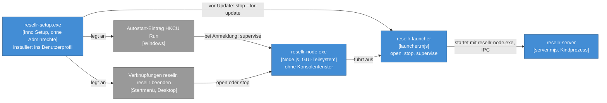

# ADR-008 – Installationspaket und Start ohne Konsolenfenster unter Windows

- **Status:** approved (Owner-Freigabe 2026-11-08 mit Technical Specification v0.5.1, Revision `d94988cb-76ee-4d24-a7bc-e9ee6d21fe8d`, [MAR-111](/MAR/issues/MAR-111#document-owner-freigabeanfrage-spec-v051)). Hauptwege (A) und (S1) im Windows-Spike bestätigt (S-1, S-2; Lauf 42475377911, Windows Server 2025, Kap. 9.2); Anmelde-Start, Sichtprüfung und Defender-Scan unter Windows 11 folgen bei der Abnahme (Kap. 6.4)
- **Kontext:** ADR-006 legt den Betrieb mit Autostart-Eintrag, Überwachung in `resellr-launcher` und Installation im Benutzerprofil ohne Adminrechte fest und überlässt Installer-Technik und Mechanismus des unsichtbaren Starts der Technical Specification (Baseline 3, 10.2). `node.exe` ist ein Konsolenprogramm; ohne Vorkehrung öffnet Windows ein Konsolenfenster, dessen Schließen resellr ungeordnet beendet. VBScript scheidet aus (abgekündigt). Smart App Control ist aus (OD-09), eine Code-Signierung ist nicht vorgesehen. Container auf dem Arbeitsplatzrechner sind ausgeschlossen (Owner-Kommentar `bdc2d18b`, Kap. 2.18).
- **Betroffene Anforderungen:** REQ-065, REQ-073, REQ-104 bis REQ-106; Baseline 10.2, 10.6, AR-13, AR-15.
- **Optionen Installer:**
  - (A) Inno Setup 6: Installation pro Benutzer (`PrivilegesRequired=lowest`), Registry-Einträge unter `HKCU`, Verknüpfungen, Skriptschritt vor dem Ersetzen der Dateien, kostenlos, im Windows-Runner verfügbar.
  - (B) NSIS: gleichwertig, aber Skriptsprache aufwendiger.
  - (C) WiX/MSI: Benutzerinstallation möglich, deutlich mehr Aufwand, MSI-Regeln für Benutzerprofile umständlich.
  - (D) MSIX: Paketidentität und Signierung nötig, Autostart nur über Paketerweiterungen; mit unsigniertem Paket praktisch nicht nutzbar.
- **Optionen unsichtbarer Start:**
  - (S1) Kopie von `node.exe` mit Teilsystem „Windows-GUI“ im PE-Kopf (`resellr-node.exe`), beim Bauen erzeugt; Launcher und Server laufen damit ohne Konsole.
  - (S2) kleiner Start-Baustein (z. B. in C oder Rust) mit GUI-Teilsystem, der `node.exe` mit `CREATE_NO_WINDOW` startet.
  - (S3) Windows-Dienst oder Aufgabenplanung: verworfen in ADR-006 (H1, H3).
- **Entscheidung (Vorschlag):** Installer **(A)**, Start **(S1)**; Rückfall **(S2)**, falls die Abnahme, die Windows-CI oder ein Virenschutz (TR-05) gegen S1 spricht. Im Spike war der Rückfall nicht nötig (P2.R nicht ausgelöst).
- **Begründung:** (A) deckt alle Anforderungen aus Baseline 10.2 und 10.6 ohne Zusatzprogramme ab. (S1) braucht keinen zusätzlichen kompilierten Code und keine weitere Toolchain in der CI; die Umstellung betrifft nur Teilsystem, Prüfsumme und Signatureintrag im Programmkopf (14 Bytes) und das Abschneiden der Signatur am Dateiende und ist automatisch prüfbar (Spike P2.1).
- **Konsequenzen:**
  - Das Umstellen macht die Authenticode-Signatur von `node.exe` ungültig; der Build entfernt sie deshalb (Kap. 2.19), `resellr-node.exe` ist also unsigniert statt ungültig signiert. Ob ein Virenschutz die Datei trotzdem beanstandet, prüft ein Defender-Scan im Spike, in der Windows-CI und bei der Abnahme (S-2, TR-05, Kap. 6.4). Der Spike-Scan unter Windows Server 2025 fand nichts (P2.4); für den Arbeitsplatzrechner bleibt „unschädlich“ bis zur Abnahme eine Annahme (FIND-219). SmartScreen prüft nur das heruntergeladene Installationspaket: eine Warnung bei der Installation und bei jedem Update (AR-13).
  - Launcher und Server haben keine Standardausgabe; alles Protokollieren läuft über Dateien (Kap. 2.19).
  - Der Build braucht einen Windows-Runner (`release.yml`, `windows.yml`); Linux-CI bleibt für alle übrigen Tests.
  - Wechsel auf (S2) ändert nur Packaging-Einheiten (CU-273, CU-274, CU-276), nicht Launcher oder Server.
- **Risiken:** TR-05, AR-13, AR-15.
- **Referenzen:** Baseline v0.3.2 Kap. 10.2, 10.6, ADR-006; Architecture Review Runde 2 H-13, H-14; Delta-Review MAR-146; Kommentar `1d050fcf` an MAR-153 (Spike-Weg); Spike-Ergebnis `spike/ERGEBNIS.md` (Branch `spike/windows-hosting`, Commit `ad17ab2`), Lauf 42475377911 auf Commit `9428f22`; Freigabe pending.

**Vorher/Nachher** (Frage: Was legt ADR-008 gegenüber ADR-006 zusätzlich fest? Nur die Packaging-Teile sind neu.)

---
Veröffentlicht aus der Technical Specification v0.5.1 (Kapitel 11), `docs/architecture/technical-specification.md`.
