# Architecture Baseline – resellr Phase 1 (Inserat-Generator), Release 0.1

## Dokument-Metadaten

| Feld | Wert |
| --- | --- |
| Projekt | resellr (Arbeitstitel), Pilotkunde notebookers.de |
| Dokumenttyp | Architecture Baseline (Prozessschritt 6a), Paperclip-Dokument `architecture-baseline` an [MAR-125](/MAR/issues/MAR-125#document-architecture-baseline) |
| Version | 0.3.3 |
| Status | **v0.3.3: approved** (Owner-Freigabe 2026-11-23, Revision `793976c6-d9b1-42d2-b075-f187a80c3f58` des Dokuments `architekturaenderung-mar-1061`, Gate [MAR-1060](/MAR/issues/MAR-1060), beide kritischen Annahmen bestätigt; Baseline-Delta der Architekturänderung MAR-1061, Basis v0.3.2). v0.3.2: approved (Owner-Freigabe 2026-11-07, Revision `2876806d-48b2-4ec3-b961-2f4d370d9b2e`, Freigabeanfrage [MAR-142](/MAR/issues/MAR-142#document-owner-freigabeanfrage), mit OD-02 Variante A, OD-09 Aus). Vorheriger Status: draft (Delta-Revision von v0.3.1 nach Architecture Review Runde 2 mit Verdikt `pass` und nach dem Cross-Check des Designs `92e018e`; über ein Delta-Review entscheidet der CEOrchestrator) |
| Autor | Software Architect (MarloNET) |
| Datum | 23.11.2026 (v0.3.3, veröffentlicht; Entwurf vom 18.11.2026; v0.3.2: 06.11.2026) |
| Vorgängerfassung | v0.3.1, Revision `a1b9ea85-c28a-49db-9fc7-768c214e743a` (Basis dieser Delta-Revision, Gegenstand von Architecture Review Runde 2, Verdikt `pass`); davor v0.3, Revision `0aca5c84-860d-47fa-bfe8-755b03dc22b1` (nicht reviewt); v0.2, Revision `8b2a682e-2cc8-44c8-973b-41d20b31bd30` (Gegenstand von Review Runde 1, Verdikt `changes_requested`); v0.1, Revision `ae51c8cc-8691-41f5-b1f9-f8ed58134604` (nie reviewt) |
| Auftrag dieser Fassung | v0.3.3: [MAR-1061](/MAR/issues/MAR-1061), Architekturänderung „Nachführen des Anzeigetitels ab S5“ (Kap. 2.4, 4.3, 14.1). v0.3.2: [MAR-141](/MAR/issues/MAR-141), Folgen des Cross-Checks gegen das Design `92e018e`, FIND-110 und FIND-111 aus Architecture Review Runde 2, dazu die Hinweise H-7 bis H-10 an denselben Stellen (Änderungsliste Ä-28 bis Ä-36). v0.3.1: [MAR-139](/MAR/issues/MAR-139), Delta-Prüfung gegen Requirements v0.3.3 (Rev. `ce76d962`), nur das durch v0.3.3 Nötige (Änderungsliste Ä-22 bis Ä-27). v0.3: [MAR-136](/MAR/issues/MAR-136), Findings FIND-101 bis FIND-109 aus dem Architecture Review Runde 1 einarbeiten; Ausrichtung auf Requirements-Kandidat v0.3.2 |
| Bindende Requirements | Requirements Specification v0.3, Dokument `requirements` an [MAR-114](/MAR/issues/MAR-114#document-requirements), **Revision `170ca77f-9e3e-4ffc-b0ae-d8ffa0f0c9e4`** |
| Freigabenachweis Requirements | Interaktion `4b838947-abf0-4c1b-b4f7-8de52c248386` („Freigabe Requirements v0.3 und UI/UX-Klassifikation“) an [MAR-111](/MAR/issues/MAR-111), Ergebnis `accepted` am 06.11.2026 18:09 UTC durch den Owner (Board). Gebunden an Revision `170ca77f`. Mit dieser Freigabe gelten die Standardannahmen zu OP-17, OP-18, OP-29 und OP-30 (REQ-090 bleibt Must). |
| **Ausrichtung dieser Fassung** | **Kandidat v0.3.3, Revision `ce76d962-cc37-46e1-9086-b2be8e08e752`** (enthält v0.3.1 und v0.3.2; Änderungsliste [v033-aenderungsliste](/MAR/issues/MAR-137#document-v033-aenderungsliste) an MAR-137, Requirements Kap. 15.12). Delta-Review zu v0.3.3: [requirements-review-v033-r2](/MAR/issues/MAR-138#document-requirements-review-v033-r2) an MAR-138, Revision `13dde053`, Verdikt `pass` (nachgeführt in v0.3.2, Hinweis H-9). v0.3.1 und v0.3.2: [requirements-review-v032-r1](/MAR/issues/MAR-133#document-requirements-review-v032-r1) an MAR-133, Revision `b119fea9`, Verdikt `pass` (FIND-030 bis FIND-034 minor, in v0.3.3 korrigiert). **Owner-Freigabe pending.** Die Baseline folgt dem Kandidaten auf Anweisung des CEOrchestrators (MAR-136, MAR-139). Der Kandidat wird damit **nicht** als bindend behandelt: Die Baseline ist erst widerspruchsfrei, wenn der Owner v0.3.3 freigibt. Bedingung und Rückfall: Kap. 13.4 (KF-01). v0.3 dieser Baseline war auf v0.3.2 (Rev. `e4b94794`) ausgerichtet. |
| Requirements-Delta v0.3.2 → v0.3.3 | in dieser Fassung geprüft ([MAR-139](/MAR/issues/MAR-139)); Ergebnis: Änderungsliste Ä-22 bis Ä-27 am Dokumentanfang |
| Konflikt mit bindenden Requirements | **KF-01** (REQ-066 v0.3 gegen Owner-Entscheidung E-7): **aufgelöst durch v0.3.2** (REQ-066 *Withdrawn*, neu REQ-104 bis REQ-106; in v0.3.3 inhaltlich unverändert), wirksam mit der Owner-Freigabe von v0.3.3 (Kap. 13.4) |
| UI/UX-Klassifikation | **Material**, vom Owner mit der Freigabe von v0.3 bestätigt; v0.3.2 und v0.3.3 ändern die Klasse nach Einschätzung des BA nicht |
| UI/UX-Design (Abstimmung, kein Input der Baseline) | Branch `design/MAR-126`, Commit `92e018e`, `docs/ux/uiux-design.md` v0.3 (draft); Draft-PR [MarloNET/resellr#1](https://github.com/MarloNET/resellr/pull/1); Produkt-Review bestanden ([MAR-128](/MAR/issues/MAR-128)). Stellungnahme zur Vorabprüfung in Kap. 6.2, Punkte an den Designer in Kap. 6.3. **Formaler Cross-Check des Architekten** gegen `92e018e` in [MAR-141](/MAR/issues/MAR-141): Ergebnis in Kap. 6.4; Folgen für die Baseline sind Ä-28 bis Ä-33. Der Cross-Check des Designers gegen die Baseline läuft parallel. |
| Weitere Quellen | Product Brief v1.0 (`docs/product/product-brief.md`, Repository `MarloNET/resellr`, Commit `45d5ef6`); Owner-Entscheidungen E-1 bis E-6 (Dokument `v03-aenderungsanalyse` an [MAR-121](/MAR/issues/MAR-121#document-v03-aenderungsanalyse), Revision `5f87d5e9`); **Owner-Entscheidung E-7** (Fragekarte `15ba6e78-50f2-45ae-bf5f-94ec9af39256` „Sicherung in Phase 1“ an [MAR-125](/MAR/issues/MAR-125), beantwortet am 06.11.2026 18:58 UTC mit „(b) Nur Hinweis, ich sichere selbst“, dazu Kommentar [317f1409](/MAR/issues/MAR-125#comment-317f1409-e70e-4acd-a9f7-8201121f5703) des Owners; in dieser Baseline OD-03 (b)); **Ableitung aus E-7** (nicht Owner-Wortlaut): Kommentar `bb98a214` des Software Architect an MAR-125 nach der Antwort (ein Datenordner, Aktion „resellr beenden“), in den Requirements v0.3.3 als REQ-105 und REQ-106 zur ausdrücklichen Owner-Bestätigung gekennzeichnet (OP-17); Owner-Antworten vom 06.11.2026 an MAR-125 zu OD-03 und OD-04; Requirements Review [requirements-review-v03-r1](/MAR/issues/MAR-124#document-requirements-review-v03-r1), Revision `6adbad6c`, Verdikt `pass` mit FIND-025 bis FIND-029 (minor). Product Research v0.3 nur als Hintergrund. |
| ADRs | ADR-001 bis ADR-007 in Kapitel 15, alle mit Status **proposed**; ADR-006 in v0.3 um den Hosting-Mechanismus unter Windows ergänzt, in v0.3.1 um die Trennung von Owner-Wortlaut und Ableitung bei E-7 und um OP-32/A-37 (Kopie vor Updates), in v0.3.2 um den Lebenszyklus der Überwachung (FIND-110); ADR-001 und ADR-002 in v0.3.2 an Kap. 8.1 und ADR-006 angeglichen (FIND-111) |
| Architecture Review | Runde 1: [architecture-review-v02-r1](/MAR/issues/MAR-134#document-architecture-review-v02-r1), Revision `1b16f458-cfa2-4b6d-beb5-3cdc6e263ee0`, auf v0.2 (Revision `8b2a682e`), Verdikt `changes_requested` (FIND-101 major, FIND-102 bis FIND-109 minor). Runde 2: [architecture-review-v03-r2](/MAR/issues/MAR-140#document-architecture-review-v03-r2), Revision `d915d35f-599f-4a3f-b6ea-2fce78ee0404`, auf v0.3.1 (Revision `a1b9ea85`), Verdikt **`pass`** (FIND-110, FIND-111 minor; Hinweise H-5 bis H-11). FIND-110 und FIND-111 sind in v0.3.2 behoben (Kap. 14.5). Ob die geänderten Teile ein Delta-Review brauchen, entscheidet der CEOrchestrator. |
| Human Approval | pending. Wegen Klassifikation „Material“ gemeinsam mit dem UI/UX-Design nach Cross-Check. Setzt die Owner-Freigabe von Requirements v0.3.3 voraus, einschließlich der Bestätigung von REQ-105 und REQ-106 nach OP-17 (Kap. 13.4). **Für die Freigabeanfrage:** Die Änderungen aus dem Cross-Check sind Ä-28 bis Ä-33 (Änderungsliste unten), die offenen Punkte an das Design stehen in Kap. 6.3 und 6.4. |
| Mermaid-Prüfung | 12/12 Diagramme gültig (`validate-mermaid.mjs`, mermaid 11), Kapitel 14.3; in v0.3.3 ist genau ein Diagramm geändert (Komponenten von `resellr-server`, Kap. 2.4); in v0.3.2 war es Ablauf 4b (FIND-110) |

**Lesehilfe.** Alle Entscheidungen in diesem Dokument sind **Vorschläge des Software Architect (proposed)**. Verbindlich werden sie erst mit der Owner-Freigabe der Baseline. Ausgenommen sind die Punkte, die der Owner bereits beantwortet hat (OD-03 = E-7, OD-04); sie sind als „vom Owner entschieden“ gekennzeichnet und werden mit der Baseline-Freigabe formal bestätigt. Bei OD-03 gilt das nur für den Owner-Wortlaut von E-7; der eine Datenordner (REQ-106) und die Aktion „resellr beenden“ in resellr (REQ-105) sind daraus abgeleitet und stehen zur Owner-Bestätigung (Kap. 13.3, 13.4). Offene Owner-Entscheidungen heißen **OD-01** usw. und sind in Kapitel 13.3 gebündelt, Architekturrisiken heißen **AR-01** usw., Konflikte mit bindenden Requirements **KF-01** usw. (Kap. 13.4). Die Bezeichner RI-xx, A-xx, OP-xx, E-x, RB-xx, LP-x, REQ-xxx und AC-REQ-xxx stammen aus den Requirements, C-x, V-x, P-xx, FLOW-xx und UI-xxx aus dem UI/UX-Design, FIND-1xx aus dem Architecture Review, H-x aus dessen Hinweisen, K-x aus dem Cross-Check des Architekten (Kap. 6.4). Komponenten-, Entitäts- und Technologienamen sind englisch, alle Beschreibungen deutsch.

### Änderungen gegenüber v0.3.1 (Revision `a1b9ea85`) – Cross-Check und Architecture Review Runde 2

Basis ist v0.3.1, Revision `a1b9ea85-c28a-49db-9fc7-768c214e743a`. **Ä-28 bis Ä-33 sind Folgen des Cross-Checks** gegen das Design `92e018e` ([MAR-141](/MAR/issues/MAR-141)) und gehören in die Owner-Freigabeanfrage. Sie präzisieren technische Randbedingungen für die Oberfläche und ergänzen eine Konfliktprüfung; Komponenten, Technologien und Owner-Entscheidungen ändern sich nicht. Ä-34 bis Ä-36 erledigen die Findings und Hinweise aus Architecture Review Runde 2. Keine OD-xx ist entschieden oder geändert.

| Nr. | Änderung | Anlass | Kapitel |
| --- | --- | --- | --- |
| Ä-28 | **Nutzbare Fensterfläche bei 1366 × 768:** Die Bildschirmauflösung von REQ-077 ist nicht die Fläche der Seite. In einem maximierten Chrome-Fenster mit Tableiste und Windows-Taskleiste bleiben etwa 1350 × 630 px (Schätzung, Messung im Windows-Spike). Das Design muss bei dieser Fläche ohne Funktionsverlust bedienbar sein; der E2E-Test für REQ-077 nutzt diesen Viewport statt 1366 × 768. | Cross-Check (DESIGN.md „Mindestbreite 1366 px“ für den Inhaltsbereich, Mockups mit voller Bildschirmfläche) | 6.1, 10.2 (Spike-Punkt 6), 11.2, 12.2 |
| Ä-29 | **Schreibende Aktionen ohne feste Zeitgrenze im Browser:** `web-ui` bricht eine schreibende Anfrage nicht nach einer festen Zeit als Fehler ab, weil der Server sie dann trotzdem speichern kann. Sie wartet auf die Antwort; nur ein Verbindungsabbruch ist ein Fehler, und dann ist der Ausgang unbekannt („bitte neu laden“). Für lesende Anfragen bleibt eine Zeitgrenze zulässig. | Cross-Check (Regel `.loading` „bis 5 s, danach Fehler“ in `uiux-design.md` Kap. 5; Speichern mit Neuberechnung) | 6.1 |
| Ä-30 | **Kopier-Assistent:** Die Kennzeichnungen „übernommen“ (REQ-049) sind Zustand des Browserfensters, kein Serverzustand; sie hängen am Inhalts-Hash des freigegebenen Stands und gelten deshalb nach einer neuen Freigabe automatisch nicht mehr. Ein veralteter Stand (neue Freigabe oder geänderte Bestandsangaben in einem anderen Fenster) wird beim nächsten Abruf erkannt, z. B. bei Rückkehr in das Fenster, nicht in Echtzeit. | Cross-Check (UI-019) | 6.1 |
| Ä-31 | **Konfliktprüfung auch für „Abgleich bestätigen“ und schreibende Dialoge:** Der Abgleich trägt die Bestandsangaben, die der Nutzer gesehen hat; weichen sie inzwischen ab, lehnt der Server mit „Konflikt“ ab. So wird kein Abgleich für einen Bestand bestätigt, den der Nutzer nicht gesehen hat. Das Muster P-05 gilt damit auch für Dialoge. | Cross-Check (UI-021, P-05) | 6.1, 9.3 |
| Ä-32 | **Datenblatt und Einstellungen:** Die Warnung „passt nicht auf eine Seite“ vor dem Öffnen setzt voraus, dass der Server das PDF schon beim Aufruf von UI-023 erzeugt; „Datenblatt öffnen“ öffnet dann dieses PDF direkt aus dem Klick (sonst greift der Popup-Blocker). Vorschauen in Einstellungen (UI-029, UI-037) bildet `content-engine` aus den noch nicht gespeicherten Werten, ohne zu speichern. Eine Anzahl „betroffen“ **vor** dem Speichern ist nur als Anzahl der Kanal-Inhalte im Geltungsbereich verfügbar; die Anzahlen je Gruppe nach REQ-053 entstehen erst beim Speichern (Ablauf 3). | Cross-Check (UI-023, UI-029, UI-037, UI-043) | 6.1 |
| Ä-33 | **Cross-Check dokumentiert:** Ergebnis je Prüfpunkt und Konflikte K-1 bis K-5 für den Designer in neuem Kap. 6.4; X-1 um das schmale Layout von UI-019 ergänzt; neuer Punkt X-8 (Warnungen des Betriebsstatus ohne Ort im Design); C-1 und C-5 in Kap. 6.2 mit dem Ergebnis nachgeführt | Cross-Check | 6.2, 6.3, 6.4, 13.3 |
| Ä-34 | **Lebenszyklus der Überwachung festgelegt:** genau eine Überwachung je Windows-Sitzung (Sperre); nach der Neustartgrenze endet die Überwachung mit dem Ereignis „Neustart aufgegeben“, das die Auswertung wie „Start abgebrochen“ als „nicht verfügbar“ zählt; eigener Exit-Code „läuft bereits“ bei belegter Einzelinstanz-Sperre, ohne Neustart und nicht als Absturz gezählt; `resellr-server` endet mit seiner Überwachung (Kopplung), damit kein unüberwachter Server zurückbleibt; Ablauf 4b um den Fall „Überwachung läuft, Server noch nicht bereit“ ergänzt; Prüfpunkt 3 des Windows-Spikes erweitert | FIND-110 | 2.3, 2.5 (Ablauf 4b), 7.3, 9.6, 10.2, 10.7, 12.2, ADR-006 |
| Ä-35 | **ADR-002 und ADR-001 angeglichen:** ADR-002 „Umsetzung“: Bindeadresse fest im Programm, kein Konfigurationswert (statt „nicht einstellbar; Startabbruch bei anderer Adresse“). ADR-001: „Hintergrundprozess `resellr-server` unter der Überwachung von `resellr-launcher` (ADR-006, H2)“ statt „Hintergrunddienst“ | FIND-111 | ADR-001, ADR-002 |
| Ä-36 | **Hinweise aus Runde 2 an denselben Stellen:** genau eine Quelle für das Ereignis „vom Nutzer beendet“ (`ops`, H-7); Einzelinstanz-Sperre als Dateisperre des Betriebssystems, damit eine mitkopierte Sperrdatei den Start nicht blockiert (H-8); Delta-Review von v0.3.3 in den Metadaten (H-9); Rückfallweg für Spike-Punkt 4 (H-10). H-5, H-6 (Freigabeanfrage) und H-11 (Technical Specification) bleiben beim CEOrchestrator bzw. in der Technical Specification. | Review Runde 2, Kap. 9 | Metadaten, 7.3, 9.6, 10.2 |

### Änderungen gegenüber v0.3 (Revision `0aca5c84`) – Delta zu Requirements v0.3.3

Basis ist v0.3, Revision `0aca5c84-860d-47fa-bfe8-755b03dc22b1`. Geändert ist nur, was Requirements v0.3.3 (Rev. `ce76d962`, Änderungen FIND-030 bis FIND-034 nach Requirements Kap. 15.12) nötig macht. Kein Diagramm, keine Komponente, keine Technologieentscheidung und keine Owner-Entscheidung ist geändert. Die Finding-IDs FIND-030 bis FIND-034 stammen aus dem Requirements Review an MAR-133, nicht aus dem Architecture Review.

| Nr. | Änderung | Anlass | Kapitel |
| --- | --- | --- | --- |
| Ä-22 | **Verweisstände auf Kandidat v0.3.3** (Rev. `ce76d962`): Ausrichtung, KF-01 wirksam mit der Owner-Freigabe von v0.3.3, Bedingung für die Baseline-Freigabe, Referenzen der ADRs | Requirements v0.3.3, Auftrag MAR-139 | Metadaten, 1.4, 10.4, 13.3, 13.4, 14.1, 14.2, ADR-002, ADR-006 |
| Ä-23 | **Owner-Wortlaut und Ableitung bei E-7 getrennt:** Entschieden hat der Owner keine Sicherungsfunktion, freiwillige Sicherung nach OneDrive, immer einen klaren Hinweis, nur Hinweis mit Anleitung, Kopie nur bei beendetem resellr sicher brauchbar. Der eine Datenordner (REQ-106) und die Aktion „resellr beenden“ in resellr (REQ-105) sind daraus abgeleitet (Kommentar `bb98a214` des Software Architect) und stehen zur Owner-Bestätigung (OP-17, Standardannahme: gelten wie beschrieben). Folgen eines Widerspruchs in Kap. 13.4. Die technischen Entscheidungen der Baseline ändern sich nicht. | FIND-030 (Requirements) | Metadaten, Lesehilfe, 1.2, 1.4, 13.3 (OD-03), 13.4, 14.1, ADR-006 |
| Ä-24 | **REQ-065: Zeiten nach einem Beenden zählen weder als Ausfall noch als Geschäftszeit** [Vorschlag BA, OP-12]. Die Auswertung nach Kap. 7.3 nimmt den Zeitanteil „vom Nutzer beendet“ bis zum nächsten Startversuch aus Zähler und Nenner heraus. Die Frage dazu ist nicht mehr Teil von OD-05, sondern wird mit der Requirements-Freigabe bestätigt. Neuer Hinweis an den BA: ob das Beenden über die Startmenü-Verknüpfung mitgemeint ist | FIND-033 (Requirements) | 1.4, 7.3, 11.2, 13.3 (OD-05, OD-08, weitere Punkte), 14.1 |
| Ä-25 | **Nachweis REQ-106 (AC-REQ-106-01) für beide Betriebsmodelle:** bei OD-02 A Beenden über REQ-105, bei B durch den Betreiber am PC über die Startmenü-Verknüpfung (A-36) | FIND-034 (Requirements) | 11.2, 13.3.1, 14.1, ADR-002 |
| Ä-26 | **Kopie vor Updates und Requirements Kap. 14 (OP-32, A-37):** Stellungnahme des Architekten als Mitentscheider mit dem Product Owner: A-37 trifft zu, die Kopie ist Teil des Update-Vorgangs und keine Sicherung; Empfehlung, sie zu behalten; Folgen der anderen Entscheidung. A-37 in der Tabelle der Startannahmen. | FIND-032 (Requirements) | 1.4, 10.6, 13.3, 14.1, ADR-006 |
| Ä-27 | **Geprüft, ohne Änderung:** leere Merkmalsfelder erscheinen im Kopier-Assistenten nicht und zählen im Übernahmefortschritt nicht mit (REQ-037, AC-REQ-037-01, REQ-047, REQ-049; in v0.3.3 als Änderung der mit v0.3 freigegebenen Regel gekennzeichnet). Die Baseline legt die Feldliste des Kopier-Assistenten nicht fest (D6); `content-engine` gibt leere Merkmale im Kanal-Inhalt weiter als leeres Feld aus, das Weglassen in der Feldliste und im Fortschritt ist Verhalten von `listing-content` und `web-ui` in der Technical Specification. Ebenfalls ohne Wirkung: Glossar „Sicherung“, RB-21 und Kap. 6.15 der Requirements außer der Kennzeichnung nach Ä-23. | FIND-031 (Requirements) | 14.1 (Vermerk bei REQ-047) |

### Änderungen gegenüber v0.2 (Revision `8b2a682e`)

| Nr. | Änderung | Anlass | Kapitel |
| --- | --- | --- | --- |
| Ä-12 | **Ausrichtung auf Requirements-Kandidat v0.3.2:** E-7 mit Fragekarte als Entscheidungsnachweis; REQ-066 als *Withdrawn* geführt; A-07 als aufgehoben; KF-01 als aufgelöst mit Bedingung (Owner-Freigabe v0.3.2) und Rückfallweg | FIND-101 | Metadaten, 1.2, 1.4, 10.3, 10.4, 11.2, 13.3 (OD-08), 13.4, 14.1, ADR-002, ADR-004, ADR-006 |
| Ä-13 | **Traceability REQ-104 bis REQ-106** und Nachweise AC-REQ-104-01 bis -06, AC-REQ-105-01 bis -05, AC-REQ-106-01 | FIND-102 | 11.1, 11.2, 14.1 |
| Ä-14 | **Hinweis „Sicherung einrichten“ immer sichtbar:** Option „ausblendbar oder wiederkehrend“ und der gespeicherte Wert „ausgeblendet am“ gestrichen; das Design bestimmt nur Ort und Gestaltung | FIND-103 | 4.4, 6.1, 10.2 |
| Ä-15 | **Fehlerpfad des geordneten Beendens:** „Beenden bestätigt“ erst nach Checkpoint, Schließen der Datenbank und Schreiben der Ende-Markierung; bei Fehler Meldung nach REQ-073, Server läuft weiter; neue schreibende Aufträge werden während des Beendens abgewiesen; nicht bestätigte Aktionen gelten als nicht gespeichert. Ablauf 4 aufgeteilt in 4a (Beenden, mit Fehlerzweig) und 4b (Starten) | FIND-104, FIND-107 | 2.5, 9.6 |
| Ä-16 | **Startprüfung realistisch beschrieben und ergänzt:** Was sie erkennt und was nicht; Ende-Markierung „geordnet beendet“, Erkennung eines ersetzten Datenordners, dann vollständige Integritätsprüfung und Prüfung der Fotodateien; Schutzgrenze beim Löschen verwaister Dateien | FIND-105 | 9.4, 9.6, 10.4, 13.1 (AR-14) |
| Ä-17 | **Hosting unter Windows ohne Aufgabenplanung:** Autostart über den Autostart-Eintrag des Benutzers (`HKCU\…\Run`), `resellr-launcher` überwacht `resellr-server` unsichtbar und startet ihn nur nach Absturz neu; `health-probe` ist kein eigener Container mehr, sondern eine Funktion der Überwachung (nur bei OD-05 a). Drei Arten des Endes (vom Nutzer beendet, abgestürzt, ohne geordnetes Beenden). Früher Windows-Spike vor Abschluss der Technical Specification, Rückfallwege; neues Risiko AR-15; Smart App Control als Owner-Information und bedingte Entscheidung OD-09 | FIND-106 | 2.3, 2.5, 5.1, 7.3, 9.6, 10.1, 10.2, 10.7, 12, 13.1, 13.3, ADR-006 |
| Ä-18 | **Rückmeldeweg von `resellr-launcher`:** mitgelieferte statische Seiten, die der Launcher in Chrome öffnet („resellr startet“, „Start abgebrochen“ mit Referenznummer, Ergebnis des Beendens über das Startmenü); Rückkanal vom Server über Exit-Code und Startergebnis-Datei | FIND-107 | 2.3, 2.5, 6.1, 9.6 |
| Ä-19 | **OP-31 in OD-02 aufgenommen:** Folgen beider Varianten für REQ-104/REQ-105, Einordnung der Startmenü-Verknüpfung „resellr beenden“ als Betreiberwerkzeug | FIND-108 | 6.1, 8.1, 13.3, 13.3.1 |
| Ä-20 | **ADR-Kontext nachgeführt:** ADR-001 und ADR-003 auf Windows 11 und Chrome (OD-04), ADR-006 mit E-7 und REQ-104 bis REQ-106 | FIND-109 | ADR-001, ADR-003, ADR-006 |
| Ä-21 | **Redaktionell und Hinweise des Reviews:** Bindeadresse fest im Code statt „nicht einstellbar, Startabbruch bei anderer Adresse“ (Review Kap. 4.5); `resellr-launcher` öffnet genau die Adresse `http://127.0.0.1:<Port>` (H-4); CSP gegen Laufzeit-Styles der Komponentenbibliothek prüfen (H-2); Erreichbarkeit des Datenordners nach dem Beenden als Cross-Check-Punkt (H-1); `health-probe` entfällt bei OD-05 ≠ (a) (H-3) | Review R1 Kap. 4.5, 6 | 1.5, 6.1, 6.3, 7.3, 8.1, 8.3 |

### Änderungen gegenüber v0.1 (Revision `ae51c8cc`)

| Nr. | Änderung | Anlass | Kapitel |
| --- | --- | --- | --- |
| Ä-01 | **Betriebssystem und Browser festgelegt:** Windows 11 (x64) und Google Chrome in aktueller Version. Firefox, macOS und Linux entfallen als Test- und Paketierungsziel. Der Stack bleibt plattformneutral. | OD-04, Owner-Antwort 06.11.2026 | 1.4, 3, 6, 10.1, 10.2, 11, 12.3, 13, ADR-001, ADR-003 |
| Ä-02 | **Keine Sicherungsfunktion in Release 0.1.** Die automatische tägliche Sicherung mit 30 Tagen Aufbewahrung, der Wiederherstellungs-Prüfbefehl und das Sicherungsziel als externes System entfallen. Stattdessen: **ein Datenordner** (Datenbank, Fotos, Logo, Konfiguration), Anleitung zur Handsicherung, Aktion **„resellr beenden“**, Betriebsstatus mit Pfad des Datenordners, dauerhafter Hinweis „Sicherung einrichten“ (Gestaltung durch das UI/UX-Design). Die automatische lokale Kopie vor Updates bleibt. | OD-03 (b), Owner-Antwort 06.11.2026 | 2, 5, 7.2, 8, 9.6, 10, 11, 13, ADR-006 |
| Ä-03 | **Neuer Container `resellr-launcher`:** startet `resellr-server`, falls er nicht läuft, und öffnet resellr in Chrome; beendet ihn auf Wunsch. Grund: Nach „resellr beenden“ muss resellr ohne Abmelden vom PC wieder startbar sein. | Folge aus Ä-02 | 2.3, 10.1, 10.2 |
| Ä-04 | **Neuer Ablauf 4 „resellr beenden und Datenordner sichern“** als Sequenzdiagramm | Folge aus Ä-02 | 2.5 |
| Ä-05 | **Konflikt KF-01 mit REQ-066** als offener Punkt mit Verweis auf MAR-131 | Auftrag MAR-130 | Metadaten, 13.4 |
| Ä-06 | **OD-02 neu dargestellt** mit den Folgen beider Fälle (mit und ohne Netzbetrieb) für Screens, Requirements und Aufwand, weil das UI/UX-Design UI-001 und UI-040 beibehält (C-1). Neuer Befund: Netzbetrieb verlangt HTTPS schon wegen der Zwischenablage. Empfehlung unverändert, Entscheidung beim Owner. | Auftrag MAR-130, Design C-1 | 6, 13.3, ADR-002 |
| Ä-07 | **Stellungnahme zur Vorabprüfung des Designs** (C-1 bis C-10) und neue UI-relevante Randbedingungen: Betriebsende und Neustart, „resellr nicht erreichbar“, Sicherungshinweis, schmale Ansicht ab 480 px | Auftrag MAR-130 | 6.1, 6.2 |
| Ä-08 | **Verfügbarkeitsmessung (OD-05) an v0.3.1 angeglichen:** `health-probe` bleibt; sie unterscheidet „vom Owner beendet“ von Ausfällen. v0.3.1 schlägt stattdessen ein Störungsprotokoll des Nutzers vor; die Baseline stellt beide Wege gegenüber. | v0.3.1 REQ-065, Folge aus Ä-02 | 7.3, 13.3 |
| Ä-09 | **Redaktionelle Nachführung auf v0.3.1:** REQ-103 in der Traceability, AC-REQ-001-07 als Test der Nicht-Erreichbarkeit, FIND-026 und FIND-027 als in v0.3.1 adressiert vermerkt | Lesestand v0.3.1 | 1.5, 11.2, 14.1 |
| Ä-10 | **OD-06 entfällt** (keine Sicherungen in resellr). **OD-07 entfällt in dieser Form**, der neue Hinweis ist Gestaltungsfrage des UI/UX-Designs (über den Product Owner). | Folge aus Ä-02 | 10.5, 13.3 |
| Ä-11 | Risiken angepasst: AR-01, AR-02 neu bewertet, AR-08 erledigt, AR-05 und AR-10 auf Windows/Chrome eingeengt, neu AR-13 (unsigniertes Installationspaket) und AR-14 (Kopie bei laufendem resellr) | Folge aus Ä-01, Ä-02 | 13.1 |

---

## Freigabe-Briefing v0.3.3 (Architekturänderung MAR-1061)

Dieses Briefing gilt für beide Teile dieser Änderung (Baseline-Delta v0.3.3 und Specification-Nachtrag v0.5.4). Es nennt nur, was gegenüber der von dir freigegebenen Baseline v0.3.2 und Specification v0.5.3 neu ist.

### Kurzfassung

Jedes Modell-Inserat hat einen Anzeigetitel, den resellr in der Inserat-Übersicht, beim Zuordnen, in der Gerätesuche und auf der Seite des Modell-Inserats zeigt. Er soll der ungekürzte Titel nach dem Titelmuster der Geräteart sein (REQ-052). Bis zur Kanal-Engine (Bauschritt S5) steht dort nur die Modellbezeichnung. Diese Änderung legt fest, wie resellr den Titel ab S5 bildet und bei jeder Änderung sofort nachführt: beim Speichern von Modellvorlage, Inseratswerten, Herstellername, Merkmalen, Listenwerten oder Titelmuster. Dazu bildet der Baustein für die Kanal-Inhalte den Titel mit, und der Bestand speichert ihn über eine eigene, eng begrenzte Schreibfunktion. Beim ersten Start mit S5 bildet resellr die Titel aller bis dahin angelegten Modell-Inserate einmal neu. Es gibt keine Datenbankänderung, keine Änderung an der Oberfläche und keine neue Architekturentscheidung mit eigenem ADR.

### So haben wir dich verstanden

| Deine Vorgabe (Quelle) | Unsere Auslegung | Beispiel |
| --- | --- | --- |
| Übersicht zeigt je Modell-Inserat „den ungekürzten Titel nach dem Titelmuster der Geräteart“ (REQ-052) | Der Anzeigetitel folgt **immer** dem Titelmuster der Geräteart, auch wenn ein Kanal ein eigenes Muster hat, und wird nie gekürzt. Er nutzt dieselben Regeln wie der Kanal-Titel: leere Werte lassen den ganzen Bestandteil weg. | MI-A heißt „Apple MacBook Pro 13 (A1989), intel Core i5-8279U, 16GB RAM, 512GB Space Gray“ (77 Zeichen), obwohl der Kleinanzeigen-Titel auf 65 Zeichen gekürzt ist. Fehlt die Typbezeichnung: „Apple MacBook Pro 13, intel Core i5-8279U, 16GB RAM, 512GB Space Gray“ ohne „()“. (Teil B, Kap. 2.8.6) |
| Änderungen an Modelldaten und Einstellungen wirken sofort auf die Inhalte (REQ-034, REQ-053, Requirements Kap. 6.0) | Der Anzeigetitel ändert sich in **derselben** Speicherung wie die Kanal-Inhalte. Es gibt keinen Zeitpunkt, an dem Kanal-Inhalt und Anzeigetitel verschiedene Daten zeigen. | Du änderst bei MV-A die Farbe von „Space Gray“ auf „Silber“. Direkt nach dem Speichern zeigt die Übersicht „… 512GB Silber“, und der Shop-Entwurf hat denselben neuen Titel. (Teil B, Kap. 2.8.6) |

### Kritische Annahmen – bitte einzeln bestätigen

1. **Annahme:** Wenn resellr einen Anzeigetitel wegen einer anderen Änderung nachführt, ist das **keine Änderung des Modell-Inserats**. Seine Versionsnummer bleibt gleich, der neue Titel allein lässt es in der Übersicht nicht nach oben rücken (Sortierung „zuletzt geändert“), und im Änderungsprotokoll steht nur die auslösende Änderung, nicht 300 Titeländerungen.
   *Beispiel:* Du benennst den Hersteller „Apple“ in „Apple Inc.“ um. 300 Modell-Inserate heißen danach „Apple Inc. MacBook …“. Hast du in einem zweiten Fenster gerade die Inseratswerte von MI-A geöffnet, speicherst du sie ohne „Neu laden“. Das Protokoll zeigt einen Eintrag „Hersteller geändert“. In der Übersicht bleibt die Reihenfolge gleich: Weder der neue Anzeigetitel noch die automatisch neu gebildeten Kanal-Inhalte zählen als Änderung durch dich (Regel des Product Owners, MAR-1073). Nach oben rückt ein Modell-Inserat erst, wenn du an ihm selbst etwas tust, z. B. Inseratswerte speicherst oder einen Kanal-Inhalt freigibst. Die technische Umsetzung dieser Regel folgt in einem eigenen Nachtrag (siehe „Bewusst nicht enthalten“).
   **Wenn falsch:** Soll jede Titeländerung als Änderung des Modell-Inserats zählen, würde jede Einstellungsänderung offene Formulare mit „Neu laden“ unterbrechen und das Protokoll mit Einträgen füllen. Vor dem Bau ist das eine kleine Änderung an einer Stelle, danach ein Update. (Teil B, Kap. 2.8.6 „Schreiben“, RQ-24)
2. **Annahme:** Beim **ersten Start mit S5** bildet resellr die Anzeigetitel aller vorher angelegten Modell-Inserate einmal neu. Das geschieht im selben Startschritt, der auch die fehlenden Kanal-Inhalte anlegt. Der Start dauert dadurch etwas länger. **Eine automatische Kopie vor diesem Schritt gibt es erst ab Bauschritt S10** (dort kommt die Kopie vor Updates). Wir halten das für vertretbar: Der Schritt schreibt nur abgeleitete Werte (Kanal-Inhalte und Anzeigetitel), nichts, was du erfasst hast; er läuft in einer einzigen Speicherung und nimmt bei einem Fehler alles zurück, dann startet resellr nicht und der Datenstand von S4 bleibt unverändert; mit einer neuen Programmversion lässt er sich wiederholen. Die Abnahme startet ohnehin mit frischen Beispieldaten (`npm run demo`). Wer S4 mit eigenen, dauerhaften Daten betrieben hat, kopiert den Datenordner (`%LOCALAPPDATA%\resellr\Daten` bzw. den Ordner aus `RESELLR_DATA_DIR`) vor dem ersten Start mit S5 selbst. Den Hinweis dazu bekommst du in der Abnahmeanfrage von S5 (CEOrchestrator) und, falls du vor Release 0.1 ein Paket aus einem manuellen Build (`workflow_dispatch`) bekommst, in dessen Begleittext; ein eigenes Release je Bauschritt gibt es nicht. Das erste Release v0.1.0 enthält die automatische Kopie schon (CU-248); Installationen aus GitHub Releases sind nicht betroffen.
   *Beispiel:* Du hast S4 mit einem eigenen Datenordner betrieben und dort 40 Modell-Inserate angelegt. Bis zum Update heißt MI-A in der Übersicht „MacBook Pro 13“. Nach dem ersten Start mit S5 heißt es „Apple MacBook Pro 13 (A1989), intel Core i5-8279U, 16GB RAM, 512GB Space Gray“. Vorher hast du den Datenordner nach dem Hinweis in der Abnahmeanfrage von S5 kopiert; resellr selbst hat keine Kopie angelegt.
   **Wenn falsch:** Ohne Neubildung blieben alte Titel stehen, bis jemand das Modell-Inserat oder seine Einstellungen ändert. Eine Korrektur nach dem Update wäre ein weiteres Update mit erneuter Neubildung. Willst du schon vor S10 eine automatische Kopie, müsste die Kopie vor Updates (CU-248) aus S10 nach S5 vorgezogen werden; das ist eine Änderung der Bauschritte, keine dieser Architekturänderung. (Teil B, Kap. 2.8.6 „Erster Start mit S5“)

### Weitere Annahmen

- **Geräteart ohne Titelmuster:** Hat eine Geräteart noch kein eigenes Titelmuster, ist der Anzeigetitel die Modellbezeichnung, wie bis S5. *Beispiel:* Du legst die Geräteart „Monitor“ an und noch kein Titelmuster. Das Modell-Inserat von „Dell P2422H“ heißt „P2422H“, bis du ein Muster speicherst; dann sofort „Dell P2422H …“. (RQ-25)
- **Antwort nach dem Speichern:** Nach „Modell-Inserat anlegen“ und „Inseratswerte speichern“ zeigt resellr schon den neuen Titel, ohne Neuladen. *Beispiel:* Du änderst bei MI-A RAM von 16 auf 8 GB; der Kopf von UI-014 zeigt sofort „… 8GB RAM …“.
- **Zahlen nach dem Speichern:** Die drei Zahlen nach REQ-053 („aktualisiert“, „zur erneuten Freigabe“, „manuell angepasst“) zählen weiter nur Kanal-Inhalte, keine Anzeigetitel. *Beispiel:* Umbenennen des Textbausteins „Abholung“ ändert keinen Titel und zeigt dieselben Zahlen wie bisher.
- **Fehler:** Scheitert das Bilden eines Titels, wird die ganze Speicherung zurückgenommen, wie bei den Kanal-Inhalten. *Beispiel:* Ein technischer Fehler beim Umbenennen des Herstellers: nichts ist gespeichert, du siehst die Fehlermeldung mit Referenznummer.

### Entscheidungen der Agenten

| Entscheidung | Verworfene Alternative | Warum | Umkehrbar |
| --- | --- | --- | --- |
| Der Baustein für Kanal-Inhalte (`listing-content`) bildet den Anzeigetitel bei jeder Neuberechnung mit; der Bestand (`inventory`) speichert ihn über eine Schreibfunktion, die nur diesen einen Wert ändert | (a) Der Bestand bildet den Titel selbst und reagiert dafür auf dieselben Änderungsmeldungen; (b) Titel bei jedem Anzeigen neu bilden, nicht speichern; (c) Titel aus dem Modell-Inserat in eine Tabelle des Kanal-Bausteins verschieben | (a) bräuchte einen zweiten Empfänger je Meldung und einen zweiten Weg zu Titelmuster, Hersteller und Merkmalen; Titel und Kanal-Inhalte könnten auseinanderlaufen. (b) Gerätesuche, Zuordnen und Übersicht müssten Titelmuster und Merkmale selbst laden; die Übersicht bildete bei jedem Aufruf bis 200 Titel. (c) braucht eine Datenbankänderung, und der Bestand müsste beim Kanal-Baustein lesen, der seinerseits beim Bestand liest. | leicht vor dem Bau, mittel danach |
| Neubildung beim ersten Start über den vorhandenen Startschritt „alles neu bilden“ (CU-173) | eigene Datenmigration nur für die Titel | Der Startschritt läuft beim ersten Start mit S5 ohnehin (bis S10 ohne automatische Kopie vorab, kritische Annahme 2); eine zweite Stelle für dieselbe Bildung entfällt | leicht |
| Die Antworten auf „Anlegen“ und „Inseratswerte speichern“ lesen den Titel nach dem Speichern noch einmal | Bericht der Speicherung um Titel erweitern | Der Bericht ist eine gemeinsame Stelle aller Dienste; ein zusätzliches Lesen betrifft nur zwei Dienste | leicht |
| Kein eigenes ADR; die Regel steht in der Baseline (Kap. 2.4, 4.3) | ADR-009 | keine neue Technologie, keine Datenbankänderung, keine neue Komponente; die Abhängigkeitsrichtung bleibt dieselbe. Die Ausnahme ist eng (ein abgeleiteter Wert) und vor dem Bau leicht änderbar | – |

### Bewusst nicht enthalten

- **Keine Änderung an der Oberfläche und am Design.** Die Screens zeigen den Titel schon heute; sie bekommen ab S5 nur den richtigen Wert. *Beispiel:* UI-002 sieht gleich aus, nur „MacBook Pro 13“ wird zu „Apple MacBook Pro 13 (A1989), …“.
- **Keine Datenbankänderung, keine neue Änderungsmeldung**, kein neuer Endpunkt.
- **Nicht hier gelöst** (zwei Lücken, die ich dabei gefunden habe, an den CEOrchestrator gemeldet, Kap. 9): wer den Zeitstempel „zuletzt geändert“ des Modell-Inserats setzt, wenn sich nur ein Kanal-Inhalt ändert; und wie ein Kanal-Titel aussieht, wenn die Geräteart kein Titelmuster hat. *Beispiel:* Freigabe eines Shop-Inhalts von MI-A: Ob MI-A dadurch in der Übersicht nach oben rückt, ist schon heute vorgesehen, aber keinem Baustein zugewiesen.
  **Stand:** Die Regel zum Zeitstempel hat der Product Owner entschieden (MAR-1073: nur deine Aktionen zählen, automatische Neubildungen nicht). Die technische Umsetzung folgt in einem eigenen Nachtrag vor dem Ready der S5-Issues zu CU-322 und CU-323. Die Regel zum Kanal-Titel ohne Titelmuster ist ebenfalls entschieden (MAR-1072) und folgt in der Specification vor dem Bau von CU-145.

### Was sich geändert hat

Gegenüber Baseline v0.3.2 und Specification v0.5.3 mit den Code-Struktur-Nachträgen bis MAR-1053:
- **Baseline:** Abhängigkeitsregel um eine eng begrenzte schreibende Ausnahme ergänzt (`listing-content` schreibt den Anzeigetitel über `inventory`), Komponentendiagramm um diese Kante; Anzeigetitel als abgeleiteter, gespeicherter Wert des Modell-Inserats (Kap. 2.4, 4.3, 14.1).
- **Specification:** neues Kap. 2.8.6 „Anzeigetitel des Modell-Inserats“ mit Ablaufdiagramm; Antwort „Modell-Inserat“ ab S5 (Kap. 2.6); Meldung beim Speichern des Titelmusters einer Geräteart präzisiert (Kap. 2.3); Kopie vor der Neubildung erst ab S10 klargestellt (Kap. 2.8.3, 4.4.0 Zeile S5); Lasttest um einen Fall mit Titeln erweitert (Kap. 2.8.5, CU-174, CU-175); Ausnahme (5) in Kap. 4.1; Zwischenstand S4 und Code-Einheiten CU-123, CU-124, CU-125, CU-145, CU-164, CU-165, CU-166, CU-173, CU-175 angepasst, neu CU-322 und CU-323 (Kap. 4.4); Tests (Kap. 6.2); Auslegungen RQ-24 und RQ-25 (Kap. 9.3).
- **Aus der Architecture Review (Runde 1) korrigiert:** Die frühere Aussage, vor der Neubildung beim ersten Start mit S5 lege resellr eine Kopie an, war falsch; die Kopie kommt erst in S10 (kritische Annahme 2 neu gefasst). Außerdem: Beispiel zur Sortierung in kritischer Annahme 1 ausdrücklich gemacht, zusätzliche Messung der Neuberechnung mit Titeln, Namen und Formulierungen geschärft.
- **Aus der Architecture Review (Runde 2) korrigiert:** Das Beispiel zu kritischer Annahme 1 sagte, die 300 Modell-Inserate rückten nach der Herstellerumbenennung trotzdem nach oben. Das widersprach der inzwischen entschiedenen Regel des Product Owners (MAR-1073); jetzt bleibt die Reihenfolge gleich. Kritische Annahme 2 nennt jetzt, wo du den Hinweis zum Kopieren findest (Abnahmeanfrage von S5 statt einer „Release-Notiz von S5“, die es nicht gibt), den genauen Datenordner und dass sich die Neubildung nur mit einer neuen Programmversion wiederholt. Der zweite Messfall des Lasttests ändert jetzt wirklich alle 3.000 Titel.
- Bezug zu deiner letzten Vorlage: Der Nachtrag MAR-1053 hatte diesen Punkt als „Architekturänderung vor S5“ offen gelassen; das hier ist die Lösung dazu.

### Deine Entscheidungen

Keine neue. Du bestätigst die beiden kritischen Annahmen und gibst die Änderung frei.

### Lesetipps

- **Teil B, Kap. 2.8.6:** wann der Titel nachgeführt wird und wann nicht (Tabelle der Auslöser), mit Ablaufdiagramm.
- **Kap. 2 „Varianten“:** warum der Kanal-Baustein den Titel bildet und nicht der Bestand.
- **Teil A, Kap. 2.4:** die geänderte Abhängigkeitsregel der Baseline.

---

## 1. Kontext und Randbedingungen

### 1.1 Zweck und Umfang

resellr Phase 1 ist ein Inserat-Generator. Der Nutzer (E-4: genau eine Person, der Owner) erfasst jedes Gerät einmal strukturiert. Das System erzeugt daraus geprüfte Kanal-Inhalte für Shop (PrestaShop 9.1.4), Kleinanzeigen und eBay, stellt sie im Kopier-Assistenten zur manuellen Übernahme bereit und erzeugt das Datenblatt. Zu Release 0.1 gehören alle aktiven Must- und Should-Anforderungen der Requirements v0.3, die Could-Anforderungen REQ-056 bis REQ-059 nur optional (Requirements Kap. 5).

Diese Baseline legt fest: Anwendungsart, Betriebsmodell, Technologie-Stack, Komponenten, fachliches Datenmodell, Schnittstellen, Betrieb und Updates sowie die Querschnittsthemen. Endpunkte, Datenfelder, feldgenaue Validierung und das Verhalten einzelner Screens legt sie **nicht** fest. Das folgt in der Technical Specification.

### 1.2 Randbedingungen mit Architekturwirkung

| Randbedingung | Quelle | Wirkung auf die Architektur |
| --- | --- | --- |
| Eigene Oberfläche, kein PrestaShop-Modul; Web oder Desktop offen | E-1, OP-15 | ADR-001 |
| Keine Smartphones und Tablets; ein Arbeitsplatzrechner, ab 1366 × 768 | E-2, E-6, REQ-077 | keine responsive Mobil-Auslegung, nur ein Endgerät |
| Keine Barrierefreiheitsanforderung | E-3 | kein Konformitätsnachweis |
| Genau ein Nutzer, keine Konten, keine Rollen, keine Personendaten | E-4, REQ-069 | kein Identitäts- und Rechtemodell, keine Personendaten im Datenmodell |
| Zugangspasswort nur im Netzbetrieb; Betrieb nur auf dem PC zulässig | E-5, A-35, REQ-001 | ADR-002 |
| Keine automatisierte Verbindung zu Kleinanzeigen, eBay oder Shop in 0.1 | F-3, REQ-079 | keine ausgehenden Verbindungen (Kap. 5, Kap. 8) |
| Keine Plattform-Zugangsdaten speichern | REQ-068 | keine Geheimnisse im System |
| Kundenspezifisches nur als Einstellung; Kanäle als Bausteine; Gerätearten ohne Entwicklung | LP-1, LP-2, LP-4, REQ-074 bis REQ-076 | ADR-004 (konfigurierbare Merkmale), ADR-005 (Kanäle als Konfiguration) |
| Betrieb durch den Owner ohne Betriebsteam | F-5, REQ-073, Auftrag MAR-125 | Kapitel 10, ADR-006 |
| Arbeitsplatzrechner mit Windows 11, Browser Chrome | OD-04 (Owner, 06.11.2026), OP-24, A-34 | Installationspaket nur für Windows; Tests nur in Chrome (Kap. 3, Kap. 11) |
| Keine Sicherungsfunktion in Phase 1; der Owner sichert selbst, freiwillig, Ziel OneDrive; dauerhafter Hinweis; Kopie nur bei beendetem resellr sicher brauchbar. Daraus abgeleitet: Aktion „resellr beenden“ in resellr, ein Datenordner | E-7 = OD-03 (b) (Owner, 06.11.2026); v0.3.2: REQ-066 *Withdrawn*, REQ-104; abgeleitet aus E-7 und zur Owner-Bestätigung (OP-17, gekennzeichnet in v0.3.3): REQ-105, REQ-106 | ADR-006, Kap. 10.4, Kap. 13.4 |

### 1.3 Abgrenzung

- **Nicht in Release 0.1:** Direktveröffentlichung (0.2), Stückzahl-Abgleich (0.3), PDF-Einlesen (0.4), Mehrhändler-Betrieb, Konten und Rollen (Requirements Kap. 14). Kapitel 12.3 hält die Architektur dafür offen, gebaut wird davon nichts.
- **Nicht in dieser Baseline:** feature-bezogene Spezifikation. Sie folgt in der Technical Specification.

### 1.4 Umgang mit den Startannahmen (Requirements Kap. 13.1)

Diese Baseline verwirft **keine** Startannahme. Die folgende Tabelle zeigt, wie jede Annahme umgesetzt ist.

| Annahme | Ergebnis in der Baseline | Folge |
| --- | --- | --- |
| A-33 (OP-15, Web oder Desktop) | Vorschlag: **lokale Webanwendung**, Oberfläche im Browser (ADR-001). Die Annahme legte nichts fest, deshalb ist das keine Abweichung. | Das UI/UX-Design entwirft für ein Browserfenster (Kap. 6). Die frühe Empfehlung steht seit 06.11.2026 als [Kommentar an MAR-125](/MAR/issues/MAR-125#comment-fc6166c7-8947-4f25-9460-96bec3f1a6de). |
| A-34 (OP-24, Betriebssystem und Programme) | Übernommen und durch den Owner konkretisiert (OD-04, 06.11.2026): **Windows 11 und Google Chrome**, jeweils aktuell. | Installationspaket nur für Windows 11 (x64), Tests nur in Chrome. Der Stack selbst bleibt plattformneutral. |
| A-35 und A-23 (OP-23, Betriebsmodell) | Vorschlag: **Betrieb nur am Arbeitsplatzrechner**, Daten auf diesem PC, Betreiber ist der Owner (ADR-002). | Kein Zugangspasswort, REQ-067 und REQ-097 sind nicht anwendbar (E-5). A-23 gilt mit diesen Ausnahmen und der Messmethode von REQ-065 (Kap. 1.5). |
| A-36 (OP-31, „resellr beenden“ im Netzbetrieb, v0.3.2) | Übernommen als Standard. Bei Variante A von OD-02 ohne Wirkung, weil es keinen Netzbetrieb gibt. | Entscheidung OP-31 mit OD-02 (Kap. 13.3.1). |
| A-37 (OP-32, Kopie vor Updates und Kap. 14, v0.3.3) | Übernommen. Entspricht der Baseline seit v0.2: Die Kopie vor Updates schützt nur vor einem fehlerhaften Update und ersetzt keine Sicherung (Kap. 10.6, ADR-006). | Stellungnahme zu OP-32 in Kap. 13.3; Entscheidung Product Owner mit Software Architect. |
| A-02 (kein Offline-Betrieb nötig) | Bestätigt. Die Anwendung selbst braucht kein Internet, nur die Kanal-Formulare brauchen es. | Daraus folgt keine Offline-Anforderung. |
| A-06 (OP-11, Fotos im System) | Übernommen: Fotos liegen im `media-store`. | Speicherbedarf siehe Kap. 7.2. |
| REQ-065 (OP-12) | Übernommen und erfüllbar (Kap. 7.3). v0.3.3: Zeiten nach einem Beenden (REQ-105; im Netzbetrieb durch den Betreiber, A-36) bis zum nächsten Startversuch zählen weder als Ausfall noch als Geschäftszeit [Vorschlag BA]. | Messung nach OD-05; die Auswertung rechnet diese Zeiten heraus (Kap. 7.3). |
| A-07, REQ-066 (OP-12) | **v0.3.2: A-07 aufgehoben, REQ-066 *Withdrawn*** (E-7). Der Owner sichert selbst; resellr liefert den Hinweis (REQ-104), die Aktion „resellr beenden“ (REQ-105) und einen Datenordner (REQ-106) (ADR-006, Kap. 10.4). REQ-105 und REQ-106 sind aus E-7 abgeleitet und stehen zur Owner-Bestätigung (v0.3.3, OP-17). | KF-01 aufgelöst mit der Owner-Freigabe von v0.3.3, die v0.3.2 enthält (Kap. 13.4). RPO und RTO hängen allein von der Handsicherung des Owners ab. |
| A-12 (OP-03, Datenvolumen) | Übernommen. Die Architektur hat bei dieser Größe viel Reserve. | Bei höherem Volumen siehe Kap. 7.4. |
| A-17 (OP-22, Titel-Höchstlängen, Verantwortung Software Architect) | Die Werte sind Einstellung (REQ-029). Sie werden vor Entwicklungsstart gegen die Kanalregeln geprüft. | Kein Architektur-Blocker (Kap. 13.3). |

### 1.5 Architekturrelevante Review-Findings

| Finding | Behandlung in der Baseline |
| --- | --- |
| FIND-026 (a), Abgrenzung lokal/Netz | Mit ADR-002 ist sie prüfbar: `resellr-server` bindet ausschließlich an die Loopback-Schnittstelle; die Adresse steht fest im Programm und wird aus keiner Einstellung gelesen. Prüfung: Zugriff von einem anderen Gerät im Netz wird abgewiesen (Kap. 11). **v0.3.1:** als AC-REQ-001-07 übernommen. |
| FIND-026 (b), (c), Geltung eines Zugangs und Mindestlänge des ersten Passworts | Im Betrieb nur am Arbeitsplatzrechner nicht anwendbar, weil es kein Zugangspasswort gibt. **v0.3.1** legt beides für den Netzbetrieb fest (REQ-001, REQ-097, REQ-067). Die technische Umsetzung für den Fall Netzbetrieb beschreibt OD-02 Variante B und ADR-002. |
| FIND-027, Verfügbarkeitsmessung bei Betrieb am PC | Messvorschlag in Kap. 7.3: Prüfung alle 5 Minuten, solange der PC läuft; Ausfälle des PCs zählen nicht. **v0.3.1** misst stattdessen über ein Störungsprotokoll des Nutzers. Gegenüberstellung und Empfehlung in OD-05. |
| FIND-028, Begriff Arbeitsplatzrechner | Die Baseline geht von genau einem PC aus, dem PC des Owners (E-4, E-6). Die Angaben zu OP-24 hat der Owner geliefert: Windows 11, Chrome (OD-04). |
| FIND-025, FIND-029 | Keine Architekturwirkung. Zu FIND-029: Die Architektur bietet unabhängig von der Priorität von REQ-095 keine Funktion zum Löschen von Geräten und kein automatisches Löschen von Geräten, Modell-Inseraten oder Modellvorlagen (Kap. 9.5). **v0.3.1:** als REQ-103 herausgelöst. |

---

## 2. Architekturüberblick

### 2.1 Kurzfassung

- **Lokale Webanwendung (ADR-001):** Die Oberfläche `web-ui` ist eine Single-Page-Anwendung im Browser des Arbeitsplatzrechners. `resellr-server` ist ein lokaler Node.js-Prozess auf demselben PC. Er liefert die Oberfläche aus und stellt eine JSON-API bereit.
- **Betrieb nur am Arbeitsplatzrechner (ADR-002):** Der Server ist nur über `127.0.0.1` erreichbar. Daher gibt es keine Anmeldung und kein Zugangspasswort (E-5). Betreiber ist der Owner.
- **Modularer Monolith:** ein Prozess, fachliche Module als Komponenten, keine verteilten Dienste und keine Message-Infrastruktur.
- **Persistenz (ADR-004):** eine SQLite-Datei für alle Fach- und Einstellungsdaten, ein Verzeichnis für Fotos. Merkmalswerte konfigurierbarer Gerätearten liegen als JSON-Dokumente vor, eine neue Geräteart braucht deshalb keine Änderung der Datenbankstruktur (REQ-076).
- **Kanal-Engine (ADR-005):** Kanal-Inhalte entstehen deterministisch aus Daten und Kanal-Einstellungen. Der freigegebene Stand wird unveränderlich gespeichert. Bestandsangaben stehen darin als Platzhalter und werden erst bei der Ausgabe aufgelöst (REQ-091). Eine Änderung bildet die betroffenen Kanal-Inhalte synchron in derselben Transaktion neu.
- **Betrieb (ADR-006, ADR-007):** Windows 11 und Chrome. Autostart bei der Anmeldung über den Autostart-Eintrag des Benutzers; `resellr-launcher` startet, überwacht und beendet `resellr-server` unsichtbar und startet ihn nur nach einem Absturz neu. Updates per Installationspaket mit automatischer lokaler Kopie vorab. **Keine Sicherungsfunktion (E-7):** Alle Daten liegen in einem Datenordner (REQ-106), den der Owner nach „resellr beenden“ (REQ-105) selbst kopiert; ein dauerhaft sichtbarer Hinweis erinnert daran (REQ-104). Datenblatt als serverseitig erzeugtes PDF.

### 2.2 Systemkontext

**Mit wem und womit arbeitet resellr?** Das Diagramm zeigt den Nutzer, das System als eine Einheit und die externen Systeme. Zu Shop, Kleinanzeigen, eBay und OneDrive hat resellr in Release 0.1 **keine** technische Verbindung (REQ-079, OD-03 b). Die gestrichelten Pfeile vom Nutzer sind manuelle Übertragungen.

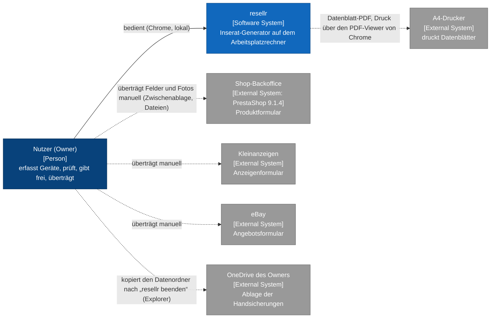

### 2.3 Container

**Welche lauffähigen Einheiten und Datenspeicher gibt es, und wie kommunizieren sie?** Alle Einheiten laufen auf dem Arbeitsplatzrechner. Der Rahmen „Datenordner“ ist der eine Ordner, den der Owner zur Sicherung kopiert (REQ-106). Vereinfacht: Installer, Release-Bezug und die Kopien vor Updates sind nur im Deployment-Diagramm dargestellt (Kap. 10.1).

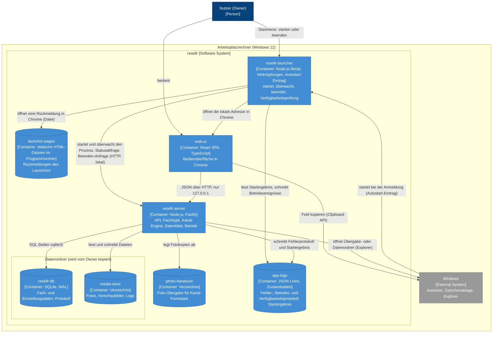

| Container | Technologie | Verantwortung | Daten |
| --- | --- | --- | --- |
| `resellr-launcher` | ein kleines Node.js-Skript der mitgelieferten Laufzeit, unsichtbar gestartet (ohne Konsolenfenster, Mechanismus im Windows-Spike, Kap. 10.2); Verknüpfungen „resellr“ (Startmenü, Desktop) und „resellr beenden“ (Startmenü); Autostart-Eintrag des Benutzers | Drei Rollen. **Überwachen** (läuft unsichtbar ab der Anmeldung, **genau eine je Windows-Sitzung**, gesichert über eine Sperre, v0.3.2): startet `resellr-server` als Kindprozess, der mit der Überwachung endet (Kopplung, Kap. 9.6), startet ihn nur nach einem Absturz neu (höchstens 3-mal in 10 Minuten, Vorschlag), nicht nach geordnetem Beenden, nicht nach abgebrochenem Start und nicht bei „läuft bereits“; endet nach der Neustartgrenze mit dem Ereignis „Neustart aufgegeben“; protokolliert Start, Prozessende mit Exit-Code und ihr eigenes Ende; prüft bei OD-05 (a) alle 5 Minuten die Verfügbarkeit (`health-probe`, Kap. 7.3). **Starten** (Verknüpfung „resellr“): startet die Überwachung, falls keine läuft; läuft schon eine, startet es keine zweite, sondern wartet auf Bereitschaft (Ablauf 4b). Danach öffnet es genau die Adresse `http://127.0.0.1:<Port>` in Chrome; bei abgebrochenem oder aufgegebenem Start öffnet es die Rückmeldung „Start abgebrochen“ mit Referenznummer. **Beenden** (Verknüpfung „resellr beenden“, Betreiberwerkzeug, Kap. 13.3.1): sendet die Beenden-Anfrage und öffnet die Rückmeldung zum Ergebnis. | keine |
| `launcher-pages` | statische HTML-Seiten mit eigenem CSS, ohne Skripte von außen, im Programmordner; Chrome öffnet sie als Datei | Rückmeldungen, wenn `resellr-server` nicht läuft: „resellr startet“, „Start abgebrochen“ (deutscher Text, nächster Schritt, Referenznummer nach REQ-073), Ergebnis von „resellr beenden“ über das Startmenü (beendet bzw. fehlgeschlagen mit Referenznummer). Die Referenznummer übergibt der Launcher als Teil der Datei-Adresse. Wortlaut und Gestaltung über den Product Owner (Kap. 6.3). | keine |
| `web-ui` | React SPA, TypeScript, wird von `resellr-server` ausgeliefert | gesamte Bedienoberfläche, Kopieren in die Zwischenablage, Darstellung von Fehlern und Zuständen, dauerhaft sichtbarer Hinweis „Sicherung einrichten“ mit Aktion „resellr beenden“ (REQ-104, REQ-105; Gestaltung durch das UI/UX-Design), Endzustand nach dem Beenden ohne Server | keine dauerhaften Daten; Zwischenstände nur im Browser-Speicher der Sitzung |
| `resellr-server` | Node.js (Active LTS), Fastify | JSON-API, alle Fachregeln, Kanal-Engine, Datenblatt-PDF, Foto-Ablage und -Übergabe, Protokoll, Migrationen mit Kopie vorab, Löschfristen, Startprüfung, Betriebsstatus, geordnetes Beenden | – |
| `resellr-db` | SQLite-Datei im WAL-Modus, im Datenordner | alle Fach- und Einstellungsdaten, Kanal-Inhalte, Änderungsprotokoll | Kap. 4 |
| `media-store` | Verzeichnis im Datenordner | Fotos (Originale, unverändert), Vorschaubilder, Logo; Dateinamen aus dem Inhalts-Hash | Bilddateien |
| `photo-handover` | Verzeichnis im Benutzerprofil, **außerhalb** des Datenordners und außerhalb von OneDrive-synchronisierten Ordnern | nummerierte Fotokopien für den Upload in Kanal-Formulare (REQ-048) | kurzlebige Kopien, Löschung nach 7 Tagen |
| `app-logs` | Protokollordner außerhalb des Datenordners: Dateien im JSON-Lines-Format mit täglicher Rotation, dazu eine kleine Zustandsdatei | technisches Fehlerprotokoll (REQ-073), Betriebsereignisse (Start, Art des Endes, abgebrochener Start), Verfügbarkeitsprotokoll; Zustandsdatei mit Ergebnis des letzten Starts (Referenznummer bei Abbruch) und Kennung des zuletzt benutzten Datenordner-Stands (Kap. 9.6) | 30 Tage Aufbewahrung; Zustandsdatei ohne Frist, wenige Bytes |

`health-probe` war in v0.2 ein eigener Container als geplante Aufgabe von Windows. Seit v0.3 ist die Verfügbarkeitsprüfung eine Funktion der Überwachung in `resellr-launcher` (Ä-17, Kap. 10.2). Sie entfällt, wenn der Owner OD-05 nicht mit (a) entscheidet.

Die Konfigurationsdatei und die Ende-Markierung liegen ebenfalls im Datenordner (Kap. 9.6, 10.2). Sie sind keine eigenen Container.

### 2.4 Komponenten von `resellr-server`

**Welche fachlichen Module hat der Server und wie hängen sie voneinander ab?** Vereinfacht: Alle schreibenden Komponenten rufen `audit` auf und greifen über eine gemeinsame Datenzugriffsschicht auf `resellr-db` zu. Beides ist als je eine Kante dargestellt. `content-engine` greift nicht auf die Datenbank zu. Lesezugriffe über Reader sind nur für `datasheet` dargestellt; `listing-content` liest die anderen Fachkomponenten zusätzlich über deren Reader (für `inventory` u. a. CU-129), ohne eigene Kante. Neu in v0.3.3: `listing-content` schreibt den Anzeigetitel des Modell-Inserats über die Schreibfunktion von `inventory`; dieselbe Richtung besteht schon für das Lesen.

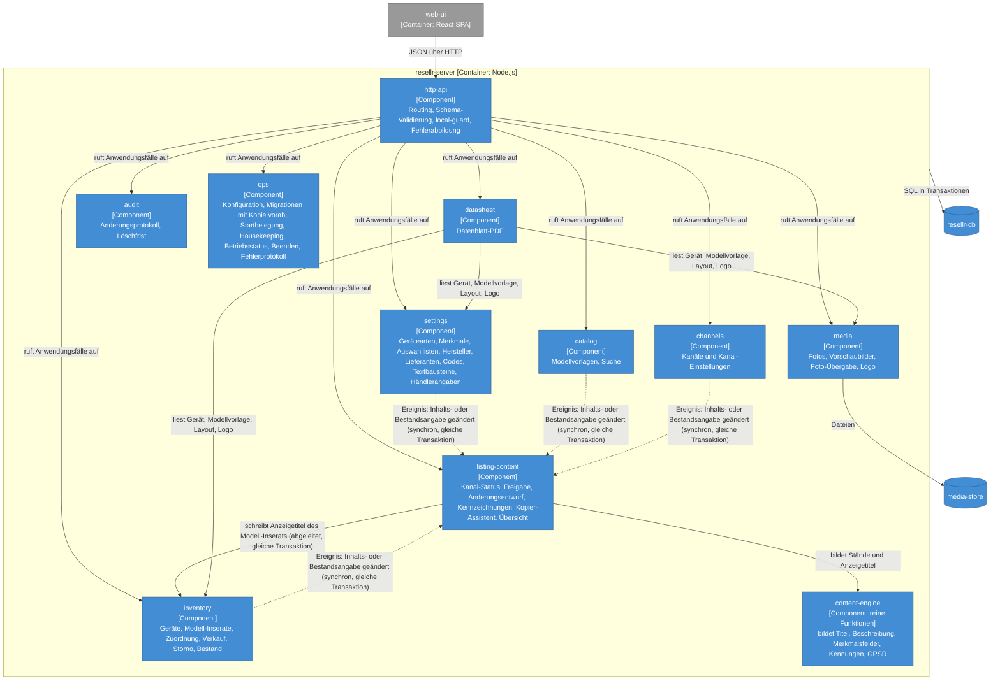

| Komponente | Verantwortung | Requirements (Auswahl) |
| --- | --- | --- |
| `http-api` | HTTP-Routing, Validierung der Anfragen gegen gemeinsame Schemas, `local-guard` (Host- und Origin-Prüfung, Kap. 8), Abbildung von Fehlern auf Nutzermeldungen mit Referenznummer, Auslieferung von `web-ui` | REQ-073, REQ-079 |
| `settings` | Gerätearten und Merkmale, Auswahllisten, Hersteller mit GPSR-Herstellerangaben, Lieferanten, Code-Übersetzungstabelle, Textbausteine mit Prüfstatus, Händlerangaben, Datenblatt-Layout | REQ-004 bis REQ-007, REQ-022, REQ-026 bis REQ-028, REQ-051, REQ-054, REQ-099 bis REQ-101 |
| `catalog` | Modellvorlagen: Anlegen, Ändern, Suche, Hinweis auf Dubletten, Löschen | REQ-008 bis REQ-011, REQ-058, REQ-095 |
| `inventory` | Geräte (Erfassung, Vorbelegung, Prüfmarkierungen, Zustandscode), Modell-Inserate (Inseratswerte, Preise je Kanal, Lieferumfang), Vergleichsregel für Variantenangaben, Zuordnen und Umbuchen, Verkauf und Rücknahme, Storno, WI-Nr-Korrektur, Bestandsangaben | REQ-012 bis REQ-021, REQ-032, REQ-033, REQ-084, REQ-088, REQ-091 bis REQ-095 |
| `channels` | Kanal-Registry, Kanal-Einstellungen: Titel-Höchstlänge, VB, Titelmuster, Beschreibungsvorlage, Merkmals-, Zustands- und Kategoriezuordnung, Preisregel, Feldreihenfolge; Prüfung der Platzhalter beim Speichern | REQ-023 bis REQ-025, REQ-029 bis REQ-031, REQ-085 |
| `content-engine` | reine, deterministische Funktionen: Titel nach Muster und Kürzung, Beschreibung nach Vorlage, Merkmalsfelder, Kategorie- und Zustandsvorschlag, Kennungen, GPSR-Angaben, Produktidentifikation, Auflösung der Bestandsplatzhalter | REQ-034 bis REQ-041, REQ-091 |
| `listing-content` | Lebenszyklus der Kanal-Inhalte: materialisierter aktueller Stand, freigegebener Stand, Änderungsentwurf, Kanal-Status, Kennzeichnungen, manuelle Anpassungen, Freigabe und Freigabebedingungen, Abgleich, Neuberechnung nach Änderungen mit Meldung der Anzahlen, Daten für Kopier-Assistent und Inserat-Übersicht; Bildung des Anzeigetitels der Modell-Inserate (REQ-052) bei jeder Neuberechnung | REQ-043 bis REQ-047, REQ-049, REQ-052, REQ-053, REQ-059, REQ-086, REQ-087, REQ-089, REQ-090 |
| `media` | Foto-Upload mit Typ- und Größenprüfung, Ablage, Reihenfolge, Vorschaubilder, Foto-Übergabe (Ordner und ZIP), Logo | REQ-028, REQ-042, REQ-048 |
| `datasheet` | Datenblatt als A4-PDF je Gerät | REQ-050, REQ-051, REQ-081 |
| `audit` | Protokolleinträge in derselben Transaktion wie die Änderung, Abfrage mit Filter, tägliche Löschung nach 24 Monaten | REQ-055, REQ-072 |
| `ops` | Konfiguration, Einzelinstanz-Sperre, Migrationen mit automatischer lokaler Kopie vorab, **Startprüfung des Datenordners** mit Ende-Markierung und Erkennung eines ersetzten Datenordners (Kap. 9.6), Startergebnis für `resellr-launcher`, Startbelegung beim ersten Start, Housekeeping (Löschfristen, verwaiste Dateien mit Schutzgrenze, Übergabeordner, alte Kopien vor Updates), Fehlerprotokoll, Statusabfrage, **Betriebsstatus** (Speicherort und Größe des Datenordners, freier Speicher, Version, Startzeitpunkt, Art des letzten Endes, Befunde der Startprüfung), **Datenordner im Explorer öffnen**, **geordnetes Beenden** mit Fehlerpfad (Kap. 9.6) | REQ-006, REQ-065, REQ-072, REQ-073, REQ-104 (Speicherort), REQ-105, REQ-106 |
| optional `excel-import` | einmalige Übernahme von Excel-Datenblättern (Could) | REQ-056 |
| optional `prestashop-export` | Importdatei für den Shop (Could), Format in Kap. 5.2 | REQ-057 |

Die beiden optionalen Komponenten fehlen im Diagramm. Sie sind Could-Anforderungen und hängen nur lesend von `listing-content` (Export) bzw. schreibend von `catalog` (Import) ab.

**Abhängigkeitsregeln:** `content-engine` hängt von keiner anderen Komponente ab und ist vollständig ohne Datenbank testbar. `listing-content` liest Modelldaten, Inseratswerte und Einstellungen über Lese-Schnittstellen der anderen Komponenten. Die anderen Komponenten rufen `listing-content` nicht direkt auf, sondern melden Änderungen über In-Process-Ereignisse in derselben Transaktion. So entsteht kein Abhängigkeitskreis. **Ausnahme beim Schreiben (v0.3.3, MAR-1061):** Den Anzeigetitel des Modell-Inserats (ungekürzter Titel nach dem Titelmuster der Geräteart, REQ-052) bildet `listing-content` mit `content-engine` bei jeder Neuberechnung, die ihn betreffen kann, und schreibt ihn über eine Schreibfunktion, die `inventory` nur dafür anbietet. Der Anzeigetitel bleibt Teil des Modell-Inserats und gehört zu `inventory`; die Schreibfunktion ändert keinen anderen Wert, keine Version und erzeugt keinen Protokolleintrag. Das ist die einzige Stelle, an der `listing-content` über eine andere Fachkomponente schreibt. Wie bei den übrigen schreibenden Exporten der Technical Specification (Kap. 4.1, Ausnahmen (1), (2) und (4)) schreibt die aufgerufene Komponente dabei nur ihre eigene Tabelle. Die Abhängigkeitsrichtung `listing-content` → `inventory` besteht schon für das Lesen; es entsteht kein Kreis. Grund: Die Ereignisse, die den Titel ändern können, verarbeitet nur `listing-content`, und nur `listing-content` stellt die Eingaben der Bildung zusammen (Abwägung in der Technical Specification, Kap. 2.8.6).

### 2.5 Wichtige Abläufe

**Ablauf 1 – Weiteres Gerät einbuchen (J-02).** Wie arbeiten die Komponenten beim häufigsten Ablauf zusammen, einschließlich der Ablehnungen? Vereinfacht: Fehlerprotokoll und technische Fehler sind nicht dargestellt (Kap. 9).

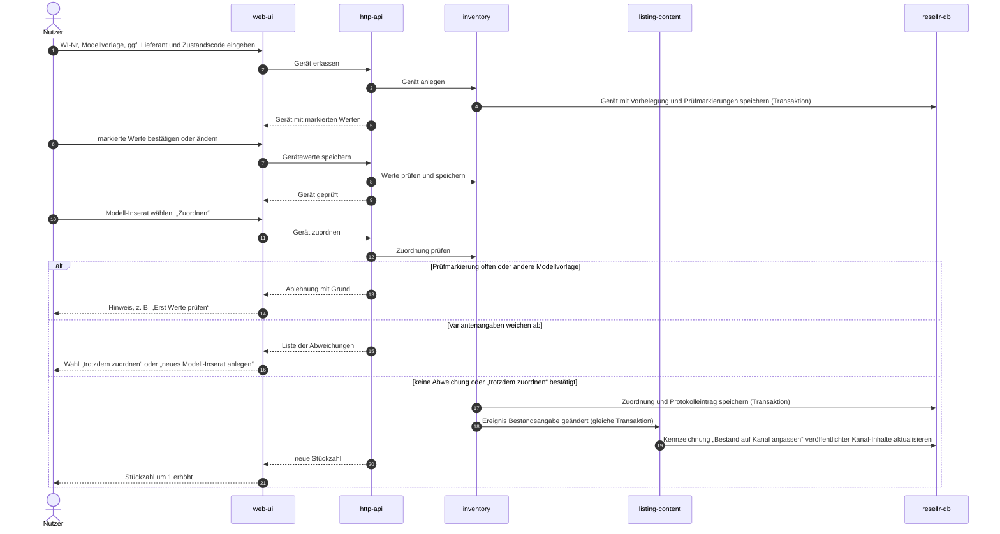

**Ablauf 2 – Kanal-Inhalt freigeben und übernehmen.** Wie wird ein Kanal-Inhalt freigegeben, wie wird die Freigabe gegen einen veralteten Stand abgesichert, und wie gelangen die Felder in die Zwischenablage?

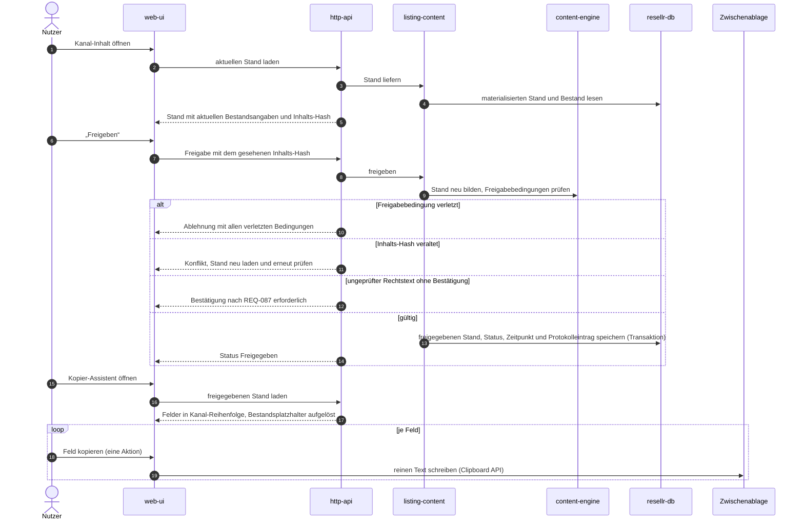

**Ablauf 3 – Einstellung ändern mit Wirkung auf viele Kanal-Inhalte (J-04, REQ-053).** Wie wirkt eine zentrale Änderung auf betroffene Kanal-Inhalte, und was passiert bei einem Fehler?

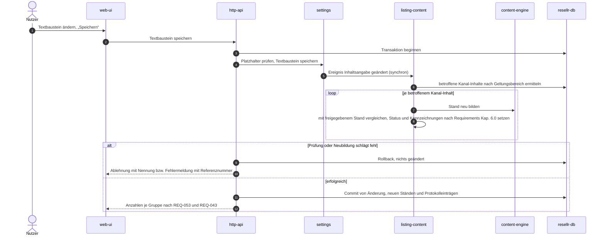

**Ablauf 4a – resellr beenden (REQ-105, E-7, ADR-006).** Wie beendet der Nutzer resellr so, dass eine Kopie des Datenordners vollständig und brauchbar ist, und was passiert, wenn das Beenden scheitert? Vereinfacht: Das Beenden über die Startmenü-Verknüpfung „resellr beenden“ läuft ab `http-api` gleich; dort zeigt `resellr-launcher` das Ergebnis über `launcher-pages` statt `web-ui`. Rückfrage, Texte und Ort der Aktion gestaltet das UI/UX-Design.

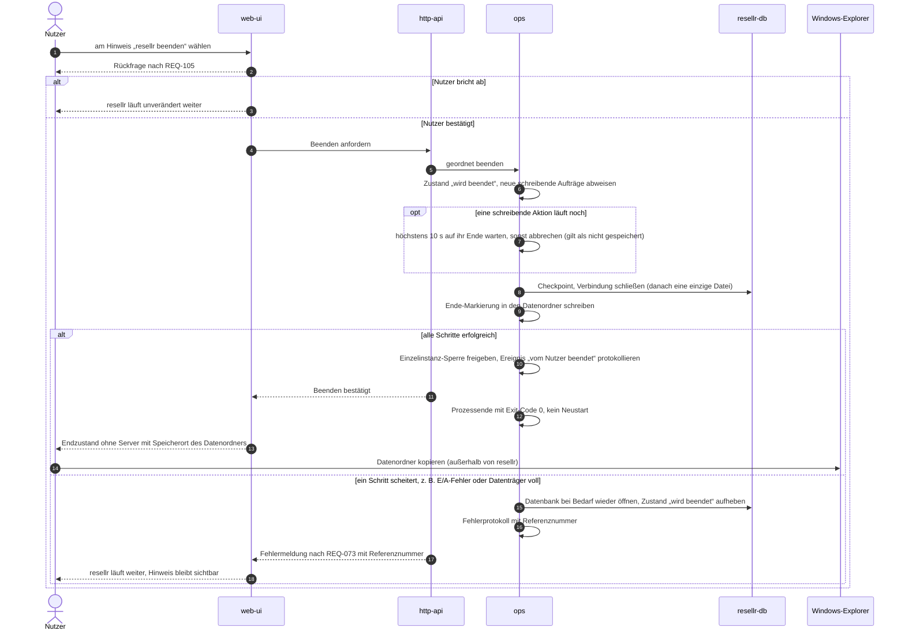

**Ablauf 4b – resellr starten (`resellr-launcher`, Startprüfung).** Wie startet der Nutzer resellr nach dem Beenden wieder, wie verhindert der Start eine zweite Überwachung, und wie erfährt der Nutzer von einem abgebrochenen Start, obwohl der Server dann nicht läuft? Vereinfacht: Der Autostart bei der Anmeldung und der Neustart nach Absturz laufen ab „Überwachung startet `resellr-server`“ gleich, nur ohne Öffnen von Chrome. Die Verfügbarkeitsprüfung, die Rückmeldung „resellr startet“ bei längerem Warten und der Exit-Code „läuft bereits“ sind nicht dargestellt (Kap. 7.3, 9.6). v0.3.2: Fall „Überwachung läuft, Server noch nicht bereit“ ergänzt (FIND-110).

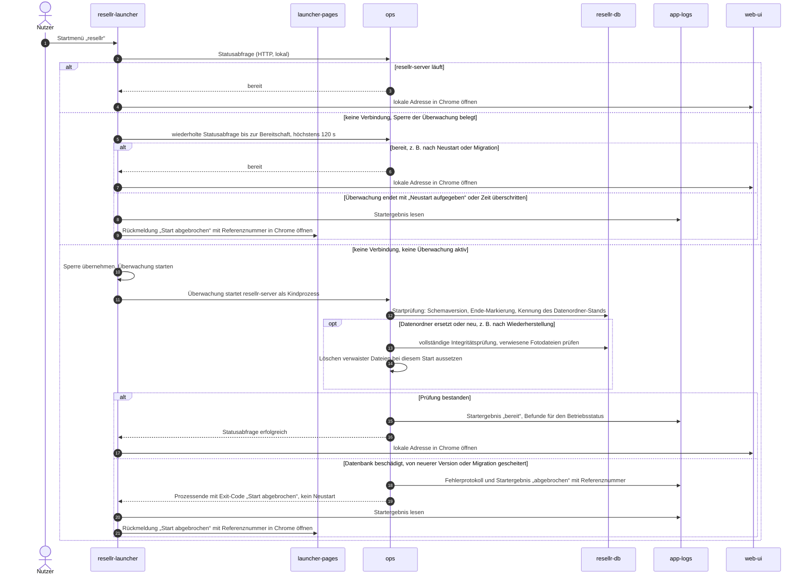

### 2.6 Datenflüsse

- **Eingaben:** Alle Daten gibt der Nutzer über `web-ui` ein. Fotos und Logo lädt er als Dateien hoch. Optional übernimmt `excel-import` einmalig Excel-Datenblätter (REQ-056).
- **Verarbeitung:** Ausschließlich in `resellr-server`. Jede schreibende Aktion ist eine Datenbanktransaktion, einschließlich Neuberechnung und Protokoll (Kap. 9.3).
- **Ausgaben:** Kanal-Inhalte gehen als Text über die Zwischenablage hinaus, Fotos als Dateien im Übergabeordner oder als ZIP, das Datenblatt als PDF und optional die Importdatei für den Shop. resellr selbst schreibt **keine** Sicherungen. Der Owner kopiert den Datenordner selbst (Ablauf 4a).
- **Keine Flüsse nach außen:** `resellr-server` baut keine Verbindung ins Netz auf. Es gibt keine Telemetrie, keine Update-Prüfung und keine Abfrage bei Kanälen (REQ-079). `web-ui` lädt nichts von fremden Servern (Kap. 6, Kap. 8).

---

## 3. Technologie-Stack und Begründung

Die vollständige Abwägung steht in ADR-001 (Anwendungsart), ADR-003 (Stack), ADR-004 (Persistenz) und ADR-007 (PDF). Die konkreten Versionen legt die Technical Specification fest.

| Bereich | Vorschlag | Kurzbegründung | ADR |
| --- | --- | --- | --- |
| Anwendungsart | lokale Webanwendung: SPA im Browser und lokaler Server-Prozess | Zwischenablage, Dateizugriff und PDF ohne native Paketierung; ohne Netzbetrieb kein Passwort; später hostbar | ADR-001, ADR-002 |
| Sprache | TypeScript in Server und Oberfläche | eine Sprache, gemeinsame Typen und Validierungsschemas | ADR-003 |
| Server-Laufzeit | Node.js, jeweils aktuelle Active-LTS-Version, für Windows x64 mit der Anwendung ausgeliefert | plattformneutral, kein separat installiertes Runtime nötig | ADR-003 |
| Zielplattform | Windows 11 (x64), Google Chrome aktuell | Owner-Angabe OD-04 | ADR-001 |
| HTTP-Framework | Fastify | schlank, Schema-Validierung, gut testbar (Requests ohne Netzwerk testbar) | ADR-003 |
| Validierung | Zod-Schemas in einem gemeinsamen Paket | dieselben Regeln in Oberfläche (sofortige Rückmeldung) und Server (verbindlich) | ADR-003 |
| Datenbank | SQLite (WAL-Modus) über `better-sqlite3`, Abfragen mit Kysely | eingebettet, kein Datenbankserver, transaktional, eine Datei nach dem Beenden (Handsicherung), Kopie vor Updates über die Online-Backup-API; Kysely unterstützt auch PostgreSQL (Evolutionspfad) | ADR-004, ADR-006 |
| Dateiablage | Dateisystem, Dateinamen aus dem Inhalts-Hash | unveränderliche Dateien, sichere Mehrfachverwendung, Migrationen ändern keine Fotodateien | ADR-004 |
| Bilder | `sharp` für Vorschaubilder und Prüfung der Bildabmessungen | Originale bleiben unverändert (REQ-042) | ADR-003 |
| PDF | `pdfmake`, serverseitig, mit eingebetteter Schrift | deterministisches A4-Layout, Seitenzahl testbar (REQ-081) | ADR-007 |
| Oberfläche | React mit Vite, React Router, TanStack Query, React Hook Form, Tailwind CSS, shadcn/ui (Radix-Primitives), lucide-Icons, alle Assets lokal gebündelt | verbreitet, Komponenten im eigenen Code anpassbar, Design-Tokens aus `DESIGN.md` direkt als CSS-Variablen abbildbar | ADR-003 |
| Tests | Vitest (Unit, Integration), Playwright (End-to-End in Google Chrome, Playwright-Kanal `chrome`) | Kap. 11 | ADR-003 |
| Build, CI, Releases | npm-Workspaces, GitHub Actions mit Windows-Runner, Installationspaket für Windows 11 x64 (Installation im Benutzerprofil ohne Adminrechte) in GitHub Releases des Repositorys `MarloNET/resellr`; die Installer-Technik legt die Technical Specification fest | reproduzierbar, Owner lädt Releases manuell | ADR-003, ADR-006 |

**Kosten:** keine laufenden Lizenz- oder Hostingkosten. Alle genannten Bibliotheken sind Open Source mit freien Lizenzen, überwiegend MIT oder Apache-2.0. `sharp` bündelt libvips unter LGPL-3.0. Die Lizenzen prüft die Technical Specification vor der Festlegung der Versionen. Für die Handsicherung nutzt der Owner sein vorhandenes OneDrive; ob der Speicherplatz reicht, hängt vom Fotobestand ab (Kap. 7.2). Ein Zertifikat zur Code-Signierung des Installationspakets ist optional und kostenpflichtig (AR-13); Release 0.1 sieht keines vor.

---

## 4. Fachliches Datenmodell

### 4.1 Kernentitäten: Katalog, Bestand und Modell-Inserat

**Welche Kernentitäten gibt es für Modelle, Geräte und Modell-Inserate, und wie hängen sie zusammen?** Ohne Felder. Die Kanal-Einstellungen zeigt Kap. 4.2.

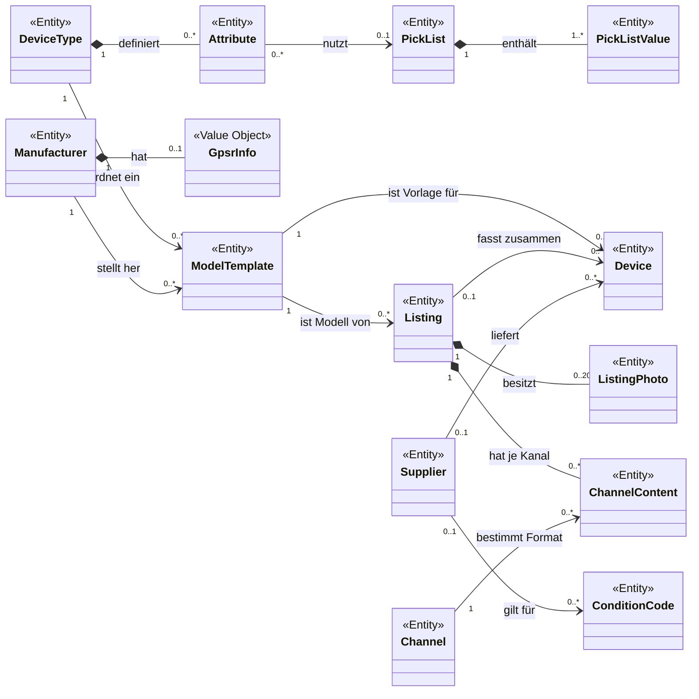

### 4.2 Kanal-Einstellungen und Kanal-Inhalte

**Welche Einstellungen bestimmen einen Kanal-Inhalt, und welche Stände hat ein Kanal-Inhalt?** Ohne Felder. Händlerangaben und Datenblatt-Layout sind Einzel-Datensätze, Protokolleinträge verweisen ohne Fremdschlüssel auf ihr Objekt. Diese drei stehen deshalb nur in Kap. 4.3.

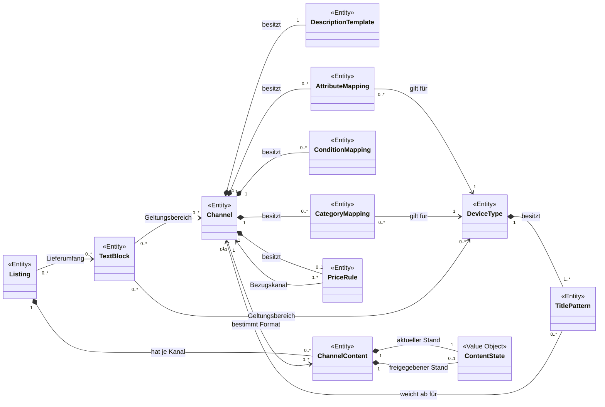

### 4.3 Entitäten, Zuständigkeit und Lebenszyklus

| Entität (Code) | Fachbegriff (Requirements) | Zuständige Komponente | Lebenszyklus und Regeln mit Architekturwirkung |
| --- | --- | --- | --- |
| `MerchantProfile` | Händlerangaben, Händlermarke | `settings` | genau ein Datensatz; Logo als Datei im `media-store` |
| `DeviceType` | Geräteart | `settings` | aktiv oder deaktiviert, kein Löschen bei Verwendung (REQ-004); Startbelegung über `ops` |
| `Attribute` | Merkmal | `settings` | stabile technische ID; Datentyp und Ebene unveränderlich, sobald Werte existieren (REQ-005) |
| `PickList`, `PickListValue` | Auswahlliste, Wert | `settings` | Werte haben eine stabile ID, gespeichert wird die ID; dadurch wirkt eine Umbenennung überall (REQ-007) |
| `Manufacturer`, `GpsrInfo` | Hersteller, GPSR-Herstellerangaben | `settings` | aktiv oder deaktiviert; „GPSR vollständig“ wird aus den Angaben abgeleitet |
| `Supplier` | Lieferant | `settings` | aktiv oder deaktiviert, kein Löschen bei Verwendung |
| `ConditionCode` | Zustandscode-Eintrag | `settings` | eindeutig je Code und Lieferant |
| `TextBlock` | Textbaustein | `settings` | aktiv oder deaktiviert; Prüfstatus bei *Rechtliches* und *Akku-Hinweis* |
| `DatasheetLayout` | Datenblatt-Layout | `settings` | genau ein Datensatz |
| `ModelTemplate` | Modellvorlage | `catalog` | Modelldaten und Vorbelegungswerte; Löschen nur ohne Verweise (REQ-095) |
| `Device` | Gerät | `inventory` | Bestandsstatus *verfügbar*, *verkauft*, *storniert*; Erfassungsstatus aus Prüfmarkierungen; **wird nie gelöscht** (REQ-093) |
| `Listing` | Modell-Inserat | `inventory` | Inseratswerte, Preise je Kanal, Lieferumfang; Bestandsangaben werden **nicht** gespeichert, sondern aus den verfügbaren Geräten abgeleitet (REQ-091). Der **Anzeigetitel** (ungekürzter Titel nach dem Titelmuster der Geräteart, REQ-052) ist ein abgeleiteter, gespeicherter Wert: gebildet von `listing-content` mit `content-engine`, geschrieben nur über die Schreibfunktion von `inventory`, in derselben Transaktion wie die auslösende Änderung (Kap. 2.4, v0.3.3). |
| `ListingPhoto` | Foto | `media` | Reihenfolge je Modell-Inserat; die Datei bleibt erhalten, solange ein freigegebener Stand auf sie verweist (Kap. 9.4) |
| `Channel` | Kanal | `channels` | aktiv oder deaktiviert; Kanäle sind Daten, kein Code (ADR-005) |
| `TitlePattern`, `DescriptionTemplate`, `AttributeMapping`, `ConditionMapping`, `CategoryMapping`, `PriceRule` | Titelmuster, Beschreibungsvorlage, Merkmals-, Zustands-, Kategoriezuordnung, Preisregel | `channels` | Einstellungen; Platzhalter werden beim Speichern gegen die Liste in Requirements Kap. 9.7 geprüft |
| `ChannelContent` | Kanal-Inhalt | `listing-content` | genau einer je Modell-Inserat und Kanal; Kanal-Status und Kennzeichnungen (Requirements Kap. 9.4); manuelle Anpassungen; Bestand beim letzten Abgleich |
| `ContentState` | aktueller Stand, freigegebener Stand, Änderungsentwurf | `listing-content` | vollständig gebildeter Inhalt (Texte, Merkmalsfelder, Kategorie, Zustand, Preis, GPSR, Foto-Verweise) mit **Bestandsplatzhaltern als Platzhalter**; der freigegebene Stand ist unveränderlich (ADR-005) |
| `AuditEntry` | Protokolleintrag | `audit` | nur anhängen, kein Ändern; verweist über Objektart und ID auf das Objekt, ohne Fremdschlüssel; Löschung nach 24 Monaten (REQ-072) |

Der Änderungsentwurf ist kein eigenes Objekt. Er ist der aktuelle Stand eines Kanal-Inhalts im Status *Veröffentlicht* oder *Beendet*, wenn dieser vom freigegebenen Stand abweicht.

### 4.4 Persistenz-Grundsätze

- **Speicherort:** alle Entitäten in `resellr-db`, Fotos und Logo als Dateien im `media-store` (ADR-004). Beide liegen mit der Konfiguration in **einem** Datenordner (REQ-106, ADR-006, Kap. 10.2). Außerhalb des Datenordners liegen nur Protokolle, kurzlebige Fotokopien im Übergabeordner, die Kopien vor Updates und die Programmdateien; keines davon sind Daten im Sinne von Requirements Kap. 9.1 und 9.5. Der Hinweis „Sicherung einrichten“ hat keinen gespeicherten Zustand (REQ-104).
- **Konfigurierbare Merkmalswerte:** Die Werte von Modellvorlage (Ebene *Modell* und Vorbelegung), Gerät und Modell-Inserat liegen als JSON-Dokument am jeweiligen Datensatz. Schlüssel ist die stabile Merkmals-ID, nicht die Bezeichnung. Prüfmarkierungen am Gerät liegen ebenso je Merkmals-ID vor. Eine neue Geräteart oder ein neues Merkmal ändert daher nie die Datenbankstruktur (REQ-076).
- **Typisierte Werte, keine Umwandlung:** Zahlen werden nach Datentyp gespeichert, Dezimalwerte als kanonische Dezimalzeichenkette, Geldbeträge in Cent als Ganzzahl. Es gibt keine automatische Typ- oder Datumserkennung (REQ-005, Excel-Befund).
- **Eindeutigkeit ohne Groß-/Kleinschreibung:** Für Namen, WI-Nr und Artikelnummer gibt es zusätzlich eine normalisierte Schlüsselspalte mit eindeutigem Index. Sie wird mit Unicode-Kleinschreibung gebildet, weil SQLite `NOCASE` nur ASCII behandelt (Umlaute). Dasselbe gilt für die Suchspalten (REQ-009).
- **Zeit:** Zeitpunkte in UTC, Anzeige in Europe/Berlin; Kalenderdaten wie Verkaufs- und Veröffentlichungsdatum als Datum ohne Uhrzeit in Europe/Berlin (REQ-078).
- **Keine Personendaten:** Das Datenmodell enthält keine Felder für Käufer, Nutzer oder Zugangsdaten. Ausgenommen sind die geschäftlichen Kontaktangaben in `MerchantProfile` und `GpsrInfo` (REQ-069). Kein Datensatz und kein Protokolleintrag verweist auf eine Person.

---

## 5. Externe Schnittstellen und Integrationen

### 5.1 Übersicht

| System oder Schnittstelle | Release 0.1 | Richtung, Protokoll | Daten | Abhängigkeit, Fehlerfall |
| --- | --- | --- | --- | --- |
| Shop (PrestaShop 9.1.4), Kleinanzeigen, eBay | **keine technische Verbindung** (REQ-079) | manuell durch den Nutzer über Zwischenablage und Dateien | Kanal-Inhalte, Fotos | keine Laufzeitabhängigkeit |
| Zwischenablage von Windows | ja | `web-ui` → Clipboard API (`navigator.clipboard.writeText`), reiner Text | je Aktion ein Feld | Der Ursprung `127.0.0.1` gilt in Chrome als sicherer Kontext. Lehnt der Browser das Schreiben ab (selten, z. B. bei entzogener Berechtigung), meldet `web-ui` einen Fehler (UI-019, Toast mit Hinweis auf Strg+C). |
| Dateisystem: Übergabeordner | ja | `resellr-server` schreibt nummerierte Kopien und öffnet den Ordner im Windows-Explorer | Fotos eines Modell-Inserats | Ordner nicht beschreibbar → Fehlermeldung mit Referenznummer, ZIP-Download als Ausweg |
| ZIP-Download | ja | `resellr-server` → Browser-Download | Fotos mit Reihenfolge-Namen | – |
| PDF-Ausgabe, Druck | ja | `resellr-server` erzeugt PDF; Anzeige, Druck und Speichern über den PDF-Viewer von Chrome | Datenblatt | Kein Logo → fachliche Ablehnung (REQ-050) |
| Windows-Explorer: Datenordner | ja | `resellr-server` öffnet den Datenordner im Explorer, damit der Owner ihn nach dem Beenden kopieren kann | – | Explorer lässt sich nicht öffnen → Speicherort wird zum Kopieren angezeigt |
| OneDrive (Handsicherung) | **keine technische Verbindung** | Der Owner kopiert den Datenordner selbst (ADR-006) | Datenordner | keine Laufzeitabhängigkeit |
| Windows-Autostart des Benutzers | ja | Das Installationspaket legt einen Autostart-Eintrag des Benutzers an (`HKCU\Software\Microsoft\Windows\CurrentVersion\Run`, ohne Adminrechte); er startet bei der Anmeldung die Überwachung in `resellr-launcher`. Mechanismus wird im Windows-Spike bestätigt (Kap. 10.2) | – | Eintrag fehlt oder ist in den Windows-Einstellungen deaktiviert → kein Autostart; die Verknüpfung „resellr“ startet resellr trotzdem, der Betriebsstatus zeigt „Autostart aus“ |
| Chrome: Rückmeldungen ohne Server | ja | `resellr-launcher` öffnet eine Seite aus `launcher-pages` als Datei-Adresse in Chrome, mit Referenznummer als Parameter | – | Chrome lässt sich nicht starten → Eintrag im Betriebsprotokoll; das Betriebshandbuch nennt den Protokollordner |
| Excel-Datenblätter (REQ-056, Could) | optional | Upload einer `.xlsx`-Datei | Modellvorlagen-Daten | unlesbare Datei → Einlesebericht |
| Importdatei Shop (REQ-057, Could) | optional | Download einer CSV-Datei | freigegebene Shop-Kanal-Inhalte | Kap. 5.2 |

### 5.2 Format der Importdatei für den Shop (REQ-057, Could)

REQ-057 verlangt die Festlegung des Formats in der Baseline. Vorschlag:

- **Format:** CSV für den Produktimport im PrestaShop-Backoffice, UTF-8, Feldtrenner `;`, Trenner für Mehrfachwerte `,`, eine Kopfzeile, eine Zeile je freigegebenem Shop-Kanal-Inhalt. Es gilt der freigegebene Stand mit aktuellen Bestandsangaben.
- **Inhalt:** die Angaben aus REQ-057 (Titel, Beschreibung, Kategorie, Preis, Artikelnummer, EAN, Herstellernummer, Merkmale, Stückzahl). Die genaue Zuordnung zu den Importfeldern von PrestaShop 9.1.4 legt die Technical Specification fest und prüft sie an einer Testinstallation.
- **Ohne Fotos:** Der PrestaShop-Import lädt Bilder nur über Internetadressen. Der Shop kann Dateien auf dem Arbeitsplatzrechner nicht abrufen. Fotos bleiben deshalb beim Kopier-Assistenten (REQ-048).
- **Zu klären in der Technical Specification, falls REQ-057 umgesetzt wird:** ob der Preis brutto oder netto übergeben wird und welche Steuerregel gilt. Das hängt von der Shop-Konfiguration des Pilotkunden ab (Kap. 13.1, AR-12).

### 5.3 Erweiterungspunkte für spätere Releases (nicht gebaut)

| Release | Erweiterung | Vorgesehener Ansatzpunkt |
| --- | --- | --- |
| 0.2 Direktveröffentlichung PrestaShop | Kanal-Adapter `publisher` je Kanal; ausgehende HTTPS-Verbindung von `resellr-server` zum Webservice des Shops | Schnittstelle neben `listing-content`. Der freigegebene Stand ist die Quelle der Übertragung. Zugangsdaten kommen in den Schlüsselspeicher des Betriebssystems, nicht in `resellr-db`. REQ-068 und REQ-079 müssen dafür geändert werden. |
| 0.3 Stückzahl-Abgleich | geplanter Abgleichjob in `resellr-server`, solange der PC läuft | Bestandsangaben sind bereits abgeleitet; der Bestand beim letzten Abgleich ist gespeichert |
| beliebig | automatische Sicherung in einen vom Owner gewählten Ordner (z. B. OneDrive), falls der Owner sie später möchte | Erweiterung von `ops`: konsistenter Snapshot über die Online-Backup-API, Fotos als unveränderliche Dateien inkrementell; etwa 1 bis 2 Entwicklertage; kein Umbau nötig, weil Datenordner und Kopie vor Updates dieselben Mechanismen nutzen |
| 0.4 Einkaufs-PDF | neue Komponente `intake` | Code-Übersetzungstabelle bleibt nutzbar |
| Produkt, mehrere Händler | Betrieb auf einem Server mit Konten (ADR-002, Evolutionspfad) | gleicher Code; Kysely erlaubt den Wechsel zu PostgreSQL |

---

## 6. UI-relevante technische Randbedingungen

Dieses Kapitel ist die Grundlage für den Cross-Check durch den UI/UX Designer. Es macht keine Gestaltungsvorgaben.

### 6.1 Randbedingungen

| Thema | Technische Randbedingung | Quelle |
| --- | --- | --- |
| Art der Oberfläche | Webanwendung im **Chrome-Fenster** auf dem Arbeitsplatzrechner, kein natives Desktop-Fenster. Der Nutzer öffnet sie über die Verknüpfung „resellr“ (`resellr-launcher`), die resellr bei Bedarf startet und genau eine feste lokale Adresse (`http://127.0.0.1:<Port>`) in Chrome öffnet. Ob als normaler Tab oder als eigenes App-Fenster ohne Adressleiste, legt die Technical Specification fest; für das Design gilt in beiden Fällen dasselbe Browserfenster. Mehrere Fenster nebeneinander sind möglich (Kopier-Assistent neben dem Kanal-Formular). | ADR-001, E-1, A-33 |
| Browser | **Google Chrome in aktueller Version**, einziger getesteter und unterstützter Browser (OD-04). Edge ist ebenfalls Chromium-basiert und wird voraussichtlich funktionieren, ist aber kein Testziel. Firefox, Safari und ältere Browser werden nicht unterstützt. | OD-04, OP-24, A-34 |
| Plattform, Bildschirm | Windows 11, Tastatur und Maus, ab 1366 × 768 ohne Funktionsverlust. Das Fenster ist frei in der Größe veränderbar. Eine Mobil- oder Touch-Auslegung gibt es nicht. **Nutzbare Fläche (v0.3.2, Cross-Check):** 1366 × 768 ist die Bildschirmauflösung. In einem maximierten normalen Chrome-Fenster bleiben nach Windows-Taskleiste, Tableiste und Adressleiste etwa **1350 × 630 px** für die Seite (Schätzung bei 100 % Skalierung; der genaue Wert wird im Windows-Spike gemessen und in der Technical Specification festgehalten). Ein App-Fenster ohne Tableiste hat etwas mehr Höhe. Layouts mit fester linker Navigation (208 px) und mitlaufenden Leisten müssen bei dieser Fläche ohne Funktionsverlust bedienbar sein; senkrechtes Scrollen ist zulässig, waagrechtes nicht. | REQ-077, E-2, OD-04 |
| Schmale Ansicht (UI-019) | Ein schmales Layout ist eine reine CSS-Variante derselben Seite und **ab 480 px Breite des Fensterinhalts umsetzbar**. Ob Chrome sich auf dem Arbeitsplatzrechner so schmal ziehen lässt, hängt von Fensterart und Windows-Skalierung ab. Ein App-Fenster ohne Tableiste lässt sich schmaler ziehen als ein normales Fenster mit Tableiste. Das Layout darf deshalb keine Breite unter 480 px voraussetzen und muss bis 480 px ohne waagrechtes Scrollen bedienbar sein. Der Umschalter im selben Fenster (Design `92e018e`) ist umsetzbar; zusätzlich kann der Nutzer ein zweites Chrome-Fenster öffnen. Technisch möglich, aber nicht vorgesehen, ist ein von resellr geöffnetes schmales Popup-Fenster ohne Tableiste. | C-5, Kap. 6.2, 6.4 |
| Frontend-Framework | React (SPA) mit clientseitigem Routing. Jede Ansicht hat eine eigene Adresse; Lesezeichen, Zurück und Vorwärts im Browser funktionieren. | ADR-003 |
| Komponentenbasis, Design-System | Tailwind CSS mit shadcn/ui (Radix-Primitives), Icons von lucide. Design-Tokens aus `docs/ux/DESIGN.md` (Farben, Typografie, Abstände, Radien) werden als CSS-Variablen und Tailwind-Theme abgebildet. Ein bestimmter Look ist nicht vorgegeben. Das Design-System muss sich mit Standard-CSS umsetzen lassen. Exportiertes Stitch-HTML ist nur visuelle Referenz. | ADR-003 |
| Externe Ressourcen | **Keine** Schriften, Skripte oder Bilder von fremden Servern (kein Google Fonts, kein CDN). Schriften müssen frei lizenziert und mitlieferbar sein. | REQ-079, Kap. 8 |
| Anmeldung | **Hängt von OD-02 ab.** Variante A (Empfehlung, Betrieb nur am Arbeitsplatzrechner): keine Anmeldung, kein Zugangspasswort; UI-001, UI-040 und FLOW-07 werden in Release 0.1 nicht umgesetzt, der Eintrag „Zugangspasswort“ in UI-025 fehlt. Variante B (Netzbetrieb): UI-001 und UI-040 werden wie entworfen umgesetzt; ein Zugang gilt je Chrome-Programm bis zu dessen Ende (Sitzungs-Cookie), andere Zugänge enden bei Passwortänderung. Beide Fälle im Detail: Kap. 13.3, OD-02. | E-5, REQ-001, REQ-097, C-1 |
| Echtzeit | Kein Echtzeitabgleich und keine Push-Meldungen. Nach eigenen Aktionen zeigt die Oberfläche sofort den neuen Stand. Andere offene Fenster oder Tabs zeigen ihn erst nach Neuladen bzw. beim nächsten Abruf. | E-4, Requirements Kap. 7 |
| Konflikt bei mehreren Fenstern | Speichern und Freigeben können mit einem Konflikt abgelehnt werden, wenn derselbe Datensatz oder Kanal-Inhalt inzwischen in einem anderen Fenster geändert wurde (Kap. 9.3). Das ist ein möglicher Fehlerzustand für Formulare und für die Freigabe. Muster P-05 / Zustand `.conflict` des Designs passt dazu (C-4). **v0.3.2 (Cross-Check):** Dasselbe gilt für schreibende Dialoge, die einen gezeigten Stand bestätigen oder ändern, insbesondere „Abgleich bestätigen“ (UI-021): Der Abgleich trägt die gesehenen Bestandsangaben und wird bei Abweichung mit „Konflikt“ abgelehnt. | RI-11 |
| Offline | Die Anwendung braucht kein Internet. Nur die Kanal-Formulare brauchen es. | A-02 |
| resellr nicht erreichbar | Auch im Betrieb nur am Arbeitsplatzrechner kann der Server fehlen: nach „resellr beenden“ in einem anderen Fenster, nach einem Absturz bis zum automatischen Neustart (wenige Sekunden), nach einem abgebrochenen Start oder beim Update. Eine offene Seite erhält dann bei jeder Aktion einen Verbindungsfehler. `web-ui` erkennt das und kann einen eigenen Zustand zeigen (z. B. „resellr läuft nicht, bitte über das Startmenü starten“). Eingaben gehen dabei nicht verloren, solange die Seite offen bleibt, gespeichert sind sie aber nicht. Während des Beendens (höchstens etwa 10 s) lehnt der Server neue schreibende Aufträge mit einer eigenen Meldung „resellr wird beendet“ ab. Das Design kennt bisher nur „Verbindungsfehler im Netzbetrieb → `.error`“ (Kap. 5 des Designs). | Ä-02, ADR-006, Kap. 9.6 |
| Sicherungshinweis (REQ-104) | Der Hinweis „Sicherung einrichten“ ist **bei jedem Öffnen von resellr sichtbar**, ohne Zeitablauf und ohne Aktion oder Einstellung, die ihn für künftige Nutzungen ausblendet (REQ-104, AC-REQ-104-03, Owner-Wortlaut „immer“, E-7). Er blockiert nichts und verlangt keine Bestätigung. Das UI/UX-Design bestimmt **nur Ort und Gestaltung**. Für die Architektur hat der Hinweis keinen gespeicherten Zustand. resellr kann **nicht** erkennen, ob der Owner gesichert hat, und ändert den Hinweis deshalb nie. Die Architektur liefert über den Betriebsstatus den vollständigen Speicherort des Datenordners für den Hinweistext; Größe des Datenordners, freier Speicher, Zeitpunkt und Art des letzten Endes sowie die Aktion „Datenordner im Explorer öffnen“ stehen zusätzlich zur Verfügung, ob das Design sie nutzt, ist offen. | REQ-104, E-7, ADR-006 |
| Aktion „resellr beenden“ (REQ-105) | Die Architektur stellt das geordnete Beenden bereit (Ablauf 4a). Die Aktion steht am Hinweis (REQ-105); Rückfrage und Meldungen kommen aus REQ-105 und dem Design. **Erfolg:** Erst wenn der Server das Beenden bestätigt, ist resellr beendet; danach gibt es keinen Server mehr. Den Endzustand mit Speicherort des Datenordners muss `web-ui` aus bereits geladenen Daten zeigen, er kann nichts mehr nachladen. **Fehler:** Scheitert das Beenden, antwortet der Server mit einer Fehlermeldung nach REQ-073 (Referenznummer) und läuft weiter; die Seite bleibt bedienbar und der Hinweis sichtbar (REQ-105). Antwortet der Server gar nicht mehr, kann `web-ui` den Ausgang nicht sicher wissen; das ist ein eigener Zustand für das Design. Neustart nur über die Verknüpfung „resellr“ oder die nächste Anmeldung an Windows. Zusätzlich gibt es im Startmenü die Verknüpfung „resellr beenden“ als **Betreiberwerkzeug** außerhalb der Oberfläche (Kap. 13.3.1, OP-31); sie zeigt ihr Ergebnis über `launcher-pages`. | REQ-105, E-7, ADR-006 |
| Rückmeldungen ohne Server | Wenn `resellr-server` nicht läuft, kann `web-ui` nichts anzeigen. Für diese Fälle öffnet `resellr-launcher` mitgelieferte statische Seiten (`launcher-pages`) in Chrome: „resellr startet“ (falls der Start länger dauert, z. B. bei Migration oder vollständiger Prüfung nach einer Wiederherstellung), „Start abgebrochen“ mit Referenznummer und nächstem Schritt nach REQ-073 und das Ergebnis von „resellr beenden“ über das Startmenü. Die Seiten sind einfache HTML-Seiten mit den Design-Tokens aus `DESIGN.md`, ohne React und ohne Serverzugriff. Wortlaut und Gestaltung über den Product Owner (Kap. 6.3). | FIND-107, REQ-073 |
| Befunde der Startprüfung | Erkennt die Startprüfung einen ersetzten Datenordner ohne Ende-Markierung oder fehlende Fotodateien (Kap. 9.6), startet resellr trotzdem und liefert den Befund im Betriebsstatus. Ob und wie `web-ui` ihn zeigt, ist eine Gestaltungsfrage über den Product Owner (Kap. 6.3). | FIND-105, Kap. 9.6 |
| Zwischenablage | Eine Nutzeraktion (Klick oder Taste) kopiert **ein Feld als reinen Text** samt Zeilenumbrüchen, kein HTML und keine Formatierung. Kopieren ohne Nutzeraktion ist nicht möglich. Mehrere Felder in einer Aktion sind technisch möglich, dann aber als ein gemeinsamer Text. | REQ-047 |
| Kopier-Assistent: „übernommen“ und Aktualität (v0.3.2, Cross-Check) | Die Kennzeichnungen „übernommen“ und der Zähler (REQ-049, „laufende Nutzung“) sind **Zustand des Browserfensters**, kein Serverzustand. Sie hängen am Inhalts-Hash des freigegebenen Stands und gelten nach einer neuen Freigabe deshalb von selbst nicht mehr. Sie überdauern ein Neuladen derselben Seite, aber nicht das Schließen des Fensters; ein zweites Fenster sieht sie nur, wenn die Technical Specification einen fensterübergreifenden Browser-Speicher wählt. Eine neue Freigabe oder geänderte Bestandsangaben aus einem anderen Fenster erkennt `web-ui` beim nächsten Abruf, z. B. bei Rückkehr in das Fenster, nicht in Echtzeit (Zeile „Echtzeit“). Scheitert das Kopieren, muss der volle Feldwert markierbar sein, auch im schmalen Layout. | REQ-047, REQ-049, REQ-091 |
| Foto-Übergabe | Eine Aktion legt die Fotos als Dateien mit Reihenfolge-Namen (`01…`, `02…`) in einen Übergabeordner auf dem PC und öffnet ihn im Windows-Explorer. Der Nutzer zieht sie von dort in das Upload-Feld des Kanals oder wählt sie im Upload-Dialog aus. Alternativ gibt es einen ZIP-Download mit denselben Namen. Fotos per Drag & Drop direkt aus der Browser-Seite in das Upload-Feld einer fremden Website zu ziehen, ist **nicht verlässlich möglich** und kein Hauptweg. Ob das Explorer-Fenster vor oder hinter Chrome erscheint, bestimmt Windows. | REQ-048, C-3 |
| Foto-Upload in resellr | Dateiauswahl und Drag & Drop aus dem Windows-Explorer, mehrere Dateien auf einmal. JPEG oder PNG, höchstens 20 MB je Datei, höchstens 20 je Modell-Inserat. Die Oberfläche zeigt Vorschaubilder; die Originale bleiben unverändert. Fortschritt und Ablehnung erfolgen je Datei. | REQ-042 |
| Datenblatt | Das PDF wird vom Server erzeugt und öffnet sich im PDF-Viewer von Chrome, z. B. in einem neuen Tab. Drucken und Speichern erfolgen dort. Es gibt keinen eigenen Druckdialog und keine Druckansicht im HTML-Layout. Technisch möglich ist zusätzlich, dasselbe PDF in die Seite einzubetten (PDF-Viewer von Chrome in einem eingebetteten Rahmen); eine Vorschau wäre dann das echte PDF, keine nachgebaute Blattansicht. Der Server kann beim Erzeugen die Seitenzahl ermitteln (Warnung „passt nicht auf eine Seite“). **v0.3.2 (Cross-Check):** Soll die Warnung **vor** dem Öffnen erscheinen, erzeugt der Server das PDF schon beim Aufruf des Datenblatt-Screens (Ladezustand, höchstens 5 s nach REQ-061) und meldet die Seitenzahl; „Datenblatt öffnen“ öffnet dann genau dieses PDF. Der neue Tab muss unmittelbar aus dem Klick geöffnet werden, ohne vorher auf den Server zu warten, sonst blockiert Chrome ihn als Popup. | ADR-007, REQ-050, REQ-081, C-2 |
| Antwortzeiten | Typische Aktionen höchstens 2 s, keine über 5 s (REQ-060). Kanal-Inhalte höchstens 3 s, Datenblatt höchstens 5 s (REQ-061). Eine Einstellungsänderung, die sehr viele Kanal-Inhalte neu bildet, kann einige Sekunden dauern. Sie endet mit einer Ergebnismeldung mit Anzahlen (REQ-053). Ladezustände sind für Speichern, Freigabe, Foto-Upload, Datenblatt und Einstellungsänderungen vorzusehen. **v0.3.2 (Cross-Check): Schreibende Aktionen haben im Browser keine feste Zeitgrenze.** `web-ui` wartet auf die Antwort des Servers und zeigt bis dahin „wird gespeichert“; eine feste Zeitgrenze mit Fehlermeldung würde einen Fehler melden, obwohl der Server die Aktion danach noch vollständig speichert. Nur ein Verbindungsabbruch ist während des Speicherns ein Fehler; dann ist der Ausgang unbekannt, und die Seite fordert zum Neuladen auf (vgl. Zeile „resellr nicht erreichbar“). Für lesende Anfragen ist eine Zeitgrenze mit Fehlerzustand zulässig. | REQ-053, REQ-060, REQ-061, REQ-073 |
| Vorschau und Auswirkung in Einstellungen (v0.3.2, Cross-Check) | Vorschauen aus noch nicht gespeicherten Einstellungen (Titelmuster, Beschreibungsvorlage) bildet `content-engine` am gewählten Beispiel, ohne etwas zu speichern; sie sind schnell genug für eine Aktualisierung nach kurzer Eingabepause. Eine Anzahl „n Kanal-Inhalte betroffen“ **vor** dem Speichern ist nur als Anzahl der Kanal-Inhalte im Geltungsbereich der Einstellung verfügbar (z. B. alle Kanal-Inhalte einer Geräteart). Welche davon sich tatsächlich ändern und die Anzahlen je Gruppe nach REQ-053 und REQ-043 entstehen erst beim Speichern und kommen mit dessen Antwort (Ablauf 3). Scheitert das Speichern, ist nichts geändert; eine eigene Fehlerlage „gespeichert, aber Anzahlen unbekannt“ gibt es nicht. | REQ-043, REQ-053, ADR-005 |
| Listen | Die Inserat-Übersicht hat bis etwa 3.000 Modell-Inserate (A-12). Filter und Suche laufen auf dem Server. Seitenweise Anzeige und virtuelles Scrollen sind beide umsetzbar. Die Suche nach Modellvorlagen und WI-Nr ist schnell genug für eine Trefferliste während der Eingabe. | REQ-009, REQ-052, REQ-064 |
| Formulare aus Einstellungen | Die Formulare für Modellvorlage, Gerät und Modell-Inserat entstehen zur Laufzeit aus den Merkmalsdefinitionen der Geräteart. Feldtypen: Text, Ganzzahl, Dezimalzahl, Ja/Nein, Auswahl aus Liste, Mehrfachangabe Anzahl × Typ. Die Anzahl der Felder ist variabel, bis etwa 30. Die Reihenfolge kommt aus der Einstellung. Das Layout muss mit einer unbekannten Zahl von Feldern funktionieren. | LP-4, REQ-005, REQ-076 |
| Vergleich alter und neuer Stand | Für Änderungsentwürfe liefert der Server beide Stände feldweise. Eine Hervorhebung von Textunterschieden innerhalb der Beschreibung lässt sich im Browser berechnen. Ob und wie sie gezeigt wird, entscheidet das Design. | REQ-045, Requirements Kap. 10.6 |
| Validierung, Meldungen | Der Server ist verbindlich. Die Oberfläche prüft mit denselben Regeln sofort beim Eingeben. Ablehnungen kommen je Feld bzw. je verletzter Regel mit deutschem Text. Technische Fehler zeigen einen deutschen Text mit Referenznummer und nächstem Schritt, ohne technische Details (REQ-073). | REQ-073, REQ-078 |
| Sprache, Formate | Nur Deutsch; de-DE, Dezimalkomma, „1.234,56 €“, TT.MM.JJJJ, Europe/Berlin. Zahleneingaben akzeptieren Komma und Punkt. | REQ-078 |
| Barrierefreiheit | Keine Anforderung (E-3). Bedienung per Tastatur ist technisch möglich. | E-3 |
| Grenzwerte | Feldlängen und Formate nach Requirements Kap. 9.6 und OP-17. Die feldgenaue Festlegung folgt in der Technical Specification. | Requirements Kap. 9.6 |

### 6.2 Stellungnahme zur Vorabprüfung des UI/UX-Designs (Kap. 6a, Commit `92e018e`)

Das ist eine Abstimmung vor dem Architecture Review, **nicht** der formale Cross-Check nach Kap. 4 des Qualitätsstandards. Gestaltungsentscheidungen trifft der Architekt nicht; Hinweise an das Design gehen über den CEOrchestrator an den Product Owner. **v0.3.2:** Der formale Cross-Check hat die Punkte C-1 bis C-5 am Stand `92e018e` erneut geprüft; das Ergebnis steht in Kap. 6.4. C-2 ist dort als Konflikt K-1 weitergeführt, weil `screen.md` von UI-023 noch nicht angeglichen ist.

| ID (Design) | Thema | Stellungnahme des Architekten | Handlungsbedarf |
| --- | --- | --- | --- |
| C-1 | UI-001, UI-040, FLOW-07: Zugang im Netzbetrieb | Kein Widerspruch in der Sache, aber eine offene Owner-Frage. Die Requirements machen REQ-001 und REQ-097 vom Netzbetrieb abhängig; im Betrieb nur am Arbeitsplatzrechner gibt es dort ausdrücklich keine Anmeldung (REQ-001, AC-REQ-001-05) und keine Passwortänderung (REQ-097). Das Design selbst führt UI-001 und UI-040 als „nur im Netzbetrieb“. „Requirements gelten, Screens bleiben“ ist deshalb mit beiden Betriebsmodellen vereinbar. Offen ist allein, **ob resellr in Release 0.1 im Netzbetrieb laufen soll**. Das ist OD-02; beide Fälle stehen mit ihren Folgen in Kap. 13.3. Hinweis zum Wortlaut in UI-001 und UI-040: A-35 ist eine Startannahme der Requirements, keine Annahme der Baseline. | Owner entscheidet OD-02. Bei Variante A vermerkt das Design UI-001, UI-040 und FLOW-07 als „in Release 0.1 nicht umgesetzt“. |
| C-2 | UI-023 Datenblatt als PDF im PDF-Viewer von Chrome | **Bestätigt.** Ergänzung: Die `screen.md` von UI-023 beschreibt noch eine „Blatt-Vorschau“, die auf Fensterbreite skaliert, und einen Ladezustand „Blatt als Platzhalter“. Das passt nicht zur Anpassung „keine eigene Blattvorschau“. Technisch gibt es zwei saubere Wege: (a) nur der Button „Datenblatt öffnen (PDF)“ wie angepasst, oder (b) das vom Server erzeugte PDF eingebettet anzeigen (Kap. 6.1, Zeile Datenblatt). Eine nachgebaute HTML-Vorschau empfehle ich nicht, weil sie vom PDF abweichen kann. Die Warnung „passt nicht auf eine Seite“ ist umsetzbar, weil der Server die Seitenzahl kennt. | Design wählt (a) oder (b) und gleicht `screen.md` an. |
| C-3 | UI-019 „Foto-Ordner öffnen“ und „Fotos als ZIP herunterladen“ | **Bestätigt.** Der Fehlerfall „Ordner nicht beschreibbar → ZIP“ passt. Der Übergabeordner liegt außerhalb des Datenordners und nicht in einem OneDrive-synchronisierten Ordner. | keiner |
| C-4 | Zustand `.conflict`, Muster P-05 | **Bestätigt.** Der Server lehnt mit „Konflikt“ ab und speichert nichts; die Eingaben bleiben im Browser erhalten, bis der Nutzer neu lädt. Das gilt für alle Formulare mit Versionsprüfung sowie für UI-016 und UI-018 (Inhalts-Hash). Für UI-019 (nur lesend) entsteht kein Konflikt, nur ein veralteter Stand; ein Banner „Bitte neu laden“ ist dort ein Gestaltungsmittel, kein Serverfehler. | keiner |
| C-5 | UI-019 schmale Ansicht ab 480 px | **Bestätigt mit Prüfpunkt.** Ab 480 px Inhaltsbreite ist das Layout technisch umsetzbar und im E2E-Test mit einem Viewport von 480 × 768 prüfbar. Wie schmal sich das Chrome-Fenster ziehen lässt, hängt von Fensterart und Skalierung ab (Kap. 6.1). Das prüfe ich bei der Abnahme auf dem Arbeitsplatzrechner; ein App-Fenster ohne Tableiste ist der Rückfallweg. Der Umschalter im selben Fenster (Design-Entscheidung) ist umsetzbar. | Prüfpunkt Abnahme (Kap. 11.2, REQ-077) |
| C-6, C-7, C-9, C-10 | Textdifferenz, Neuberechnung mit Ladezustand, Upload-Grenzen, Suche | Bestätigt, keine Änderung. | keiner |
| C-8 | Kein Screen für einen Sicherungshinweis | **Überholt durch OD-03 (b).** C-8 betraf den Hinweis auf eine *fehlgeschlagene* automatische Sicherung (v0.1, OD-07). Diese Funktion entfällt. Nach der Owner-Antwort vom 06.11.2026 („gern immer klaren Hinweis darauf, dass man es einrichten sollte, aber nicht als Pflicht“) braucht die Oberfläche einen dauerhaft klaren Hinweis „Sicherung einrichten“ und daran die Aktion „resellr beenden“; v0.3.2 fasst das als REQ-104 und REQ-105. Was die Architektur dafür liefert: Kap. 6.1, Zeilen „Sicherungshinweis (REQ-104)“ und „Aktion resellr beenden (REQ-105)“. | Design ergänzt Hinweis und Aktion über den Product Owner (Kap. 6.3). |
| neu | Zustand „resellr nicht erreichbar“ | Durch „resellr beenden“ kann der Server auch im lokalen Betrieb fehlen (Kap. 6.1). Das Design sieht Verbindungsfehler bisher nur im Netzbetrieb vor. | Design prüft, ob `.error` genügt oder ein eigener Hinweis nötig ist. |

### 6.3 Punkte an das Design aus Requirements v0.3.2/v0.3.3 (Design `92e018e`)

Diese Punkte ergeben sich aus Requirements v0.3.2 und v0.3.3 und aus dieser Baseline. Sie sind keine Gestaltungsvorgaben. Der CEOrchestrator gibt X-1 bis X-7 in der parallelen Aufgabe an den Designer; X-8 und die Ergänzung bei X-1 kommen aus dem Cross-Check (v0.3.2, Kap. 6.4).

| Nr. | Thema | Stand im Design `92e018e` | Architektur (diese Fassung) | Erwartete Klärung |
| --- | --- | --- | --- | --- |
| X-1 | Hinweis „Sicherung einrichten“ (REQ-104) | nicht vorhanden; `uiux-design.md` Kap. 6a C-8 nennt noch „kein Screen für den Sicherungshinweis“, das ist durch E-7 überholt | dauerhaft sichtbar, ohne gespeicherten Zustand; Speicherort des Datenordners aus dem Betriebsstatus | Design ergänzt den Hinweis; nur Ort und Gestaltung sind frei, Ausblenden ist ausgeschlossen. **Ergänzung aus dem Cross-Check:** Der Hinweis muss auch im schmalen Layout von UI-019 sichtbar sein, das ohne Navigation auskommt, und in jedem Fenster, in dem resellr geöffnet wird (REQ-104 „bei jeder Nutzung“). |
| X-2 | Aktion „resellr beenden“ mit Rückfrage, Endzustand und Fehlerfall (REQ-105) | nicht vorhanden | Ablauf 4a mit Erfolgs- und Fehlerzweig; Endzustand ohne Server aus geladenen Daten | Design ergänzt Aktion, Rückfrage, Endzustand, Fehlerzustand und den Zustand „Ausgang unbekannt“ |
| X-3 | Zustand „resellr nicht erreichbar“ und „resellr wird beendet“ | nur Verbindungsfehler im Netzbetrieb | Kap. 6.1, Zeile „resellr nicht erreichbar“ | Design prüft, ob `.error` genügt |
| X-4 | Rückmeldungen ohne Server (`launcher-pages`) | nicht vorhanden | Kap. 6.1, Zeile „Rückmeldungen ohne Server“ | Wortlaut und Gestaltung der drei Seiten über den Product Owner; einfache Seiten genügen |
| X-5 | Befunde der Startprüfung nach einer Wiederherstellung | nicht vorhanden | Kap. 9.6; Befund im Betriebsstatus | Product Owner entscheidet, ob und wo `web-ui` den Befund zeigt |
| X-6 | Datenordner nach dem Beenden erreichen (Review-Hinweis H-1) | – | `%LOCALAPPDATA%` ist im Explorer standardmäßig ausgeblendet. Technisch einfach möglich: eine Startmenü-Verknüpfung „resellr-Datenordner“, die ohne Server funktioniert, oder Öffnen des Datenordners im Explorer als letzter Schritt vor dem Beenden | Product Owner entscheidet; ohne Entscheidung zeigt der Endzustand nur den Speicherort |
| X-7 | Bei OD-02 Variante B: Hinweis ohne Aktion (A-36, AC-REQ-104-06) | UI-001, UI-040 nur im Netzbetrieb | Kap. 13.3.1 | nur relevant, wenn der Owner B wählt |
| X-8 | Warnungen des Betriebsstatus (v0.3.2, Cross-Check) | kein Ort im Design | `ops` liefert im Betriebsstatus Warnungen: weniger als 10 GB frei (AR-09), Autostart aus, Aufräumen wegen Schutzgrenze abgebrochen (Kap. 9.4, 10.7); dazu Version und Art des letzten Endes. Ohne Ort im Design stehen sie nur im Fehlerprotokoll, das der Owner nicht liest. Die Maßnahme zu AR-09 wirkt dann nicht. | Product Owner entscheidet, ob und wo `web-ui` diese Warnungen zeigt, gern zusammen mit X-5; keine Anforderung verlangt das ausdrücklich |

### 6.4 Ergebnis des Cross-Checks gegen das Design `92e018e` (v0.3.2, MAR-141)

Geprüft: `docs/ux/uiux-design.md` v0.3, `flows/flow.md`, `DESIGN.md` und alle 43 `screens/*/screen.md` am Commit `92e018e` (Branch `design/MAR-126`), gegen diese Baseline. Mockups nur als visuelle Referenz. Der Cross-Check ist eine Konsistenzprüfung, keine Freigabe; der Architekt ändert das Design nicht. Das ausführliche Ergebnis steht im Kommentar an [MAR-141](/MAR/issues/MAR-141).

| Prüfpunkt | Ergebnis | Kern |
| --- | --- | --- |
| C-5 schmales Layout ab 480 px (UI-019) | machbar mit Auflage | Umschalter im selben Fenster umsetzbar; Abnahmeprüfpunkt bleibt; „übernommen“ gilt je Fenster (Kap. 6.1); Hinweis REQ-104 auch im schmalen Layout (X-1) |
| C-2 PDF im PDF-Viewer von Chrome (UI-023) | **Konflikt K-1** | `screen.md` beschreibt weiter eine eigene Blattvorschau |
| C-3 Foto-Ordner und ZIP (UI-019) | machbar | wie entworfen |
| C-4 `.conflict`, P-05 | machbar mit Auflage | gilt auch für schreibende Dialoge, besonders UI-021 (Ä-31) |
| Zugang UI-001, UI-040 (A-35, ADR-002, OD-02) | machbar in beiden Varianten | offen ist nur OD-02 beim Owner; bei A „in Release 0.1 nicht umgesetzt“ kennzeichnen |
| Kopier-Assistent UI-019 | machbar mit Auflage; **K-2** | Auflagen Ä-30; leere Merkmalsfelder werden noch als „leer“ angezeigt, Requirements v0.3.3 lassen sie weg |
| Prüfen und Freigeben UI-016, UI-017, UI-018, UI-022 | machbar; **K-3** | Speicherzeitpunkt manueller Anpassungen in UI-016 fehlt |
| Einstellungseditoren UI-025 bis UI-039 | machbar mit Auflage; **K-4** | Vorschau und Anzahl vor dem Speichern nach Ä-32; Zustand „wird gespeichert“ fehlt |
| Neuberechnung UI-043 | machbar mit Auflage; **K-5** | Anzahlen kommen mit der Antwort des Speicherns; Fehlerzustand und Ziele von „Anzeigen“ angleichen |
| Leistungsziele REQ-060, REQ-061 | machbar mit Auflage | Ä-29 (keine feste Zeitgrenze beim Speichern), Ä-32 (PDF beim Aufruf von UI-023), AR-03 |
| übrige Screens | machbar | keine Fähigkeit nötig, die die Baseline nicht bietet |

**Konflikte, die der Designer über den Product Owner löst:**

| ID | Screens | Problem | Technische Ursache | Machbare Alternativen |
| --- | --- | --- | --- | --- |
| K-1 | UI-023 (auch UI-039 „Vorschau-Link“) | `screen.md` beschreibt eine Blattvorschau, die auf Fensterbreite skaliert, einen Ladezustand „Blatt als Platzhalter“ und `default` = „Blattvorschau“, obwohl C-2 als „angepasst“ geführt ist | Das Blatt entsteht nur als PDF im Server (ADR-007). Eine nachgebaute HTML-Vorschau kann vom PDF abweichen | (a) nur „Datenblatt öffnen (PDF)“ mit Hinweis auf die Seitenzahl, oder (b) das erzeugte PDF eingebettet anzeigen; in beiden Fällen Ä-32 |
| K-2 | UI-019 | Leere Merkmalsfelder erscheinen als Zeile mit „leer“ ohne Kopieren-Button. Requirements v0.3.3 (REQ-037, REQ-047, AC-REQ-037-01) lassen sie im Kopier-Assistenten weg. Der Zähler stimmt bereits | keine; beides ist technisch gleich einfach | Zeile weglassen (Requirements v0.3.3) oder die Requirements-Regel über den Product Owner ändern |
| K-3 | UI-016 | Für „Titel manuell anpassen“ und „Beschreibung manuell anpassen“ fehlt der Zeitpunkt des Speicherns; offen ist auch, was beim Kanal-Wechsel („ohne Datenverlust“), beim Verlassen und bei „Freigeben“ mit ungespeicherter Anpassung geschieht | Jede Änderung ist eine Transaktion mit Versionsprüfung; die Freigabe trägt den Inhalts-Hash des gesehenen, gespeicherten Stands (Kap. 9.3). Eine nur im Browser gehaltene Anpassung ist nicht gespeichert und nicht Teil des freigegebenen Stands | (a) eigene Aktion „Anpassung speichern“ wie bei der Kategorie, „Freigeben“ erst danach, oder (b) „Freigeben“ speichert offene Anpassungen und gibt in einem Schritt frei, mit Rückfrage beim Verlassen |
| K-4 | UI-007, UI-014 (Inseratswerte, Preis), UI-026 bis UI-031, UI-034 bis UI-038 | Kein Zustand „wird gespeichert“ beim Speichern mit Neuberechnung; `.loading` meint dort nur das Laden der Seite. Die allgemeine Regel in `uiux-design.md` Kap. 5 („`.loading` bis 5 s, danach Fehler“) würde beim Speichern einen Fehler zeigen, obwohl der Server noch speichert | Neuberechnung synchron in einer Transaktion, im ungünstigsten Fall einige Sekunden (Kap. 7.3, AR-03); Ä-29 | Zustand „wird gespeichert“ mit gesperrtem Button bis zur Antwort; die 5-s-Regel nur für das Laden; bei Verbindungsabbruch „Ausgang unbekannt, bitte neu laden“ (vgl. X-2, X-3) |
| K-5 | UI-043 (auch UI-029, UI-034, UI-036, UI-037) | (1) `UI-043.error` „Auswirkung konnte nicht ermittelt werden“ kann nicht eintreten: Die Anzahlen kommen mit der Antwort des Speicherns, scheitert das Speichern, ist nichts geändert und der Fehler gehört in den aufrufenden Screen. (2) Für die Gruppen „aktualisiert“ und „manuell angepasst, zur Prüfung“ ist das Ziel von „Anzeigen“ offen; UI-002 hat dafür keinen Filter. (3) UI-029 nennt „n Kanal-Inhalte betroffen“ **vor** dem Speichern | (1) Ablauf 3. (2) „manuell angepasst, zur Prüfung“ ist eine gespeicherte Kennzeichnung und als Filter möglich; „aktualisiert“ hinterlässt keine Kennzeichnung. (3) Ä-32 | (1) Zustand streichen oder als Fehler des aufrufenden Screens führen. (2) Filter für „manuell angepasst“ in UI-002 ergänzen und „Anzeigen“ bei „aktualisiert“ weglassen, oder eine Liste nur direkt nach dem Speichern. (3) Anzahl im Geltungsbereich vor dem Speichern, genaue Anzahlen danach in UI-043 |

**Redaktionelle Hinweise an das Design (kein Konflikt):** `uiux-design.md` Kap. 2 nennt „Chromium (Edge/Chrome) Referenz, Firefox unterstützt“, die Baseline unterstützt nur Chrome (OD-04). Kap. 5, Kap. 6 und UI-019 machen das schmale Layout noch von OP-15 abhängig; nach ADR-001 ist es der Umschalter im selben Fenster. `DESIGN.md` nennt „Inhaltsbereich … Mindestbreite 1366 px“, gemeint ist wohl das Fenster; nutzbar sind etwa 1350 × 630 px (Ä-28). UI-001 und UI-040 nennen A-35 eine „Baseline-Annahme“, sie ist eine Startannahme der Requirements, und C-1 („die Baseline muss den Zugang im Netzbetrieb abbilden“) ist mit ADR-002 Option E und Kap. 13.3.1 erledigt. FLOW-09 und Kap. 6a C-3 sprechen noch von „Fotos herunterladen“. Verweise auf „Baseline v0.1“ auf den freigegebenen Stand nachführen. UI-015: Klarstellen, dass Hinzufügen, Reihenfolge und Entfernen sofort gespeichert werden und „Fertig“ nur zurückführt; Fotoänderungen bilden die Kanal-Inhalte neu.

**Auflagen an die Technical Specification (keine Designänderung):** Kennzeichnungen „übernommen“ am Inhalts-Hash (Ä-30); Fall (b) von UI-018 setzt voraus, dass der freigegebene Stand beim Rückfall auf *Entwurf* erhalten bleibt; WI-Nr-Eindeutigkeit nur über nicht stornierte Geräte (UI-012, UI-013) über einen Teilindex; Eingaben beim Wechsel UI-003 → UI-007 → UI-003 im Browser-Speicher der Sitzung; „zuletzt genutzter Bereich“ (UI-025) im Browser, nicht im Datenordner; Upload-Fortschritt je Datei (UI-015); bei Umsetzung der Could-Funktion REQ-056 (UI-042) Prüfmarkierungen und ein Zustand „noch nicht bestätigt“ an der Modellvorlage; bei OD-02 B die Begrenzung von Fehlversuchen in UI-001 als Verzögerung, damit kein eigener Zustand nötig ist.

---

## 7. Qualitätsattribute und Skalierungsentscheidung

### 7.1 Last und Volumen

| Größe | Wert | Art |
| --- | --- | --- |
| Nutzer | 1, keine gleichzeitigen Nutzer | E-4 (entschieden) |
| Datenvolumen | 2.000 Modellvorlagen, 10.000 Geräte, 3.000 Modell-Inserate, 9.000 Kanal-Inhalte bei 3 Kanälen, 60.000 Fotos | A-12 (Annahme mit Puffer) |
| Anfragen | einzelne Aktionen eines Menschen, wenige je Minute | abgeleitet aus E-4 |
| Änderungsprotokoll | bei einigen hundert Einträgen je Tag etwa 100.000 bis 300.000 Einträge in 24 Monaten | Schätzung, nicht belegt |

### 7.2 Speicherbedarf

- **Datenbank:** bei A-12 einschließlich Protokoll und gespeicherter Stände unter 1 GB (Schätzung).
- **Fotos:** Die Größe je Foto ist nicht belegt. Bei 3 bis 5 MB je Foto ergeben 60.000 Fotos (A-12) etwa 180 bis 300 GB, die Vorschaubilder kommen mit wenigen Prozent hinzu. Der heutige Bestand liegt laut Requirements deutlich darunter (Shop-IDs bis 177, 4 aktive Kleinanzeigen). Der Datenträger des Arbeitsplatzrechners muss dennoch dafür ausgelegt sein (AR-09). `ops` schreibt eine Warnung ins Fehlerprotokoll und liefert sie im Betriebsstatus, wenn auf dem Datenträger weniger als 10 GB frei sind. Der Schwellenwert ist ein Vorschlag des Architekten.
- **Handsicherung:** Die Größe des Datenordners entspricht im Wesentlichen der Größe der Fotos. Ob das OneDrive des Owners dafür reicht, liegt beim Owner; der Betriebsstatus zeigt die aktuelle Größe des Datenordners.
- **Kopien vor Updates:** nur Datenbank und Konfiguration, die letzten 3 Kopien bleiben erhalten (Kap. 10.6), also wenige GB.

### 7.3 Leistung und Verfügbarkeit

| Anforderung | Ansatz | Nachweis |
| --- | --- | --- |
| REQ-060 (95 % ≤ 2 s, keine > 5 s) | lokaler Prozess, eingebettete Datenbank, Indizes auf Such- und Schlüsselspalten, Listen serverseitig gefiltert und seitenweise | Lasttest mit synthetischem Bestand nach A-12 (Kap. 11) |
| REQ-061 (Kanal-Inhalte ≤ 3 s, Datenblatt ≤ 5 s) | Bildung im Speicher ohne externe Aufrufe; PDF ohne Browser-Prozess | wie oben |
| Neuberechnung nach Einstellungsänderung | synchron in einer Transaktion, nur betroffene Kanal-Inhalte (ADR-005). Ziel: auch im ungünstigsten Fall (alle 9.000 Kanal-Inhalte) unter 5 s | eigener Lasttest früh in der Umsetzung; Rückfallweg AR-03 |
| REQ-064 (Volumen) | SQLite und Dateisystem sind dafür klein dimensioniert | Lasttest |
| REQ-065 (≥ 99 % Mo–Sa 8–18 Uhr) | Autostart mit der Anmeldung an Windows, automatischer Neustart nach Absturz durch die Überwachung in `resellr-launcher`, Neustart nach „resellr beenden“ mit einem Klick, absturzsichere Datenbank (WAL); Updates außerhalb der Geschäftszeiten | Messung siehe unten; Mechanismen werden im Windows-Spike belegt (Kap. 10.2, AR-15) |

**Messvorschlag für REQ-065 bei Betrieb nur am Arbeitsplatzrechner (FIND-027, Entscheidung OD-05):** Die Überwachung in `resellr-launcher` (Kap. 2.3) schreibt Betriebsereignisse in `app-logs`: Start, bereit, Absturz, Neustart, vom Nutzer beendet, Start abgebrochen. Solange sie läuft, prüft sie zusätzlich alle 5 Minuten den Status von `resellr-server` (`health-probe`) und schreibt „verfügbar“ oder „nicht verfügbar“. Ein Auswerteskript in `ops` bildet daraus je Kalendermonat Mo–Sa 8–18 Uhr drei Zeitanteile: **verfügbar**, **nicht verfügbar** (erfolglose Prüfungen; nach „Start abgebrochen“ und, seit v0.3.2, nach „Neustart aufgegeben“ jeweils bis zum nächsten erfolgreichen Start) und **vom Nutzer beendet** (vom Ereignis bis zum nächsten Startversuch, also bis zum nächsten Ereignis „Start“). Läuft der PC nicht oder ist der Owner abgemeldet, entstehen keine Prüfungen; diese Zeiten zählen nicht. Innerhalb der Zeiträume „vom Nutzer beendet“, „nach Start abgebrochen“ und „nach Neustart aufgegeben“ läuft keine Überwachung, deshalb ist dort nicht erkennbar, ob der PC lief; die Auswertung weist diese Zeiträume getrennt aus. **Lücken ohne abschließendes Ereignis (v0.3.2, FIND-110):** Endet die Überwachung unerwartet, endet der Server mit ihr (Kopplung, Kap. 9.6), und bis zum nächsten Ereignis „Start“ entstehen keine Prüfungen. Die Auswertung weist solche Lücken während der Geschäftszeit als „ohne Messung“ getrennt aus, statt sie stillschweigend wie einen ausgeschalteten PC zu behandeln. So bleibt ein Ausfall der Überwachung im Monatsbericht sichtbar. **Seit v0.3.3** zählen Zeiten nach einem Beenden bis zum nächsten Startversuch weder als Ausfall noch als Geschäftszeit (REQ-065 [Vorschlag BA, OP-12]); die Auswertung nimmt den Anteil „vom Nutzer beendet“ deshalb aus Zähler und Nenner heraus: Verfügbarkeit = verfügbar ÷ (verfügbar + nicht verfügbar). Das Ereignis „vom Nutzer beendet“ hat **genau eine Quelle (v0.3.2, H-7): `ops`** schreibt es nach erfolgreichem geordnetem Beenden, unmittelbar vor dem Prozessende (Ablauf 4a), gleich ob über die Aktion am Hinweis (REQ-105) oder über die Startmenü-Verknüpfung „resellr beenden“. Die Überwachung protokolliert nur das Prozessende mit Exit-Code und ihr eigenes Ende; die Auswertung zählt Exit-Code 0 nicht ein zweites Mal. REQ-065 nennt nur das Beenden über REQ-105 und, im Netzbetrieb, durch den Betreiber (A-36); ob bei Variante A auch die Startmenü-Verknüpfung gemeint ist, sagt der Wortlaut nicht (Hinweis an den BA, Kap. 13.3). Bei OD-02 Variante B liefert dasselbe Ereignis Beginn und Ende der Zeiten nach einem Beenden durch den Betreiber, die REQ-065 im Netzbetrieb herausrechnet.

**Verhältnis zu den Requirements:** Die bindende Fassung v0.3 verlangt eine automatische Prüfung mindestens alle 5 Minuten; dazu passt `health-probe`. v0.3.1 bis zum Kandidaten v0.3.3 messen im Betrieb nur am Arbeitsplatzrechner stattdessen über ein **Störungsprotokoll, das der Nutzer führt**, abgeglichen mit dem Fehlerprotokoll; seit v0.3.3 trägt der Nutzer dort auch die Zeiten nach einem Beenden über REQ-105 ein. `health-probe` liefert diese Angaben automatisch. Ich empfehle, sie als Messquelle zu nehmen und das Störungsprotokoll auf Zeiten zu beschränken, die die Prüfung nicht sieht (OD-05). Entscheidet der Owner OD-05 nicht mit (a), entfällt `health-probe` (Review-Hinweis H-3); die Betriebsereignisse der Überwachung (Start, Art des Endes, Neustart) bleiben, weil sie den Abgleich des Störungsprotokolls mit dem Fehlerprotokoll erleichtern.

### 7.4 Skalierungsentscheidung

**Skalierung ist für Release 0.1 nicht erforderlich.** Es gibt einen Nutzer auf einem Rechner. Das Volumen nach A-12 liegt bei einem Bruchteil dessen, was SQLite und ein Node.js-Prozess bewältigen. Deshalb gibt es kein Caching über die Datenbank hinaus, keine Hintergrund-Warteschlange, keine horizontale Skalierung und keine getrennten Dienste.

**Evolutionspfad ohne Vorleistung:**
- Bis etwa zum Zehnfachen von A-12 reicht dieselbe Architektur. Bei Bedarf kommen gezielte Indizes hinzu.
- Wird die synchrone Neuberechnung zu langsam: Neuberechnung im Hintergrund mit Fortschrittsanzeige (AR-03). Das bräuchte einen zusätzlichen UI-Zustand.
- Für Netzbetrieb (OD-02 Variante B), mehrere Nutzer oder mehrere Händler: Netzbetrieb mit Zugangspasswort und HTTPS, bei mehreren Händlern Betrieb auf einem Server, Konten, ggf. PostgreSQL (ADR-002, ADR-004). Nach der Freigabe der Baseline ist das eine Architekturänderung mit eigenem Review und eigener Freigabe.

---

## 8. Sicherheit und Datenschutz

### 8.1 Zugriffsmodell

- **Identität und Rechte:** Es gibt keine Identitäten, keine Konten und keine Rollen (E-4, E-5). Wer `web-ui` am Arbeitsplatzrechner aufruft, hat alle Funktionen (Requirements Kap. 10.3).
- **Schutz vor Zugriff aus dem Netz:** `resellr-server` bindet ausschließlich an `127.0.0.1`. Die Bindeadresse steht in Release 0.1 fest im Programm; der Server liest sie aus keiner Einstellung, auch nicht aus der Konfigurationsdatei. So ist resellr von einem anderen Gerät aus nicht erreichbar (REQ-001, FIND-026 a).
- **Schutz vor fremden Websites im selben Browser (`local-guard`):**
  - Der Server beantwortet nur Anfragen mit dem Host `127.0.0.1` und dem konfigurierten Port. Das schützt vor DNS-Rebinding. `resellr-launcher` öffnet genau diese Adresse; `localhost` wird nicht verwendet, weil es für den Browser ein anderer Ursprung wäre (Review-Hinweis H-4).
  - Alle ändernden Anfragen müssen vom eigenen Ursprung kommen (Prüfung von `Origin` bzw. `Sec-Fetch-Site`) und den Inhaltstyp JSON tragen. Datei-Uploads müssen ebenfalls vom eigenen Ursprung kommen.
  - Es gibt keine CORS-Freigaben, und lesende Anfragen ändern nichts.
  - Die Beenden-Funktion nimmt der Server nur über die Loopback-Schnittstelle an. Im Betrieb nur am Arbeitsplatzrechner ist das ohnehin so; bei Netzbetrieb (OD-02 B) bleibt sie dadurch ein Werkzeug am PC selbst (Kap. 13.3.1).
- **Zugangspasswort:** entfällt im Betrieb nur am Arbeitsplatzrechner (E-5, OD-02 Variante A). REQ-097 ist dann nach seinem eigenen Wortlaut nicht anwendbar; von REQ-067 gilt nur die Nicht-Erreichbarkeit von einem anderen Gerät (AC-REQ-001-07). Was bei Netzbetrieb hinzukäme, beschreiben OD-02 Variante B und ADR-002.
- **Geheimnisse:** In Release 0.1 gibt es keine: kein Passwort, keine Schlüssel, keine Plattform-Zugangsdaten (REQ-068). Das Datenmodell hat keine Felder dafür.

### 8.2 Vertrauensgrenzen

**Wo überschreiten Daten eine Vertrauensgrenze, und wo werden Herkunft und Eingaben geprüft?**

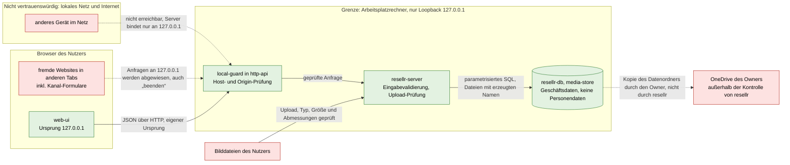

Die Kopie nach OneDrive verlässt die Kontrolle von resellr. Sie enthält Geschäftsdaten ohne Personendaten von Käufern oder Nutzer (Kap. 8.4).

### 8.3 Bedrohungen und Maßnahmen

| ID | Bedrohung | Maßnahme (verhältnismäßig) |
| --- | --- | --- |
| TH-01 | Zugriff von einem anderen Gerät im Netz | Bindung nur an Loopback, Startprüfung, Test (Kap. 11) |
| TH-02 | Fremde Website im selben Browser sendet Anfragen an den lokalen Server (CSRF, DNS-Rebinding), z. B. um Daten zu ändern oder resellr zu beenden | `local-guard` (Host-Allowlist, Ursprungsprüfung, nur JSON, keine CORS-Freigaben), lesende Anfragen ohne Seiteneffekte; die Beenden-Funktion ist eine ändernde Anfrage und unterliegt denselben Prüfungen. `resellr-launcher` ist kein Browser und sendet die Anfrage über Loopback ohne Browser-Ursprung; `local-guard` unterscheidet das an den Browser-Kopfzeilen (`Origin`, `Sec-Fetch-Site`), die genaue Regel legt die Technical Specification fest. |
| TH-03 | Eingeschleuster Code über selbst gepflegte Texte in der Oberfläche (XSS) | React escaped Ausgaben; kein Einfügen von rohem HTML; Content-Security-Policy `default-src 'self'` ohne Inline-Skripte. Ob einzelne Radix/shadcn-Bausteine zur Laufzeit Styles einfügen und dafür eine gezielte Ausnahme nur für Styles brauchen, prüft die Technical Specification (Review-Hinweis H-2); Inline-Skripte bleiben in jedem Fall ausgeschlossen. `launcher-pages` laufen ohne Skripte von außen. |
| TH-04 | Präparierte Bilddatei beim Upload | Typprüfung über die Dateisignatur (JPEG, PNG), Größen- und Pixelgrenze, Ablage unter erzeugtem Namen außerhalb des ausgelieferten Verzeichnisses, Auslieferung mit festem Bild-Inhaltstyp und `X-Content-Type-Options: nosniff` |
| TH-05 | Verlust, Defekt oder Diebstahl des PCs, Ransomware | **Vom Owner bewusst getragenes Risiko** (OD-03 b): Schutz nur durch die Handsicherung des Owners nach OneDrive (ADR-006). resellr unterstützt sie mit einem Datenordner, „resellr beenden“, Anleitung und dauerhaftem Hinweis. Empfehlung an den Owner: BitLocker einschalten (Windows 11) und ältere Kopien in OneDrive nicht sofort überschreiben, damit eine Kopie vor einem Ransomware-Befall erhalten bleibt (OneDrive-Versionsverlauf) |
| TH-06 | Unerlaubte ausgehende Verbindungen (REQ-079) | Server baut keine Verbindungen auf; CSP `connect-src 'self'`; Test mit Prüfung auf ausgehende Verbindungen (Kap. 11) |
| TH-07 | Verwundbare Abhängigkeiten | Lockfile, wenige Abhängigkeiten, `npm audit` und automatische Update-Vorschläge in der CI; Updates mit jedem Release |
| TH-08 | Andere Prozesse auf demselben PC greifen auf Loopback oder Datenordner zu | akzeptiertes Restrisiko: Einzelplatz-PC eines Nutzers. Ein Schadprogramm mit Benutzerrechten hätte ohnehin Zugriff auf die Dateien. Der Datenordner liegt im Benutzerprofil. |

### 8.4 Datenschutz

- resellr speichert **keine personenbezogenen Daten** von Käufern und vom Nutzer (REQ-069). Geschäftliche Kontaktangaben in `MerchantProfile` und `GpsrInfo` sind ausgenommen.
- Protokolleinträge, Freigaben, Abgleiche und Geräte enthalten keinen Nutzer (E-4).
- Das Fehlerprotokoll enthält keine Anfrageinhalte und keine Feldwerte, nur Funktion, Fehlerbeschreibung, technische IDs und Referenznummer.
- Die Daten bleiben auf dem Arbeitsplatzrechner und in den Kopien, die der Owner selbst in sein OneDrive legt. Microsoft ist dabei Anbieter des Owners, nicht von resellr. V-05 (Auftragsverarbeitung) betraf den Fall, dass MarloNET das System betreibt. Nach diesem Betriebsmodell betreibt der Owner es selbst auf seinem PC, und Personendaten von Käufern oder Nutzer gibt es nicht. Geschäftliche Kontaktangaben können aber Namen enthalten, z. B. die verantwortliche Person in der EU. Die rechtliche Bewertung von V-05 bleibt beim Owner. Diese Baseline ist keine Rechtsberatung.

---

## 9. Fehlerbehandlung und Konsistenz

### 9.1 Fehlerklassen und Abbildung

| Klasse | Beispiele | Verhalten des Servers | Darstellung in `web-ui` |
| --- | --- | --- | --- |
| Eingabe ungültig | Pflichtfeld fehlt, Datentyp, Länge, EAN-Prüfziffer | Ablehnung mit Liste der verletzten Regeln je Feld, keine Änderung | Meldung am Feld |
| Fachregel verletzt | WI-Nr vergeben, Prüfmarkierung offen, Freigabebedingung verletzt, Kreis bei Preisregeln | Ablehnung mit fachlichem Code und deutscher Nennung, keine Änderung | fachliche Meldung |
| Bestätigung nötig | Abweichung der Variantenangaben, ungeprüfter Rechtstext (REQ-087) | Antwort „Bestätigung erforderlich“ mit Details, keine Änderung | Rückfrage |
| Konflikt | Datensatz oder Kanal-Inhalt inzwischen geändert (Kap. 9.3) | Ablehnung, keine Änderung | Hinweis, Stand neu laden |
| Nicht gefunden | gelöschter oder unbekannter Datensatz | Ablehnung | Hinweis |
| Technischer Fehler | Datenbank- oder Dateifehler, Programmfehler | Rollback, Eintrag im Fehlerprotokoll mit Referenznummer, Zeitpunkt, Funktion und Beschreibung | Meldung nach REQ-073: deutsch, Funktion, nächster Schritt, Referenznummer, ohne technische Details |

Fehlertexte stehen in einem zentralen deutschen Meldungskatalog mit stabilen Fehlercodes. Der Code dient der Zuordnung im Programm. Angezeigt wird er nicht (REQ-073).

### 9.2 Validierungsschichten

1. **`web-ui`:** dieselben Zod-Schemas wie der Server, für sofortige Rückmeldung. Nicht verbindlich.
2. **`http-api`:** Prüfung von Struktur und Datentyp jeder Anfrage.
3. **Fachkomponenten:** Fachregeln und Prüfungen gegen den Datenbestand (Eindeutigkeit, Zustände, Vergleichsregel, Freigabebedingungen). Verbindlich.
4. **Datenbank:** eindeutige Indizes, Fremdschlüssel und Prüfbedingungen als letzte Sicherung.

### 9.3 Transaktionen und Nebenläufigkeit

- **Eine schreibende Aktion ist eine Transaktion.** Dazu gehören die Änderung selbst, die ausgelöste Neuberechnung der Kanal-Inhalte, Kennzeichnungen und alle Protokolleinträge. Entweder wird alles gespeichert oder nichts.
- **Ein Prozess, ein Schreiber:** `better-sqlite3` arbeitet synchron. Schreibende Transaktionen laufen nacheinander, Wettlaufsituationen zwischen Anfragen entstehen nicht. Eine Einzelinstanz-Sperre im Datenordner verhindert einen zweiten Server-Prozess auf denselben Daten. **v0.3.2 (H-8):** Sie ist eine Dateisperre des Betriebssystems, keine Datei mit Prozessnummer. Das Betriebssystem gibt sie mit dem Prozessende frei, auch nach einem Absturz, und eine bei laufendem resellr mitkopierte Sperrdatei blockiert den Start nach einer Wiederherstellung nicht.
- **Mehrere Fenster (RI-11):** Bearbeitbare Datensätze tragen eine Versionsnummer. Die Freigabe trägt den Inhalts-Hash des gesehenen Stands. **v0.3.2 (Cross-Check, UI-021):** „Abgleich bestätigen“ trägt die gesehenen Bestandsangaben, denn er bestätigt, dass der Kanal diesem Bestand entspricht. Ist der Datensatz, Stand oder Bestand inzwischen geändert, lehnt der Server mit „Konflikt“ ab. Das verhindert verlorene Änderungen und vor allem die **Freigabe eines Stands, den der Nutzer nicht gesehen hat**. Es sichert also den Grundsatz „Freigabe durch den Menschen“ (Brief Kap. 9). Der Aufwand ist gering, deshalb schlägt der Architekt diesen Mechanismus vor, obwohl RI-11 als Restrisiko akzeptiert ist.
- **Doppelklick:** Ein wiederholter Auftrag scheitert an der Versionsprüfung oder ist fachlich wirkungslos, z. B. eine zweite Freigabe eines bereits freigegebenen Stands. Eine weitere Idempotenzlogik ist nicht nötig.

### 9.4 Konsistenz zwischen Datenbank und Dateien

- **Upload:** Die Datei wird zuerst in ein temporäres Verzeichnis geschrieben, geprüft und unter ihrem Inhalts-Hash in den `media-store` verschoben. Erst danach wird der Datensatz gespeichert. Scheitert die Transaktion, bleibt eine Datei ohne Verweis zurück. Die Aufräumaufgabe entfernt sie.
- **Entfernen von Fotos:** Die Datenbank wird zuerst geändert. Die Datei wird erst gelöscht, wenn weder ein Modell-Inserat noch ein freigegebener Stand auf sie verweist. So zeigt der Kopier-Assistent den freigegebenen Stand mit seinen Fotos weiter, auch wenn ein Foto im Änderungsentwurf schon entfernt ist (REQ-045, REQ-047).
- **Aufräumen:** Täglich und beim Start entfernt `ops` Dateien ohne Verweis, die älter als 24 Stunden sind. **Schutzgrenzen (FIND-105):** Beim ersten Start nach einem ersetzten Datenordner (Kap. 9.6) entfällt das Aufräumen. Würde ein Lauf mehr als 20 Dateien oder mehr als 1 % der Dateien im `media-store` löschen, bricht er ohne Löschen ab und schreibt eine Warnung ins Fehlerprotokoll und in den Betriebsstatus. Bei einem Nutzer entstehen verwaiste Dateien nur einzeln, z. B. nach einem abgebrochenen Upload; viele auf einmal deuten auf eine inkonsistente Datenbank hin. Die Grenzwerte sind Vorschläge des Architekten.

### 9.5 Datenerhalt und Löschen

- Geräte werden nie gelöscht, nur storniert. Es gibt dafür keine Funktion und keinen Datenbankpfad (REQ-093, FIND-029).
- Modell-Inserate und Modellvorlagen werden nur über den Anwendungsfall nach REQ-095 gelöscht, nach den dortigen Bedingungen und mit Protokoll. Es gibt keine automatische Löschung von Fachdaten.
- Automatisch gelöscht werden nur Daten mit Löschfrist (Kap. 10.5).

### 9.6 Wiederholungen, Timeouts, Wiederherstellung

- **Keine Wiederholungslogik:** Externe Aufrufe gibt es nicht. Ausnahme: Ist die Datenbank kurz gesperrt, z. B. während eines Checkpoints, wartet der Zugriff bis zu 5 s (`busy_timeout`).
- **Absturz:** Endet `resellr-server` unerwartet mit einem Fehlercode, startet die Überwachung in `resellr-launcher` ihn neu, höchstens 3-mal in 10 Minuten (Vorschlag). SQLite im WAL-Modus stellt beim Start einen konsistenten Stand her; nicht abgeschlossene Transaktionen sind verworfen. Nach einem **geordneten Beenden** (Exit-Code 0) und nach einem **abgebrochenen Start** (eigener Exit-Code) startet sie nicht neu und endet selbst (Ablauf 4a, 4b); die Verknüpfung „resellr“ startet sie wieder.

**Lebenszyklus der Überwachung (v0.3.2, FIND-110).** Auf Baseline-Ebene gilt die folgende Strategie; Exit-Codes, Wartezeiten und den Mechanismus der Sperre legt die Technical Specification nach dem Windows-Spike fest.
- **Genau eine Überwachung je Windows-Sitzung:** Die Überwachung hält eine Sperre des Betriebssystems, die nur innerhalb der Sitzung des Owners gilt (Kandidaten: benanntes Mutex der Sitzung oder Dateisperre im Protokollordner). Autostart und Verknüpfung „resellr“ versuchen, die Sperre zu übernehmen. Gelingt das nicht, läuft bereits eine Überwachung; der Aufrufer startet dann keine zweite, sondern wartet auf Bereitschaft (Ablauf 4b). Das Betriebssystem gibt die Sperre mit dem Ende des Prozesses frei, auch nach einem Absturz der Überwachung.
- **Neustartgrenze:** Nach dem dritten Absturz in 10 Minuten schreibt die Überwachung das Ereignis „Neustart aufgegeben“ mit Referenznummer in das Betriebsprotokoll und in das Startergebnis der Zustandsdatei und **endet**. Die Auswertung zählt die Zeit danach bis zum nächsten erfolgreichen Start als „nicht verfügbar“ (Kap. 7.3). Ein wartender Aufruf über „resellr“ zeigt „Start abgebrochen“ mit dieser Referenznummer. Der nächste Aufruf von „resellr“ oder die nächste Anmeldung startet eine neue Überwachung mit neuem Zähler.
- **„läuft bereits“:** Findet `resellr-server` die Einzelinstanz-Sperre des Datenordners belegt, endet er sofort mit einem eigenen Exit-Code, ohne Daten anzufassen. Die Überwachung startet dann nicht neu, zählt das nicht als Absturz, protokolliert eine Warnung und endet. Antwortet ein Server auf die Statusabfrage, bleibt er nutzbar, läuft aber bis zur nächsten Anmeldung ohne Neustart nach Absturz; der Betriebsstatus zeigt die Warnung (X-8). Mit der folgenden Kopplung tritt das nur auf, wenn die Kopplung versagt hat.
- **Kopplung des Servers an die Überwachung:** Unter Windows endet ein Kindprozess nicht von selbst mit seinem Elternprozess. `resellr-server` erkennt deshalb das Ende der Überwachung (z. B. am geschlossenen Kommunikationskanal zum Elternprozess), schließt die Datenbank nach einem Checkpoint und endet; den Grund protokolliert er. Als Absicherung, falls der Server hängt, startet die Überwachung ihn in einem Windows-Job-Objekt, das seine Prozesse beim Schließen beendet. Ob Node.js Kindprozesse unter Windows bereits so einbindet, prüft der Spike. So bleibt kein unüberwachter Server zurück, und eine neue Überwachung startet keinen zweiten Server.
- **Art des Endes bei Abmelden und Herunterfahren:** siehe nächster Punkt und Rückfallweg zu Spike-Punkt 4 (Kap. 10.2, H-10).
- **Art des letzten Endes:** Der Betriebsstatus unterscheidet drei Fälle. „Vom Nutzer beendet“: geordnetes Beenden, Ende-Markierung vorhanden. „Abgestürzt“: Die Überwachung hat ein unerwartetes Prozessende protokolliert. „Ohne geordnetes Beenden“: keine Ende-Markierung und kein protokollierter Absturz, typisch beim Abmelden, Herunterfahren oder Stromausfall. Abmelden und Herunterfahren gelten damit nicht als Absturz (FIND-106). Ob der Server beim Abmelden noch geordnet beenden kann, klärt der Windows-Spike (Kap. 10.2); nötig ist es nicht, weil WAL einen konsistenten Stand sichert.

**Geordnetes Beenden (REQ-105, Ablauf 4a, FIND-104).**
- **Ablauf:** `ops` setzt den Zustand „wird beendet“. Ab dann weist `http-api` neue schreibende Aufträge mit einer eigenen Meldung ab. Eine bereits laufende schreibende Aktion darf höchstens 10 s zu Ende laufen (Vorschlag). Datenbanktransaktionen laufen mit `better-sqlite3` synchron und sind kurz; länger dauern nur Aktionen mit Dateiarbeit, z. B. ein Foto-Upload. Ist die Aktion nach 10 s nicht fertig, bricht `ops` sie vor ihrer Transaktion ab. Danach folgen Checkpoint der WAL-Datei, Schließen der Datenbank und Schreiben der **Ende-Markierung** (kleine Datei im Datenordner mit Zeitpunkt und Programmversion).
- **Bestätigung erst nach Erfolg:** `http-api` bestätigt das Beenden erst, wenn alle drei Schritte gelungen sind. Erst dann endet der Prozess mit Exit-Code 0. Damit gilt REQ-105: Alle bis zur Bestätigung gespeicherten Daten sind im Datenordner, und die Datenbank ist eine einzige, in sich vollständige Datei.
- **Was als gespeichert gilt:** Eine Aktion ist gespeichert, sobald der Server sie bestätigt hat. Was vor dem Beenden nicht bestätigt war, also auch eine nach 10 s abgebrochene Aktion, gilt als nicht gespeichert. Es wird nicht teilweise gespeichert, weil jede schreibende Aktion eine Transaktion ist (Kap. 9.3). Bei einem Nutzer tritt das nur auf, wenn er in einem zweiten Fenster gleichzeitig speichert; die Rückfrage nach REQ-105 nennt den Verlust nicht gespeicherter Eingaben.
- **Fehlerpfad:** Scheitert einer der Schritte, z. B. durch einen E/A-Fehler, einen vollen Datenträger oder eine Datei, die ein anderes Programm sperrt, öffnet `ops` die Datenbank bei Bedarf wieder, hebt den Zustand „wird beendet“ auf und schreibt einen Eintrag mit Referenznummer ins Fehlerprotokoll. `http-api` antwortet mit einer Meldung nach REQ-073. resellr läuft weiter, der Hinweis bleibt sichtbar (REQ-105). Eine Ende-Markierung entsteht in diesem Fall nicht.

**Startprüfung des Datenordners (Ablauf 4b, FIND-105).** Beim Start prüft `ops` in dieser Reihenfolge:
1. **Vorhandensein und Schemaversion:** Fehlt die Datenbank, obwohl der `media-store` Dateien enthält, bricht der Start ab, statt einen leeren Bestand anzulegen. Stammt die Datenbank von einer neueren Programmversion, bricht der Start ab. Ist sie älter, folgen Kopie und Migration (Kap. 10.6).
2. **Struktur:** `quick_check` bei jedem Start; vollständige `integrity_check` (prüft zusätzlich Indizes gegen Tabellen) bei einem ersetzten Datenordner. Bei Befund bricht der Start ab.
3. **Ersetzter Datenordner:** `ops` schreibt bei jedem Start eine neue **Kennung des Datenordner-Stands** in die Datenbank und in die Zustandsdatei in `app-logs`. Weichen beide beim nächsten Start voneinander ab, oder fehlt die Zustandsdatei wie bei einer frischen Installation, ist der Datenordner ersetzt oder neu, z. B. durch eine Wiederherstellung.
4. **Nur bei ersetztem Datenordner:** Prüfung, ob jede Datei vorhanden ist, auf die die Datenbank verweist; kein Löschen verwaister Dateien bei diesem Start (Kap. 9.4).
5. **Ende-Markierung:** Fehlt sie bei einem ersetzten Datenordner, entstand die Kopie nicht nach einem geordneten Beenden, z. B. bei laufendem resellr. Fehlt sie im selben Datenordner, ist resellr zuletzt ohne geordnetes Beenden geendet (Art des Endes, siehe oben). Nach erfolgreicher Prüfung entfernt `ops` die Markierung, denn ab jetzt läuft resellr wieder.

Bei Abbruch (Schritt 1 oder 2, gescheiterte Migration) schreibt `ops` den Grund mit Referenznummer ins Fehlerprotokoll und das Ergebnis in die Zustandsdatei und endet mit dem Exit-Code „Start abgebrochen“. `resellr-launcher` zeigt die Rückmeldung „Start abgebrochen“ mit dieser Referenznummer (Ablauf 4b). Befunde aus Schritt 4 und 5 brechen den Start **nicht** ab, denn eine unvollständige Kopie ist für den Owner meist besser als keine. Sie stehen mit Anzahl bzw. Art im Betriebsstatus und im Fehlerprotokoll; die Anzeige in `web-ui` klärt der Product Owner (Kap. 6.3, X-5).

**Was die Startprüfung erkennt und was nicht:**

| Lage | Erkannt? | Folge |
| --- | --- | --- |
| Datenbank strukturell beschädigt | ja (Schritt 2) | Start abgebrochen, Meldung mit Referenznummer |
| Datenbank aus neuerer Programmversion | ja (Schritt 1) | Start abgebrochen |
| Kopie nicht nach geordnetem Beenden entstanden | ja, als Verdacht (Schritt 5) | Start mit Befund „neueste Änderungen fehlen möglicherweise“ |
| Datenbank verweist auf Fotos, die in der Kopie fehlen | ja (Schritt 4) | Start mit Befund und Anzahl fehlender Fotos |
| Kopie bei laufendem resellr, strukturell intakt, aber mit älterem Stand, z. B. ohne die WAL-Datei | **nur als Verdacht** über die fehlende Ende-Markierung; welche Änderungen fehlen, ist nicht erkennbar | Owner arbeitet mit dem älteren Stand weiter |
| Fotos in der Kopie, die die Datenbank nicht kennt | ja, beim nächsten Aufräumen | wegen Schutzgrenze kein Massenlöschen (Kap. 9.4) |
| Kopie unvollständig, weil nur Teile des Datenordners kopiert wurden | ja: fehlende Datenbank bei vorhandenen Fotos (Schritt 1), fehlende Fotos (Schritt 4); nicht erkennbar: fehlende Konfigurationsdatei (dann gelten Standardwerte) | Abbruch bzw. Befund; die Anleitung verlangt das Kopieren des ganzen Ordners |

Damit ist das Restrisiko einer Kopie bei laufendem resellr verkleinert, aber nicht beseitigt (AR-14). Die wirksame Maßnahme bleibt das Kopieren nach „resellr beenden“.

---

## 10. Zuverlässigkeit und Betrieb

### 10.1 Deployment

**Wo läuft was, und welche Grenzen gibt es?** Alles läuft im Benutzerprofil des Owners auf dem Arbeitsplatzrechner unter Windows 11. Der Port 4310 ist ein Vorschlag und einstellbar. Die Ordnernamen sind beispielhaft; die genauen Pfade legt die Technical Specification fest.

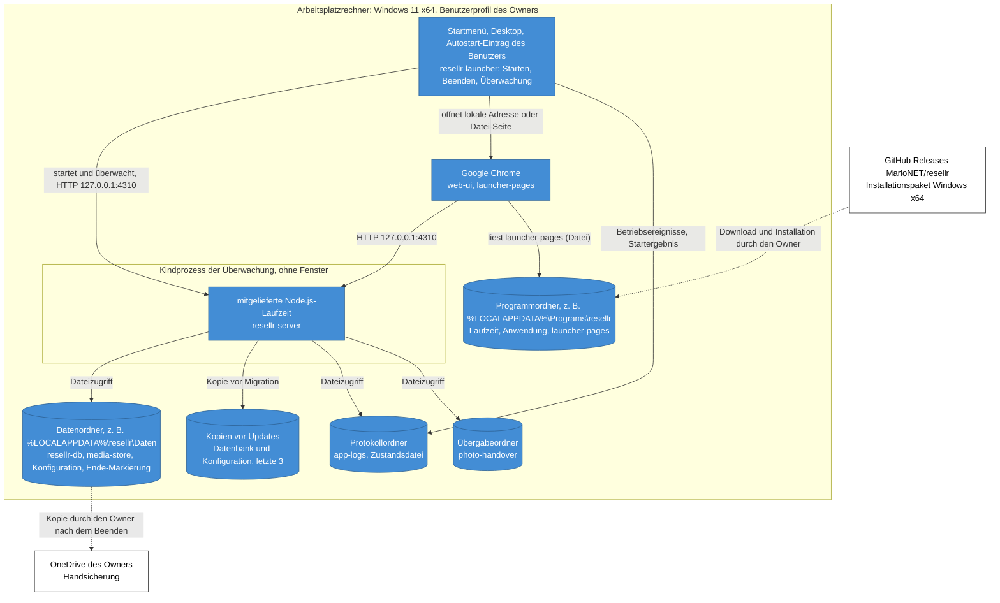

### 10.2 Installation und Konfiguration

- **Installationspaket für Windows 11 x64**, gebaut von der CI. Es enthält die Node.js-Laufzeit, die Anwendung, `resellr-launcher` und `launcher-pages`. Die Installation läuft im Benutzerprofil, **ohne Adminrechte**:
  - Programmdateien im Benutzerprofil (z. B. `%LOCALAPPDATA%\Programs\resellr`),
  - **Datenordner** `%LOCALAPPDATA%\resellr\Daten` (Beispiel) mit Datenbank, `media-store` und Konfiguration (REQ-106). Er liegt bewusst **nicht** in „Dokumente“ oder „Desktop“, weil Windows diese Ordner oft mit OneDrive synchronisiert und eine Synchronisierung der laufenden Datenbank sie beschädigen kann (ADR-006),
  - Protokollordner und Übergabeordner außerhalb des Datenordners (sie gehören nicht in die Sicherung),
  - **Autostart-Eintrag des Benutzers** (`HKCU\Software\Microsoft\Windows\CurrentVersion\Run`), der bei der Anmeldung die Überwachung in `resellr-launcher` startet; keine Aufgaben in der Windows-Aufgabenplanung,
  - Verknüpfungen „resellr“ (Startmenü und Desktop) und „resellr beenden“ (Startmenü) auf `resellr-launcher`.
- **Hosting-Mechanismus (FIND-106).** v0.2 sah die Windows-Aufgabenplanung für Autostart, Neustart nach Absturz und `health-probe` vor. Das ist nicht belegt und hat bekannte Fallstricke: Die Einstellung „bei Fehler neu starten“ greift nicht verlässlich bei einem Prozessende mit Fehlercode; `node.exe` ist ein Konsolenprogramm und öffnet ohne Vorkehrung ein sichtbares Fenster, dessen Schließen den Server ungeordnet beendet; ob sich ein Anmelde-Trigger ohne Adminrechte anlegen lässt, hängt von der Art der Anlage ab. Seit v0.3 gilt deshalb:
  - **Autostart** über den Autostart-Eintrag des Benutzers, der ohne Adminrechte angelegt werden kann.
  - **Überwachung** in `resellr-launcher`: Er startet `resellr-server` als Kindprozess ohne Fenster und startet ihn nur nach einem Absturz neu (Kap. 9.6). Er übernimmt `health-probe` (Kap. 7.3).
  - **Unsichtbarer Start:** Weder Überwachung noch Server dürfen ein Konsolenfenster zeigen. Der Mechanismus wird im Spike festgelegt; Kandidaten sind ein kleiner Start-Baustein mit Windows-Oberflächen-Subsystem, der `node.exe` ohne Fenster startet, oder eine dafür umgestellte Kopie von `node.exe`. VBScript scheidet aus, weil Microsoft es abgekündigt hat.
- **Windows-Spike (früh, vor Abschluss der Technical Specification, etwa 1 Entwicklertag, Ergebnis in der Technical Specification).** Auf einem Windows-11-Rechner mit Standardbenutzer ohne Adminrechte wird belegt:
  1. Installation ins Benutzerprofil und Autostart-Eintrag ohne Adminrechte; Start bei der Anmeldung,
  2. kein sichtbares Konsolenfenster für Überwachung und Server, auch nicht kurzzeitig,
  3. Neustart nach erzwungenem Prozessende des Servers, kein Neustart nach geordnetem Beenden und nach abgebrochenem Start; **ergänzt in v0.3.2 (FIND-110):** Ende der Überwachung mit „Neustart aufgegeben“ nach der Neustartgrenze; genau eine Überwachung, wenn Autostart und Verknüpfung „resellr“ kurz nacheinander starten; Exit-Code „läuft bereits“ ohne Neustart und ohne Zählung als Absturz; Ende des Servers nach erzwungenem Ende der Überwachung (Kopplung über den Kommunikationskanal und das Job-Objekt),
  4. Verhalten beim Abmelden und Herunterfahren: Wird der Server beendet, entsteht ein konsistenter Stand, und der Betriebsstatus zeigt „ohne geordnetes Beenden“ statt „abgestürzt“,
  5. Verhalten der nativen Module (`better-sqlite3`, `sharp`) und des Start-Bausteins unter SmartScreen und unter Smart App Control (Intelligente App-Steuerung) im Modus „Ein“,
  6. **neu in v0.3.2 (Ä-28):** nutzbare Fläche der Seite bei 1366 × 768 und 100 % Skalierung im maximierten normalen Chrome-Fenster und im App-Fenster; der Wert wird Viewport der E2E-Tests für REQ-077.
- **Rückfallwege, falls der Spike scheitert:** für den Autostart eine Verknüpfung im Autostart-Ordner des Benutzers statt des Registry-Eintrags; für den unsichtbaren Start der jeweils andere Kandidat; für die Überwachung die Aufgabenplanung mit Anmelde-Trigger nur für den Start, Neustart weiterhin durch die Überwachung. **Für Punkt 4 (v0.3.2, H-10):** Erhält die Überwachung kein verwertbares Signal zum Ende der Windows-Sitzung, wertet sie ein Ende des Servers, auf das innerhalb weniger Sekunden ihr eigenes Ende folgt, beim nächsten Start als „ohne geordnetes Beenden“; der Neustartversuch in dieser Zeit ist unschädlich. Gelingt auch das nicht, wird die Fehleinordnung als „abgestürzt“ bewusst hingenommen; sie betrifft nur die Anzeige der Art des letzten Endes, nicht die Daten. Für Smart App Control gibt es keinen technischen Rückfallweg: Ist sie auf dem PC des Owners aktiv, ist die Code-Signierung aller ausgelieferten Programmdateien Pflicht (AR-13, AR-15, OD-09). Die Architektur bleibt in allen Fällen gleich, nur der Hosting-Mechanismus wechselt.
- **Unsigniertes Paket:** Ohne Code-Signierung zeigt Windows SmartScreen bei der Installation eine Warnung, die der Owner einmal bestätigt (AR-13). Das gilt nur, wenn Smart App Control nicht aktiv ist.
- **Erster Start:** Migrationen legen die Datenbank an, `ops` spielt die Startbelegung nach REQ-006 ein. Die Startbelegung ist Daten, kein Code, und enthält keine kundenspezifischen Inhalte (REQ-074).
- **Konfiguration:** eine Datei im Datenordner mit Port und Übergabeordner. Die Bindeadresse ist fest `127.0.0.1` und kein Konfigurationswert (Kap. 8.1). Die Konfiguration enthält keine Geheimnisse und keinen Zustand des Sicherungshinweises (REQ-104).
- **Anzeige des Speicherorts:** Der Betriebsstatus liefert den tatsächlichen, vollständigen Speicherort des Datenordners, damit Hinweis (REQ-104) und Anleitung ihn zeigen können. Die Anleitung muss ihn nicht kennen. `resellr-launcher` liest ihn für `launcher-pages` aus der Installation.

### 10.3 Betriebsverantwortung

| Aufgabe | Wer | Wie |
| --- | --- | --- |
| Installation, Updates | Owner als Betreiber (Vorschlag, OD-02) | nach Betriebshandbuch; MarloNET liefert Releases |
| Datensicherung | **Owner, freiwillig, von Hand** (E-7) | resellr beenden, Datenordner nach OneDrive kopieren (Kap. 10.4); resellr erinnert dauerhaft daran (REQ-104) |
| Wiederherstellung | Owner | nach Betriebshandbuch: resellr installieren, beenden, Datenordner zurückkopieren, starten (Kap. 10.4) |
| Prüfung des Datenordners vor Pilotstart (AC-REQ-106-01) | MarloNET (QA) | einmal vor Pilotstart nach Kap. 11.2; der frühere Wiederherstellungstest nach REQ-066 v0.3 entfällt mit v0.3.2 |
| Fehleranalyse | Owner meldet die Referenznummer; ein Entwickler liest `app-logs` | Kap. 10.7 |
| Verfügbarkeitsauswertung | Owner, monatlich | Auswerteskript (Kap. 7.3, OD-05) |

Ein Betriebshandbuch auf Deutsch gehört zum Lieferumfang von Release 0.1 (Installation, Start und Beenden, Handsicherung, Wiederherstellung, Update, Fehlermeldung).

### 10.4 Datensicherung durch den Owner und Wiederherstellung (ADR-006, OD-03 b, KF-01)

**Grundsatz:** resellr hat in Release 0.1 **keine eigene Sicherungs- und keine Wiederherstellungsfunktion** (E-7, Requirements Kap. 14). Der Owner sichert selbst und freiwillig; Ziel ist sein OneDrive. resellr läuft ohne Sicherung normal weiter. Weil die Daten nur auf einem PC liegen, ist das ein bewusst vom Owner getragenes Risiko (AR-01, RI-13). resellr kann nicht erkennen, ob und wann gesichert wurde.

**Was resellr dafür bereitstellt:**
- **Ein Datenordner (REQ-106):** Datenbank, Fotos, Logo und Konfiguration liegen in einem Ordner (Kap. 10.2). Eine Kopie dieses Ordners nach „resellr beenden“ ist eine vollständige Sicherung. Protokolle, Übergabeordner und Programmdateien gehören nicht dazu.
- **„resellr beenden“ (REQ-105)** am Hinweis in der Oberfläche, zusätzlich als Betreiberwerkzeug im Startmenü (Ablauf 4a). Nach dem bestätigten Beenden besteht die Datenbank aus einer einzigen, in sich vollständigen Datei, die WAL-Datei ist aufgelöst und die Ende-Markierung liegt im Datenordner. Erst dann ist eine Kopie sicher brauchbar. Scheitert das Beenden, läuft resellr mit Meldung weiter (Kap. 9.6).
- **Betriebsstatus** mit Speicherort und Größe des Datenordners, freiem Speicher und Art des letzten Endes sowie die Aktion **„Datenordner im Explorer öffnen“** (Kap. 6.1).
- **Dauerhaft sichtbarer Hinweis „Sicherung einrichten“ (REQ-104)** mit den Aussagen (a) bis (d) und dem Speicherort des Datenordners, bei jedem Öffnen sichtbar und nicht ausblendbar. Ort und Gestaltung legt das UI/UX-Design über den Product Owner fest.
- **Anleitung** im Betriebshandbuch und im Hinweis.

**Anleitung zur Handsicherung (Inhalt, Wortlaut durch Design und Betriebshandbuch):**
1. resellr beenden („resellr beenden“ in der Oberfläche oder im Startmenü).
2. Den Datenordner im Explorer öffnen und **als Ganzes** in einen Ordner im OneDrive kopieren, z. B. mit Datum im Namen. Ältere Kopien eine Weile behalten.
3. resellr wieder starten (Verknüpfung „resellr“).

**Regeln, die die Anleitung nennen muss:**
- Den Datenordner **nicht selbst in OneDrive verschieben** und nicht von OneDrive synchronisieren lassen. Eine Synchronisierung der laufenden Datenbank kann sie beschädigen. Nach OneDrive gehören nur Kopien.
- Kopieren, während resellr läuft, kann eine unbrauchbare oder unbemerkt veraltete Datenbankkopie ergeben (REQ-104 Aussage d, AR-14).

**Wiederherstellung (Handlung des Owners, keine Funktion von resellr):** resellr installieren, „resellr beenden“, den Inhalt des Datenordners durch die Kopie ersetzen, resellr starten. Die Startprüfung (Kap. 9.6) erkennt den ersetzten Datenordner und prüft dann vollständig: Eine beschädigte Kopie oder eine Kopie aus einer neueren Programmversion startet nicht; fehlende Fotos und eine fehlende Ende-Markierung erscheinen als Befund; verwaiste Dateien werden bei diesem Start nicht gelöscht. Eine strukturell intakte, aber veraltete Kopie erkennt sie nur als Verdacht (Tabelle in Kap. 9.6). Eine Kopie aus einer älteren Version wird beim Start migriert. Dauer: Minuten bis Stunden, je nach Fotobestand.

**Verhältnis zu den Requirements:** Datenverlust und Wiederherstellungszeit hängen allein davon ab, wie oft der Owner sichert. Die Werte aus REQ-066 v0.3 (RPO ≤ 24 h, RTO ≤ 2 Arbeitstage, 30 Tage Aufbewahrung, Wiederherstellungstest) entfallen mit v0.3.2 (REQ-066 *Withdrawn*, E-7). An ihre Stelle treten REQ-104 bis REQ-106, die diese Baseline vollständig trägt (Kap. 14.1); REQ-105 und REQ-106 sind aus E-7 abgeleitet und stehen zur Owner-Bestätigung (v0.3.3, OP-17). Bis zur Owner-Freigabe von v0.3.3 gilt Kap. 13.4.

**Nachrüstbar:** Eine automatische Sicherung in einen vom Owner gewählten Ordner lässt sich später ohne Umbau ergänzen, etwa 1 bis 2 Entwicklertage (Kap. 5.3).

### 10.5 Löschfristen und Housekeeping

| Daten | Frist | Umsetzung | Quelle |
| --- | --- | --- | --- |
| Protokolleinträge | 24 Monate, dann löschen, spätestens 7 Tage danach | tägliche Aufgabe und Aufgabe beim Start in `audit` | REQ-072 |
| Fehler- und Verfügbarkeitsprotokoll | 30 Tage | tägliche Rotation, 30 Tagesdateien bleiben erhalten | REQ-073 |
| Kopien vor Updates | die letzten 3 bleiben erhalten | `ops` beim Anlegen einer neuen Kopie | Vorschlag des Architekten |
| Übergabeordner | 7 Tage | tägliche Aufgabe | Vorschlag des Architekten |
| Dateien ohne Verweis | 24 Stunden nach Entstehen | tägliche Aufgabe mit Schutzgrenze | Kap. 9.4 |

**Hinweise zur Löschfrist der Protokolleinträge:**
- Läuft der PC länger als 7 Tage nicht, erfolgt die Löschung beim nächsten Start.
- In den Handsicherungen des Owners bleiben Protokolleinträge so lange erhalten, wie der Owner die Kopien aufbewahrt. Das liegt beim Owner (bisher OD-06, entfällt). Das Protokoll enthält keine Personendaten.

### 10.6 Updates und Migrationen

- MarloNET veröffentlicht Releases als Installationspaket in GitHub Releases. Es gibt keine automatische Update-Prüfung, weil der Server keine Verbindungen ins Netz aufbaut (Kap. 2.6). Der Owner lädt und installiert Updates manuell, möglichst außerhalb der Geschäftszeiten.
- **Ablauf:** Das Installationspaket beendet resellr geordnet (die Überwachung endet damit ebenfalls), ersetzt die Programmdateien und startet resellr über `resellr-launcher`. Scheitert das geordnete Beenden, bricht die Installation ab, ohne Dateien zu ersetzen. Beim Start erkennt `ops` eine neuere Schemaversion und legt **vor den Migrationen automatisch eine lokale Kopie** von Datenbank (Online-Backup-API) und Konfiguration an. Danach laufen die Migrationen in einer Transaktion, nur vorwärts. Migrationen ändern keine Dateien im `media-store`; deshalb genügt die Kopie von Datenbank und Konfiguration.
- **Zweck der Kopie:** Sie schützt nur vor einem fehlerhaften Update. Sie liegt auf demselben PC und **ersetzt keine Sicherung**. Sie ist ein Schritt des Update-Vorgangs und keine Sicherung im Sinne von Requirements Kap. 14 (Startannahme A-37, offener Punkt OP-32; Stellungnahme des Architekten in Kap. 13.3).
- **Fehlschlag:** Scheitert eine Migration, startet der Server nicht und protokolliert den Fehler. Der Owner installiert die vorige Version und kopiert die Datenbank aus der Kopie vor dem Update zurück. Das Betriebshandbuch beschreibt das.
- **Änderung der Kanal-Engine:** Ändert ein Update die Bildung von Kanal-Inhalten, entstehen bei freigegebenen Kanal-Inhalten Änderungsentwürfe bzw. Rückfälle auf *Entwurf*. Das ist fachlich richtig, weil der Mensch freigibt. Die Release-Notizen müssen es aber nennen (AR-04).

### 10.7 Logging, Diagnose und Überwachung

- **Fehlerprotokoll (REQ-073):** strukturierte Einträge im JSON-Lines-Format mit Zeitpunkt, Funktion, Fehlerbeschreibung, Stacktrace (nur im Protokoll), Referenznummer und Version. Es enthält keine Feldwerte und keine Anfrageinhalte (Kap. 8.4).
- **Verfügbarkeitsprotokoll:** Einträge von `health-probe` in der Überwachung, nur bei OD-05 (a) (Kap. 7.3).
- **Betriebsereignisse:** Start, geordnetes Beenden („vom Nutzer beendet“, Quelle `ops`), gescheitertes Beenden, Absturz und Neustart durch die Überwachung, „Neustart aufgegeben“, „läuft bereits“, Ende der Überwachung, Ende des Servers nach Ende der Überwachung, Start nach einem Ende ohne geordnetes Beenden, abgebrochener Start (Startprüfung, Migration), ersetzter Datenordner mit Befunden. `resellr-launcher` und `resellr-server` schreiben in denselben Protokollordner.
- **Warnungen:** wenig freier Speicher, gescheiterte Aufräumaufgaben, Aufräumen wegen Schutzgrenze abgebrochen, Start nach Absturz, Autostart-Eintrag fehlt, Server läuft ohne Überwachung („läuft bereits“). Ob und wo `web-ui` sie zeigt, ist Punkt X-8 (Kap. 6.3).
- **Überwachung:** Es gibt keine zentrale Überwachung und keine Alarme nach außen. Das passt zu einem Einzelplatzbetrieb ohne Betriebsteam und zu REQ-079. Fehler werden über die Nutzermeldung mit Referenznummer sichtbar.

---

## 11. Test- und Verifikationsstrategie

### 11.1 Testebenen

| Ebene | Gegenstand | Werkzeug |
| --- | --- | --- |
| Unit | `content-engine` vollständig: Titelmuster, Kürzung, Beschreibung mit Weglassregeln, Merkmalsfelder, Platzhalter einschließlich `{Akkukapazität}`, Kennungen, GPSR. Dazu Vergleichsregel der Variantenangaben, Statusübergänge und Kennzeichnungen, EAN-Prüfziffer, Normalisierung | Vitest, tabellengesteuerte Fälle aus den ACs |
| Golden Files | vollständige Kanal-Inhalte für festgelegte Testdaten je Kanal; erkennt ungewollte Änderungen an der Kanal-Engine (AR-04) | Vitest Snapshots, im Repository geprüft |
| Integration | Anwendungsfälle gegen eine echte SQLite-Datei: Transaktionen, Rollback, Protokolleinträge, Neuberechnung, Konfliktprüfung, Datei-Konsistenz | Vitest mit temporärem Datenverzeichnis |
| API | Anfragen ohne Netzwerk, einschließlich `local-guard` (falscher Host, fremder Ursprung) | Fastify `inject` |
| End-to-End | Nutzerreisen J-01 bis J-06 im Browser, Zwischenablage, Foto-Übergabe, Datenblatt, schmale Ansicht bei 480 × 768, Hinweis „Sicherung einrichten“ bei jedem Öffnen, „resellr beenden“ mit Abbruch, Erfolg und Endzustand | Playwright mit Google Chrome (Kanal `chrome`) |
| Last | synthetischer Bestand nach A-12, Antwortzeiten je Aktionstyp, Neuberechnung im ungünstigsten Fall | eigener Datengenerator, Messskript |
| Betrieb | geordnetes Beenden (Datenbank danach eine Datei, Ende-Markierung, kein Neustart); Fehlerpfad des Beendens durch Fehlerinjektion (Checkpoint, Schließen, Ende-Markierung) mit Prüfung „läuft weiter, Meldung mit Referenznummer“; Abweisen neuer Schreibaufträge während des Beendens; Kopie des Datenordners nach dem Beenden in eine frische Installation zurückspielen (AC-REQ-106-01); Startprüfung mit beschädigter, zu neuer, fehlender und während des Betriebs kopierter Datenbank sowie mit fehlenden Fotos; Schutzgrenze beim Aufräumen; Kopie vor Migration und Migration auf Kopie eines Bestands; Löschfristen mit verstellter Uhr | Integrationstests und Skripte; Installationspaket, Autostart, unsichtbarer Start, Überwachung und `resellr-launcher` mit `launcher-pages` im Windows-Spike (Kap. 10.2), danach auf einem Windows-11-Runner der CI und bei der Abnahme auf dem Arbeitsplatzrechner |

Die Uhrzeit ist im Server austauschbar (Clock-Abstraktion). Damit lassen sich Löschfristen, „nicht in der Zukunft“ und die Aufbewahrung des Übergabeordners ohne Warten testen.

### 11.2 Nachweis der nicht-funktionalen Anforderungen

| REQ | Nachweis |
| --- | --- |
| REQ-060, REQ-061, REQ-064 | Lasttest mit synthetischem Bestand nach A-12, je Aktionstyp ≥ 50 Messungen |
| REQ-062, REQ-063, REQ-080 | Messung beim Pilotbetrieb nach Requirements. Die Architektur trägt kurze Antwortzeiten bei. |
| REQ-065 | je nach OD-05: (a) Betriebsereignisse, `health-probe` und Monatsauswertung (Kap. 7.3) oder (b) Störungsprotokoll des Nutzers nach v0.3.3, abgeglichen mit Fehler- und Betriebsprotokoll. In beiden Fällen bleiben Zeiten nach einem Beenden bis zum nächsten Startversuch außerhalb von Ausfall und Geschäftszeit (v0.3.3); bei (a) liefert das Betriebsereignis „vom Nutzer beendet“ ihren Beginn, das Ereignis „Start“ ihr Ende |
| REQ-104 (v0.3.2) | E2E: AC-REQ-104-01 (Hinweis mit Aussagen a bis d und Speicherort bei jedem Öffnen), AC-REQ-104-02 (J-01 ohne Bestätigung), AC-REQ-104-03 (keine Aktion oder Einstellung blendet aus), AC-REQ-104-04 (Systemdatum + 400 Tage über die Clock-Abstraktion), AC-REQ-104-05 (nach Kopie und Neustart); AC-REQ-104-06 nur bei OD-02 B |
| REQ-105 (v0.3.2) | E2E und Betriebstest: AC-REQ-105-01 und -02 (Rückfrage, Abbruch ohne Änderung), AC-REQ-105-03 (Beenden mit gespeichertem Preis, Wert nach Neustart), AC-REQ-105-04 (Wert in der Kopie, zusammen mit AC-REQ-106-01); Fehlerpfad nach Kap. 9.6 per Fehlerinjektion; AC-REQ-105-05 nur bei OD-02 B |
| REQ-106 (v0.3.2) | AC-REQ-106-01 (Fassung v0.3.3) vor Pilotstart: Testbestand, Beenden – bei OD-02 A durch den Nutzer über REQ-105, bei B durch den Betreiber am PC über die Startmenü-Verknüpfung „resellr beenden“ außerhalb der Funktionen von `web-ui` (A-36) –, Kopie in eine zweite, leere Installation derselben Version, Stichprobe 20 Datensätze, 20 Fotos, Logo und jede geänderte Einstellung; zusätzlich automatischer Test, dass `resellr-server` außerhalb des Datenordners nur in Protokoll-, Übergabe- und Update-Kopie-Ordner schreibt |
| REQ-066 | *Withdrawn in v0.3.2* (E-7), kein Nachweis. Der frühere Vorschlag eines Wiederherstellungstests ist in AC-REQ-106-01 aufgegangen. |
| REQ-067, REQ-097, REQ-001 | Variante A (OD-02): Test nach AC-REQ-001-07 (v0.3.1): Server-Start auf dem Testrechner, Verbindungsversuch von einem zweiten Gerät über die Netzwerkadresse des Rechners schlägt fehl; dazu AC-REQ-001-05 (alle Funktionen ohne Anmeldung). Variante B: Sicherheitstests nach REQ-067 und AC-REQ-001-01 bis -09, AC-REQ-097-01 bis -05 |
| REQ-103 (v0.3.1) | Bestandsvergleich vor und nach J-01 bis J-06, Test mit 25 Monate alten Datensätzen (keine automatische Löschung), Code-Review: kein Löschpfad für Geräte (Kap. 9.5) |
| REQ-068, REQ-069 | Review von Datenmodell und Eingabefeldern gegen Kap. 4.4; automatischer Test, dass keine Felder für Zugangsdaten oder Personen existieren |
| REQ-072 | Testfall je Änderungsart; Löschtest mit rückdatierten Einträgen (23 Monate vorhanden, 24 Monate plus 8 Tage gelöscht) |
| REQ-073 | Fehlerinjektion in 5 Funktionen, Prüfung von Protokolleintrag und Nutzermeldung |
| REQ-074 | Testkonfiguration „Testhändler“; Suche nach kundenspezifischen Begriffen in Kanal-Inhalten, Datenblatt, Quellcode und ausgeliefertem Bundle |
| REQ-075 | Golden-File-Vergleich aller bestehenden Kanal-Inhalte vor und nach dem Hinzufügen eines Testkanals bzw. dem Deaktivieren eines Kanals |
| REQ-076 | Abnahmetest „Monitor“; zusätzlich automatischer Test, dass dabei keine Migration und keine Schemaänderung nötig ist |
| REQ-077 | E2E in Chrome mit dem Viewport, der bei 1366 × 768 tatsächlich nutzbar ist (etwa 1350 × 630 px, Wert aus dem Windows-Spike; v0.3.2, Ä-28), nicht mit 1366 × 768 als Viewport; Abnahme auf dem Arbeitsplatzrechner (Windows 11, Chrome), dabei Prüfpunkt C-5: schmale Ansicht des Kopier-Assistenten neben einem Kanal-Formular |
| REQ-078 | E2E-Prüfungen auf Formate; Meldungskatalog nur deutsch |
| REQ-079 | Netzwerkmitschnitt bzw. Prüfung auf ausgehende Verbindungen während der E2E-Nutzerreisen: 0 Verbindungen außer `127.0.0.1` |
| REQ-081 | Datenblatt für 5 Testgeräte je Geräteart mit bis zu 40 Merkmalen; Seitenzahl des PDF automatisch geprüft |

### 11.3 Reproduzierbarer Start mit synthetischen Testdaten (Klausel O5)

Ein dokumentierter Befehl im Repository-Wurzelverzeichnis (Voraussetzung: Node.js Active LTS; läuft unter Windows und, für CI und Review, ebenso unter Linux und macOS, weil der Stack plattformneutral ist):

`npm ci && npm run demo`

Der Befehl baut die Anwendung, legt ein frisches temporäres Datenverzeichnis an, spielt Startbelegung und synthetische Beispieldaten ein und startet den Server auf `127.0.0.1` mit Port aus `PORT` (Standard 4310). Die Beispieldaten sind Modellvorlagen, Geräte, Modell-Inserate in allen Kanal-Status und generierte Testfotos, keine Kundendaten. Jeder Lauf ist unabhängig von anderen Läufen. Code Review und QA können so den Stand jedes Pull Requests in einem eigenen Arbeitsverzeichnis starten. Den genauen Inhalt der Testdaten legt die Technical Specification fest.

---

## 12. Umsetzungsansatz

### 12.1 Repository-Struktur (Vorschlag)

- `apps/server`: `resellr-server` mit den Komponenten aus Kap. 2.4 als Verzeichnisse
- `apps/web`: `web-ui`
- `packages/domain`: gemeinsame Typen, Zod-Schemas, Platzhalter-Parser, `content-engine` (rein, ohne Ein- und Ausgabe)
- `packages/test-data`: Startbelegung, synthetische Testdaten, Lastdaten-Generator
- `tools/packaging`: Installationspaket für Windows, Autostart-Eintrag, Start-Baustein ohne Fenster, `resellr-launcher` mit Überwachung und `health-probe`, `launcher-pages`

### 12.2 Reihenfolge vertikaler Schnitte

Die Schnitte bauen aufeinander auf. Jeder ergibt einen lauffähigen, testbaren Stand. Backlog-Tickets entstehen erst nach der Technical Specification durch den Product Owner.

0. **Windows-Spike** (vor Abschluss der Technical Specification, Kap. 10.2): Autostart ohne Adminrechte, unsichtbarer Start, Überwachung mit Neustart und Lebenszyklus (genau eine Überwachung, Neustartgrenze, Kopplung des Servers, v0.3.2), Abmelden und Herunterfahren, native Module unter SmartScreen und Smart App Control, nutzbare Fensterfläche von Chrome bei 1366 × 768 (Ä-28). Wegwerf-Prototyp, kein Produktcode; Ergebnis bestimmt den Hosting-Mechanismus in der Technical Specification.
1. **Gerüst:** Repository, Build, CI, `npm run demo`, `local-guard`, Datenbank und Migrationen, Fehlerbehandlung und Fehlerprotokoll, `audit`, Grundgerüst von `web-ui`.
2. **Grundeinstellungen:** Gerätearten, Merkmale, Auswahllisten mit Startbelegung, Hersteller und GPSR-Angaben, Lieferanten, Code-Tabelle, Händlerangaben.
3. **Modell-Bibliothek:** Modellvorlagen mit Formularen aus Merkmalsdefinitionen, Suche.
4. **Bestand:** Geräteerfassung mit Prüfmarkierungen, Modell-Inserat, Zuordnung mit Vergleichsregel, Bestandsangaben.
5. **Kanal-Engine:** Kanal-Einstellungen, `content-engine` mit Golden Files, Kanal-Inhalte im Status *Entwurf*. **Kritischer Pfad mit höchstem fachlichem Risiko, deshalb früh.** Der Lasttest der Neuberechnung gehört in diesen Schnitt (AR-03).
6. **Freigabe-Workflow:** Freigabe, Status, Änderungsentwurf, Kennzeichnungen, Wirkung zentraler Änderungen (REQ-053), Prüfstatus und Bestätigung (REQ-087).
7. **Fotos und Kopier-Assistent.**
8. **Datenblatt.**
9. **Übersicht und Korrekturen:** Inserat-Übersicht, Verkauf und Rücknahme, Storno, WI-Nr-Korrektur, Löschen, Protokollansicht, Abgleich.
10. **Betrieb:** Installationspaket für Windows 11, Autostart-Eintrag, `resellr-launcher` mit Überwachung und `launcher-pages`, geordnetes Beenden mit Fehlerpfad, Hinweis „Sicherung einrichten“ und Aktion „resellr beenden“ (nach Design), Betriebsstatus, Datenordner im Explorer öffnen, Startprüfung mit Ende-Markierung und Erkennung eines ersetzten Datenordners, Kopie vor Migrationen, `health-probe` (nur bei OD-05 a), Housekeeping mit Schutzgrenze, Betriebshandbuch mit Anleitung zur Handsicherung. Der Hinweis und die Aktion „resellr beenden“ sind Must (REQ-104, REQ-105) und dürfen zeitlich vorgezogen werden; sie hängen nur von Schnitt 1 ab.
11. **Optional (Could):** Importdatei Shop, Excel-Übernahme, Plausibilitätswarnungen.
12. **Nur bei OD-02 Variante B:** Zugang im Netzbetrieb (Zugangspasswort, Sitzungen, HTTPS, Einrichtung durch den Betreiber), UI-001 und UI-040. Dieser Schnitt kann nach Schnitt 1 jederzeit eingeschoben werden; er berührt nur `http-api`, `ops` und die Paketierung.

### 12.3 Abhängigkeiten und Voraussetzungen

- OD-04 ist beantwortet (Windows 11, Chrome). Schnitt 10 hängt vom Ergebnis des Windows-Spikes (Schnitt 0) und, falls Smart App Control aktiv ist, von OD-09 ab. Die Gestaltung von Hinweis, Aktion „resellr beenden“ und `launcher-pages` kommt aus dem UI/UX-Design (Kap. 6.3).
- Schnitt 12 hängt von OD-02 ab.
- Schnitt 5 braucht die Startbelegung der Kanäle (Requirements Kap. 9.8, 9.12). Die kundenspezifischen Zuordnungen (V-03) sind erst für den Pilotbetrieb nötig.
- Vor Entwicklungsstart gelten V-01 und V-02 aus den Requirements unverändert. Sie liegen außerhalb der Architektur.

---

## 13. Risiken, verworfene Optionen und offene Entscheidungen

### 13.1 Architekturrisiken

| ID | Risiko | Wirkung | Maßnahme bzw. bewusste Risikoakzeptanz |
| --- | --- | --- | --- |
| AR-01 | Daten liegen auf einem einzigen PC: Defekt, Diebstahl, Ransomware oder fehlerhaftes Update | Datenverlust bis zur letzten **Handsicherung des Owners**; ohne Handsicherung vollständiger Verlust aller Geräte, Fotos und Einstellungen | **Vom Owner bewusst getragen** (E-7, RI-13). Unterstützung: ein Datenordner (REQ-106), „resellr beenden“ (REQ-105), dauerhafter Hinweis (REQ-104), Anleitung; Kopie vor Updates gegen fehlerhafte Updates; BitLocker-Empfehlung. Nachrüstung einer automatischen Sicherung möglich (Kap. 5.3). |
| AR-02 | Der Owner sichert selten oder gar nicht; resellr kann das nicht erkennen | wie AR-01, ohne dass es auffällt | dauerhaft sichtbarer Hinweis „Sicherung einrichten“ (REQ-104); Anzeige der Datenordner-Größe; die Wirkung bleibt Verantwortung des Owners |
| AR-03 | Synchrone Neuberechnung ist bei großem Bestand zu langsam | REQ-060 verletzt (> 5 s) | Lasttest in Schnitt 5; Neuberechnung nur betroffener Kanal-Inhalte; Rückfallweg Hintergrund-Neuberechnung mit Fortschritt (zusätzlicher UI-Zustand, dann Änderung über PO) |
| AR-04 | Ein Update ändert die Bildung von Kanal-Inhalten | viele Kanal-Inhalte gelten als „geändert seit Freigabe“ | fachlich gewollt; Golden-File-Tests verhindern ungewollte Änderungen; Release-Notizen nennen gewollte Änderungen |
| AR-05 | Chrome-Updates ändern Verhalten (Zwischenablage, PDF-Viewer, Downloads, Fenstergrößen) | Kopier-Assistent oder Datenblatt eingeschränkt | nur Standard-Schnittstellen; E2E-Tests in aktuellem Chrome in der CI; Rückfall: Electron-Hülle um dieselbe Anwendung ohne Neuentwicklung (ADR-001) |
| AR-06 | Angriff über eine fremde Website im selben Browser | Datenänderung oder Beenden durch Dritte | `local-guard`, CSP, Tests (Kap. 8.3) |
| AR-07 | Owner wünscht später Zugriff über das Netz | Architekturänderung | OD-02 Variante B und Evolutionspfad in ADR-002; nach Freigabe Änderungsprozess mit Review und Freigabe |
| AR-08 | ~~Betriebssystem des Arbeitsplatzrechners unbekannt (OP-24)~~ | – | **erledigt** durch OD-04 (Windows 11, Chrome) |
| AR-09 | Speicherbedarf der Fotos wächst stark | Datenträger des PCs oder OneDrive des Owners voll | Warnung bei < 10 GB frei, Größe des Datenordners im Betriebsstatus; Speicherschätzung Kap. 7.2 |
| AR-10 | Native Node-Module (`better-sqlite3`, `sharp`) | Build-Probleme | vorkompilierte Binärpakete für Windows x64; CI baut auf einem Windows-Runner |
| AR-11 | Betriebswissen nur beim Owner | Fehler bei Updates, Handsicherung oder Wiederherstellung | Betriebshandbuch, Ein-Klick-Abläufe (Starten, Beenden, Datenordner öffnen), automatische Kopie vor jedem Update |
| AR-12 | Nur falls REQ-057 umgesetzt wird: Preisangabe im Shop-Import (brutto/netto, Steuerregel) unklar | falsche Preise im Shop | Klärung in der Technical Specification an einer Testinstallation, bevor die Funktion freigegeben wird |
| AR-13 | Installationspaket ohne Code-Signierung | SmartScreen-Warnung bei jeder Installation und jedem Update; Owner muss „Trotzdem ausführen“ wählen. Ist Smart App Control aktiv, blockiert Windows unsignierte Programme und native Module ohne diese Möglichkeit (AR-15) | im Betriebshandbuch beschrieben; Signierung mit kostenpflichtigem Zertifikat nachrüstbar; Pflicht, falls Smart App Control aktiv ist (OD-09) |
| AR-14 | Der Owner kopiert den Datenordner, während resellr läuft, oder nur Teile davon | Kopie strukturell beschädigt oder, schwerer zu bemerken, **strukturell intakt, aber mit älterem Stand** (z. B. ohne WAL-Datei) bzw. mit Verweisen auf fehlende Fotos. Fällt erst bei der Wiederherstellung auf. Ein Aufräumen nach der Wiederherstellung könnte Fotos löschen, die die Kopie nicht mehr kennt. | Anleitung und Hinweis „erst beenden“ (REQ-104 Aussage d); Aktion „resellr beenden“ (REQ-105); Startprüfung nach Kap. 9.6: bricht bei beschädigter, zu neuer oder fehlender Datenbank ab, meldet fehlende Fotos und eine fehlende Ende-Markierung als Befund, erkennt einen veralteten Stand **nur als Verdacht**; kein Aufräumen beim ersten Start nach einer Wiederherstellung, Schutzgrenze beim Löschen (Kap. 9.4); ältere Kopien in OneDrive behalten. Restrisiko „unbemerkt veralteter Stand“ trägt der Owner (E-7). |
| AR-15 | Hosting unter Windows nicht belegt: Autostart ohne Adminrechte, Start ohne sichtbares Konsolenfenster, Neustart nach Absturz, Verhalten beim Abmelden, Smart App Control (FIND-106) | REQ-065 gefährdet; sichtbares Fenster, dessen Schließen den Server ungeordnet beendet; falsche „Art des Endes“; im ungünstigsten Fall startet resellr gar nicht | Mechanismus seit v0.3 ohne Aufgabenplanung (Kap. 10.2); Windows-Spike vor Abschluss der Technical Specification mit benannten Rückfallwegen; Zustand von Smart App Control beim Owner erheben (OD-09) |

### 13.2 Verworfene Optionen

| Option | Grund der Ablehnung |
| --- | --- |
| Desktop-Anwendung, nativ oder mit Webtechnik (ADR-001) | mehr Aufwand für Paketierung, Signierung und Updater bei gleichem fachlichem Nutzen. Mit OD-04 (Windows) fällt das Argument der Plattformbindung weg, der Mehraufwand bleibt. Electron bleibt Rückfallweg. |
| Eingebaute automatische Sicherung in Release 0.1 (ADR-006, Fassung v0.1) | vom Owner nicht gewünscht (OD-03 b, 06.11.2026); nachrüstbar |
| Datenordner direkt in einem OneDrive-Ordner | Die Synchronisierung einer laufenden SQLite-Datenbank kann sie beschädigen (ADR-006) |
| Gehostete Webanwendung oder Server im lokalen Netz (ADR-002; Vorschlag, Entscheidung OD-02) | Netzbetrieb verlangt Zugangspasswort, HTTPS und Schutz vor Brute Force, bei Hosting zusätzlich Server-Betrieb und laufende Kosten. Für einen Nutzer an einem PC gibt es keinen Nutzen, denn ohne den PC arbeitet der Nutzer ohnehin nicht (E-6). |
| PrestaShop-Modul | durch E-1 ausgeschlossen |
| Microservices, Container-Orchestrierung, Message-Broker | kein Bedarf bei einem Nutzer und einem Prozess (P3) |
| Docker für den Produktivbetrieb | zusätzliche Laufzeitumgebung auf dem PC ohne Nutzen; Node.js wird direkt mitgeliefert |
| PostgreSQL oder ein anderer Datenbankserver | zusätzlicher Dienst mit Betriebsaufwand; SQLite genügt (ADR-004) |
| Spalten je Merkmal mit Schemaänderung zur Laufzeit | widerspricht REQ-076 (keine Änderung der Datenbankstruktur) |
| EAV-Tabelle für Merkmalswerte | mehr Abfrage- und Validierungsaufwand als JSON-Dokumente; kein Vorteil bei diesem Volumen (ADR-004) |
| Kanal-Inhalte nur bei Bedarf berechnen, ohne Speicherung | Filter und Kennzeichnungen in der Übersicht wären teuer, Änderungserkennung unzuverlässig (ADR-005) |
| Ereignis-Sourcing für Kanal-Inhalte | unverhältnismäßig; Protokoll und gespeicherter freigegebener Stand genügen |
| Datenblatt über Browserdruck oder Headless-Chromium | Browserdruck: Seitenumbruch und Kopfzeilen browserabhängig, nicht automatisch prüfbar. Headless-Chromium: großer zusätzlicher Prozess (ADR-007). |
| Automatische Updates | bräuchten ausgehende Verbindungen und Update-Infrastruktur, bei einem Nutzer ohne Mehrwert |
| Echtzeit-Synchronisation (WebSocket) | ein Nutzer, keine Anforderung |

### 13.3 Offene Entscheidungen für den Owner

Offene Punkte sind Vorschläge. Der Owner entscheidet sie mit der Freigabe der Baseline, gemeinsam mit dem UI/UX-Design; der CEOrchestrator benennt OD-01, OD-02, OD-05, OD-08 und OD-09 in der Freigabeanfrage einzeln. Ohne Einwand gilt die Empfehlung; **OD-02 braucht wegen der Design-Entscheidung zu C-1 eine ausdrückliche Antwort, OD-02 schließt OP-31 ein, und OD-09 braucht eine Angabe des Owners.**

| ID | Entscheidung | Optionen | Status und Empfehlung | Folge |
| --- | --- | --- | --- | --- |
| **OD-01** | Art der Oberfläche (OP-15) | (a) lokale Webanwendung im Browser; (b) Desktop-Anwendung (Electron, Tauri oder nativ); (c) gehostete Webanwendung | offen, Empfehlung **(a)** (ADR-001) | Design für ein Chrome-Fenster (Design folgt dem bereits) |
| **OD-02** | Betriebsmodell und Zugangsabfrage (OP-23), zusammen mit OP-31 („resellr beenden“ im Netzbetrieb, A-36) | **A** Betrieb nur am Arbeitsplatzrechner, ohne Zugangsabfrage; **B** Netzbetrieb mit Zugangsabfrage (resellr auch von anderen Geräten im lokalen Netz nutzbar); verworfen: Server auf NAS oder Cloud-Hosting (ADR-002) | offen, **ausdrückliche Antwort nötig**; Empfehlung **A**; OP-31 nur bei B zu entscheiden, Empfehlung dann A-36 | Gegenüberstellung beider Fälle in Kap. 13.3.1 |
| **OD-03** | Datensicherung (OP-12) | (a) freiwillige eingebaute Sicherung nach OneDrive; (b) keine Sicherungsfunktion, nur deutlicher Hinweis, der Owner sichert selbst | **vom Owner entschieden: (b)** = E-7 (Fragekarte `15ba6e78-50f2-45ae-bf5f-94ec9af39256`, 06.11.2026 18:58 UTC, „(b) Nur Hinweis, ich sichere selbst“; dazu Kommentar an MAR-125: „gern immer klaren Hinweis“). Ziel OneDrive, freiwillig, keine Pflicht. In v0.3.2 als REQ-104 bis REQ-106 gefasst. **Vom Owner entschieden ist nur der Wortlaut von E-7** (Requirements RB-21). Der eine Datenordner (REQ-106) und die Aktion „resellr beenden“ in resellr (REQ-105) sind daraus abgeleitet, zuerst im Kommentar `bb98a214` des Software Architect; sie stehen nach v0.3.3 zur ausdrücklichen Owner-Bestätigung mit der Requirements-Freigabe (OP-17; Standardannahme: gelten wie beschrieben). Folgen eines Widerspruchs: Kap. 13.4. | ADR-006, Kap. 10.4; KF-01 aufgelöst mit v0.3.2, wirksam mit der Owner-Freigabe von v0.3.3 (Kap. 13.4); Hinweis und „resellr beenden“ im Design |
| **OD-04** | Betriebssystem und Browser des Arbeitsplatzrechners (OP-24, FIND-028) | Angabe durch den Owner | **vom Owner entschieden: Windows 11 und Chrome** (06.11.2026) | Installationspaket nur für Windows, Tests nur in Chrome; Firefox entfällt |
| **OD-05** | Verfügbarkeitsmessung bei Betrieb am PC (REQ-065, FIND-027) | (a) automatische Messung über die Betriebsereignisse und `health-probe` der Überwachung wie Kap. 7.3, Zeiten ohne laufenden PC zählen nicht, „vom Nutzer beendet“ wird getrennt ausgewiesen und herausgerechnet; (b) Störungsprotokoll des Nutzers nach v0.3.1 bis v0.3.3, abgeglichen mit dem Fehlerprotokoll; (c) REQ-065 nur für Netzbetrieb gelten lassen | offen, Empfehlung **(a)**, weil der Nutzer dann nichts von Hand protokollieren muss. Die Frage, ob Zeiten nach einem Beenden (z. B. für die Handsicherung) als Ausfall zählen, ist **nicht mehr Teil von OD-05**: REQ-065 v0.3.3 regelt sie [Vorschlag BA, OP-12] (weder Ausfall noch Geschäftszeit); der Owner bestätigt oder ändert das mit der Requirements-Freigabe. Alle drei Optionen setzen diese Regel um. | Business Analyst gleicht REQ-065 an, falls (a) gewählt wird; bei (b) oder (c) entfällt `health-probe` (H-3) |
| ~~OD-06~~ | Löschfrist in Sicherungen | – | **entfällt**, weil resellr keine Sicherungen anlegt. Wie lange Protokolleinträge in den Kopien des Owners bleiben, bestimmt der Owner. | keine |
| ~~OD-07~~ | Hinweis auf fehlgeschlagene Sicherung | – | **entfällt in dieser Form.** Ersetzt durch den dauerhaften Hinweis „Sicherung einrichten“ aus OD-03 (b); Gestaltung durch das UI/UX-Design über den Product Owner (Kap. 6.2, C-8) | keine neue Architekturentscheidung |
| **OD-08** | Startannahmen OP-03 (A-12) und OP-11 (A-06) bestätigen | bestätigen oder Werte nennen | offen, Empfehlung: bestätigen. A-07 (OP-12, Datenverlust und Wiederherstellung) ist mit v0.3.2 durch E-7 aufgehoben und nicht mehr Teil von OD-08; von OP-12 bleiben die Werte von REQ-065, seit v0.3.3 einschließlich der Regel für Zeiten nach einem Beenden; die Messmethode behandelt OD-05. | Die Baseline arbeitet mit diesen Werten. Höhere Werte ändern nur Kap. 7. Fotos nur als Verweis (A-06 abgelehnt) würden REQ-106 und Kap. 4 ändern. |
| **OD-09** | Smart App Control und Code-Signierung (FIND-106, AR-13, AR-15) | **Information vom Owner, einmalig:** Zustand von „Intelligente App-Steuerung“ auf dem Arbeitsplatzrechner (Windows-Sicherheit → App- und Browsersteuerung): Ein, Auswertung oder Aus. Nur falls Ein oder Auswertung: (a) Code-Signierung des Installationspakets und aller Programmdateien mit kostenpflichtigem Zertifikat bzw. Signaturdienst; (b) Owner schaltet Smart App Control aus | offen. Bei „Aus“ ist nichts zu entscheiden. Bei „Ein“ oder „Auswertung“ Empfehlung **(a)**, weil das Ausschalten eine Schutzfunktion von Windows aufgibt; die laufenden Kosten nennt die Technical Specification vor der Entscheidung | Bei (a) zusätzlicher Schritt in CI und Release-Prozess; Schnitt 10 hängt davon ab |

#### 13.3.1 OD-02: Folgen mit und ohne Zugangsabfrage

**Ausgangslage.** Die Requirements lassen beide Betriebsmodelle zu (A-35) und machen die Zugangsabfrage vom Netzbetrieb abhängig (E-5, REQ-001, REQ-097, REQ-067). Das UI/UX-Design hat UI-001 „Zugang“ und UI-040 „Zugangspasswort ändern“ nach der Owner-Entscheidung „Requirements gelten, Screens bleiben“ beibehalten (C-1), kennzeichnet sie aber selbst als „nur im Netzbetrieb“. Die eigentliche Frage an den Owner lautet deshalb:

> **Soll resellr in Release 0.1 auch von einem anderen Gerät aus nutzbar sein, z. B. von einem Laptop im selben Netz?**
> Nein → Variante A. Ja → Variante B.

| Gesichtspunkt | **A: nur am Arbeitsplatzrechner, ohne Zugangsabfrage** (Empfehlung) | **B: Netzbetrieb mit Zugangsabfrage** |
| --- | --- | --- |
| Nutzung | nur an diesem PC, in Chrome; das genügt nach E-6 | an diesem PC und an weiteren Geräten im lokalen Netz (keine Smartphones und Tablets, E-2) |
| Screens | UI-001, UI-040 und FLOW-07 bleiben im Design als „nur im Netzbetrieb“ dokumentiert, werden in Release 0.1 aber **nicht umgesetzt**. UI-025 zeigt 14 Bereiche. Alle übrigen Screens unverändert. | UI-001 und UI-040 werden **wie entworfen umgesetzt**, FLOW-07 ist aktiv, UI-025 zeigt 15 Bereiche. Zusätzlich braucht das Design einen Zustand für „Zugang abgelaufen, weil das Passwort in einem anderen Programm geändert wurde“ (in UI-001 als „erneute Abfrage“ bereits vorgesehen). |
| Requirements | **keine Änderung nötig.** REQ-001 gilt mit AC-REQ-001-05 und AC-REQ-001-07 (nicht erreichbar von einem anderen Gerät). REQ-097 ist nach eigenem Wortlaut nicht vorhanden. REQ-067 verlangt nur die Nicht-Erreichbarkeit. | **keine Änderung nötig.** REQ-001, REQ-097 und REQ-067 gelten vollständig, einschließlich der [Vorschlag BA]-Regeln aus v0.3.1 (Zugang je Programm bis Programmende, Passwortänderung beendet andere Zugänge, Mindestlänge 12 Zeichen auch für das erste Passwort). |
| Technik | Server nur an `127.0.0.1`, `local-guard` (Kap. 8.1) | zusätzlich: Bindung an das lokale Netz; **HTTPS ist Pflicht** (REQ-067 „Übertragung verschlüsselt“; außerdem steht die Clipboard API in Chrome nur in einem sicheren Kontext zur Verfügung, also auf `127.0.0.1`/`localhost` oder über HTTPS; ohne HTTPS fehlt dem Kopier-Assistenten auf dem zweiten Gerät die tragfähige Grundlage); eigenes Zertifikat, das auf jedem weiteren Gerät einmal als vertrauenswürdig eingetragen werden muss; Zugangspasswort als Argon2id-Hash; Sitzungs-Cookie ohne Ablaufzeit (endet mit dem Beenden von Chrome) und serverseitige Sitzungsliste, damit eine Passwortänderung alle anderen Zugänge beendet; Begrenzung von Fehlversuchen; Einrichtungs- und Zurücksetzbefehl für den Betreiber mit Prüfung der Mindestlänge |
| Betrieb | keine Einrichtung | Windows-Firewall-Regel für den Port (braucht **einmal Adminrechte**); Zertifikat erzeugen und auf Zweitgeräten eintragen; Zertifikat erneuern; der PC muss laufen, damit andere Geräte arbeiten können |
| Sicherheit | kleinste Angriffsfläche; Schutz gegen fremde Websites über `local-guard` | Angriffsfläche im lokalen Netz; Schutz hängt vom Passwort und von HTTPS ab |
| Restrisiko | – | Chrome kann mit der Einstellung „Dort weitermachen, wo ich aufgehört habe“ Sitzungs-Cookies über einen Neustart retten. Dann gilt ein Zugang länger als bis zum Programmende (AC-REQ-001-09). Gegenmaßnahme: Hinweis im Betriebshandbuch oder zusätzliche Prüfung beim Start von Chrome; Festlegung in der Technical Specification. |
| OP-31: Hinweis und „resellr beenden“ (REQ-104, REQ-105) | Hinweis mit Aktion „resellr beenden“ in `web-ui` wie in REQ-105. A-36 hat keine Wirkung. OP-31 ist mit A erledigt. | Nach A-36 (Standard): Hinweis mit demselben Text, **ohne** Aktion (AC-REQ-104-06), keine Beenden-Funktion in `web-ui` (AC-REQ-105-05). Der Betreiber beendet resellr für die Sicherung am PC selbst. Dieses Beenden durch den Betreiber ist im Netzbetrieb auch der Prüfschritt von AC-REQ-106-01 (v0.3.3) und Beginn der Zeiten, die REQ-065 herausrechnet (Kap. 7.3). Alternativen nach OP-31: Aktion auch im Netzbetrieb (beendet alle Zugriffe; REQ-105 und AC ändern, ebenso Messmethode von REQ-106 und AC-REQ-106-01) oder anderer Hinweistext (REQ-104 ergänzen); beide brauchen eine Requirements-Änderung und Nacharbeit im Design. Empfehlung: A-36. |
| Startmenü-Verknüpfung „resellr beenden“ | zusätzliches Werkzeug am PC; die Funktion für den Nutzer ist die Aktion am Hinweis | **Betreiberwerkzeug** außerhalb der Funktionen des Systems: Sie liegt nur im Startmenü des Arbeitsplatzrechners, ist nicht Teil von `web-ui` und von anderen Geräten nicht erreichbar, weil der Server die Beenden-Funktion nur über Loopback annimmt (Kap. 8.1). Damit erfüllt sie AC-REQ-105-05 nach dessen Wortlaut („angebotene Funktionen“ der Oberfläche). Sieht der Owner das anders, entfällt die Verknüpfung bei B, und der Betreiber beendet resellr über das Betriebshandbuch. |
| Aufwand Release 0.1 | keiner | Schätzung **5 bis 8 Entwicklertage** plus Einrichtung beim Owner; zusätzlicher Schnitt 12 (Kap. 12.2) |
| Später nachrüstbar | ja, B lässt sich als Architekturänderung ergänzen, ohne den Rest umzubauen (ADR-002) | – |

**Empfehlung des Architekten:** A. Der Owner arbeitet nach E-6 immer an demselben PC; B bringt dort keinen Nutzen, aber Aufwand, Einrichtung und Angriffsfläche. Die beiden Screens gehen bei A nicht verloren, sie bleiben im Design für einen späteren Netzbetrieb erhalten.

**Wenn der Owner B wählt:** ADR-002 wechselt auf Option E (Netzbetrieb vom Arbeitsplatzrechner aus), Kap. 6.1, 8 und 10.2 erhalten die Netzbetriebs-Teile aus der Tabelle, OP-31 wird nach der Empfehlung (A-36) oder der Wahl des Owners umgesetzt, und ein zusätzlicher Review der geänderten Teile ist nötig.

**Weitere offene Punkte ohne Owner-Entscheidung:**
- **OP-22 (Verantwortung Software Architect):** Titel-Höchstlängen und Pflichtfelder von eBay und Shop prüfe ich vor Entwicklungsstart gegen die aktuellen Kanalregeln. Die Werte sind Einstellung (REQ-029), es gibt daher keine Architekturwirkung.
- **OP-32 / A-37 (v0.3.3; Entscheidung Product Owner mit Software Architect, bei Bedarf Owner): Ist die Kopie vor Updates eine Sicherung im Sinne von Requirements Kap. 14?** Stellungnahme des Architekten: **A-37 trifft zu, Empfehlung: Kopie behalten.** Gründe: (1) Die Kopie entsteht nur als Schritt des Update-Vorgangs vor den Migrationen, nicht nach Zeitplan und nicht auf Wunsch des Nutzers. (2) Sie enthält nur Datenbank und Konfiguration, keine Fotos und kein Logo, ist also keine vollständige Kopie der Daten. (3) Sie liegt auf demselben PC und schützt nicht gegen Verlust des PCs. (4) resellr stellt aus ihr nichts wieder her; das Zurückkopieren nach einem fehlerhaften Update ist eine Handlung des Owners nach Betriebshandbuch (Kap. 10.6). (5) Dass die letzten drei Kopien erhalten bleiben, ist Aufräumen des Update-Vorgangs, keine Aufbewahrung von Sicherungen. **Folge einer anderen Entscheidung:** Entfällt die Kopie, gibt es nach einem Update, dessen Migration durchläuft, aber dessen neue Version fehlerhaft ist, keinen Rückweg zur vorigen Version, weil diese die neuere Schemaversion nicht öffnet; es bliebe nur die Handsicherung des Owners (AR-11). Wird sie als eigene Anforderung gefasst, ändert sich an der Technik nichts. In beiden Fällen wird ADR-006 angepasst. Bis zur Entscheidung gilt A-37; OP-32 blockiert die Baseline nicht.
- **An den Business Analyst über den CEOrchestrator:** REQ-065 nach OD-05 angleichen. REQ-066 ist mit v0.3.2 erledigt (KF-01). Das AC zur Nicht-Erreichbarkeit ist mit AC-REQ-001-07 in v0.3.1 bereits übernommen. **Neu (v0.3.3, Hinweis ohne Blockade):** REQ-065 nimmt Zeiten nach einem Beenden über REQ-105 und, im Netzbetrieb, durch den Betreiber (A-36) aus. Bei Variante A gibt es zusätzlich die Startmenü-Verknüpfung „resellr beenden“ (Kap. 6.1); die Baseline protokolliert beide Wege als „vom Nutzer beendet“ und rechnet beide heraus. Bitte klarstellen, ob REQ-065 das so meint.
- **An den Product Owner und den UI/UX Designer über den CEOrchestrator:** die Punkte X-1 bis X-8 in Kap. 6.3 (X-8 und die Ergänzung bei X-1 aus dem Cross-Check); die Konflikte K-1 bis K-5 und die redaktionellen Hinweise aus dem Cross-Check in Kap. 6.4 (K-1 ersetzt die frühere Bitte zu C-2); bei OD-02 Variante A UI-001, UI-040 und FLOW-07 als „in Release 0.1 nicht umgesetzt“ kennzeichnen. Ergeben sich Konflikte erst aus der Designänderung, prüft der Architekt sie in einer zweiten, kurzen Runde.
- **An den Owner über den CEOrchestrator:** Zustand von Smart App Control auf dem Arbeitsplatzrechner (OD-09).
- **Requirements v0.3.3 (MAR-135, MAR-137):** Delta-Prüfung erledigt in v0.3.1 (MAR-139, Ä-22 bis Ä-27); Delta-Review v0.3.3 inzwischen `pass` (MAR-138, Rev. `13dde053`).

### 13.4 Konflikte mit bindenden Requirements

| ID | Konflikt | Stand | Auflösung |
| --- | --- | --- | --- |
| **KF-01** | REQ-066 in der bindenden Fassung v0.3 (Rev. `170ca77f`) verlangt, dass **das System** alle Daten sichert: RPO ≤ 24 h, RTO ≤ 2 Arbeitstage, 30 Tage Aufbewahrung, Wiederherstellungstest vor Pilotstart und halbjährlich. Nach Owner-Entscheidung E-7 (OD-03 b) hat Release 0.1 keine Sicherungsfunktion; die Baseline folgt dieser Entscheidung (ADR-006, Kap. 10.4). | **aufgelöst durch v0.3.2, wirksam mit der Owner-Freigabe von v0.3.3** | v0.3.2 (Rev. `e4b94794`, Requirements Review `pass`) zieht REQ-066 zurück und ersetzt sie durch REQ-104 bis REQ-106; A-07 ist aufgehoben. Der Kandidat v0.3.3 (Rev. `ce76d962`, Delta-Review pending) enthält das unverändert und kennzeichnet REQ-105 und REQ-106 als aus E-7 abgeleitet, zur ausdrücklichen Owner-Bestätigung (OP-17). Diese Baseline trägt REQ-104 bis REQ-106 vollständig (Kap. 14.1). **Bedingung:** Die Baseline darf erst nach oder zusammen mit der Owner-Freigabe von v0.3.3 freigegeben werden; der CEOrchestrator stellt die Reihenfolge sicher. **Rückfall, falls der Owner REQ-105 oder REQ-106 widerspricht (OP-17), v0.3.3 im Übrigen aber freigibt:** KF-01 bleibt aufgelöst, weil REQ-066 zurückgezogen bleibt. (a) Widerspruch zu REQ-105 (Aktion „resellr beenden“ in resellr): Die Aktion am Hinweis in `web-ui` entfällt; das geordnete Beenden ab `http-api` (Ablauf 4a) bleibt, weil das Installationspaket und die Startmenü-Verknüpfung es nutzen und eine Kopie nach E-7 nur bei beendetem resellr sicher brauchbar ist. Kap. 6.1, 6.3 (X-2) und Ablauf 4a werden angepasst. (b) Widerspruch zu REQ-106 (ein Datenordner): Die Ablage in einem Datenordner bleibt Vorschlag dieser Baseline (ADR-004, ADR-006), es entfällt nur die Anforderung mit ihrem Nachweis AC-REQ-106-01. Wünscht der Owner ausdrücklich eine andere Ablage, ist das eine Änderung von ADR-006 über den CEOrchestrator. In beiden Fällen entscheidet der Architekt nichts für den Owner. **Rückfall, falls der Owner v0.3.3 insgesamt ablehnt:** KF-01 ist wieder offen. Der Owner entscheidet dann über den CEOrchestrator zwischen (1) REQ-066 v0.3 erfüllen mit ADR-006 Option A (eingebaute Sicherung, etwa 1 bis 2 Entwicklertage, Kap. 5.3) und (2) einer anderen Requirements-Änderung. Der Architekt entscheidet das nicht allein; die betroffenen Stellen der Baseline werden dann erneut überarbeitet. |

---

## 14. Traceability und Änderungshistorie

### 14.1 Anforderungen → Komponenten und Entscheidungen

| Anforderungen | Komponenten | Entscheidungen, Kapitel |
| --- | --- | --- |
| REQ-001, REQ-067, REQ-097 (Zugang) | `http-api` (`local-guard`), Server-Bindung | ADR-002, Kap. 8.1, OD-02 (Kap. 13.3.1); bei Variante A REQ-097 nicht vorhanden und von REQ-067 nur die Nicht-Erreichbarkeit (AC-REQ-001-07) |
| REQ-004 bis REQ-007, REQ-099 bis REQ-101 (Gerätearten, Merkmale, Auswahllisten, Hersteller, Lieferanten) | `settings` | ADR-004, Kap. 4 |
| REQ-006 (Startbelegung) | `ops`, `settings` | Kap. 10.2 |
| REQ-008 bis REQ-011, REQ-058 (Modell-Bibliothek, Warnung) | `catalog` | Kap. 4.4 (Normalisierung, Suche) |
| REQ-012 bis REQ-021, REQ-084, REQ-088, REQ-092 bis REQ-094 (Geräte, Modell-Inserat, Zuordnung, Verkauf, Korrekturen) | `inventory`, `listing-content` | ADR-005, Kap. 2.5 Ablauf 1, Kap. 9.3 |
| REQ-095 (Löschen) | `catalog`, `inventory` | Kap. 9.5 |
| REQ-022, REQ-026 bis REQ-028, REQ-054 (Code-Tabelle, Textbausteine, GPSR, Händlerangaben, Prüfstatus) | `settings`, `media` (Logo) | Kap. 4 |
| REQ-023 bis REQ-025, REQ-029 bis REQ-031, REQ-033, REQ-085 (Kanal-Einstellungen, Preisregel) | `channels`, `inventory` (Preise) | ADR-005 |
| REQ-032, REQ-034 bis REQ-041, REQ-086 (Preis, Bildung der Kanal-Inhalte, Kategorie) | `content-engine`, `listing-content`, `inventory` | ADR-005 |
| REQ-043 bis REQ-046, REQ-049, REQ-052, REQ-053, REQ-059, REQ-087, REQ-089 bis REQ-091 (Lebenszyklus, Kennzeichnungen, Übersicht, Wirkung zentraler Pflege) | `listing-content`; Anzeigetitel für REQ-052: `listing-content` bildet, `inventory` speichert (Kap. 2.4, v0.3.3) | ADR-005, Kap. 2.5 Abläufe 2 und 3, Kap. 9.3 |
| REQ-047 (Kopier-Assistent Felder) | `listing-content`, `web-ui` (Clipboard API) | ADR-001, Kap. 5, Kap. 6; leere Merkmalsfelder nicht in der Feldliste und nicht im Übernahmefortschritt (REQ-037, REQ-047, REQ-049, v0.3.2/v0.3.3): ohne Architekturwirkung, Verhalten in der Technical Specification |
| REQ-042, REQ-048 (Fotos) | `media` | ADR-004, Kap. 5, Kap. 6, Kap. 9.4 |
| REQ-050, REQ-051, REQ-081 (Datenblatt) | `datasheet`, `settings` | ADR-007 |
| REQ-055, REQ-072 (Protokoll) | `audit` | Kap. 9.3, Kap. 10.5 |
| REQ-056 (Excel-Übernahme, Could) | optional `excel-import` | Kap. 2.4 |
| REQ-057 (Importdatei Shop, Could) | optional `prestashop-export` | Kap. 5.2 |
| REQ-060, REQ-061, REQ-064 (Leistung, Volumen) | alle | Kap. 7, Kap. 11 |
| REQ-062, REQ-063, REQ-080 (Effizienz, Wirksamkeit, Erlernbarkeit) | `web-ui` (UI/UX-Design), alle | Kap. 11.2 (Messung im Pilot) |
| REQ-065 (Verfügbarkeit) | `resellr-launcher` (Autostart, Überwachung, Neustart, Betriebsereignisse, `health-probe` bei OD-05 a), `ops` (Auswertung) | ADR-006, Kap. 7.3, Kap. 9.6, Kap. 10.2, OD-05, AR-15; v0.3.3: Zeiten nach einem Beenden herausgerechnet (Kap. 7.3); v0.3.2: Lebenszyklus der Überwachung, „Neustart aufgegeben“ als nicht verfügbar, Lücken „ohne Messung“ (Kap. 7.3, 9.6, FIND-110) |
| REQ-104 (Hinweis „Sicherung einrichten“, v0.3.2) | `web-ui` (dauerhaft sichtbarer Hinweis ohne gespeicherten Zustand), `ops` (Betriebsstatus mit Speicherort des Datenordners) | ADR-006, Kap. 6.1, Kap. 10.4, Kap. 6.3 (X-1); bei OD-02 B ohne Aktion (A-36, Kap. 13.3.1) |
| REQ-105 (resellr beenden, v0.3.2; abgeleitet aus E-7, Owner-Bestätigung nach OP-17) | `web-ui` (Aktion am Hinweis, Rückfrage, Endzustand, Fehlerzustand), `http-api`, `ops` (geordnetes Beenden mit Fehlerpfad, Ende-Markierung), `resellr-launcher` (kein Neustart nach Beenden; Neustart über „resellr“) | ADR-006, Kap. 2.5 Ablauf 4a, Kap. 9.6, Kap. 13.3.1 (OP-31) |
| REQ-106 (ein Datenordner, v0.3.2; abgeleitet aus E-7, Owner-Bestätigung nach OP-17) | Datenordner mit `resellr-db`, `media-store`, Konfiguration; `ops` (Startprüfung, Erkennung eines ersetzten Datenordners) | ADR-004, ADR-006, Kap. 2.3, Kap. 4.4, Kap. 9.6, Kap. 10.2, Kap. 10.4, Kap. 11.2 (AC-REQ-106-01 in der Fassung v0.3.3 für beide Betriebsmodelle) |
| A-37, OP-32 (Kopie vor Updates keine Sicherung im Sinne von Requirements Kap. 14, v0.3.3) | `ops` (Kopie vor Migrationen, Aufräumen der Kopien) | ADR-006, Kap. 10.5, Kap. 10.6, Kap. 13.3 |
| REQ-103 (Datenerhalt, v0.3.1) | `inventory`, `catalog`, `ops` (keine Löschaufgaben für Fachdaten) | Kap. 9.5, Kap. 11.2 |
| REQ-068, REQ-069 (keine Zugangsdaten, keine Personendaten) | Datenmodell | Kap. 4.4, Kap. 8 |
| REQ-073 (Fehler erkennbar) | `http-api`, `ops` | Kap. 9.1, Kap. 10.7 |
| REQ-074 (keine kundenspezifischen Festinhalte) | `ops` (Startbelegung), alle | Kap. 10.2, Kap. 11.2 |
| REQ-075 (Kanal als Baustein) | `channels`, `content-engine` | ADR-005, Kap. 11.2 |
| REQ-076 (Geräteart ohne Entwicklung) | `settings`, `web-ui` (Formulare aus Einstellungen) | ADR-004, Kap. 6 |
| REQ-077 (Plattform) | `web-ui`, Paketierung | ADR-001, Kap. 6, OD-04 (Windows 11, Chrome) |
| REQ-078 (Deutsch, Formate) | `web-ui`, `http-api` (Meldungskatalog), `datasheet` | Kap. 4.4, Kap. 6, Kap. 9.1 |
| REQ-079 (keine automatisierte Verbindung zu Kanälen) | alle | ADR-002, Kap. 2.6, Kap. 8.3 |

Zurückgezogene Anforderungen (REQ-002, REQ-003, REQ-070, REQ-071, REQ-082, REQ-083, REQ-096, REQ-098, REQ-102; mit v0.3.2 zusätzlich REQ-066) haben keine Entsprechung. REQ-066 war bis v0.2 dieser Baseline als Konflikt KF-01 geführt (Kap. 13.4).

### 14.2 Änderungshistorie

| Version | Datum | Änderung | Adressierte Findings |
| --- | --- | --- | --- |
| 0.1 | 06.11.2026 | Erstfassung auf Requirements v0.3 (Revision `170ca77f`); frühe OP-15-Empfehlung zuvor als Kommentar an MAR-125 veröffentlicht. Revision `ae51c8cc`. | – (berücksichtigt aus dem Requirements Review: FIND-026, FIND-027, FIND-028, FIND-029) |
| 0.2 | 06.11.2026 | Vorab-Überarbeitung vor dem Architecture Review (MAR-130), keine Review-Runde: Owner-Entscheidungen OD-03 (b) und OD-04 eingearbeitet, ADR-006 neu gefasst, `resellr-launcher` und Ablauf 4 ergänzt, Konflikt KF-01 (REQ-066) vermerkt, OD-02 mit beiden Fällen dargestellt, Stellungnahme zur Vorabprüfung des Designs (Kap. 6.2), Nachführung auf Requirements v0.3.1 als Lesestand. Einzelheiten: Änderungsliste Ä-01 bis Ä-11 am Dokumentanfang. | keine Architecture-Review-Findings (Review steht aus) |
| 0.3 | 06.11.2026 | Korrekturrunde 1 nach Architecture Review Runde 1 ([architecture-review-v02-r1](/MAR/issues/MAR-134#document-architecture-review-v02-r1), Rev. `1b16f458`, auf v0.2 Rev. `8b2a682e`), Auftrag MAR-136. Ausrichtung auf Requirements-Kandidat v0.3.2 (Rev. `e4b94794`); Einzelheiten: Änderungsliste Ä-12 bis Ä-21 am Dokumentanfang und Tabelle 14.4. Revision `0aca5c84`, nicht reviewt. | FIND-101 bis FIND-109 (alle behoben, Tabelle 14.4) |
| 0.3.1 | 06.11.2026 | Delta-Revision von v0.3 (Rev. `0aca5c84`) zu Requirements-Kandidat v0.3.3 (Rev. `ce76d962`), Auftrag MAR-139: Verweisstände, Kennzeichnung von REQ-105 und REQ-106 als Ableitung aus E-7, REQ-065-Regel für Zeiten nach einem Beenden, AC-REQ-106-01 für beide Betriebsmodelle, Stellungnahme zu OP-32/A-37; leere Merkmalsfelder geprüft ohne Änderung. Kein Diagramm geändert. Einzelheiten: Änderungsliste Ä-22 bis Ä-27 am Dokumentanfang. Gegenstand von Architecture Review Runde 2. | keine Architecture-Review-Findings; Folgen der Requirements-Findings FIND-030 bis FIND-034 (MAR-133) |
| 0.3.2 | 06.11.2026 | Delta-Revision von v0.3.1 (Rev. `a1b9ea85`) nach Architecture Review Runde 2 (`pass`) und Cross-Check gegen das Design `92e018e`, Auftrag MAR-141: Folgen des Cross-Checks (nutzbare Fensterfläche, keine feste Zeitgrenze beim Speichern, Kopier-Assistent, Konfliktprüfung beim Abgleich, Datenblatt und Einstellungen, Ergebnis in Kap. 6.4, X-8); Lebenszyklus der Überwachung; ADR-001 und ADR-002 angeglichen; Hinweise H-7 bis H-10. Geändert ist ein Diagramm (Ablauf 4b). Einzelheiten: Änderungsliste Ä-28 bis Ä-36 am Dokumentanfang. | FIND-110, FIND-111 (Kap. 14.5); Hinweise H-7, H-8, H-9, H-10 |
| 0.3.3 | 23.11.2026 | Architekturänderung „Nachführen des Anzeigetitels ab S5“, Auftrag MAR-1061 (Ursprung Nachtrag MAR-1053): Abhängigkeitsregel um eine eng begrenzte Ausnahme beim Schreiben ergänzt (`listing-content` schreibt den Anzeigetitel über die Schreibfunktion von `inventory`; einzige Stelle, an der `listing-content` über eine andere Fachkomponente schreibt; die aufgerufene Komponente schreibt nur ihre eigene Tabelle), Komponentendiagramm um diese Kante und Bildunterschrift ersetzt, Anzeigetitel als abgeleiteter gespeicherter Wert in Kap. 4.3, Kap. 14.1. Kein ADR, keine Änderung an Stack, Datenmodell, Kap. 6 (UI-relevante Randbedingungen), Sicherheit, Betrieb und Teststrategie. Geändert ist ein Diagramm (Komponenten). Klarstellung zu Kap. 10.6 ohne Textänderung: Die automatische Kopie vor Updates gibt es erst ab Bauschritt S10 (CU-248); die Neubildung beim ersten Start mit S5 läuft ohne sie (Technical Specification Kap. 2.8.3, 2.8.6). | Runde 1 (MAR-1066): FIND-410 (Aussage zur Kopie in Teil A.7), FIND-411 (Regeltext), FIND-412 (Bildunterschrift); Runde 2 (MAR-1074): FIND-418 (Hinweis zum Kopieren, Datenordner und Wiederholbarkeit in Teil A.7) |

### 14.3 Mermaid-Prüfung

Mermaid-Prüfung: 12/12 Diagramme gültig (`validate-mermaid.mjs`, mermaid 11, 23.11.2026, Fassung v0.3.3; geändert gegenüber v0.3.2 ist nur das Komponentendiagramm in Kap. 2.4, neue Kante `listing-content` → `inventory`). Davor: 12/12 Diagramme gültig (`validate-mermaid.mjs` aus dem Skill `architecture-diagrams`, mermaid 11, 06.11.2026, Fassung v0.3.2; geändert gegenüber v0.3.1 ist nur Ablauf 4b, die Prüfung lief über das ganze Dokument). Ablauf 4b habe ich zusätzlich gegen Kap. 2.3 und 9.6 geprüft: Die neuen Fälle (Sperre belegt, „Neustart aufgegeben“, Zeitüberschreitung) und die Sperre stehen dort im Text. Geprüft sind Systemkontext, Container, Komponenten, fünf Abläufe (1, 2, 3, 4a, 4b), zwei Domänenmodelle, Vertrauensgrenzen und Deployment. Geändert gegenüber v0.2: Container (ohne `health-probe`, neu `launcher-pages`, Autostart), Ablauf 4 aufgeteilt in 4a und 4b, Deployment (ohne Aufgabenplanung, mit Programmordner). Die Prüfung umfasst nur die Syntax. Die inhaltliche Übereinstimmung mit Text und Tabellen habe ich nach der Selbstprüfliste des Skills geprüft.

### 14.4 Behandlung der Findings aus Architecture Review Runde 1

| Finding | Schwere | Behandlung in v0.3 | Stellen |
| --- | --- | --- | --- |
| FIND-101 | major | **behoben, mit Bedingung.** Ausrichtung auf Kandidat v0.3.2: E-7 mit Fragekarte `15ba6e78` als Entscheidungsnachweis, REQ-066 *Withdrawn*, A-07 aufgehoben, OD-08 ohne A-07, KF-01 aufgelöst. Weil v0.3.2 noch nicht freigegeben ist, ist die Auflösung an deren Owner-Freigabe gebunden; Rückfallweg bei Ablehnung in Kap. 13.4. | Metadaten, 1.2, 1.4, 10.3, 10.4, 11.2, 13.3, 13.4, 14.1, ADR-002, ADR-004, ADR-006 |
| FIND-102 | minor | **behoben.** REQ-104 bis REQ-106 in Kap. 14.1; Nachweise mit AC-REQ-104-01 bis -06, AC-REQ-105-01 bis -05 und AC-REQ-106-01 in Kap. 11.2; Betriebstest in Kap. 11.1 ergänzt. | 11.1, 11.2, 14.1 |
| FIND-103 | minor | **behoben.** Option „ausblendbar oder wiederkehrend“ und Wert „ausgeblendet am“ gestrichen; Hinweis bei jedem Öffnen sichtbar, ohne gespeicherten Zustand; Design bestimmt nur Ort und Gestaltung. | 4.4, 6.1, 6.3, 10.2, 10.4 |
| FIND-104 | minor | **behoben.** Bestätigung erst nach Checkpoint, Schließen und Ende-Markierung; Fehlerpfad mit Meldung nach REQ-073, Server läuft weiter; neue Schreibaufträge werden während des Beendens abgewiesen; nicht bestätigte Aktionen gelten als nicht gespeichert; Ablauf 4a mit `alt`-Zweig. | 2.5, 6.1, 9.6, 11.1 |
| FIND-105 | minor | **behoben.** AR-14 und Kap. 9.6 korrigiert (Tabelle „erkannt / nicht erkannt“); Absicherungen (a) Ende-Markierung, (b) Prüfung der Fotodateien und vollständige Integritätsprüfung nach ersetztem Datenordner, (c) Schutzgrenze und Aussetzen des Aufräumens umgesetzt; Anzeige eines Befunds über den Product Owner (X-5). | 9.4, 9.6, 10.4, 13.1, 6.3 |
| FIND-106 | minor | **behoben.** Hosting ohne Aufgabenplanung: Autostart-Eintrag des Benutzers, Überwachung in `resellr-launcher`, unsichtbarer Start als Pflichteigenschaft; drei Arten des Endes (Abmelden ≠ Absturz); Windows-Spike vor Abschluss der Technical Specification mit Rückfallwegen; AR-15; Smart App Control als OD-09. | 2.3, 5.1, 7.3, 9.6, 10.1, 10.2, 12, 13.1, 13.3, ADR-006 |
| FIND-107 | minor | **behoben.** Rückmeldeweg über `launcher-pages` (statische Seiten in Chrome); Rückkanal Server → Launcher über Exit-Code und Startergebnis in der Zustandsdatei; Ablauf 4b mit Serverstart vor der Startprüfung. | 2.3, 2.5, 5.1, 6.1, 9.6 |
| FIND-108 | minor | **behoben.** OP-31 in OD-02 und Kap. 13.3.1 mit Folgen beider Varianten; Startmenü-Verknüpfung „resellr beenden“ als Betreiberwerkzeug eingeordnet; Beenden nur über Loopback. Empfehlung gekennzeichnet, Entscheidung beim Owner. | 6.1, 8.1, 13.3, 13.3.1 |
| FIND-109 | minor | **behoben.** Kontext von ADR-001 und ADR-003 auf Windows 11 und Chrome (OD-04); ADR-006 mit E-7 und REQ-104 bis REQ-106. | ADR-001, ADR-003, ADR-006 |

Hinweise ohne Finding: H-1 als Cross-Check-Punkt X-6; H-2 in TH-03 an die Technical Specification übergeben; H-3 in Kap. 7.3 und OD-05; H-4 in Kap. 6.1 und 8.1 umgesetzt; Review Kap. 4.5 (Bindeadresse) in Kap. 1.5 und 8.1 geglättet, in ADR-002 erst mit v0.3.2 (FIND-111).

### 14.5 Behandlung der Findings und Hinweise aus Architecture Review Runde 2 (v0.3.2)

Review: [architecture-review-v03-r2](/MAR/issues/MAR-140#document-architecture-review-v03-r2), Revision `d915d35f`, auf v0.3.1 (Revision `a1b9ea85`), Verdikt `pass`.

| Finding / Hinweis | Schwere | Behandlung in v0.3.2 | Stellen |
| --- | --- | --- | --- |
| FIND-110 | minor (T4) | **behoben.** (a) Nach der Neustartgrenze endet die Überwachung mit „Neustart aufgegeben“; die Auswertung zählt das wie „Start abgebrochen“ als „nicht verfügbar“; Ablauf 4b kennt den Fall „Überwachung läuft, Server noch nicht bereit“. (b) Genau eine Überwachung je Windows-Sitzung über eine Sperre des Betriebssystems. (c) Eigener Exit-Code „läuft bereits“, kein Neustart, kein Absturz. (d) Kopplung des Servers an die Überwachung über den Kommunikationskanal, Job-Objekt als Absicherung. (e) Spike-Punkt 3 erweitert. Dazu Lücken ohne abschließendes Ereignis als „ohne Messung“ in der Auswertung. | 2.3, 2.5 (Ablauf 4b), 7.3, 9.6, 10.2, 10.7, 12.2, ADR-006 |
| FIND-111 | minor (D2) | **behoben.** ADR-002 „Umsetzung“ an Kap. 8.1 angeglichen; ADR-001 „Hintergrundprozess `resellr-server` unter der Überwachung von `resellr-launcher` (ADR-006, H2)“ | ADR-001, ADR-002 |
| H-5 | Hinweis | nicht in der Baseline: OD-05 in derselben Freigaberunde wie Requirements v0.3.3 beantworten lassen (CEOrchestrator) | – |
| H-6 | Hinweis | nicht in der Baseline: Kosten der Code-Signierung folgen in der Technical Specification; Zustand von Smart App Control vor dem Spike erheben (CEOrchestrator) | – |
| H-7 | Hinweis | umgesetzt: eine Quelle für „vom Nutzer beendet“ (`ops`) | 7.3, 10.7 |
| H-8 | Hinweis | umgesetzt: Einzelinstanz-Sperre als Dateisperre des Betriebssystems | 9.3 |
| H-9 | Hinweis | umgesetzt: Delta-Review v0.3.3 `pass` in den Metadaten | Metadaten |
| H-10 | Hinweis | umgesetzt: Rückfallweg für Spike-Punkt 4 | 10.2 |
| H-11 | Hinweis | an die Technical Specification: Referenznummer in `launcher-pages` nur in festem Format und als Text | – |

---

## 15. Architecture Decision Records

### ADR-001 – Anwendungsart: lokale Webanwendung (Browser-Oberfläche und lokaler Server)

- **Status:** approved (Owner-Freigabe 2026-11-07 mit Architecture Baseline v0.3.2, Revision `2876806d-48b2-4ec3-b961-2f4d370d9b2e`, [MAR-142](/MAR/issues/MAR-142#document-owner-freigabeanfrage))
- **Kontext:** E-1 legt eine eigene Oberfläche fest. Offen ist Web oder Desktop (OP-15, A-33). Der Nutzer arbeitet allein an einem PC (E-4, E-6). Er kopiert Felder in die Formulare anderer Programme (REQ-047), stellt Fotos als Dateien bereit (REQ-048) und druckt Datenblätter (REQ-050). Ein Betriebsteam gibt es nicht. Zielplattform ist nach Owner-Angabe Windows 11 mit Google Chrome (OD-04, 06.11.2026; vor v0.2 war das Betriebssystem unbekannt, OP-24).
- **Betroffene Anforderungen:** REQ-047, REQ-048, REQ-050, REQ-060, REQ-077, REQ-079, REQ-001 (über ADR-002); LP-2, F-5.
- **Optionen:**

| Kriterium | (A) Webanwendung, Oberfläche im Browser, lokaler Server-Prozess | (B) Desktop mit Webtechnik (Electron, Tauri) | (C) nativ (.NET WPF/WinUI, Qt) |
| --- | --- | --- | --- |
| Zwischenablage (REQ-047) | Clipboard API; `127.0.0.1` ist sicherer Kontext | nativ | nativ |
| Dateien (REQ-048) | über den lokalen Server, der Dateien schreibt und den Ordner öffnet; ZIP | nativ | nativ |
| Druck und PDF (REQ-050) | Server-PDF, PDF-Viewer des Browsers | eigene Umsetzung oder wie (A) | eigene Umsetzung |
| Plattform (OP-24; seit v0.2 entschieden: Windows 11) | plattformneutral | plattformneutral, aber Builds je Betriebssystem | an ein Betriebssystem gebunden (WPF) bzw. aufwendig |
| Paketierung, Signierung, Updater | Installer mit Laufzeit, keine Code-Signierung des UI-Teils | je Betriebssystem, Code-Signierung gegen SmartScreen/Gatekeeper, eigener Updater | je Betriebssystem |
| Aufwand Release 0.1 | gering | mittel | mittel bis hoch |
| Testbarkeit | Playwright im Standard-Browser | Playwright mit Electron-Unterstützung | eigene UI-Tests |
| Offen für später (Hosting, Produkt) | derselbe Code ist auf einem Server betreibbar | Umbau nötig | Neuentwicklung |

- **Entscheidung (Vorschlag):** **(A)**. Sie erfüllt alle Anforderungen mit dem geringsten Aufwand und ist plattformneutral. Sie hält den Weg zu einem gehosteten Produkt offen (F-5), ohne ihn jetzt zu bauen.
- **Konsequenzen:**
  - Das UI/UX-Design entwirft für ein Browserfenster (Kap. 6); das Design `92e018e` folgt dem bereits.
  - Unterstützt und getestet wird nur Google Chrome in aktueller Version unter Windows 11 (OD-04, ab v0.2).
  - Nötig ist ein Hintergrundprozess `resellr-server` unter der Überwachung von `resellr-launcher` mit Autostart bei der Anmeldung (ADR-006, H2; Kap. 10.2), dazu `resellr-launcher` zum Starten und Beenden (ab v0.2). Ein Windows-Dienst ist das ausdrücklich nicht (ADR-006, H3 verworfen; v0.3.2, FIND-111).
  - Fotos per Drag & Drop direkt in fremde Websites sind kein verlässlicher Weg, die Übergabe erfolgt über einen Ordner.
  - Falls Browser-Einschränkungen später stören (AR-05), lässt sich dieselbe Anwendung ohne Neuentwicklung in eine Electron-Hülle setzen.
  - Mit OD-04 entfällt der Vorteil „plattformneutral“ für Release 0.1 als Entscheidungsgrund. Die Entscheidung bleibt richtig, weil der Mehraufwand von (B) und (C) für Paketierung, Signierung und Updater bleibt und (A) den Weg zum gehosteten Produkt offen hält.
- **Risiken:** AR-05, AR-13.
- **Referenzen:** Requirements Rev. `170ca77f` (OP-15, A-33); frühe Empfehlung als Kommentar an MAR-125 vom 06.11.2026; Owner-Antwort zu OD-04 vom 06.11.2026; Architecture Review Runde 1 (FIND-109, Kontext in v0.3 nachgeführt); Freigabe pending.

### ADR-002 – Betriebsmodell und Zugangsschutz: Betrieb nur am Arbeitsplatzrechner

- **Status:** approved (Owner-Freigabe 2026-11-07 mit Architecture Baseline v0.3.2, Revision `2876806d-48b2-4ec3-b961-2f4d370d9b2e`, [MAR-142](/MAR/issues/MAR-142#document-owner-freigabeanfrage))
- **Kontext:** E-5 verlangt ein Zugangspasswort nur im Netzbetrieb, A-35 lässt Betrieb nur auf dem PC zu. Offen sind Betreiber und Ort der Daten (OP-23). FIND-026 verlangt eine prüfbare Abgrenzung zwischen lokalem Betrieb und Netzbetrieb. Das UI/UX-Design hält UI-001 und UI-040 für den Netzbetrieb vor (C-1, Owner: „Requirements gelten, Screens bleiben“).
- **Betroffene Anforderungen:** REQ-001, REQ-065, REQ-067, REQ-069, REQ-079, REQ-097, REQ-104 und REQ-105 (über A-36, OP-31), REQ-106 (AC-REQ-106-01 im Netzbetrieb mit Beenden durch den Betreiber, v0.3.3); E-4, E-5, E-6. REQ-066 bis v0.3.1, mit v0.3.2 *Withdrawn*.
- **Optionen:**
  - (A) Betrieb nur am Arbeitsplatzrechner: Server an `127.0.0.1`, Daten im Benutzerprofil, Betreiber ist der Owner. Entspricht OD-02 Variante A.
  - (B) Server im lokalen Netz, z. B. auf einem NAS: Netzbetrieb.
  - (C) Cloud-Hosting auf einer VM oder PaaS in der EU: Netzbetrieb.
  - (D) wie (A), aber mit Fernzugriff über VPN: ebenfalls Netzbetrieb.
  - (E) wie (A), aber `resellr-server` zusätzlich im lokalen Netz erreichbar, mit Zugangspasswort und HTTPS (ab v0.2 ergänzt). Entspricht OD-02 Variante B.

  Bei (B) bis (E) werden REQ-001, REQ-067 und REQ-097 wirksam. Nötig sind dann Zugangspasswort, Passwort-Hash, Sitzung, HTTPS, Schutz vor Brute Force, bei (B) bis (D) zusätzlich Server-Betrieb mit Patches und Zertifikaten, bei (C) mit laufenden Kosten. (E) ist unter den Netzbetriebs-Varianten die günstigste, weil Daten und Betrieb auf dem PC bleiben (Kap. 13.3.1).
- **Entscheidung (Vorschlag):** **(A)**. Der Nutzer arbeitet nur an diesem PC (E-6). Ein Server oder Netzzugang brächte deshalb keine höhere Verfügbarkeit für den Nutzer, aber mehr Angriffsfläche, mehr Betriebsaufwand und, bei (B) bis (D), mehr Kosten. Wählt der Owner Netzbetrieb, empfiehlt der Architekt (E).
- **Umsetzung:**
  - Bindung ausschließlich an `127.0.0.1`. Die Adresse steht fest im Programm und ist kein Konfigurationswert; der Server liest sie aus keiner Einstellung (Kap. 8.1, 10.2; v0.3.2, FIND-111).
  - `local-guard` gegen fremde Websites (Kap. 8.1).
  - Keine Anmeldung (AC-REQ-001-05).
- **Konsequenzen:**
  - REQ-097 ist nach eigenem Wortlaut nicht vorhanden, von REQ-067 gilt nur die Nicht-Erreichbarkeit (AC-REQ-001-07); die Netzbetriebs-Regeln aus FIND-026 (b) und (c) greifen nicht.
  - UI-001, UI-040 und FLOW-07 werden in Release 0.1 nicht umgesetzt, bleiben im Design aber erhalten.
  - Die Daten liegen nur auf dem PC. Nach E-7 schützt nur die Handsicherung des Owners gegen Verlust (ADR-006, AR-01).
  - Die Aktion „resellr beenden“ steht am Hinweis (REQ-105); OP-31 hat bei (A) keine Wirkung.
  - Die Verfügbarkeitsmessung braucht eine Definition für den lokalen Betrieb (OD-05).
- **Netzbetrieb (Option E), falls der Owner ihn wählt oder später wünscht (nicht gebaut):**
  - Zugangspasswort mit Argon2id-Hash in `resellr-db`, gesetzt und zurückgesetzt vom Betreiber per Befehl, der die Mindestlänge nach REQ-067 auch für das erste Passwort prüft (REQ-001, v0.3.1),
  - Sitzungs-Cookie ohne Ablaufzeit (`HttpOnly`, `Secure`, `SameSite=Strict`), gültig bis zum Beenden von Chrome (REQ-001 v0.3.1); serverseitige Sitzungsliste mit Passwort-Generation, damit eine Passwortänderung alle anderen Zugänge beendet (REQ-097 v0.3.1); Begrenzung der Fehlversuche,
  - HTTPS direkt in `resellr-server` mit eigenem Zertifikat, das auf jedem weiteren Gerät einmal als vertrauenswürdig eingetragen wird; HTTPS ist auch wegen der Clipboard API nötig (Kap. 13.3.1),
  - Bindung an das lokale Netz, Windows-Firewall-Regel (einmal Adminrechte), Erweiterung der Host-Allowlist in `local-guard`.
  - Hinweis „Sicherung einrichten“ ohne Aktion nach A-36; Beenden nur über Loopback am PC (Kap. 13.3.1, OP-31). Dieses Beenden durch den Betreiber ist auch der Prüfschritt von AC-REQ-106-01 im Netzbetrieb und der Beginn der Zeiten, die REQ-065 herausrechnet (v0.3.3).

  Vor der Baseline-Freigabe gehört das über OD-02 zur Entscheidung des Owners, danach wäre es eine Architekturänderung mit Review und Owner-Freigabe.
- **Risiken:** AR-01, AR-02, AR-07.
- **Referenzen:** Requirements Rev. `170ca77f` (OP-23, A-35, E-5); Lesestand v0.3.1 Rev. `d816223d` (REQ-001, REQ-067, REQ-097, AC-REQ-001-07 bis -09); Kandidat v0.3.3 Rev. `ce76d962` (REQ-065, AC-REQ-106-01); Review-Findings FIND-026, FIND-027; Design C-1 (Commit `92e018e`); Architecture Review Runde 2 (FIND-111, in v0.3.2 behoben); Cross-Check MAR-141 (UI-001, UI-040 in beiden Varianten machbar, Kap. 6.4); Freigabe pending.

### ADR-003 – Technologie-Stack: TypeScript, Node.js, Fastify, React

- **Status:** approved (Owner-Freigabe 2026-11-07 mit Architecture Baseline v0.3.2, Revision `2876806d-48b2-4ec3-b961-2f4d370d9b2e`, [MAR-142](/MAR/issues/MAR-142#document-owner-freigabeanfrage))
- **Kontext:** Nach ADR-001 braucht es einen lokalen Server und eine Browser-Oberfläche. Zielplattform ist Windows 11 x64 mit Google Chrome (OD-04); ein plattformneutraler Stack ist kein Muss mehr, erleichtert aber CI, Review und QA unter Linux (Kap. 11.3) und den späteren Betrieb auf einem Server (ADR-002). Der Stack muss Formulare aus Einstellungen erzeugen können (LP-4), PDF und Bildverarbeitung bieten und vom Owner ohne Entwickler betreibbar sein.
- **Betroffene Anforderungen:** REQ-005, REQ-047, REQ-050, REQ-060, REQ-061, REQ-073, REQ-076 bis REQ-078.
- **Optionen:**
  - (A) TypeScript durchgängig: Node.js und Fastify, React-SPA.
  - (B) Python: FastAPI, SQLAlchemy, WeasyPrint, React- oder htmx-Oberfläche.
  - (C) .NET: ASP.NET Core mit Blazor.
  - (D) Java: Spring Boot mit SPA.
- **Bewertung:**
  - (A) bietet eine Sprache für Server und Oberfläche und gemeinsame Validierungsschemas, also dieselben Regeln an beiden Stellen. Die Laufzeit ist klein und mitlieferbar, das Ökosystem für SPAs sehr groß.
  - (B) ist gleichwertig für den Server, braucht aber zwei Sprachen. Dazu kommt Paketierung einer Python-Laufzeit mit nativen Abhängigkeiten (WeasyPrint).
  - (C) ist stark unter Windows, aber Blazor hat ein deutlich kleineres Ökosystem an UI-Komponenten.
  - (D) hat die größte Laufzeit und den meisten Aufwand für eine Einzelplatz-Anwendung.
- **Entscheidung (Vorschlag):** **(A)**, mit den Bausteinen aus Kap. 3.
- **Konsequenzen:**
  - Native Module (`better-sqlite3`, `sharp`) brauchen Builds für das Zielsystem, in Release 0.1 nur Windows x64 (AR-10).
  - Mit OD-04 (Windows) gewinnt (C) .NET an Gewicht. Für (A) sprechen weiterhin eine Sprache in Server und Oberfläche, gemeinsame Validierungsschemas und das größere Angebot an UI-Komponenten. Die Entscheidung bleibt deshalb bei (A).
  - JavaScript-Zahlen sind Gleitkommazahlen, deshalb Geld in Cent und Dezimalwerte als Zeichenkette (Kap. 4.4).
  - Die exakten Versionen legt die Technical Specification fest.
- **Risiken:** AR-10.
- **Referenzen:** Owner-Antwort zu OD-04 vom 06.11.2026; Architecture Review Runde 1 (FIND-109, Kontext in v0.3 nachgeführt); Freigabe pending.

### ADR-004 – Persistenz: SQLite, Dateiablage und Merkmalswerte als JSON-Dokumente

- **Status:** approved (Owner-Freigabe 2026-11-07 mit Architecture Baseline v0.3.2, Revision `2876806d-48b2-4ec3-b961-2f4d370d9b2e`, [MAR-142](/MAR/issues/MAR-142#document-owner-freigabeanfrage))
- **Kontext:**
  - Ein Nutzer, Volumen nach A-12, Betrieb auf einem PC ohne Betriebsteam.
  - Gerätearten und Merkmale sind Einstellung. Eine neue Geräteart darf die Datenbankstruktur nicht ändern (REQ-076).
  - Fotos müssen gespeichert werden (A-06) und zusammen mit der Datenbank in einem Datenordner liegen (REQ-106, E-7, ADR-006).
- **Betroffene Anforderungen:** REQ-004, REQ-005, REQ-042, REQ-064, REQ-072, REQ-076, REQ-106 (bis v0.3.1 REQ-066).
- **Optionen Datenbank:**
  - (A) SQLite eingebettet.
  - (B) PostgreSQL als lokaler Dienst.
  - (C) Dateien je Datensatz (JSON).

  (B) bedeutet einen zusätzlichen Dienst mit Installation, Updates und eigener Sicherung. (C) bietet keine Transaktionen und keine Indizes.
- **Optionen Merkmalswerte:**
  - (A) JSON-Dokument je Datensatz mit Merkmals-ID als Schlüssel.
  - (B) EAV-Tabelle (eine Zeile je Wert).
  - (C) Spalten je Merkmal.

  (C) verletzt REQ-076. (B) ist möglich, macht aber Lesen und Validieren aufwendiger. Die Kanal-Engine braucht stets alle Werte eines Datensatzes.
- **Optionen Fotos:**
  - (A) Dateisystem mit Inhalts-Hash als Name.
  - (B) Blobs in der Datenbank.

  (B) bläht die Datenbank auf und macht jede Kopie der Datenbank (Handsicherung, Kopie vor Updates) groß und langsam.
- **Entscheidung (Vorschlag):** SQLite im WAL-Modus, Merkmalswerte als JSON-Dokumente mit Validierung in der Fachschicht gegen die Merkmalsdefinitionen, Fotos im Dateisystem unter ihrem Inhalts-Hash.
- **Konsequenzen:**
  - Die Datenintegrität der Merkmalswerte prüft die Anwendung, nicht die Datenbank. Prüfungen wie „gibt es Werte zu diesem Merkmal“ (REQ-005) laufen über JSON-Funktionen von SQLite. Bei A-12 ist das schnell genug.
  - Fotodateien sind unveränderlich und können von mehreren Ständen gleichzeitig genutzt werden (Kap. 9.4).
  - Abfragen laufen über Kysely. Ein späterer Wechsel zu PostgreSQL bleibt möglich.
- **Risiken:** AR-09.
- **Referenzen:** Review und Freigabe pending.

### ADR-005 – Kanal-Inhalte: deterministische Bildung, gespeicherte Stände, Kanäle als Konfiguration

- **Status:** approved (Owner-Freigabe 2026-11-07 mit Architecture Baseline v0.3.2, Revision `2876806d-48b2-4ec3-b961-2f4d370d9b2e`, [MAR-142](/MAR/issues/MAR-142#document-owner-freigabeanfrage))
- **Kontext:** Kanal-Inhalte werden aus vielen Quellen gebildet (Requirements Kap. 6.0). Der freigegebene Stand muss erhalten bleiben, solange ein Änderungsentwurf offen ist (REQ-045, REQ-047). Eine Änderung „geht ein“, wenn der neu gebildete Stand vom freigegebenen abweicht, Bestandsangaben ausgenommen (REQ-045). Bestandsangaben werden stets aktuell ausgegeben (REQ-091). Zentrale Änderungen wirken auf viele Kanal-Inhalte und werden gezählt (REQ-053). Ein weiterer Kanal darf den Kern nicht ändern (LP-2, REQ-075).
- **Betroffene Anforderungen:** REQ-029 bis REQ-047, REQ-052, REQ-053, REQ-075, REQ-086, REQ-089 bis REQ-091.
- **Optionen Bildung und Speicherung:**
  - (A) stets bei Bedarf bilden, nur den freigegebenen Stand speichern.
  - (B) aktuellen Stand nach jeder Änderung bilden und speichern, freigegebenen Stand unveränderlich speichern.
  - (C) Ereignis-Sourcing aller Stände.
  - (D) wie (B), aber Neubildung asynchron in einer Warteschlange.

  (A) macht Übersicht, Filter und Kennzeichnungen teuer. (C) ist unverhältnismäßig. (D) bringt Zwischenzustände und Zählungen erst nach Abschluss.
- **Entscheidung (Vorschlag):** **(B)**.
  - `content-engine` ist eine reine, deterministische Funktion: gleiche Eingaben ergeben einen zeichengleichen Stand, ohne Uhrzeit oder Zufall.
  - Bestandsplatzhalter `{WI-Nr}`, `{Stückzahl}` und `{Akkukapazität}` bleiben im Stand als Platzhalter stehen und werden erst bei der Ausgabe aufgelöst. Der freigegebene Stand enthält deshalb keine veralteten Bestandswerte (REQ-091).
  - „Geht ein“ wird als Vergleich der kanonischen Form von neuem und freigegebenem Stand bestimmt.
  - Schreibende Komponenten melden geänderte Inhaltsangaben als Ereignis. `listing-content` ermittelt die betroffenen Kanal-Inhalte und bildet sie in derselben Transaktion neu. Danach setzt es Status und Kennzeichnungen nach Requirements Kap. 6.0 und liefert die Zählung nach REQ-053.
  - Manuelle Anpassungen (REQ-043, REQ-086) werden mit dem automatisch gebildeten Text gespeichert, auf dem sie beruhen. Ändert sich dieser, wird der Kanal-Inhalt gekennzeichnet.
  - Für die Kennzeichnung „Bestand auf Kanal anpassen“ wird der Bestand bei Veröffentlichung bzw. letztem Abgleich gespeichert und mit dem aktuellen verglichen. Die genaue Regel legt die Technical Specification fest.
- **Optionen Kanäle:**
  - (i) Kanäle als Daten mit generischer Bildung aus Einstellungen; kanaleigener Code nur in späteren Adaptern.
  - (ii) ein Code-Modul je Kanal ab Release 0.1.
- **Entscheidung (Vorschlag):** **(i)**. Shop, Kleinanzeigen und eBay unterscheiden sich in 0.1 nur in Einstellungen (Requirements Kap. 9.8, 9.12). Ein weiterer Kopier-Kanal ist ein neuer Datensatz mit Einstellungen, eingespielt per Datenmigration, ohne Änderung an Erfassung, Modell-Bibliothek, Modell-Inserat oder bestehenden Kanälen (REQ-075). Direktanbindungen (0.2) kommen als Adapter hinzu (Kap. 5.3).
- **Konsequenzen:**
  - Die Neuberechnung ist synchron. Ihr Zeitbedarf wird früh gemessen (AR-03).
  - Fotos, auf die ein freigegebener Stand verweist, werden nicht gelöscht (Kap. 9.4).
  - Änderungen an der Kanal-Engine wirken wie Inhaltsänderungen (AR-04).
- **Risiken:** AR-03, AR-04.
- **Referenzen:** Review und Freigabe pending.

### ADR-006 – Datensicherung, Start und Beenden, Updates im Einzelplatzbetrieb

- **Status:** approved (Owner-Freigabe 2026-11-07 mit Architecture Baseline v0.3.2, Revision `2876806d-48b2-4ec3-b961-2f4d370d9b2e`, [MAR-142](/MAR/issues/MAR-142#document-owner-freigabeanfrage)). **In v0.2 inhaltlich neu gefasst** nach Owner-Entscheidung E-7 (OD-03 b) vom 06.11.2026. Die Fassung v0.1 (Revision `ae51c8cc`) schlug eine eingebaute tägliche Sicherung auf ein konfiguriertes Ziel mit 30 Tagen Aufbewahrung und Wiederherstellungs-Prüfbefehl vor; diese Option ist unten als (A) erhalten und nicht mehr gewählt. **In v0.3 ergänzt** um den Hosting-Mechanismus unter Windows (Optionen Hosting), den Fehlerpfad des Beendens und die Startprüfung (FIND-104 bis FIND-107). **In v0.3.1 ergänzt** um die Trennung von Owner-Wortlaut und Ableitung bei E-7 und um OP-32/A-37 (Requirements v0.3.3); die Entscheidung selbst ist unverändert. **In v0.3.2 ergänzt** um den Lebenszyklus der Überwachung (FIND-110); die Entscheidung (H2) ist unverändert. Da ADR-006 nie freigegeben war, wird nichts Freigegebenes ersetzt.
- **Kontext:**
  - Daten liegen nach ADR-002 nur auf dem PC. Zielplattform Windows 11 (OD-04).
  - **E-7** (Fragekarte `15ba6e78-50f2-45ae-bf5f-94ec9af39256`, 06.11.2026 18:58 UTC, „(b) Nur Hinweis, ich sichere selbst“): Release 0.1 bekommt **keine eigene Sicherungsfunktion**, sondern einen dauerhaft klaren Hinweis; der Owner sichert selbst, freiwillig, nach OneDrive; eine Kopie ist nur bei beendetem resellr sicher brauchbar (Owner-Wortlaut nach Requirements RB-21).
  - Requirements: REQ-066 v0.3 verlangte eine Sicherung durch das System. v0.3.2 (in v0.3.3 inhaltlich unverändert) zieht sie zurück und fordert stattdessen den dauerhaften Hinweis (REQ-104), das geordnete Beenden aus dem Hinweis heraus mit Fehlerpfad nach REQ-073 (REQ-105) und einen Datenordner mit allen Daten (REQ-106). REQ-105 und REQ-106 sind **aus E-7 abgeleitet**, nicht Owner-Wortlaut; die Ableitung stammt aus dem Kommentar `bb98a214` des Software Architect nach der Owner-Antwort. Sie stehen zur ausdrücklichen Owner-Bestätigung mit der Freigabe von v0.3.3 (OP-17).
  - v0.3.3 nimmt die Kopie vor Updates als offenen Punkt OP-32 auf, mit Startannahme A-37: keine Sicherung im Sinne von Requirements Kap. 14.
  - resellr startet mit der Anmeldung und läuft fast immer; eine Kopie einer laufenden SQLite-Datenbank im WAL-Modus ist nicht sicher brauchbar.
  - Den Betrieb übernimmt der Owner ohne Betriebsteam und ohne Adminrechte bei der Installation. Ausgehende Verbindungen gibt es nicht (REQ-079).
  - Die Windows-Aufgabenplanung als Hosting-Mechanismus (v0.2) ist für Neustart nach Absturz, unsichtbaren Start und Anmelde-Trigger ohne Adminrechte nicht belegt (FIND-106).
- **Betroffene Anforderungen:** REQ-065, REQ-072, REQ-073, REQ-079, REQ-104, REQ-105, REQ-106 (v0.3.2, unverändert in v0.3.3); A-37 (OP-32, v0.3.3); REQ-066 bis v0.3.1, mit v0.3.2 *Withdrawn* (KF-01, Kap. 13.4).
- **Optionen Sicherung:**
  - (A) in die Anwendung eingebaute automatische Sicherung auf ein vom Owner gewähltes Verzeichnis (Fassung v0.1; etwa 1 bis 2 Entwicklertage).
  - (B) keine Sicherungsfunktion; resellr macht die **Handsicherung** einfach und sicher: ein Datenordner, geordnetes Beenden, Betriebsstatus mit Speicherort, Datenordner im Explorer öffnen, dauerhafter Hinweis, Anleitung, Startprüfung.
  - (C) Datenordner direkt in OneDrive legen oder vom Windows-Dateiversionsverlauf erfassen lassen.
  - (D) externer Backup-Dienst.

  (C) erzeugt keine verlässlich konsistenten Kopien einer laufend beschriebenen Datenbank, eine Synchronisierung kann sie sogar beschädigen. (D) ist ein zusätzlicher Dienst mit Kosten und ausgehenden Verbindungen. (A) ist technisch die robustere Lösung, vom Owner aber für Phase 1 nicht gewünscht.
- **Optionen Hosting unter Windows (seit v0.3):**
  - (H1) Windows-Aufgabenplanung für Autostart, Neustart nach Absturz und Verfügbarkeitsprüfung (Fassung v0.2).
  - (H2) Autostart-Eintrag des Benutzers, Überwachung als Teil von `resellr-launcher`, die `resellr-server` als Kindprozess ohne Fenster startet und nur nach Absturz neu startet.
  - (H3) Windows-Dienst.

  (H1) ist nicht belegt und hat bekannte Fallstricke (Kap. 10.2). (H3) braucht Adminrechte bei der Installation und läuft außerhalb der Benutzersitzung, sodass der Server den Explorer nicht im Benutzerkontext öffnen kann. (H2) kommt ohne Adminrechte aus, ist in der CI testbar und unterscheidet Absturz, geordnetes Beenden und Abmelden selbst.
- **Optionen Updates:**
  - (A) manuelle Installation eines Release-Pakets, automatische lokale Kopie von Datenbank und Konfiguration vor den Migrationen.
  - (B) automatische Updates.

  (B) braucht ausgehende Verbindungen, Signierung und Update-Infrastruktur.
- **Entscheidung:** Sicherung **(B)** (Kern vom Owner entschieden, E-7: keine Sicherungsfunktion, Hinweis, Handsicherung; Datenordner und Aktion „resellr beenden“ in resellr aus E-7 abgeleitet, REQ-105 und REQ-106, Owner-Bestätigung nach OP-17), Hosting **(H2)** (Vorschlag, im Windows-Spike zu belegen), Updates **(A)** (Vorschlag), wie in Kap. 9.6, 10.2, 10.4 und 10.6 beschrieben. Dazu:
  - ein Datenordner außerhalb von OneDrive-synchronisierten Ordnern (REQ-106),
  - `resellr-launcher` zum Starten, Überwachen und Beenden, mit `launcher-pages` für Rückmeldungen ohne Server; genau eine Überwachung je Windows-Sitzung, Ende nach der Neustartgrenze mit „Neustart aufgegeben“, Server an die Lebensdauer der Überwachung gekoppelt (Kap. 9.6, v0.3.2),
  - geordnetes Beenden mit Checkpoint und Ende-Markierung; Bestätigung erst nach Erfolg, sonst Meldung und Weiterlaufen; danach kein automatischer Neustart (REQ-105),
  - Startprüfung des Datenordners mit Erkennung eines ersetzten Datenordners, damit eine unbrauchbare oder unvollständige Kopie nicht unbemerkt weiterverwendet wird; Schutzgrenze beim Löschen verwaister Dateien.
- **Konsequenzen:**
  - Mit v0.3.2 erfüllt die Baseline REQ-104 bis REQ-106. Bis zur Owner-Freigabe von v0.3.3 besteht der Konflikt mit REQ-066 v0.3 formal weiter (KF-01, Kap. 13.4). Folgen eines Widerspruchs zu REQ-105 oder REQ-106: Kap. 13.4.
  - Datenverlust und Wiederherstellungszeit hängen von der Sicherungsgewohnheit des Owners ab (AR-01, AR-02); resellr kann nicht erkennen, ob gesichert wurde. Eine bei laufendem resellr angelegte, strukturell intakte Kopie mit älterem Stand erkennt die Startprüfung nur als Verdacht (AR-14).
  - Das UI/UX-Design braucht den dauerhaften Hinweis, die Aktion „resellr beenden“ mit Endzustand und Fehlerzustand sowie Texte für `launcher-pages` (Kap. 6.3).
  - Der Hosting-Mechanismus (H2) wird vor Abschluss der Technical Specification belegt; die Rückfallwege ändern die Architektur nicht (AR-15). Ist Smart App Control aktiv, wird die Code-Signierung Pflicht (OD-09).
  - Updates sind eine Aufgabe des Owners (AR-11); die Kopie vor Updates macht ein Zurück möglich, ersetzt aber keine Sicherung. Sie ist ein Schritt des Update-Vorgangs und keine Sicherung im Sinne von Requirements Kap. 14 (A-37). Entscheiden Product Owner und Software Architect OP-32 anders, entfällt sie oder wird als eigene Anforderung gefasst; ADR-006 wird dann angepasst (Stellungnahme und Folgen in Kap. 13.3).
  - Option (A) Sicherung bleibt ohne Umbau nachrüstbar (Kap. 5.3).
- **Risiken:** AR-01, AR-02, AR-11, AR-13, AR-14, AR-15.
- **Referenzen:** E-7 (Fragekarte `15ba6e78`, 06.11.2026) und Owner-Antworten vom 06.11.2026 an MAR-125 („von mir aus gern One-Drive, aber ich hätte das nicht in Phase 1 eingebaut und es sollte optional bleiben …“, „gern immer klaren Hinweis …“); Requirements-Kandidat v0.3.2 Rev. `e4b94794` (REQ-066 *Withdrawn*, REQ-104 bis REQ-106, A-36, OP-31); Requirements-Kandidat v0.3.3 Rev. `ce76d962` (Kennzeichnung REQ-105 und REQ-106, REQ-065, AC-REQ-106-01, OP-32, A-37); Kommentare `317f1409` (Owner) und `bb98a214` (Software Architect) an MAR-125; Architecture Review Runde 1 (FIND-101, FIND-104 bis FIND-107, FIND-109); Freigabe pending.

### ADR-007 – Datenblatt als serverseitig erzeugtes PDF

- **Status:** approved (Owner-Freigabe 2026-11-07 mit Architecture Baseline v0.3.2, Revision `2876806d-48b2-4ec3-b961-2f4d370d9b2e`, [MAR-142](/MAR/issues/MAR-142#document-owner-freigabeanfrage))
- **Kontext:** REQ-050 verlangt das Datenblatt als Druck oder als PDF-Datei in A4. Bei der Startbelegung muss es auf eine Seite passen (REQ-081, bis 40 Merkmale), und das in höchstens 5 s (REQ-061). Das Layout ist Einstellung (REQ-051).
- **Betroffene Anforderungen:** REQ-050, REQ-051, REQ-061, REQ-078, REQ-081.
- **Optionen:**
  - (A) Druckansicht im Browser mit CSS für den Druck.
  - (B) PDF über einen Headless-Browser (Puppeteer oder Playwright).
  - (C) PDF-Bibliothek im Server (`pdfmake`).
  - (D) Vorlage in Excel oder LibreOffice.

  (A) ist browserabhängig: Seitenumbrüche, Kopf- und Fußzeilen des Browsers, keine automatische Prüfung der Seitenzahl. (B) braucht einen zusätzlichen Browser-Prozess mit großem Speicherbedarf. (D) braucht eine zusätzliche Office-Installation.
- **Entscheidung (Vorschlag):** **(C)**, mit eingebetteter, frei lizenzierter Schrift und dem Logo aus dem `media-store`. Drucken und Speichern laufen über den PDF-Viewer des Browsers.
- **Konsequenzen:**
  - Das Layout wird in Code aus der Layout-Einstellung gebaut, nicht als HTML.
  - Die Seitenzahl wird automatisch getestet (Kap. 11.2).
  - Eine pixelgenaue Nachbildung der Excel ist nicht vorgesehen (A-10).
- **Risiken:** Ist REQ-081 mit langen Werten knapp, braucht es eine Verdichtungsregel, z. B. eine kleinere Schrift ab einer Zeilenzahl. Sie wird in der Technical Specification festgelegt.
- **Referenzen:** Review und Freigabe pending.

