# Technical Specification – resellr Phase 1 (Inserat-Generator), Release 0.1

## Dokument-Metadaten

| Feld | Wert |
| --- | --- |
| Projekt | resellr (Arbeitstitel), Pilotkunde notebookers.de |
| Dokumenttyp | Technical Specification (Prozessschritt 10), Paperclip-Dokument `technical-specification` an [MAR-153](/MAR/issues/MAR-153#document-technical-specification) |
| Version | **0.5.3** (Spezifikations-Nachtrag Wieder-Aktivieren eines Merkmals nach Change Management, Gate [MAR-574](/MAR/issues/MAR-574), Auftrag [MAR-605](/MAR/issues/MAR-605): REQ-005 mit AC-REQ-005-11 und AC-REQ-005-12 aus Requirements v0.3.4; Basis v0.5.2 mit allen Nachträgen bis MAR-599, `main` @ `8806fea`. v0.5.2: Nachtrag nach dem freigegebenen Design v0.6.2, Auftrag [MAR-218](/MAR/issues/MAR-218); Findings F-1 bis F-4 der Konsistenzprüfung [MAR-215](/MAR/issues/MAR-215): Meldungstexte M-25 bis M-31 in Kap. 8.2, Rangfolge der Löschgründe einer Modellvorlage, Prüfmuster und Prüfreihenfolge der Herstellernummer, Warnung „Gleiche Herstellernummer“ auch beim Ändern (Could); Basis v0.5.1 einschließlich Code-Struktur-Nachtrag 1, `main` @ `7a87a89`. v0.5.1: redaktionelle Korrektur nach Architecture Review v0.5 ([MAR-192](/MAR/issues/MAR-192#document-architecture-review-techspec-v05-r1), `pass`): FIND-238 im Freigabe-Briefing, FIND-239 in Kap. 9.2; Basis v0.5 Revision 8 `ac547307`. v0.5: Spike-Delta: Ergebnis des Windows-Spikes, GitHub-Issue #2, maßgeblicher Lauf 42475377911, in Kap. 9.2, 6.4, TR-05 und ADR-008 eingearbeitet; Hinweise 5.1 und 5.3 aus dem Delta-Review v0.4.1 (MAR-189); Basis v0.4.1 Revision 7 `a3e7016b`. v0.4.1: kleine Revision nach Architecture Review v0.4 Runde 1 (MAR-183): FIND-236, FIND-237, Defender-Scan bei der Abnahme in Kap. 6.4 und Verweis auf Spike-Prüfung P2.4 in Kap. 9.2 (Backlog-Review MAR-184, Hinweis B). v0.4: Einarbeitung der verbindlichen Entscheidungen K-01 bis K-07 des Product Owners (MAR-176), der Findings FIND-234 und FIND-235 aus Architecture Review Runde 3 und der Hinweise 5.1 bis 5.3. Änderungsliste in Kap. 10.2) |
| Status | **v0.5.3: approved** (Owner-Freigabe 2026-11-12, Revision `763710f3-cdce-49f6-81a8-b5fcfe888241` des Dokuments `ts-nachtrag-mar-605` an [MAR-605](/MAR/issues/MAR-605#document-ts-nachtrag-mar-605), Freigabekarte an Gate [MAR-574](/MAR/issues/MAR-574); Stand vor der Freigabe: draft; Teil A ohne Design-Bezug und Teil B mit dem UI-Bezug nach dem geprüften Design-Nachtrag UI-027 v0.6.4, [MAR-606](/MAR/issues/MAR-606); Architecture Review Runde 1 `pass` mit FIND-350 bis FIND-353 minor, behoben vor der Owner-Freigabe, [MAR-621](/MAR/issues/MAR-621)). v0.5.2: approved (Owner-Freigabe 2026-11-09, Karte `dd6024a6-ff56-4e73-a6b0-f2c7f2a9271a` an [MAR-211](/MAR/issues/MAR-211), Quellstand Branch `arch/MAR-218` Commit `898e5eb`, Dokument [`ts-nachtrag-v052`](/MAR/issues/MAR-218#document-ts-nachtrag-v052)). v0.5.1: approved (Owner-Freigabe 2026-11-08, Revision `d94988cb-76ee-4d24-a7bc-e9ee6d21fe8d`, Karte `433b109d-d77d-4bfa-9f69-9cf01385f49b` an [MAR-111](/MAR/issues/MAR-111), Freigabeanfrage [MAR-111](/MAR/issues/MAR-111#document-owner-freigabeanfrage-spec-v051), mit Bestätigung der Annahmen 1 bis 4 und E-1 Option A). Vorheriger Status: draft |
| Autor | Software Architect (MarloNET) |
| Datum | 12.11.2026 (v0.5.3); v0.5.2: 09.11.2026; v0.5.1: 08.11.2026 |
| Bindende Requirements | **v0.5.3: Requirements Specification v0.3.4**, Revision `0e17f047-eae3-41c0-8299-f9585509190b` (Delta zu v0.3.3: REQ-005 „Wieder aktivieren“, AC-REQ-005-11, AC-REQ-005-12, A-38, A-39, Kap. 15.13), veröffentlicht als `docs/product/requirements.md` (Commit `8806fea`). Freigabenachweis: Owner-Freigabe 12.11.2026, Gate [MAR-574](/MAR/issues/MAR-574), alle vier kritischen Annahmen mit „Stimmt“ bestätigt. Bis v0.5.2: Requirements Specification v0.3.3, Revision `ce76d962-cc37-46e1-9086-b2be8e08e752`, veröffentlicht als `docs/product/requirements.md` (Repository `MarloNET/resellr`, Branch `main`, Commit `6f34e2a`). Freigabenachweis: Owner-Freigabe 07.11.2026, Freigabeanfrage [MAR-142](/MAR/issues/MAR-142#document-owner-freigabeanfrage), mit Bestätigung von REQ-104 bis REQ-106 |
| UI/UX-Klassifikation | **Material** (vom Owner bestätigt). Nachtrag v0.5.3: **Minimal** (vom Owner mit Requirements v0.3.4 bestätigt: nur die Aktion „Wieder aktivieren“ in UI-027, kein neuer Screen, keine Navigationsänderung, kein Eingriff ins Design-System) |
| Bindende Architecture Baseline | v0.3.2, Revision `2876806d-48b2-4ec3-b961-2f4d370d9b2e`, veröffentlicht als `docs/architecture/architecture-baseline.md` (Commit `6f34e2a`); ADR-001 bis ADR-007 unter `docs/architecture/adr/`, Status approved. Freigabenachweis: Owner-Freigabe 07.11.2026 (MAR-142) |
| Bindendes UI/UX-Design | **v0.5.3:** Design-Nachtrag **v0.6.4** UI-027 „Wieder aktivieren“ ([MAR-606](/MAR/issues/MAR-606)/[MAR-607](/MAR/issues/MAR-607), Minimal), Repository `MarloNET/resellr`, Branch `design/MAR-607`, Commit `9f11a6b` (PR #340; `b098e65` plus redaktionelle Angleichung [MAR-622](/MAR/issues/MAR-622)), Basis v0.6.3 @ `8806fea`; Product Owner Review bestanden (Kommentar `5e5ced1c` an MAR-605), Owner-Freigabe 2026-11-12 mit Gate [MAR-574](/MAR/issues/MAR-574); der Owner mergt den Design-PR. Gelesen: Delta `8806fea..b098e65 -- docs/ux` (`uiux-design.md`, `meldungskatalog.md`, `flows/flow.md`, UI-003, UI-007, UI-010, UI-014, UI-015, UI-027). Sonst unverändert **v0.6.2**, Repository `MarloNET/resellr`, Branch `design/MAR-211`, **Commit `1422a6b`** (PR #275). Freigabenachweis: Owner-Freigabe 09.11.2026, alle fünf kritischen Annahmen des Design-Briefings mit „Stimmt“ bestätigt (Auftrag MAR-218). v0.6.2 enthält v0.6.1 (`894d49e`, einschließlich MAR-182) und v0.5.3; für v0.5.2 gelesen: Delta `acb0106..1422a6b -- docs/ux` (`uiux-design.md`, `meldungskatalog.md`, `flows/flow.md`, UI-007, UI-014, UI-019, UI-020, UI-030, UI-035, UI-041). Vorher (v0.5.1): v0.5.2 @ `a9356c1` (Owner-Freigabe 07.11.2026, MAR-142); gelesen: `docs/ux/uiux-design.md`, `docs/ux/DESIGN.md`, `docs/ux/flows/flow.md`, alle 46 `docs/ux/screens/*/screen.md` und die 3 `docs/ux/launcher-pages/*/screen.md` |
| Design v0.6.1 (in v0.6.2 enthalten und mit ihm freigegeben) | Branch `design/MAR-167`, **Commit `894d49e`** (Draft-PR #3), v0.6.1 einschließlich MAR-182: v0.6 (`4fee15c`, Review des Product Owners MAR-169) mit der Textkorrektur nach MAR-176 (MAR-181: K-05, K-06, Sammeltext M-23 entfallen) und der Klarstellung aus dem PO-Review MAR-182 (FIND-1): Es entfällt nur der Sammeltext M-23, die Fehlerzusammenfassung des freigegebenen Designs bleibt. Zwei Teile: **(A) anpassendes Fenster** nach Owner-Entscheid MAR-168 (UI-044 Variante A, UI-019 mit Hinweis am Ende der scrollenden Fläche, Dialogregel, Reflow-Regel R-1, Abnahme „kein Inhalt und keine Aktion unerreichbar“); **(B)** Umbuchungsziel in UI-005, Zeitüberschreitung in LP-02, Meldungskatalog (M-01 bis M-22 und M-24), Kopierfelder und Markierungen in UI-019, Text in UI-030. **Teil A ist für Fenstergröße, Rahmen und Dialoge Grundlage dieser Specification** (Kap. 2.0.10, 2.17, 6.3), weil der Owner die Richtung entschieden hat (CEOrchestrator-Kommentar `dc349316`). **Teil B ist Grundlage, soweit die Entscheidung MAR-176 ihn bestätigt** (Kap. 8.2). **Stand v0.5.2:** Der Owner hat v0.6.2 freigegeben, das v0.6.1 unverändert enthält; Teil A und Teil B gelten damit ohne Vorbehalt. Die Änderungen von v0.6.2 gegenüber v0.6.1 bildet Kap. 8.2 ab |
| Eingaben dieser Revision | **v0.5.3:** Auftrag [MAR-605](/MAR/issues/MAR-605) mit den vier verbindlichen Owner-Festlegungen zu REQ-005; Design-Nachtrag v0.6.4 @ `b098e65` (Teil B); Requirements v0.3.4 (`0e17f047`) REQ-005, AC-REQ-005-11, AC-REQ-005-12, A-38, A-39, Kap. 15.13; Change Request [MAR-573](/MAR/issues/MAR-573) und Rückfrage [MAR-571](/MAR/issues/MAR-571); Stand von PR #334 (Issue #151, Branch `feature/151-attributes` @ `fa9494d`) zum Abgleich von `PATCH /api/attributes/{id}` und CU-067. **v0.5.2:** Auftrag [MAR-218](/MAR/issues/MAR-218); Konsistenzprüfung Design v0.6.2 gegen Specification v0.5.1 [MAR-215](/MAR/issues/MAR-215) (Kommentar `3e948845`: F-1 bis F-4 und Hinweis „Herstellernummer leer“); Design v0.6.2 @ `1422a6b` mit Freigabe-Briefing-Annahme 5 nach MAR-217; Requirements v0.3.3 REQ-008, REQ-058, REQ-095, Kap. 9.6. **v0.5.1:** Architecture Review v0.5 Runde 1 [MAR-192](/MAR/issues/MAR-192#document-architecture-review-techspec-v05-r1) (Rev. `c2f0ca05`, `pass`, FIND-238, FIND-239); Auftrag [MAR-193](/MAR/issues/MAR-193). **v0.5:** Spike-Ergebnis `spike/ERGEBNIS.md` (Repository `MarloNET/resellr`, Branch `spike/windows-hosting`, Commit `ad17ab2`; Wegwerf-Prototyp, kein Merge nach `main`), maßgeblicher CI-Lauf [42475377911](https://github.com/MarloNET/resellr/actions/runs/42475377911) auf Commit `9428f22` mit Artefakt `windows-spike-results`, Meldung im [Issue #2](https://github.com/MarloNET/resellr/issues/2#issuecomment-6720918499); geprüft gegen Spike-Auftrag v1.2 (Rev. `636316e8`); Delta-Review v0.4.1 [MAR-189](/MAR/issues/MAR-189#document-architecture-review-techspec-v041-r2) (Rev. `fc901cae`, `pass`, Hinweise in Abschnitt 5); Auftrag [MAR-191](/MAR/issues/MAR-191). **v0.4.1:** Architecture Review v0.4 Runde 1 [MAR-183](/MAR/issues/MAR-183#document-architecture-review-techspec-v04-r1) (Rev. `aa3a061a`, `changes_requested`, FIND-236, FIND-237); Backlog-Review [MAR-184](/MAR/issues/MAR-184#document-backlog-review-spike-2-r2) (Rev. `3c22abee`, Hinweis B); Spike-Auftrag `windows-spike-auftrag` v1.2 an [MAR-158](/MAR/issues/MAR-158#document-windows-spike-auftrag) (Rev. `636316e8`, Prüfung P2.4); Auftrag [MAR-187](/MAR/issues/MAR-187). **v0.4:** Entscheidung des Product Owners `k-entscheidung` an [MAR-176](/MAR/issues/MAR-176#document-k-entscheidung) (Rev. `004e2a12`, K-01 bis K-07 verbindlich, E-1 als Owner-Frage); Architecture Review Runde 3 [MAR-174](/MAR/issues/MAR-174#document-architecture-review-techspec-v01-r3) (Rev. `11d6d784`, `pass`, FIND-234, FIND-235, Hinweise 5.1 bis 5.3); Auftrag [MAR-178](/MAR/issues/MAR-178). Weiter gültig: Architecture Review Runde 2 [MAR-170](/MAR/issues/MAR-170#document-architecture-review-techspec-v01-r2) (Rev. `da549bb0`); Architecture Review Runde 1 [MAR-157](/MAR/issues/MAR-157#document-architecture-review-techspec-v01-r1) (Rev. `f54d5195`, FIND-201 bis FIND-225); Klärungen des Product Owners: `dg-klaerung` an [MAR-159](/MAR/issues/MAR-159#document-dg-klaerung) (Rev. `b993f9da`), `decisions` an [MAR-163](/MAR/issues/MAR-163#document-decisions) (Rev. `16a017e2`), `ts-klaerung-r1` an [MAR-164](/MAR/issues/MAR-164#document-ts-klaerung-r1) (Rev. `a168ec15`). Ihre sieben Widersprüche K-01 bis K-07 sind durch MAR-176 verbindlich entschieden (Kap. 8.2) |
| Owner-Entscheidungen, die hier bindend gelten | **OD-02: Variante A** (nur Arbeitsplatzrechner, keine Zugangsabfrage; UI-001, UI-040 und FLOW-07 werden nicht umgesetzt). **OD-09: Aus** (keine Code-Signierung). **X-8: Nein** (Betriebshinweise nur im Protokoll). OD-01 (a), OD-05 (a), OD-08 und A-37 wie in Baseline Kap. 13.3. Designvorschläge ohne Requirement (Zeile zum Erreichen des Datenordners in UI-046, Startmenü-Zeile in UI-046, Beschriftung „Erneut versuchen“ in `UI-046.unknown`) sind **nicht verbindlich** und werden nicht gebaut (Owner-Kommentar `97d46083` an MAR-142, Auftrag MAR-153). Owner-Kommentar `bdc2d18b` an MAR-153 vom 07.11.2026: keine Container auf dem Arbeitsplatzrechner |
| Weitere Eingaben | Hinweise T-1 bis T-10 aus der Machbarkeitsprüfung [MAR-150](/MAR/issues/MAR-150) (Kommentar `a132fe23`); FIND-112, FIND-113 und Hinweise H-12 bis H-17 aus dem Delta-Review [MAR-146](/MAR/issues/MAR-146) (Dokument `architecture-review-v032-delta-r1`, Rev. `9d6e1d8c`); H-2 und H-11 aus den Architecture Reviews der Baseline |
| Neue ADRs | ADR-008 (Installationspaket und unsichtbarer Start unter Windows), Status **approved** (Owner-Freigabe 2026-11-08 mit dieser Specification), Kap. 11 |
| Architecture Review | **v0.5.3 (Nachtrag MAR-605, Teil A und B): `pass`** (Runde 1 [MAR-618](/MAR/issues/MAR-618): `pass`, 0 blocker, 0 major, 4 minor FIND-350 bis FIND-353, behoben in Rev. 3 [MAR-621](/MAR/issues/MAR-621); Runde 2 [MAR-624](/MAR/issues/MAR-624), Sichtprüfung Rev. 2 → Rev. 3: `pass`, keine Findings). Runde 1 (v0.1, Rev. `ae7beee9`): `changes_requested`, 15 major, 10 minor ([MAR-157](/MAR/issues/MAR-157)). Runde 2 (v0.2, Rev. `63122564`): `changes_requested`, 0 blocker, 1 major, 7 minor ([MAR-170](/MAR/issues/MAR-170)). Runde 3 (v0.3, Rev. `108083b3`, letzte Runde, Delta-Review): **`pass`**, 0 blocker, 0 major, 2 minor (FIND-234, FIND-235; [MAR-174](/MAR/issues/MAR-174)). v0.4 (Rev. `a1afb9c3`, Delta-Review, Runde 1 eines neuen Zyklus): `changes_requested`, 0 blocker, 1 major (FIND-236), 1 minor (FIND-237) ([MAR-183](/MAR/issues/MAR-183)). v0.4.1 (Rev. `a3e7016b`, Delta-Review, Runde 2 des Zyklus): **`pass`**, 0 blocker, 0 major, 0 minor ([MAR-189](/MAR/issues/MAR-189)). v0.5 (Rev. `ac547307`, Delta-Review, Runde 1 eines neuen Zyklus): **`pass`**, 0 blocker, 0 major, 2 minor (FIND-238, FIND-239) ([MAR-192](/MAR/issues/MAR-192)). v0.5.1: redaktionelle Korrektur dieser beiden Findings; Sichtprüfung des Text-Diffs durch den Architecture Reviewer pending. **v0.5.2 (Nachtrag MAR-218, Delta-Review, Commit `898e5eb`): `pass`**, 0 blocker, 0 major, 1 minor (FIND-241, nur Metadaten; [MAR-219](/MAR/issues/MAR-219)) |
| Human Approval | **v0.5.3: approved** (Owner-Freigabe 2026-11-12, Freigabekarte 2 an Gate [MAR-574](/MAR/issues/MAR-574), Revision `763710f3-cdce-49f6-81a8-b5fcfe888241`, gemeinsam mit dem Design-Nachtrag UI-027 @ `9f11a6b`; beide kritischen Annahmen („Prüfung aller Merkmalswerte nach aktueller Definition, nicht für deaktivierte Merkmale“; „Vorbelegung nur für aktive Merkmale“) mit „Stimmt“ bestätigt). v0.5.2: approved (Delta-Freigabe des Owners 2026-11-09, Karte `dd6024a6-ff56-4e73-a6b0-f2c7f2a9271a` an [MAR-211](/MAR/issues/MAR-211): Freigabe „Freigeben“, kritische Annahme 1 (Herstellernummer: nur A–Z, a–z, 0–9, `-`, `/`, `.`) „Stimmt“; Entscheidung DG-17: (a) Designtext UI-007 an die Requirements angleichen). v0.5.1: approved (Owner-Freigabe 2026-11-08, Revision `d94988cb-76ee-4d24-a7bc-e9ee6d21fe8d`, Karte `433b109d-d77d-4bfa-9f69-9cf01385f49b` an [MAR-111](/MAR/issues/MAR-111), Freigabeanfrage [MAR-111](/MAR/issues/MAR-111#document-owner-freigabeanfrage-spec-v051), mit Bestätigung der Annahmen 1 bis 4 und E-1 Option A) |
| Windows-Spike | **Ergebnis liegt vor, alle Prüfungen bestanden** (GitHub-Issue #2, [MAR-188](/MAR/issues/MAR-188), Lauf 42475377911; eingearbeitet in v0.5). **S-1, S-2, S-3, S-5 und S-7 sind bestätigt**, kein Rückfallweg ausgelöst. Grenzen: Prüfumgebung Windows Server 2025 im CI-Runner, nicht Windows 11; nicht geprüft sind S-4, S-8, `stop` über die Pipe, SmartScreen, Smart App Control und der Start durch eine echte Anmeldung. Diese Punkte belegt die Abnahme am Arbeitsplatzrechner (Kap. 6.4) bzw. die Windows-CI (S-8). Einzelheiten Kap. 9.2. **Die Messung am PC des Owners entfällt** (Owner-Entscheid, [MAR-162](/MAR/issues/MAR-162) storniert; CEOrchestrator-Kommentar `dc349316` an MAR-161): Die Oberfläche soll auf jedem PC ab 1366 × 768 funktionieren und sich anpassen, statt auf einen gemessenen PC zugeschnitten zu sein. S-6 entfällt; an ihre Stelle tritt die Fenstergrößen-Matrix FM-1 bis FM-7 (Kap. 6.3). |
| Mermaid-Prüfung | siehe Kap. 10.3 |

**Lesehilfe.** Diese Specification wiederholt nicht, was Requirements, Baseline und Design schon festlegen; sie verweist darauf. Bezeichner: REQ-xxx, AC-REQ-xxx, A-xx, OP-xx, E-x stammen aus den Requirements; Ä-xx, AR-xx, OD-xx, K-x, X-x, TH-xx aus der Baseline; FLOW-xx, UI-xxx, LP-xx, P-xx aus dem Design; T-x aus MAR-150; FIND-1xx und H-xx aus den Architecture Reviews. Neu in diesem Dokument sind **F-xx** (Feature-Abschnitte in Kap. 2), **S-x** (Spike-Annahmen), **DG-xx** (Lücken und Klärungsbedarf am Design), **K-xx** (Entscheidungen des Product Owners zu früher widersprüchlichen Klärungen, Kap. 8.2), **FM-x** (Fenstergrößen-Matrix, Kap. 6.3), **RQ-xx** (Auslegungen der Requirements), **TR-xx** (technische Risiken) und die Fehlercodes in Kap. 2.0.6. M-xx und R-1 verweisen auf den Meldungskatalog bzw. die Reflow-Regel des Designs (v0.6.1, seit v0.5.2 der freigegebene Stand v0.6.2). Komponenten-, Code- und Feldnamen sind englisch, alle Beschreibungen deutsch.

---

## Freigabe-Briefing

Dieses Briefing gilt für den **Nachtrag v0.5.3** (Wieder-Aktivieren eines Merkmals). Es nennt nur, was gegenüber der von dir freigegebenen v0.5.2, den Requirements v0.3.4 und dem Design-Nachtrag UI-027 neu ist. Die Briefings von v0.5.1 und v0.5.2 stehen unverändert in Kap. 10.4 und 10.5.

### Kurzfassung

Der Nachtrag macht umsetzbar, was du mit den Requirements v0.3.4 freigegeben hast: Ein deaktiviertes Merkmal lässt sich wieder aktivieren (REQ-005). Technisch ist das dieselbe Änderung wie das Deaktivieren, nur in die andere Richtung. Sie wird nie abgelehnt und ändert keinen gespeicherten Wert. Neu festgelegt ist vor allem, wie resellr beim Speichern prüft: Bei Modellvorlage, Gerätewerten und Inseratswerten prüft es immer alle Merkmalswerte, nicht nur das geänderte Feld. So verlangt es einen fehlenden Pflichtwert genau bei den drei Vorgängen, die du bestätigt hast. In „Gerätearten und Merkmale“ (UI-027) setzt die Specification den Design-Nachtrag v0.6.4 um: ein Klick auf „Wieder aktivieren“, Banner „Merkmal aktiviert“. Es gibt keine neue Architekturentscheidung, keine Datenbankänderung und keinen neuen Code-Baustein.

### So haben wir dich verstanden

| Deine Vorgabe (Quelle) | Unsere Auslegung | Beispiel |
| --- | --- | --- |
| „Das Aktivieren wird nie abgelehnt“ (Requirements v0.3.4, Annahme 1; REQ-005) | Keine Fachregel verhindert das Aktivieren, auch nicht bei einer deaktivierten Geräteart. Wie jede Änderung kann es nur an allgemeinen Zuständen scheitern: Ein anderes Fenster hat das Merkmal inzwischen geändert („Neu laden“), resellr wird gerade beendet, oder ein technischer Fehler tritt auf. | Du aktivierst RAM bei Notebooks, obwohl 40 Notebooks ohne RAM-Wert existieren: gespeichert. Hast du RAM vorher in einem zweiten Fenster umbenannt, erscheint „Neu laden“; danach klappt das Aktivieren. (Kap. 2.1) |
| Ein fehlender Pflichtwert wird beim Speichern verlangt, „auch wenn die Änderung ein anderes Feld betrifft“ (Annahme 2; AC-REQ-005-12) | Beim Speichern einer Modellvorlage, der Gerätewerte und der Inseratswerte prüft resellr alle Merkmalswerte des Datensatzes. Alle anderen Speichervorgänge prüfen keine Merkmalswerte; die Liste steht in Kap. 2.5. | Notebook ohne RAM-Wert, du änderst nur die Optik-Note: „RAM fehlt“ am Feld RAM, nichts gespeichert. Shop-Preis 499,00 € für MI-B ohne RAM-Wert: gespeichert. Zuordnen, Verkaufen und WI-Nr korrigieren laufen wie bisher. (Kap. 2.5) |
| „Gespeicherte Werte bleiben unverändert“ (REQ-005) | Beim Speichern überschreibt resellr nur die Werte, die die Änderung nennt. Werte deaktivierter Merkmale bleiben erhalten, auch wenn das Formular sie nicht abfragt. | RAM ist deaktiviert, Gerät „626198“ hat RAM 16 GB. Du änderst an 626198 die Optik-Note: Die 16 GB bleiben gespeichert. Nach dem Aktivieren von RAM stehen sie wieder im Formular. (Kap. 2.5) |

### Kritische Annahmen – bitte einzeln bestätigen

1. **Annahme:** Beim Speichern einer Modellvorlage, der Gerätewerte oder der Inseratswerte prüft resellr **alle** Merkmalswerte des Datensatzes nach der **aktuellen** Merkmalsdefinition, nicht nur die geänderten. Das gilt für fehlende Pflichtwerte (von dir bestätigt) und ebenso für einen Wert, der nach einer späteren Änderung der Definition nicht mehr passt.
   Für ein **deaktiviertes** Merkmal gilt das nicht: Sein gespeicherter Wert wird weder verlangt noch gegen den Bereich geprüft, weil das Formular ihn nicht abfragt.
   *Beispiel:* RAM bei Notebooks hatte keinen Höchstwert, Gerät „626198“ hat RAM 2048. Du setzt den Bereich auf 1 bis 1024. Änderst du danach an 626198 nur die Optik-Note, lehnt resellr mit „RAM: ganze Zahl von 1 bis 1024“ ab; nach Korrektur des RAM-Werts wird gespeichert. Ist RAM in diesem Moment deaktiviert, wird die Optik-Note gespeichert und die 2048 bleiben; nach dem Wieder-Aktivieren verlangt resellr beim nächsten Speichern die Korrektur.
   **Wenn falsch:** Sollen unveränderte Werte nur darauf geprüft werden, ob sie fehlen, braucht der Server zwei getrennte Prüfungen. Vor dem Bau ist das eine kleine Änderung, danach ein Update an drei Diensten. Gespeicherte Daten sind nicht betroffen. (Kap. 2.5, RQ-22)
2. **Annahme:** Die Vorbelegung aus einer Modellvorlage gilt nur für aktive Merkmale. Solange ein Merkmal deaktiviert ist, bekommt ein neues Gerät dessen Vorbelegungswert nicht; nach dem Aktivieren wieder.
   *Beispiel:* „ThinkPad T14“ hat die Vorbelegung RAM 16 GB. Solange RAM deaktiviert ist, hat ein neu erfasstes T14 keinen RAM-Wert und nichts zu prüfen für RAM. Nach dem Aktivieren bekommt das nächste T14 wieder „16 GB“ zur Prüfung.
   **Wenn falsch:** Übernähme ein neues Gerät den Wert trotzdem, hätte es eine offene Prüfung für ein Merkmal, das das Formular nicht abfragt, und ließe sich nicht zuordnen. Vor dem Bau ist eine Änderung klein; danach wäre ein Update nötig, und bereits erfasste Geräte hätten den Wert. (Kap. 2.5, RQ-23)

### Weitere Annahmen

- Wer ein schon aktives Merkmal noch einmal aktiviert, ändert nichts; es entsteht kein zweiter Protokolleintrag. *Beispiel:* Zwei Fenster zeigen RAM als deaktiviert; im ersten aktivierst du RAM. Im zweiten erscheint beim Aktivieren „Neu laden“, und nach dem Neuladen ist RAM schon aktiv. (Kap. 2.1)
- Das Aktivieren ändert keinen Kanal-Inhalt, weil Werte deaktivierter Merkmale schon heute weiter in Titeln, Beschreibungen und Datenblatt erscheinen (RQ-05). *Beispiel:* Ein freigegebener Shop-Inhalt mit „16GB RAM“ bleibt nach dem Aktivieren von RAM freigegeben. (Kap. 2.1)
- Eine Prüfmarkierung, die ein Gerät vor dem Deaktivieren eines Merkmals bekommen hat, bleibt bestehen; nur Bestätigen oder Ändern hebt sie auf (REQ-013). *Beispiel:* 626199 hat „RAM prüfen“ offen, dann wird RAM deaktiviert. Nach dem Wieder-Aktivieren bestätigst du den RAM-Wert wie gewohnt. (Kap. 2.5)

### Entscheidungen der Agenten

| Entscheidung | Verworfene Alternative | Warum | Umkehrbar |
| --- | --- | --- | --- |
| Wieder aktivieren über die vorhandene Änderung des Merkmals (`PATCH /api/attributes/{id}` mit `active: true`) | eigener Endpunkt „aktivieren“ | Derselbe Weg wie beim Deaktivieren und beim Status von Gerätearten und Listenwerten; die laufende Umsetzung (PR #334) kann es schon | leicht |
| Beim Speichern nennt die Anfrage nur geänderte Werte; nicht genannte bleiben | Formular sendet jedes Mal den vollständigen Satz und ersetzt den gespeicherten | Sonst gingen Werte deaktivierter Merkmale beim nächsten Speichern verloren | mittel, nach dem Bau |
| Eine Prüfung des vollständigen Stands mit dem bestehenden Merkmalswerte-Schema (beruht auf Annahme 1) | getrennte Prüfung „nur Pflicht“ für unveränderte Werte | eine Regel an einer Stelle; Browser und Server prüfen gleich | leicht vor dem Bau |
| Keine Datenbankänderung, keine Markierung von Datensätzen mit fehlenden Werten | Kennzeichen „Werte fehlen“ an Modellvorlage, Gerät und Modell-Inserat | von dir ausgeschlossen (keine Liste, keine Markierung) | – |
| Ist „Merkmal bearbeiten“ desselben Merkmals beim Aktivieren offen, übernimmt das Panel den neuen Stand; seine Eingaben lassen sich danach ohne „Neu laden“ speichern. *Beispiel:* Du änderst im Panel von RAM „Pflicht“, aktivierst RAM in der Zeile und klickst dann „Merkmal speichern“: gespeichert. | Panel behält den alten Stand, das Speichern meldet „Neu laden“ | Das Design lässt das Panel offen und seine Eingaben unberührt; das Aktivieren ändert nur den Status, den das Panel nicht enthält | leicht |

### Bewusst nicht enthalten

- **Keine Liste „Werte nachtragen“** und keine Markierung betroffener Datensätze (deine Festlegung). *Beispiel:* Wie viele Notebooks ohne RAM-Wert es gibt, zeigt resellr nicht; du merkst es beim nächsten Ändern eines solchen Notebooks.
- **Kein Wieder-Aktivieren** bei Herstellern, Lieferanten und Textbausteinen (deine Festlegung).
- **Keine Änderung** an Baseline, ADRs, Datenmodell und Vergleichsregel. *Beispiel:* Ein Notebook, das während der Deaktivierung ohne RAM erfasst wurde, weicht beim Zuordnen weiter von MI-A (16 GB) ab.

### Was sich geändert hat

Gegenüber v0.5.2 (von dir am 09.11.2026 freigegeben) und den Code-Struktur-Nachträgen bis MAR-599:
- neue Regel „Wieder aktivieren eines Merkmals“ mit Ablaufdiagramm (Kap. 2.1);
- neue Regel „Prüfung am Stand nach der Änderung“ mit der Liste der Speichervorgänge mit und ohne Prüfung; Verweise in Kap. 2.4 und 2.7 (Kap. 2.5);
- Vorbelegung nur für aktive Merkmale (Kap. 2.5);
- Tests für AC-REQ-005-11 und AC-REQ-005-12 (Kap. 6.2);
- die Aktion „Wieder aktivieren“ in UI-027 mit Zuständen und Texten nach Design v0.6.4 und die Meldung M-32 „<Merkmal> fehlt“ in UI-003, UI-007, UI-010 und UI-014 (Kap. 2.1, 2.5, 7.2, 7.3, 8.2);
- nach der Architektur-Prüfung präzisiert (FIND-350 bis FIND-353): Werte deaktivierter Merkmale prüft resellr nur auf ihre Form, nicht auf Pflicht oder Bereich (dazu der Zusatz bei kritischer Annahme 1); die Akkukapazität ist nur Pflicht, solange das Merkmal Akkukapazität aktiv ist. *Beispiel:* Akkukapazität ist deaktiviert, du erfasst ein Notebook „mit Akku“: gespeichert, ohne Akkukapazität. Dazu, woher die Vorbelegung den Status der Merkmale bekommt, und welcher Test in welchem Bauschritt entsteht (Kap. 2.5, 4.4, 6.2).

### Deine Entscheidungen

Keine neue.

### Lesetipps

- **Kap. 2.1, Regel „Wieder aktivieren eines Merkmals“:** was das Aktivieren tut und was nicht, mit Beispiel.
- **Kap. 2.5, Regel „Prüfung am Stand nach der Änderung“:** welche Speichervorgänge fehlende Werte verlangen und welche nicht.
- **Kap. 10.2, Eintrag „Spezifikations-Nachtrag v0.5.3“:** jede geänderte Stelle.

---

## 1. Überblick und Basis

### 1.1 Zweck und Umfang

Diese Specification macht die freigegebene Baseline implementierbar. Sie legt für Release 0.1 fest:

- die HTTP-Schnittstelle zwischen `web-ui` und `resellr-server` mit Anfragen, Antworten und Fehlercodes,
- die Datenfelder, Typen und Prüfregeln aller Entitäten,
- das Verhalten jedes Screens und jedes gestalteten Zustands (`UI-NNN.<state>`),
- den Betrieb unter Windows (Installation, Start, Überwachung, Beenden, Update),
- die Code-Struktur mit allen benannten Code-Einheiten und den Umfang des Walking Skeleton.

**Im Umfang:** alle aktiven Must- und Should-Requirements; die Could-Requirements REQ-056 bis REQ-059 als optionale Einheiten (Kap. 2.21). **Nicht im Umfang:** REQ-001 Netzbetriebsteil, REQ-067 Netzbetriebsteil und REQ-097 (OD-02 A, Baseline 13.3.1); umgesetzt wird nur „nicht erreichbar von einem anderen Gerät“ (AC-REQ-001-05, AC-REQ-001-07).

### 1.2 Eingaben (exakte Versionen)

| Eingabe | Version / Stand | Verwendung |
| --- | --- | --- |
| Requirements | **v0.3.4**, Rev. `0e17f047`, `docs/product/requirements.md` @ `8806fea` (Delta zu v0.3.3, Rev. `ce76d962` @ `6f34e2a`: REQ-005 „Wieder aktivieren“, AC-REQ-005-11, AC-REQ-005-12, A-38, A-39) | fachliche Regeln, ACs, Validierung (Kap. 6.0, 9); v0.5.3: Kap. 2.1, 2.5 |
| Architecture Baseline | v0.3.2, Rev. `2876806d`, `docs/architecture/architecture-baseline.md` @ `6f34e2a` | Komponenten, Datenmodell, Betrieb, Strategien |
| ADR-001 bis ADR-007 | approved, `docs/architecture/adr/` @ `6f34e2a` | Entscheidungen |
| UI/UX-Design | **v0.6.2**, Commit `1422a6b` (Branch `design/MAR-211`, PR #275), Owner-Freigabe 09.11.2026; enthält v0.6.1 und v0.5.3 (bis v0.5.1: v0.5.2 @ `a9356c1`). **v0.5.3:** Design-Nachtrag **v0.6.4**, Branch `design/MAR-607`, Commit `b098e65` (PR #340), Product Owner Review bestanden, Owner-Freigabe mit Gate MAR-574 | Screens, Zustände, Flows, Texte, Design-Tokens; v0.6.2: Meldungstexte M-25 bis M-31 (Kap. 8.2), UI-007 (Kap. 2.4), UI-030 (Kap. 2.2), UI-041 (Kap. 2.4, 2.15); v0.6.4: UI-027 „Wieder aktivieren“ (Kap. 2.1), M-32 in UI-003, UI-007, UI-010, UI-014 (Kap. 2.5, 8.2) |
| Design v0.6.1 | Commit `894d49e`, v0.6.1 einschließlich MAR-182 (v0.6 `4fee15c` plus Textkorrektur MAR-181 und Klarstellung MAR-182 zu M-23); mit v0.6.2 vom Owner freigegeben | Teil A (Fenstergröße, Rahmen, Dialoge, R-1): Kap. 2.0.10, 2.17, 6.3; Teil B nach Kap. 8.2: UI-005 Schritt 2 (Kap. 2.6), LP-02 Zeitüberschreitung (Kap. 2.18), Meldungstexte M-xx, UI-019 Kopierfelder und Markierungen (Kap. 2.12), UI-030 (Kap. 2.2) |
| Klärungen Product Owner | MAR-159 (r3), MAR-163, MAR-164; verbindliche Entscheidung MAR-176 (`004e2a12`) | Kap. 8, 9.3 |
| Product Brief | v1.0 | nur Hintergrund |

**Baseline-Prüfung v0.5.3 (Nachtrag MAR-605): kein Baseline-Delta.** Das Wieder-Aktivieren nutzt die vorhandene Komponente `settings`, den vorhandenen Endpunkt und die vorhandene Spalte `attribute.active` (Migration `0001`). Es entsteht keine neue Komponente, keine neue Schnittstelle nach außen, keine Datenbankänderung und keine neue Rolle. Domänenmodell (Baseline Kap. 4: `Attribute` mit stabiler ID, Werte als JSON je Datensatz), UI-relevante Randbedingungen (Kap. 6), Sicherheit, Betrieb und Teststrategie bleiben unberührt. Die Prüfung am Stand nach der Änderung (Kap. 2.5) ist eine Feldregel der Dienste und folgt der bestehenden Strategie „eine Aktion, eine Transaktion“ (Baseline 9.3). Kein neuer harter Architekturentscheid, daher keine ADR.

Das exportierte Stitch-HTML und die Mockups sind nicht Grundlage dieser Specification (Design Kap. 6). Wiederverwendet werden nur die Design-Tokens aus `DESIGN.md` (Kap. 4.6).

### 1.3 Release-Umfang je Bauschritt

Die Bauschritte folgen Baseline Kap. 12.2. Die Zuordnung der Code-Einheiten zu den Schritten steht in Kap. 4.4.

| Schritt | Inhalt | Features (Kap. 2) |
| --- | --- | --- |
| S0 | Windows-Spike (Wegwerf-Prototyp, Branch `spike/windows-hosting`) | Kap. 9.2 |
| S1 | Walking Skeleton: Repository, Build, CI, `npm run demo`, `local-guard`, Datenbank mit vollständigem Schema, Fehlerbehandlung, `audit`, Rahmen von `web-ui` mit Platz für UI-044 | Kap. 4.6 |
| S2 | Grundeinstellungen mit Startbelegung | F-01, F-02 |
| S3 | Modell-Bibliothek | F-04 |
| S4 | Bestand: Erfassung, Zuordnung, Modell-Inserat | F-05, F-06, F-07 |
| S5 | Kanal-Einstellungen und Kanal-Engine, Lasttest Neuberechnung | F-03, F-08 |
| S6 | Freigabe-Workflow | F-09, F-10 |
| S7 | Fotos und Kopier-Assistent | F-11, F-12 |
| S8 | Datenblatt | F-13 |
| S9 | Übersicht und Korrekturen, Protokollansicht | F-14, F-15, F-16 |
| S10 | Betrieb: Installer, Launcher, Beenden, Startprüfung, Housekeeping, Verfügbarkeit | F-17, F-18, F-19 |
| S11 | Could (optional) | F-21 |

F-17 (Hinweis und „resellr beenden“) darf nach S1 vorgezogen werden (Baseline 12.2). Welche Schritte voneinander abhängen und was bis zu einem späteren Schritt gilt, steht in Kap. 4.4.0.

---

## 2. Feature-Spezifikationen

Kap. 2.0 legt Regeln fest, die für alle Features gelten. Die Features F-01 bis F-21 verweisen darauf und nennen nur Abweichungen und Besonderheiten. Felder, Typen und Grenzen der Entitäten stehen in Kap. 3; hier stehen die Regeln, die an der Schnittstelle sichtbar werden.

**Autorisierung (gilt für jedes Feature).** Es gibt genau eine Rolle, den Nutzer; er darf jede Aktion (E-4, Requirements Kap. 10.3). Es gibt keine Anmeldung (OD-02 A, AC-REQ-001-05). Der Schutz besteht aus der Bindung an `127.0.0.1` und `local-guard` (Kap. 2.0.2). Je Feature steht deshalb nur noch, welche Endpunkte zusätzlich ohne Browser erreichbar sind; das ist allein `POST /api/ops/shutdown` (Kap. 2.17).

### 2.0 Querschnitt: Schnittstelle, Fehler, Zustände

#### 2.0.1 Adressen und Formate

| Thema | Festlegung |
| --- | --- |
| Basisadresse | `http://127.0.0.1:<port>`, Port aus `config.json` im Datenordner, Standard `4310` (Baseline 10.1). Die Bindeadresse `127.0.0.1` steht fest im Code (`apps/server/src/http/listen-address.ts`), sie ist kein Konfigurationswert (ADR-002). |
| Pfade | JSON-API unter `/api/…`. Statische Oberfläche: `/assets/*` (gebündelte Dateien), jeder andere `GET`-Pfad ohne `/api`, `/media`, `/datasheets` oder `/downloads` liefert `index.html` (clientseitiges Routing, Baseline 6.1). Bilder: `/media/photos/{hash}`, `/media/thumbs/{hash}`, `/media/logo/{hash}`; `{hash}` muss `^[0-9a-f]{64}$` entsprechen, sonst `404` **vor** jedem Dateizugriff. Datenblatt: `/datasheets/{token}.pdf`. Foto-ZIP: `/downloads/{token}.zip`. Welche Code-Einheit welchen Pfad bedient, steht bei den Routen-Einheiten in Kap. 4.4 (Regel „ein Pfad, eine Routen-Einheit“ in Kap. 4.1). |
| Kodierung | UTF-8, `Content-Type: application/json` für Anfragen und Antworten; Uploads `multipart/form-data` mit genau einer Datei je Anfrage. |
| Feldnamen | camelCase, englisch. |
| Kennungen | Ganzzahlen (SQLite `INTEGER PRIMARY KEY`). Fotos und Logo zusätzlich über den SHA-256-Hash (64 Hex-Zeichen, klein). |
| Zeitpunkte | ISO 8601 in UTC mit Millisekunden, z. B. `2026-11-07T16:05:12.345Z`. Die Oberfläche zeigt sie in Europe/Berlin, Format `TT.MM.JJJJ HH:MM` (REQ-078). |
| Kalenderdaten | `YYYY-MM-DD` (Verkaufs-, Veröffentlichungs-, Prüf- und Erfassungsdatum). „Heute“ und „nicht in der Zukunft“ beziehen sich auf das Datum in Europe/Berlin nach der Server-Uhr (`shared/clock.ts`). |
| Geld | `…Cents` als Ganzzahl (z. B. `amountCents: 27900`). Anzeige „279,00 €“. |
| Dezimalwerte von Merkmalen | kanonische Zeichenkette mit Punkt, ohne führende oder abschließende Nullen nach dem Komma (`"14.01"`, `"13.3"`). Eingaben mit Komma oder Punkt werden in `packages/domain` umgewandelt (Kap. 2.0.5); es gibt keine Umwandlung in ein Datum (REQ-005, AC-REQ-005-02). |
| Listen | Antwort `{ "items": [...], "total": n }`. Parameter `limit` (Standard 50, höchstens 200) und `offset`. |
| Erfolg | `200` mit dem geänderten oder gelesenen Objekt, `201` bei Neuanlage. Schreibende Antworten enthalten das vollständige Objekt mit neuer `version`, damit `web-ui` ohne Nachladen den neuen Stand zeigt (Baseline 6.1 „Echtzeit“). |

#### 2.0.2 `local-guard` (Baseline 8.1, TH-02)

`apps/server/src/http/local-guard.ts` prüft jede Anfrage in dieser Reihenfolge; eine Ablehnung hat keinen Seiteneffekt und wird im Fehlerprotokoll als Warnung ohne Anfrageinhalt vermerkt.

| Nr. | Regel | Ablehnung |
| --- | --- | --- |
| G-1 | `Host` muss genau `127.0.0.1:<port>` sein (nicht `localhost`, keine andere Adresse). | `403 forbidden_host` |
| G-2 | Ändernde Methoden (`POST`, `PUT`, `PATCH`, `DELETE`) brauchen `Origin: http://127.0.0.1:<port>`. Ist `Sec-Fetch-Site` vorhanden, muss es `same-origin` sein. | `403 forbidden_origin` |
| G-3 | Ausnahme von G-2 nur für `POST /api/ops/shutdown`: Fehlen **sowohl** `Origin` **als auch** `Sec-Fetch-Site`, kommt die Anfrage nicht aus einem Browser (`resellr-launcher`, Startmenü „resellr beenden“, Installationspaket). Chrome setzt beide Kopfzeilen bei jeder ändernden Anfrage selbst; eine fremde Website kann sie nicht weglassen. | – |
| G-4 | Ändernde Anfragen außer Uploads brauchen `Content-Type: application/json`; Uploads `multipart/form-data`. | `415 unsupported_media_type` |
| G-5 | `GET` auf `/api/*`, `/media/*`, `/datasheets/*` und `/downloads/*` mit `Sec-Fetch-Site: cross-site` wird abgelehnt. | `403 forbidden_origin` |
| G-6 | Es gibt keine CORS-Kopfzeilen. `OPTIONS` wird auf jedem Pfad abgelehnt, im Fehlerformat (Kap. 2.0.5) mit `message: ""` und ohne `Allow`-Kopfzeile (Nachtrag MAR-240). Lesende Anfragen ändern nichts. | `405 method_not_allowed` |

**Sicherheitskopfzeilen** (`apps/server/src/http/security-headers.ts`) auf allen Antworten: `Content-Security-Policy: default-src 'self'; script-src 'self'; style-src 'self' 'unsafe-inline'; img-src 'self' blob: data:; font-src 'self'; connect-src 'self'; object-src 'none'; base-uri 'none'; form-action 'self'; frame-ancestors 'none'`, `X-Content-Type-Options: nosniff`, `Referrer-Policy: no-referrer`, `Cache-Control: no-store` für `/api/*`. **Entscheidung zu H-2:** `style-src` erlaubt `'unsafe-inline'`, weil der Dialog-Baustein der Komponentenbibliothek (Radix über `react-remove-scroll`) zur Laufzeit ein `<style>`-Element einfügt. Eingeschleuste Styles können keinen Code ausführen; Inline-Skripte bleiben ausgeschlossen (`script-src 'self'`). Bilder unter `/media/*` werden mit festem Inhaltstyp (`image/jpeg`, `image/png`) ausgeliefert (TH-04).

#### 2.0.3 Versionen und Konflikte (Baseline 9.3, RI-11, Ä-31)

- Jede bearbeitbare Entität hat `version` (Ganzzahl, beginnt bei 1). Jede Änderung über die API sendet die zuletzt gelesene `version` mit. Weicht sie ab, antwortet der Server `409 version_conflict` und ändert nichts.
- Die Freigabe sendet den Inhalts-Hash des gesehenen Stands (`seenContentHash`); weicht der gespeicherte aktuelle Stand ab: `409 stale_content` (Ablauf 2).
- „Abgleich bestätigen“ sendet den Hash der gesehenen Bestandsangaben (`seenStockHash`); weicht der aktuelle Bestand ab: `409 stale_stock` (Ä-31).
- Tabellen, die als Ganzes gespeichert werden (Zustandszuordnung je Kanal, Merkmalszuordnung, Beschreibungsvorlage, Titelmuster, Reihenfolgen), haben **eine** Version für die ganze Tabelle.
- **Ausnahme ohne Versionsprüfung:** Foto hinzufügen (T-2) hängt an; die Prüfung „höchstens 20“ läuft in der Transaktion.
- Ein Doppelklick erzeugt keine Doppel: Der zweite Auftrag scheitert an der Version oder ist fachlich wirkungslos (Baseline 9.3).

#### 2.0.4 Schreibende Aktionen

- **Eine Aktion, eine Transaktion** (`db/unit-of-work.ts`): Änderung, ausgelöste Neuberechnung der Kanal-Inhalte (Kap. 2.8), Kennzeichnungen und Protokolleinträge werden gemeinsam gespeichert oder gar nicht (Baseline 9.3). Fachkomponenten melden Änderungen über `UnitOfWork.emit(event)`; `listing-content` verarbeitet die Ereignisse vor dem Commit in derselben Transaktion (Baseline 2.4, Abhängigkeitsregeln).
- **Zwei Arten von Ereignissen** (Kap. 4.5, Hotspot CU-034). *Änderungsereignisse* (`emit`) werden gesammelt und vor dem Commit verarbeitet; ihre Handler liefern einen **Bericht** zurück, den der auslösende Dienst in seine Antwort übernimmt (`impact` nach REQ-053, `adjustStockChannels`). *Prüfereignisse* (`check`) werden sofort verarbeitet; ein Handler lehnt mit einer Fachregel ab, dann rollt die Transaktion zurück. So prüft eine Komponente Regeln, deren Daten einer anderen Komponente gehören, ohne sie direkt aufzurufen: Variantenmenge geändert (`settings` → `inventory`), Geräteart einer Modellvorlage geändert und Modellvorlage löschen (`catalog` → `inventory`), Modell-Inserat löschen (`inventory` → `listing-content`). Ist für ein Ereignis noch kein Handler registriert (ein späterer Bauschritt), ist der Bericht leer bzw. die Prüfung bestanden; das ist richtig, weil die Daten des späteren Schritts dann noch nicht existieren (Kap. 4.4.0).
- **Schnittstelle der Unit of Work (CU-031, Nachtrag MAR-263).** `createUnitOfWork(db, handlers)` liefert den Runner `uow`, den die Dienste bekommen (`createXService({ db, uow, clock })`, Kap. 4.2). `uow.run(async (tx) => …)` führt eine Aktion in einer Transaktion aus und liefert `{ result, report }`; `tx` hat `db` (die Kysely-Transaktion), `emit(event)` und `check(event)`. Handler: `{ change: { <Änderungsereignis>: (event, tx) => Promise<ChangeReport> }, check: { <Prüfereignis>: (event, tx) => Promise<void> } }`, je Ereignis höchstens einer (Kap. 4.5). Änderungs-Handler laufen nach der Aktion und vor dem Commit in der Reihenfolge der Meldung, auch für Ereignisse, die ein Handler selbst meldet. Eine Ablehnung in `check` rollt die Transaktion auch dann zurück, wenn die Aktion den Fehler abfängt. Die Handler-Tabellen von CU-169 und CU-290 führt der App-Zusammenbau (CU-019) zusammen.
- **Bericht (`ChangeReport`, Nachtrag MAR-263):** `{ impact: { updated, rerelease, manualReview }, adjustStockChannels: number[] }`. `adjustStockChannels` sind **Kanal-IDs**. Die Unit of Work summiert `impact` und vereinigt `adjustStockChannels` ohne Dubletten in der Reihenfolge des ersten Auftretens; ohne Handler ist der Bericht `{0, 0, 0}` und `[]`. Das Antwortfeld `adjustStockChannels[]` (Kap. 2.6, 2.15) ist dieselbe Liste von Kanal-IDs. Bezeichnung, Code und Reihenfolge der Anzeige nimmt die Oberfläche aus `GET /api/channels` (Kap. 2.3, `sortOrder`); der Dienst löst die IDs nicht auf.
- **Innerhalb einer Aktion nur `tx.db` (Nachtrag MAR-263).** Kysely arbeitet mit `better-sqlite3` auf **einer** Verbindung, die die Transaktion bis zum Commit belegt. Eine Abfrage über das äußere `db` innerhalb von `uow.run` wartet auf diese Verbindung und hängt dauerhaft; eine Zeitgrenze gibt es nicht (letzter Punkt dieser Liste). Repositories und Reader, die in einer Aktion oder einem Handler laufen, werden deshalb mit `tx.db` erzeugt oder aufgerufen. Das äußere `db` nutzen nur Lesezugriffe außerhalb einer Aktion (z. B. `GET`-Anfragen).
- **Datenbankfehler in einer Aktion nicht verschlucken (Nachtrag MAR-275).** Nach manchen Fehlern (z. B. `SQLITE_FULL`, `SQLITE_IOERR`) hat SQLite die Transaktion schon selbst zurückgerollt. Fängt eine Aktion oder ein Handler einen solchen Fehler ab und schreibt weiter, laufen die folgenden Schreibzugriffe ohne Transaktion und werden einzeln gespeichert; „gemeinsam oder gar nicht“ (Baseline 9.3) gilt dann nicht mehr. Innerhalb von `uow.run` wird ein Fehler aus `tx.db` deshalb nie abgefangen, um danach weiterzumachen. Erlaubt ist nur, ihn abzufangen und sofort einen anderen Fehler zu werfen (z. B. eine verletzte Eindeutigkeit als fachlichen Fehler nach Kap. 2.0.6). Wer einen Konflikt erwartet und danach weiterschreiben will, prüft vorher mit einer Abfrage oder nutzt `ON CONFLICT` in der Anweisung, statt den Fehler abzufangen. `uow.run` rollt bei jedem Fehler zurück und wirft den ursprünglichen Fehler weiter; scheitert das Zurückrollen, weil SQLite schon zurückgerollt hat, verwirft es nur diesen zweiten Fehler. Technisch erzwungen wird die Regel nicht; Code Review prüft sie wie die Regel zu `tx.db`.
- **Protokoll (REQ-072):** Jede protokollpflichtige Änderung schreibt in derselben Transaktion einen Eintrag über `audit/audit-writer.ts` (Kap. 2.16). Ohne Protokolleintrag wird nicht gespeichert.
- **Schreibsperre beim Beenden (`apps/server/src/http/write-gate.ts`):** Im Zustand `stopping` lehnt der Server jede neue ändernde Anfrage mit `503 shutting_down` ab (P-07). Laufende Anfragen zählt die Sperre; das Beenden wartet höchstens 10 s auf ihr Ende (Kap. 2.17).
- **Keine Wiederholung, keine Zeitgrenze im Server.** Datenbankzugriffe warten bei einer kurzen Sperre bis 5 s (`busy_timeout`, Baseline 9.6).

#### 2.0.5 Fehlerformat und Statuscodes

Jede Ablehnung hat dieses Format (`packages/domain/src/errors/error-response.ts`):

```json
{
  "error": {
    "code": "validation_failed",
    "message": "",
    "fields": [
      { "path": "wiNr", "code": "wi_nr_format", "message": "WI-Nr darf nur Buchstaben und Ziffern enthalten (1–20 Zeichen)" }
    ],
    "details": {},
    "referenceNumber": null
  }
}
```

- `message` und `fields[].message` sind deutscher Text aus dem Meldungskatalog `packages/domain/src/messages/messages.de.ts`; `web-ui` zeigt sie unverändert. Fehlercodes werden nicht angezeigt (REQ-073, Baseline 9.1).
- **Meldungsschlüssel je Verwendung (FIND-209):** Der Katalog ist nach `<code>.<verwendung>` geordnet (z. B. `name_taken.attribute`, `variant_duplicate.listing_values`). Der Dienst setzt die Verwendung, `error-mapper` wählt den Text. So steht jeder Text im Wortlaut des Screens, der ihn zeigt; Kap. 2.0.6 nennt die Verwendungen.
- **Kein Sammeltext bei `validation_failed` (K-07, MAR-176):** `message` ist bei `validation_failed` leer (`""`), und der Meldungskatalog hat dafür keinen Eintrag; `web-ui` zeigt die Feldfehler am Feld. Der Schlüssel M-23 ist entfallen und wird nicht neu vergeben.
- **Fehlerzusammenfassung, wo das freigegebene Design sie vorsieht (FIND-236; UI-003 `screen.md`, Zustand `validation`; Meldungskatalog v0.6.1 Abschnitt 3):** K-07 streicht nur den Sammeltext M-23, nicht die Zusammenfassung. In UI-003 zeigt `web-ui` bei „Gerät speichern“ und „Speichern und zuordnen“ zusätzlich oben die Fehlerzusammenfassung. Sie entsteht nur aus den Feldfehlern, die im Zustand `UI-003.validation` am Feld stehen: aus der Prüfung im Browser oder aus `fields[].message` bei `422 validation_failed`, dazu `wi_nr_taken` an der WI-Nr. Sie hat keinen eigenen Text aus dem Meldungskatalog; ihre Gestaltung folgt dem Design. Umgesetzt in CU-132 ohne neue Verantwortung. Die Zusammenfassung bei Freigabe-Ablehnung (`DESIGN.md` Formulare, UI-016 „Freigabe nicht möglich:“) bildet `release_conditions_violated` ab (Kap. 2.0.6, 2.9) und ist davon nicht berührt. Verbindlicher Wortlaut aller Meldungen mit Schlüssel M-xx: Tabelle „Meldungstexte“ in Kap. 8.2; die M-Nummern sind nur Schlüssel (FIND-230).
- **Ein Feldfehler je Feld (v0.5.2; Design v0.6.2 UI-007 „eine Meldung je Feld, wie in den übrigen Feldern“; MAR-215 F-4):** `fields[]` enthält je `path` höchstens einen Eintrag, nämlich die erste verletzte Regel in der Reihenfolge, die das Schema festlegt. Einzige Ausnahme bleibt M-24 (ein Text, zwei Felder, je Feld ein Eintrag; Kap. 2.2). Umsetzung: Ein Schema in `packages/domain`, das für ein Feld mehrere Regeln hat, gibt über **eine** Verfeinerung (`superRefine`) genau eine Meldung aus (z. B. Herstellernummer, Kap. 2.4); CU-026 übernimmt zusätzlich je `path` nur die erste Zod-Meldung, und CU-057 zeigt je Feld einen Text. Browser und Server zeigen so dieselbe Meldung. Wo ein Feature keine Reihenfolge nennt, gilt: Pflicht, Länge, Zeichen bzw. Format, Wertebereich.
- **Abgrenzung `400 bad_request` und `422 validation_failed` (Nachtrag MAR-240, CU-026):** Ein Strukturfehler zeigt einen Programmfehler der Oberfläche, eine verletzte Feldregel eine Eingabe des Nutzers.
  - `400 bad_request` ohne `fields`, mit `referenceNumber: null`, gilt, wenn (a) der Fehler in Pfad- oder Query-Parametern oder Kopfzeilen liegt, (b) Fastify den Rumpf oder die Adresse nicht lesen kann (kaputtes JSON, leerer JSON-Rumpf, fehlerhafte URL), (c) im Rumpf mindestens ein Strukturfehler vorliegt, d. h. einer der Zod-Codes `invalid_type`, `unrecognized_keys`, `invalid_union`, `invalid_key`, `invalid_element` (falscher Typ, fehlendes oder unbekanntes Feld), oder (d) ein Fehler an keinem Feld hängt (leerer Pfad). Der Server vermerkt jede `bad_request`-Antwort als Warnung im Fehlerprotokoll mit Methode, Routenmuster, Zod-Codes und Pfaden, ohne Werte und ohne Meldungstexte.
  - Sonst `422 validation_failed`: `fields[].path` ist der Zod-Pfad, mit `.` verbunden (`wiNr`, `values.3`); je `path` die erste Meldung (Regel oben); `fields[].message` ist der Text, den das Schema aus dem Meldungskatalog setzt; `fields[].code` ist `params.code` der Verfeinerung (z. B. `wi_nr_format`), sonst der Zod-Code (`too_big`, `invalid_format` …).
  - **Regeln für die Schemas der Features** in `packages/domain`, damit eine Eingabe des Nutzers nie als `bad_request` endet: (1) Jede Regel, die der Nutzer durch eine Eingabe verletzen kann, ist eine Feldregel mit Text aus dem Meldungskatalog, nie nur ein Typ. Pflicht heißt: Das Feld gehört zum Typ (leer = `""` bzw. `null`), die Regel lehnt den leeren Wert ab. (2) Ein Feld, das das Schema verlangt, sendet `web-ui` immer, ein leeres Eingabefeld als `""` bzw. `null`; welche Felder bei `PATCH` fehlen dürfen, legt das Schema fest. (3) Formularvarianten nutzen `z.discriminatedUnion`, nicht `z.union`, damit die Feldfehler der gewählten Variante am Feld ankommen. (4) Eine Regel über mehrere Felder, die der Nutzer verletzen kann, setzt `path` auf das Feld, an dem die Meldung steht (M-24: je Feld ein Eintrag). Eine Regel ohne `path` gilt als Strukturfehler, z. B. `mpnUnknown: true` mit Wert (Kap. 6.2). (5) Kein Feld zeigt einen Standardtext von Zod; der Test des Schemas prüft den Text je Regel.
- `referenceNumber` gibt es nur bei `500 internal_error` und bei Fehlern, die das Fehlerprotokoll erzeugen. Warnungen im Fehlerprotokoll (Ablehnungen von `local-guard`, `400 bad_request`) erhalten keine Referenznummer; ihre Antwort hat `referenceNumber: null` (Nachtrag MAR-240).
- **Referenznummer (H-11):** Format `R-XXXX-XXXX` aus 8 Zeichen des Crockford-Base32-Alphabets (`0-9`, `A-Z` ohne `I`, `L`, `O`, `U`), zufällig erzeugt, z. B. `R-7K2M-9QX4`. Prüfmuster `^R-[0-9A-HJKMNP-TV-Z]{4}-[0-9A-HJKMNP-TV-Z]{4}$` (`packages/runtime-shared/src/reference-number.ts`). **Jede angezeigte Referenznummer steht im Fehlerprotokoll**, auch die des Launchers (`start_aborted`, `start_timeout`, `crash`, `gave_up`, `already_running`; zusätzlich zum Betriebsprotokoll, Kap. 2.19).
- Zahlen- und Datumseingaben: `packages/domain/src/format/parse-decimal.ts` akzeptiert `14,01` und `14.01` (genau ein Dezimaltrennzeichen, Komma oder Punkt). Tausendertrennzeichen werden nicht akzeptiert, weil `1.234` sonst mehrdeutig wäre; die Eingabe wird mit der Regel des Felds abgelehnt. Datumsfelder akzeptieren `TT.MM.JJJJ` in der Oberfläche und senden `YYYY-MM-DD`.

| HTTP | Code | Bedeutung | Zustand in `web-ui` |
| --- | --- | --- | --- |
| 400 | `bad_request` | Anfrage passt nicht zum Schema (Programmfehler der Oberfläche; Abgrenzung oben) | `.error` ohne Referenznummer → als `500` behandelt; der Server protokolliert die Ablehnung als Warnung |
| 403 | `forbidden_host`, `forbidden_origin` | `local-guard` | tritt bei eigener Oberfläche nicht auf |
| 404 | `not_found` | Datensatz fehlt (z. B. in anderem Fenster gelöscht) | Banner „Dieser Eintrag ist nicht mehr vorhanden.“ (DG-08, Schlüssel M-15, Wortlaut nach MAR-159), ohne Referenznummer; beim Laden anstelle des Inhalts, im Dialog mit „Abbrechen“ |
| 405 | `method_not_allowed` | `OPTIONS`, `local-guard` G-6 (Nachtrag MAR-240) | tritt bei eigener Oberfläche nicht auf |
| 409 | `version_conflict`, `stale_content`, `stale_stock` | Konflikt | `.conflict` (P-05) |
| 413 | `file_too_large` | Datei über der Grenze | `.validation` am Feld bzw. je Datei |
| 415 | `unsupported_media_type` | falscher Dateityp oder Inhaltstyp | `.validation` |
| 422 | `validation_failed` | Feldregeln verletzt, `fields` gefüllt | `.validation` |
| 422 | fachlicher Code (Kap. 2.0.6) | Fachregel verletzt | fachliche Meldung, je Feature |
| 422 | `confirmation_required` | Rückfrage nötig; `details.kind` sagt welche | Rückfragedialog, je Feature |
| 503 | `shutting_down` | resellr wird beendet | `.wird-beendet` (P-07) bei schreibenden, `.unreachable` (P-06) bei lesenden Anfragen |
| 500 | `internal_error` | technischer Fehler, Rollback, Eintrag im Fehlerprotokoll | `.error` mit Referenznummer (REQ-073) |

#### 2.0.6 Fehlercode-Katalog (Auswahl der fachlichen Codes)

Der vollständige Katalog liegt in `packages/domain/src/errors/error-codes.ts` und `messages.de.ts`. Die Texte übernehmen den Wortlaut von Requirements und Design; wo das freigegebene Design keinen Text hat, gilt Kap. 8 (DG-08). Diese Tabelle nennt die Codes mit eigenem Verhalten und je Verwendung den Text; Feldfehler (`validation_failed`) stehen bei den Features.

| Code | HTTP | Text je Verwendung (Auszug) | Quelle |
| --- | --- | --- | --- |
| `name_taken` | 422 | `.device_type`: „Name ist bereits vergeben“; `.attribute`: „Bezeichnung ist bei dieser Geräteart bereits vergeben“; `.supplier`, `.text_block`: „Name ist bereits vergeben“; `.pick_list_value`: „Wert gibt es in dieser Liste bereits“; `.condition_code`: „Diesen Code gibt es für diesen Lieferanten bereits“ | REQ-004, REQ-005, REQ-007, REQ-022, REQ-099; UI-027, UI-028, UI-030, UI-032, UI-033 |
| `attribute_has_values` | 422 | „Datentyp kann nicht geändert werden, weil bereits Werte gespeichert sind.“ bzw. „Ebene …“ | REQ-005, UI-027 |
| `variant_flag_would_merge_listings` | 422 | „Änderung nicht möglich: Modell-Inserate <Liste> würden gleiche Variantenangaben haben“ (`details.groups`); einzige Verwendung `.flag` (Kennzeichen „variantenbildend“ entfernen). Deaktivieren und Wieder-Aktivieren eines Merkmals lösen den Code nie aus (K-03, MAR-176; REQ-005 v0.3.4, Nachtrag MAR-605) | REQ-005, AC-REQ-005-09, UI-027 |
| `device_type_in_use` | 422 | „Geräteart kann nicht geändert werden, weil Geräte erfasst sind“ | REQ-010, AC-REQ-010-02 |
| `manufacturer_deactivated` | 422 | „Hersteller <Name> ist deaktiviert“ | REQ-100 |
| `wi_nr_taken` | 422 | „WI-Nr bereits vergeben: Gerät <WI-Nr> in <Modell-Inserat>“ (`details.deviceId`, `details.listingId`) | REQ-012, AC-REQ-012-02 |
| `review_pending` | 422 | „Erst Werte prüfen“ (`details.keys`) | REQ-013, REQ-017, REQ-019 |
| `other_model_template` | 422 | „Gerät gehört zu anderer Modellvorlage“ | REQ-017 |
| `already_assigned` | 422 | „Gerät ist bereits einem Modell-Inserat zugeordnet“ | AC-REQ-017-04 |
| `variant_duplicate` | 422 | `.new_listing` (UI-004): „Gleiche Variantenangaben wie Modell-Inserat <Titel>; bitte dort zuordnen“; `.listing_values` (UI-014): „Variantenangaben stimmen mit Modell-Inserat <Titel> überein“ (`details.listingId`) | REQ-019, REQ-088; UI-004, UI-014 |
| `article_number_taken` | 422 | „Artikelnummer bereits vergeben“ | REQ-019, REQ-088 |
| `mapping_exists` | 422 | „Für diese Kombination gibt es bereits einen Eintrag“ mit `details.existing` (Kategoriepfad des vorhandenen Eintrags), den UI-035 an der Zelle nennt | REQ-024, AC-REQ-024-02 |
| `device_not_available` | 422 | „Ein verkauftes oder storniertes Gerät kann nicht umgebucht werden“ und Varianten je Aktion | REQ-020, REQ-021, REQ-093 |
| `device_not_assigned` | 422 | „Gerät keinem Modell-Inserat zugeordnet“ | REQ-021, REQ-050 |
| `device_not_sold` | 422 | „Gerät ist nicht als verkauft markiert“ | REQ-084 |
| `release_conditions_violated` | 422 | „Freigabe nicht möglich:“ + `details.violations[]` | REQ-044, REQ-089 |
| `invalid_status_transition` | 422 | „Erst freigeben“, „Erst Änderung freigeben“, „Freigegeben kann nicht beendet werden“ | REQ-046 |
| `nothing_to_reconcile` | 422 | „Kanal ist abgeglichen“ | REQ-090 |
| `copy_assistant_unavailable` | 422 | „Erst freigeben“ | REQ-047 |
| `photo_limit_reached` | 422 | „Höchstens 20 Fotos je Modell-Inserat“ | REQ-042 |
| `datasheet_precondition` | 422 | „Werte noch zu prüfen“, „Gerät keinem Modell-Inserat zugeordnet“, „Gerät storniert“, „Logo der Händlermarke fehlt“ | REQ-050 |
| `delete_not_allowed` | 422 | „Löschen nicht möglich: …“ mit **genau einem** Grund. Modellvorlage (v0.5.2, Rangfolge Kap. 2.4): `.model_template_listings` mit `details.reason: listings_reference`: „Löschen nicht möglich: Modellvorlage wird von ein oder mehreren Inseraten genutzt“ (M-29); `.model_template_devices` mit `details.reason: devices_reference`: „Löschen nicht möglich: Geräte verweisen auf die Modellvorlage“. Modell-Inserat: Texte nach Kap. 2.15 (unverändert) | REQ-095; UI-041 |
| `price_rule_cycle` | 422 | „Die Preisregeln dürfen keinen Kreis bilden“ | REQ-085 |
| `placeholder_not_allowed` | 422 | `.unknown` (alle): „Unbekannter Platzhalter {…}“; `.title_pattern` (UI-029): „Platzhalter {…} ist im Titelmuster nicht zulässig.“; `.condition_extra` (UI-034): „Platzhalter {…} ist in der Zusatzangabe nicht zulässig“; `.text_block` (UI-030): „{Baustein:Name} ist im Textbaustein nicht zulässig“ | REQ-023, REQ-026, REQ-030, REQ-031; UI-029, UI-030, UI-034 |
| `confirmation_required` | 422 | `details.kind` ∈ `possible_duplicate`, `mpn_in_use` (Could), `variant_deviation`, `target_deviation`, `assigned_devices_deviate`, `unchecked_legal_text`; Dialogtexte von `possible_duplicate` (M-27) und `mpn_in_use` (M-28) in Kap. 8.2, ihre Prüfreihenfolge in Kap. 2.4 (v0.5.2) | REQ-011, REQ-058, REQ-018, REQ-014, REQ-020, REQ-088, REQ-087 |

#### 2.0.7 Gestaltete Zustände und ihr technischer Auslöser

Diese Regeln gelten für jeden Screen, der den Zustand nennt. Kap. 7.3 ordnet jedem Screen seine Zustände zu und nennt nur noch Besonderheiten. Umgesetzt werden sie zentral in `apps/web/src/api/api-client.ts` (Klassifizierung der Antwort) und `apps/web/src/components/patterns/*` (Darstellung).

| Zustand | Auslöser (technisch) | Verhalten |
| --- | --- | --- |
| `.default` | Daten geladen | – |
| `.loading` | lesende Anfrage läuft (TanStack Query `isPending`) | Platzhalter mit dem Text des Screens; Zeitgrenze 5 s, außer beim Datenblatt (Kap. 2.0.8) |
| `.empty` | Antwort mit leerer Liste bzw. Bedingung des Screens | Text und Aktion aus `screen.md` |
| `.error` | `500 internal_error` (lesend oder schreibend) | Banner mit dem Text des Screens, Funktion, nächstem Schritt und `referenceNumber` (REQ-073); bei schreibenden Aktionen bleiben die Eingaben erhalten |
| `.validation` | `422 validation_failed` oder `413`/`415` | Fehler am Feld (`fields[].path` = Feldname), erster Fehler erhält den Fokus (Design Kap. 5); dieselben Zod-Schemas prüfen schon beim Verlassen des Felds im Browser |
| fachliche Ablehnung | `422` mit fachlichem Code | Meldung am Feld bzw. im Banner, je Feature |
| `.success` | `2xx` auf eine schreibende Aktion | Banner mit dem Text des Screens, schließt nach 5 s (Design Kap. 5) |
| `.disabled` | aus geladenen Daten berechnet (z. B. Status, Prüfmarkierungen) | Button deaktiviert, Begründung als Tooltip |
| `.conflict` (P-05) | `409 version_conflict`, `stale_content`, `stale_stock` | Banner P-05 mit „Neu laden“; „Neu laden“ holt nur die Daten neu (`queryClient.invalidateQueries`), die Seite bleibt, Eingaben bleiben bis dahin sichtbar (T-1) |
| `.speichert` (P-08) | schreibende Anfrage läuft (`useMutation` `isPending`) | ein **Speicherknopf** zeigt „Speichern …“; andere Auslöser („Freigeben“, „Als verkauft markieren“ u. a.) behalten ihre Beschriftung und sind gesperrt (P-08, FIND-208); alle Eingaben der Seite gesperrt, **keine Zeitgrenze** (Ä-29) |
| `.ausgang-unbekannt` (P-08, K-6) | schreibende Anfrage endet **ohne HTTP-Antwort** (`fetch` wirft `TypeError`, Verbindung abgebrochen) | dauerhaftes Banner „Ausgang unbekannt, bitte neu laden.“ mit Zusatztext aus Design Kap. 5; `apps/web/src/api/write-outcome-store.ts` setzt die Seite in den Zustand „gesperrt bis Neuladen“, jede weitere schreibende Aktion ist deaktiviert, es gibt keine Wiederholung |
| `.wird-beendet` (P-07) | `503 shutting_down` auf eine schreibende Anfrage | Banner P-07 ohne Referenznummer, Eingaben bleiben sichtbar |
| `.unreachable` (P-06) | lesende Anfrage ohne HTTP-Antwort, Zeitgrenze überschritten oder `503 shutting_down` auf eine lesende Anfrage | dauerhaftes Banner P-06 mit „Erneut versuchen“ (prüft `GET /api/ops/health` und lädt bei Erfolg die Daten der Seite und den Speicherort von UI-044 neu, DG-06); die Seite wird nicht ersetzt; UI-044 bleibt sichtbar. Je Inhaltsbereich steht höchstens ein P-06: Endet `GET /api/ops/status` mit `.unreachable`, zeigt es der Rahmen (CU-044) und die Seite zeigt keines (CU-053, Nachtrag MAR-395) |

**Wartezustand bei Folgeanfragen.** Schreibende Antworten enthalten das geänderte Objekt; `web-ui` übernimmt es direkt in den Cache (`setQueryData`) und lädt betroffene Listen im Hintergrund neu. Ein Fehler beim Nachladen einer Liste nach erfolgreichem Speichern zeigt `.unreachable` bzw. `.error` an der Liste, nicht am Formular.

#### 2.0.8 Zeitgrenzen im Browser

| Anfrageart | Zeitgrenze | Folge |
| --- | --- | --- |
| lesend (`GET`, Vorschau, Anzahl im Geltungsbereich) | 5 s (Design Kap. 5, REQ-060) | `.unreachable` (P-06); der Server bricht nichts ab. Das gilt auch für Vorschau und Anzahl im Geltungsbereich: Sie haben keine eigene Fehlerregel (FIND-208) |
| Datenblatt erzeugen (UI-023) | **keine** (DG-04, MAR-159): REQ-061 erlaubt bis 5 % der Aufrufe über 5 s | `.loading` „Datenblatt wird erzeugt …“ bis zur Antwort; nur ein Verbindungsabbruch ohne Antwort führt zu P-06 |
| schreibend | **keine** (Ä-29) | Ende nur durch Antwort oder Verbindungsabbruch |
| `POST /api/ops/shutdown` aus UI-045 | 30 s (T-3, `UI-045.unknown`) | Wechsel zu `UI-046.unknown` |

Begründung für die 30 s beim Beenden: höchstens 10 s Warten auf eine laufende Aktion plus Checkpoint, Schließen und Ende-Markierung, mit Reserve (MAR-150, T-3). Nach Ablauf ist der Ausgang unbekannt, nicht fehlgeschlagen; deshalb widerspricht die Grenze Ä-29 nicht.

#### 2.0.9 Protokolleinträge (REQ-072)

Ein Eintrag hat: `occurredAt`, `objectType`, `objectId`, `objectLabel` (z. B. „Gerät 626198“, „Textbaustein Abholung“), `action`, `oldValue`, `newValue` (JSON, nur die geänderten Felder, lesbar formatiert). Kein Nutzer, keine Passwörter (E-4, E-5). Die Aktionen je Objektart stehen in Kap. 3.6. Bestandsangaben, Neuberechnungen und Kennzeichnungen, die das System selbst setzt, werden nicht einzeln protokolliert; protokolliert wird die auslösende Änderung.

#### 2.0.10 Fenstergröße, Reflow und Dialoge (REQ-077; Design-Entwurf v0.6 Teil A, Owner-Entscheid MAR-168)

Grundlage sind `DESIGN.md` (Form und Dichte, Dialoge, R-1) und `uiux-design.md` Kap. 5 im Entwurf v0.6.1 (`894d49e`, einschließlich MAR-182; Teil A unverändert seit v0.6 `4fee15c`). REQ-077 (1366 × 768) ist die Untergrenze, kein Planungsmaß. Seitenzoom bis 150 % wird unterstützt. Technische Umsetzung:

- **Eine Bruchstelle für alle Screens.** CU-059 legt im Tailwind-Theme die Bruchstelle `full` = `min-width: 1366px` fest. Die Media Query misst die Viewport-Breite in CSS-Pixeln einschließlich Scrollleiste, und ein maximiertes Chrome-Fenster bei 1366 × 768 und 100 % ist genau so breit. Layouts werden **einspaltig als Grundform** geschrieben; mehrspaltige Anordnungen stehen nur unter dem Präfix `full:`. So gilt R-1 (1) in jedem Screen, ohne eigene Regel je Screen. Die Angaben „ab 1366 px“ in den `screen.md` beschreiben die `full`-Anordnung. Eine weitere Bruchstelle gibt es nicht; die schmale Ansicht von UI-019 ist ein eigener Rahmen (Kap. 2.17).
- **Keine waagrechte Scrollleiste der Seite (R-1 (2)).** Der Inhaltsbereich hat `min-width: 0`. Tabellen und breite Vergleiche (`Table` aus CU-058, CU-094, CU-177, UI-017, UI-018) liegen in einem Behälter mit `overflow-x: auto`; die erste Spalte ist `position: sticky; left: 0`. Lange Werte ohne Leerzeichen brechen mit `overflow-wrap: anywhere` um, außer wo das Design eine Kürzung mit vollem Wert im Tooltip vorsieht (`data-truncated`, Kap. 6.3).
- **Seitenpanels (R-1 (3)).** Unterhalb von `full` zeigt ein Screen seine Seitenpanels als `Sheet` aus CU-058: eine überlagernde Fläche mit „Schließen“, der Fokus bleibt im Panel, Esc schließt. Ab `full` stehen die Panels wie gestaltet daneben. Welche Bereiche stapeln und welche überlagern, legt das Design je Screen fest; die Specification legt nur den Baustein fest.
- **Kopf- und Aktionsleisten (R-1 (4)).** Seitenkopf und Aktionsleiste langer Formulare bleiben im scrollenden Inhaltsbereich sichtbar (`position: sticky`). Ihre Buttons brechen bei Platzmangel um (`flex-wrap: wrap`).
- **Schrift (R-1 (5)).** Keine Schrift unter 12 CSS-px. Größen kommen aus den Tokens (`px`/`rem`), nie abhängig von der Viewport-Breite. Seitenzoom verkleinert den Viewport in CSS-Pixeln; die Regeln oben greifen dadurch von selbst.
- **Dialoge (DESIGN.md, u. a. UI-004 und UI-005).** Alle Dialoge nutzen `Dialog` aus CU-058. Breite `min(<Designbreite>, 100vw − 16px)`, Höhe höchstens `100dvh − 16px`. Der Dialog ist eine Spalte aus Titel, Inhalt (`overflow-y: auto`) und Aktionsleiste, sodass Titel und Aktionen immer sichtbar bleiben. Jeder Dialog übergibt seine Designbreite als Eigenschaft `width` (z. B. 720 für UI-004, 800 für UI-005).
- **Rahmen** (Navigationsspalte und schmale Ansicht): Kap. 2.17. **Nachweis:** Fenstergrößen-Matrix, Kap. 6.3.

---

### 2.1 F-01 Gerätearten, Merkmale und Auswahllisten (REQ-004 bis REQ-007, REQ-076)

**Komponenten:** `web-ui` (UI-027, UI-028), `http-api`, `settings`, `listing-content` (Neuberechnung), `audit`. **Screens:** UI-025, UI-027, UI-028. **Flows:** FLOW-05.

**Endpunkte**

| Methode, Pfad | Anfrage | Antwort | Fehler |
| --- | --- | --- | --- |
| `GET /api/device-types` | – | `items[]`: `id, name, active, version, attributeCount` | – |
| `POST /api/device-types` | `name`, `active` | `201` DeviceType | `name_taken`, `validation_failed` |
| `PATCH /api/device-types/{id}` | `version`, `name?`, `active?` | DeviceType | `version_conflict`, `name_taken` |
| `GET /api/device-types/{id}/attributes` | – | `items[]`: Attribut nach Kap. 3.1 plus `hasValues` | `not_found` |
| `POST /api/device-types/{id}/attributes` | Attribut ohne `id`, `version` | `201` Attribut | `name_taken` (Bezeichnung je Geräteart), `validation_failed` |
| `PATCH /api/attributes/{id}` | `version` und geänderte Felder | Attribut | `name_taken` (Umbenennen auf eine vergebene Bezeichnung), `validation_failed`, `attribute_has_values`, `variant_flag_would_merge_listings`, `version_conflict` |
| `PUT /api/device-types/{id}/attribute-order` | `version` (der Geräteart), `attributeIds[]` vollständig | Geräteart mit neuer Version | `version_conflict`, auch wenn `attributeIds[]` nicht genau die Merkmale der Geräteart enthält (fehlende, doppelte oder fremde IDs: Stand vor einer Anlage in einem anderen Fenster, P-05; wie `value-order`, Nachtrag MAR-543) |
| `GET /api/pick-lists` | – | `items[]`: `id, key, name, isBatteryList, version` | – |
| `GET /api/pick-lists/{id}/values` | – | `items[]`: `id, label, active, batteryPresent, sortOrder, version` | – |
| `POST /api/pick-lists/{id}/values` | `label`, `active`, `batteryPresent?` | `201` Wert | `name_taken` („Wert gibt es in dieser Liste bereits“), `validation_failed` |
| `PATCH /api/pick-list-values/{id}` | `version`, `label?`, `active?`, `batteryPresent?` | Wert | `name_taken`, `version_conflict` |
| `PUT /api/pick-lists/{id}/value-order` | `version` (der Liste), `valueIds[]` | Liste | `version_conflict` |

Es gibt **keinen** Endpunkt zum Löschen von Gerätearten, Merkmalen oder Listenwerten (REQ-004, REQ-005, REQ-007: nur deaktivieren; Merkmale seit Requirements v0.3.4 auch wieder aktivieren, Regel unten) und keinen zum Anlegen neuer Auswahllisten (UI-028 kennt nur die Listen der Startbelegung, RQ-07).

**Regeln (zusätzlich zu Kap. 3.1)**

- **Name der Geräteart** 1–50 Zeichen nach Entfernen der Randleerzeichen, eindeutig über `name_key` (Unicode-Kleinschreibung, Baseline 4.4); AC-REQ-004-02.
- **Merkmal:** Bezeichnung 1–100 Zeichen, eindeutig je Geräteart (auch beim Umbenennen), ohne `{` und `}`, nicht gleich einem festen Platzhalternamen aus Requirements Kap. 9.7 (`Hersteller`, `Modellbezeichnung`, … `Stückzahl`), damit Platzhalter eindeutig bleiben. Verglichen wird wie bei der Eindeutigkeit: nach Entfernen der Randleerzeichen, ohne Groß-/Kleinschreibung (`label_key`); eine Bezeichnung, die mit `Baustein:` beginnt, gilt ebenfalls als fester Platzhaltername (`{Baustein:Name}`). Die 19 festen Namen (Hersteller, Modellbezeichnung, Typbezeichnung, Herstellernummer, Geräteart, Artikelnummer, EAN, Zustand, Optik-Note, Zustandsbeschreibung, Lieferumfang, Preis, Zustandsbezeichnung Kanal, Händlermarke, Händler-Kontakt, Merkmalsliste, WI-Nr, Stückzahl, Akkukapazität) stehen einmal im Platzhalterkatalog CU-068 (Nachtrag MAR-543). Ausgenommen ist das Merkmal mit der Systemrolle `battery_capacity`, dessen Bezeichnung „Akkukapazität“ zugleich der Bestandsplatzhalter ist; für andere feste Namen gilt die Regel auch bei ihm. Texte: Tabelle „Meldungstexte“ in Kap. 8.2 (Schlüssel M-02 bis M-04; M-04 „Bezeichnung ist für einen festen Platzhalter vergeben: <Name>“ nach K-07). Einheit optional, 0–20 Zeichen (Kap. 3.1 `attribute.unit`; zu lang: „Einheit: höchstens 20 Zeichen“, Tabelle „Meldungstexte“ in Kap. 8.2, Nachtrag MAR-493).
- **Datentyp und Ebene** sind nach dem ersten gespeicherten Wert gesperrt (`hasValues`, CU-074: Prüfung über `json_extract` in Modellvorlagen, Geräten und Modell-Inseraten; einzige erlaubte direkte Lesestelle fremder Tabellen, Kap. 4.1); AC-REQ-005-04, AC-REQ-005-08.
- **„variantenbildend“** nur bei Ebene *Gerät*, nie bei Systemrolle `battery_capacity` (AC-REQ-005-07). Die **Menge der Variantenmerkmale** einer Geräteart sind alle Merkmale der Ebene *Gerät* mit `variantForming = true`, **aktive und deaktivierte** (K-03, MAR-176; Requirements Kap. 6.0 vergleicht „den Wert jedes Variantenmerkmals“). Sie ändert sich nur durch das Kennzeichen, nie durch Deaktivieren oder Aktivieren. Wird das Kennzeichen entfernt, meldet `settings` (`settings/variant-flag-guard.ts`, CU-075) das Prüfereignis `VariantSetChanging { deviceTypeId, variantAttributeIds }` (Kap. 2.0.4). Der Handler in `inventory/inventory-checks.ts` (CU-290; eine Einheit `inventory/variant-flag-guard.ts` gibt es nicht, FIND-227) prüft je Modellvorlage der Geräteart mit der Vergleichsregel (CU-119), ob danach zwei Modell-Inserate übereinstimmen würden; dann `variant_flag_would_merge_listings` mit `details.groups[]: { modelTemplateId, listingIds[] }` (REQ-005, AC-REQ-005-09). Bestehende Zuordnungen bleiben unverändert (AC-REQ-005-10). Das Setzen des Kennzeichens fügt nur ein Unterscheidungsmerkmal hinzu und ist immer zulässig.
- **Deaktivieren eines Merkmals** (auch eines Variantenmerkmals) wird **nie abgelehnt** (K-03, MAR-176; REQ-005: „nicht mehr abgefragt; vorhandene Werte bleiben gespeichert“). Ein deaktiviertes Variantenmerkmal wird für neue Geräte nicht mehr abgefragt, bleibt aber in der Vergleichsregel (Kap. 2.6). *Beispiel:* Nach „RAM deaktivieren“ hat ein neu erfasstes MacBook keinen RAM-Wert; gegen ein Modell-Inserat mit „16GB“ zeigt UI-005 „RAM: Gerät –, Modell-Inserat 16GB“, und der Nutzer entscheidet („trotzdem zuordnen“, neues Modell-Inserat oder Kennzeichen entfernen nach AC-REQ-005-09, -10).
- **Wieder aktivieren eines Merkmals (REQ-005 v0.3.4, AC-REQ-005-11, A-38; Nachtrag MAR-605).** `PATCH /api/attributes/{id}` mit `version` und `active: true`. Einen eigenen Endpunkt gibt es nicht; der Weg ist derselbe wie beim Deaktivieren und beim Status von Gerätearten und Listenwerten.
  - **Nie abgelehnt:** An `active: true` hängt keine Fachregel und kein Prüfereignis, auch nicht bei einer deaktivierten Geräteart oder bei Datensätzen ohne Wert für das Merkmal. Möglich sind nur die allgemeinen Antworten jeder Änderung (Kap. 2.0.5): `409 version_conflict` (veralteter Stand, P-05), `404 not_found`, `503 shutting_down` (P-07), `500 internal_error`; `400 bad_request` nur bei einem Programmfehler der Oberfläche. Enthält die Anfrage weitere geänderte Felder, gelten für sie ihre Regeln; eine Ablehnung trifft dann die ganze Anfrage, nie das Aktivieren als solches.
  - **Wirkung:** `active = 1`, neue `version`, `updated_at`; in derselben Transaktion der Protokolleintrag `attribute`/`activated` mit „Status: deaktiviert“ → „Status: aktiv“ (Kap. 3.6, REQ-072) und `SettingsChanged` mit der Geräteart wie bei jeder Statusänderung (Absatz „Wirkung auf Kanal-Inhalte“ unten). Die Neuberechnung ändert keinen Kanal-Inhalt, weil der Status nicht in die Bildung eingeht (RQ-05): Hash und Status bleiben.
  - **Unverändert (A-38):** alle übrigen Angaben des Merkmals, also Bezeichnung, Datentyp, Ebene, „variantenbildend“, Pflicht, Einheit, Mindest- und Höchstwert, Auswahlliste, Datenblatt-Block, Systemrolle und Platz in der Reihenfolge. Die Menge der Variantenmerkmale ändert sich nicht; CU-075 meldet kein `VariantSetChanging`, Modell-Inserate werden nicht verglichen. Merkmalswerte in Modellvorlagen, Geräten und Modell-Inseraten werden weder gelesen noch geschrieben; fehlende Werte werden beim Aktivieren nicht nachgefordert (dazu Kap. 2.5 „Prüfung am Stand nach der Änderung“). Ein Namenskonflikt ist ausgeschlossen, weil die Eindeutigkeit `UNIQUE (device_type_id, label_key)` deaktivierte Merkmale einschließt.
  - **Wiederholung:** Ist das Merkmal schon aktiv und die Version aktuell, antwortet der Server `200` mit dem unveränderten Merkmal, ohne neue Version, Protokolleintrag oder Ereignis. Eine veraltete Version ergibt auch dann `409`, weil `version_conflict` vor allen Regeln geprüft wird (Regel „Prüfung gegen den Stand nach der Änderung“ unten).
  - **Ab dem Aktivieren** fragen die Formulare das Merkmal für neue Daten wieder ab, CU-067 verlangt seinen Wert wieder, wenn es Pflicht ist, und die Vorbelegung der Modellvorlage gilt wieder (Kap. 2.5).
  - *Beispiel (AC-REQ-005-11):* RAM (Notebook, Ebene *Gerät*, variantenbildend, Pflicht) ist deaktiviert, das Gerät „626198“ hat RAM 16 GB. `PATCH /api/attributes/12` mit `{ "version": 5, "active": true }` → `200` mit `active: true`, `variantForming: true`, `version: 6`. „626198“ hat weiter 16 GB, beim nächsten Notebook fragt UI-003 RAM wieder ab, und ein Notebook, das während der Deaktivierung ohne RAM erfasst wurde, weicht von MI-A (16 GB) weiter ab (Kap. 2.6).
  - **Oberfläche (UI-027, Design v0.6.4, CU-095):**
    - **Darstellung:** Die Merkmal-Tabelle zeigt deaktivierte Merkmale an ihrem Platz in der Reihenfolge, Spalte „Status“ als Text „aktiv“ bzw. „deaktiviert“ (Chip), bei „deaktiviert“ die Bezeichnung zusätzlich gedämpft (Design-Token aus `DESIGN.md`, nie nur Farbe). Alle übrigen Spalten bleiben, „variantenbildend“ hängt nicht am Status.
    - **Zeilenaktion:** an derselben Stelle je Status ein Textbutton, bei `active = true` „Deaktivieren“, bei `active = false` „Wieder aktivieren“. Die bisherige Beschriftung „Merkmal deaktivieren“ (PR #334) wird dabei zu „Deaktivieren“; Verhalten des Deaktivierens unverändert. Kein Rückfrage-Dialog, kein Hinweistext, kein Zähler betroffener Datensätze. Tastatur wie jede Zeilenaktion (Enter, Leertaste).
    - **Anfrage:** genau `PATCH /api/attributes/{id}` mit `{ version, active: true }`, `version` aus dem geladenen Merkmal (Cache); keine weiteren Felder, auch wenn das Panel desselben Merkmals offen ist.
    - **Während der Anfrage** `UI-027.aktiviert-speichert` (P-08, Kap. 2.0.7 `.speichert`): An der Stelle der Zeilenaktion steht „Speichern …“; nach dem Design abweichend von der Grundregel, nach der andere Auslöser ihre Beschriftung behalten. Alle Zeilenaktionen, der Speicherknopf der Geräteart und die Eingaben des Panels sind gesperrt, keine Zeitgrenze. Die Zeile wird erst mit der Antwort geändert (keine vorgezogene Anzeige).
    - **Erfolg (`200`):** CU-095 übernimmt das Merkmal aus der Antwort in den Cache (`setQueryData`, Kap. 2.0.7): Status „aktiv“, Zeilenaktion „Deaktivieren“, `UI-027.success` mit Banner „Merkmal aktiviert“ (CU-314, angekündigt als Statusmeldung wie „Merkmal gespeichert“). Der Fokus bleibt auf der Zeilenaktion derselben Zeile, die jetzt „Deaktivieren“ heißt; der Nutzer bleibt in UI-027.
    - **Fehler:** nur die allgemeinen Zustände, nie ein fachlicher: `500` → `UI-027.error` „Einstellungen konnten nicht gespeichert werden. Referenz: <Nr>“; ohne Antwort → `.ausgang-unbekannt` „Ausgang unbekannt, bitte neu laden“ ohne „Erneut versuchen“ (K-6); `409` → `.conflict` (P-05); `503` → `.wird-beendet` (P-07); `404` → Banner M-15. In allen Fällen behält die Zeile ihren bisherigen Status „deaktiviert“.
    - **Offenes Panel „Merkmal bearbeiten“ desselben Merkmals:** bleibt offen, seine Eingaben werden weder gespeichert noch verworfen (Design). Stand das Panel auf der Version, von der das Aktivieren ausging, übernimmt es nach dem Erfolg die neue `version` und den Status aus der Antwort und behält alle Eingaben; sein späteres „Merkmal speichern“ sendet wie bisher nur die geänderten Felder und ergibt kein `409`. Das ist zulässig, weil das Aktivieren nur `active` ändert und das Panel kein Statusfeld hat. Stand das Panel auf einer älteren Version, bleibt sie, und das Speichern ergibt wie sonst `409` (P-05).
    - **Panel eines deaktivierten Merkmals:** bearbeitbar wie bei einem aktiven, mit denselben Regeln und Meldungen (Design v0.6.4); der Server erlaubt jede Änderung an einem deaktivierten Merkmal schon heute (keine Regel hängt an `active`). Das Panel hat keinen Statusschalter; Aktivieren und Deaktivieren gibt es nur in der Zeile. *Beispiel:* RAM ist deaktiviert; im Panel wird „Pflicht“ gesetzt und gespeichert (`PATCH` mit `required: true`), danach „Wieder aktivieren“ in der Zeile.
- **Systemrollen** (`keyboard_layout`, `power_supply`, `battery`, `battery_capacity`): Datentyp, Ebene und Auswahlliste sind fest; Bezeichnung, Pflicht, Reihenfolge, Datenblatt-Block und Status sind änderbar. Die Regeln von REQ-014 hängen an der Rolle, nicht an der Bezeichnung.
- **Mindest-/Höchstwert** nur bei Ganzzahl und Dezimalzahl, `min ≤ max`. In der Anfrage `minValue`/`maxValue` als Zeichenkette, wie eingegeben (`""` oder `null` = keine Grenze), umgewandelt mit `parse-decimal` (CU-013); in der Antwort kanonisch (Kap. 2.0.1). Bei Ganzzahl muss die Grenze eine ganze Zahl sein. Texte (Tabelle „Meldungstexte“ in Kap. 8.2, Nachtrag MAR-543): keine Zahl „Mindestwert: Zahl“ bzw. „Höchstwert: Zahl“, bei Ganzzahl „Mindestwert: ganze Zahl“ bzw. „Höchstwert: ganze Zahl“; `min > max` am Feld `minValue` „Mindestwert darf nicht größer als Höchstwert sein“ (UI-027). Kein Eingabefeld `type="number"`: Chrome liefert bei ungültiger Eingabe einen leeren Wert, die Grenze fiele ohne Meldung weg.
- **Auswahlliste** Pflicht bei Datentyp `pick` („Auswahlliste fehlt“ am Feld `pickListId`, UI-027); beim Datentyp `ports` (Mehrfachangabe Anzahl × Typ) sind die Listen „Anschlusstyp“ und „Anschlussposition“ fest, die Position ist je Eintrag optional (Kap. 3.4).
- **Prüfung gegen den Stand nach der Änderung (Nachtrag MAR-543).** Bei `PATCH` gelten die Regeln zu Mindest-/Höchstwert, Auswahlliste und „variantenbildend“ für den gespeicherten Stand mit den geänderten Feldern; `web-ui` sendet deshalb beim Wechsel von Datentyp oder Ebene die dann unzulässigen Felder mit `null` bzw. `false`. Regeln, die nur die Anfrage brauchen, prüft schon das Schema (Kap. 2.0.5); im Dienst gilt danach die Reihenfolge `not_found`, `version_conflict`, Strukturfehler (`400`), Feldregeln (`422 validation_failed`), `name_taken`, sodass ein veralteter Stand immer `409` ergibt. Das Entfernen von „variantenbildend“ erkennt CU-075 am Stand nach der Änderung, gleich aus welchem Feld.
- **Strukturfehler ohne gestalteten Text (Kap. 2.0.5 Regel (4), Nachtrag MAR-543):** UI-027 bietet diese Eingaben nicht an; der Server antwortet `400 bad_request` (Warnung im Fehlerprotokoll, keine Änderung): `minValue` oder `maxValue` nicht `null` bei Datentyp ≠ `integer`/`decimal`; `pickListId` nicht `null` bei Datentyp ≠ `pick` oder unbekannte Liste; `variantForming: true` bei Ebene *Modell* (AC-REQ-005-06) oder bei Systemrolle `battery_capacity` (AC-REQ-005-07); bei einem Merkmal mit Systemrolle ein von `dataType`, `level` oder `pickListId` abweichender Wert (DER-34-08; der gespeicherte Wert ist keine Änderung); `systemRole` oder ein anderes unbekanntes Feld in der Anfrage (Rollen kommen nur aus der Startbelegung). Prüfungen, die den gespeicherten Stand brauchen, wirft der Dienst als `BadRequestError` (CU-033), den CU-023 wie einen Strukturfehler des Schemas abbildet.
- **Listenwerte:** Wert 1–100 Zeichen nach Entfernen der Randleerzeichen (leer, nur Leerzeichen oder zu lang: „Wert: 1 bis 100 Zeichen“, Tabelle „Meldungstexte“ in Kap. 8.2, Nachtrag MAR-487); eindeutig je Liste ohne Groß-/Kleinschreibung (AC-REQ-007-02); bei der Liste Akku ist `batteryPresent` Pflicht (REQ-007). Eine Umbenennung wirkt überall, weil Datensätze die ID speichern (Baseline 4.3).
- **Umbenennen eines Merkmals:** Titelmuster und Merkmalszuordnungen speichern Merkmale über die Merkmals-ID (Kap. 3.4); eine Umbenennung wirkt dort ohne weiteres. Kanalweite Texte (Beschreibungsvorlagen, Zusatzangaben, Textbausteine) gelten für mehrere Gerätearten und lösen `{Merkmalsbezeichnung}` je Geräteart über die Bezeichnung auf; sie werden nicht umgeschrieben (RQ-06). *Beispiel:* „RAM“ wird zu „Arbeitsspeicher“; `{RAM}` in einer Beschreibungsvorlage löst sich nicht mehr auf, die Zeile entfällt in allen Kanal-Inhalten, freigegebene fallen auf *Entwurf*. Eine Warnung beim Umbenennen wäre eine Design-Erweiterung (DG-14).

**Wirkung auf Kanal-Inhalte:** Jede Änderung an Merkmal (Bezeichnung, Einheit, Schreibweise, Status), Listenwert (Bezeichnung) oder Geräteart (Name) meldet `SettingsChanged` mit dem Geltungsbereich (Geräteart bzw. alle Gerätearten, die die Liste nutzen); `listing-content` bildet die betroffenen Kanal-Inhalte neu (Kap. 2.8). Die Anzahlen werden nicht angezeigt (UI-043 nur nach UI-030/UI-031).

**Zustände:** UI-027 und UI-028 nach Kap. 2.0.7; `UI-027.disabled` = `hasValues` sperrt Datentyp und Ebene. Die Zeilenaktion „Merkmal deaktivieren“ hat keinen fachlichen Fehlerfall (K-03); es gelten nur die allgemeinen Zustände (P-05 bis P-08). Dasselbe gilt für das Wieder-Aktivieren (Nachtrag MAR-605): einziger eigener Zustand ist `UI-027.aktiviert-speichert` (Design v0.6.4, Regel oben), Erfolg ist `UI-027.success` mit „Merkmal aktiviert“. Kein Zustandsdiagramm für `attribute.active`: Es hat zwei Werte, und beide Übergänge laufen ohne Bedingung über `PATCH /api/attributes/{id}`. **Migrationen:** keine eigene; Tabellen in der Initialmigration (Kap. 3.8), Startbelegung nach Kap. 2.1.1. Das Wieder-Aktivieren braucht keine Migration (Nachtrag MAR-605).

**Ablauf „Kennzeichen variantenbildend ändern“** (Frage: Wie verhindert der Server, dass zwei Modell-Inserate ununterscheidbar werden?)

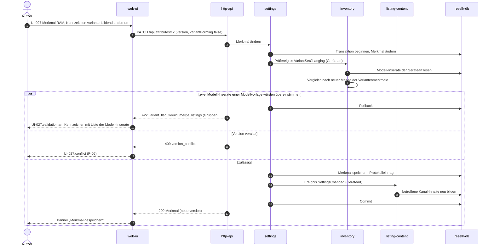

**Ablauf „Merkmal wieder aktivieren“** (Frage: Was ändert das Wieder-Aktivieren, und woran kann es scheitern? Nachtrag MAR-605; Zustände nach Design v0.6.4; vereinfacht: der Protokolleintrag entsteht in `settings` über `audit`.)

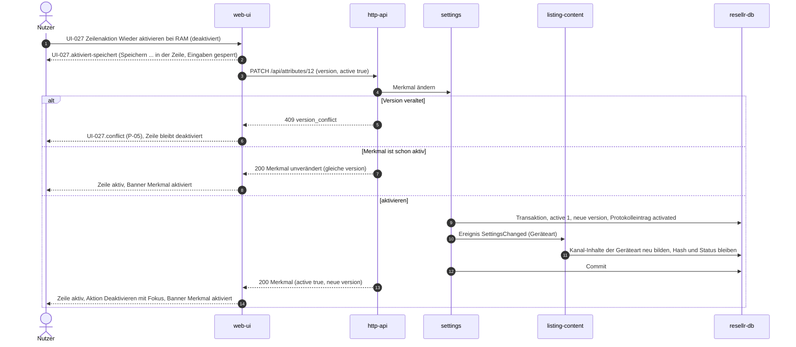

Kein Prüfereignis, kein Zugriff auf Merkmalswerte von Modellvorlagen, Geräten oder Modell-Inseraten und kein fachlicher Fehlerfall.

#### 2.1.1 Startbelegung (REQ-006)

- Inhalt abschließend nach Requirements Kap. 9.2, 9.3, 9.8 und 9.12: vier Gerätearten mit Merkmalen, Ebenen, Variantenkennzeichen und Pflicht, Titelmuster, Auswahllisten, Kanäle Shop, Kleinanzeigen und eBay (aktiv, Höchstlängen 128/65/80, VB nur Kleinanzeigen), Merkmalszuordnungen, Beschreibungsvorlagen, Datenblatt-Layout. Merkmale „Tastaturlayout“, „Netzteil“, „Akku“, „Akkukapazität“ erhalten ihre Systemrolle. Die Reihenfolge der Merkmale folgt Kap. 9.3.
- Nicht enthalten (AC-REQ-006-03): Kategorie- und Zustandszuordnungen, Texte der Textbausteine, GPSR-Angaben, Händlerangaben, Code-Übersetzungstabelle, Lieferanten.
- Ablage: `packages/seed-data/src/initial-settings.ts` (Daten, kein Code mit Kundenbezug, REQ-074). Eingespielt einmalig durch die Datenmigration `20261110_0002_seed_initial_settings.ts` beim Anlegen der Datenbank (Baseline 10.2 „Erster Start“). Spätere Updates ändern die Startbelegung bestehender Installationen nicht.
- **Prüfung OP-22 (Verantwortung Software Architect, A-17):** Die Startwerte 80 Zeichen (eBay-Titel) und 128 Zeichen (Produktname PrestaShop) entsprechen dem Kenntnisstand des Architekten. Sie sind Einstellung (REQ-029) und werden vor dem Pilotbetrieb am echten Formular geprüft (Kap. 9.3). In der Startbelegung ist kein Merkmalsfeld Pflichtfeld des Kanals (Requirements Kap. 9.8).

### 2.2 F-02 Händlermarke, Hersteller und GPSR, Lieferanten, Code-Übersetzung, Textbausteine, Datenblatt-Layout

(REQ-022, REQ-026 bis REQ-028, REQ-051, REQ-053, REQ-054, REQ-099 bis REQ-101)

**Komponenten:** `web-ui`, `http-api`, `settings`, `media` (Logo), `listing-content`, `audit`. **Screens:** UI-008, UI-026, UI-030, UI-031, UI-032, UI-033, UI-039, UI-043. **Flows:** FLOW-04, FLOW-05.

**Endpunkte**

| Methode, Pfad | Anfrage | Antwort | Fehler |
| --- | --- | --- | --- |
| `GET /api/merchant-profile` | – | `brandName, contactText, logo: { hash, url } \| null, version` | – |
| `PUT /api/merchant-profile` | `version, brandName, contactText` | Profil | `validation_failed`, `version_conflict` |
| `PUT /api/merchant-profile/logo` | multipart `file` (PNG/JPEG ≤ 5 MB), Feld `version` | Profil | `file_too_large`, `unsupported_media_type` („Logo: nur PNG oder JPEG bis 5 MB“, AC-REQ-028-02) |
| `DELETE /api/merchant-profile/logo?version=` | – | Profil ohne Logo | `version_conflict` |
| `GET /api/manufacturers?includeInactive=true` | – | `items[]`: `id, name, active, gpsrComplete, gpsrMissing[], gpsr, version` | – |
| `POST /api/manufacturers` | `name` | `201` neu, oder `200` mit `existing: true` und dem vorhandenen Hersteller (REQ-100, AC-REQ-100-02) | `manufacturer_deactivated`, `validation_failed` |
| `PATCH /api/manufacturers/{id}` | `version, name?, active?, gpsr?` | `{ manufacturer, impact }` | `name_taken`, `validation_failed`, `version_conflict` |
| `GET /api/suppliers?includeInactive=true` | – | `items[]` | – |
| `POST /api/suppliers` | `name, active` | `201` | `name_taken`, `validation_failed` |
| `PATCH /api/suppliers/{id}` | `version, name?, active?` | Lieferant | `name_taken`, `version_conflict` |
| `GET /api/condition-codes` | – | `items[]`: `id, code, supplierId, plainText, suggestedConditionValueId, suggestedVisualGrade, version` | – |
| `POST /api/condition-codes` | Eintrag ohne `id` | `201` | `name_taken` („Diesen Code gibt es für diesen Lieferanten bereits“, AC-REQ-022-02), `validation_failed` (AC-REQ-022-04) |
| `PATCH /api/condition-codes/{id}` / `DELETE …?version=` | – | Eintrag / `204` | `version_conflict` |
| `GET /api/condition-codes/resolve?code=&supplierId=` | – | `{ found, plainText, suggestedConditionValueId, suggestedVisualGrade }` | – |
| `GET /api/text-blocks` | – | `items[]` nach Kap. 3.1; Geltungsbereich als `allDeviceTypes, deviceTypeIds[], allChannels, channelIds[]` (Regel „Geltungsbereich des Textbausteins“ unten, Nachtrag MAR-773) | – |
| `POST /api/text-blocks` | Baustein ohne `id`; die vier Felder des Geltungsbereichs sind Pflicht | `201 { textBlock, impact }` | `name_taken`, `placeholder_not_allowed`, `validation_failed` |
| `PATCH /api/text-blocks/{id}` | `version` und Änderungen; Geltungsbereich je Paar (`allDeviceTypes` mit `deviceTypeIds`, `allChannels` mit `channelIds`) ganz oder gar nicht | `{ textBlock, impact, legalStatusReset }` | wie oben, `version_conflict` |
| `GET /api/datasheet-layout` / `PUT …` | `version, headerLabels[], blockOrder[], attributeOrder{deviceTypeId: attributeIds[]}` | Layout | `validation_failed`, `version_conflict` |
| `GET /api/datasheets/preview-device` | – | `{ deviceId \| null }` (Beispielgerät für den Vorschau-Link in UI-039); ab S8, Route CU-224, Abfrage CU-306 (FIND-227) | – |

`impact` = `{ updated, rerelease, manualReview }` nach REQ-053 und REQ-043 (Kap. 2.8.4); er ist der Bericht der Änderungsereignisse (Kap. 2.0.4). Vor S5 gibt es keine Kanal-Inhalte, `impact` ist dann `{0, 0, 0}` und UI-043 zeigt `.empty`; die ACs von REQ-053 werden in S6 abgenommen (Kap. 4.4.0). Es gibt keine Löschfunktion für Hersteller, Lieferanten und Textbausteine (REQ-026, REQ-099, REQ-101); das Löschen eines Code-Eintrags ist erlaubt (REQ-022).

**Regeln**

- **Hersteller (REQ-100, REQ-101):** Name 1–50 Zeichen nach Trim, eindeutig ohne Groß-/Kleinschreibung. `POST` mit vorhandenem aktivem Namen legt nichts an und liefert den vorhandenen (UI-008 „<Name> gibt es bereits und wird verwendet“); ist er deaktiviert, `manufacturer_deactivated`.
- **GPSR (REQ-027, AC-REQ-027-02):** Speichern ist auch unvollständig erlaubt. `gpsrComplete` = Herstellername, Straße und Hausnummer, Postleitzahl, Ort, Land und Kontakt vorhanden; `gpsrMissing[]` nennt die fehlenden Teile (UI-031 „<Teil> fehlt“). Kontakt ist eine E-Mail-Adresse oder eine Internetadresse mit `http://` oder `https://`; ein vorhandener, ungültiger Kontakt wird abgelehnt („E-Mail-Adresse oder Internetadresse ungültig“). Die Längen der GPSR-Felder (Kap. 3.1) sind technische Obergrenzen des Architekten ohne Requirement; Texte: Tabelle „Meldungstexte“ in Kap. 8.2 (Schlüssel M-05 bis M-13, Wortlaut nach MAR-159).
- **Textbaustein (REQ-026, REQ-054):** Name 1–100 (leer oder zu lang: „Name: 1 bis 100 Zeichen“, M-30, v0.5.2), eindeutig (`name_taken`); Art fest aus fünf Werten; Text 1–5.000 Zeichen (leer oder zu lang: „Text: 1 bis 5.000 Zeichen“, Tabelle „Meldungstexte“ in Kap. 8.2, Nachtrag MAR-493); Platzhalter nach Requirements Kap. 9.7, Zeile „Textbaustein“ (alle außer `{Baustein:Name}`); Geltungsbereich „alle“ oder Auswahl je Gerätearten und Kanäle. Prüfstatus nur bei `legal` und `battery_notice`; neue Bausteine dieser Arten sind `unchecked`; jede Textänderung an einem `checked`-Baustein setzt `unchecked` und meldet `legalStatusReset: true` (UI-030-Hinweis). `checked` braucht Prüfdatum (nicht in der Zukunft) und prüfende Stelle (1–100; zu lang: „Prüfende Stelle: höchstens 100 Zeichen“, M-31, v0.5.2; fehlt sie, gilt M-24 wie unten). Feldfehler (K-05, MAR-176; Design v0.6.1 UI-030 und M-24): Fehlt das Prüfdatum, die prüfende Stelle oder beides, lehnt der Server mit `validation_failed` ab, je fehlendem Feld ein Eintrag in `fields[]` (`legalCheckedOn` bzw. `legalCheckedBy`, Code `legal_check_required`) mit **einem** Text „Prüfdatum und prüfende Stelle erforderlich“ (M-24, Wortlaut von AC-REQ-054-03). `web-ui` zeigt den Text **einmal** unter den beiden Feldern und markiert beide Felder; einen Text „Prüfende Stelle fehlt“ gibt es nicht mehr. Datum in der Zukunft → „Prüfdatum darf nicht in der Zukunft liegen“ (UI-030) am Feld Prüfdatum. *Beispiel:* Prüfdatum 05.11.2026 eingetragen, prüfende Stelle leer → einmal „Prüfdatum und prüfende Stelle erforderlich“, nichts gespeichert.
- **Geltungsbereich des Textbausteins (REQ-026, UI-030; Nachtrag MAR-773):**
  - **Felder** in Anfrage und Antwort: `allDeviceTypes: boolean`, `deviceTypeIds: number[]`, `allChannels: boolean`, `channelIds: number[]` (Kap. 3.1: `text_block.all_device_types`, `text_block_device_type`, `text_block.all_channels`, `text_block_channel`). Bei `POST` sind alle vier Pflicht. Bei `PATCH` kommt jedes Paar ganz oder gar nicht. Bei „alle“ ist die Liste leer, auch in der Antwort; sonst stehen die IDs aufsteigend.
  - **Strukturregeln** (CU-066, Verfeinerung ohne `path`, also `400 bad_request` nach Kap. 2.0.5): `all… = true` mit nicht leerer Liste, eine ID doppelt in der Liste, bei `PATCH` nur ein Feld eines Paars. Das sind Programmfehler der Oberfläche; `web-ui` sendet bei „alle“ eine leere Liste.
  - **Feldregel:** `all… = false` mit leerer Liste → `422 validation_failed` am Feld `deviceTypeIds` bzw. `channelIds`, Code `scope_required`, Text „Gerätearten: mindestens eine wählen oder ‚alle‘“ bzw. „Kanäle: mindestens einen wählen oder ‚alle‘“ (Tabelle „Meldungstexte“ in Kap. 8.2). Im Browser deaktiviert die verletzte Regel „Speichern“ und zeigt keine Meldung, wie gestaltet (UI-030: Geltungsbereich Pflicht ohne Fehlermeldung, „Speichern“ mit Voraussetzung „gültig“). Den Text zeigt CU-101 nur, wenn der Server die Regel meldet.
  - **Vorhandene IDs:** CU-082 prüft in der Aktion über `tx.db`, dass jede ID eine vorhandene Geräteart (CU-073) bzw. ein vorhandener Kanal (CU-161) ist, aktiv oder deaktiviert. Sonst `400 bad_request`, weil Gerätearten und Kanäle nie gelöscht werden und eine unbekannte ID nur aus einem Programmfehler kommt (wie die unbekannte Auswahlliste eines Merkmals in CU-072).
  - **Auswahl in UI-030:** Angeboten werden aktive Gerätearten und Kanäle, wie bei jeder neuen Eingabe (Kap. 2.5, „nur aktive Werte“). Ein schon gespeicherter, inzwischen deaktivierter Eintrag bleibt ausgewählt und gültig, bis der Nutzer ihn abwählt. Namen und Reihenfolge der Gerätearten kommen aus `GET /api/device-types` (CU-092), die der Kanäle aus `GET /api/channels` (CU-176, Kap. 2.3, ab S2).
  - **Keine Änderung:** Ein `PATCH`, dessen Geltungsbereich als Menge dem gespeicherten gleicht, ändert ihn nicht. Ändert sich auch sonst nichts, gibt es keine neue Version, keinen Protokolleintrag und kein Ereignis.
  - **Protokoll (Kap. 3.6):** ein Feld „Geltungsbereich“ in `newValue` von `created` und, wenn er sich ändert, in `oldValue` und `newValue` von `updated`. Text: „Gerätearten: <alle | Namen>; Kanäle: <alle | Namen>“, Namen in der Reihenfolge der Gerätearten bzw. nach `sort_order` der Kanäle, mit „, “ getrennt, z. B. „Gerätearten: alle; Kanäle: Kleinanzeigen, eBay“.
  - **Ereignis:** `POST` und jeder `PATCH`, der Name, Art, Text, Status oder Geltungsbereich ändert, melden genau ein `SettingsChanged` mit `scope: { kind: 'text_block', deviceTypeIds, channelIds }`. Die Listen sind die Vereinigung aus altem und neuem Geltungsbereich (bei `POST` nur der neue). „Alle“ wird in die IDs aller vorhandenen Gerätearten (CU-073) bzw. Kanäle (CU-161) aufgelöst, aktive und deaktivierte. CU-165 bildet daraus Gerätearten × Kanäle. Das umfasst den alten und den neuen Bereich und kann weitere Kanal-Inhalte umfassen; deren Stand ändert sich nicht, deshalb zählen sie in `impact` nicht (Kap. 2.8.4). Bis S5 gibt es keinen Handler, `impact` ist `{0, 0, 0}` (Kap. 4.4.0).
- **Code-Übersetzung (REQ-022):** Code 1–20, Klartext 1–500, Kombination Code (ohne Groß-/Kleinschreibung) und Lieferant eindeutig, ohne Lieferant zählt als eigener Schlüssel. Änderungen wirken nur auf künftige Erfassungen (AC-REQ-022-03); sie lösen keine Neuberechnung aus.
- **Auflösen eines Codes (REQ-015):** Eintrag des Lieferanten vor dem Eintrag ohne Lieferant; Vergleich ohne Groß-/Kleinschreibung (AC-REQ-015-01).
- **Händlermarke (REQ-028):** Name 1–100, Kontakt 0–500; Logo nach Kap. 2.11 (Dateiprüfung) mit eigener Grenze 5 MB, ersetzt das bisherige. Zuständigkeit (FIND-203): `merchant_profile` schreibt nur `settings` (CU-084). Beim Hochladen prüft und speichert `media` die Datei und liefert den Hash (CU-090); CU-084 setzt `logo_hash` in derselben Transaktion.
- **Datenblatt-Layout (REQ-051):** Kopfzeilentexte je 0–50 Zeichen (UI-039), Blockreihenfolge ist eine Permutation der sechs Blöcke, Merkmalsreihenfolge je Geräteart eine Permutation der Merkmale dieser Geräteart. Fehlt eine Merkmalsreihenfolge, gilt die Reihenfolge aus UI-027.
- **Beispielgerät für den Vorschau-Link in UI-039 (FIND-207, FIND-227):** das zuletzt erfasste Gerät, das die Voraussetzungen des Datenblatts erfüllt (zugeordnet, geprüft, nicht storniert, REQ-050). Gibt es keines, ist der Link deaktiviert (DG-13). Die Abfrage gehört zu `datasheet` (CU-306, S8) und liest über `inventory-reader` (CU-129); `settings` liest dafür nichts aus `inventory`, so entsteht kein Kreis. Der Pfad liegt bewusst nicht unter `/api/datasheet-layout` (CU-087). Bis S8 ist der Link in UI-039 deaktiviert, weil es UI-023 noch nicht gibt (Kap. 4.4.0).

**Wirkung auf Kanal-Inhalte:** Textbaustein, GPSR-Angaben, Herstellername und Händlermarke melden `SettingsChanged`; der Geltungsbereich ist beim Textbaustein Gerätearten × Kanäle aus altem **und** neuem Geltungsbereich (ein Ereignis mit der Vereinigung der IDs, Regel „Geltungsbereich des Textbausteins“ oben), beim Hersteller alle Modell-Inserate seiner Modellvorlagen, bei der Händlermarke alle Kanal-Inhalte. `impact` geht nur bei Textbaustein und Hersteller an die Oberfläche (UI-043, REQ-053). Code-Übersetzung, Lieferant und Datenblatt-Layout ändern keine Kanal-Inhalte.

**Zustände:** UI-043 zeigt die drei Zahlen aus `impact`; `UI-043.empty`, wenn alle drei 0 sind; „Zu den betroffenen Inseraten“ öffnet `/inserate?flag=changed_since_release` (UI-002). Übrige Zustände nach Kap. 2.0.7. Der Ablauf „Textbaustein speichern“ steht in Kap. 2.8 (Diagramm F-08).

### 2.3 F-03 Kanäle, Preisregeln, Titelmuster, Beschreibungsvorlagen und Zuordnungen

(REQ-023 bis REQ-025, REQ-029 bis REQ-031, REQ-075, REQ-085; Ä-32, T-9)

**Komponenten:** `web-ui` (UI-029, UI-034 bis UI-038), `http-api`, `channels`, `settings`, `listing-content` (Vorschau, Anzahl im Geltungsbereich, Neuberechnung), `content-engine`, `audit`. **Flows:** FLOW-05.

**Endpunkte**

| Methode, Pfad | Anfrage | Antwort | Fehler |
| --- | --- | --- | --- |
| `GET /api/channels` | – | `items[]`: `id, code, name, active, titleMaxLength, vbAllowed, priceRule, sortOrder, version`, alle Kanäle (aktive und deaktivierte) nach `sort_order`. Ab S2 nur `id, code, name, active, sortOrder` (Kanalliste für den Geltungsbereich in UI-030); die übrigen Felder kommen in S5 dazu (Nachtrag MAR-773) | – |
| `PATCH /api/channels/{id}` | `version, active?, titleMaxLength?, vbAllowed?` | Kanal | `validation_failed` („Höchstlänge: ganze Zahl von 20 bis 500“), `version_conflict` |
| `PUT /api/channels/{id}/price-rule` | `version, referenceChannelId, deltaCents` | Kanal | `price_rule_cycle`, `validation_failed` („Ein Kanal kann nicht sein eigener Bezugskanal sein“), `version_conflict` |
| `DELETE /api/channels/{id}/price-rule?version=` | – | Kanal | `version_conflict` |
| `GET /api/title-patterns?deviceTypeId=` | – | `items[]`: `id, deviceTypeId, channelId\|null, parts[], version` | – |
| `PUT /api/title-patterns` | `deviceTypeId, channelId\|null, version\|null, parts[]` | Titelmuster | `placeholder_not_allowed`, `validation_failed`, `version_conflict` |
| `DELETE /api/title-patterns/{id}?version=` | nur kanaleigene Muster | `204` | `version_conflict` |
| `GET /api/channels/{id}/description-template` / `PUT …` | `version, sections[]` | Vorlage | `placeholder_not_allowed`, `validation_failed`, `version_conflict` |
| `GET /api/channels/{id}/condition-mappings` / `PUT …` | `version, rows[]` (ganze Tabelle) | Tabelle | `validation_failed` (Zeile doppelt: „Für diese Kombination gibt es bereits einen Eintrag“), `placeholder_not_allowed`, `version_conflict` |
| `GET /api/category-mappings` | – | Matrix `items[]`: `deviceTypeId, channelId, categoryPath, categoryRef, version` | – |
| `PUT /api/category-mappings/{deviceTypeId}/{channelId}` / `DELETE …?version=` | `version\|null, categoryPath, categoryRef` | Zelle | `mapping_exists` (`version: null` auf eine belegte Zelle), `validation_failed`, `version_conflict` |
| `GET /api/channels/{id}/attribute-mappings/{deviceTypeId}` / `PUT …` | `version\|null, fields[]` | Zuordnung | `validation_failed`, `version_conflict` |
| `POST /api/previews/title` | `deviceTypeId, channelId\|null, parts[], listingId` | `items[]` je aktivem Kanal: `title, length, maxLength, truncation` (`none\|parts\|word`) | `validation_failed` |
| `POST /api/previews/description` | `channelId, sections[], listingId` | `{ text, droppedLines[] }` | `validation_failed` |
| `POST /api/scope-counts` | `kind` und Bezug (siehe unten) | `{ count }` | – |

**Regeln**

- **Kanal (REQ-029):** Titel-Höchstlänge 20–500. Deaktivieren: keine neuen Kanal-Inhalte für neue Modell-Inserate, bestehende bleiben lesbar (AC-REQ-029-02). **Aktivieren** legt für jedes Modell-Inserat ohne Kanal-Inhalt dieses Kanals einen Inhalt im Status *Entwurf* an (RQ-08). Änderungen an einem Kanal lösen nur Neuberechnungen dieses Kanals aus (AC-REQ-029-03). Neue Kanäle entstehen nur per Datenmigration, ohne Oberfläche (ADR-005, UI-038).
- **Preisregel (REQ-085):** Bezugskanal aktiv und ≠ eigener Kanal; kein Kreis über alle Regeln (`packages/domain/src/pricing/price-rule-graph.ts`, Tiefensuche; dieselbe Funktion liefert `inventory` die Reihenfolge, Kap. 2.7); Auf-/Abschlag in Cent mit Vorzeichen, höchstens zwei Nachkommastellen in der Eingabe. Bereits erfasste Preise bleiben unverändert (AC-REQ-085-01); die Regel wirkt bei der nächsten Preiserfassung (Kap. 2.7).
- **Titelmuster (REQ-030):** `parts[]` mit `kind` `placeholder` oder `text`; Platzhalter nur aus „Modelldaten“ und „Inseratswerte außer `{Lieferumfang}`, `{Preis}`“ (Requirements Kap. 9.7); `{Hersteller}` und `{Modellbezeichnung}` sind Pflicht und haben Priorität 1; Präfix und Suffix je 0–50 Zeichen, fester Text 1–100 (technische Obergrenzen; Texte: Kap. 8.2, Schlüssel M-17 bis M-19); Priorität ganze Zahl ≥ 1. Je Geräteart genau ein Muster ohne Kanal; kanaleigene Muster optional (AC-REQ-030-03).
- **Beschreibungsvorlage (REQ-031):** `sections[]` mit `heading` (0–100), `lines[]` (Text mit Platzhaltern, je Zeile 0–1.000 Zeichen; technische Obergrenzen; Texte: Kap. 8.2, Schlüssel M-20, M-21), Elementen `textBlock` (ein bestimmter Baustein) und `textBlockKind` (alle gültigen einer Art) als eigene Zeilen, `deviceTypeIds[]` leer = alle. Alle Platzhalter nach Kap. 9.7 sind zulässig.
- **Zustandszuordnung (REQ-023):** Zeile `conditionValueId, visualGrade (1–5 oder null = „alle Noten“), label (1–100), extra (0–100)`; `extra` zu lang: „Zusatzangabe: höchstens 100 Zeichen“ (Tabelle „Meldungstexte“ in Kap. 8.2, Nachtrag MAR-493); je Zustand und Note höchstens eine Zeile; Platzhalter in `extra` wie im Titelmuster (AC-REQ-023-04).
- **Kategoriezuordnung (REQ-024):** je Geräteart und Kanal höchstens ein Eintrag; Pfad 1–255, Kennung 0–100 (technische Obergrenze; Text: Kap. 8.2, Schlüssel M-14). Ein neuer Eintrag (`version: null`) für eine belegte Zelle wird nicht überschrieben, sondern mit `mapping_exists` und dem vorhandenen Pfad abgelehnt (AC-REQ-024-02, FIND-220). Eine veraltete `version` auf eine belegte Zelle bleibt `409 version_conflict`.
- **Merkmalszuordnung (REQ-025):** `fields[]` mit `label` (1–100), `source` (genau eine Quelle Q-01 bis Q-08 nach Requirements Kap. 9.11; Q-01 speichert die Merkmals-ID), `required`, `valueMap[]` (interner Wert → Kanal-Wert 1–100, leer oder zu lang: „Kanal-Wert: 1 bis 100 Zeichen“ nach Design UI-036 und Tabelle „Meldungstexte“ in Kap. 8.2, Nachtrag MAR-493; interne Werte eindeutig), bei Q-08 `fixedText` (1–255). Die Reihenfolge von `fields[]` ist die Reihenfolge im Kanal-Inhalt und im Kopier-Assistenten (REQ-025, UI-036).
- **Vorschau (Ä-32):** `listing-content/preview-service.ts` (CU-162) lädt das `ContentInput` des gewählten Modell-Inserats über CU-166, ersetzt darin die Einstellung durch die **ungespeicherten** Werte und bildet den Stand mit `content-engine`; gespeichert wird nichts. So gibt es nur eine Stelle, die `ContentInput` zusammenstellt (FIND-203). `web-ui` ruft die Vorschau 400 ms nach der letzten Eingabe auf (UI-029 „kurz verzögert“). Ohne Modell-Inserat der Geräteart zeigt die Vorschau nichts (UI-029 Annahme).
- **Anzahl im Geltungsbereich (Ä-32, T-9):** `POST /api/scope-counts` zählt Kanal-Inhalte, die die Einstellung betrifft, ohne zu prüfen, ob sie sich ändern: `title_pattern` (Geräteart, optional Kanal), `description_template` (Kanal, Gerätearten der Abschnitte), `condition_mappings` (Kanal), `attribute_mapping` (Kanal und Geräteart), `category_mapping` (Kanal und Geräteart), `model_template` (Modellvorlage, für UI-007). CU-171 bildet daraus das Ereignis, das das Speichern auslösen würde, und zählt das Ergebnis von `scope-resolver` (CU-165); die Regel „welche Kanal-Inhalte betrifft eine Einstellung“ steht damit nur einmal im Code (FIND-203). `web-ui` zeigt „gilt für n Kanal-Inhalte im Geltungsbereich“ vor dem Speichern. **UI-029** verlangt dazu eine Bestätigung (Design UI-029): „Titelmuster speichern“ öffnet den Bestätigungsdialog P-04 mit diesem Satz; erst die Bestätigung sendet `PUT`. UI-034, UI-036 und UI-037 zeigen den Satz ohne Bestätigungsschritt, wie gestaltet.

**Wirkung auf Kanal-Inhalte:** Jede Speicherung meldet `SettingsChanged` mit Kanal und ggf. Geräteart; `listing-content` bildet neu (Kap. 2.8). Nach dem Speichern zeigt die Oberfläche nur das Banner, kein UI-043 (K-5).

**Zustände:** UI-029, UI-034 bis UI-038 nach Kap. 2.0.7; `.speichert` während `PUT`. Vorschau und Anzahl im Geltungsbereich sind lesende Anfragen; bei Zeitüberschreitung oder fehlender Verbindung gilt P-06 wie für jede lesende Anfrage (Kap. 2.0.8, FIND-208).

**Ablauf „Merkmalszuordnung speichern“** (Frage: Was passiert vor und beim Speichern einer kanalweiten Einstellung?)

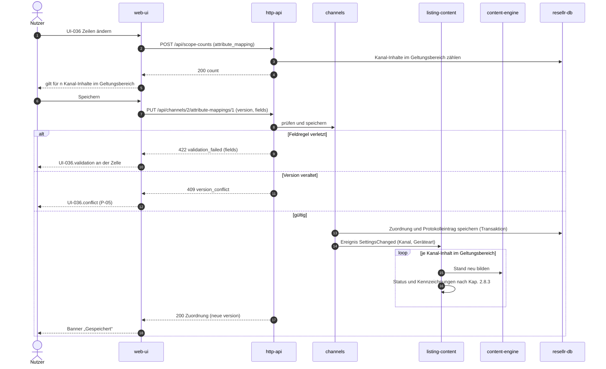

### 2.4 F-04 Modell-Bibliothek (REQ-008 bis REQ-011, REQ-058, REQ-095 für Modellvorlagen)

**Komponenten:** `web-ui` (UI-006, UI-007, UI-008, UI-041), `http-api`, `catalog`, `settings` (Merkmalsdefinitionen), `listing-content`, `audit`. **Flows:** FLOW-01, FLOW-06, FLOW-08.

**Endpunkte**

| Methode, Pfad | Anfrage | Antwort | Fehler |
| --- | --- | --- | --- |
| `GET /api/model-templates?q=&deviceTypeId=&limit=` | `q` ab 2 Zeichen; ohne `q` die 50 zuletzt angelegten (UI-006) | `items[]`: `id, deviceType, manufacturer, modelName, typeDesignation, mpn, mpnUnknown` | `validation_failed` bei `q` mit 1 Zeichen („Mindestens 2 Zeichen“, AC-REQ-009-04) |
| `GET /api/model-templates/{id}` | – | Modellvorlage nach Kap. 3.3 | `not_found` |
| `GET /api/model-templates/{id}/usage` | – | `{ deviceCount, listingCount, deleteBlockedReason }` mit `deleteBlockedReason` ∈ `listings_reference`, `devices_reference` oder `null` (Rangfolge unten; bedient von `inventory`, CU-295) | `not_found` |
| `POST /api/model-templates` | Modellvorlage ohne `id`, `confirmDuplicate?`, `confirmMpnWarning?` | `201` | `validation_failed`, `confirmation_required` (`possible_duplicate` mit `details.matches[]`; Could: `mpn_in_use` mit `details.matches[]`); Reihenfolge unten |
| `PATCH /api/model-templates/{id}` | `version` und Änderungen, `confirmMpnWarning?` | Modellvorlage | `device_type_in_use`, `validation_failed`, `version_conflict`; Could: `confirmation_required` (`mpn_in_use`, v0.5.2) |
| `DELETE /api/model-templates/{id}?version=` | – | `204` | `delete_not_allowed` mit `details.reason` `listings_reference` (M-29) bzw. `devices_reference` („Löschen nicht möglich: Geräte verweisen auf die Modellvorlage“), Rangfolge unten; `version_conflict` |
| `GET /api/model-templates/{id}/device-prefill?conditionCode=&supplierId=` | – | Vorbelegung für UI-003, bedient von `inventory` (Kap. 2.5) | `not_found` |

**Regeln**

- Felder und Grenzen nach Kap. 3.3 und Requirements REQ-008, Kap. 9.6: Modellbezeichnung 1–100, Typbezeichnung 0–50, Herstellernummer nach der Regel „Herstellernummer“ unten **oder** `mpnUnknown: true` (AC-REQ-008-02/-03), Original-EAN 8 oder 13 Ziffern mit GS1-Prüfziffer (`packages/domain/src/validation/ean.ts`, AC-REQ-008-04). Merkmalswerte der Ebene *Modell* nach ihrer Definition, aktive Pflichtmerkmale Pflicht (AC-REQ-008-05); Vorbelegungswerte der Ebene *Gerät* optional, aber typgeprüft. Bei `PATCH` geprüft am vollständigen Stand nach der Änderung (Kap. 2.5 „Prüfung am Stand nach der Änderung“, Nachtrag MAR-605).
- **Herstellernummer (REQ-008, Requirements Kap. 9.6; v0.5.2, MAR-215 F-4, Design v0.6.2 O-4):**
  - **Zeichen:** erlaubt sind die Buchstaben `A`–`Z` und `a`–`z`, die Ziffern `0`–`9` und die Zeichen `-`, `/`, `.` (RQ-19). Nicht erlaubt sind u. a. Umlaute, `ß`, Leerzeichen innerhalb des Werts, `#`, `+` und `_`. Groß- und Kleinschreibung bleiben wie eingegeben.
  - **Länge:** 1 bis 40 Zeichen. Gezählt werden Zeichen als Unicode-Codepunkte (`[...value].length`), nicht Bytes und nicht UTF-16-Einheiten; so zählen Browser und Server gleich, auch bei eingefügten Sonderzeichen.
  - **Bereinigung:** Leerzeichen am Anfang und Ende werden vor der Prüfung entfernt (wie bei Namen, Kap. 2.2); gespeichert wird der bereinigte Wert.
  - **„unbekannt“:** Mit `mpnUnknown: true` sendet `web-ui` `mpn: null` (das Feld ist geleert und gesperrt). Ein Wert zusammen mit `mpnUnknown: true` ist ein Programmfehler der Oberfläche (`400 bad_request`).
  - **Prüfreihenfolge, genau eine Meldung am Feld `mpn` (Kap. 2.0.5):**

    | Schritt | Bedingung (nach Bereinigung, `mpnUnknown: false`) | `fields[].code` | Text |
    | --- | --- | --- | --- |
    | 1 | leer | `mpn_required` | „Herstellernummer: Wert eingeben oder ‚unbekannt‘ wählen“ (AC-REQ-008-02; DG-17) |
    | 2 | mehr als 40 Zeichen | `mpn_too_long` | „Herstellernummer: höchstens 40 Zeichen“ (M-25) |
    | 3 | mindestens ein Zeichen außerhalb der erlaubten | `mpn_invalid_chars` | „Herstellernummer: nur Buchstaben, Ziffern und die Zeichen - / . erlaubt“ (M-26) |

    Prüfmuster für Schritt 3: `^[A-Za-z0-9./-]+$`. Umgesetzt in CU-104 als eine Verfeinerung; dieselbe Regel prüft der Browser beim Verlassen des Felds und der Server beim Speichern.
  - *Beispiele:* „MHGT3D/A“, „20TD002MGE“, „6FY52AV“ sind gültig. „ 20TD002MGE “ wird als „20TD002MGE“ gespeichert. „ABC#123“, „ÄB-12“ und „20TD 002MGE“ ergeben M-26. 45 Zeichen mit „#“ ergeben nur M-25; nach Kürzen auf 40 Zeichen folgt M-26. Die HP-Teilenummer „6FY52AV#ABD“ wird mit M-26 abgelehnt; der Nutzer gibt „6FY52AV“ ein oder wählt „unbekannt“ (Freigabe-Briefing, kritische Annahme 1).
- **Mögliche Dublette (REQ-011):** gleicher Hersteller und gleiche Modellbezeichnung nach `model_name_key` (Kleinschreibung, alle Leerzeichen entfernt, AC-REQ-011-01). Ohne `confirmDuplicate: true` antwortet `POST` mit `confirmation_required`/`possible_duplicate`; UI-007 zeigt den Dialog `UI-007.dublette` mit Titel und Text M-27 und den Knöpfen „Vorhandene verwenden“ / „Trotzdem anlegen“.
- **Gleiche Herstellernummer (REQ-058, Could; v0.5.2, MAR-215 F-3, Design v0.6.2 O-6):** nur wenn umgesetzt.
  - **Bedingung:** `mpnUnknown: false`, und mindestens eine **andere** Modellvorlage hat dieselbe Herstellernummer (Vergleich ohne Groß-/Kleinschreibung) und eine **andere** Modellbezeichnung (`model_name_key` verschieden; Wortlaut REQ-058). Hersteller und Geräteart spielen keine Rolle. Gleiche Herstellernummer bei gleicher Modellbezeichnung löst keine Warnung aus.
  - **Anlass:** bei `POST` immer; bei `PATCH` nur, wenn die Anfrage `mpn`, `mpnUnknown` oder `modelName` gegenüber dem gespeicherten Stand ändert (RQ-20).
  - **Ablauf:** Ohne `confirmMpnWarning: true` antwortet der Server `422 confirmation_required` mit `details.kind: mpn_in_use` und `details.matches[]` (`id, manufacturer, modelName, mpn`, alle Treffer) und speichert nichts. UI-007 zeigt den Dialog `UI-007.mpn-warnung` (M-28) mit den Treffern und Verweis auf die Modellvorlage; „Trotzdem speichern“ sendet dieselbe Anfrage mit `confirmMpnWarning: true`, „Abbrechen“ speichert nichts (AC-REQ-058-01).
  - **Abfrage:** über alle Modellvorlagen ohne eigenen Index; bei einigen hundert bis wenigen tausend Zeilen genügt das (keine Migration).
  - *Beispiel:* „ThinkPad E15 Gen 2“ hat „20TD002MGE“. Beim Anlegen von „ThinkPad V15“ mit „20td002mge“ kommt die Warnung mit Verweis auf „ThinkPad E15 Gen 2“. Ändert der Nutzer an „ThinkPad V15“ später nur die Typbezeichnung, kommt sie nicht erneut.
- **Prüfreihenfolge beim Speichern einer Modellvorlage (v0.5.2, MAR-215 F-3; Design v0.6.2 UI-007 „zuerst `UI-007.dublette`, danach `UI-007.mpn-warnung`“):** Der Server meldet das erste zutreffende Ergebnis:
  1. jede Ablehnung: `validation_failed` (alle Felder, je Feld eine Meldung), `version_conflict`, `device_type_in_use` und jede andere fachliche Ablehnung;
  2. `possible_duplicate` (nur `POST`, ohne `confirmDuplicate: true`);
  3. `mpn_in_use` (Could, ohne `confirmMpnWarning: true`).

  Rückfragen kommen also erst, wenn das Speichern sonst gelingen würde; der Nutzer bestätigt nie etwas, das danach abgelehnt wird. Eine Bestätigung gilt für die Anfrage, nicht für bestimmte Treffer; der Server prüft bei jeder Anfrage neu. `web-ui` sendet bereits gegebene Bestätigungen bei der Wiederholung mit: Nach „Trotzdem anlegen“ folgt `POST` mit `confirmDuplicate: true`; antwortet der Server darauf mit `mpn_in_use`, sendet „Trotzdem speichern“ beide Kennzeichen. Umsetzung: CU-105 (Reihenfolge), CU-107 (beide Prüfungen), CU-114 (Dialoge).
- **Ändern (REQ-010):** Geräteart gesperrt, sobald ein Gerät auf die Modellvorlage verweist. `catalog` meldet beim Ändern der Geräteart das Prüfereignis `ModelTemplateDeviceTypeChanging`; `inventory` lehnt mit `device_type_in_use` ab, wenn Geräte verweisen (Kap. 2.0.4). Änderungen an Modelldaten melden `ContentInputsChanged(modelTemplateId)`; Vorbelegungswerte wirken nur auf künftige Geräte und lösen keine Neuberechnung aus (AC-REQ-010-05). Fehlt der Modellvorlage der Wert eines aktiven Pflichtmerkmals der Ebene *Modell*, etwa weil sie während einer Deaktivierung angelegt wurde, lehnt jedes Speichern einer Änderung ab, auch wenn nur ein anderes Feld geändert wird (AC-REQ-005-12 (a); Kap. 2.5).
- **Suche (REQ-009):** Teilübereinstimmung ohne Groß-/Kleinschreibung in `search_key` (Modellbezeichnung, Typbezeichnung, Herstellernummer, normalisiert) oder im Herstellernamen (`manufacturer.name_key`, per Join); eine Umbenennung des Herstellers wirkt deshalb ohne Nachpflege (AC-REQ-009-01/-02).
- **Löschen (REQ-095):** nur ohne Gerät (jeder Status) und ohne Modell-Inserat (AC-REQ-095-03); geprüft über das Prüfereignis `ModelTemplateDeleting`, das `inventory` mit `delete_not_allowed` ablehnt; Protokolleintrag.
  - **Rangfolge der Gründe (v0.5.2, MAR-215 F-1, Design v0.6.2 O-8 und Briefing-Annahme 5):** Gemeldet wird **genau ein** Grund. (1) Verweist mindestens ein Modell-Inserat auf die Modellvorlage (`listing.model_template_id`), lautet er `listings_reference` mit dem Text M-29 „Löschen nicht möglich: Modellvorlage wird von ein oder mehreren Inseraten genutzt“, auch wenn zusätzlich Geräte verweisen. (2) Sonst, wenn mindestens ein Gerät in irgendeinem Bestandsstatus verweist (`device.model_template_id`), lautet er `devices_reference` mit dem Text „Löschen nicht möglich: Geräte verweisen auf die Modellvorlage“. (3) Sonst wird gelöscht.
  - **Eine Regel, zwei Aufrufer:** CU-290 prüft beim Löschen in der Transaktion, CU-295 liefert dieselbe Rangfolge vorab als `deleteBlockedReason`. UI-041 zeigt den Text zum Grund als Banner und sperrt „Löschen“ (Kap. 2.15). Ändert sich der Bestand zwischen Öffnen und Löschen, entscheidet die Prüfung in der Transaktion; UI-041 zeigt dann `error.message`.
  - **Warum diese Reihenfolge:** Auf jede Modellvorlage mit Modell-Inserat verweist immer auch mindestens ein Gerät: Ein Modell-Inserat entsteht aus einem Gerät (Kap. 2.6), Geräte werden nie gelöscht (REQ-103), und die Modellvorlage eines Geräts ist nicht änderbar. Prüfte der Server die Geräte zuerst, erschiene M-29 nie.
  - *Beispiele:* „ThinkPad E15 Gen 2“ mit einem Modell-Inserat und drei Geräten → M-29. „MacBook Pro 13“, dessen einziges Gerät storniert und dessen Modell-Inserat danach gelöscht wurde (AC-REQ-095-03), oder dessen einziges Gerät erfasst, aber noch keinem Modell-Inserat zugeordnet ist → Gerätetext.
- **Hersteller neu (UI-008):** über `POST /api/manufacturers` (Kap. 2.2).

**Zustände:** UI-006 `.empty` unterscheidet „Keine Modellvorlage gefunden“ (Suche ohne Treffer) und „Noch keine Modellvorlagen“ (`total = 0` ohne Suche); UI-007 `.disabled` = Geräteart gesperrt (`deviceCount > 0` aus `…/usage`); `UI-007.speichert` während `POST`/`PATCH`. UI-007 zeigt beim Ändern „gilt für n Kanal-Inhalte im Geltungsbereich“ aus `POST /api/scope-counts` mit `kind: model_template` (ab S5; vorher gibt es keine Kanal-Inhalte, Kap. 4.4.0).

**Ablauf „Modellvorlage anlegen mit Dubletten-Hinweis“** (Frage: Wie wirkt der Hinweis nach REQ-011?)

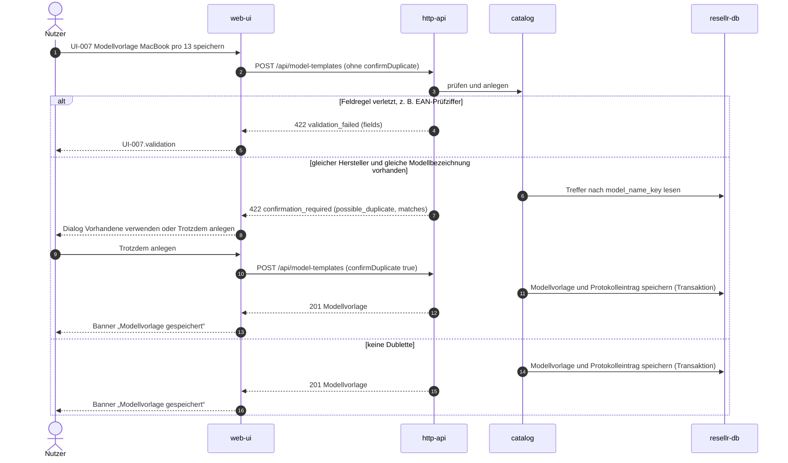

### 2.5 F-05 Gerät erfassen, prüfen und finden (REQ-012 bis REQ-016, REQ-094, REQ-062)

**Komponenten:** `web-ui` (UI-003, UI-009, UI-010), `http-api`, `inventory`, `catalog` (Vorbelegung), `settings` (Code-Übersetzung, Merkmalsdefinitionen), `listing-content` (Bestandsangaben), `audit`. **Flows:** FLOW-01, FLOW-02, FLOW-03.

**Endpunkte**

| Methode, Pfad | Anfrage | Antwort | Fehler |
| --- | --- | --- | --- |
| `GET /api/model-templates/{id}/device-prefill?conditionCode=&supplierId=` | – | `{ conditionValueId, visualGrade, conditionDescription, values, reviewKeys[], codeResult: { found, plainText } }` | `not_found` |
| `POST /api/devices` | `wiNr, supplierId?, conditionCode?, modelTemplateId, conditionValueId, visualGrade, conditionDescription, values{}, confirmedKeys[]` | `201` Gerät (Kap. 3.4) mit `captureStatus`, `reviewKeys[]` | `wi_nr_taken`, `validation_failed` |
| `GET /api/devices?wiNr=&limit=&offset=` | Teil der WI-Nr, ab 1 Zeichen | `items[]`: `id, wiNr, modelTemplateLabel, listing: { id, title } \| null, stockStatus, captureStatus` | – |
| `GET /api/devices/unassigned` | – | `items[]`: `id, wiNr, modelTemplateLabel, captureStatus, capturedOn`, ältestes zuerst | – |
| `GET /api/devices/{id}` | – | Gerät mit Modelldaten (nur lesen), Verkauf, Storno, Modell-Inserat | `not_found` |
| `PATCH /api/devices/{id}` | `version, conditionValueId?, visualGrade?, conditionDescription?, values?, confirmedKeys[], deviationDecision?, targetListingId?, confirmTargetDeviation?` | Gerät (+ ggf. neues bzw. Ziel-Modell-Inserat) | `validation_failed`, `device_not_available`, `confirmation_required` (`variant_deviation`, `target_deviation`), `version_conflict` |

**Vorbelegung und Prüfmarkierungen (REQ-013, REQ-015)**

- `GET …/device-prefill` bedient `inventory/device-prefill-query.ts` (CU-293): Er liest die Vorbelegungswerte über `catalog-reader`, das Ergebnis der Code-Übersetzung und die Merkmalsdefinitionen der Geräteart (mit `active`) über `settings-reader` und ruft die reine Funktion `packages/domain/src/inventory/device-prefill.ts`. Diese bildet die Vorbelegung aus den Vorbelegungswerten der Modellvorlage und dem Ergebnis der Code-Übersetzung. `reviewKeys` sind alle Merkmale mit Vorbelegungswert sowie `condition` und `visualGrade`, wenn der Code-Eintrag dafür einen Vorschlag hat (AC-REQ-015-04). Der Klartext eines Codes geht ohne Prüfmarkierung in die Zustandsbeschreibung (AC-REQ-015-01); bei unbekanntem Code bleibt sie leer (AC-REQ-015-03).
- Der Server bildet die Vorbelegung beim Speichern selbst neu (dieselbe Funktion) und setzt die Prüfmarkierungen: **verbleibend = Vorbelegungsschlüssel − `confirmedKeys` − Schlüssel, deren Wert vom vorbelegten abweicht**. Nur eine ausdrückliche Bestätigung oder eine Änderung hebt eine Markierung auf (REQ-013, AC-REQ-013-02). `captureStatus` = `checked`, wenn keine Markierung bleibt, sonst `review_pending` (AC-REQ-013-04).
- Bei `PATCH` gilt dieselbe Regel gegen die gespeicherten Markierungen.
- **Nur aktive Merkmale (Nachtrag MAR-605, RQ-23):** CU-117 übernimmt Vorbelegungswerte und bildet Prüfschlüssel nur für **aktive** Merkmale (REQ-005: ein deaktiviertes Merkmal „wird für neue Daten nicht mehr abgefragt“). Den Status erhält die reine Funktion als dritte Eingabe: die Merkmalsdefinitionen der Geräteart mit `active`, die CU-293 über `settings-reader` (CU-086) liest; CU-121 übergibt beim Neuaufbau der Vorbelegung beim Speichern dieselbe Eingabe, nämlich die Merkmalsdefinitionen, die es ohnehin über `settings-reader` für CU-067 liest. `catalog-reader` liefert die Vorbelegungswerte ungefiltert, so wie sie an der Modellvorlage gespeichert sind; der Status eines Merkmals gehört zu `settings` (Baseline 4.3), gefiltert wird nur in CU-117 (Nachtrag MAR-605, FIND-351). Der Vorbelegungswert eines deaktivierten Merkmals bleibt an der Modellvorlage gespeichert und gilt nach dem Wieder-Aktivieren wieder. Gespeicherte Prüfmarkierungen eines Geräts ändern sich durch Deaktivieren und Aktivieren nicht; nur Bestätigen oder Ändern hebt sie auf (REQ-013). *Beispiel:* „ThinkPad T14“ hat die Vorbelegung RAM 16 GB. Solange RAM deaktiviert ist, hat ein neues T14 weder RAM-Wert noch Prüfmarkierung für RAM; nach dem Aktivieren bekommt das nächste T14 wieder „16 GB“ zur Prüfung.

**Prüfregeln der Gerätewerte (REQ-014, Kap. 9.6)** – `packages/domain/src/schemas/attribute-values.schema.ts` (CU-067) erzeugt das Zod-Schema zur Laufzeit aus den Merkmalsdefinitionen der Geräteart (LP-4); Oberfläche und Server nutzen dasselbe Schema:

| Feld | Regel | Meldung |
| --- | --- | --- |
| `wiNr` | Pflicht, `^[A-Za-z0-9]{1,20}$`, eindeutig ohne Groß-/Kleinschreibung über Geräte im Status *verfügbar* und *verkauft* | „WI-Nr darf nur Buchstaben und Ziffern enthalten (1–20 Zeichen)“; `wi_nr_taken` |
| `modelTemplateId` | Pflicht | „Bitte eine Modellvorlage wählen“ |
| `conditionValueId` | Pflicht, Wert der Liste Zustand; neue Eingabe nur aktive Werte | „Zustand fehlt“ |
| `visualGrade` | Pflicht, ganze Zahl 1–5 | „Optik-Note: ganze Zahl von 1 bis 5“ / „Optik-Note fehlt“ (AC-REQ-014-04) |
| `conditionDescription` | 0–1.000 Zeichen | „Zustandsbeschreibung: höchstens 1.000 Zeichen“ |
| Rolle `keyboard_layout`, `power_supply`, `battery` | Pflicht, wenn die Geräteart das aktive Merkmal hat | „<Feld> fehlt“ |
| Rolle `battery_capacity` | Pflicht genau dann, wenn das Merkmal Akkukapazität aktiv ist **und** der gewählte Akku-Wert `batteryPresent` trägt; ein Akku-Wert gilt nur als gewählt, solange das Merkmal mit Rolle `battery` aktiv ist (Nachtrag MAR-605, FIND-353); `{ "percent": 0–100 }` oder `{ "notDeterminable": true }` | „Akkukapazität fehlt“ (AC-REQ-007-04, AC-REQ-014-06); „Akkukapazität: ganze Zahl von 0 bis 100 oder „nicht ermittelbar““ (AC-REQ-014-02) |
| übrige Merkmale der Ebene *Gerät* | nach Datentyp, Bereich und Pflicht (Kap. 3.1) | „<Merkmal>: <Regel>“; Wortlaut je Datentyp unten (Nachtrag MAR-543) |

**Regeln und Texte je Datentyp (Nachtrag MAR-543).** Gelten für jedes Merkmal ohne eigene Zeile oben, auf beiden Ebenen (Modellvorlage und Gerät); `<Merkmal>` ist die aktuelle Bezeichnung. Je Merkmal ein Feldfehler am Pfad `values.<Merkmals-ID>`, erste verletzte Regel in dieser Reihenfolge: Pflicht, dann Format, Länge oder Bereich. Wortlaut: Tabelle „Meldungstexte“ in Kap. 8.2.

| Datentyp | Eingabe in der Anfrage | Regel | Meldung |
| --- | --- | --- | --- |
| alle | `null` = kein Wert; bei Text auch `""` nach Entfernen der Randleerzeichen, bei Mehrfachangabe auch `[]` | aktives Pflichtmerkmal ohne Wert | „<Merkmal> fehlt“ (M-32) |
| Ganzzahl | Zeichenkette wie eingegeben (Randleerzeichen entfernt, `-` und Ziffern, ohne Tausendertrennzeichen) oder gespeicherte Zahl; gespeichert als Zahl | ganze Zahl im sicheren Bereich von JavaScript, `min ≤ Wert ≤ max` (Grenzen eingeschlossen); Format- und Bereichsfehler ergeben denselben Text | mit beiden Grenzen „<Merkmal>: ganze Zahl von <min> bis <max>“; nur Mindestwert „<Merkmal>: ganze Zahl ab <min>“; nur Höchstwert „<Merkmal>: ganze Zahl bis <max>“; ohne Grenzen „<Merkmal>: ganze Zahl“ |
| Dezimalzahl | Zeichenkette wie eingegeben (Komma oder Punkt, `parse-decimal`, CU-013) oder gespeicherte kanonische Zeichenkette; gespeichert kanonisch (Kap. 2.0.1) | wie Ganzzahl; Vergleich exakt auf der Dezimalzahl, ohne Gleitkomma-Rundung | wie Ganzzahl mit „Zahl“ statt „ganze Zahl“, z. B. „Bildschirmdiagonale: Zahl von 10 bis 60“ |
| Text | Zeichenkette; gespeichert ohne Randleerzeichen | höchstens 200 Zeichen (technische Obergrenze, DG-08) | „<Merkmal>: höchstens 200 Zeichen“ |
| Mehrfachangabe Anzahl × Typ | Liste `{ count, typeId, positionId }`, `count` wie Ganzzahl | je Eintrag in Listenreihenfolge: Anzahl ganze Zahl ≥ 1, dann Typ gewählt | „<Merkmal>: Anzahl als ganze Zahl ab 1“; „<Merkmal>: Typ fehlt“ |
| Ja/Nein, Auswahl aus Liste | `true`/`false` bzw. ID des Listenwerts | nur Pflicht | – |

Grenzen erscheinen in der Meldung mit Dezimalkomma und **ohne** Tausendertrennzeichen (z. B. „Prozessortakt: Zahl von 0,5 bis 6“, „RAM: ganze Zahl von 1 bis 1024“), weil Eingaben kein Tausendertrennzeichen annehmen (Kap. 2.0.5) und „1.024“ in einem Zahlenfeld 1,024 bedeutete. Damit eine falsche Eingabe eine Feldregel bleibt und kein Strukturfehler wird (Kap. 2.0.5 Regel (1)), prüft das Schema Format und Bereich in **einer** Verfeinerung (`superRefine`) hinter dem Typ der Eingabe; ein anderer JSON-Typ (z. B. ein Objekt bei Ganzzahl) ist ein Programmfehler (`400`). *Beispiel (AC-REQ-005-03):* Merkmal „Prozessorkerne“, Ganzzahl, Bereich 1–5, Eingabe „3 bis 4“ → Feldfehler „Prozessorkerne: ganze Zahl von 1 bis 5“, nichts gespeichert.

Gespeichert wird auch mit Prüfmarkierungen, aber nie mit verletzten Pflicht- oder Formatregeln (AC-REQ-013-04, AC-REQ-014-04).

**Prüfung am Stand nach der Änderung (REQ-005 v0.3.4, AC-REQ-005-12, A-39; Nachtrag MAR-605, RQ-22).** Gilt für Modellvorlagen (REQ-010 mit REQ-008), Gerätewerte (REQ-014) und Inseratswerte ohne Preise und Fotos (REQ-088):

- **Pflicht sind nur aktive Merkmale.** CU-067 verlangt einen Wert nur für Merkmale, die aktiv **und** Pflicht sind; die Rollen `keyboard_layout`, `power_supply` und `battery` nur, wenn das Merkmal aktiv ist (Tabelle oben), `battery_capacity` nur, wenn das Merkmal Akkukapazität aktiv ist und der gewählte Akku-Wert `batteryPresent` trägt (Zeile oben; FIND-353). Ein deaktiviertes Merkmal wird weder abgefragt noch verlangt; ein gespeicherter Wert von ihm bleibt gültig. **Werte deaktivierter Merkmale prüft CU-067 nur auf ihre Struktur:** das gespeicherte Format ihres Datentyps bzw. ihrer Rolle nach Kap. 3.4 (z. B. bei Ganzzahl eine JSON-Zahl, bei Text eine Zeichenkette bis 200 Zeichen), **nicht** auf Pflicht, Mindest- und Höchstwert oder Auswahlliste der aktuellen Definition (REQ-005: „nicht mehr abgefragt“; Nachtrag MAR-605, FIND-350). Das gilt für alle Wertobjekte, auch `defaultDeviceValues`. Ein Feldfehler am Pfad eines deaktivierten Merkmals entsteht daher nie; ein gespeicherter Wert erfüllt die Struktur immer, weil der Datentyp eines Merkmals mit Werten nicht änderbar ist (`attribute_has_values`). Sendet eine Anfrage für ein deaktiviertes Merkmal einen Wert in anderer Form, ist das ein Programmfehler (`400`, Kap. 2.0.5 Regel (4)), weil `web-ui` deaktivierte Merkmale nicht abfragt. *Beispiel:* RAM (Bereich auf 1–1024 eingeengt) ist deaktiviert, Gerät „626198“ hat RAM 2048. „Gerätewerte speichern“ mit geänderter Optik-Note → `200`, die 2048 bleiben gespeichert; nach dem Wieder-Aktivieren von RAM verlangt dasselbe Speichern „RAM: ganze Zahl von 1 bis 1024“. Ein wieder aktiviertes Pflichtmerkmal ist ein aktives Pflichtmerkmal; eine Ausnahme für Datensätze aus der Zeit der Deaktivierung gibt es nicht.
- **Merkmalswerte bei `PATCH` sind Änderungen.** In `PATCH /api/model-templates/{id}` (`modelValues`, `defaultDeviceValues`), `PATCH /api/devices/{id}` (`values`) und `PATCH /api/listings/{id}` (`variantValues`, `otherValues`) überschreibt ein Schlüssel den gespeicherten Wert, `null` entfernt ihn, ein fehlender Schlüssel lässt ihn unverändert; fehlt das Objekt, bleiben alle Werte. Umgesetzt einmal in CU-067 (`mergeAttributeValues`), aufgerufen von CU-105, CU-121 und CU-124. So bleiben Werte deaktivierter Merkmale, die das Formular nicht abfragt, beim Speichern erhalten (REQ-005: „vorhandene Werte bleiben gespeichert“). `web-ui` darf alle Felder des Formulars senden.
- **Geprüft wird der vollständige Stand.** Der Dienst (CU-105, CU-121, CU-124) bildet nach den Vorbedingungen des Endpunkts den Stand nach der Änderung (gespeicherte Werte mit den Änderungen) und prüft **alle** Merkmalswerte mit CU-067 nach den aktuellen Merkmalsdefinitionen der Geräteart, gleich welches Feld die Anfrage ändert: Modellvorlage `modelValues` (Ebene *Modell*) und `defaultDeviceValues` (Ebene *Gerät*, ohne Pflicht, nur typgeprüft, Kap. 2.4); Gerät `values` (Ebene *Gerät*); Modell-Inserat `variantValues` mit den Variantenmerkmalen und `otherValues` mit den übrigen Merkmalen der Ebene *Gerät* ohne `battery_capacity`, je mit einem Schema aus CU-067 (REQ-088: „Regeln wie REQ-014“, „nach Merkmalsdefinition“). Auch ein unveränderter Wert eines **aktiven** Merkmals, der nach einer späteren Änderung der Merkmalsdefinition nicht mehr passt (z. B. engerer Bereich), wird mit der Regel seines Datentyps abgelehnt (RQ-22); Werte deaktivierter Merkmale nur auf ihre Struktur (erster Punkt).
- **Ablehnung:** `422 validation_failed` mit je einem Feldfehler am Pfad des Merkmals (`modelValues.<Merkmals-ID>`, `values.<Merkmals-ID>`, `variantValues.<Merkmals-ID>` bzw. `otherValues.<Merkmals-ID>`), bei fehlendem Wert „<Merkmal> fehlt“ (M-32, Tabelle oben, Kap. 8.2); nichts wird gespeichert. Die Meldung steht mit allen übrigen Feldfehlern der Anfrage in derselben Antwort, je Feld eine (Kap. 2.0.5). Reihenfolge: nach den Vorbedingungen des Endpunkts (`not_found`, `version_conflict`, bei Geräten `device_not_available`, Strukturfehler `400`) und vor jeder Rückfrage (`possible_duplicate`, `mpn_in_use`, `variant_deviation`, `target_deviation`, `assigned_devices_deviate`), wie die übrigen Feldregeln (Kap. 2.4 „Prüfreihenfolge beim Speichern“).
- **Anzeige (Design v0.6.4, M-32):** `.validation` des Formulars (Kap. 2.0.7): je fehlendem Pflichtmerkmal ein Feldfehler „<Merkmal> fehlt“ am Feld des Merkmals, das als leeres Pflichtfeld („*“) erscheint; der Fokus geht auf das erste markierte Feld; nichts wird gespeichert, die Eingaben bleiben. Screens: UI-007 „Modellvorlage speichern“ (`modelValues`), UI-003 und UI-010 „Gerätewerte speichern“ (`values`; UI-003 zusätzlich mit der Fehlerzusammenfassung oben, Kap. 7.3), UI-014 nur „Inseratswerte bearbeiten“ (`variantValues`, `otherValues`). Die Prüfung im Browser (dasselbe Schema aus CU-067, Kap. 2.0.7) zeigt den Fehler schon vor dem Absenden, der Server lehnt gleich ab. UI-014 „Preis speichern“, UI-015 (Fotos) und die übrigen Aktionen in UI-010 (Verkauf, Umbuchen, Zuordnen, WI-Nr korrigieren, Storno, Datenblatt) zeigen M-32 nie (Tabelle unten).
- **Speichervorgänge mit und ohne Prüfung der Merkmalswerte (A-39):**

  | Vorgang | Endpunkt | Merkmalswerte nach CU-067 |
  | --- | --- | --- |
  | Modellvorlage anlegen und ändern (REQ-008, REQ-010) | `POST /api/model-templates`, `PATCH /api/model-templates/{id}` | vollständig geprüft |
  | Gerätewerte erfassen und ändern (REQ-012, REQ-014), auch die zweite Anfrage in Kontext B von UI-005 | `POST /api/devices`, `PATCH /api/devices/{id}` | vollständig geprüft |
  | Inseratswerte ändern (REQ-088) | `PATCH /api/listings/{id}` | vollständig geprüft |
  | Preis erfassen (REQ-032) | `PUT /api/listings/{id}/prices/{channelId}` | nicht geprüft |
  | Fotos zuordnen, ordnen, entfernen (REQ-042) | `POST /api/listings/{id}/photos`, `PUT /api/listings/{id}/photos/order`, `DELETE /api/listings/{id}/photos/{photoId}` | nicht geprüft |
  | Modell-Inserat anlegen (REQ-019) | `POST /api/listings` | nicht geprüft; übernimmt die gespeicherten Werte des Geräts, auch Lücken |
  | Zuordnen, Umbuchen (REQ-017, REQ-020) | `POST /api/devices/{id}/assignment`, `POST /api/devices/{id}/rebooking` | nicht geprüft |
  | Verkauf und Rücknahme (REQ-021, REQ-084) | `POST /api/devices/{id}/sale`, `POST /api/devices/{id}/sale-reversal` | nicht geprüft |
  | WI-Nr korrigieren, Stornieren (REQ-092, REQ-093) | `POST /api/devices/{id}/wi-nr-correction`, `POST /api/devices/{id}/cancellation` | nicht geprüft |
  | Kanal-Inhalt freigeben (REQ-044) | `POST /api/channel-contents/{id}/release` | nicht geprüft; es gelten nur die Freigabebedingungen (Kap. 2.9), darunter Pflichtfelder des Kanals aus der Merkmalszuordnung. Das ist keine Pflichtprüfung nach REQ-005 |
  | alle übrigen schreibenden Endpunkte (Einstellungen, manuelle Texte, Kanal-Status, Abgleich, Löschen) | – | nicht geprüft |

- *Beispiel (AC-REQ-005-12):* Prozessor (Notebook, Ebene *Modell*, Pflicht) und RAM (Notebook, Ebene *Gerät*, Pflicht) waren deaktiviert, als „ThinkPad T14“ ohne Prozessor, ein nicht zugeordnetes Notebook ohne RAM und aus einem zweiten Notebook ohne RAM das Modell-Inserat „MI-B“ entstanden; beide Merkmale sind wieder aktiv. (a) `PATCH /api/model-templates/{T14}` nur mit `version` und `typeDesignation` → `422`, Feldfehler `modelValues.<ID Prozessor>` „Prozessor fehlt“; dieselbe Anfrage mit Prozessor → `200`. (b) `PATCH /api/devices/{id}` nur mit `version` und `visualGrade` → `422`, Feldfehler `values.<ID RAM>` „RAM fehlt“; mit RAM-Wert → `200`. (c) `PUT /api/listings/{MI-B}/prices/{Shop}` mit `amountCents: 49900` → `200`, kein RAM verlangt; MI-B hat weiter keinen RAM-Wert.

**Variantenangabe eines zugeordneten Geräts ändern (REQ-014, REQ-020, UI-005 Kontext B)**

- Weicht das zugeordnete, verfügbare Gerät nach der Änderung nach der Vergleichsregel (Kap. 2.6) vom Modell-Inserat ab und fehlt `deviationDecision`, antwortet der Server `422 confirmation_required` mit `details.kind = variant_deviation`, `details.deviations[]` (`key, label, deviceValue, listingValue`) und `details.rebookTargets[]`: andere Modell-Inserate derselben Modellvorlage, **je Ziel mit seinen Abweichungen** zum geänderten Gerät (`{ listingId, title, deviations[] }`, leer = stimmt überein). Nichts ist gespeichert.
- Entscheidungen in einem zweiten `PATCH` mit denselben Werten: `keep` (speichert, Protokolleintrag wie „trotzdem zuordnen“ mit den Abweichungen, AC-REQ-014-07), `new_listing` (speichert und legt aus dem Gerät ein Modell-Inserat an wie Kap. 2.6), `rebook` mit `targetListingId` (speichert und bucht um wie Kap. 2.6). Weicht das gewählte Ziel ab und ist `confirmTargetDeviation` nicht `true` oder hat sich das Ziel seit der Anzeige geändert, antwortet der Server `confirmation_required` mit `details.kind = target_deviation` und den aktuellen Abweichungen; nichts ist gespeichert. Die Oberfläche zeigt dann den zweiten Dialogschritt `UI-005.ziel-abweichung` (K-04, MAR-176; Design v0.6, Abläufe in Kap. 2.6); erst „Trotzdem umbuchen“ sendet `confirmTargetDeviation: true`.
- `device-service` (CU-121) prüft und speichert die Werte und entscheidet, welche Folge gilt; `new_listing` und `rebook` führt `assignment-service` (CU-123) aus, damit Anlegen und Umbuchen nur dort umgesetzt sind (FIND-203).
- Änderungen der Akkukapazität oder des Akku-Werts eines zugeordneten Geräts ändern nur Bestandsangaben (REQ-091, AC-REQ-014-08): `StockChanged(listingId)`.
- Verkaufte und stornierte Geräte sind nicht änderbar (`device_not_available`, `UI-010.disabled` „Werte schreibgeschützt“; Auslegung RQ-17).

**Suche (REQ-016, REQ-094):** Teilübereinstimmung auf `wi_nr_key`, alle Bestandsstatus, stornierte mit Status (AC-REQ-012-05). Nicht zugeordnete Geräte: Status *verfügbar*, `listing_id IS NULL`, sortiert nach `captured_at` aufsteigend (AC-REQ-094-01).

**Zustände (Besonderheiten):** UI-003 `.loading` = Vorbelegung lädt nach Wahl der Modellvorlage; `UI-003.validation` = Feldfehler am Feld und beim Speichern die Fehlerzusammenfassung oben (Kap. 2.0.5); `UI-003.disabled` = „Speichern und zuordnen“ deaktiviert, solange `reviewKeys` nicht leer sind (Tooltip „Erst Werte prüfen“). „Speichern und zuordnen“ ist `POST /api/devices` und öffnet bei Erfolg UI-004. Die Checkbox „Weiteres Gerät derselben Modellvorlage“ (Design-Annahme) ist reiner Oberflächenzustand. Der Formularstand von UI-003 liegt beim Wechsel zu UI-007 und zurück im `sessionStorage` (Schlüssel `resellr.deviceIntake.draft`, Baseline 6.4 Auflage). UI-009 `.empty` je Reiter. UI-010 `.disabled` = verkauft oder storniert.

**Ablauf „Gerät einbuchen“** (Frage: Wie entstehen Vorbelegung und Prüfmarkierungen, und wo wird abgelehnt?)

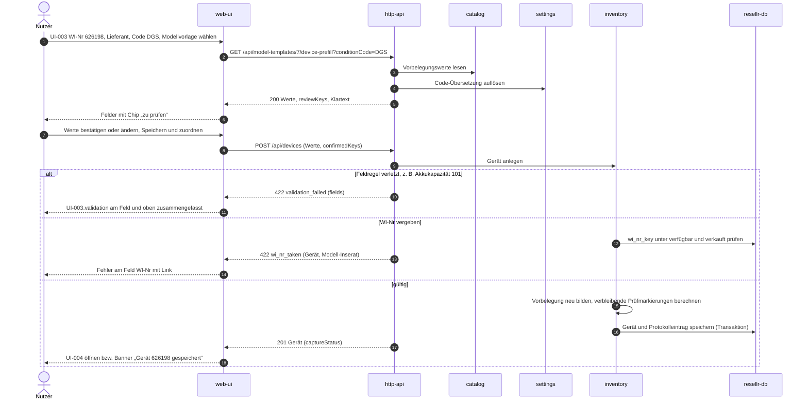

### 2.6 F-06 Zuordnen, Modell-Inserat anlegen, Umbuchen (REQ-017 bis REQ-020)

**Komponenten:** `web-ui` (UI-004, UI-005), `http-api`, `inventory`, `listing-content`, `audit`. **Flows:** FLOW-01, FLOW-02, FLOW-08.

**Endpunkte**

| Methode, Pfad | Anfrage | Antwort | Fehler |
| --- | --- | --- | --- |
| `GET /api/model-templates/{id}/listings?deviceId=` | – | `items[]`: `id, displayTitle, variantSummary, quantity`, mit `deviceId` zusätzlich `deviations[]` zum Gerät (UI-004, UI-005); bedient von `inventory/listing-choice-query.ts` (CU-294) | `not_found` |
| `POST /api/devices/{id}/assignment` | `version, listingId, confirmDeviation` | `{ device, listing: { id, quantity }, adjustStockChannels[] }` | `review_pending`, `other_model_template`, `already_assigned`, `device_not_available`, `confirmation_required` (`variant_deviation`), `version_conflict` |
| `POST /api/listings` | `fromDeviceId, deviceVersion, articleNumber?` | `201` Modell-Inserat | `review_pending`, `variant_duplicate`, `article_number_taken`, `device_not_available`, `version_conflict` |
| `POST /api/devices/{id}/rebooking` | `version, targetListingId, confirmDeviation` | wie Zuordnung, dazu `previousListing: { id, quantity }` | `device_not_available`, `device_not_assigned`, `other_model_template`, `confirmation_required` (`target_deviation`), `version_conflict` |

**Vergleichsregel (Requirements Kap. 6.0)** – `packages/domain/src/inventory/compare-variants.ts` (CU-119, ab S2), reine Funktion, von Server und Oberfläche genutzt:

- verglichen werden `conditionValueId`, `visualGrade`, die Zustandsbeschreibung nach `trim()` und Unicode-Kleinschreibung (zwei leere sind gleich, leer und nicht leer verschieden) und der Wert jedes Merkmals der Ebene *Gerät* mit `variantForming = true`, **aktiv oder deaktiviert** (K-03, MAR-176; Kap. 2.1). Ein deaktiviertes Variantenmerkmal hat bei neu erfassten Geräten keinen Wert und weicht deshalb von einem Modell-Inserat mit Wert ab (Regel unten),
- nicht verglichen: übrige Gerätemerkmale, Akkukapazität, WI-Nr (AC-REQ-018-03),
- ein fehlender Wert ist nur einem fehlenden Wert gleich; Mehrfachangaben (Anschlüsse) werden als sortierte Liste verglichen,
- Ergebnis: Liste `{ key, label, deviceValue, listingValue }` mit formatierten Werten (z. B. „RAM: Gerät 8GB, Modell-Inserat 16GB“, AC-REQ-018-04); bei Zustandsbeschreibung beide Texte vollständig (AC-REQ-018-05).

**Zuordnen (REQ-017, REQ-018):** Voraussetzungen in dieser Reihenfolge: Gerät *verfügbar* (`device_not_available`), nicht zugeordnet (`already_assigned`), `captureStatus = checked` (`review_pending` mit `details.keys`), gleiche Modellvorlage (`other_model_template`). Weichen Variantenangaben ab und ist `confirmDeviation` nicht `true`: `confirmation_required`/`variant_deviation`. Mit Bestätigung: Zuordnung, Protokolleintrag „trotzdem zuordnen“ mit Zeitpunkt und Abweichungen (AC-REQ-018-02); die Inseratswerte bleiben unverändert. `device.assigned_at` = jetzt (bestimmt die Reihenfolge der WI-Nrn in `{WI-Nr}`, Kap. 2.8.2). Danach `StockChanged(listingId)`; `adjustStockChannels` nennt veröffentlichte Kanal-Inhalte, die jetzt „Bestand auf Kanal anpassen“ tragen (UI-004-Hinweis mit Link zu UI-021). Die Liste kommt aus dem Bericht des `StockChanged`-Handlers von `listing-content` (Kap. 2.0.4); `inventory` liest dafür keine Kanal-Inhalte.

**Modell-Inserat anlegen (REQ-019):** Gerät *verfügbar* und `checked`; Variantenangaben müssen sich von jedem anderen Modell-Inserat der Modellvorlage unterscheiden (`variant_duplicate` mit Verweis, AC-REQ-019-02). Artikelnummer = WI-Nr des Geräts, außer `articleNumber` ist gesetzt; ist sie vergeben: `article_number_taken` und UI-004 zeigt das Feld „Artikelnummer“. Übernommen werden Variantenangaben und übrige inserierte Gerätewerte (alle Merkmale der Ebene *Gerät* ohne Variantenkennzeichen, **ohne** Akkukapazität); Lieferumfang leer, EAN-Kennzeichnung `original`, keine Preise, keine Fotos (AC-REQ-019-01). Ein bisher anders zugeordnetes Gerät verlässt sein Modell-Inserat (AC-REQ-019-07). `ListingCreated` legt in derselben Transaktion je aktivem Kanal einen Kanal-Inhalt im Status *Entwurf* an. Protokolleinträge: Anlage des Modell-Inserats, Zuordnung.

**Umbuchen (REQ-020, Should):** nur verfügbare, zugeordnete Geräte; Ziel derselben Modellvorlage, ≠ bisheriges Modell-Inserat; REQ-018 gilt für das Ziel: Weicht das Ziel ab und ist `confirmDeviation` nicht `true`, folgt `confirmation_required`/`target_deviation` mit den aktuellen Abweichungen zum Ziel; nichts ist gespeichert.

**Umbuchungsziel weicht ab (K-04, MAR-176; Design v0.6 UI-005 „Umbuchen: Ziel weicht ab“):** Der Dialog UI-005 (CU-135) sendet „Umbuchen“ in Schritt 1 **immer ohne** Bestätigung (Kontext A: `POST /api/devices/{id}/rebooking` mit `confirmDeviation: false`; Kontext B: `PATCH` mit `deviationDecision: rebook` ohne `confirmTargetDeviation`). Stimmt das Ziel überein, bucht der Server sofort um (AC-REQ-020-01, -04); den zweiten Schritt sieht der Nutzer dann nicht. Antwortet er `confirmation_required`/`target_deviation`, wechselt derselbe Dialog zu `UI-005.ziel-abweichung`: Titel „Umbuchen: Ziel weicht ab“, Zeile „Ziel: <Titel>“, Tabelle aus `details.deviations` gegen das **Ziel**-Modell-Inserat, Knöpfe „Anderes Ziel wählen“, „Abbrechen“, „Trotzdem umbuchen“. Die Abweichungen kommen aus der Antwort des Servers, nicht aus der zuvor geladenen Zielliste; so zeigt der Schritt auch dann den aktuellen Stand, wenn sich das Ziel inzwischen geändert hat. Beim Öffnen von Schritt 2 liegt der Fokus auf „Anderes Ziel wählen“ (Design). „Anderes Ziel wählen“ kehrt ohne Serveraufruf zu Schritt 1 zurück, die bisherige Auswahl bleibt markiert; „Abbrechen“ und Esc schließen den Dialog, nichts ist gespeichert. „Trotzdem umbuchen“ sendet dieselbe Anfrage mit `confirmDeviation: true` bzw. `confirmTargetDeviation: true`. Während dieser Anfrage gilt `UI-005.ziel-abweichung.speichert` (P-08: Auswahl und alle drei Knöpfe gesperrt, Primärknopf „Umbuchen …“, keine Zeitgrenze). Antwortet der Server darauf erneut mit `target_deviation` (Ziel inzwischen erneut geändert), bleibt Schritt 2 mit den neuen Abweichungen stehen. *Beispiel:* Gerät 626198 (Optik-Note 4) soll von MI-A nach MI-B (Optik-Note 2). Schritt 2 zeigt „Optik-Note: Gerät 4, Ziel-Modell-Inserat 2“; erst „Trotzdem umbuchen“ bucht um, MI-A hat danach eine Stückzahl weniger, MI-B eine mehr. Beide Modell-Inserate erhalten `StockChanged`; das bisherige bleibt mit Stückzahl 0 bestehen (AC-REQ-020-03). Protokolleintrag `rebooked`, bei bestätigter Abweichung mit den Abweichungen wie „trotzdem zuordnen“.

**Zustände:** UI-004 `.empty` = Modellvorlage ohne Modell-Inserat (nur „Neues Modell-Inserat anlegen“, AC-REQ-017-03); `.disabled` = „Zuordnen“ ohne Auswahl. UI-005 erscheint, wenn eine Antwort `confirmation_required`/`variant_deviation` liefert; Kontext A aus UI-004, Kontext B aus UI-003/UI-010 (Kap. 2.5). „Umbuchen“ in UI-005 ist nur aktiv, wenn `rebookTargets` nicht leer ist („Kein anderes Modell-Inserat dieser Modellvorlage“). `target_deviation` führt zu `UI-005.ziel-abweichung`, die laufende Bestätigung zu `UI-005.ziel-abweichung.speichert` (K-04, Ablauf oben).

**Ablauf „Zuordnen mit Abweichung“** (Baseline Ablauf 1, hier mit Endpunkten und Statuscodes)

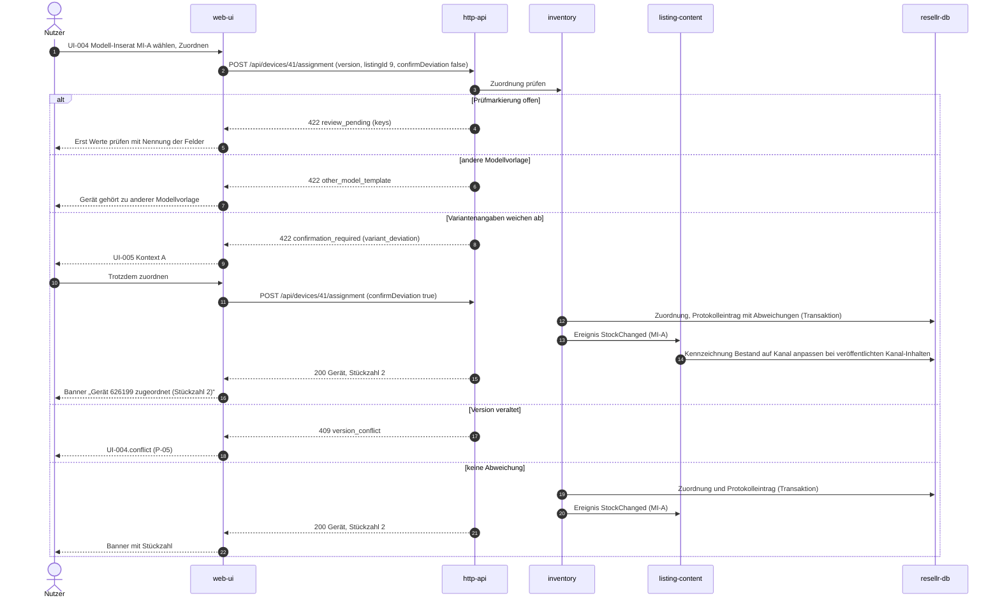

### 2.7 F-07 Modell-Inserat pflegen: Inseratswerte und Preise (REQ-032, REQ-033, REQ-088, REQ-091)

**Komponenten:** `web-ui` (UI-014), `http-api`, `inventory`, `channels` (Preisregeln), `listing-content`, `audit`. **Flows:** FLOW-01, FLOW-02 (Variante), FLOW-06.

**Endpunkte**

| Methode, Pfad | Anfrage | Antwort | Fehler |
| --- | --- | --- | --- |
| `GET /api/listings/{id}?includeCancelled=` | – | Modell-Inserat mit `displayTitle`, `stock { quantity, wiNrs[], batteryText, stockHash }`, `prices[]`, `devices[]`, `deliveryScope[]`, `version`; bedient von `inventory/listing-detail-query.ts` (CU-292). Kanal-Karten und Fotos lädt UI-014 über `GET /api/listings/{id}/channel-contents` (Kap. 2.9) und `GET /api/listings/{id}/photos` (Kap. 2.11), damit jede Komponente nur ihre eigenen Daten liefert (FIND-202) | `not_found` |
| `PATCH /api/listings/{id}` | `version`, optional `conditionValueId, visualGrade, conditionDescription, variantValues, otherValues, deliveryScopeTextBlockIds[], articleNumber, eanMode, ownEan`, `confirmDeviatingDevices` | Modell-Inserat | `validation_failed`, `variant_duplicate`, `article_number_taken`, `confirmation_required` (`assigned_devices_deviate` mit `details.devices[]: { wiNr, deviations[] }`), `version_conflict` |
| `PUT /api/listings/{id}/prices/{channelId}` | `version, amountCents, vb` | `{ listing: { version }, prices[] }` (alle Kanäle, weil Preisregeln mehrere ändern können) | `validation_failed` („Preis: Zahl größer 0 mit höchstens zwei Nachkommastellen“), `version_conflict` |

**Regeln (REQ-088):** Modelldaten sind über diesen Endpunkt nicht änderbar; das Schema enthält sie nicht (AC-REQ-088-06). Variantenangaben müssen sich weiter von jedem anderen Modell-Inserat der Modellvorlage unterscheiden (`variant_duplicate`, AC-REQ-088-02). Weichen danach zugeordnete verfügbare Geräte ab, ist `confirmDeviatingDevices: true` nötig; die Bestätigung wird protokolliert (AC-REQ-088-03, `UI-014.abweichung-bestaetigen`). Lieferumfang: nur aktive Textbausteine der Art *Lieferumfang*, deren Geltungsbereich die Geräteart umfasst (AC-REQ-088-05). Artikelnummer 1–30, `^[A-Za-z0-9-]+$`, eindeutig ohne Groß-/Kleinschreibung. EAN: bei `own` Pflicht, 8 oder 13 Ziffern mit Prüfziffer (AC-REQ-088-04); bei `original` wird `ownEan` auf `null` gesetzt. Variantenangaben und übrige inserierte Gerätewerte prüft CU-124 am vollständigen Stand nach der Änderung, auch wenn nur Lieferumfang, Artikelnummer oder EAN geändert werden (Kap. 2.5 „Prüfung am Stand nach der Änderung“, Nachtrag MAR-605). Preise (`PUT …/prices/{channelId}`) und Fotos prüfen keine Merkmalswerte (A-39; AC-REQ-005-12 (c)).

**Preise und Preisregel (REQ-032, REQ-033, RQ-03)**

- Preis > 0, höchstens zwei Nachkommastellen (Oberfläche wandelt „269,00“ in `26900`), `vb` nur bei Kanälen mit `vbAllowed` (AC-REQ-032-04, sonst `validation_failed`).
- Jeder Preis hat `source` = `manual` oder `rule`. Speichert der Nutzer einen Preis, wird er `manual`.
- `inventory/price-rule-applier.ts` (CU-127) liest die Preisregeln über `channel-reader` (CU-161) und erhält die topologische Reihenfolge von `packages/domain/src/pricing/price-rule-graph.ts` (CU-156); die Reihenfolge ist damit nur dort umgesetzt (FIND-203). Er wendet danach in derselben Transaktion alle Regeln an, deren Bezugskanal sich geändert hat, in dieser Reihenfolge: Für jeden Kanal mit Regel, dessen Preis **nicht** `manual` ist, gilt Preis = Bezugspreis + Auf-/Abschlag; ist das ≤ 0 oder fehlt der Bezugspreis, entfällt der Regelpreis (AC-REQ-033-03). `manual`-Preise bleiben (AC-REQ-033-02). Regelpreise werden in UI-014 mit „Vorschlag nach Preisregel“ angezeigt.
- Eine neue oder geänderte Preisregel ändert bestehende Preise nicht (AC-REQ-085-01); sie wirkt bei der nächsten Preisspeicherung des Bezugskanals. Dann folgt ihr auch ein Preis, der schon vorher als Regelpreis (`rule`) gespeichert war; nur `manual`-Preise bleiben (RQ-03). Vor S5 gibt es weder Pflege der Preisregeln noch die Einheit CU-127: CU-126 speichert dann nur den eingegebenen Preis, Regelpreise entstehen erst ab S5 (Kap. 4.4.0, FIND-227).
- Jede Preisänderung ist eine Inhaltsangabe des betroffenen Kanals: `ContentInputsChanged(listingId, channelIds)`.

**Zustände:** `UI-014.edit` ist der Bearbeitungsmodus der Inseratswerte (lokaler Oberflächenzustand); `UI-014.abweichung-bestaetigen` entsteht aus `confirmation_required`/`assigned_devices_deviate`; `UI-014.speichert` während `PATCH`/`PUT`. Preise speichern beim Verlassen des Felds oder mit Enter (UI-014). Die Kanal-Karten zeigen `status`, `flags[]` (Kap. 3.5) und den Preis mit `source`. Für das Datenblatt öffnet „Datenblatt“ den Dialog „Datenblatt für Gerät“ mit den Geräten aus `devices[]`, die zugeordnet, geprüft und nicht storniert sind (UI-014, Design-Annahme). „Importdatei erzeugen“ nur bei REQ-057 (Kap. 2.21).

**Ablauf „Shop-Preis ändern mit Preisregel“** (Frage: Wie entstehen Regelpreise, und wie wirkt die Änderung auf die Kanal-Inhalte?)

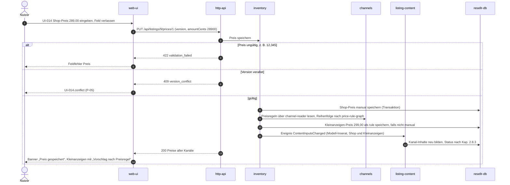

### 2.8 F-08 Kanal-Inhalte bilden und neu berechnen (REQ-034 bis REQ-041, REQ-043, REQ-045, REQ-053, REQ-091; ADR-005)

**Komponenten:** `content-engine` (reine Funktionen in `packages/domain/src/content-engine/`), `listing-content` (Neuberechnung, Status, Kennzeichnungen), alle schreibenden Fachkomponenten (Ereignisse). Kein eigener Screen; sichtbar in UI-002, UI-014, UI-016 bis UI-019, UI-043.

#### 2.8.1 Eingabe und Ergebnis von `content-engine`

`buildContentState(input: ContentInput): ContentState` ist deterministisch: gleiche Eingabe, zeichengleiches Ergebnis; keine Uhrzeit, kein Zufall, kein Datenbankzugriff (ADR-005, Baseline 2.4). `ContentInput` enthält Modellvorlage, Hersteller mit GPSR, Geräteart mit Merkmalen, Listenwerte, Modell-Inserat (Inseratswerte, Lieferumfang, Preis des Kanals, Fotos), Kanal mit Titelmuster, Beschreibungsvorlage, Merkmals-, Zustands- und Kategoriezuordnung, alle Textbausteine, Händlerangaben und die manuellen Anpassungen des Kanal-Inhalts.

`ContentState` (gespeichert als JSON in `channel_content.current_state` bzw. `released_state`, Schema `packages/domain/src/content-engine/content-state.ts`, `engineVersion: 1`):

| Feld | Inhalt |
| --- | --- |
| `title` | `{ text, autoText, truncation: none\|parts\|word, manual }` |
| `description` | `{ manual, sections[] }`; jede Section `{ heading, keep, lines[] }`, jede Line `{ text, keep }`; bei manueller Anpassung `{ manual: true, text, autoText }` |
| `category` | `{ path, ref, source: mapping\|manual }` oder `null` |
| `condition` | `{ label, extra }` oder `null` |
| `price` | `{ amountCents, vb }` oder `null` |
| `attributeFields[]` | `{ key, label, value, required }`, Reihenfolge der Merkmalszuordnung |
| `gpsr` | `{ complete, legalName, addressLines[], contact, euRp: { name, addressLines[], contact } \| null, productId }` |
| `photos[]` | Datei-Hashes in Reihenfolge |
| `missing[]` | `category`, `condition_mapping`, `gpsr` (Kap. 9.4 der Requirements) |

`text`/`value` können die Bestandsplatzhalter `{WI-Nr}`, `{Stückzahl}` und `{Akkukapazität}` unverändert enthalten (ADR-005). Der **Inhalts-Hash** ist SHA-256 über die kanonische JSON-Form (Schlüssel sortiert) des **ausgegebenen Teils** von `ContentState` (`content-hash.ts`): alle Felder außer `attributeFields[].required`, `title.truncation` und `missing[]`. Diese drei sind Prüfangaben, keine Ausgabe; ändert der Nutzer nur „Pflichtfeld“ in einer Merkmalszuordnung, entsteht deshalb kein Änderungsentwurf ohne sichtbare Änderung (RQ-13, FIND-220). Die Freigabebedingungen prüfen sie trotzdem bei jeder Freigabe am aktuellen Stand. Weil Bestandsplatzhalter darin unaufgelöst stehen, ändert eine Bestandsänderung den Hash nicht (REQ-045, REQ-091). Die IDs der verwendeten Textbausteine stehen **nicht** im Stand, sondern in `channel_content.used_text_block_ids`; eine Änderung des Prüfstatus ändert den Stand deshalb nicht.

#### 2.8.2 Bildungsregeln

| Teil | Regel | Quelle |
| --- | --- | --- |
| Werte formatieren | Text unverändert; Ganzzahl ohne Tausendertrennzeichen; Dezimalzahl mit Komma („13,3“); Einheit mit oder ohne Leerzeichen nach `unitSpacing` („16GB“, „13,3 Zoll“); Ja/Nein als „Ja“/„Nein“; Auswahl als aktuelle Bezeichnung des Listenwerts; Anschlüsse als „2 × USB-A 3.x, 1 × HDMI“, mit Position „2 × USB-A 3.x (hinten)“; Preis „279,00 €“ bzw. „50,00 € VB“ | REQ-005, REQ-078, AC-REQ-032-02 |
| Platzhalter | nach Requirements Kap. 9.7; in Titelmustern und Merkmalszuordnungen über die Merkmals-ID, in kanalweiten Texten wird `{Merkmalsbezeichnung}` je Geräteart über die Bezeichnung aufgelöst (RQ-06); `{Herstellernummer}` leer bei „unbekannt“; `{EAN}` = eigene EAN oder Original-EAN; `{Lieferumfang}` = Texte der aktiven gewählten Bausteine, je Baustein eine Zeile; `{Merkmalsliste}` = alle nicht leeren Merkmale der Geräteart ohne Akkukapazität als „Bezeichnung: Wert“, eine Zeile je Merkmal, Reihenfolge der Geräteart; `{Zustandsbezeichnung Kanal}` = Bezeichnung der Zustandszuordnung ohne Zusatzangabe (RQ-04); `{Baustein:Name}` = Text des aktiven Bausteins mit diesem Namen | REQ-040, REQ-036 |
| Titel | Bestandteile in Reihenfolge, je Bestandteil Präfix + Wert + Suffix; leerer Platzhalter → ganzer Bestandteil entfällt (AC-REQ-030-05). Kürzung: solange zu lang, entfällt der verbleibende Bestandteil mit der höchsten Priorität > 1, bei Gleichstand der hinterste (`truncation: parts`). Reicht das nicht, wird am letzten Leerzeichen vor der Höchstlänge geschnitten, abschließende Satzzeichen `, ; : / -` und `(` entfallen, `truncation: word` → Kennzeichnung „Titel gekürzt, bitte prüfen“. Enthält der Text vor der Höchstlänge kein Leerzeichen (schon das erste Wort ist zu lang), bleibt das erste Wort **vollständig** stehen, es wird nie im Wort geschnitten (K-02, MAR-176; Auslegung RQ-18): `truncation: word`, Kennzeichnung „Titel gekürzt, bitte prüfen“, und die Freigabebedingung `title_too_long` (Kap. 2.9) lehnt die Freigabe ab, bis der Nutzer den Titel manuell anpasst (REQ-043). *Beispiel:* Höchstlänge 65, erstes Wort mit 70 Zeichen → Titel = dieses Wort (70 Zeichen), Freigabe abgelehnt mit „Titel zu lang: höchstens 65 Zeichen“. Kanaleigenes Titelmuster vor dem der Geräteart | REQ-030, REQ-034, REQ-035, AC-REQ-035-01 bis -04 |
| Beschreibung | Abschnitte der Vorlage, deren Geltung die Geräteart umfasst. Eine Zeile mit mindestens einem Platzhalter, deren Platzhalter alle leer sind, entfällt samt festem Text. Ein Abschnitt mit mindestens einem Platzhalter oder Baustein, deren Werte alle leer sind, entfällt samt Überschrift. Textbausteine: nur aktive, deren Geltungsbereich Geräteart und Kanal umfasst; Platzhalter darin werden aufgelöst. Enthält eine Zeile oder ein Abschnitt Bestandsplatzhalter, wird das Entfallen erst bei der Ausgabe entschieden: `keep: false` heißt „entfällt, wenn auch alle Bestandsplatzhalter leer sind“. Ausgabe: Überschrift als eigene Zeile, Zeilen mit `\n`, Abschnitte durch eine Leerzeile getrennt | REQ-031, REQ-036, AC-REQ-031-02/-03, AC-REQ-091-02 |
| Merkmalsfelder | je Feld der Merkmalszuordnung der Wert der Quelle Q-01 bis Q-08 (Requirements Kap. 9.11), danach die Wertzuordnung; Q-01 auf das Merkmal mit Rolle `battery_capacity` und Q-07 ergeben Bestandsplatzhalter; ein Merkmal, das die Geräteart nicht hat, ergibt kein Feld; ein leerer Wert ergibt ein Feld mit `value: ""` | REQ-025, REQ-037 |
| Kategorie | manuelle Kategorie vor Zuordnung; ohne beides `null` und `missing: category` | REQ-038, REQ-086 |
| Zustand | Zuordnung des Kanals für Zustand und Optik-Note; Eintrag mit Note vor „alle Noten“; Zusatzangabe mit aufgelösten Platzhaltern, leere Platzhalter ergeben nichts; ohne Eintrag `null` und `missing: condition_mapping` | REQ-023, REQ-039 |
| GPSR | Angaben des Herstellers; `complete` nach Kap. 2.2; fehlt etwas, `missing: gpsr`; Produktidentifikation = EAN des Modell-Inserats, sonst Herstellernummer (nicht „unbekannt“), sonst Artikelnummer (A-26) | REQ-041 |
| Fotos | Hashes der Fotos des Modell-Inserats in Reihenfolge | REQ-042 |
| manuelle Anpassung | Titel bzw. Beschreibung = gespeicherter manueller Text; zusätzlich steht der automatisch gebildete Text in `autoText` | REQ-043 |

**Bestandsangaben** (`packages/domain/src/content-engine/stock.ts`, REQ-091, A-16): `quantity` = Anzahl zugeordneter Geräte im Status *verfügbar*; `wiNrs` = deren WI-Nrn nach `assigned_at`, dann `id` aufsteigend, mit „, “ verbunden (AC-REQ-043-05); `batteryText` nach Requirements Kap. 9.7 Regeln 1 bis 4 („85 %“, „82–90 %“, „85 % bzw. nicht ermittelbar“, „nicht ermittelbar“, leer). `stockHash` = SHA-256 über `{ quantity, wiNrs, batteryText }`. `resolveStock(state, stock)` ersetzt die Platzhalter und wendet die Entfall-Regeln an; das geschieht nur bei der Ausgabe (Kopier-Assistent, Vergleich, Übersicht, Import-Datei).

#### 2.8.3 Neuberechnung, Status und Kennzeichnungen (Requirements Kap. 6.0, 9.4)

`listing-content/recompute-service.ts` verarbeitet die Ereignisse einer Transaktion vor dem Commit:

1. `scope-resolver.ts` ermittelt die betroffenen Kanal-Inhalte aus dem Ereignis (Tabelle unten).
2. `content-input-loader.ts` lädt die Eingaben gebündelt (Einstellungen einmal je Lauf, Modell-Inserate in Gruppen zu 500).
3. Je Kanal-Inhalt: neuen Stand bilden, Hash vergleichen, Regeln anwenden, Zeile nur bei Änderung schreiben.

| Status vorher | neuer Hash = aktueller Hash | neuer Hash ≠ aktueller Hash |
| --- | --- | --- |
| *Entwurf* | nichts | aktueller Stand = neuer Stand |
| *Freigegeben* | nichts | aktueller Stand = neuer Stand; weicht er vom freigegebenen ab, Status → *Entwurf* (freigegebener Stand bleibt zum Vergleich) |
| *Veröffentlicht*, *Beendet* | nichts | aktueller Stand = neuer Stand (Änderungsentwurf); Status bleibt |

Die ersten drei und die fünfte Kennzeichnung sind **gespeicherte Zustände** (Spalten in Kap. 3.3): Sie entstehen und enden nur durch die Ereignisse, die Requirements Kap. 9.4 nennt, und verschwinden nicht von selbst, wenn eine Änderung zurückgenommen wird (FIND-205, MAR-164). CU-167 ändert sie nur bei diesen Ereignissen und berechnet sie nie aus den Hashes neu; die Feldtabelle `channel_content` in Kap. 3.3 nennt dieselben Regeln (FIND-226). Die übrigen werden aus dem aktuellen Stand bzw. den Anpassungsspalten abgeleitet und nicht gespeichert.

| Kennzeichnung | gesetzt | entfernt |
| --- | --- | --- |
| geändert seit Freigabe (`flag_changed_since_release`) | wenn eine Neubildung einen Stand ergibt, der vom freigegebenen abweicht (`current_hash ≠ released_hash`, REQ-045), bei Status *Freigegeben* (dann zugleich → *Entwurf*), *Entwurf* nach Rückfall, *Veröffentlicht*, *Beendet* | **nur** durch Freigabe (REQ-044, REQ-089; K-01, MAR-176). Beispiel: Preis 279 € → 289 € → 279 €; die Kennzeichnung bleibt bis zur nächsten Freigabe |
| Änderung auf Kanal übertragen | bei Freigabe eines Änderungsentwurfs im Status *Veröffentlicht* | Abgleich-Bestätigung, *Veröffentlicht* → *Beendet* |
| Bestand auf Kanal anpassen (`flag_adjust_stock`) | bei `StockChanged`, wenn der Status *Veröffentlicht* ist und sich `stockHash` gegenüber dem Stand vor dem Ereignis geändert hat (REQ-052, REQ-091) | **nur** Abgleich-Bestätigung (REQ-090) oder *Veröffentlicht* → *Beendet* (REQ-046). Kehrt der Bestand zur Momentaufnahme zurück, bleibt die Kennzeichnung (Requirements Kap. 9.4; RQ-01 entfällt). Die Momentaufnahme (bei Veröffentlichung und Abgleich) dient nur dazu, die geänderten Angaben zu nennen (AC-REQ-052-02) |
| manuell angepasst | `manual_title` bzw. `manual_description` vorhanden | Verwerfen |
| Daten geändert, manuell angepassten Text prüfen (`flag_manual_text_review`) | bei einer Neubildung, wenn sich der Hash von `autoText` gegenüber dem Basis-Hash der Anpassung (`manual_title_base_hash`, `manual_description_base_hash`) ändert | **nur** Verwerfen oder erneutes Speichern der Anpassung (setzt den Basis-Hash auf den aktuellen `autoText`, T-1); nicht durch Freigabe und nicht, wenn die Daten zurückkehren (Requirements Kap. 9.4) |
| Kategorie manuell | `manual_category` vorhanden | Verwerfen |
| Titel gekürzt, bitte prüfen | `title.truncation = word` im aktuellen Stand | Neubildung ohne diese Kürzung, manueller Titel |
| Kategorie fehlt, Zustandszuordnung fehlt, GPSR-Herstellerangaben fehlen | `missing[]` im aktuellen Stand | Angabe vorhanden |
| ausverkauft | Modell-Inserat mit `quantity = 0` | Stückzahl > 0 |

Bei Änderungsentwürfen zeigen Übersicht und Kopier-Assistent den freigegebenen Stand (REQ-045); die Kennzeichnungen des aktuellen Stands (z. B. „Kategorie fehlt“ im Entwurf) erscheinen nur in UI-016 und UI-018.

**Ereignisse und Geltungsbereich**

| Ereignis | Auslöser | betroffene Kanal-Inhalte |
| --- | --- | --- |
| `ListingCreated` | Kap. 2.6 | neue Inhalte je aktivem Kanal anlegen und bilden |
| `ContentInputsChanged` | Modell-Inserat (Werte, Preise, Fotos), Modellvorlage, manuelle Anpassung, Kategorie | Inhalte der genannten Modell-Inserate, ggf. eingeschränkt auf Kanäle |
| `SettingsChanged` | Kap. 2.1 bis 2.3 | nach Geltungsbereich: Geräteart, Kanal, Hersteller, Textbaustein (Gerätearten × Kanäle vor und nach der Änderung), Händlermarke (alle) |
| `ChannelActivated` | Kap. 2.3 | fehlende Inhalte des Kanals anlegen |
| `StockChanged` | Zuordnung, Umbuchung, Verkauf, Rücknahme, Storno, WI-Nr-Korrektur, Akku eines zugeordneten Geräts | nur Kennzeichnung „Bestand auf Kanal anpassen“ der veröffentlichten Inhalte der Modell-Inserate setzen; kein neuer Stand. Bericht: `adjustStockChannels` |

Prüfereignisse (Kap. 2.0.4) bilden keine Kanal-Inhalte; sie prüfen nur:

| Prüfereignis | meldet | prüft | Ablehnung |
| --- | --- | --- | --- |
| `VariantSetChanging` | `settings` | `inventory`: würden Modell-Inserate einer Modellvorlage zusammenfallen? | `variant_flag_would_merge_listings` |
| `ModelTemplateDeviceTypeChanging` | `catalog` | `inventory`: verweisen Geräte auf die Modellvorlage? | `device_type_in_use` |
| `ModelTemplateDeleting` | `catalog` | `inventory`: verweisen Modell-Inserate (zuerst) oder Geräte? Rangfolge Kap. 2.4 (v0.5.2) | `delete_not_allowed` mit `details.reason` |
| `ListingDeleting` | `inventory` | `listing-content`: ist ein Kanal-Inhalt *Veröffentlicht*? | `delete_not_allowed` |

**Engine-Version (AR-04):** `ENGINE_VERSION` in `content-engine/index.ts`. Weicht der Wert in `app_meta.engine_version` beim Start ab oder fehlt er (Update mit geänderter Bildung, erster Start), bildet CU-173 nach den Migrationen alle Kanal-Inhalte neu und legt fehlende an, bevor der Server bereit meldet; danach speichert es den Wert. Die Migration `0001` schreibt den Wert nicht (FIND-201). Vor einer solchen Neubildung liegt immer eine Kopie (Kap. 2.19, Schritt 5). Die Release-Notizen nennen das (Baseline 10.6).

#### 2.8.4 Anzahlen nach REQ-053

`recompute-service` zählt je Lauf jeden betroffenen Kanal-Inhalt, dessen Stand sich geändert hat, genau einmal:

1. **zur erneuten Freigabe**: Status vorher *Freigegeben*, *Veröffentlicht* oder *Beendet* und neuer Hash ≠ freigegebener Hash,
2. sonst **manuell angepasst, zur Prüfung**: in diesem Lauf hat sich der automatisch gebildete Text unter einer manuellen Anpassung geändert (die Kennzeichnung „Daten geändert, manuell angepassten Text prüfen“ wird gesetzt oder bleibt gesetzt),
3. sonst **aktualisiert**.

Beispiel AC-REQ-043-07: 8 Entwürfe ohne Anpassung → aktualisiert; 2 Entwürfe mit angepasster Beschreibung → manuell angepasst; 5 veröffentlichte → zur erneuten Freigabe; Antwort `{ updated: 8, manualReview: 2, rerelease: 5 }`.

Lesart (RQ-12, FIND-220): Requirements REQ-053 nennt „Änderungsentwürfe“ unter „aktualisiert“ und „bisher *Veröffentlicht*“ unter „zur erneuten Freigabe“. Ein veröffentlichter Inhalt mit schon bestehendem Änderungsentwurf zählt hier als „zur erneuten Freigabe“, weil der Nutzer ihn freigeben muss. Ein manuell angepasster Inhalt zählt in „manuell angepasst, zur Prüfung“, sobald dieser Lauf den Text unter der Anpassung ändert, auch wenn der Hinweis schon bestand; ist er zugleich zur erneuten Freigabe fällig, zählt er dort. Jeder Inhalt zählt genau einmal.

#### 2.8.5 Leistung (REQ-060, REQ-061, AR-03)

Ziel nach Baseline 7.3: auch die Neuberechnung aller 9.000 Kanal-Inhalte (A-12) in unter 5 s auf einem Arbeitsplatzrechner der Mittelklasse. Maßnahmen: Einstellungen einmal je Lauf laden, Modell-Inserate gebündelt lesen, nur geänderte Zeilen schreiben, vorbereitete Anweisungen. Der Lasttest in S5 misst das (Kap. 6.3); verfehlt er das Ziel, gilt der Rückfallweg AR-03 als Architekturänderung.

**Ablauf „Textbaustein ändern mit Wirkung auf viele Kanal-Inhalte“** (Baseline Ablauf 3, hier mit Endpunkten, UI-043 und Fehlerfällen)

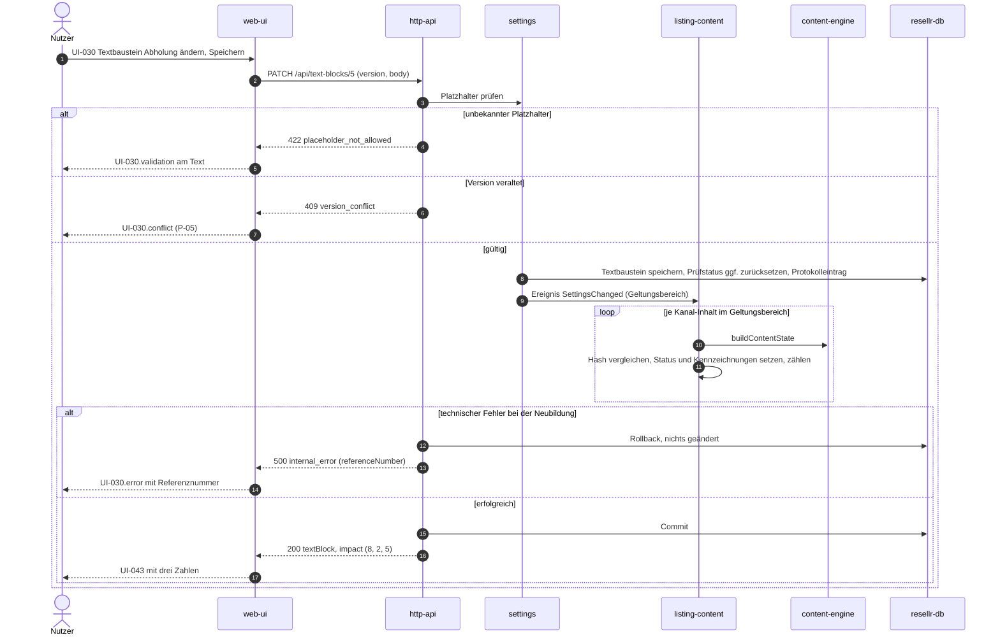

### 2.9 F-09 Prüfen, manuell anpassen und freigeben (REQ-043, REQ-044, REQ-045, REQ-059, REQ-086, REQ-087, REQ-089; K-3, T-1)

**Komponenten:** `web-ui` (UI-016, UI-017, UI-018, UI-022), `http-api`, `listing-content`, `content-engine`, `settings` (Prüfstatus), `audit`. **Flows:** FLOW-01, FLOW-04, FLOW-06.

**Endpunkte**

| Methode, Pfad | Anfrage | Antwort | Fehler |
| --- | --- | --- | --- |
| `GET /api/channel-contents/{id}` | – | `id, listingId, channel, status, version, currentHash, display` (aktueller Stand mit aufgelösten Bestandsangaben), `releasedAt, flags[], conditions[]` (`key, ok, message`), `manual { title, description, category }`, `uncheckedLegalTextBlocks[]`, `categoryWarning` (Could) | `not_found` |
| `GET /api/listings/{id}/channel-contents` | – | je Kanal mit Kanal-Inhalt: `id, channelId, status, flags[], price, lastReconciledAt, publishedOn, openConditionCount` (Kanal-Karten UI-014) | `not_found` |
| `GET /api/listings/{id}/channel-comparison` | – | `{ channels[]: { channelId, name, status, flags[], openConditionCount }, rows[]: { key, label, kind: fixed\|identifier\|attribute, values: { <channelId>: string \| null }, different } }` (UI-017, Regeln unten) | `not_found` |
| `PUT /api/channel-contents/{id}/manual-title` | `version, text` | `{ content, outcome }` | `validation_failed` („Titel zu lang: höchstens <n> Zeichen“), `version_conflict` |
| `DELETE /api/channel-contents/{id}/manual-title?version=` | – | `{ content, outcome }` | `version_conflict` |
| `PUT /api/channel-contents/{id}/manual-description` | `version, text` | `{ content, outcome }` | `placeholder_not_allowed` („Unbekannter Platzhalter {…}“), `validation_failed`, `version_conflict` |
| `DELETE /api/channel-contents/{id}/manual-description?version=` | – | `{ content, outcome }` | `version_conflict` |
| `PUT /api/channel-contents/{id}/manual-category` | `version, path` | `{ content, outcome }` | `validation_failed` („Kategorie: 1 bis 255 Zeichen“), `version_conflict` |
| `DELETE /api/channel-contents/{id}/manual-category?version=` | – | `{ content, outcome }` | `version_conflict` |
| `POST /api/channel-contents/{id}/release` | `version, seenContentHash, confirmUncheckedLegal` | `{ content }` | `stale_content`, `release_conditions_violated`, `confirmation_required` (`unchecked_legal_text`), `version_conflict` |
| `GET /api/channel-contents/{id}/comparison` | – | `{ case: change_draft\|draft_after_release\|none, releasedAt, rows[] }`, je Zeile `field, label, changed, releasedValue, currentValue` | `not_found` |

`outcome` = `{ statusBefore, statusAfter, changeDraft }` (T-1): `web-ui` wählt daraus die Ergebnismeldung von UI-016 („Anpassung gespeichert“; „Anpassung gespeichert, Kanal-Inhalt ist wieder Entwurf, bitte erneut freigeben“; „Änderungsentwurf angelegt“ mit Link UI-018; oder keine Statusmeldung).

**Manuelle Anpassung (REQ-043, REQ-086)**

- In jedem Status möglich (UI-016). Titel 1 bis Höchstlänge des Kanals (AC-REQ-043-03); Beschreibung 1–20.000 Zeichen (technische Obergrenze; Text: Kap. 8.2, Schlüssel M-16; vor „Unbekannter Platzhalter“ geprüft), als Platzhalter nur die Bestandsplatzhalter `{WI-Nr}`, `{Stückzahl}`, `{Akkukapazität}` (REQ-043, T-1); Kategorie 1–255.
- Speichern setzt den Text und den Basis-Hash (Hash des aktuellen `autoText`), entfernt damit „Daten geändert, manuell angepassten Text prüfen“ und löst `ContentInputsChanged` für diesen Kanal-Inhalt aus; Status und Kennzeichnungen folgen Kap. 2.8.3. „Gespeicherter Stand“ ist der aktuelle Stand, bei *Veröffentlicht*/*Beendet* also der Änderungsentwurf (T-1).
- `DELETE` verwirft die Anpassung; der Text wird neu gebildet (AC-REQ-043-04); Status und Kennzeichnungen folgen Kap. 2.8.3.
- Ungespeicherte Eingaben bleiben im Browser (`apps/web/src/features/channel-content/unsaved-adaptation-store.ts`, je Modell-Inserat, Kanal und Fenster, übersteht Kanalwechsel und Routenwechsel innerhalb der Seite). „Eingabe verwerfen“ ist rein clientseitig.
- **Kategorie-Warnung (REQ-059, Could):** `categoryWarning = { deviceTypeName }`, wenn die manuelle Kategorie in der Kategoriezuordnung desselben Kanals einer anderen Geräteart zugeordnet ist (AC-REQ-059-01); keine Sperre. Berechnet von `listing-content/category-warning.ts` (CU-289, S11).

**Freigabe (REQ-044, REQ-089, REQ-087)** – Reihenfolge der Prüfungen in `listing-content/release-service.ts`:

1. **Status:** *Entwurf* → Freigabe; *Veröffentlicht* oder *Beendet* mit „geändert seit Freigabe“ → Freigabe des Änderungsentwurfs. *Freigegeben* sowie *Veröffentlicht*/*Beendet* ohne Änderungsentwurf: fachlich wirkungslos, Antwort `200` mit unverändertem Inhalt (Baseline 9.3 „Doppelklick“).
2. **Gesehener Stand:** `seenContentHash ≠ current_hash` → `409 stale_content` (Ablauf 2).
3. **Freigabebedingungen** auf dem aktuellen Stand mit aufgelösten Bestandsangaben; jede verletzte Bedingung wird genannt (AC-REQ-044-02): `price_missing` „Preis fehlt“, `category_missing` „Kategorie fehlt“, `condition_missing` „Zustandszuordnung fehlt“, `gpsr_incomplete` „GPSR-Herstellerangaben fehlen“, `title_too_long` „Titel zu lang: höchstens <n> Zeichen“, `required_field_empty` „Pflichtfeld „<Feld>“ ist leer“ (AC-REQ-044-03). Jede Verletzung trägt `fieldKey`, damit UI-016 zum Feld springt.
4. **Ungeprüfter Rechtstext:** Enthält `used_text_block_ids` einen aktiven Baustein der Art *Rechtliches* oder *Akku-Hinweis* mit Prüfstatus `unchecked` und ist `confirmUncheckedLegal` nicht `true` → `confirmation_required` mit `details.kind = unchecked_legal_text` und den Namen (UI-022, AC-REQ-087-01/-03).
5. **Speichern:** freigegebener Stand = aktueller Stand, `released_hash`, `released_at` (jede Freigabe einen neuen Zeitpunkt, auch bei gleichem Stand; Kap. 2.12), „geändert seit Freigabe“ entfernt; *Entwurf* → *Freigegeben*; bei *Veröffentlicht* zusätzlich „Änderung auf Kanal übertragen“ (AC-REQ-089-01); bei *Beendet* keine weitere Kennzeichnung (AC-REQ-089-03). Protokolleinträge: Freigabe; bei Bestätigung nach REQ-087 zusätzlich ein Eintrag „Freigabe mit ungeprüftem Rechtstext bestätigt“ mit den Namen der Bausteine.

**Kanäle vergleichen (UI-017, FIND-207):** `listing-content/channel-comparison-query.ts` (CU-301) bildet die Zeilen aus dem **aktuellen** Stand jedes Kanal-Inhalts mit aufgelösten Bestandsangaben:

- feste Zeilen (`fixed`): Titel (`title.text`), Preis, Kategorie (`category.path`), Zustandsbezeichnung (`condition.label`, mit Zusatzangabe), Beschreibung, GPSR-Angaben (eine Zeile je Angabe wie im Kopier-Assistenten);
- Kennungen (`identifier`): Herstellernummer, EAN, Artikelnummer und Stückzahl, jeweils der Wert des Merkmalsfelds des Kanals mit der Quelle Q-02 `mpn`, Q-03 `ean`, Q-04 `articleNumber` bzw. Q-07 `quantity` (nach Wertzuordnung); hat ein Kanal kein solches Feld, ist der Wert `null` („–“);
- Merkmale (`attribute`): je Merkmal, das in mindestens einem Kanal als Merkmalsfeld mit Quelle Q-01 vorkommt, eine Zeile, Reihenfolge der Geräteart. Das Design nennt beispielhaft „Prozessor, RAM, Speicher“; die Auswahl aller zugeordneten Merkmale ist DG-12.
- `different` = mindestens zwei Kanäle mit Wert (`≠ null`) haben nach `trim()` verschiedene Werte; Kanäle ohne Feld zählen nicht. Bei `identifier` hebt UI-017 `different` zusätzlich hervor (Design UI-017).

**Vergleich (REQ-045, UI-018):** Beide Stände werden mit **denselben** aktuellen Bestandsangaben aufgelöst, damit Bestandsänderungen nicht als Änderung erscheinen. `changed` vergleicht die aufgelösten Werte je Feld. `web-ui` hebt Unterschiede mit der Bibliothek `diff` hervor: Wortebene bei einzeiligen Feldern, Zeilenebene bei der Beschreibung (UI-018 Annahme; Entscheidung des Architekten). `case = draft_after_release` ist Fall (b) von UI-018 (`UI-018.entwurf-vergleich`).

**Zustände (Besonderheiten):** `UI-016.ungespeichert-hinweis` entsteht ohne Serveraufruf, wenn „Freigeben“ bei ungespeicherter Eingabe im aktuellen Kanal gewählt wird. `UI-016.verlassen-rueckfrage` über den Router-Blocker von React Router (Kanalwechsel ausgenommen) und `beforeunload` beim Schließen. `UI-016.conflict`: Nach `409` lädt „Stand neu laden“ nur die Daten; der eigene Text bleibt als „Ihr Text (nicht gespeichert)“ sichtbar, „Meinen Text übernehmen“ setzt ihn in den Bearbeitungsmodus (T-1). `UI-016.geaendert` = Status *Entwurf* mit „geändert seit Freigabe“. „Freigeben“ ist nie wegen verletzter Bedingungen deaktiviert (UI-016). UI-017 `.empty` = nur ein Kanal in `channels[]`; der Chip „unterschiedlich“ steht an Zeilen mit `different`. UI-018 `.empty` = `case: none`. UI-022 öffnet bei `unchecked_legal_text`; „Ungeprüfter Rechtstext enthalten – trotzdem freigeben“ sendet die Freigabe erneut mit `confirmUncheckedLegal: true` und demselben `seenContentHash`.

**Ablauf „Kanal-Inhalt freigeben“** (Baseline Ablauf 2, hier mit Endpunkten, Prüfreihenfolge und UI-022)

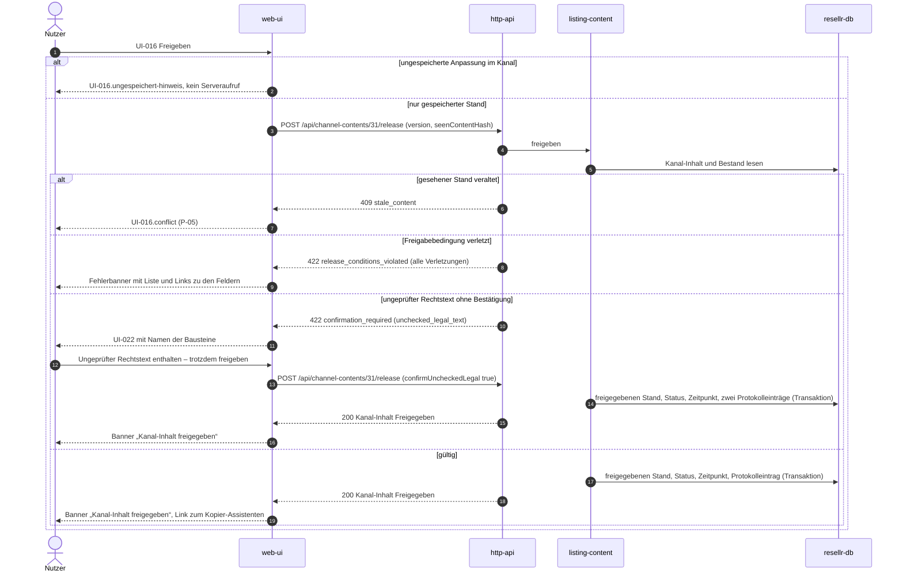

### 2.10 F-10 Kanal-Status und Abgleich (REQ-046, REQ-052, REQ-090; Ä-31)

**Komponenten:** `web-ui` (UI-020, UI-021, UI-014, UI-019, UI-002), `http-api`, `listing-content`, `audit`. **Flows:** FLOW-01, FLOW-02, FLOW-03, FLOW-06, FLOW-09.

**Endpunkte**

| Methode, Pfad | Anfrage | Antwort | Fehler |
| --- | --- | --- | --- |
| `POST /api/channel-contents/{id}/status` | `version, target: published\|ended, publishedOn?, externalRef?` | `{ content }` | `invalid_status_transition`, `validation_failed`, `version_conflict` |
| `POST /api/channel-contents/{id}/reconciliation` | `version, seenStockHash` | `{ content }` | `nothing_to_reconcile`, `invalid_status_transition`, `stale_stock`, `version_conflict` |

`GET /api/channel-contents/{id}` liefert für UI-021 zusätzlich `stockChanges[]` (`key: quantity\|wiNrs\|battery, label, snapshotValue, currentValue, changed`; alle drei Angaben, `changed` gegenüber der Momentaufnahme) und `stockHash`.

**Übergänge (Requirements Kap. 9.4, AC-REQ-046-01 bis -08)**

| von | nach | zulässig | Folge |
| --- | --- | --- | --- |
| *Freigegeben* | *Veröffentlicht* | ja; `publishedOn` Pflicht, nicht in der Zukunft; `externalRef` 0–500 | Momentaufnahme des Bestands; keine Abgleich-Kennzeichnung |
| *Veröffentlicht* | *Beendet* | ja | „Änderung auf Kanal übertragen“ und „Bestand auf Kanal anpassen“ werden entfernt (gespeicherte Kennzeichnungen, Kap. 2.8.3; im Status *Beendet* setzt `StockChanged` sie nicht neu); „geändert seit Freigabe“ und Änderungsentwurf bleiben (AC-REQ-046-08) |
| *Beendet* | *Veröffentlicht* | nur ohne „geändert seit Freigabe“, sonst „Erst Änderung freigeben“ (AC-REQ-046-04) | neue Momentaufnahme, keine Abgleich-Kennzeichnung (AC-REQ-046-05); `publishedOn` Pflicht |
| *Entwurf* | *Veröffentlicht* oder *Beendet* | nein, „Erst freigeben“ (AC-REQ-046-02) | – |
| *Freigegeben* | *Beendet* | nein, „Freigegeben kann nicht beendet werden“ (AC-REQ-046-06) | – |

Ein Kanal-Inhalt wird nie automatisch freigegeben (AC-REQ-044-04). UI-020 bietet nur zulässige Übergänge an; unzulässige erscheinen nicht (Design UI-020, FIND-208). Die Server-Ablehnung `invalid_status_transition` bleibt für veraltete Seiten.

**Abgleich (REQ-090, Ä-31):** nur im Status *Veröffentlicht*. Trägt der Inhalt weder „Änderung auf Kanal übertragen“ noch „Bestand auf Kanal anpassen“ → `nothing_to_reconcile` („Kanal ist abgeglichen“, AC-REQ-090-03; UI-021 `.empty` zeigt das schon aus den geladenen Daten). Weicht `seenStockHash` vom aktuellen Bestand ab → `409 stale_stock`; so wird kein Bestand bestätigt, den der Nutzer nicht gesehen hat. Sonst: „Änderung auf Kanal übertragen“ und „Bestand auf Kanal anpassen“ entfernt, Momentaufnahme = aktueller Bestand, `last_reconciled_at` = jetzt, Protokolleintrag; „geändert seit Freigabe“ bleibt (AC-REQ-090-02).

**„Bestand auf Kanal anpassen“ (REQ-052, Requirements Kap. 9.4):** gespeicherte Kennzeichnung (Kap. 2.8.3), gesetzt bei jeder Änderung einer Bestandsangabe im Status *Veröffentlicht*, entfernt nur durch Abgleich oder *Veröffentlicht* → *Beendet*. Kehrt der Bestand zur Momentaufnahme zurück, bleibt sie; der Kanal kann inzwischen angepasst worden sein. *Beispiel:* Im Shop steht das MacBook-Inserat mit 2 Stück. Ein Verkauf setzt die Kennzeichnung, der Nutzer stellt den Shop auf 1 und nimmt den Verkauf dann zurück: Die Kennzeichnung bleibt bis zur Abgleich-Bestätigung, und UI-021 zeigt die aktuelle Stückzahl 2 neben der Momentaufnahme 2. Die Übersicht nennt die geänderten Bestandsangaben aus `stockChanges` (AC-REQ-052-02); sind alle unverändert, zeigt UI-021 die aktuellen Werte ohne Hervorhebung. (Bisherige Auslegung RQ-01 entfällt, FIND-205.)

**Zustände:** UI-020 `.validation` am Datum; UI-021 `.conflict` bei `stale_stock` (P-05: Bestand neu laden und erneut prüfen); UI-021 `.empty` ohne Kennzeichnung. Lebenszyklus des Kanal-Inhalts: Kap. 3.5.

**Ablauf „Verkauf mit Abgleich“** (Frage: Wie entsteht und verschwindet „Bestand auf Kanal anpassen“?)

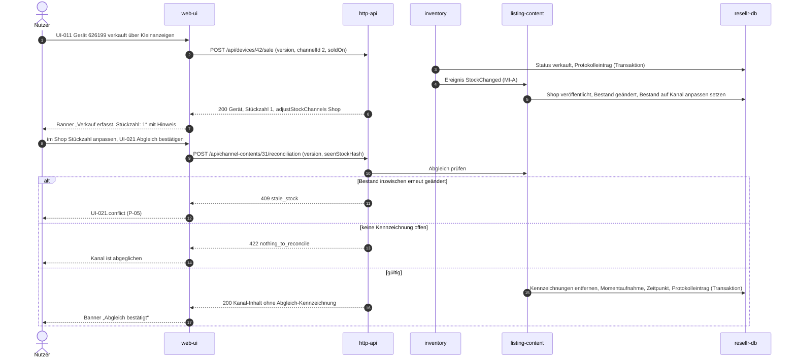

### 2.11 F-11 Fotos verwalten (REQ-042; T-2, Baseline 9.4, TH-04)

**Komponenten:** `web-ui` (UI-015), `http-api`, `media`, `inventory`, `listing-content`, `audit`. **Flows:** FLOW-01.

**Endpunkte**

| Methode, Pfad | Anfrage | Antwort | Fehler |
| --- | --- | --- | --- |
| `GET /api/listings/{id}/photos` | – | `items[]`: `id, hash, position, originalName, byteSize, url, thumbUrl` | `not_found` |
| `POST /api/listings/{id}/photos` | multipart, **eine** Datei je Anfrage, ohne `version` (T-2) | `201 { photo, listingVersion, count }` | `413 file_too_large`, `415 unsupported_media_type` (je „<Datei>: nur JPEG oder PNG bis 20 MB“), `photo_limit_reached`, `shutting_down` |
| `PUT /api/listings/{id}/photos/order` | `version` (des Modell-Inserats), `photoIds[]` vollständig | `{ items[], listingVersion }` | `validation_failed` (Menge stimmt nicht), `version_conflict` |
| `DELETE /api/listings/{id}/photos/{photoId}?version=` | – | `{ items[], listingVersion }` | `not_found`, `version_conflict` |
| `GET /media/photos/{hash}`, `GET /media/thumbs/{hash}` | – | Bilddatei, `Cache-Control: private, max-age=31536000, immutable`; `{hash}` wird vor jedem Dateizugriff gegen `^[0-9a-f]{64}$` geprüft (FIND-218) | `404` |

**Ablauf des Uploads (Baseline 9.4):** `media/photo-upload-service.ts` streamt die Datei nach `<Datenordner>/media/.incoming/<zufällig>` mit Grenze 20 MB (`@fastify/multipart`, Abbruch bei Überschreitung), berechnet dabei SHA-256, prüft die Signatur (JPEG `FF D8 FF`, PNG `89 50 4E 47 0D 0A 1A 0A`) und liest Abmessungen mit `sharp` (`limitInputPixels` 100 Mio.; ungültige Bilder → `415` mit derselben Meldung). Dann Vorschaubild (`sharp().rotate().resize({ width: 400 })`, JPEG Qualität 80) ebenfalls nach `media/.incoming`. **Ablegen und Speichern unter der Sperre des Hashes (FIND-226):** CU-090 nimmt die Sperre für diesen Hash im Prozess (CU-088; dieselbe Sperre nimmt das Aufräumen, Kap. 2.19). Unter der Sperre: Fehlt das Original unter `media/photos/<hash[0..1]>/<hash>.<ext>` bzw. das Vorschaubild unter `media/thumbs/<hash>.jpg`, wird die temporäre Datei dorthin verschoben, sonst gelöscht (gleicher Inhalt). Danach die Transaktion: Anzahl < 20 prüfen, `media_file` neu anlegen, falls die Zeile fehlt, sonst ihr `unreferenced_since` auf NULL setzen; `listing_photo` mit Position `max + 1`, `ContentInputsChanged(listingId)`, Protokolleintrag. Erst nach dem Commit wird die Sperre frei. So sieht ein Upload entweder Zeile und Datei oder keins von beiden und legt dann beides neu an; das Aufräumen kann keine Datei löschen, auf die ein Upload gerade einen Verweis setzt. Scheitert die Transaktion, bleibt die Datei ohne Zeile (oder, wenn die Zeile schon bestand, unverändert); das Aufräumen behandelt sie nach Kap. 2.19. Vor der Transaktion prüft der Dienst den Zustand `stopping` (Kap. 2.17). Das Logo (Kap. 2.2) läuft über denselben Weg in CU-090.

**Mehrere Dateien (T-2):** `web-ui` lädt nacheinander, je Datei eine Anfrage mit Fortschritt (`XMLHttpRequest.upload.onprogress`, UI-015 „Lade <Datei> hoch (n %)“); Ablehnungen erscheinen je Datei, die übrigen laufen weiter. Die 21. Datei scheitert an `photo_limit_reached` (AC-REQ-042-03).

**Reihenfolge und Entfernen:** Die Reihenfolge wird vollständig übertragen und gegen den Bestand geprüft (T-2). Entfernen löscht nur den Verweis; es gibt keinen Trigger und keine Vormerk-Tabelle. Ob eine Datei verwaist ist, stellt allein das Aufräumen fest (Spalte `media_file.unreferenced_since`, Kap. 2.19, 3.1; FIND-226). Die Datei bleibt, solange ein Modell-Inserat oder ein aktueller oder freigegebener Stand auf sie verweist (Baseline 9.4, REQ-045/REQ-047). Jede Änderung ist eine Inhaltsangabe aller Kanal-Inhalte des Modell-Inserats (UI-015 „Folge“); auf manuell angepasste Texte wirkt sie nicht, weil kein Platzhalter Fotos enthält.

**Zustände:** UI-015 nach Kap. 2.0.7; `.loading` = Upload läuft; `.disabled` = 20 Fotos; `.ausgang-unbekannt` sperrt die Fotoverwaltung bis zum Neuladen. Es gibt keinen Speicherknopf; „Fertig“ navigiert nur zu UI-014.

**Ablauf „Foto hochladen“** (Frage: In welcher Reihenfolge entstehen Datei und Datensatz?)

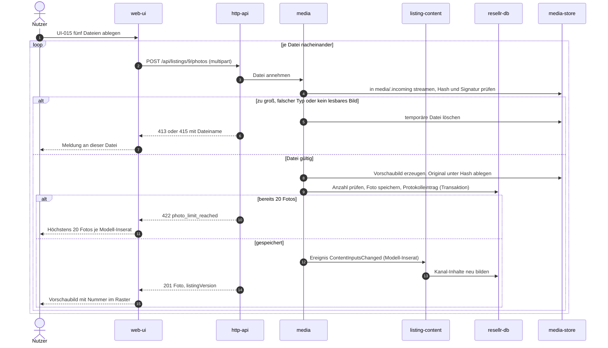

### 2.12 F-12 Kopier-Assistent und Foto-Übergabe (REQ-047 bis REQ-049; Ä-30, T-7, C-3, H-16)

**Komponenten:** `web-ui` (UI-019 in zwei Layouts), `http-api`, `listing-content`, `media`, `shared/desktop-shell`. **Flows:** FLOW-09.

**Endpunkte**

| Methode, Pfad | Anfrage | Antwort | Fehler |
| --- | --- | --- | --- |
| `GET /api/channel-contents/{id}/copy-view` | – | `{ status, flags[], releasedAt, releasedHash, newStateNotReleased, stockHash, fields[], photos[], canMarkPublished, canReconcile }` | `copy_assistant_unavailable` (Status *Entwurf*, „Erst freigeben“), `not_found` |
| `POST /api/channel-contents/{id}/photo-handover` | `{}` | `{ folderPath, count }` | `500 internal_error` („Foto-Ordner konnte nicht angelegt werden. Bitte stattdessen die ZIP-Datei laden. Referenz: <Nr>“) |
| `POST /api/channel-contents/{id}/photo-zip` | `{}` | `{ downloadUrl }` | `500 internal_error` („Fotos konnten nicht bereitgestellt werden. Referenz: <Nr>“) |
| `GET /downloads/{token}.zip` | – | ZIP als Anhang, Name `<Artikelnummer>-<Kanalcode>-fotos.zip` | `404` |

**Feldliste (REQ-047, T-7):** immer der **freigegebene** Stand mit aktuell aufgelösten Bestandsangaben, nie der Änderungsentwurf; `newStateNotReleased` = „geändert seit Freigabe“ (Hinweis „Neuer Stand noch nicht freigegeben“, AC-REQ-047-05). Feste Reihenfolge: Titel, Beschreibung, Kategorie, Zustand, Zustand – Zusatz (nur wenn vorhanden), Preis, die Merkmalsfelder in der Reihenfolge der Merkmalszuordnung, dann die GPSR-Angaben Herstellername, Postanschrift, Elektronische Kontaktadresse, ggf. die drei Angaben der verantwortlichen Person in der EU, Produktidentifikation (DG-01, DG-02, DG-05). Die Reihenfolge der festen Felder ist nicht einstellbar; ob REQ-029 das verlangt, entscheidet der Owner (E-1, RQ-11). Optionale GPSR-Angaben ohne Wert (verantwortliche Person) erscheinen nicht und zählen nicht (RQ-16). **Merkmalsfelder ohne Wert nach Auflösung entfallen** (REQ-037, AC-REQ-047-07); ein Feld mit Quelle WI-Nr oder Akkukapazität kann deshalb nach der Freigabe entfallen oder erscheinen (REQ-047). Jedes Feld: `key` (stabil, z. B. `title`, `attr:Prozessor`, `gpsr:contact`), `label`, `value` (zeichengenau der Kopierwert, Zeilenumbrüche als `\n`).

**Übernahme-Markierungen (REQ-049, Ä-30, H-16):** `apps/web/src/features/copy-assistant/copy-progress-store.ts` speichert je Fenster im `sessionStorage` die Schlüssel `<channelContentId>:<releasedAt>:<fieldKey>:<valueHash>`. `releasedAt` ändert sich mit **jeder** Freigabe, auch wenn derselbe Stand erneut freigegeben wird; die alten Markierungen gelten damit nicht mehr (AC-REQ-049-02, FIND-220). `valueHash` (SHA-256 des Kopierwerts, gekürzt auf 16 Zeichen) bindet die Markierung an das Feld **mit seinem angezeigten Wert** (K-06, MAR-176; Auslegung RQ-14; Design v0.6.1 UI-019 „Markierungen übernommen“): Ändert sich der angezeigte Wert eines Felds (z. B. Stückzahl nach einem Verkauf), ist das Feld wieder offen und zählt in „n von m übernommen“ wieder als offen. Eine zusätzliche Anzeige „Wert seit Übernahme geändert“ gibt es nicht. *Beispiel:* Stückzahl „2“ kopiert (übernommen), ein Gerät wird verkauft, nach „Neu laden“ zeigt das Feld „1“ ohne Marke „übernommen“, und aus „9 von 9“ wird „8 von 9“. „n von m“ zählt nur die angezeigten Felder (AC-REQ-049-03). Neuladen derselben Seite und Kanalwechsel behalten die Markierungen, ein zweites Fenster beginnt leer (DG-03). Scheitert `navigator.clipboard.writeText`, wird das Feld nicht markiert (UI-019 Annahme), der Toast nennt Strg+C, und der volle Wert ist markierbar, auch im schmalen Layout (Ä-30).

**Aktualität (Ä-30, FIND-208):** `copy-view` wird **nicht** still neu geladen (`refetchOnWindowFocus: false` für diese Abfrage). Bei Rückkehr ins Fenster ruft `web-ui` die Ansicht im Hintergrund ab, ohne die angezeigten Werte zu ersetzen. Weichen `releasedAt` oder `stockHash` ab, erscheint das Banner „Bitte neu laden“ (P-05, Design UI-019); erst „Neu laden“ übernimmt die neuen Werte. Die Markierungen überstehen das Neuladen nach den Regeln oben.

**Foto-Übergabe (REQ-048, C-3):** Die Routen gehören zu `listing-content` (CU-172); CU-208 und CU-209 sind Dateidienste von `media` (Kap. 4.1). `copy-view-service` (CU-212) ermittelt die Fotos des **freigegebenen** Stands und die Namen und übergibt die Liste an `media`: `media/photo-handover-service.ts` (CU-208) kopiert sie nach `<Übergabeordner>/<Artikelnummer>-<Kanalcode>-<JJJJMMTT-HHMMSS>/` als `01_<Name>.<ext>`, `02_…` (Name = Originalname ohne Endung, auf `A-Za-z0-9_-` bereinigt, höchstens 40 Zeichen) und öffnet den Ordner im Windows-Explorer (`shared/desktop-shell.ts`, abgelöst und ohne Fenster gestartet, Kap. 2.18). `media` liest dafür keine Kanal-Inhalte (FIND-202). Der Übergabeordner liegt außerhalb des Datenordners und wird beim Start geprüft (Kap. 2.19). ZIP: `media/photo-zip-service.ts` erzeugt die Datei `<Artikelnummer>-<Kanalcode>-<JJJJMMTT-HHMMSS>-fotos.zip` mit denselben Namen im Übergabeordner (Bibliothek `yazl`, ohne Komprimierung, weil JPEG und PNG bereits komprimiert sind) und gibt eine einmalige Download-Adresse zurück (Route in CU-091); Ordner und ZIP werden nach 7 Tagen gelöscht. Ohne Fotos: `photos: []` und „Keine Fotos zugeordnet“ (AC-REQ-048-02).

**Zustände:** `UI-019.empty (Entwurf)` aus `copy_assistant_unavailable`; `.empty (Fotos)`; Banner „Bitte neu laden“ (P-05) aus dem Hintergrundabruf (oben); `.success` = alle Felder markiert (clientseitig); `.disabled` = „Abgleich bestätigen“ bei `canReconcile = false` („Kanal ist abgeglichen“); „Als veröffentlicht melden“ nur bei `canMarkPublished` (Status *Freigegeben* oder *Beendet* ohne Änderungsentwurf). Schmales Layout über `?ansicht=schmal` in derselben Route (Umschalter, ADR-001), Mindestbreite 480 px, Hinweis UI-044 als Streifen am Ende der scrollenden Fläche (Kap. 2.17).

**Ablauf „Feld kopieren und Fotos übergeben“**

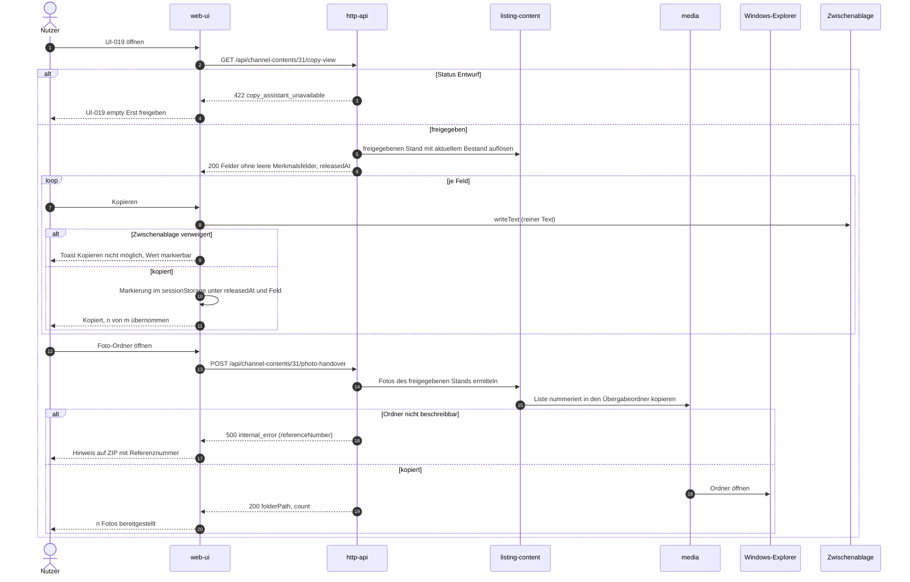

### 2.13 F-13 Datenblatt (REQ-050, REQ-051, REQ-081, REQ-040; ADR-007, T-8)

**Komponenten:** `web-ui` (UI-023, UI-014-Dialog), `http-api`, `datasheet`, `inventory`, `catalog`, `settings`, `media`. **Flows:** FLOW-01.

**Endpunkte**

| Methode, Pfad | Anfrage | Antwort | Fehler |
| --- | --- | --- | --- |
| `GET /api/devices/{id}/datasheet` | – | `{ pdfUrl, pageCount }` | `datasheet_precondition` mit `details.reason` ∈ `review_pending`, `not_assigned`, `cancelled`, `logo_missing` (Texte nach REQ-050) |
| `GET /datasheets/{token}.pdf` | – | `application/pdf`, `Content-Disposition: inline; filename="Datenblatt-<WI-Nr>.pdf"` | `404` (Token abgelaufen) |
| `GET /api/datasheets/preview-device` | – | `{ deviceId \| null }`: Beispielgerät für den Vorschau-Link in UI-039 (Regel Kap. 2.2, CU-306) | – |

**Ablauf (Ä-32, T-8):** UI-023 ruft beim Öffnen `GET /api/devices/{id}/datasheet` auf (lesend, Zeitgrenze 5 s, REQ-061). `datasheet/datasheet-service.ts` prüft die Voraussetzungen, baut das PDF mit `pdfmake` und legt es im Speicher unter einem zufälligen Token (128 Bit) ab: höchstens 20 Einträge, 15 Minuten gültig (`datasheet/pdf-cache.ts`). „Datenblatt öffnen (PDF)“ öffnet `pdfUrl` mit `window.open` **direkt im Klick**, ohne auf den Server zu warten (Popup-Blocker). Ist `pageCount > 1`, zeigt UI-023 vorher „Datenblatt passt nicht auf eine Seite“.

**Inhalt und Layout (REQ-050, AC-REQ-050-01 bis -08):** A4 hoch, Ränder 12 mm, Schrift Inter 4.1 (eingebettet, OFL). Kopf: Logo zentriert (höchstens 60 × 20 mm), darunter je Kopfzeilentext eine Zeile „<Text> ________“ (REQ-051). Danach die sechs Blöcke in der eingestellten Reihenfolge, je Block Überschrift und zweispaltige Tabelle „Bezeichnung | Wert“:

| Block | feste Zeilen | dazu |
| --- | --- | --- |
| Identifikation | WI-Nr (des Geräts), Hersteller, Modellbezeichnung, Typbezeichnung, Herstellernummer (nicht bei „unbekannt“), EAN (des Modell-Inserats, REQ-040) | Merkmale mit Block Identifikation |
| Zustand | Zustand, Optik-Note, Zustandsbeschreibung (des Geräts) | Merkmale mit Block Zustand |
| Lieferumfang | Lieferumfang des Modell-Inserats, Texte der aktiven Bausteine der Art *Akku-Hinweis* mit Geltung für die Geräteart, Akkukapazität **dieses Geräts** („N %“ bzw. „nicht ermittelbar“, AC-REQ-050-08) | Merkmale mit Block Lieferumfang |
| Technik, Anschlüsse, Software | – | Merkmale des Blocks; Anschlüsse je Eintrag eine Zeile |

Werte: Modelldaten aus der Modellvorlage, Gerätewerte dieses Geräts (AC-REQ-050-07). Leere Merkmale entfallen (AC-REQ-050-04). Merkmalsreihenfolge aus dem Datenblatt-Layout, sonst aus UI-027.

**Verdichtung (ADR-007, Risiko „REQ-081 knapp“):** Grundschrift 9 pt. Ergibt das mehr als eine Seite, baut der Dienst neu mit 8 pt, dann mit 7,5 pt und engeren Zeilenabständen; das Ergebnis mit der kleinsten Seitenzahl wird geliefert, `pageCount` ehrlich gemeldet. Der automatische Test prüft REQ-081 mit 5 Testgeräten je Geräteart und bis zu 40 Merkmalen (Kap. 6.2).

**Zustände:** UI-023 `.loading` „Datenblatt wird erzeugt …“ bis zur Antwort; Voraussetzungsmeldung aus `datasheet_precondition` über dem Button (`.error` laut Design), Button deaktiviert (`.disabled`); technischer Fehler als Banner mit Referenznummer; `.success` nach `window.open`.

**Ablauf „Datenblatt erzeugen und öffnen“**

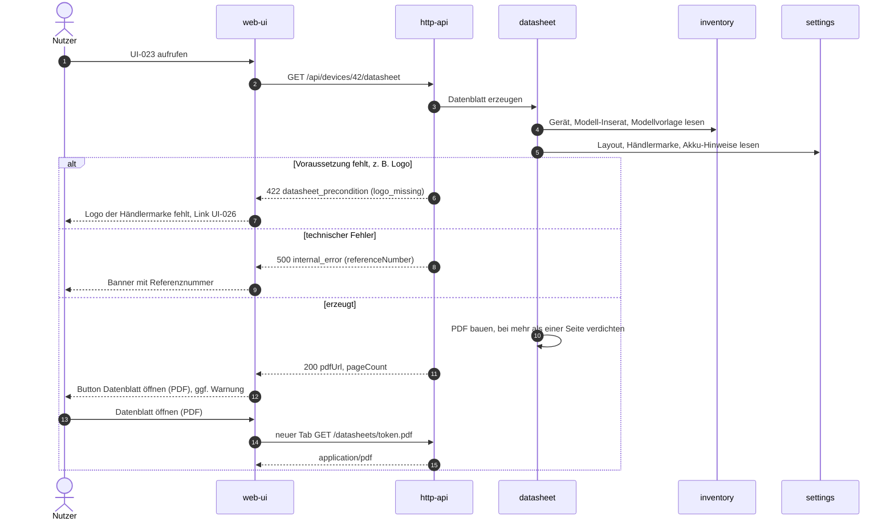

### 2.14 F-14 Inserat-Übersicht und Gerätesuche (REQ-052, REQ-016, REQ-094)

**Komponenten:** `web-ui` (UI-002, UI-009), `http-api`, `listing-content` (Übersicht), `inventory` (Gerätesuche, Kap. 2.5).

| Methode, Pfad | Anfrage | Antwort |
| --- | --- | --- |
| `GET /api/listings` | `q` (ab 2 Zeichen), `deviceTypeId`, `status` (`draft\|released\|published\|ended`), `flags` (kommagetrennt: `changed_since_release`, `transfer_change`, `adjust_stock`), `quantityZero=true`, `limit`, `offset` | `items[]`: `id, displayTitle, deviceTypeName, variantSummary { conditionLabel, visualGrade, variantValues[], conditionDescription }, quantity, soldOut, soldByChannel[] { channelId, count }, channels[] { channelId, status, flags[], lastReconciledAt, manualTextReview, stockChanges[] }`; `total` |

- Suche: Teilübereinstimmung ohne Groß-/Kleinschreibung auf WI-Nr (verfügbare und verkaufte Geräte des Modell-Inserats, AC-REQ-052-05), Herstellername und Modellbezeichnung. Unter 2 Zeichen filtert die Oberfläche nicht (UI-002 `.validation`).
- Filter: `status` = mindestens ein Kanal-Inhalt mit diesem Status; jede Kennzeichnung in `flags` muss an mindestens einem Kanal-Inhalt bestehen (UND über die Filter, UI-002); `quantityZero` = Stückzahl 0 (AC-REQ-052-03). „Bestand auf Kanal anpassen“ und „Änderung auf Kanal übertragen“ kommen nur bei *Veröffentlicht* vor (AC-REQ-046-07).
- Für Kanal-Inhalte mit Änderungsentwurf gelten Status und Angaben des freigegebenen Stands (REQ-052); die Kennzeichnung „geändert seit Freigabe“ wird gezeigt.
- Sortierung: `listing.updated_at` absteigend; der Zeitstempel wird bei jeder Änderung des Modell-Inserats und seiner Kanal-Inhalte gesetzt (UI-002 Annahme).
- Seiten: Die Oberfläche holt bis 200 Zeilen; ist `total` größer, blättert sie in Seiten zu 50 (DESIGN.md „Tabellen“).
- `UI-002.empty`: `total = 0` ohne Filter „Noch keine Modell-Inserate“ (AC-REQ-052-04), mit Filter „Keine Treffer“ (AC-REQ-052-07).

Ablauf ohne eigenes Sequenzdiagramm: Die Übersicht ist eine einzelne lesende Abfrage von `listing-content` an `resellr-db` ohne Seiteneffekt; Fehlerfälle sind die allgemeinen lesenden Zustände (Kap. 2.0.7).

### 2.15 F-15 Verkauf, Rücknahme, Storno, WI-Nr-Korrektur, Löschen (REQ-021, REQ-084, REQ-092, REQ-093, REQ-095, REQ-103)

**Komponenten:** `web-ui` (UI-010 bis UI-013, UI-041), `http-api`, `inventory`, `catalog`, `listing-content`, `audit`. **Flows:** FLOW-03, FLOW-08.

| Methode, Pfad | Anfrage | Antwort | Fehler |
| --- | --- | --- | --- |
| `POST /api/devices/{id}/sale` | `version, channelId, soldOn` | `{ device, listing: { id, quantity }, soldOut, adjustStockChannels[] }` | `device_not_assigned` (AC-REQ-021-05), `device_not_available` („Gerät ist bereits verkauft oder storniert“, AC-REQ-021-04), `validation_failed` („Verkaufsdatum darf nicht in der Zukunft liegen“, AC-REQ-021-02), `version_conflict` |
| `POST /api/devices/{id}/sale-reversal` | `version` | `{ device, listing }` | `device_not_sold` (AC-REQ-084-02), `version_conflict` |
| `POST /api/devices/{id}/cancellation` | `version, reason` | `{ device, listing \| null }` | `validation_failed` („Grund fehlt“ bzw. „Grund: 1 bis 200 Zeichen“, AC-REQ-093-03), `device_not_available` („Verkaufte Geräte können nicht storniert werden. Erst Verkauf zurücknehmen.“, AC-REQ-093-02), `version_conflict` |
| `POST /api/devices/{id}/wi-nr-correction` | `version, wiNr` | `{ device }` | `wi_nr_taken` (AC-REQ-092-02), `validation_failed`, `device_not_available` (storniert), `version_conflict` |
| `DELETE /api/listings/{id}?version=` | – | `204` | `delete_not_allowed` („Dem Modell-Inserat sind noch Geräte zugeordnet“ bzw. „… ein Kanal-Inhalt ist veröffentlicht“, AC-REQ-095-02), `version_conflict` |

**Regeln**

- **Verkauf:** Kanal ist einer der Kanäle (auch deaktivierte, weil Verkäufe dort noch vorkommen); Datum Pflicht, Standard heute, nicht in der Zukunft. Das Gerät bleibt dem Modell-Inserat zugeordnet (für „verkauft je Kanal“, REQ-052) und zählt nicht mehr in der Stückzahl. `StockChanged`; `soldOut` bei Stückzahl 0 (UI-011 Hinweis „ausverkauft“). Protokoll mit Kanal und Datum (AC-REQ-021-06).
- **Rücknahme:** Status *verfügbar*, Kanal und Datum entfernt, Protokoll mit bisherigem Kanal und Datum (AC-REQ-084-01), `StockChanged`.
- **Storno:** nur *verfügbar*; Status *storniert*, Grund, Zeitpunkt; die Zuordnung wird aufgehoben (`listing_id = null`), das bisherige Modell-Inserat bleibt in `cancelled_from_listing_id` nachvollziehbar (UI-014 „auch stornierte“); die WI-Nr ist sofort wieder frei (Teilindex, Kap. 3.4); kein Zurücknehmen. `StockChanged`.
- **WI-Nr-Korrektur:** Status *verfügbar* oder *verkauft*; alte und neue WI-Nr im Protokoll; die Artikelnummer ändert sich nicht (AC-REQ-092-01); `StockChanged`, wenn das Gerät verfügbar und zugeordnet ist.
- **Löschen eines Modell-Inserats (REQ-095):** nur ohne zugeordnetes Gerät im Status *verfügbar* oder *verkauft* und ohne Kanal-Inhalt im Status *Veröffentlicht*; löscht Kanal-Inhalte, Preise, Fotoverweise und Lieferumfang; Geräte werden nie gelöscht (REQ-103), stornierte behalten nur den Verweis `cancelled_from_listing_id = null`. Protokolleintrag „gelöscht“. Es gibt **keinen** Löschpfad für Geräte (Kap. 6.2, Code-Review-Prüfpunkt).

**Zustände:** UI-010 `.disabled` je Status (Kap. 3.5); „Verkauf zurücknehmen“ mit Bestätigung nach P-04 in UI-010; UI-041 `.disabled` ohne Häkchen und wenn der Ablehnungsgrund schon aus den geladenen Daten bekannt ist (`deleteBlockedReason` in `GET /api/listings/{id}` bzw. `GET /api/model-templates/{id}/usage`). Beim Modell-Inserat nennt `deleteBlockedReason` nur Gründe aus `inventory` (zugeordnete Geräte); einen veröffentlichten Kanal-Inhalt erkennt `web-ui` aus den Kanal-Karten, und der Server lehnt beim Löschen über `ListingDeleting` ab. So liest `inventory` nicht aus `listing-content` (FIND-202). Bei der Modellvorlage zeigt UI-041 zum Grund `listings_reference` den Text M-29 und zu `devices_reference` den Gerätetext, jeweils als Banner im Dialog mit gesperrtem „Löschen“ (Rangfolge Kap. 2.4, v0.5.2).

Ablauf: Verkauf mit Abgleich in Kap. 2.10. Rücknahme, Storno und WI-Nr-Korrektur folgen demselben Muster (`inventory` → `StockChanged` → `listing-content`) und haben kein eigenes Diagramm.

### 2.16 F-16 Änderungsprotokoll (REQ-055, REQ-072)

| Methode, Pfad | Anfrage | Antwort | Fehler |
| --- | --- | --- | --- |
| `GET /api/audit-entries` | `from, to` (Kalenderdaten, Standard der Oberfläche: letzte 30 Tage), `objectType` (eine Objektart aus Kap. 3.6) **oder** `objectCategory` ∈ `settings, model_template, listing, channel_content, device, other` (höchstens einer der beiden), `limit` (50), `offset` | `items[]`: `occurredAt, objectType, objectLabel, objectRef { type, id } \| null, action, actionLabel, oldValue, newValue`, neueste zuerst; `total` | `validation_failed` („Von-Datum liegt nach Bis-Datum“) |

- **Filter „Art des Objekts“ (AC-REQ-055-01, FIND-204):** gefiltert wird nach `object_type`; die Kategorie dient zusätzlich zur Gruppierung. Die Auswahl in UI-024 zeigt die sechs Kategorien des Designs und unter „Einstellung“ eingerückt die 16 Objektarten der Einstellungen (z. B. „Textbaustein“). Wahl einer Kategorie sendet `objectCategory`, Wahl einer Objektart `objectType`. Die eingerückten Einträge sind eine Design-Lücke (DG-15, Kap. 8).
- Geschrieben wird in jeder schreibenden Transaktion (Kap. 2.0.4); `audit/audit-writer.ts` ist die einzige Stelle, die in `audit_entry` schreibt. Objektarten und Aktionen: Kap. 3.6.
- Kategorie „other“ umfasst Löschungen und die Bestätigung ungeprüfter Rechtstexte (UI-024).
- `objectRef` ist `null`, wenn das Objekt nicht mehr existiert (gelöschtes Modell-Inserat); sonst verlinkt UI-024 auf den Screen.
- Löschfrist: `audit/audit-retention-job.ts` löscht täglich und beim Start Einträge älter als 24 Monate (REQ-072, AC: 24 Monate + 8 Tage gelöscht, 23 Monate vorhanden).

Kein Sequenzdiagramm: einzelne lesende Abfrage einer Komponente.

### 2.17 F-17 Hinweis „Sicherung einrichten“ und „resellr beenden“ (REQ-104, REQ-105, REQ-106; Ablauf 4a, T-3, X-1, X-2)

**Komponenten:** `web-ui` (UI-044, UI-045, UI-046), `http-api` (`write-gate`), `ops` (Betriebsstatus, geordnetes Beenden), `resellr-launcher` (Startmenü „resellr beenden“, LP-03). **Flows:** FLOW-10.

**Endpunkte**

| Methode, Pfad | Anfrage | Antwort | Fehler |
| --- | --- | --- | --- |
| `GET /api/ops/status` | – | `{ dataDirPath, appVersion }` | `500 internal_error` |
| `GET /api/ops/health` | – | `{ state: starting\|ready\|stopping, startId }`; ohne `Origin`-Pflicht (lesend) | – |
| `POST /api/ops/shutdown` | `{}` | `200 { dataDirPath }`, erst **nach** Checkpoint, Schließen und Ende-Markierung | `503 shutting_down` (läuft schon), `500 internal_error` (Beenden gescheitert, resellr läuft weiter) |

`GET /api/ops/status` liefert nur, was das Design zeigt (Speicherort für UI-044 und UI-046). Größe des Datenordners, freier Speicher und Art des letzten Endes stehen nur im Betriebsprotokoll (X-8 Nein, X-5, Kap. 2.19).

**Hinweis UI-044 (REQ-104, AC-REQ-104-01 bis -05):**

- Teil des Anwendungsrahmens `apps/web/src/app/AppFrame.tsx` (linke Navigationsspalte, 208 px breit, so hoch wie der Viewport) und des schmalen Rahmens `CompactFrame.tsx` von UI-019; eine Komponente `BackupNotice.tsx` mit den Varianten `sidebar` und `strip`. Jede Route mit Rahmen zeigt ihn; ausgenommen sind nur `/beendet` (UI-046) und die Launcher-Seiten.
- **Navigationsspalte (Variante A, Design v0.6 UI-044):** Der Kopf „resellr“ (40 px) steht fest. Darunter liegt **ein** Bereich mit `overflow-y: auto` und `overflow-x: hidden`, als Spalte (`display: flex; flex-direction: column`) mit den sechs Einträgen (CU-045) und dem Hinweis. Der Hinweis hat `margin-top: auto`: Bei genug Höhe steht er am unteren Rand, sonst folgt er den Einträgen am Ende des Bereichs. Es gibt kein Einklappen, keinen Zustand und keine eigene Höhe für den Hinweis. Mausrad und Scrollleiste scrollen den Bereich. Liegt der Fokus auf einem Eintrag oder auf „resellr beenden“, scrollen Pfeil- und Bildtasten diesen Bereich; das ist Verhalten von Chrome, ohne eigenen Code und ohne zusätzlichen Tab-Halt. Erhält „resellr beenden“ den Fokus, scrollt Chrome ihn ins Sichtbare. Der Inhaltsbereich scrollt getrennt davon.
- **Schmale Ansicht UI-019 (Design v0.6):** `CompactFrame` hat oben einen festen Bereich mit Titel, Kanal-Wahl und Fortschritt. Darunter liegt **eine** scrollende Fläche: Feldliste, dann die Aktionen „Als veröffentlicht melden“ und „Abgleich bestätigen“, zuletzt der Hinweis als Streifen (`strip`). Der Inhalt der Fläche ist eine Spalte mit `min-height: 100%`, der Streifen hat `margin-top: auto`. Bei genug Höhe steht er also am unteren Fensterrand, sonst nach den Aktionen. Der Streifen hat keine eigene Höhenbegrenzung und kein eigenes Scrollen. Sein Button folgt in der Tab-Reihenfolge nach der Feldliste und den Aktionen.
- Überschrift und Text sind feste Zeichenketten aus `messages.de.ts` im Wortlaut von REQ-104; der Pfad kommt aus `GET /api/ops/status` beim Laden des Rahmens. Es gibt **keinen** gespeicherten Zustand, keine Einstellung und keine Aktion zum Ausblenden; nichts wird in `localStorage` gelegt (AC-REQ-104-03). Weder Systemdatum noch Kopien ändern den Hinweis (AC-REQ-104-04/-05).
- Pfad als markierbarer Text, Umbruch an beliebiger Stelle mit `word-break: break-all` (Design: „bricht an beliebiger Stelle“). `overflow-wrap: anywhere` bräche einen Pfad mit Leerzeichen oder Bindestrichen zuerst dort um; ein Pfad mit 100 Zeichen bräuchte dann 6 statt 4 Zeilen (Messseite MAR-158). Schrift Inter 4.1, 12/16 px, Maße nach UI-044 (Rand 8, Innenabstand 8, Rahmen 1, Balken 4, Textbreite 170 px). **Überschrift:** Symbol 14 px, Abstand 4 px, „Sicherung einrichten“ 14 px halbfett (152 px), zusammen genau 170 px; mit dem 16-px-Symbol bräche sie auf zwei Zeilen um (MAR-158). Diese Pixelwerte beschreiben die Gestaltung. Abnahmegrundlage ist allein das Kriterium „kein Inhalt und keine Aktion unerreichbar“ (Design v0.6 UI-044, Kap. 6.3), keine Höhenrechnung. Der Hinweis wird bei keiner Fenstergröße eingeklappt, ausgeblendet oder gekürzt, und sein Text bleibt mindestens 12 CSS-px groß.
- Zustände: `UI-044.loading` = Status lädt („wird geladen …“ an der Stelle des Pfads, der Rest steht sofort); `UI-044.error` = `500` beim Status (Text mit Referenznummer laut UI-044); bei fehlender Verbindung bleibt „wird geladen …“ und der Inhaltsbereich zeigt P-06; dieses Banner setzt der Rahmen (CU-044), nicht der Hinweis (Nachtrag MAR-395). `UI-044.disabled` = Button „resellr beenden“ gesperrt, solange UI-045 offen ist oder das Beenden läuft. Der Zustand „Netzbetrieb“ entfällt (OD-02 A).

**Rückfrage und Beenden (REQ-105, UI-045, UI-046):**

- UI-045 öffnet ohne Serveraufruf; Fokus auf „Abbrechen“. „Abbrechen“ und Esc schließen den Dialog, nichts geschieht (AC-REQ-105-02).
- „resellr beenden“ sendet `POST /api/ops/shutdown` mit Zeitgrenze 30 s (`UI-045.loading`, Buttons gesperrt, Esc wirkungslos).
- `200` → `apps/web/src/api/app-termination.ts` stoppt alle Abfragen (`queryClient.cancelQueries()`, `clear()`, Flag `terminated`) und navigiert clientseitig nach `/beendet` mit dem Pfad aus der Antwort: `UI-046.success`, Wortlaut REQ-105 („resellr ist beendet. Sie können den Datenordner jetzt kopieren.“) und „Der Datenordner liegt hier:“ mit Pfad. Die beiden Zusatzzeilen des Designvorschlags werden nicht gebaut.
- `500` → Dialog schließt, Banner `UI-045.error` mit Referenznummer, resellr läuft weiter, Hinweis bleibt.
- `503 shutting_down` → Dialog schließt, Banner P-07 (Beenden läuft schon aus einem anderen Fenster).
- **Ort der beiden Banner (Nachtrag MAR-421):** Beide stehen oben im Inhaltsbereich, nicht im Hinweis. CU-255 legt den Ausgang beim Ende der Anfrage in CU-311 ab (`500` und jede andere Fehlerantwort außer `503 shutting_down` → `error` mit dem `ApiError`; `503 shutting_down` → `shutting-down`) und leert CU-311, sobald es eine neue Anfrage sendet. CU-312 zeigt den Ausgang: `UI-045.error` über CU-051 mit „ד (leert CU-311) oder P-07 über CU-054 (ohne „ד, verschwindet nicht von selbst). Der Rahmen (CU-044) rendert CU-312 im Inhaltsbereich direkt nach dem P-06 des Rahmens und vor `<Outlet />`; der schmale Rahmen (CU-217) an derselben Stelle wie die übrigen Seitenbanner. Der Ausgang gilt je Fenster bis zum Neuladen und liegt nicht in `localStorage`.
- Verbindungsabbruch oder 30 s ohne Antwort → `/beendet` mit `UI-046.unknown` (Text laut Design, **ohne** Button „Erneut versuchen“, ohne Pfad).
- Neuladen von `/beendet` nach dem Beenden zeigt die Fehlerseite von Chrome (Design UI-046); das ist gewollt.
- **`/beendet` ohne Beenden in diesem Fenster (Nachtrag MAR-510):** Kennt CU-257 keinen Ausgang, weil dieses Fenster resellr nicht beendet hat (z. B. Adresse von Hand eingegeben, oder das alte Fenster nach einem Neustart von resellr neu geladen), leitet CU-256 mit `replace` auf `/` und damit nach `/inserate` (UI-002). Die Seite kam dann vom laufenden Server; weder `UI-046.success` noch `UI-046.unknown` wäre wahr. Kein Text, kein Zustand, kein Serveraufruf.
- **„Zurück“ nach dem Beenden (Nachtrag MAR-510):** Hat dieses Fenster resellr beendet (`isAppTerminated()`, CU-257), zeigt keine Route mehr den Rahmen: CU-044 leitet statt des Rahmens mit `replace` nach `/beendet`, und CU-256 zeigt denselben Ausgang wie zuvor. „Zurück“ und „Vor“ führen so nicht in einen Rahmen, dessen Abfragen gestoppt sind und der dauerhaft „wird geladen …“ zeigt.

**Geordnetes Beenden im Server** (`ops/shutdown-service.ts`, Baseline 9.6):

1. Ist der Zustand nicht `ready` → `503 shutting_down`.
2. Zustand `stopping`: `write-gate` lehnt neue schreibende Anfragen mit `503` ab; `GET /api/ops/health` meldet `stopping` (T-4, FIND-112).
3. Höchstens 10 s auf laufende schreibende Anfragen warten. Länger dauern nur Aktionen mit Dateiarbeit (Upload, Foto-Übergabe, ZIP); sie prüfen vor ihrer Transaktion `isStopping()` und enden mit `503` (gilt als nicht gespeichert, Baseline 9.6).
4. `PRAGMA wal_checkpoint(TRUNCATE)`; scheitert er oder meldet er `busy`, gilt das Beenden als gescheitert.
5. Datenbank schließen; danach besteht sie aus der einzigen Datei `resellr.db`.
6. Ende-Markierung `shutdown-marker.json` (`endedAt`, `appVersion`, `startId`) schreiben und mit `fsync` sichern.
7. Einzelinstanz-Sperre freigeben, Betriebsereignis `stopped_by_user` schreiben (einzige Quelle, H-7), Antwort `200 { dataDirPath }` senden und **erst nach vollständig gesendeter Antwort** (`reply.raw` Ereignis `finish`) mit Exit-Code 0 enden (T-3). Trennt der Browser vorher die Verbindung (`close` ohne `finish`), endet der Server ebenso; spätestens 5 s nach dem Senden endet er in jedem Fall (FIND-217).
8. Scheitert Schritt 4 bis 6: Datenbank bei Bedarf wieder öffnen, Zustand `ready`, Eintrag im Fehlerprotokoll mit Referenznummer, `500`. Es entsteht keine Ende-Markierung.

**Startmenü „resellr beenden“** (Betreiberwerkzeug, Baseline 13.3.1): `resellr-launcher stop` sendet dieselbe Anfrage ohne `Origin` (G-3) und zeigt das Ergebnis über LP-03 (Kap. 2.18).

**Ablauf „resellr beenden“** (Baseline Ablauf 4a, hier mit Endpunkt, Zeitgrenze und Zuständen)

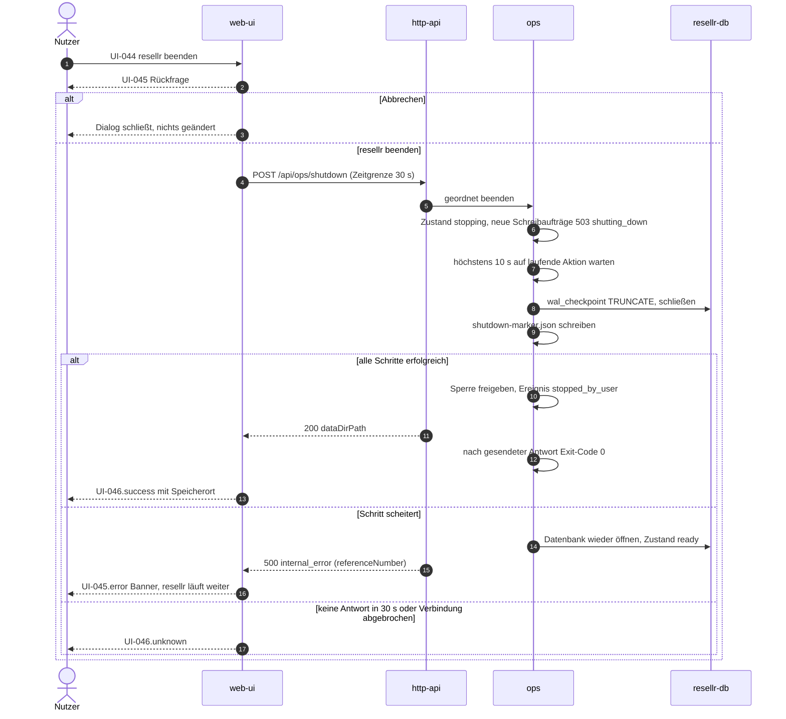

### 2.18 F-18 Start, Überwachung, Launcher-Seiten und Verfügbarkeit (REQ-065, REQ-073; Ablauf 4b, FIND-112, FIND-113, H-10 bis H-14, T-4 bis T-6, ADR-006, ADR-008)

**Komponenten:** `resellr-launcher` (`tools/launcher`), `launcher-pages` (`tools/launcher-pages`), `resellr-server` (`ops`), Windows (Autostart-Eintrag, Explorer), Chrome. **Screens:** LP-01, LP-02, LP-03. **Flows:** FLOW-10.

**Warum kein Container auf dem Arbeitsplatzrechner** (Owner-Kommentar `bdc2d18b`): Der Anwendungscode ist plattformneutral und wird unter Linux entwickelt und getestet (ADR-003, Kap. 6). Container unter Windows hießen Docker Desktop mit WSL 2: Installation mit Adminrechten, Virtualisierung im BIOS, eine dauerhaft laufende Linux-VM mit mehreren GB Arbeitsspeicher, Datenordner und Foto-Übergabe jenseits der VM-Grenze, und die Windows-Fragen (Autostart, Fenster, Chrome) blieben trotzdem. Das widerspricht ADR-006 (ohne Adminrechte) und hilft REQ-065 nicht. Container sind erst für einen späteren Betrieb auf NAS oder Server sinnvoll (ADR-002, B und C).

**Befehle von `resellr-launcher`** (ein Node.js-Programm `app/launcher.mjs`, gestartet mit `resellr-node.exe`, ADR-008):

| Aufruf | Auslöser | Verhalten |
| --- | --- | --- |
| `supervise` | Autostart-Eintrag `HKCU\…\Run` bei der Anmeldung | Wird Überwachung, wenn keine läuft; sonst sofortiges Ende ohne Meldung. Öffnet kein Chrome. |
| `open` | Verknüpfung „resellr“ (Startmenü, Desktop), Ende der Installation | siehe Ablauf unten |
| `stop` | Verknüpfung „resellr beenden“ (Startmenü) | LP-03 öffnen; läuft eine Überwachung, über die Pipe `{"cmd":"stop"}`; sonst `POST /api/ops/shutdown` direkt; Ergebnis an LP-03. Die Überwachung antwortet je nach Zustand (FIND-233, Diagramm unten): in `ready` `POST /api/ops/shutdown`, dann `stopped` (Exit-Code 0) oder `error` (Beenden gescheitert; der Server läuft weiter, die Überwachung bleibt in `ready` mit normaler Neustart-Regel); in `crash_grace` (5-s-Wartezeit nach einem Absturz, kein Server läuft) Wartezeit abbrechen, kein Neustart, **`stopped`**, Ende; in `starting` keine weiteren Neustarts, Warten auf das Ergebnis des laufenden Starts (`stop_pending`): bei `ready` weiter wie in `ready`, endet der Serverprozess (Abbruch oder Absturz) **`stopped`**, Ende, ohne `start_aborted`, ohne `crash` und ohne `state.json.lastCrashAt`; bei einem Exit-Code ungleich 0, 10, 11 und beim Ende durch die Startgrenze schreibt sie wie in `stopping` `stop_crash` mit Referenznummer ins Betriebsprotokoll (Nachtrag MAR-764); endet er dort mit Exit-Code 11 (ein anderer Server läuft schon), meldet die Überwachung `already_running`, und `stop` sendet `POST /api/ops/shutdown` direkt an den laufenden Server (Hinweis 5.1 aus Review R3). **In `stopping` (FIND-234):** `503 shutting_down` heißt „Beenden läuft schon“ (z. B. gleichzeitig „resellr beenden“ in UI-045): die Überwachung bleibt in `stopping` und wartet auf das Prozessende, sie meldet **nicht** `error`. Bricht die Verbindung ohne Antwort ab, wartet sie ebenso; das gilt auch für jede andere Antwort (z. B. `403`, `500` ohne gültige Referenznummer). Ein zweites `POST` innerhalb desselben `stopping` gibt es nicht; die Anfrage endet spätestens nach 30 s (Nachtrag MAR-764). `error` (Beenden gescheitert) gibt es nur bei `500 internal_error` oder wenn der Serverprozess 30 s nach dem Wechsel in `stopping` noch läuft; dann bleibt sie in `ready`. **Referenznummer von `error` (Nachtrag MAR-764):** bei `500` die des Servers (`error.referenceNumber`; `shutdown_failed` und den Eintrag im Fehlerprotokoll hat der Server geschrieben, Kap. 2.17 Schritt 8), die Überwachung schreibt nichts dazu; nach 30 s eine eigene (CU-007), die CU-296 als `shutdown_failed` (`function` `launcher.shutdown_timeout`) in Betriebs- und Fehlerprotokoll schreibt, bevor die Überwachung `error` sendet. **Jedes Prozessende in `stopping` führt zu `stopped` und zum Ende der Überwachung, ohne Neustart**, weil kein Server mehr läuft; bei einem Exit-Code ungleich 0 (z. B. Absturz beim Checkpoint) schreibt sie zusätzlich das Ereignis `stop_crash` mit Referenznummer ins Betriebsprotokoll. Nach `stopped` startet die Überwachung nichts mehr neu |
| `stop --for-update` | Installationspaket vor dem Ersetzen der Dateien und vor dem Entfernen bei der Deinstallation (Nachtrag MAR-471) | wie `stop`, ohne Seite; wartet danach, bis die Pipe der Überwachung frei ist (höchstens 30 s, FIND-217); Exit-Code 0 = beendet oder lief nicht (`stopped`, auch aus `crash_grace` und nach einem Prozessende in `stopping` mit beliebigem Code), 1 = gescheitert (`error` oder Pipe nach 30 s nicht frei, z. B. weil ein laufender Start mit Migration länger dauert) |
| `availability-report <JJJJ-MM>` | Datei `Verfügbarkeitsbericht.cmd` im Programmordner (Betriebshandbuch) | Monatsbericht nach OD-05 (a) als Textdatei im Protokollordner |

**Eine Überwachung je Windows-Sitzung (H-14, FIND-112):** Die Überwachung lauscht auf der benannten Pipe `\\.\pipe\resellr-supervisor-<h>` (`<h>` = erste 16 Hex-Zeichen von SHA-256 über `%LOCALAPPDATA%`, also je Benutzer). Windows vergibt eine Pipe nur einmal und gibt sie mit dem Prozessende frei, auch nach einem Absturz. Die Pipe ist zugleich der Kanal, über den `open` den Zustand abfragt (Protokoll: eine JSON-Zeile je Nachricht; Anfragen `{"cmd":"subscribe"}` und `{"cmd":"stop"}`, Ereignisse `phase` mit `starting`, `ready`, `aborted` + `refNo`, `gave_up` + `refNo`, `already_running` + `refNo`, `stopped`, `error` + `refNo`; jedes `aborted`, `gave_up` und `already_running` trägt eine gültige Referenznummer, Nachtrag MAR-382, ebenso jedes `error`, Nachtrag MAR-764). Wer die Pipe öffnen kann, **wird selbst** zur Überwachung; es gibt keinen abgelösten Hintergrundprozess (H-13). Unter Linux (Entwicklung, Tests) ist es ein Unix-Socket im temporären Ordner.

**Ablauf `open` (FIND-112, T-4):**

1. `GET /api/ops/health` mit 1 s Zeitgrenze. `ready` → Chrome mit `http://127.0.0.1:<port>/` öffnen, Ende. `<port>` bestimmt jeder Aufruf von `open`, `stop` und `supervise` neu über CU-309 aus `config.json` im Datenordner, nach derselben Regel wie der Server (Kap. 2.19, Nachtrag MAR-296).
2. `stopping` oder keine Verbindung: Pipe der Überwachung verbinden.
   - Verbunden → `subscribe` und warten. `ready` → Chrome öffnen. `aborted` oder `gave_up` → LP-02 mit dieser Referenznummer. `already_running` → noch einmal Schritt 1, nur die Abfrage; meldet der Server dabei nicht `ready`, LP-02 mit der Referenznummer aus dem Ereignis `already_running` (Nachtrag MAR-382). `stopped` oder Pipe geschlossen ohne Ergebnis (z. B. direkt nach „resellr beenden“) → weiter mit Schritt 3, **höchstens einmal**.
   - Nicht verbunden → Schritt 3.
3. Pipe selbst öffnen (bei Konflikt zurück zu Schritt 2), Server starten, auf `ready` warten wie oben, dann als Überwachung weiterlaufen. Für die Ergebnisse des eigenen Starts gelten die Regeln aus Schritt 2; Referenznummern kommen dann direkt aus CU-261, nicht über die Pipe.
4. Dauert das Warten länger als 3 s, öffnet `open` LP-01. **Nach 120 s ohne Ergebnis (K-07, MAR-176; Design v0.6 `LP-02.zeitueberschreitung`):** `open` schreibt `start_timeout` mit **eigener** Referenznummer in Betriebs- und Fehlerprotokoll (CU-296) und setzt `launcher-state.js` auf `phase: 'timeout'` mit dieser `refNo` (CU-268). LP-01 wechselt damit zu `LP-02.zeitueberschreitung` („resellr startet länger als erwartet“, Text nach Design). `open` **wartet weiter** auf das Ergebnis und schreibt es ebenso in `launcher-state.js`: `ready` → die Seite leitet selbst zur lokalen Adresse weiter wie LP-01; `aborted` oder `gave_up` → die Seite zeigt `LP-02.default` („Start abgebrochen“) mit der Referenznummer des Abbruchs. Ein Neuladen der Seite zeigt den jeweils aktuellen Zustand. Ein altes Startergebnis wird nie verwendet: Startergebnisse tragen die `startId` des Versuchs (FIND-112 b).
5. **Obergrenze des Wartens (K-07):** Ein Startversuch, der **10 min** nach dem Start des Serverprozesses noch nicht `ready` gemeldet hat, gilt als hängend. Die Überwachung, die ihn gestartet hat (CU-264), beendet den Serverprozess, schreibt `start_aborted` mit **eigener** Referenznummer (`function` `launcher.start_limit`) in beide Protokolle und als `aborted` in `start-result.json`, meldet `aborted` + `refNo` über die Pipe, startet nicht neu und endet. Jedes wartende `open` zeigt damit `LP-02.default` mit dieser Nummer. Das Beenden mitten in einer Migration ist unschädlich, weil der Migrationslauf in **einer** Transaktion läuft (CU-029) und SQLite einen nicht abgeschlossenen Lauf beim nächsten Öffnen verwirft. Weil die Grenze in der Überwachung liegt, endet das Warten jedes `open` spätestens mit ihr (oder mit dem Schließen der Pipe, dann Schritt 3, höchstens einmal). Begründung für 10 min: Startprüfung und Migration brauchen auch bei großem Datenbestand Sekunden bis wenige Minuten; die Grenze trennt nur „hängt“ von „dauert“, ohne einen langsamen Start abzubrechen.
6. **Rückfall S-7 (T-5):** Kann sich die Seite nicht selbst aktualisieren, öffnet `open` nach 120 s `LP-02.zeitueberschreitung` im Text des Rückfalls des Designs (ohne den Satz „resellr öffnet sich von selbst, sobald es bereit ist.“) in einem neuen Tab und bei späterem `ready` die lokale Adresse bzw. bei Abbruch `LP-02.default` ebenfalls in einem neuen Tab.

**Referenznummern in beiden Protokollen (FIND-210, beide Klärungen):** Jede Referenznummer, die der Launcher anzeigt (`start_timeout`, `start_aborted`, `crash`, `gave_up`, `already_running`, `shutdown_failed` nach 30 s in `stopping`, Nachtrag MAR-764), schreibt `launcher-log` (CU-296) ins Betriebsprotokoll **und** ins Fehlerprotokoll (`refNo`, `function` z. B. `launcher.start_timeout`). So stimmt der Verweis auf das Fehlerprotokoll in LP-02 und in Kap. 2.0.5. **Jedes Ereignis `aborted` hat genau einen Eintrag `start_aborted` (Nachtrag MAR-498):** Die Überwachung protokolliert ihn über CU-296 mit der Referenznummer des Ereignisses, bevor sie `aborted` über die Pipe sendet, gleich aus welchem Grund: Abbruch durch den Server (Exit-Code 10 mit gültigem Startergebnis, `function` `launcher.start_aborted`), Exit-Code 10 ohne passendes Startergebnis (`launcher.start_result_missing`) oder Startgrenze (`launcher.start_limit`). Bei einem Abbruch durch den Server steht die Nummer damit zweimal im Fehlerprotokoll: im Eintrag des Servers mit der Ursache (Kap. 2.19 „Abbruch heißt“) und im Eintrag des Launchers. **In `stop_pending` gibt es kein `aborted` und deshalb kein `start_aborted` (Nachtrag MAR-764):** Der Nutzer hat beendet, angezeigt wird `stopped`; ein `start_aborted` zählte in der Verfügbarkeitsauswertung ohne Höchstdauer als „nicht verfügbar“. Bei Exit-Code 10 stehen Ursache und Nummer im Eintrag des Servers und in `start-result.json`; die Startgrenze hält `stop_crash` fest.

**Überwachung (`tools/launcher/src/supervisor/`):**

- Startet `resellr-server` mit `child_process.spawn(process.execPath, [serverEntry], { stdio: ['ignore','ignore','ignore','ipc'], windowsHide: true })` und den Umgebungswerten `RESELLR_START_ID`, `RESELLR_DATA_DIR`, `RESELLR_LOG_DIR`, `RESELLR_HANDOVER_DIR`, `RESELLR_UPDATE_COPY_DIR`. `process.execPath` ist `resellr-node.exe` (Windows-GUI-Teilsystem), daher entsteht kein Konsolenfenster (S-2).
- Der Server meldet Bereitschaft über IPC (`{ type: 'ready', startId }`).
- **Kopplung (H-13, S-3):** Nicht abgelöste Kindprozesse legt Node.js unter Windows in ein Job-Objekt, das sie beim Ende des Elternprozesses beendet. Zusätzlich beendet sich der Server geordnet, wenn der IPC-Kanal schließt (`process.on('disconnect')`: Checkpoint, Schließen, Exit-Code 12). Weil das Job-Objekt meist schneller ist, verlässt sich keine Auswertung auf das Ereignis „Ende nach Ende der Überwachung“ (H-13). Koppelt das Job-Objekt im Spike nicht, ist das IPC-Ende allein der Mechanismus (S-3).
- **Kindprozesse (FIND-213, Nachtrag MAR-366):** Jeder Kindprozess von Launcher und Server bekommt `windowsHide: true`, auch kurze Aufrufe wie `reg query`, **außer Chrome und `explorer.exe`**. Programme, die den Launcher überleben sollen (Chrome, `explorer.exe`), starten mit `detached: true`, `stdio: 'ignore'` und `unref()`, aber ohne `windowsHide`: Die Option setzt `SW_HIDE` für das erste Fenster des neuen Prozesses, ein GUI-Programm wie Chrome bliebe dann unsichtbar (DER-102-01). Beide sind GUI-Programme und öffnen ohnehin kein Konsolenfenster. Node.js legt abgelöste Prozesse nicht in sein Job-Objekt, sie enden also nicht mit dem Launcher. Nur `resellr-server` startet nicht abgelöst (Kopplung oben). Die Windows-CI (CU-278) prüft, dass Chrome sichtbar öffnet, nach dem Ende von `open` und nach dem Ende der Überwachung weiterläuft und dass kein Konsolenfenster erscheint (S-8).
- **Exit-Codes** (`packages/runtime-shared/src/exit-codes.ts`): `0` vom Nutzer beendet → kein Neustart, Ereignis `stopped`, Überwachung endet. `10` Start abgebrochen → kein Neustart, Startergebnis lesen (`refNo` nur aus einem Ergebnis mit der `startId` dieses Versuchs; fehlt es, erzeugt die Überwachung eine eigene Referenznummer und protokolliert `start_aborted` mit `function` `launcher.start_result_missing`, Nachtrag MAR-382; mit gültigem Startergebnis protokolliert sie `start_aborted` mit dessen `refNo` und `function` `launcher.start_aborted`, Nachtrag MAR-498), Ereignis `aborted` + `refNo`, Überwachung endet. `11` läuft bereits → kein Neustart, keine Zählung als Absturz, Warnung `already_running` mit eigener Referenznummer der Überwachung (`function` `launcher.already_running`, Nachtrag MAR-382), Ereignis `already_running` + `refNo`, Überwachung endet. `12` Überwachung verloren (kommt nur ohne Überwachung vor). Jeder andere Code = Absturz.
- **Startgrenze (K-07):** CU-264 misst je Startversuch die Zeit bis `ready`; nach 10 min beendet es den Serverprozess (`child.kill()`) und meldet den Abbruch wie in Schritt 5 des Ablaufs `open`. Dieses Prozessende ist kein Absturz und wird nicht in die Neustartgrenze gezählt.
- **Absturz und Neustartgrenze (H-12, H-10):** Nach einem Absturz wartet die Überwachung 5 s. Endet sie in dieser Zeit selbst (Abmelden, Herunterfahren), wird **kein** Absturz protokolliert; der nächste Start ordnet das Ende als „ohne geordnetes Beenden“ ein (S-4). Sonst: Ereignis `crash` mit Referenznummer, `state.json.lastCrashAt`, Neustart. **Höchstens 3 Neustarts in 10 Minuten** (gleitendes Fenster); der vierte Absturz im Fenster führt zu `gave_up` mit Referenznummer im Betriebsprotokoll und im Startergebnis, die Überwachung endet (Baseline 9.6; Zählweise festgelegt nach H-12). **Vierter Absturz (Nachtrag MAR-498):** Nach der Wartezeit von 5 s protokolliert die Überwachung auch ihn als `crash` mit eigener Referenznummer und setzt `state.json.lastCrashAt`; sonst ordnete die Startprüfung das Ende beim nächsten Start nicht als „abgestürzt“ ein (Kap. 2.19 Schritt 4). Danach schreibt sie `gave_up` mit einer **weiteren, eigenen** Referenznummer (`function` `launcher.gave_up`) in Betriebs- und Fehlerprotokoll (CU-296) und in `start-result.json` (`state: gave_up`, `startId` des letzten Versuchs) und sendet erst dann `gave_up` + `refNo` über die Pipe. LP-02 zeigt die Nummer von `gave_up`; `crash` hält den einzelnen Absturz mit Exit-Code fest, `gave_up` die Entscheidung, nicht neu zu starten.
- **Verfügbarkeitsprüfung (`health-probe`, OD-05 a):** alle 5 min `GET /api/ops/health` mit 5 s Zeitgrenze, Eintrag `{ ts, ok }` in `availability-<Datum>.jsonl`.

**Startergebnis und Rückmeldungen (Baseline 2.3, 9.6):** `resellr-server` schreibt `Protokolle/start-result.json` (`startId`, `state: ready\|aborted`, `refNo`, `at`); die Überwachung schreibt `gave_up` dort ebenfalls hinein. `resellr-launcher` schreibt für die Seiten `launcher-pages/launcher-state.js`. Alle drei Dateien werden atomar geschrieben (CU-009, FIND-217).

**Launcher-Seiten (T-5, T-6, H-11, S-7):**

- Drei statische Seiten `launcher-pages/lp-01.html`, `lp-02.html`, `lp-03.html` mit gemeinsamer Datei `launcher-pages.css` (Design-Tokens aus `DESIGN.md`, Inter 4.1 als `data:`-URL eingebettet, weil Chrome Schriften aus `file://` nicht lädt) und `launcher-pages.js`. Kein React, kein Serverzugriff, keine Skripte von außen. Texte laut LP-01 bis LP-03.
- **Adresse der Seiten (CU-310, Nachtrag MAR-382):** `file:`-URL aus `<Programmordner>\launcher-pages\lp-0N.html`, gebildet mit `pathToFileURL` (Leerzeichen, Umlaute und `#` im Benutzerpfad werden kodiert), Parameter über `URLSearchParams`; Programmordner = Ordner von `process.execPath` (`resellr-node.exe`), wie beim Server. Ist LP-01 noch nicht offen, öffnet `open` LP-02 direkt über CU-267 mit `?ref=<refNo>`; ist LP-01 offen, wechselt die Seite über `launcher-state.js` (Phase `aborted` mit `refNo`, auch für `gave_up` und `already_running` ohne Server).
- Parameter per URL-Kodierung: `request` (Kennung des Aufrufs), `ref`, `dataDir`. `launcher-state.js` liegt neben den Seiten im Programmordner (`launcher-pages\launcher-state.js`, Installation pro Benutzer, also beschreibbar) und wird über den festen relativen Pfad `./launcher-state.js` geladen; ein Parameter für die Skriptadresse entfällt (FIND-218). Die Referenznummer wird nur angezeigt, wenn sie dem Muster aus Kap. 2.0.5 entspricht; alle Werte werden mit `textContent` eingesetzt (H-11).
- **Seitenwechsel (T-5):** Die Seite lädt `launcher-state.js` jede Sekunde als klassisches `<script>` mit wechselndem Abfrageteil neu (`fetch` ist aus `file://` gesperrt). Die Datei enthält **je Aufruf (`request`) eine Zeile** `window.__resellrLauncherState({ request, phase, url, refNo, dataDir });`; die Seite reagiert nur auf ihre `request`. Mehrere gleichzeitig wartende Aufrufe (je ein LP-01) überschreiben sich damit nicht gegenseitig (Nachtrag MAR-470). CU-009 ersetzt beim Schreiben die Zeile derselben `request` oder hängt sie an, behält höchstens die 20 zuletzt geschriebenen Zeilen und liest, ändert und schreibt unter der Sperrdatei `launcher-state.js.lock`; CU-268 legt die Datei an, bevor `open` LP-01 bzw. `stop` LP-03 öffnet (eine leere Datei ist ein gültiges Skript). LP-01: `ready` → `location.replace(url)`, `aborted` → LP-02, `timeout` → `LP-02.zeitueberschreitung`. LP-02 in `zeitueberschreitung` lädt `launcher-state.js` weiter: `ready` → `location.replace(url)`, `aborted` → `LP-02.default` mit neuer Referenznummer (K-07). LP-03: `loading` bis `stopped` (mit `dataDir`, Text nach REQ-105), `error` (mit `refNo`) oder `not_running`.
- **Rückfallweg (S-7, Design Kap. 8 Nr. 8):** Bestätigt der Spike den Seitenwechsel nicht, öffnet der Launcher Ziel- bzw. Ergebnisseite in einem neuen Tab, LP-01 bleibt stehen, LP-03 öffnet erst mit dem Ergebnis, `LP-03.loading` entfällt. Das ist eine kleine Designänderung über den Product Owner.
- **Chrome finden:** `reg query` (mit `windowsHide`) auf `App Paths\chrome.exe` unter `HKCU`, dann `HKLM`; sonst Öffnen mit dem Standardbrowser über `explorer.exe <url>` und Warnung `chrome_not_found` im Betriebsprotokoll (Kap. 2.19, Nachtrag MAR-366). Start abgelöst und ohne `windowsHide` wie oben (FIND-213). Normaler Tab, kein App-Fenster (Entscheidung, Baseline 6.1).

**Verfügbarkeitsauswertung (OD-05 a, Baseline 7.3, FIND-113):**

- Die Überwachung fasst einmal täglich (bei der ersten Prüfung nach Mitternacht und beim Start für fehlende Vortage) die Tage zusammen und schreibt je Tag eine Zeile in `availability-days.jsonl`. Die Überwachung löscht dabei Zeilen älter als 24 Monate (Housekeeping-Tabelle Kap. 2.19; Verfeinerung von Baseline 10.5, die diese Datei nicht nennt, FIND-221). Das Rohprotokoll bleibt bei 30 Tagen (Baseline 10.5).
- **Quellen (Nachtrag MAR-498):** Prüfungen aus `availability-<Datum>.jsonl` und die Ereignisse `supervisor_started` (mit `bootTime`), `server_started`, `server_ready`, `stopped_by_user`, `crash`, `start_aborted` und `gave_up` aus dem Betriebsprotokoll. Ein Abbruch zählt über `start_aborted`, das es zu jedem `aborted` gibt (Referenznummern oben). Fehlerprotokoll und `start-result.json` liest die Auswertung nicht: Das Fehlerprotokoll hat kein Ereignisfeld, und `start-result.json` enthält nur den letzten Start.
- Zeitanteile je Tag, nur Mo–Sa 8–18 Uhr Europe/Berlin: **verfügbar** bzw. **nicht verfügbar** nach erfolgreicher bzw. erfolgloser Prüfung (Zeit bis zum nächsten Ereignis oder zur nächsten Prüfung, **in beiden Fällen höchstens 6 min**; folgt in dieser Zeit nichts, ist der Rest eine Lücke, also „PC aus“ oder „ohne Messung“, Nachtrag MAR-498), **nicht verfügbar** außerdem nach `crash`, `start_aborted` oder `gave_up` ohne Höchstdauer bis zum nächsten `server_ready` oder zur nächsten Prüfung (`crash` ergänzt mit Nachtrag MAR-498: Zwischen Absturz und erneutem `ready` antwortet kein Server), **vom Nutzer beendet** (von `stopped_by_user` bis zum nächsten Startversuch), **PC aus** (Lücke ohne Ereignis, in der ein Windows-Start liegt; den Zeitpunkt protokolliert jede Überwachung beim Start als `bootTime = jetzt − os.uptime()`), **ohne Messung** (übrige Lücken; enthält auch Abmelden ohne Neustart und ist deshalb eine Obergrenze für Ausfälle der Überwachung, FIND-113 Variante a mit b). **Grenze (FIND-222):** Mit dem Windows-Schnellstart (Standard) setzt Herunterfahren `os.uptime()` nicht zurück; „PC aus“ wird dann nur nach einem Neustart erkannt, sonst fällt die Zeit unter „ohne Messung“. Die Kennzahl selbst ändert das nicht, weil beide Anteile nicht zählen (TR-09).
- Verfügbarkeit = verfügbar ÷ (verfügbar + nicht verfügbar) (REQ-065 v0.3.3). „vom Nutzer beendet“, „PC aus“ und „ohne Messung“ werden getrennt ausgewiesen, zählen aber weder als Ausfall noch als Geschäftszeit.

**Zustände:** LP-01 `default`; LP-02 `default` und `zeitueberschreitung` (K-07); LP-03 `loading`, `success`, `error`, `nicht-aktiv` (Kap. 7.3).

**Ablauf „resellr starten über die Verknüpfung“** (Baseline Ablauf 4b mit Wartezweig nach FIND-112)

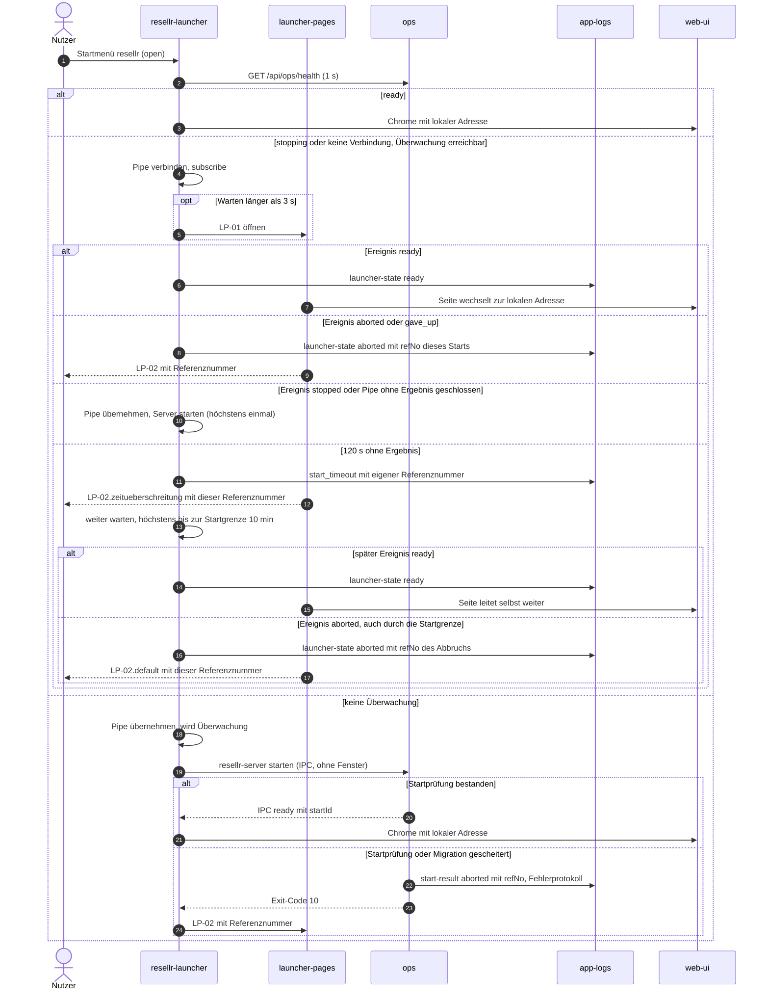

**Lebenszyklus der Überwachung** (Frage: In welchen Zuständen ist `resellr-launcher` als Überwachung, und was beendet sie? Vereinfacht: `health-probe` läuft in `ready` alle 5 min und ist nicht dargestellt. In `stop_pending` und `stopping` startet die Überwachung nach einem Prozessende nichts neu; FIND-233, FIND-234. In `stopping` ändert `503 shutting_down` den Zustand nicht, ebenso jede andere Antwort außer `200` und `500` mit Referenznummer (Nachtrag MAR-764). Die Startgrenze von 10 min wirkt in `starting` und `stop_pending`; K-07.)

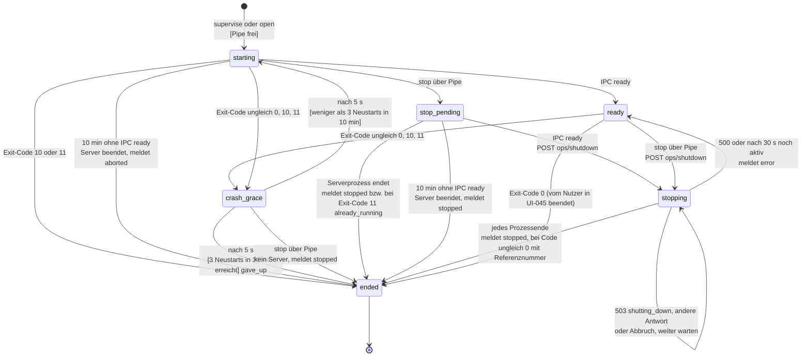

### 2.19 F-19 Installation, Update, Startprüfung, Housekeeping und Protokolle (REQ-072, REQ-073, REQ-106; ADR-006, ADR-008, Baseline 9.4, 9.6, 10.2 bis 10.7)

**Ordner (Baseline 10.1, 10.2):**

| Ordner | Pfad | Inhalt |
| --- | --- | --- |
| Programmordner | `%LOCALAPPDATA%\Programs\resellr` | `resellr-node.exe`, `node.exe`, `app\server.mjs`, `app\launcher.mjs`, `app\web\…`, `app\node_modules\…` (nur native Module), `launcher-pages\…` (dazu zur Laufzeit `launcher-state.js`), `Verfügbarkeitsbericht.cmd`, `Betriebshandbuch.pdf`, `THIRD-PARTY-NOTICES.txt` |
| **Datenordner** (REQ-106) | `%LOCALAPPDATA%\resellr\Daten` | `resellr.db` (bei laufendem resellr zusätzlich `-wal`, `-shm`), `media\photos\…`, `media\thumbs\…`, `media\logo\…`, `media\.incoming\` (temporär), `config.json`, `shutdown-marker.json` (nur nach geordnetem Beenden), `instance.lock` |
| Protokollordner | `%LOCALAPPDATA%\resellr\Protokolle` | `errors-<Datum>.jsonl`, `operations-<Datum>.jsonl`, `availability-<Datum>.jsonl`, `availability-days.jsonl`, `state.json`, `start-result.json`, Verfügbarkeitsberichte |
| Übergabeordner | `%LOCALAPPDATA%\resellr\Fotoübergabe` | Foto-Übergaben und ZIP-Dateien, 7 Tage |
| Kopien vor Updates | `%LOCALAPPDATA%\resellr\Update-Kopien` | je Update ein Ordner mit `resellr.db` und `config.json`, die letzten 3 |

Alle Pfade außer dem Datenordner liegen außerhalb der Sicherung (REQ-106). `config.json` enthält `port` (Standard 4310) und optional `handoverDir`; keine Bindeadresse, keine Geheimnisse, kein Zustand des Hinweises (Baseline 10.2).

**Lesen von `config.json` (FIND-266, Nachtrag MAR-296):** Fehlt die Datei, legt der Server sie beim Start mit `{ "port": 4310 }` an (CU-039). Ist sie kein JSON-Objekt (kein gültiges JSON, Array, Zahl, Text, `null`), gelten für `port` und `handoverDir` die Standardwerte. Ein führendes UTF-8-BOM wird vor dem Parsen entfernt. `port` muss eine ganze JSON-Zahl von 1 bis 65535 sein; Text wie `"4311"`, Dezimalzahlen und Werte außerhalb des Bereichs sind ungültig, dann gilt 4310. Fehlt `port`, gilt 4310 ohne Warnung. In beiden Fehlerfällen schreibt der Server bei jedem Start die Warnung `config_invalid` (`reason`: `not_a_json_object` bzw. `invalid_port`) ins Betriebsprotokoll. Er bricht nicht ab (X-5, wie bei `handoverDir`) und ändert die Datei nicht. Unbekannte Schlüssel ignoriert er ohne Warnung. Ist der so bestimmte Port belegt oder nicht nutzbar, bricht der Start in Schritt 8 ab. **Server und Launcher bestimmen den Port mit derselben Funktion `readConfiguredPort(dataDir)` (CU-309).** Ein ungültiger Wert führt deshalb bei beiden zu 4310, und `open` fragt denselben Port ab, auf dem der Server lauscht (Kap. 2.18). Der Launcher schreibt keine eigene Warnung und legt die Datei nicht an. Eine Änderung von `port` wirkt ab dem nächsten Serverstart; das Betriebshandbuch verlangt dafür vorher „resellr beenden“.

**Prüfung von `handoverDir` beim Start (FIND-212, CU-039):** Der Wert muss ein absoluter Pfad sein, der weder gleich dem Daten-, Protokoll-, Programm- oder Update-Kopie-Ordner ist noch darunter oder darüber liegt, und der nicht gleich dem Benutzerprofil, `Desktop`, `Downloads`, dem Dokumentenordner (`Documents` im Benutzerprofil, im Explorer „Dokumente“; abgelehnt werden beide Schreibweisen) oder einer Laufwerkswurzel ist. Sonst gilt der Standardpfad, und das Betriebsprotokoll erhält eine Warnung. Zusätzlich löscht das Aufräumen nur Einträge mit dem eigenen Namensmuster (Housekeeping unten). Test in Kap. 6.2. Ein automatischer Test prüft, dass der Server außerhalb des Datenordners nur in Protokoll-, Übergabe- und Update-Kopie-Ordner schreibt (Baseline 11.2, REQ-106).

**Einzelinstanz-Sperre des Datenordners (H-8, H-14):** `ops/instance-lock.ts` öffnet mit `better-sqlite3` die Datei `instance.lock` und hält mit `PRAGMA locking_mode = EXCLUSIVE; BEGIN EXCLUSIVE;` eine Dateisperre des Betriebssystems bis zum Prozessende. Ist sie belegt, endet der Server sofort mit Exit-Code 11, ohne Daten anzufassen. **Stelle im Startablauf (Nachtrag MAR-439):** Der Startablauf (CU-040) holt die Sperre als ersten Schritt, vor dem Betriebsereignis `server_started`, vor dem Lesen oder Anlegen von `config.json` und vor Schritt 1 der Startprüfung, also nicht erst vor dem Migrationslauf. Sonst würden zwei Server die Datenbank öffnen (Schritt 2 legt `-wal`/`-shm` an) und beide eine Kopie vor dem Update anlegen (Schritt 5). Eine mitkopierte Sperrdatei blockiert nichts, weil nur die Sperre zählt, nicht die Datei. Kein zusätzliches natives Modul.

**Startprüfung (`ops/startup-check.ts`, Baseline 9.6 Schritte 1 bis 5):**

1. Fehlt `resellr.db`, obwohl `media/photos` Dateien enthält → Abbruch. Fehlt beides → neue Datenbank (erster Start).
2. Datenbank öffnen, `PRAGMA journal_mode = WAL`, `synchronous = FULL` (jede bestätigte Transaktion übersteht einen Stromausfall, Baseline 9.6; FIND-217), `busy_timeout = 5000`, `foreign_keys = ON`; `PRAGMA quick_check`. Schemaversion neuer als das Programm → Abbruch.
3. **Ersetzter Datenordner:** `app_meta.data_folder_stamp` ≠ `state.json.dataFolderStamp`, oder `state.json` fehlt → `integrity_check`, Prüfung aller verwiesenen Fotodateien (Anzahl fehlender), kein Aufräumen verwaister Dateien bei diesem Start.
4. **Art des letzten Endes:** Ende-Markierung vorhanden → „vom Nutzer beendet“; sonst `state.json.lastCrashAt` nach dem letzten Serverstart → „abgestürzt“; sonst „ohne geordnetes Beenden“. Die Markierung wird erst nach Schritt 9 gelöscht, damit sie bei einem Abbruch erhalten bleibt (Baseline 9.6, FIND-211).
5. **Kopie vor Update (FIND-211):** Weicht `app_meta.app_version` oder `app_meta.engine_version` vom Programm ab oder ist das Schema älter, zuerst Kopie über die Online-Backup-API (`db.backup()`) und von `config.json` nach `Update-Kopien\<Zeit>-v<alt>-v<neu>\`, ältere als die letzten 3 löschen (CU-248). Beim ersten Start entfällt die Kopie.
   **Migrationen:** alle offenen in **einer** Transaktion, nur vorwärts, Dateinamen nach Kap. 4.2. `db/migrator.ts` (CU-029) führt sie selbst aus: `PRAGMA foreign_keys = OFF` (außerhalb der Transaktion, weil SQLite das Pragma innerhalb einer Transaktion ignoriert), `BEGIN IMMEDIATE`, je Migration `up(db)` mit der Kysely-Instanz derselben Verbindung und ein Eintrag in `app_migration` (`name`, `applied_at`), dann `PRAGMA foreign_key_check`; liefert es eine Zeile, `ROLLBACK` und Abbruch wie unten, sonst `COMMIT`; in jedem Fall danach `PRAGMA foreign_keys = ON`. So löscht ein Tabellenumbau in einer späteren Migration (neue Tabelle, kopieren, `DROP TABLE`, umbenennen) über `ON DELETE CASCADE` keine abhängigen Zeilen still (FIND-228, Regel in Kap. 3.8). Gibt es keine offene Migration, bleibt `foreign_keys` unverändert `ON`. SQLite erlaubt DDL in Transaktionen; der Kysely-`Migrator` wird nicht verwendet, weil er auf SQLite ohne Transaktion migriert (`supportsTransactionalDdl = false`). `better-sqlite3`-`db.transaction()` passt nicht, weil Kysely-Aufrufe asynchron sind. Scheitert eine Migration: `ROLLBACK`, das Schema bleibt auf dem alten Stand, Abbruch (LP-02); die Kopie bleibt für die Rückkehr zur alten Version. `app_migration` legt CU-029 selbst in der Transaktion des Laufs an (`CREATE TABLE IF NOT EXISTS`), nicht die Migration `0001`; `applied_at` ist ISO-8601-Text in UTC (Kap. 3). Die Liste der Migrationen bekommt CU-029 als Parameter; der Startablauf übergibt die statische Liste `db/migrations/index.ts` (CU-308). Einen Ordner-Scan gibt es nicht, weil der Server zu einer Datei gebündelt wird (Build unten). CU-029 schreibt nicht selbst ins Fehlerprotokoll: Nach dem `ROLLBACK` wirft es `MigrationError` (betroffene Migration bzw. Befunde von `foreign_key_check`, Ursache); den Abbruch macht der Startablauf (CU-040, S10, Nachtrag MAR-263). Tests: eine absichtlich fehlerhafte zweite Migration hinterlässt das Schema unverändert; eine Test-Migration mit Umbau von `listing` lässt die abhängigen Zeilen unverändert; eine Test-Migration, die einen ungültigen Fremdschlüssel hinterlässt, wird zurückgerollt (Kap. 6.2).
6. `ENGINE_VERSION` abgleichen, ggf. alle Kanal-Inhalte neu bilden (Kap. 2.8.3).
7. Neue Kennung des Datenordner-Stands und `app_version` in `app_meta` (CU-285) sowie in `state.json`.
8. Lauschen auf `127.0.0.1:<port>`; `EADDRINUSE` → Abbruch.
9. `start-result.json` mit `ready`, IPC `ready`, Betriebsereignis `server_ready` mit Art des letzten Endes und Befunden; danach Ende-Markierung löschen.

Abbruch heißt: Eintrag im Fehlerprotokoll mit Referenznummer, `start-result.json` mit `aborted` und dieser Nummer, Exit-Code 10 (LP-02). Das Betriebsereignis `start_aborted` mit dieser Nummer schreibt die Überwachung, nicht der Server (Kap. 2.18, Exit-Codes; Nachtrag MAR-498). Befunde aus Schritt 3 und 4 brechen nicht ab; sie stehen nur im Betriebsprotokoll (X-5).

**Housekeeping (`ops/housekeeping/*`, beim Start und alle 24 h):**

| Aufgabe | Regel | Einheit |
| --- | --- | --- |
| Protokolleinträge | löschen, wenn älter als 24 Monate (REQ-072) | `audit/audit-retention-job.ts` (einzige Stelle, die in `audit_entry` löscht) |
| Dateien ohne Verweis | **Verweis** = Eintrag in `listing_photo`, im aktuellen oder freigegebenen Stand eines Kanal-Inhalts oder in `merchant_profile.logo_hash` (über CU-287, CU-291 und CU-086). Das Vorschaubild gehört zu seinem Original und zählt nicht gesondert. **(1) Dateien mit Zeile in `media_file`** (von resellr angelegt, letzter Verweis von resellr entfernt: Foto entfernt, Modell-Inserat gelöscht, Logo ersetzt; FIND-214, FIND-226): In einer Transaktion setzt der Lauf `unreferenced_since` = jetzt bei jeder Zeile ohne Verweis, deren Wert NULL ist, und setzt ihn bei jeder Zeile mit Verweis auf NULL zurück. **Die Karenz von 24 h zählt ab `unreferenced_since`**, nicht ab dem Alter der Datei; eine Datei wird also frühestens 24 h, nachdem ein Lauf sie verwaist vorgefunden hat, gelöscht (bei Läufen alle 24 h meist beim übernächsten Lauf). Löschen je Hash unter der Sperre des Hashes (CU-088): Verweise in einer Transaktion erneut prüfen, Zeile löschen, Commit; danach Original und Vorschaubild löschen. Ohne Mengengrenze. Scheitert das Löschen der Datei, bleibt sie ohne Zeile und fällt unter (2); Warnung. **(2) Dateien ohne Zeile** (Hinweis auf eine ältere oder fremde Datenbank oder eine gescheiterte Upload-Transaktion): löschen, wenn die Datei älter als 24 h ist (Änderungszeit), ebenfalls unter der Sperre des Hashes und nach erneuter Prüfung, dass keine Zeile entstanden ist; **Schutzgrenze**: mehr als 20 solche Dateien oder mehr als 1 % aller Dateien → keine davon löschen, Warnung. **(3)** `media/.incoming` älter als 24 h leeren. Das ganze Aufräumen entfällt beim ersten Start nach ersetztem Datenordner (Baseline 9.4). **Zuständigkeit (FIND-227):** CU-251 sammelt die Verweise über die Reader und entscheidet; alles, was `media_file` und die Dateien ändert, macht der Dateidienst CU-307 von `media` (Ausnahme in Kap. 4.1) | `ops/housekeeping/orphan-files-job.ts` (CU-251) mit `media/orphan-file-service.ts` (CU-307) |
| Übergabeordner | Unterordner, deren Name vollständig `^[A-Za-z0-9-]+-[a-z]+-\d{8}-\d{6}$` entspricht, und Dateien, deren Name vollständig `^[A-Za-z0-9-]+-[a-z]+-\d{8}-\d{6}-fotos\.zip$` entspricht (Namen aus Kap. 2.12), älter als 7 Tage löschen; andere Einträge bleiben unberührt, auch fremde Dateien wie `urlaub-fotos.zip` (FIND-212, FIND-229) | `ops/housekeeping/handover-cleanup-job.ts` |
| Tageszusammenfassung Verfügbarkeit | Zeilen in `availability-days.jsonl` älter als 24 Monate löschen (FIND-221) | `tools/launcher/src/availability/availability-aggregator.ts` |
| Tagesdateien im Protokollordner | älter als 30 Tage löschen | `packages/runtime-shared/src/daily-jsonl-writer.ts` |
| Freier Speicher | unter 10 GB auf dem Laufwerk des Datenordners → Warnung im Betriebsprotokoll (AR-09; X-8 Nein) | `ops/housekeeping/disk-space-check.ts` |

**Protokolle (REQ-073, Baseline 10.7):** JSON Lines, eine Datei je Tag und Art. Fehlerprotokoll: `ts, level, refNo, function` (z. B. `datasheet.generate`), `message`, `stack`, `appVersion`, `startId`; **keine** Feldwerte, keine Anfrageinhalte (Baseline 8.4). Betriebsprotokoll: Ereignisse nach Baseline 10.7 (`supervisor_started` mit `bootTime`, `server_started`, `server_ready`, `stopped_by_user`, `shutdown_failed`, `crash`, `gave_up`, `already_running`, `start_aborted`, `start_timeout`, `supervisor_ended`, Warnungen, darunter `chrome_not_found`). Server und Launcher nutzen denselben `DailyJsonlWriter`; die Ereignisse des Launchers schreibt CU-296, angezeigte Referenznummern zusätzlich ins Fehlerprotokoll (Kap. 2.18). Jeder Eintrag im Betriebsprotokoll hat `ts`, `level` (`info` oder `warn`), `event`, die Details des Ereignisses, `appVersion` und `startId`; beim Launcher ist `startId` die Kennung des Starts, den der Prozess überwacht, sonst `null` (z. B. bei `open`). **`chrome_not_found` (Nachtrag MAR-366):** Level `warn`, keine Details; der Launcher fand unter `App Paths\chrome.exe` weder in `HKCU` noch in `HKLM` eine vorhandene Datei und öffnet die Adresse über `explorer.exe` (Kap. 2.18, DER-102-05). **`shutdown_failed` (Nachtrag MAR-764):** Level `warn`, Detail `refNo`; der Server schreibt es bei `500` auf `POST /api/ops/shutdown` (Kap. 2.17 Schritt 8), die Überwachung, wenn der Serverprozess 30 s nach dem Wechsel in `stopping` noch läuft (Kap. 2.18). **`stop_crash`:** Level `warn`, Details `refNo`, `exitCode`, `signal`, beim Ende durch die Startgrenze in `stop_pending` zusätzlich `cause: 'start_limit'`. Fastify protokolliert Anfragen nicht in Dateien.

**Installationspaket (ADR-008):** Inno Setup 6, Installation ohne Adminrechte (`PrivilegesRequired=lowest`) nach `{localappdata}\Programs\resellr`. Es legt den Autostart-Eintrag `HKCU\Software\Microsoft\Windows\CurrentVersion\Run\resellr` an (`"…\resellr-node.exe" "…\app\launcher.mjs" supervise`), die Verknüpfungen „resellr“ (Startmenü und Desktop, `open`) und „resellr beenden“ (Startmenü, `stop`). Vor dem Ersetzen von Dateien ruft es `stop --for-update` auf und bricht bei Exit-Code 1 ohne Änderung ab („resellr konnte nicht beendet werden. Bitte später erneut versuchen.“, Baseline 10.6). Nach der Installation startet es `open`. Die Deinstallation ruft nach der Bestätigung durch den Nutzer und vor dem Entfernen ebenfalls `stop --for-update` auf, weil Windows die Dateien eines laufenden resellr (`resellr-node.exe`, geladenes `better_sqlite3.node`) nicht löschen kann und resellr wegen des Autostarts meist läuft. Bei Exit-Code 0 entfernt sie Programm (einschließlich `launcher-state.js` und `launcher-state.js.lock`, `[UninstallDelete]`, Nachtrag MAR-470), Autostart-Eintrag und Verknüpfungen; Datenordner, Protokolle und Update-Kopien bleiben (Betriebshandbuch). Bei einem anderen Exit-Code bricht sie ohne Änderung mit derselben Meldung wie das Update ab; lässt sich der Aufruf nicht starten (z. B. `resellr-node.exe` fehlt), entfernt sie weiter, weil dann kein resellr aus dem Programmordner laufen kann (Nachtrag MAR-471). Ohne Code-Signierung (OD-09 Aus) zeigt SmartScreen bei **jedem** Ausführen eines heruntergeladenen Pakets eine Warnung, also bei der Installation und bei jedem Update (AR-13, FIND-216).

**Build des Pakets (`.github/workflows/release.yml`, Windows-Runner):** `npm ci`; `web-ui` mit Vite bauen; Server und Launcher mit esbuild zu je einer Datei bündeln (native Module extern; Konstante `RESELLR_BUNDLED`, damit beide ihre Pfade aus dem Programmordner statt aus dem Quellbaum bilden, Nachtrag MAR-446; ausgewertet in CU-313, damit esbuild die Quellbaum-Zweige entfernt, Nachtrag MAR-474); `better-sqlite3` und `sharp` (`@img/sharp-win32-x64`) als vorkompilierte Pakete für Windows x64 und die mitgelieferte Node.js-Version; Node.js-Laufzeit (`node-v<Version>-win-x64.zip`) von nodejs.org laden und gegen `SHASUMS256.txt` prüfen; `resellr-node.exe` durch `tools/packaging/patch-pe-subsystem.mjs` erzeugen (Feld „Subsystem“ im PE-Kopf von 3 = Konsole auf 2 = Windows-GUI; die dadurch ungültige Authenticode-Signatur wird entfernt, Eintrag „Security Directory“ auf 0, PE-Prüfsumme neu, FIND-219); `THIRD-PARTY-NOTICES.txt` durch CU-298 in den Stufenordner erzeugen (Lizenztexte aller ausgelieferten npm-Pakete: in Server und Launcher gebündelte laut esbuild-Metadatei von CU-276 und deren Hülle über `dependencies`, beigelegte native Pakete aus `app/node_modules`, in `web-ui` gebündelte laut Abhängigkeiten von `apps/web`; dazu Node.js, Inter OFL und, sobald `sharp` ausgeliefert wird, libvips aus `@img/sharp-win32-x64` mit den Texten von LGPL-3.0 und GPL-3.0 und den Lizenztexten der in die libvips-DLLs gebauten Bibliotheken; erlaubt sind MIT, ISC, BSD-2/3-Clause, Apache-2.0, 0BSD, OFL-1.1, BlueOak-1.0.0 und LGPL-3.0 nur für die Pakete, die libvips als dynamische Bibliothek tragen; ein Paket ohne eigene Lizenzdatei braucht einen Eintrag in `tools/packaging/licenses/missing-license-files.json` (ausgenommen ein Paket `@img/sharp-libvips-*` mit genau einer LGPL-3.0-Kennung als Lizenz, für das die beigelegten Texte von LGPL-3.0 und GPL-3.0 gelten), jede Bibliothek aus `versions.json` eines libvips-Pakets einen Eintrag mit derselben Version in `tools/packaging/licenses/libvips-libraries.json`; sonst scheitert der Build, FIND-222, Nachtrag MAR-687, MAR-693, MAR-711, MAR-720, MAR-758); `Betriebshandbuch.pdf` durch CU-316 aus `docs/operations/betriebshandbuch.md` in den Stufenordner erzeugen (Nachtrag MAR-599); `iscc` baut `resellr-setup-<Version>.exe`; Upload in GitHub Releases von `MarloNET/resellr`. Auslöser ist ein Tag `v<Version>` auf einem Commit von `main`; die Version kommt aus der Wurzel-`package.json`, und der Build scheitert, wenn Tag und Version nicht übereinstimmen. Ein manueller Lauf (`workflow_dispatch`) baut nur und legt Paket und Lizenzdatei als Artefakt ab (Nachtrag MAR-687).

Ohne eigenes Sequenzdiagramm: Der Start mit Startprüfung ist der letzte Zweig des Ablaufs in Kap. 2.18, das Beenden vor einem Update der Ablauf in Kap. 2.17; das Zusammenspiel von Installationspaket, Launcher und Server zeigt das Diagramm zu ADR-008 (Kap. 11).

### 2.20 F-20 Erreichbarkeit, keine ausgehenden Verbindungen, keine Personen- und Zugangsdaten (REQ-001, REQ-067, REQ-068, REQ-069, REQ-079)

- **REQ-001, REQ-067 bei OD-02 A:** keine Anmeldung, kein Zugangspasswort, keine Passwortänderung; UI-001, UI-040 und FLOW-07 werden nicht gebaut, UI-025 zeigt 14 Bereiche. Der Server bindet nur an `127.0.0.1` (Kap. 2.0.1); ein Zugriff von einem anderen Gerät ist nicht möglich (AC-REQ-001-05, AC-REQ-001-07).
- **REQ-079:** `resellr-server` und `resellr-launcher` bauen keine Verbindung außer `127.0.0.1` auf; es gibt keine HTTP-Client-Bibliothek in `apps/server` (Prüfung per Abhängigkeitsliste, Kap. 6.2); CSP `connect-src 'self'`; `web-ui` lädt nichts von fremden Servern (Schrift und Icons gebündelt).
- **REQ-068, REQ-069:** Das Datenmodell (Kap. 3) hat keine Felder für Plattform-Zugangsdaten, Käufer oder Nutzer; Protokolleinträge, Freigaben, Abgleiche und Geräte nennen keine Person (Test Kap. 6.2).

Ohne Diagramm: Diese Punkte sind Eigenschaften, keine Abläufe.

### 2.21 F-21 Optionale Could-Funktionen (REQ-056, REQ-057, REQ-058, REQ-059)

Sie werden nur gebaut, wenn der Product Owner sie in das Backlog nimmt; das Datenmodell enthält die nötigen Spalten schon (Kap. 3), damit keine spätere Migration nötig ist.

- **REQ-056 Excel-Übernahme (UI-042):** `POST /api/imports/excel` (multipart, `.xlsx`, höchstens 10 MB) → `{ created[]: { modelTemplateId, label }, unmappedLabels[]: { sheet, labels[] } }`. `excel-import/excel-import-service.ts` liest mit `exceljs` (MIT) je Blatt die Bezeichnung-Wert-Paare, ordnet Bezeichnungen über `excel-import/label-synonyms.ts` zu (u. a. 4 Varianten der WI-Nr und 7 der Herstellernummer, Research Kap. 2), legt Modellvorlagen mit `importReviewPending = true` und Prüfmarkierungen an **allen** Werten an (Baseline 6.4 Auflage). Solche Modellvorlagen erscheinen in UI-003 nicht zur Auswahl, bis der Nutzer in UI-007 alle Werte bestätigt hat (REQ-056, AC-REQ-056-01/-02).
- **REQ-057 Importdatei Shop:** `GET /api/exports/prestashop.csv` nach Baseline 5.2 (UTF-8, `;`, Mehrfachwerte `,`), freigegebener Stand mit aktuellen Bestandsangaben. **Blockiert durch eine Owner-Angabe:** Brutto- oder Nettopreis und Steuerregel (AR-12, Freigabe-Briefing „Deine Entscheidungen“, seit v0.5.2 in Kap. 10.4). Ohne Antwort wird REQ-057 nicht gebaut.
- **REQ-058:** Kap. 2.4 (`confirmation_required`/`mpn_in_use`).

**Ablauf „Excel-Datei übernehmen“ (REQ-056, nur bei Umsetzung)**

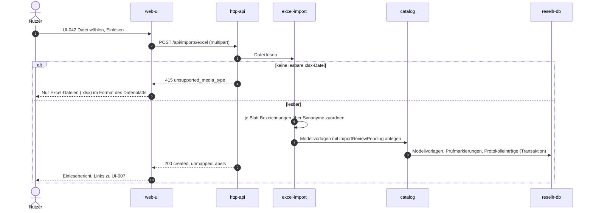

Die Importdatei für den Shop (REQ-057) ist eine einzelne lesende Abfrage ohne Seiteneffekt und hat kein eigenes Diagramm.

- **REQ-059:** Kap. 2.9 (`categoryWarning`).

---

## 3. Datenmodell im Detail

Das Datenmodell verfeinert Baseline Kap. 4 auf Tabellen und Felder. Es gibt 29 Fachtabellen in einer SQLite-Datei (`resellr.db`, WAL), angelegt von **einer** Initialmigration (Kap. 3.8), dazu die Verwaltungstabelle `app_migration` des Migrationslaufs (`name` TEXT PK, `applied_at` TEXT; CU-029, FIND-224). Konventionen:

- Tabellen- und Spaltennamen `snake_case`, englisch; in den ER-Diagrammen in `UPPER_SNAKE_CASE`.
- Wahrheitswerte als `INTEGER` 0/1, Zeitpunkte als ISO-8601-Text in UTC, Kalenderdaten als `YYYY-MM-DD`, Geld als Cent (`INTEGER`), Dezimalwerte als kanonische Zeichenkette (Baseline 4.4).
- JSON-Spalten sind `TEXT` mit `CHECK (json_valid(…))`; ihr Aufbau steht in Kap. 3.4 und als Zod-Schema in `packages/domain`.
- Eindeutigkeit ohne Groß-/Kleinschreibung über eine `…_key`-Spalte mit Unicode-Kleinschreibung (`String.prototype.normalize('NFC').toLowerCase()`), weil SQLite `NOCASE` nur ASCII kennt (Baseline 4.4).
- `version` beginnt bei 1 und steigt mit jeder Änderung um 1 (Kap. 2.0.3).
- Fremdschlüssel mit `ON DELETE RESTRICT`, außer wo `CASCADE` oder `SET NULL` genannt ist; `PRAGMA foreign_keys = ON`.
- Längen- und Wertebereichsregeln prüft die Fachschicht (Zod und Fachregeln); die Datenbank sichert Eindeutigkeit, Fremdschlüssel, Wertelisten (`CHECK … IN (…)`) und Pflichtfelder als letzte Stufe (Baseline 9.2).
- Es gibt **keine** Felder für Personen, Benutzerkonten, Passwörter oder Plattform-Zugangsdaten (REQ-068, REQ-069).

### 3.1 Einstellungen

**`merchant_profile`** – Händlerangaben, genau ein Datensatz (REQ-028). Komponente `settings`.

| Feld | Typ | Schlüssel | NULL | Regel |
| --- | --- | --- | --- | --- |
| `id` | INTEGER | PK | nein | immer 1 (CHECK) |
| `brand_name` | TEXT | – | nein | 0–100; zum Speichern über die API 1–100 |
| `contact_text` | TEXT | – | nein | 0–500, Platzhalter `{Händler-Kontakt}` |
| `logo_hash` | TEXT | FK | ja | → media_file.hash |
| `version` | INTEGER | – | nein | ≥ 1 |
| `updated_at` | TEXT | – | nein | ISO 8601 UTC |

**`device_type`** – Geräteart (REQ-004). Komponente `settings`.

| Feld | Typ | Schlüssel | NULL | Regel |
| --- | --- | --- | --- | --- |
| `id` | INTEGER | PK | nein | – |
| `name` | TEXT | – | nein | 1–50, Randleerzeichen entfernt |
| `name_key` | TEXT | UK | nein | Unicode-Kleinschreibung von name |
| `active` | INTEGER | – | nein | 0 oder 1 |
| `sort_order` | INTEGER | – | nein | – |
| `version` | INTEGER | – | nein | – |
| `created_at` | TEXT | – | nein | – |
| `updated_at` | TEXT | – | nein | – |

**`attribute`** – Merkmal einer Geräteart (REQ-005); eindeutig je Geräteart über (device_type_id, label_key). Komponente `settings`.

| Feld | Typ | Schlüssel | NULL | Regel |
| --- | --- | --- | --- | --- |
| `id` | INTEGER | PK | nein | stabile Merkmals-ID, Schlüssel in allen JSON-Werten |
| `device_type_id` | INTEGER | FK | nein | → device_type |
| `label` | TEXT | – | nein | 1–100, ohne `{` `}` |
| `label_key` | TEXT | – | nein | Kleinschreibung; UNIQUE mit device_type_id |
| `data_type` | TEXT | – | nein | text, integer, decimal, boolean, pick, ports |
| `system_role` | TEXT | – | ja | keyboard_layout, power_supply, battery, battery_capacity |
| `unit` | TEXT | – | ja | 0–20 |
| `unit_spacing` | INTEGER | – | nein | 1 = mit Leerzeichen |
| `min_value` | TEXT | – | ja | kanonische Dezimalzeichenkette, nur integer und decimal; bei integer eine ganze Zahl |
| `max_value` | TEXT | – | ja | wie min_value, min ≤ max |
| `pick_list_id` | INTEGER | FK | ja | → pick_list; Pflicht bei data_type pick |
| `level` | TEXT | – | nein | model oder device |
| `variant_forming` | INTEGER | – | nein | nur bei level device; nie bei battery_capacity |
| `required` | INTEGER | – | nein | Pflichtmerkmal |
| `datasheet_block` | TEXT | – | nein | identification, condition, delivery_scope, technical, ports, software |
| `sort_order` | INTEGER | – | nein | Reihenfolge der Geräteart |
| `active` | INTEGER | – | nein | 1 = aktiv, 0 = deaktiviert; Wechsel in beide Richtungen über `PATCH /api/attributes/{id}`, nie abgelehnt (Kap. 2.1, Nachtrag MAR-605) |
| `version` | INTEGER | – | nein | – |
| `created_at` | TEXT | – | nein | – |
| `updated_at` | TEXT | – | nein | – |

**`pick_list`** – Auswahlliste der Startbelegung (Requirements Kap. 9.2), nicht anlegbar. Komponente `settings`.

| Feld | Typ | Schlüssel | NULL | Regel |
| --- | --- | --- | --- | --- |
| `id` | INTEGER | PK | nein | – |
| `key` | TEXT | UK | nein | condition, keyboard_layout, power_supply, battery, storage_type, display_surface, operating_system, port_type, port_position |
| `name` | TEXT | – | nein | Anzeigename |
| `is_battery_list` | INTEGER | – | nein | 1 nur bei battery |
| `version` | INTEGER | – | nein | Version der Reihenfolge |

**`pick_list_value`** – Wert einer Auswahlliste (REQ-007); eindeutig über (pick_list_id, label_key). Komponente `settings`.

| Feld | Typ | Schlüssel | NULL | Regel |
| --- | --- | --- | --- | --- |
| `id` | INTEGER | PK | nein | gespeichert wird immer diese ID |
| `pick_list_id` | INTEGER | FK | nein | → pick_list |
| `label` | TEXT | – | nein | 1–100 |
| `label_key` | TEXT | – | nein | Kleinschreibung |
| `battery_present` | INTEGER | – | ja | Pflicht (0/1) in der Liste battery, sonst NULL |
| `sort_order` | INTEGER | – | nein | – |
| `active` | INTEGER | – | nein | – |
| `version` | INTEGER | – | nein | – |

**`manufacturer`** – Hersteller mit GPSR-Herstellerangaben (REQ-027, REQ-100, REQ-101). Komponente `settings`.

| Feld | Typ | Schlüssel | NULL | Regel |
| --- | --- | --- | --- | --- |
| `id` | INTEGER | PK | nein | – |
| `name` | TEXT | – | nein | 1–50 |
| `name_key` | TEXT | UK | nein | – |
| `active` | INTEGER | – | nein | – |
| `gpsr_legal_name` | TEXT | – | ja | 0–200 |
| `gpsr_street` | TEXT | – | ja | 0–200, Straße und Hausnummer |
| `gpsr_postal_code` | TEXT | – | ja | 0–20 |
| `gpsr_city` | TEXT | – | ja | 0–100 |
| `gpsr_country` | TEXT | – | ja | 0–100 |
| `gpsr_contact` | TEXT | – | ja | E-Mail oder http(s)-Adresse, 0–254 |
| `eu_rp_name` | TEXT | – | ja | 0–200 |
| `eu_rp_address` | TEXT | – | ja | 0–500, mehrzeilig |
| `eu_rp_contact` | TEXT | – | ja | 0–254 |
| `gpsr_complete` | INTEGER | – | nein | abgeleitet beim Speichern |
| `version` | INTEGER | – | nein | – |
| `created_at` | TEXT | – | nein | – |
| `updated_at` | TEXT | – | nein | – |

**`supplier`** – Lieferant (REQ-099). Komponente `settings`.

| Feld | Typ | Schlüssel | NULL | Regel |
| --- | --- | --- | --- | --- |
| `id` | INTEGER | PK | nein | – |
| `name` | TEXT | – | nein | 1–100 |
| `name_key` | TEXT | UK | nein | – |
| `active` | INTEGER | – | nein | – |
| `version` | INTEGER | – | nein | – |
| `created_at` | TEXT | – | nein | – |
| `updated_at` | TEXT | – | nein | – |

**`condition_code`** – Eintrag der Code-Übersetzungstabelle (REQ-022); eindeutig über (code_key, IFNULL(supplier_id, 0)). Komponente `settings`.

| Feld | Typ | Schlüssel | NULL | Regel |
| --- | --- | --- | --- | --- |
| `id` | INTEGER | PK | nein | – |
| `code` | TEXT | – | nein | 1–20 |
| `code_key` | TEXT | – | nein | Kleinschreibung |
| `supplier_id` | INTEGER | FK | ja | → supplier; NULL = ohne Lieferant |
| `plain_text` | TEXT | – | nein | 1–500 |
| `suggested_condition_value_id` | INTEGER | FK | ja | → pick_list_value (Liste condition) |
| `suggested_visual_grade` | INTEGER | – | ja | 1–5 |
| `version` | INTEGER | – | nein | – |
| `created_at` | TEXT | – | nein | – |
| `updated_at` | TEXT | – | nein | – |

**`text_block`** – Textbaustein mit Prüfstatus (REQ-026, REQ-054). Komponente `settings`.

| Feld | Typ | Schlüssel | NULL | Regel |
| --- | --- | --- | --- | --- |
| `id` | INTEGER | PK | nein | – |
| `name` | TEXT | – | nein | 1–100 |
| `name_key` | TEXT | UK | nein | – |
| `kind` | TEXT | – | nein | battery_notice, delivery_scope, pickup_contact, legal, other |
| `body` | TEXT | – | nein | 1–5.000 |
| `active` | INTEGER | – | nein | – |
| `all_device_types` | INTEGER | – | nein | 1 = Geltung für alle Gerätearten |
| `all_channels` | INTEGER | – | nein | 1 = Geltung für alle Kanäle |
| `legal_status` | TEXT | – | ja | unchecked oder checked; nur bei legal und battery_notice |
| `legal_checked_on` | TEXT | – | ja | YYYY-MM-DD, nicht in der Zukunft |
| `legal_checked_by` | TEXT | – | ja | 1–100 |
| `version` | INTEGER | – | nein | – |
| `created_at` | TEXT | – | nein | – |
| `updated_at` | TEXT | – | nein | – |

**`text_block_device_type`** – Geltungsbereich Gerätearten (wenn all_device_types = 0). Komponente `settings`.

| Feld | Typ | Schlüssel | NULL | Regel |
| --- | --- | --- | --- | --- |
| `text_block_id` | INTEGER | PK, FK | nein | → text_block, ON DELETE CASCADE |
| `device_type_id` | INTEGER | PK, FK | nein | → device_type |

**`text_block_channel`** – Geltungsbereich Kanäle (wenn all_channels = 0). Komponente `settings`.

| Feld | Typ | Schlüssel | NULL | Regel |
| --- | --- | --- | --- | --- |
| `text_block_id` | INTEGER | PK, FK | nein | → text_block, ON DELETE CASCADE |
| `channel_id` | INTEGER | PK, FK | nein | → channel |

**`datasheet_layout`** – Datenblatt-Layout, genau ein Datensatz (REQ-051). Komponente `settings`.

| Feld | Typ | Schlüssel | NULL | Regel |
| --- | --- | --- | --- | --- |
| `id` | INTEGER | PK | nein | immer 1 |
| `header_labels` | TEXT (JSON) | – | nein | Liste von Texten je 0–50 |
| `block_order` | TEXT (JSON) | – | nein | Permutation der sechs Blöcke |
| `attribute_order` | TEXT (JSON) | – | nein | Objekt deviceTypeId → Liste von Merkmals-IDs |
| `version` | INTEGER | – | nein | – |
| `updated_at` | TEXT | – | nein | – |

**`media_file`** – Datei im media-store, Name aus dem Inhalts-Hash (ADR-004). Komponente `media`.

| Feld | Typ | Schlüssel | NULL | Regel |
| --- | --- | --- | --- | --- |
| `hash` | TEXT | PK | nein | SHA-256, 64 Hex-Zeichen |
| `kind` | TEXT | – | nein | photo oder logo |
| `ext` | TEXT | – | nein | jpg oder png |
| `mime` | TEXT | – | nein | image/jpeg oder image/png |
| `byte_size` | INTEGER | – | nein | – |
| `width` | INTEGER | – | nein | – |
| `height` | INTEGER | – | nein | – |
| `created_at` | TEXT | – | nein | – |
| `unreferenced_since` | TEXT | – | ja | Zeitpunkt, zu dem das Aufräumen die Datei zuerst ohne Verweis vorgefunden hat; NULL, solange ein Verweis besteht. Nur CU-307 (Aufräumen) und CU-090 (Upload setzt NULL) schreiben die Spalte; Beginn der 24-h-Karenz (Kap. 2.19, FIND-226) |

Es gibt keine Vormerk-Tabelle für verwaiste Dateien und keinen Trigger; der Verweis `media_orphan_candidate` aus v0.2 entfällt (FIND-226).

**Datenmodell Einstellungen** – Welche Tabellen halten die allgemeinen Einstellungen, und wie hängen sie zusammen? `CHANNEL` steht in Kap. 3.2; `MEDIA_FILE` erscheint hier wegen des Logos.

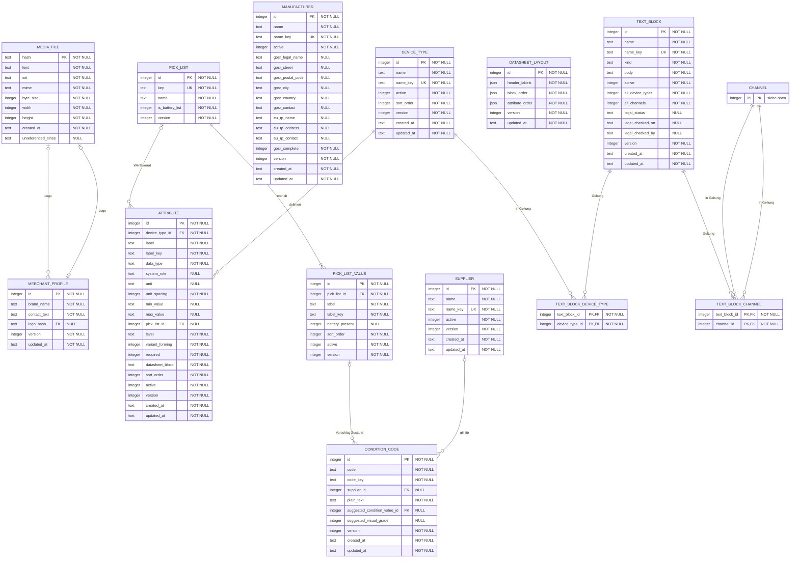

### 3.2 Kanal-Einstellungen

**`channel`** – Kanal (REQ-029, ADR-005). Komponente `channels`.

| Feld | Typ | Schlüssel | NULL | Regel |
| --- | --- | --- | --- | --- |
| `id` | INTEGER | PK | nein | – |
| `code` | TEXT | UK | nein | shop, kleinanzeigen, ebay; weitere per Datenmigration |
| `name` | TEXT | – | nein | – |
| `active` | INTEGER | – | nein | – |
| `title_max_length` | INTEGER | – | nein | 20–500 |
| `vb_allowed` | INTEGER | – | nein | – |
| `sort_order` | INTEGER | – | nein | – |
| `condition_mappings_version` | INTEGER | – | nein | Version der ganzen Zustandszuordnung des Kanals |
| `version` | INTEGER | – | nein | Version von Kanal und Preisregel |
| `created_at` | TEXT | – | nein | – |
| `updated_at` | TEXT | – | nein | – |

**`price_rule`** – Preisregel eines Kanals (REQ-085). Komponente `channels`.

| Feld | Typ | Schlüssel | NULL | Regel |
| --- | --- | --- | --- | --- |
| `channel_id` | INTEGER | PK, FK | nein | → channel |
| `reference_channel_id` | INTEGER | FK | nein | → channel, ≠ channel_id, kein Kreis |
| `delta_cents` | INTEGER | – | nein | Auf- oder Abschlag mit Vorzeichen |
| `updated_at` | TEXT | – | nein | – |

**`title_pattern`** – Titelmuster je Geräteart, optional je Kanal (REQ-030); eindeutig über (device_type_id, IFNULL(channel_id, 0)). Komponente `channels`.

| Feld | Typ | Schlüssel | NULL | Regel |
| --- | --- | --- | --- | --- |
| `id` | INTEGER | PK | nein | – |
| `device_type_id` | INTEGER | FK | nein | → device_type |
| `channel_id` | INTEGER | FK | ja | → channel; NULL = Muster der Geräteart |
| `parts` | TEXT (JSON) | – | nein | Liste { kind, placeholder, text, prefix, suffix, priority } |
| `version` | INTEGER | – | nein | – |
| `updated_at` | TEXT | – | nein | – |

**`description_template`** – Beschreibungsvorlage je Kanal (REQ-031). Komponente `channels`.

| Feld | Typ | Schlüssel | NULL | Regel |
| --- | --- | --- | --- | --- |
| `channel_id` | INTEGER | PK, FK | nein | → channel |
| `sections` | TEXT (JSON) | – | nein | Liste { heading, deviceTypeIds, lines[] } |
| `version` | INTEGER | – | nein | – |
| `updated_at` | TEXT | – | nein | – |

**`condition_mapping`** – Zeile der Zustandszuordnung (REQ-023); eindeutig über (channel_id, condition_value_id, IFNULL(visual_grade, 0)). Komponente `channels`.

| Feld | Typ | Schlüssel | NULL | Regel |
| --- | --- | --- | --- | --- |
| `id` | INTEGER | PK | nein | – |
| `channel_id` | INTEGER | FK | nein | → channel |
| `condition_value_id` | INTEGER | FK | nein | → pick_list_value (Liste condition) |
| `visual_grade` | INTEGER | – | ja | 1–5; NULL = alle Noten |
| `label` | TEXT | – | nein | 1–100 |
| `extra` | TEXT | – | nein | 0–100, Platzhalter wie Titelmuster |

**`category_mapping`** – Kategoriezuordnung (REQ-024); eindeutig über (device_type_id, channel_id). Komponente `channels`.

| Feld | Typ | Schlüssel | NULL | Regel |
| --- | --- | --- | --- | --- |
| `id` | INTEGER | PK | nein | – |
| `device_type_id` | INTEGER | FK | nein | → device_type |
| `channel_id` | INTEGER | FK | nein | → channel |
| `category_path` | TEXT | – | nein | 1–255 |
| `category_ref` | TEXT | – | nein | 0–100 |
| `version` | INTEGER | – | nein | – |
| `updated_at` | TEXT | – | nein | – |

**`attribute_mapping`** – Merkmalszuordnung (REQ-025); eindeutig über (channel_id, device_type_id). Komponente `channels`.

| Feld | Typ | Schlüssel | NULL | Regel |
| --- | --- | --- | --- | --- |
| `id` | INTEGER | PK | nein | – |
| `channel_id` | INTEGER | FK | nein | → channel |
| `device_type_id` | INTEGER | FK | nein | → device_type |
| `fields` | TEXT (JSON) | – | nein | Liste { label, source, required, valueMap[], fixedText } |
| `version` | INTEGER | – | nein | – |
| `updated_at` | TEXT | – | nein | – |

**Datenmodell Kanal-Einstellungen** – Welche Tabellen halten die Einstellungen je Kanal? `DEVICE_TYPE` und `PICK_LIST_VALUE` sind in Kap. 3.1 vollständig beschrieben und hier nur als Bezug mit Primärschlüssel gezeigt.

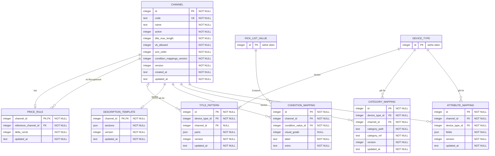

### 3.3 Katalog, Bestand, Kanal-Inhalte und Protokoll

**`model_template`** – Modellvorlage (REQ-008, REQ-010). Komponente `catalog`.

| Feld | Typ | Schlüssel | NULL | Regel |
| --- | --- | --- | --- | --- |
| `id` | INTEGER | PK | nein | – |
| `device_type_id` | INTEGER | FK | nein | → device_type |
| `manufacturer_id` | INTEGER | FK | nein | → manufacturer |
| `model_name` | TEXT | – | nein | 1–100 |
| `model_name_key` | TEXT | – | nein | Kleinschreibung ohne Leerzeichen (REQ-011) |
| `type_designation` | TEXT | – | ja | 0–50 |
| `mpn` | TEXT | – | ja | 1–40 Zeichen aus `A`–`Z`, `a`–`z`, `0`–`9`, `-`, `/`, `.`, ohne Leerzeichen am Rand (Kap. 2.4, v0.5.2); NULL genau dann, wenn mpn_unknown = 1 |
| `mpn_unknown` | INTEGER | – | nein | – |
| `original_ean` | TEXT | – | ja | 8 oder 13 Ziffern, Prüfziffer |
| `model_values` | TEXT (JSON) | – | nein | Objekt Merkmals-ID → Wert (Ebene model) |
| `default_device_values` | TEXT (JSON) | – | nein | Objekt Merkmals-ID → Vorbelegungswert (Ebene device) |
| `search_key` | TEXT | – | nein | normalisiert: Modellbezeichnung, Typbezeichnung, Herstellernummer; der Herstellername wird bei der Suche über manufacturer.name_key verbunden |
| `import_review_pending` | INTEGER | – | nein | nur REQ-056 (Could) |
| `import_review_keys` | TEXT (JSON) | – | nein | nur REQ-056 (Could) |
| `version` | INTEGER | – | nein | – |
| `created_at` | TEXT | – | nein | – |
| `updated_at` | TEXT | – | nein | – |

**`device`** – Gerät (REQ-012 bis REQ-021, REQ-084, REQ-092, REQ-093); wird nie gelöscht (REQ-103). Komponente `inventory`.

| Feld | Typ | Schlüssel | NULL | Regel |
| --- | --- | --- | --- | --- |
| `id` | INTEGER | PK | nein | – |
| `wi_nr` | TEXT | – | nein | 1–20, nur A–Z, a–z, 0–9 |
| `wi_nr_key` | TEXT | – | nein | Kleinschreibung; UNIQUE WHERE stock_status <> cancelled |
| `model_template_id` | INTEGER | FK | nein | → model_template |
| `listing_id` | INTEGER | FK | ja | → listing; NULL = nicht zugeordnet |
| `cancelled_from_listing_id` | INTEGER | FK | ja | → listing, ON DELETE SET NULL |
| `supplier_id` | INTEGER | FK | ja | → supplier |
| `condition_code` | TEXT | – | ja | wie erfasst, 1–20 |
| `condition_value_id` | INTEGER | FK | nein | → pick_list_value (Liste condition) |
| `visual_grade` | INTEGER | – | nein | 1–5 |
| `condition_description` | TEXT | – | nein | 0–1.000 |
| `device_values` | TEXT (JSON) | – | nein | Objekt Merkmals-ID → Wert (Ebene device) |
| `review_keys` | TEXT (JSON) | – | nein | Liste offener Prüfmarkierungen |
| `capture_status` | TEXT | – | nein | checked oder review_pending (abgeleitet) |
| `stock_status` | TEXT | – | nein | available, sold, cancelled |
| `sold_channel_id` | INTEGER | FK | ja | → channel; Pflicht bei sold |
| `sold_on` | TEXT | – | ja | YYYY-MM-DD; Pflicht bei sold |
| `cancel_reason` | TEXT | – | ja | 1–200; Pflicht bei cancelled |
| `cancelled_at` | TEXT | – | ja | – |
| `assigned_at` | TEXT | – | ja | Zeitpunkt der Zuordnung, Reihenfolge in {WI-Nr} |
| `captured_at` | TEXT | – | nein | ISO UTC |
| `captured_on` | TEXT | – | nein | YYYY-MM-DD Europe/Berlin |
| `version` | INTEGER | – | nein | – |
| `updated_at` | TEXT | – | nein | – |

**`listing`** – Modell-Inserat (REQ-019, REQ-088). Komponente `inventory`. `quantity`, `stock_json` und `stock_hash` sind ein **abgeleiteter Zwischenspeicher** für Filter und Sortierung, keine eigene Wahrheit: Nur CU-128 schreibt sie, in derselben Transaktion wie die Geräteänderung, immer aus den Geräten neu berechnet. Ein Invariantentest vergleicht nach jedem Integrationstest und beim Start (`integrity_check`-Zweig) die Spalten mit der Neuberechnung. Verfeinerung von Baseline Kap. 4 („nicht gespeichert, sondern abgeleitet“), FIND-221.

| Feld | Typ | Schlüssel | NULL | Regel |
| --- | --- | --- | --- | --- |
| `id` | INTEGER | PK | nein | – |
| `model_template_id` | INTEGER | FK | nein | → model_template |
| `condition_value_id` | INTEGER | FK | nein | → pick_list_value |
| `visual_grade` | INTEGER | – | nein | 1–5 |
| `condition_description` | TEXT | – | nein | 0–1.000 |
| `condition_description_key` | TEXT | – | nein | trim und Kleinschreibung, für die Vergleichsregel |
| `variant_values` | TEXT (JSON) | – | nein | Merkmals-ID → Wert, nur Variantenmerkmale |
| `other_device_values` | TEXT (JSON) | – | nein | übrige Gerätemerkmale ohne Akkukapazität |
| `article_number` | TEXT | – | nein | 1–30, A–Z a–z 0–9 - |
| `article_number_key` | TEXT | UK | nein | Kleinschreibung |
| `ean_mode` | TEXT | – | nein | original oder own |
| `own_ean` | TEXT | – | ja | Pflicht genau bei own |
| `display_title` | TEXT | – | nein | ungekürzter Titel nach Muster der Geräteart (abgeleitet) |
| `quantity` | INTEGER | – | nein | abgeleitet |
| `stock_json` | TEXT (JSON) | – | nein | { quantity, wiNrs, batteryText } (abgeleitet) |
| `stock_hash` | TEXT | – | nein | abgeleitet |
| `version` | INTEGER | – | nein | – |
| `created_at` | TEXT | – | nein | – |
| `updated_at` | TEXT | – | nein | auch bei Änderung eines Kanal-Inhalts gesetzt |

**`listing_delivery_scope`** – Lieferumfang eines Modell-Inserats (A-32). Komponente `inventory`.

| Feld | Typ | Schlüssel | NULL | Regel |
| --- | --- | --- | --- | --- |
| `listing_id` | INTEGER | PK, FK | nein | → listing, ON DELETE CASCADE |
| `text_block_id` | INTEGER | PK, FK | nein | → text_block (kind delivery_scope) |
| `position` | INTEGER | – | nein | – |

**`listing_price`** – Preis je Kanal (REQ-032, REQ-033). Komponente `inventory`.

| Feld | Typ | Schlüssel | NULL | Regel |
| --- | --- | --- | --- | --- |
| `listing_id` | INTEGER | PK, FK | nein | → listing, ON DELETE CASCADE |
| `channel_id` | INTEGER | PK, FK | nein | → channel |
| `amount_cents` | INTEGER | – | nein | > 0 |
| `vb` | INTEGER | – | nein | nur bei channel.vb_allowed |
| `source` | TEXT | – | nein | manual oder rule |

**`listing_photo`** – Foto eines Modell-Inserats in Reihenfolge (REQ-042). Komponente `media`.

| Feld | Typ | Schlüssel | NULL | Regel |
| --- | --- | --- | --- | --- |
| `id` | INTEGER | PK | nein | – |
| `listing_id` | INTEGER | FK | nein | → listing, ON DELETE CASCADE |
| `file_hash` | TEXT | FK | nein | → media_file |
| `original_name` | TEXT | – | nein | Dateiname beim Hochladen, 1–255 |
| `position` | INTEGER | – | nein | 1–20, lückenlos |
| `created_at` | TEXT | – | nein | – |

**`channel_content`** – Kanal-Inhalt (ADR-005, Requirements Kap. 9.4); eindeutig über (listing_id, channel_id). Komponente `listing-content`.

| Feld | Typ | Schlüssel | NULL | Regel |
| --- | --- | --- | --- | --- |
| `id` | INTEGER | PK | nein | – |
| `listing_id` | INTEGER | FK | nein | → listing, ON DELETE CASCADE |
| `channel_id` | INTEGER | FK | nein | → channel |
| `status` | TEXT | – | nein | draft, released, published, ended |
| `current_state` | TEXT (JSON) | – | nein | ContentState (Kap. 2.8.1) |
| `current_hash` | TEXT | – | nein | SHA-256 von current_state |
| `released_state` | TEXT (JSON) | – | ja | unveränderlich bis zur nächsten Freigabe |
| `released_hash` | TEXT | – | ja | – |
| `released_at` | TEXT | – | ja | – |
| `used_text_block_ids` | TEXT (JSON) | – | nein | nicht Teil des Hash |
| `manual_title` | TEXT | – | ja | 1 bis Höchstlänge |
| `manual_title_base_hash` | TEXT | – | ja | – |
| `manual_description` | TEXT | – | ja | 1–20.000 |
| `manual_description_base_hash` | TEXT | – | ja | – |
| `manual_category` | TEXT | – | ja | 1–255 |
| `flag_changed_since_release` | INTEGER | – | nein | **gespeicherter Zustand** (FIND-226): gesetzt durch eine Neubildung mit `current_hash ≠ released_hash`, entfernt nur durch Freigabe (Kap. 2.8.3; K-01, MAR-176); wird nie aus den Hashes neu berechnet |
| `flag_transfer_change` | INTEGER | – | nein | **gespeicherter Zustand**: gesetzt durch Freigabe eines Änderungsentwurfs im Status *Veröffentlicht*, entfernt durch Abgleich oder *Veröffentlicht* → *Beendet* (Kap. 2.8.3, 2.10) |
| `flag_adjust_stock` | INTEGER | – | nein | **gespeicherter Zustand**: gesetzt durch `StockChanged` im Status *Veröffentlicht* bei geändertem `stockHash`, entfernt nur durch Abgleich oder *Veröffentlicht* → *Beendet*; bleibt, wenn der Bestand zur Momentaufnahme zurückkehrt (Kap. 2.8.3, 2.10) |
| `flag_manual_text_review` | INTEGER | – | nein | **gespeicherter Zustand**: gesetzt durch eine Neubildung, die den Hash von `autoText` gegenüber `manual_…_base_hash` ändert, entfernt nur durch Verwerfen oder erneutes Speichern der Anpassung (Kap. 2.8.3) |
| `published_on` | TEXT | – | ja | YYYY-MM-DD |
| `external_ref` | TEXT | – | ja | 0–500 |
| `stock_snapshot` | TEXT (JSON) | – | ja | Bestand bei Veröffentlichung bzw. Abgleich |
| `stock_snapshot_hash` | TEXT | – | ja | – |
| `last_reconciled_at` | TEXT | – | ja | – |
| `version` | INTEGER | – | nein | – |
| `created_at` | TEXT | – | nein | – |
| `updated_at` | TEXT | – | nein | – |

**`audit_entry`** – Protokolleintrag (REQ-072); nur anhängen, Löschung nach 24 Monaten. Komponente `audit`.

| Feld | Typ | Schlüssel | NULL | Regel |
| --- | --- | --- | --- | --- |
| `id` | INTEGER | PK | nein | – |
| `occurred_at` | TEXT | – | nein | ISO UTC |
| `object_type` | TEXT | – | nein | Kap. 3.6 |
| `object_category` | TEXT | – | nein | settings, model_template, listing, channel_content, device, other |
| `object_id` | INTEGER | – | ja | ohne Fremdschlüssel (Baseline 4.3) |
| `object_label` | TEXT | – | nein | – |
| `action` | TEXT | – | nein | Kap. 3.6 |
| `old_value` | TEXT (JSON) | – | ja | – |
| `new_value` | TEXT (JSON) | – | ja | – |

**`app_meta`** – Schlüssel-Wert-Paare des Betriebs: `data_folder_stamp`, `engine_version`, `app_version`, `created_at`. Komponente `ops`, Repository CU-285.

| Feld | Typ | Schlüssel | NULL | Regel |
| --- | --- | --- | --- | --- |
| `key` | TEXT | PK | nein | Schlüssel |
| `value` | TEXT | – | nein | Wert |

**Datenmodell Katalog, Bestand, Kanal-Inhalte und Protokoll** – Welche Tabellen halten Modellvorlagen, Geräte, Modell-Inserate und Kanal-Inhalte? Bezugstabellen aus Kap. 3.1 und 3.2 sind nur mit Primärschlüssel gezeigt; `AUDIT_ENTRY` und `APP_META` haben bewusst keine Fremdschlüssel (Baseline 4.3).

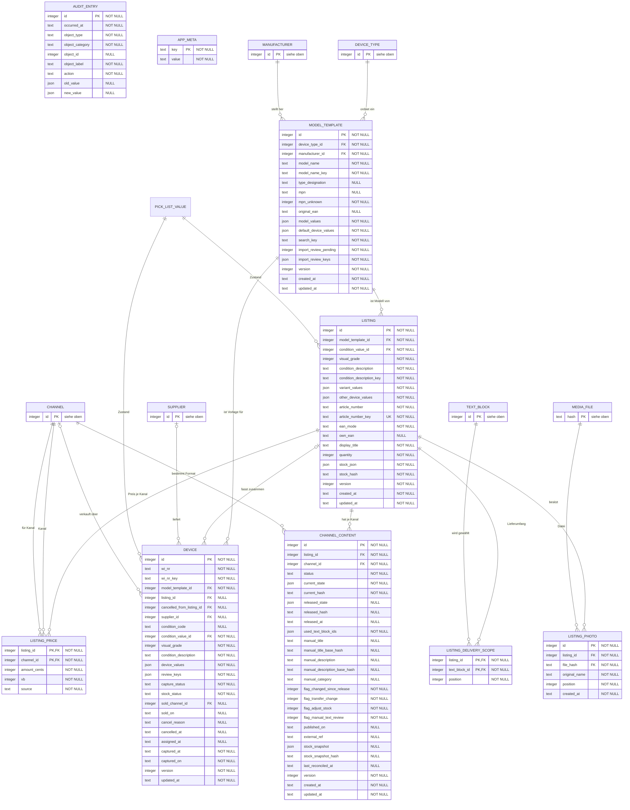

### 3.4 Aufbau der JSON-Spalten

Schemas in `packages/domain/src/schemas/`. Merkmalswerte tragen als Schlüssel die Merkmals-ID als Zeichenkette (Baseline 4.4); eine neue Geräteart oder ein neues Merkmal ändert die Datenbankstruktur nie (REQ-076).

| Spalte | Aufbau | Beispiel |
| --- | --- | --- |
| Merkmalswert je Datentyp (`model_values`, `default_device_values`, `device_values`, `variant_values`, `other_device_values`) | Merkmal ohne Wert: Schlüssel fehlt; Werte deaktivierter Merkmale bleiben gespeichert, bei `PATCH` sind die gesendeten Werte Änderungen (Kap. 2.5, Nachtrag MAR-605); `text`: Zeichenkette 1–200 ohne Randleerzeichen; `integer`: Zahl; `decimal`: kanonische Zeichenkette; `boolean`: `true`/`false`; `pick`: ID des Listenwerts; `ports`: Liste `{ count ≥ 1, typeId, positionId \| null }`; Rolle `battery_capacity`: `{ "percent": 0–100 }` oder `{ "notDeterminable": true }` | `{ "12": 16, "13": 512, "14": 7, "18": { "percent": 85 }, "21": "13.3", "30": [{ "count": 2, "typeId": 41, "positionId": null }] }` |
| `device.review_keys` | Liste von Merkmals-IDs als Zeichenkette sowie `condition`, `visualGrade` | `["12", "18", "visualGrade"]` |
| `title_pattern.parts` | Liste `{ kind: field\|attribute\|text, field?, attributeId?, text?, prefix, suffix, priority }`; `field` ∈ `manufacturer, modelName, typeDesignation, mpn, deviceType, articleNumber, ean, condition, visualGrade, conditionDescription` | `{ "kind": "attribute", "attributeId": 12, "prefix": ", ", "suffix": " RAM", "priority": 2 }` |
| `description_template.sections` | Liste `{ heading, deviceTypeIds[], lines[] }`; Zeile `{ kind: text, text }` (Platzhalter als `{Name}` im Text), `{ kind: textBlock, textBlockId }` oder `{ kind: textBlockKind, textBlockKind }` | `{ "heading": "Zustand", "deviceTypeIds": [], "lines": [{ "kind": "text", "text": "{Zustandsbezeichnung Kanal}" }] }` |
| `attribute_mapping.fields` | Liste `{ label, source, required, valueMap[], fixedText? }`; `source` = `{ kind: attribute, attributeId }` (Q-01) oder `{ kind: field, field }` mit `manufacturer, modelName, typeDesignation, mpn, deviceType` (Q-02), `ean` (Q-03), `articleNumber, condition, visualGrade, conditionDescription, deliveryScope` (Q-04), `conditionLabel, conditionExtra` (Q-05), `productId` (Q-06), `quantity, wiNrs` (Q-07) oder `{ kind: fixedText }` (Q-08); `valueMap[]` = `{ from, to }`, `from` vergleicht ohne Groß-/Kleinschreibung mit dem formatierten internen Wert | `{ "label": "Typ", "source": { "kind": "field", "field": "deviceType" }, "required": false, "valueMap": [{ "from": "Notebook", "to": "Laptop" }] }` |
| `datasheet_layout` | `header_labels`: Liste; `block_order`: Liste der sechs Blockcodes; `attribute_order`: Objekt Geräteart-ID → Liste von Merkmals-IDs | `{ "1": [3, 4, 12, 13] }` |
| `listing.stock_json`, `channel_content.stock_snapshot` | `{ quantity, wiNrs[], batteryText }` | `{ "quantity": 2, "wiNrs": ["626198", "626199"], "batteryText": "82–90 %" }` |
| `channel_content.current_state`, `released_state` | `ContentState` nach Kap. 2.8.1 | – |
| `audit_entry.old_value`, `new_value` | Objekt der geänderten Felder mit lesbaren Werten (Bezeichnungen statt IDs) | `{ "Optik-Note": 2 }` → `{ "Optik-Note": 4 }` |

### 3.5 Lebenszyklen

**Kanal-Inhalt, Feld `status`** (Frage: Welche Übergänge sind zulässig, und wodurch werden sie ausgelöst? Kennzeichnungen sind keine eigenen Zustände; ihre Regeln stehen in Kap. 2.8.3.)

```mermaid
stateDiagram-v2
  [*] --> draft: ListingCreated oder ChannelActivated
  draft --> released: POST release<br/>[Hash aktuell, Bedingungen erfüllt]
  released --> draft: Inhaltsangabe geändert<br/>[neuer Stand weicht ab]
  released --> published: POST status published
  published --> ended: POST status ended
  ended --> published: POST status published<br/>[nicht geändert seit Freigabe]
  draft --> [*]: DELETE listing
  released --> [*]: DELETE listing
  ended --> [*]: DELETE listing
```

Nicht zulässig: `draft` → `published`, `draft` → `ended`, `released` → `ended` (Kap. 2.10). Im Status `published` und `ended` führt eine Änderung nicht zu einem Statuswechsel, sondern zu einem Änderungsentwurf; `POST release` macht ihn zum freigegebenen Stand, ohne den Status zu ändern. Ein Kanal-Inhalt im Status `published` lässt sich nicht löschen (REQ-095).

**Gerät, Feld `stock_status`** (Frage: Welche Bestandsstatus kennt ein Gerät? Geräte werden nie gelöscht, REQ-103.)

```mermaid
stateDiagram-v2
  [*] --> available: POST devices
  available --> sold: POST sale<br/>[zugeordnet]
  sold --> available: POST sale-reversal
  available --> cancelled: POST cancellation<br/>[Grund angegeben]
```

`cancelled` ist endgültig (kein Zurücknehmen, REQ-093). Der Erfassungsstatus `capture_status` hat nur `review_pending` → `checked` (alle Prüfmarkierungen aufgehoben, REQ-013) und keinen Rückweg; dafür gibt es kein eigenes Diagramm. Die Zuordnung (`listing_id`) ist kein Status; sie ändert sich durch Zuordnen, Anlegen eines Modell-Inserats, Umbuchen und Storno (Kap. 2.6, 2.15).

**Textbaustein, Feld `legal_status`** (nur Arten *Rechtliches* und *Akku-Hinweis*, REQ-054)

```mermaid
stateDiagram-v2
  [*] --> unchecked: POST text-blocks
  unchecked --> checked: PATCH legal_status checked<br/>[Prüfdatum und prüfende Stelle]
  checked --> unchecked: PATCH body geändert
  checked --> unchecked: PATCH legal_status unchecked
```

**Betriebszustand von `resellr-server`** (Antwort von `GET /api/ops/health`, kein Datenbankfeld)

```mermaid
stateDiagram-v2
  [*] --> starting: Prozessstart durch die Überwachung
  starting --> ready: Startprüfung bestanden, Port gebunden
  starting --> [*]: Abbruch, Exit-Code 10 oder 11
  ready --> stopping: POST ops/shutdown
  stopping --> ready: Beenden gescheitert, 500
  stopping --> [*]: Beenden bestätigt, Exit-Code 0
```

### 3.6 Protokollierte Aktionen (REQ-072)

| Objektart (`object_type`) | Kategorie | Aktionen (`action`) |
| --- | --- | --- |
| `device_type`, `attribute`, `pick_list_value`, `manufacturer`, `supplier`, `condition_code`, `text_block`, `merchant_profile`, `datasheet_layout`, `channel`, `price_rule`, `title_pattern`, `description_template`, `condition_mappings`, `category_mapping`, `attribute_mapping` | `settings` | `created`, `updated`, `activated`, `deactivated`, `reordered`, `legal_status_changed`; `deleted` (Kategorie `other`) bei `condition_code`, `price_rule`, kanaleigenem `title_pattern` und `category_mapping`, also bei jedem DELETE-Endpunkt (REQ-072, FIND-220) |
| `model_template` | `model_template` | `created`, `updated`; `deleted` (Kategorie `other`) |
| `listing` | `listing` | `created`, `values_updated`, `deviation_confirmed` (REQ-088), `price_updated`, `photo_added`, `photo_removed`, `photos_reordered`; `deleted` (Kategorie `other`) |
| `channel_content` | `channel_content` | `manual_title_saved`, `manual_title_discarded`, `manual_description_saved`, `manual_description_discarded`, `manual_category_saved`, `manual_category_discarded`, `released`, `change_draft_released`, `status_changed`, `reconciled`; `unchecked_legal_confirmed` (Kategorie `other`, REQ-087) |
| `device` | `device` | `created`, `values_updated`, `assigned`, `assigned_despite_deviation` (REQ-018, REQ-014), `rebooked`, `sold`, `sale_reversed`, `cancelled`, `wi_nr_corrected` |

`old_value` und `new_value` enthalten die geänderten Felder; bei `assigned_despite_deviation` die Abweichungen, bei `sold`/`sale_reversed` Kanal und Datum, bei `wi_nr_corrected` alte und neue WI-Nr, bei `cancelled` den Grund. Beim Textbaustein steht der Geltungsbereich als ein Feld „Geltungsbereich“ mit Namen statt IDs (Kap. 2.2, Nachtrag MAR-773).

### 3.7 Indizes

| Tabelle | Index | Zweck |
| --- | --- | --- |
| `device` | `UNIQUE (wi_nr_key) WHERE stock_status <> 'cancelled'` | Eindeutigkeit der WI-Nr (REQ-012, REQ-093, Baseline 6.4 Auflage) |
| `device` | `(wi_nr_key)`, `(listing_id, stock_status)`, `(stock_status, listing_id, captured_at)` | Suche, Bestandsangaben, nicht zugeordnete Geräte |
| `model_template` | `(manufacturer_id, model_name_key)`, `(device_type_id)`, `(search_key)` | Dublette, Suche |
| `listing` | `UNIQUE (article_number_key)`, `(model_template_id)`, `(updated_at)` | Eindeutigkeit, Zuordnung, Sortierung |
| `channel_content` | `UNIQUE (listing_id, channel_id)`, `(status)`, `(flag_changed_since_release)`, `(flag_transfer_change)`, `(flag_adjust_stock)` | Filter der Übersicht |
| `listing_photo` | `(listing_id, position)`, `(file_hash)` | Reihenfolge, Verweisprüfung beim Aufräumen |
| `condition_code` | `UNIQUE (code_key, IFNULL(supplier_id, 0))` | REQ-022 |
| `title_pattern` | `UNIQUE (device_type_id, IFNULL(channel_id, 0))` | REQ-030 |
| `condition_mapping` | `UNIQUE (channel_id, condition_value_id, IFNULL(visual_grade, 0))` | REQ-023 |
| `category_mapping` | `UNIQUE (device_type_id, channel_id)` | REQ-024 |
| `attribute_mapping` | `UNIQUE (channel_id, device_type_id)` | REQ-025 |
| `attribute` | `UNIQUE (device_type_id, label_key)` | REQ-005 |
| `pick_list_value` | `UNIQUE (pick_list_id, label_key)` | REQ-007 |
| `audit_entry` | `(occurred_at)`, `(object_category, occurred_at)`, `(object_type, occurred_at)` | Filter, Löschfrist |

### 3.8 Migrationen

| Datei | Bauschritt | Inhalt |
| --- | --- | --- |
| `apps/server/src/db/migrations/20261110_0001_initial_schema.ts` | S1 (Walking Skeleton) | alle 29 Fachtabellen aus Kap. 3.1 bis 3.3, Indizes aus Kap. 3.7, `app_meta`-Wert `created_at`; `engine_version` schreibt CU-173 (FIND-201), `app_version` die Startprüfung |
| `apps/server/src/db/migrations/20261110_0002_seed_initial_settings.ts` | S2 | Startbelegung aus `packages/seed-data` (Kap. 2.1.1) einschließlich der Datensätze `merchant_profile` (leer) und `datasheet_layout` |

- Spätere Bauschritte von Release 0.1 brauchen **keine** Migration; das Datenmodell ist in S1 vollständig. Wird doch eine Schemaänderung nötig, ist sie eine Abweichung von dieser Specification (Kap. 4.7) und erhält eine neue Datei `YYYYMMDD_NNNN_<slug>.ts` mit der nächsten freien Nummer.
- Migrationen laufen beim Start in einer Transaktion über den eigenen Migrationslauf CU-029, nur vorwärts, nach der automatischen Kopie (Kap. 2.19, FIND-211). Sie ändern keine Dateien im `media-store` (Baseline 10.6). Die ausgelieferten Migrationen stehen statisch in `apps/server/src/db/migrations/index.ts` (CU-308); jede neue Migrationsdatei ergänzt dort eine Zeile (Nachtrag MAR-263).
- **Umbau-Migrationen (FIND-228):** Muss eine spätere Migration eine Tabelle umbauen, folgt sie dem SQLite-Verfahren „neue Tabelle anlegen, Daten kopieren, alte Tabelle mit `DROP TABLE` entfernen, neue umbenennen, Indizes neu anlegen“. Sie verlässt sich darauf, dass CU-029 die Fremdschlüssel während des Laufs ausschaltet und vor dem `COMMIT` mit `PRAGMA foreign_key_check` prüft; sie schaltet `foreign_keys` nicht selbst um. Jede solche Migration hat einen Integrationstest, der Zeilen in allen abhängigen Tabellen anlegt und nach der Migration unverändert vorfindet. **Kaskaden wirken im Migrationslauf nicht** (Hinweis 5.3 aus Review R3): Weil `foreign_keys` aus ist, löscht `ON DELETE CASCADE` keine abhängigen Zeilen. Eine Datenmigration, die etwas löschen will, löscht abhängige Zeilen selbst und ausdrücklich; sonst bricht `foreign_key_check` den Lauf ab.
- Eine Migration darf vor der ersten Auslieferung an den Owner noch geändert werden; danach sind ausgelieferte Migrationsdateien unveränderlich.

---

## 4. Code-Struktur

Diese Struktur ist verbindlich. Sie gilt für beide Entwickler, damit parallel keine Bausteine mit überschneidender Verantwortung entstehen. Neue Einheiten außerhalb dieser Karte entstehen nur über den Software Architect (Kap. 4.7). Das Repository enthält bisher nur Dokumentation; alle Einheiten sind neu.

### 4.1 Repository- und Ordnerstruktur

Verfeinert Baseline 12.1 (Vorschlag). Abweichung: Die Startbelegung liegt in einem eigenen Paket `packages/seed-data`, weil sie ausgeliefert wird; `packages/test-data` enthält nur synthetische Test- und Lastdaten. `packages/runtime-shared` ist neu, weil Server und Launcher Pfade, Exit-Codes, Referenznummern und Protokolldateien gleich behandeln müssen.

```text
resellr/
├─ package.json                 npm-Workspaces, Skripte
├─ tsconfig.base.json, eslint.config.mjs, .prettierrc, .nvmrc, vitest.config.ts, playwright.config.ts
├─ apps/
│  ├─ server/                   resellr-server (Node.js, Fastify)
│  │  ├─ src/
│  │  │  ├─ main.ts, app.ts
│  │  │  ├─ http/               Komponente http-api
│  │  │  ├─ db/                 Datenbank, Schema-Typen, Migrationen, Unit of Work
│  │  │  ├─ shared/             Uhr, Fehlerklassen, Ereignistypen
│  │  │  ├─ settings/  catalog/  inventory/  channels/  listing-content/
│  │  │  ├─ media/  datasheet/  audit/  ops/
│  │  │  └─ excel-import/  prestashop-export/      (nur Could)
│  │  ├─ assets/fonts/          Inter 4.1 TTF für das PDF
│  │  └─ test/                  Hilfen für Integrationstests
│  └─ web/                      web-ui (React, Vite)
│     └─ src/
│        ├─ main.tsx
│        ├─ app/                Router, Rahmen, Navigation, Query-Client
│        ├─ api/                API-Client und Hooks je Server-Komponente
│        ├─ components/ui/      shadcn/ui-Bausteine (im Repository, angepasst)
│        ├─ components/patterns/ Muster P-01 bis P-08
│        ├─ components/forms/   Formularbausteine
│        ├─ features/<bereich>/ Screens und ihre Teile
│        ├─ styles/             Tokens aus DESIGN.md, Tailwind
│        └─ assets/fonts/       Inter 4.1 woff2
├─ packages/
│  ├─ domain/                   gemeinsame Typen, Zod-Schemas, Fehlercodes, Meldungen, content-engine (ohne Ein-/Ausgabe)
│  ├─ runtime-shared/           Pfade, Exit-Codes, Referenznummer, Protokolldateien, Zustandsdateien
│  ├─ seed-data/                Startbelegung (REQ-006)
│  └─ test-data/                synthetische Daten für Demo, Tests, Last
├─ tools/
│  ├─ demo/                     npm run demo
│  ├─ launcher/                 resellr-launcher
│  ├─ launcher-pages/           LP-01 bis LP-03
│  ├─ packaging/                Installer, Node-Laufzeit, PE-Umstellung, Bündelung, Lizenzhinweise, Betriebshandbuch-PDF
│  ├─ qa/                       Prüfwerkzeuge der CI (AC-Abdeckung)
│  └─ loadtest/                 Last- und Antwortzeittests
├─ e2e/                         Playwright-Tests
├─ .github/workflows/           ci.yml, windows.yml, release.yml
└─ docs/                        Requirements, Baseline, Design, diese Specification, Betriebshandbuch
```

**Schichten im Server** (je Komponente): `<komponente>.routes.ts` (HTTP-Abbildung, Zod-Schemas der Anfrage, ruft genau einen Dienst) → `*-service.ts` (Anwendungsfall, Fachregeln, Transaktion, Ereignisse, Protokoll) → `*-repository.ts` (Kysely-Abfragen einer Tabellengruppe). Andere Komponenten lesen nur über die `*-reader.ts` der Komponente und melden Änderungen über Ereignisse (Baseline 2.4). Jede Komponente exportiert über `index.ts` nur ihren Reader, ihre Routen-Registrierung, ihre Ereignistypen und ihre Prüfereignis-Handler. **Ausnahmen (abschließend; FIND-202, FIND-203, FIND-227):** (1) `media` exportiert zusätzlich die Dateidienste CU-090 (Datei prüfen und ablegen), CU-208 (Foto-Übergabe), CU-209 (Foto-ZIP) und CU-307 (Aufräumen verwaister Dateien: `markUnreferenced(referencedHashes)`, `deleteOrphan(hash, isReferenced)`, `deleteUnknownFiles(limit)`); sie arbeiten nur auf Dateien und auf `media_file` und schreiben keine fremde Tabelle. (2) Betriebsaufgaben, die nur `ops` aufruft: `listing-content` exportiert `rebuildAll(uow)` aus CU-164 (alle Kanal-Inhalte neu bilden und fehlende anlegen; Aufrufer nur CU-173), `audit` exportiert die Löschfrist CU-234 (Aufrufer nur der Planer CU-250). Auch sie schreiben nur Tabellen ihrer eigenen Komponente. `ops` schreibt selbst keine Tabelle einer Fachkomponente; es entscheidet und ruft diese Funktionen auf. (3) Technischer Kern für Server-Einstieg und App-Zusammenbau (Nachtrag MAR-240): `http/index.ts` exportiert `registerHttpCore(app, deps)` (Zod-Anbindung, Sicherheitskopfzeilen, `local-guard`, Schreibsperre, Fehlerabbildung, statische Oberfläche; `local-guard` läuft vor der Schreibsperre; gibt die Schreibsperre für das Beenden zurück), `createFrameworkErrorHandler(errorLog)` für die Fastify-Option `frameworkErrors`, die Konstante `LISTEN_HOST` und die Typen `HttpCoreDeps` und `WriteGate`. `ops/index.ts` exportiert zusätzlich `createErrorLog` (CU-036), `createLifecycleState` (CU-038) mit ihren Typen und den Startablauf CU-040. Aufrufer dieser Exporte sind nur `main.ts`, `app.ts` und `apps/server/test`. (4) Protokollschreiber (Nachtrag MAR-285): `audit/index.ts` exportiert zusätzlich `createAuditWriter` (CU-035) mit den Typen `AuditWriter` und `AuditEntryInput`. Aufrufer sind die Dienste aller Komponenten, die eine protokollpflichtige Änderung nach Kap. 3.6 speichern (Kap. 2.0.4), und `apps/server/test`. Der Schreiber schreibt nur `audit_entry` und importiert keine andere Komponente. Die Einheiten von `http` erzeugen kein eigenes Fehlerprotokoll und keinen eigenen Betriebszustand; sie bekommen beide als Parameter und importieren aus `ops/index.ts` nur Typen. Ebenso bekommt das geordnete Beenden in `ops` (F-17) die Schreibsperre als Parameter und importiert aus `http/index.ts` nur den Typ `WriteGate`. `main.ts` darf `app.ts` importieren, nicht umgekehrt. `shared/` und `db/` dürfen alle nutzen. Jeder API-Pfad gehört genau einer Routen-Einheit (Spalte „Verantwortung“ der Routen-Einheiten in Kap. 4.4). `eslint-plugin-boundaries` erzwingt das; `packages/domain/src/content-engine` darf nichts importieren außer `packages/domain`.

### 4.2 Namenskonventionen

| Gegenstand | Konvention | Beispiel |
| --- | --- | --- |
| Dateien (TypeScript) | kebab-case, Rolle als Suffix | `assignment-service.ts`, `device-repository.ts`, `listing-content.routes.ts` |
| React-Komponenten | PascalCase, Datei = Komponente | `ChannelContentPage.tsx` |
| Dienste | Fabrikfunktion `create<Name>Service(deps)`, Rückgabe Objekt mit Methoden je Anwendungsfall | `createAssignmentService({ db, uow, clock })` |
| Repositories | `create<Name>Repository(db)` | `createDeviceRepository(db)` |
| Zod-Schemas | `<name>Schema`, Typ `type <Name> = z.infer<…>` | `deviceCreateSchema`, `DeviceCreate` |
| API-Hooks (Web) | `use<Ressource>Query`, `use<Aktion>Mutation` in `api/<komponente>.api.ts` | `useAssignDeviceMutation` |
| Query-Schlüssel | `['<komponente>', '<ressource>', id?]` aus `api/query-keys.ts` | `['inventory', 'listing', 9]` |
| Routen der Oberfläche | deutsch, kebab-case | `/inserate/:listingId/kanaele/:channelCode/kopieren` |
| API-Pfade | englisch, Plural, kebab-case | `/api/channel-contents/{id}/release` |
| Fehlercodes | `snake_case`, englisch | `wi_nr_taken` |
| Ereignisse | PascalCase, Vergangenheit | `ContentInputsChanged` |
| Tests | Unit/Integration neben der Datei: `*.test.ts`, `*.int.test.ts`; E2E `e2e/<flow>.spec.ts` | `compare-variants.test.ts`, `e2e/flow-02-einbuchen.spec.ts` |
| Migrationen | `YYYYMMDD_NNNN_<slug>.ts` | `20261110_0001_initial_schema.ts` |

**Routen der Oberfläche:** `/inserate` (UI-002), `/inserate/:listingId` (UI-014), `/inserate/:listingId/fotos` (UI-015), `/inserate/:listingId/kanaele/:channelCode` (UI-016), `/inserate/:listingId/vergleich` (UI-017), `/inserate/:listingId/kanaele/:channelCode/aenderungen` (UI-018), `/inserate/:listingId/kanaele/:channelCode/kopieren` (UI-019, `?ansicht=schmal`), `/geraete` (UI-009, `?reiter=nicht-zugeordnet`), `/geraete/neu` (UI-003), `/geraete/:deviceId` (UI-010), `/geraete/:deviceId/datenblatt` (UI-023), `/modelle` (UI-006), `/modelle/neu` und `/modelle/:modelTemplateId` (UI-007), `/protokoll` (UI-024), `/modelle/excel-uebernahme` (UI-042, nur mit REQ-056, CU-282; FIND-227), `/einstellungen/:bereich` (UI-025 bis UI-039; `bereich` ∈ `haendlermarke, geraetearten, auswahllisten, titelmuster, textbausteine, hersteller, lieferanten, code-uebersetzung, zustandszuordnung, kategoriezuordnung, merkmalszuordnung, beschreibungsvorlagen, kanaele, datenblatt-layout`), `/einstellungen` (UI-025, leitet mit `replace` auf `/einstellungen/<zuletzt genutzter Bereich>`, beim ersten Aufruf und bei einem ungültigen oder nicht lesbaren gespeicherten Wert auf `/einstellungen/haendlermarke`; Nachtrag MAR-354, MAR-355), `/beendet` (UI-046; ohne Beenden in diesem Fenster Weiterleitung mit `replace` auf `/`, nach dem Beenden leitet jede Route unter `/` mit `replace` hierher; Nachtrag MAR-510). `/` leitet nach `/inserate`. **Routen unter `/einstellungen` (Nachtrag MAR-354):** Kindrouten des Rahmens UI-025 (CU-093): die Index-Route und je Bereich genau eine statische Unterroute mit dem Pfad aus der Liste oben, keine Route mit Parameter `:bereich`. Die Unterrouten aller 14 Bereiche entstehen mit UI-025 (S2, #148); ein Bereich, dessen Screen noch fehlt, zeigt Rahmen, Navigation und Bereichsliste mit leerem Inhaltsbereich, ohne Text, ohne Weiterleitung und ohne Änderung der Adresse. Ein anderer Pfad unter `/einstellungen/` (z. B. `/einstellungen/zugangspasswort`, OD-02 A) fällt auf die Ersatzroute `*`. Dialoge sind Komponenten, keine Routen. **Ersatzroute `*` (Nachtrag MAR-245):** Jeder Pfad ohne eigene Route zeigt den Anwendungsrahmen mit Navigation und leerem Inhaltsbereich, ohne Text, ohne Weiterleitung und ohne Änderung der Adresse. Der Server liefert für jeden solchen Pfad `index.html` (Kap. 2.0.1); ohne Ersatzroute zeigte React Router seine eingebaute englische Fehlerseite ohne Rahmen und Navigation. Vor Release 0.1 trifft das Navigationseinträge, deren Screen noch nicht gebaut ist (Bereiche unter `/einstellungen` ab S2 nicht mehr, siehe oben); danach nur von Hand eingegebene oder veraltete Adressen. Ein gestalteter Zustand dafür fehlt (DG-18).

### 4.3 Bibliotheken und Versionen

Exakte Versionen legt das Lockfile im Walking Skeleton fest (neueste stabile Minor-Version der genannten Hauptversion am Tag des Aufsetzens). Die Lizenzen der Tabelle erlauben die Auslieferung (Baseline Kap. 3, „Kosten“). Geprüft wird das nicht nur hier, sondern bei jedem Release über alle ausgelieferten Pakete einschließlich transitiver Abhängigkeiten; das Paket enthält `THIRD-PARTY-NOTICES.txt` (CU-298, Kap. 2.19, FIND-222). libvips (LGPL-3.0-or-later) wird als unveränderte dynamische Bibliothek ausgeliefert; unter Windows liegt sie als DLLs in `lib/` des Pakets `@img/sharp-win32-x64`, nicht in einem eigenen `@img/sharp-libvips-*`-Paket. Die Texte von LGPL-3.0 und GPL-3.0 legt CU-298 bei, weil kein Paket sie mitbringt (Nachtrag MAR-687). Die übrigen in die DLLs gebauten Bibliotheken (z. B. cairo, freetype, libpng, libtiff, mozjpeg, zlib-ng) stehen unter freien Lizenzen, die nur in der DLL erlaubt sind; ihre Texte legt CU-298 aus `tools/packaging/licenses/libvips-libraries.json` bei (Nachtrag MAR-711).

| Zweck | Bibliothek | Hauptversion | Lizenz |
| --- | --- | --- | --- |
| Laufzeit | Node.js | 26 LTS (Active LTS seit Oktober 2026); Rückfall 24 LTS, falls für 26 keine vorkompilierten Pakete von `better-sqlite3` und `sharp` für Windows x64 vorliegen (S1 prüft das) | MIT |
| Sprache | TypeScript | 5.x | Apache-2.0 |
| HTTP | Fastify, `@fastify/multipart`, `@fastify/static`, `fastify-type-provider-zod` | 5.x | MIT |
| Validierung | Zod | 4.x | MIT |
| Datenbank | `better-sqlite3`, Kysely (nur Abfragen, nicht der `Migrator`, Kap. 2.19) | 12.x, 0.28.x | MIT |
| Bilder | `sharp` (libvips) | 0.35.x, mindestens 0.35.5 (Nachtrag MAR-719, vorher 0.34.x) | Apache-2.0; `@img/sharp-win32-x64` Apache-2.0 AND LGPL-3.0-or-later (libvips) |
| PDF | `pdfmake` | 0.2.x | MIT |
| ZIP | `yazl` | 3.x | MIT |
| Oberfläche | React, React DOM, React Router, TanStack Query, React Hook Form, `@hookform/resolvers` | 19.x, 7.x, 5.x, 7.x | MIT |
| Gestaltung | Tailwind CSS, shadcn/ui (Radix-Primitives), `lucide-react` | 4.x | MIT, ISC |
| Textdifferenz | `diff` (jsdiff) | 8.x | BSD-3-Clause |
| Build | Vite, esbuild | 7.x, 0.25.x | MIT |
| Tests | Vitest, Playwright (Kanal `chrome`) | 5.x (Nachtrag MAR-213, vorher 3.x), 1.x | MIT, Apache-2.0 |
| Komponententests (Test-Werkzeuge, nicht ausgeliefert; Nachtrag MAR-245) | `jsdom` (DOM-Umgebung von Vitest), `@testing-library/react`, `@testing-library/dom`, `@testing-library/user-event` (sobald ein Test Eingaben braucht) | 31.x, 16.x, 10.x, 14.x | MIT |
| Lint und Format (Build-Werkzeuge, nicht ausgeliefert; Nachtrag MAR-213) | ESLint, `@eslint/js`, `typescript-eslint`, `eslint-plugin-boundaries`, `eslint-import-resolver-typescript`, Prettier, `eslint-plugin-prettier`, `eslint-config-prettier` | 10.x, 10.x, 8.x, 7.x, 4.x, 3.x, 5.x, 10.x | MIT |
| Schrift | Inter | 4.1 (fest, Zeichenbreiten für UI-044) | OFL-1.1 |
| Installer | Inno Setup | 6.x (Build-Werkzeug, nicht ausgeliefert) | Inno-Setup-Lizenz (frei) |
| Betriebshandbuch-PDF (Build-Werkzeug, nicht ausgeliefert; Nachtrag MAR-599) | `marked` (Markdown → HTML); das PDF druckt Playwright (Kanal `chrome`) aus der Zeile „Tests“ | 18.x | MIT |
| Could | `exceljs` | 4.x | MIT |

**Zugehörige Pakete (Nachtrag MAR-245).** Ohne eigene Zeile zulässig sind (1) die Typdefinitionen `@types/<name>` einer Bibliothek der Tabelle in deren Hauptversion (z. B. `@types/react`, `@types/react-dom` 19.x; für Node.js die Typen der gewählten Laufzeit) und (2) offizielle Teilpakete einer Zeile, die das Projekt der Bibliothek selbst herausgibt: `@tailwindcss/vite` in der Hauptversion von Tailwind CSS, die Radix-Primitives `@radix-ui/react-*`, auf denen ein shadcn/ui-Baustein in `components/ui/` aufbaut. Für alles andere gilt die Hotspot-Regel von CU-001 (Kap. 4.5).

**Sicherheitshinweise der Abhängigkeiten (TH-07, Nachtrag MAR-213).** Die CI prüft in zwei Schritten: (1) `npm audit --omit=dev --audit-level=high` für alles, was ausgeliefert wird, ohne Ausnahme; (2) `npm audit --audit-level=high` für alle Abhängigkeiten einschließlich Test-, Lint- und Build-Werkzeugen, weil diese auf dem Entwicklerrechner und in der CI Code ausführen. Meldet Schritt (2) einen Befund ohne Fix innerhalb der hier genannten Hauptversion, entscheidet der Software Architect: Hauptversion in dieser Tabelle anheben (Nachtrag nach Kap. 4.7) oder befristete, im Änderungsprotokoll (Kap. 10.2) begründete Ausnahme. Meldet Schritt (1) einen solchen Befund, hebt der Software Architect die Hauptversion an (Nachtrag nach Kap. 4.7); eine Ausnahme gibt es dort nicht. Ändert die neue Hauptversion Lizenz, Komponenten oder freigegebenes Verhalten, ist das eine Architekturänderung (Nachtrag MAR-719). Befunde unterhalb `high` in Werkzeugen werden über die Dependabot-Vorschläge behoben, sobald ein Fix vorliegt.

### 4.4 Karte der Code-Einheiten

Je Bauschritt (Kap. 1.3) eine Tabelle. Alle Einheiten sind neu (das Repository enthält keinen Code). Eine Einheit, die in einem späteren Schritt erweitert wird, steht nur einmal, mit dem Hinweis „erweitert in Sx“. **Migration nötig** steht im Kopf jedes Schritts. Die Nummern sind feste Kennungen: In v0.2 ergänzte Einheiten (CU-285 bis CU-305) und in v0.3 ergänzte (CU-306, CU-307) stehen in dem Schritt, zu dem sie gehören; CU-090, CU-156, CU-162 und CU-211 haben in v0.2 Ort oder Verantwortung gewechselt, in v0.3 CU-088, CU-130, CU-167, CU-224 und CU-251 (Code-Struktur-Nachträge in Kap. 10.2). Mit Nachtrag MAR-773 stehen CU-142, CU-163 und CU-176 in S2 statt S5.

#### 4.4.0 Abhängigkeiten der Bauschritte (FIND-201)

Kein Schritt braucht eine Einheit eines späteren Schritts. Wo ein Schritt Daten eines späteren Schritts berührt, läuft das über Ereignisse ohne Handler (Kap. 2.0.4): Der Bericht ist leer bzw. die Prüfung bestanden, und das ist richtig, weil die Daten noch nicht existieren. Die Abnahme eines Schritts prüft nur, was in der Spalte „bis dahin gilt“ nicht ausgenommen ist.

| Schritt | hängt ab von | bis zu einem späteren Schritt gilt |
| --- | --- | --- |
| S1 | – | – |
| S2 | S1 | Kanäle stammen aus der Startbelegung (CU-160, CU-161 schon in S2); `GET /api/channels` liefert nur `id, code, name, active, sortOrder` (CU-142, CU-163, CU-176 schon in S2, bis S5; Nachtrag MAR-773); `impact` der Einstellungsantworten ist `{0, 0, 0}`, UI-043 zeigt nach UI-030 und UI-031 `.empty` (bis S5, CU-164; Kap. 2.2, Klärung QH-1); `VariantSetChanging` ohne Handler (bis S4, CU-290); Vorschau-Link in UI-039 deaktiviert, kein Aufruf von `GET /api/datasheets/preview-device` (bis S8, CU-306, CU-224, UI-023; FIND-227) |
| S3 | S1, S2 | `ModelTemplateDeviceTypeChanging` ohne Handler (bis S4), `ModelTemplateDeleting` ohne Handler (bis S9); UI-007 ohne Zeile „Verwendung“ (bis S4, CU-295) und ohne Hinweis zum Geltungsbereich (bis S5, CU-171) |
| S4 | S1 bis S3 | `ListingCreated`, `ContentInputsChanged`, `StockChanged` ohne Handler: keine Kanal-Inhalte, `adjustStockChannels` leer (bis S5; beim ersten Start mit S5 legt CU-173 die fehlenden Kanal-Inhalte an); kein Regelpreis (bis S5, CU-127); UI-014 ohne Kanal-Karten (bis S5) und ohne Fotos (bis S7) |
| S5 | S1 bis S4 | Fotos in `ContentInput` leer (bis S7, CU-287) |
| S6 | S5 | – |
| S7 | S5, S6 | – |
| S8 | S2, S4 | – (aktiviert den Vorschau-Link in UI-039) |
| S9 | S4 bis S6 | – |
| S10 | S1, S2, S4, S5, S7; F-17 (CU-245, CU-254 bis CU-257, CU-311, CU-312) nur S1 | F-17 darf nach S1 vorgezogen werden (Baseline 12.2). Der Rest von S10 braucht Reader späterer Schritte: CU-247 für Schritt 3 der Startprüfung (Fotodateien, CU-287 aus S7) und den Invariantentest der Bestandsspalten (CU-128, CU-129 aus S4); CU-251 und CU-307 die Verweise aus CU-287 (S7), CU-291 (S5, erweitert in S7) und CU-086 (S2); CU-234 nur die Tabelle aus S1 (FIND-227) |
| S11 | S4, S5 | – |

Zwei Entwickler können ab S2 parallel arbeiten, wenn sie Schritte ohne gegenseitige Abhängigkeit wählen, z. B. S3 neben dem vorgezogenen F-17 oder S8 neben S6.

#### S1 Walking Skeleton – Migration nötig: **ja** (`0001_initial_schema`)

| Nr. | Einheit | Ort | Verantwortung | Features |
| --- | --- | --- | --- | --- |
| CU-001 | Workspace-Wurzel | `package.json`, `tsconfig.base.json`, `.nvmrc`, `vitest.config.ts` | Workspaces, gemeinsame TypeScript-Optionen (strict), Node-Version, Skripte `build`, `test`, `e2e`, `lint`, `typecheck`, `demo`; Vitest-Projekte je Workspace über `test.projects` (Nachtrag MAR-213) | alle |
| CU-002 | Lint-Regeln | `eslint.config.mjs`, `.prettierrc` | Codeformat (Prettier, über ESLint geprüft), Importgrenzen zwischen Komponenten (Kap. 4.1) einschließlich `main.ts` → `app.ts` (nur diese Richtung; Nachtrag MAR-240) | alle |
| CU-003 | Linux-CI | `.github/workflows/ci.yml` | Lint, Typprüfung, Unit-, Integrations- und E2E-Tests unter Linux mit Google Chrome; `npm audit` in zwei Schritten (Kap. 4.3, TH-07); bei reinen Doku-Änderungen kein Lauf auf `main` und im PR nur die Diff-Prüfung (Nachtrag MAR-787) | alle |
| CU-004 | Demo-Start | `tools/demo/run-demo.ts` | `npm run demo`: bauen, temporären Datenordner anlegen, Server auf `127.0.0.1:${PORT:-4310}` starten, nach `ready` Beispieldaten über die HTTP-API einspielen (CU-061), erst danach die Adresse ausgeben (Baseline 11.3, Nachtrag MAR-305); die Startbelegung kommt erst mit S2 über CU-071 (FIND-223) | O5 |
| CU-005 | Laufzeitpfade | `packages/runtime-shared/src/paths.ts` | Pfade von Daten-, Protokoll-, Übergabe- und Update-Kopie-Ordner aus Umgebung bzw. `%LOCALAPPDATA%`; einzige Stelle für den Aufbau von `app\…` im Programmordner (Kap. 2.19): `programFolderPaths(programDir)` mit `appDir` (`app`), `serverEntry` (`app/server.mjs`), `launcherEntry` (`app/launcher.mjs`), `webRoot` (`app/web`) und `nativeModulesDir` (`app/node_modules`), gebildet mit `join` aus `node:path`; reicht `IS_BUNDLED` aus CU-313 unverändert weiter (`export { IS_BUNDLED } from './bundled.ts'`), Verwender importieren es weiter von hier. `launcher-pages` bleibt bei CU-310 (Nachtrag MAR-446, MAR-474) | F-19 |
| CU-006 | Exit-Codes | `packages/runtime-shared/src/exit-codes.ts` | Konstanten 0, 10, 11, 12 und ihre Bedeutung | F-18 |
| CU-007 | Referenznummer | `packages/runtime-shared/src/reference-number.ts` | Referenznummer erzeugen und prüfen (Kap. 2.0.5, H-11) | REQ-073 |
| CU-008 | Tagesprotokoll-Schreiber | `packages/runtime-shared/src/daily-jsonl-writer.ts` | JSON-Lines-Tagesdateien schreiben, älter als 30 Tage löschen | REQ-073 |
| CU-009 | Zustandsdateien | `packages/runtime-shared/src/runtime-state-files.ts` | `state.json`, `start-result.json` und `launcher-state.js` lesen und **atomar** schreiben (temporäre Datei im selben Ordner, `fsync`, Umbenennen; FIND-217); `launcher-state.js` mit einer Zeile je `request`, Lesen, Ändern und Schreiben unter der Sperrdatei `launcher-state.js.lock`, höchstens 20 Einträge, Anlegen einer leeren Datei, falls keine da ist (Nachtrag MAR-470) | F-18, F-19 |
| CU-309 | Port aus der Konfiguration | `packages/runtime-shared/src/configured-port.ts` | einzige Regel für `port` aus `config.json` (Kap. 2.19, FIND-266): Konstanten `CONFIG_FILE_NAME` und `DEFAULT_PORT` (4310), `parseConfigText(text)` (führendes BOM entfernen; JSON-Objekt oder `null`), `resolvePort(values)` und `readConfiguredPort(dataDir)` mit Ergebnis `{ port, problem }` (`problem`: `null`, `not_a_json_object` oder `invalid_port`; fehlende Datei → 4310 und `null`). Liest nur, schreibt nichts und protokolliert nichts. Aufrufer: CU-039 und der Launcher (CU-258). Entsteht in #112 mit CU-039 (Nachtrag MAR-296) | F-18, F-19 |
| CU-313 | Bündel-Kennung | `packages/runtime-shared/src/bundled.ts` | einzige Stelle für `declare const RESELLR_BUNDLED: boolean \| undefined` und `IS_BUNDLED = typeof RESELLR_BUNDLED !== 'undefined' && RESELLR_BUNDLED === true` (wahr nur im Bündel, Konstante aus CU-276); **ohne jeden Import**, sonst setzt esbuild `IS_BUNDLED` nicht ein und die Quellbaum-Pfade bleiben im Bündel (Prüfung von CU-276). Nach außen nur über CU-005 (Nachtrag MAR-474) | F-19 |
| CU-010 | Fehlercodes | `packages/domain/src/errors/error-codes.ts` | Liste aller Fehlercodes mit HTTP-Status (Kap. 2.0.6), erweitert je Schritt | alle |
| CU-011 | Fehlerantwort | `packages/domain/src/errors/error-response.ts` | Zod-Schema und Typ der Fehlerantwort (Kap. 2.0.5) | alle |
| CU-012 | Meldungskatalog | `packages/domain/src/messages/messages.de.ts` | alle deutschen Meldungen und festen Texte (inkl. REQ-104, REQ-105), erweitert je Schritt; Wortlaut der Schlüssel M-01 bis M-22 und M-24 bis M-32 (M-25 bis M-31 seit v0.5.2, M-32 seit v0.5.3) und der übrigen Zeilen nach Tabelle „Meldungstexte“ (Kap. 8.2); **kein** Sammeltext für `validation_failed`, M-23 entfallen (K-07) | REQ-073, REQ-078 |
| CU-013 | Dezimal-Eingabe | `packages/domain/src/format/parse-decimal.ts` | Komma oder Punkt in kanonische Dezimalzeichenkette, keine Datumserkennung | REQ-005 |
| CU-014 | Ausgabeformate | `packages/domain/src/format/format-value.ts` | Geld, Zahl, Einheit, Ja/Nein, Datum de-DE (Kap. 2.8.2) | REQ-078 |
| CU-015 | Schlüssel-Normalisierung | `packages/domain/src/text/normalize-key.ts` | `toKey` (NFC, Kleinschreibung, trim) und `toModelNameKey` (ohne Leerzeichen) | REQ-004, REQ-011 |
| CU-016 | EAN-Prüfung | `packages/domain/src/validation/ean.ts` | GTIN-8/13 mit GS1-Prüfziffer | REQ-008, REQ-088 |
| CU-017 | Grundschemas | `packages/domain/src/schemas/common.schema.ts` | ID, Version, Datum, Zeitpunkt, Cent, Listenantwort | alle |
| CU-018 | Server-Einstieg | `apps/server/src/main.ts` | Pfade lesen, Startablauf aufrufen, Prozesssignale: `SIGINT`/`SIGTERM` → Zustand `stopping`, `close()` von CU-040, Exit-Code 0; kein geordnetes Beenden nach Kap. 2.17. Die Handler werden vor dem Startablauf registriert; ein Signal während des Starts wird gemerkt und erst nach dem Startablauf ausgeführt (`ready` → wie oben, `aborted` → Exit-Code 10 unverändert; Nachtrag MAR-439). Ungültiger Wert von `--test-clock` → Meldung auf stderr, Exit-Code 10 vor dem Startablauf (Nachtrag MAR-424). Web-Wurzel: mit `IS_BUNDLED` `programFolderPaths(programDir).webRoot` aus CU-005 (`programDir` = Ordner von `process.execPath`), sonst `apps/web/dist` relativ zum Quellbaum (Nachtrag MAR-446) | F-19 |
| CU-019 | App-Zusammenbau | `apps/server/src/app.ts` | Fastify-Instanz bauen, Plugins und Routen aller Komponenten registrieren (Hotspot); Handler-Tabellen von CU-169 und CU-290 für die Unit of Work zusammenführen (Nachtrag MAR-263) | alle |
| CU-020 | Bindeadresse | `apps/server/src/http/listen-address.ts` | feste Adresse `127.0.0.1` (ADR-002) | REQ-001 |
| CU-021 | `local-guard` | `apps/server/src/http/local-guard.ts` | Regeln G-1 bis G-6; `OPTIONS` → `405 method_not_allowed` (Nachtrag MAR-240) | TH-02 |
| CU-022 | Sicherheitskopfzeilen | `apps/server/src/http/security-headers.ts` | CSP und weitere Kopfzeilen (Kap. 2.0.2) | TH-03, TH-06 |
| CU-023 | Fehlerabbildung | `apps/server/src/http/error-mapper.ts` | Fehlerklassen → Fehlerantwort; technische Fehler ins Fehlerprotokoll mit Referenznummer; `bad_request` als Warnung ohne Referenznummer, auch für Fehler vor dem Routing (`frameworkErrors`; Nachtrag MAR-240) und für `BadRequestError` aus einem Dienst (Nachtrag MAR-543) | REQ-073 |
| CU-024 | Schreibsperre | `apps/server/src/http/write-gate.ts` | laufende Schreibanfragen zählen, im Zustand `stopping` ablehnen | REQ-105 |
| CU-025 | Statische Oberfläche | `apps/server/src/http/static-web.ts` | `web-ui` und `/assets` ausliefern, History-Fallback | ADR-001 |
| CU-026 | Zod-Anbindung | `apps/server/src/http/zod-validation.ts` | Zod-Schemas als Fastify-Validierung; je `path` nur die erste Meldung in `fields[]` (Kap. 2.0.5, v0.5.2); Abgrenzung `bad_request`/`validation_failed` und `fields[].code` (Kap. 2.0.5, Nachtrag MAR-240) | Baseline 9.2 |
| CU-027 | Datenbankzugang | `apps/server/src/db/database.ts` | SQLite öffnen, Pragmas, Kysely-Instanz | ADR-004 |
| CU-028 | Schema-Typen | `apps/server/src/db/schema.ts` | Kysely-Typen aller 29 Fachtabellen (einschließlich `media_file.unreferenced_since`, ohne Vormerk-Tabelle) und der Verwaltungstabelle `app_migration` | Kap. 3 |
| CU-029 | Migrationslauf | `apps/server/src/db/migrator.ts` | offene Migrationen in **einer** Transaktion über `better-sqlite3` (`foreign_keys = OFF`, `BEGIN IMMEDIATE` … `foreign_key_check`, `COMMIT`, `foreign_keys = ON`), Eintrag in `app_migration`; nicht der Kysely-`Migrator` (Kap. 2.19, FIND-211, FIND-228); legt `app_migration` an, bekommt die Liste der Migrationen als Parameter, wirft nach dem `ROLLBACK` `MigrationError` (Nachtrag MAR-263) | F-19 |
| CU-030 | Initialmigration | `apps/server/src/db/migrations/20261110_0001_initial_schema.ts` | alle Tabellen und Indizes (Kap. 3.8) | Kap. 3 |
| CU-308 | Migrationsliste | `apps/server/src/db/migrations/index.ts` | statische Liste `migrations` aller ausgelieferten Migrationen (Kap. 3.8), die der Startablauf an CU-029 gibt; je Migration eine Zeile (Hotspot, Kap. 4.5). Entsteht mit CU-030 (Nachtrag MAR-263) | Kap. 3.8 |
| CU-285 | Betriebswerte-Repository | `apps/server/src/db/app-meta-repository.ts` | Abfragen auf `app_meta` (`data_folder_stamp`, `engine_version`, `app_version`) (FIND-202) | F-19 |
| CU-031 | Unit of Work | `apps/server/src/db/unit-of-work.ts` | Transaktion je Aktion, Ereignisse sammeln und vor dem Commit an Handler geben; Bericht `ChangeReport` zusammenführen (Kap. 2.0.4, Nachtrag MAR-263) | Baseline 9.3 |
| CU-032 | Uhr | `apps/server/src/shared/clock.ts` | aktuelle Zeit und „heute“ in Europe/Berlin; Testuhr nur mit `--test-clock` (ab dem Startzeitpunkt) oder `--test-clock=<Zeitpunkt>` (ISO 8601 mit `Z` oder Versatz, z. B. `2027-12-14T10:00:00.000Z`; läuft ab diesem Zeitpunkt weiter); `createClockFromArgs(argv)` lehnt einen Wert ab, der kein gültiger Zeitpunkt in dieser Schreibweise ist, auch ein nicht existierendes Kalenderdatum wie `2027-02-30` (Nachtrag MAR-424) | REQ-078, REQ-072 |
| CU-033 | Fehlerklassen | `apps/server/src/shared/domain-error.ts` | `ValidationError`, `RuleViolation`, `ConflictError`, `NotFoundError`, `ConfirmationRequired`, `ShuttingDownError`; `BadRequestError` für Strukturfehler, die ein Dienst erst am gespeicherten Stand erkennt, mit einem Grund nur aus Feldnamen und Regelcode, ohne Werte (Nachtrag MAR-543) | alle |
| CU-034 | Ereignistypen | `apps/server/src/shared/events.ts` | Änderungsereignisse `ListingCreated`, `ContentInputsChanged`, `SettingsChanged`, `ChannelActivated`, `StockChanged` und Prüfereignisse `VariantSetChanging`, `ModelTemplateDeviceTypeChanging`, `ModelTemplateDeleting`, `ListingDeleting` (Kap. 2.8.3, Hotspot) | F-08 |
| CU-035 | Protokollschreiber | `apps/server/src/audit/audit-writer.ts` | einzige Stelle, die Einträge in `audit_entry` **einfügt**; gelöscht wird nur durch die Löschfrist CU-234 (FIND-203). `createAuditWriter({ db, clock })` mit `db` = `tx.db` der Aktion, erzeugt in der Aktion; `write(entry)` setzt `occurred_at` über `clock` und leitet `object_category` aus Kap. 3.6 ab (`deleted` und `unchecked_legal_confirmed` → `other`, sonst die Kategorie der Objektart). Export über `audit/index.ts` (Kap. 4.1, Ausnahme 4; Nachtrag MAR-285) | REQ-072 |
| CU-036 | Fehlerprotokoll | `apps/server/src/ops/error-log.ts` | Einträge ins Fehlerprotokoll ohne Feldwerte | REQ-073 |
| CU-037 | Betriebsprotokoll | `apps/server/src/ops/operations-log.ts` | Betriebsereignisse des Servers | REQ-065, Baseline 10.7 |
| CU-038 | Betriebszustand | `apps/server/src/ops/lifecycle-state.ts` | Zustand `starting`/`ready`/`stopping` | F-17 |
| CU-039 | Konfigurationsdatei | `apps/server/src/ops/config-file.ts` | `config.json` lesen, mit Standardwerten anlegen, `handoverDir` nach Kap. 2.19 prüfen (FIND-212); JSON-Objekt und `port` über `parseConfigText` und `resolvePort` aus CU-309, ohne eigene Prüfung; Warnung `config_invalid` ins Betriebsprotokoll (FIND-266, Nachtrag MAR-296) | F-19 |
| CU-040 | Startablauf | `apps/server/src/ops/startup.ts` | Reihenfolge des Starts (Kap. 2.19); gibt CU-308 an CU-029; in S1 ohne Startprüfung, erweitert in S5 und S10 (S10: `MigrationError` → Abbruch, Nachtrag MAR-263); `close()` begrenzt: keine neuen Verbindungen, nach 2 s alle offenen Verbindungen trennen, dann Datenbank schließen (Nachtrag MAR-424) | F-19 |
| CU-041 | Ops-Routen | `apps/server/src/ops/ops.routes.ts` | `GET /api/ops/health`, `GET /api/ops/status`; erweitert in S10 um `POST /api/ops/shutdown` | F-17 |
| CU-042 | Web-Einstieg | `apps/web/src/main.tsx` | React starten, Provider | – |
| CU-043 | Router | `apps/web/src/app/router.tsx` | alle Routen (Kap. 4.2), Hotspot; jede Route ergänzt die Task, die ihren Screen anlegt (S1: `/` und `/inserate`); Ausnahme Bereiche unter `/einstellungen`: alle 14 Unterrouten legt die Task von UI-025 an (S2, #148), die Task eines Bereichs-Screens setzt nur `element` ihrer Unterroute (Kap. 4.2, Nachtrag MAR-354); Ersatzroute `*` als letzter Eintrag unter dem Rahmen (Kap. 4.2, Nachtrag MAR-245) | alle |
| CU-044 | Anwendungsrahmen | `apps/web/src/app/AppFrame.tsx` | Rahmen mit Navigationsspalte (Kopf fest, Bereich mit Einträgen und UI-044 scrollt bei wenig Höhe, Kap. 2.17), Inhaltsbereich; P-06 (CU-053) als erstes Element des Inhaltsbereichs vor `<Outlet />`, solange `useOpsStatusQuery()` (CU-050) mit `unreachable` endet (Nachtrag MAR-395); danach, ebenfalls vor `<Outlet />`, der Ausgang des Beendens (CU-312, Nachtrag MAR-421); hat dieses Fenster resellr beendet (`isAppTerminated()`, CU-257), statt des Rahmens Weiterleitung mit `replace` nach `/beendet`, für alle Routen unter `/` einschließlich UI-019 (Nachtrag MAR-510) | Design Kap. 3 |
| CU-045 | Navigation | `apps/web/src/app/Navigation.tsx` | sechs Einträge der linken Spalte, 28 px | Design Kap. 3 |
| CU-046 | Query-Client | `apps/web/src/app/query-client.ts` | TanStack-Query-Einstellungen (5 s, Fokus-Neuladen außer `copy-view`, keine Wiederholung) | Kap. 2.0.8 |
| CU-047 | API-Client | `apps/web/src/api/api-client.ts` | `fetch`-Hülle, Zeitgrenzen, Einordnung der Antwort in Zustände (Kap. 2.0.7) | alle |
| CU-048 | Query-Schlüssel | `apps/web/src/api/query-keys.ts` | alle Query-Schlüssel (Hotspot) | alle |
| CU-049 | Sperre nach unbekanntem Ausgang | `apps/web/src/api/write-outcome-store.ts` | Zustand „gesperrt bis Neuladen“ der Seite (P-08) | K-6 |
| CU-050 | Ops-API | `apps/web/src/api/ops.api.ts` | Hooks für Status, Health und Beenden | F-17 |
| CU-051 | Seitenbanner | `apps/web/src/components/patterns/PageBanner.tsx` | Erfolgs- und Fehlerbanner mit Referenznummer; einzelnes Banner ohne Zuordnung von Fehlerklassen, die liegt in CU-314 (Nachtrag MAR-555) | REQ-073 |
| CU-052 | Konfliktbanner | `apps/web/src/components/patterns/ConflictBanner.tsx` | P-05 mit „Neu laden“ (nur Daten) | P-05 |
| CU-053 | Banner nicht erreichbar | `apps/web/src/components/patterns/UnreachableBanner.tsx` | P-06 mit „Erneut versuchen“; ohne `alwaysShow` zeigt es nichts, solange der Rahmen P-06 zeigt; `alwaysShow` nur im Rahmen (CU-044) und in modalen Dialogen (Nachtrag MAR-395) | P-06 |
| CU-054 | Banner wird beendet | `apps/web/src/components/patterns/ShuttingDownBanner.tsx` | P-07 | P-07 |
| CU-055 | Banner Ausgang unbekannt | `apps/web/src/components/patterns/OutcomeUnknownBanner.tsx` | P-08 | P-08 |
| CU-314 | Banner nach dem Speichern | `apps/web/src/components/patterns/SaveNoticeBanners.tsx` | Typ `SaveNotice`, `noticeOf(error)` (Fehlerklasse ohne Feldbezug → Banner, Kap. 2.0.7) und `SaveNoticeBanners` (zeigt `.success`/`.error` über CU-051, P-05 über CU-052, P-07 über CU-054, `not_found` als Banner M-15). Feldfehler ordnet der Screen selbst zu. Aufrufer: CU-098, CU-115; CU-095, CU-096, CU-099 mit dem Nachzug FIND-324 (Nachtrag MAR-555) | Kap. 2.0.7 |
| CU-315 | Statusschalter | `apps/web/src/components/forms/StatusSwitch.tsx` | Schalter „Status“ aktiv/deaktiviert der Pflegelisten (P-01), Beschriftungen vom Screen. Entsteht erst mit dem Nachzug FIND-324; Aufrufer dann CU-095, CU-096, CU-099 (Nachtrag MAR-555) | UI-027, UI-028, UI-032 |
| CU-056 | Bestätigungsdialog | `apps/web/src/components/patterns/ConfirmDialog.tsx` | P-04 | P-04 |
| CU-057 | Formularfeld | `apps/web/src/components/forms/FormField.tsx` | Label, Pflichtkennzeichen, Fehlertext, Fokus auf ersten Fehler (`useFocusFirstError`), Prüfung beim Verlassen des Felds, die während eines Klicks im Formular bis nach dem Klick wartet (`useDeferredBlurCheck`, Nachtrag MAR-555) | Design Kap. 5 |
| CU-058 | UI-Bausteine | `apps/web/src/components/ui/*` | shadcn/ui-Bausteine (Button, Dialog, Input, Select, Checkbox, RadioGroup, Table, Tabs, Toast, Tooltip, Badge, Sheet), an Tokens angepasst; `Select`, `Checkbox` und `RadioGroup` als native Elemente ohne Radix, je eine Datei `Select.tsx`, `Checkbox.tsx`, `RadioGroup.tsx` (Nachtrag MAR-572); `Dialog` mit Breiten- und Höhenregel, `Table` mit eigenem waagrechten Scrollbereich und fester erster Spalte, `Sheet` für Seitenpanels unterhalb von `full` (Kap. 2.0.10) | DESIGN.md |
| CU-059 | Design-Tokens | `apps/web/src/styles/tokens.css`, `tailwind.css` | Farben, Typografie, Radien, Abstände aus `DESIGN.md` als CSS-Variablen und Tailwind-Theme; Bruchstelle `full` (1366 px, Kap. 2.0.10) | DESIGN.md |
| CU-060 | Schriftdateien | `apps/web/src/assets/fonts/` | Inter 4.1 woff2 (Regular, Semibold), lokal gebündelt | REQ-079 |
| CU-061 | Demo-Daten | `packages/test-data/src/demo-seed.ts` | synthetische, deterministische Beispieldaten für `npm run demo`, erweitert in jedem Schritt (Hotspot); eingespielt nur über die HTTP-API des laufenden Servers: `createDemoApi(baseUrl)` und `seedDemoData(api)`, das die Funktionen `seed<Bereich>(api)` in Schrittreihenfolge aufruft (Nachtrag MAR-305) | O5 |
| CU-062 | E2E-Grundlage | `playwright.config.ts`, `e2e/fixtures/app-fixture.ts`, `e2e/fixtures/reachability.ts` | Server je Test-Worker mit eigenem Datenordner starten, in der CI zwei Worker (Nachtrag MAR-787); ein Playwright-Projekt je Zeile der Fenstergrößen-Matrix FM-1 bis FM-7; Erreichbarkeitsprüfung je Screen; Testdaten `copy-view-few-fields` (9 Felder) und `copy-view-many-fields` (18 Felder) für die Lage des Streifens in UI-019 schmal (Kap. 6.3, FIND-235) | Kap. 6 |
| CU-284 | AC-Abdeckungsprüfung | `tools/qa/check-ac-coverage.mjs` | prüft in der CI, dass jede AC-REQ-ID der **abgeschlossenen** Schritte (CU-299) in mindestens einem Testtitel steht, und zwar am **Anfang** des Titels (Kap. 6.2, FIND-223, Nachtrag MAR-305) | Kap. 6 |
| CU-299 | AC-Schrittliste | `tools/qa/ac-steps.json` | Zuordnung jeder AC-REQ-ID zu ihrem Bauschritt und Liste der abgeschlossenen Schritte; jeder Schritt trägt seine AC-REQ-IDs spätestens bei seiner Abnahme ein, bei der Abnahme von S10 enthält die Datei jede AC-REQ-ID nach Kap. 6.2 (Nachtrag MAR-305) | Kap. 6 |

#### S2 Grundeinstellungen – Migration nötig: **ja** (`0002_seed_initial_settings`, nur Daten)

| Nr. | Einheit | Ort | Verantwortung | Features |
| --- | --- | --- | --- | --- |
| CU-063 | Schemas Gerätearten und Merkmale | `packages/domain/src/schemas/device-type.schema.ts`, `attribute.schema.ts` | Anfrage- und Antwortschemas, Feldregeln | F-01 |
| CU-064 | Schemas Auswahllisten | `packages/domain/src/schemas/pick-list.schema.ts` | Liste, Wert, `batteryPresent` | F-01 |
| CU-065 | Schemas Hersteller, Lieferant, Code | `packages/domain/src/schemas/manufacturer.schema.ts`, `supplier.schema.ts`, `condition-code.schema.ts` | Felder und GPSR-Regeln | F-02 |
| CU-066 | Schemas Textbaustein, Händler, Layout | `packages/domain/src/schemas/text-block.schema.ts`, `merchant-profile.schema.ts`, `datasheet-layout.schema.ts` | Felder, Prüfstatus; Geltungsbereich des Textbausteins mit Struktur- und Feldregel (Kap. 2.2, Nachtrag MAR-773) | F-02 |
| CU-067 | Merkmalswerte-Schema | `packages/domain/src/schemas/attribute-values.schema.ts` | Zod-Schema zur Laufzeit aus Merkmalsdefinitionen (je Ebene, Pflicht, Typ, Bereich, Rollen); Pflicht nur für aktive Merkmale; Werte deaktivierter Merkmale nur auf die Struktur ihres gespeicherten Formats (Kap. 3.4) geprüft, ohne Pflicht, Bereich und Auswahlliste der aktuellen Definition (FIND-350); `battery_capacity` Pflicht nur bei aktivem Merkmal und gewähltem Akku-Wert mit `batteryPresent` (FIND-353); dazu `mergeAttributeValues(stored, changes)`, die einzige Umsetzung der Änderungsregel bei `PATCH` (Schlüssel überschreibt, `null` entfernt, fehlender Schlüssel bleibt; Kap. 2.5, Nachtrag MAR-605) | REQ-005, REQ-014, REQ-076 |
| CU-068 | Platzhalterkatalog | `packages/domain/src/placeholders/placeholder-catalog.ts` | Platzhalter und ihre Zulässigkeit je Verwendung (Requirements Kap. 9.7); einzige Liste der festen Platzhalternamen, auch für die Merkmalsbezeichnung (M-04, Kap. 2.1; entsteht mit #151, die Zulässigkeit je Verwendung ergänzen die Platzhalter-Issues, Nachtrag MAR-543) | REQ-005, REQ-023, REQ-026, REQ-030, REQ-031 |
| CU-069 | Platzhalter-Parser | `packages/domain/src/placeholders/parse-placeholders.ts` | `{…}` in Texten finden und gegen den Katalog prüfen | wie CU-068 |
| CU-070 | Startbelegung | `packages/seed-data/src/initial-settings.ts` | Daten der Startbelegung (Kap. 2.1.1) | REQ-006 |
| CU-119 | Vergleichsregel | `packages/domain/src/inventory/compare-variants.ts` | Abweichungen der Variantenangaben (Kap. 2.6); verglichen werden aktive **und** deaktivierte Variantenmerkmale (K-03); in S2, weil reine Funktion ohne Abhängigkeit (FIND-201) | REQ-005, REQ-014, REQ-018, REQ-019, REQ-088 |
| CU-071 | Seed-Migration | `apps/server/src/db/migrations/20261110_0002_seed_initial_settings.ts` | Startbelegung einmalig einspielen | REQ-006 |
| CU-072 | Gerätearten-Dienst | `apps/server/src/settings/device-type-service.ts` | Gerätearten und Merkmale anlegen, ändern, ordnen, deaktivieren; Merkmale wieder aktivieren (Nachtrag MAR-605) | REQ-004, REQ-005 |
| CU-073 | Gerätearten-Repository | `apps/server/src/settings/device-type-repository.ts` | Abfragen auf `device_type`, `attribute` | F-01 |
| CU-074 | Merkmalsverwendung | `apps/server/src/settings/attribute-usage-query.ts` | `hasValues` je Merkmal über alle JSON-Spalten | REQ-005 |
| CU-075 | Variantenmengen-Prüfung | `apps/server/src/settings/variant-flag-guard.ts` | erkennt, dass das Entfernen des Kennzeichens „variantenbildend“ die Menge der Variantenmerkmale einer Geräteart verkleinert, und meldet `VariantSetChanging`; Deaktivieren und Aktivieren eines Merkmals ändern die Menge nicht und lösen nichts aus (K-03); den Vergleich der Modell-Inserate macht CU-290 | REQ-005 |
| CU-076 | Auswahllisten-Dienst | `apps/server/src/settings/pick-list-service.ts` | Werte anlegen, umbenennen, ordnen, deaktivieren | REQ-007 |
| CU-077 | Auswahllisten-Repository | `apps/server/src/settings/pick-list-repository.ts` | Abfragen auf `pick_list`, `pick_list_value` | REQ-007 |
| CU-078 | Hersteller-Dienst | `apps/server/src/settings/manufacturer-service.ts` | Hersteller anlegen (inkl. „vorhanden“), umbenennen, deaktivieren, GPSR | REQ-027, REQ-100, REQ-101 |
| CU-079 | Hersteller-Repository | `apps/server/src/settings/manufacturer-repository.ts` | Abfragen auf `manufacturer` | F-02 |
| CU-080 | Lieferanten-Dienst | `apps/server/src/settings/supplier-service.ts` | Lieferanten pflegen | REQ-099 |
| CU-300 | Lieferanten-Repository | `apps/server/src/settings/supplier-repository.ts` | Abfragen auf `supplier` (FIND-223) | REQ-099 |
| CU-081 | Code-Übersetzung-Dienst | `apps/server/src/settings/condition-code-service.ts` | Einträge pflegen, Code auflösen | REQ-015, REQ-022 |
| CU-302 | Code-Übersetzung-Repository | `apps/server/src/settings/condition-code-repository.ts` | Abfragen auf `condition_code` (FIND-223) | REQ-022 |
| CU-082 | Textbaustein-Dienst | `apps/server/src/settings/text-block-service.ts` | Bausteine pflegen, Prüfstatus, Geltungsbereich, Ereignis mit altem und neuem Bereich; prüft die IDs des Geltungsbereichs über CU-073 und CU-161, bildet den Protokolltext „Geltungsbereich“ und löst „alle“ für das Ereignis auf (Kap. 2.2, Nachtrag MAR-773) | REQ-026, REQ-054 |
| CU-083 | Textbaustein-Repository | `apps/server/src/settings/text-block-repository.ts` | Abfragen auf `text_block` und Geltungstabellen | F-02 |
| CU-084 | Händlerangaben-Dienst | `apps/server/src/settings/merchant-profile-service.ts` | Name, Kontakt und Logo; einzige Stelle, die `merchant_profile` schreibt; die Logodatei legt es über CU-090 ab (FIND-203) | REQ-028 |
| CU-085 | Datenblatt-Layout-Dienst | `apps/server/src/settings/datasheet-layout-service.ts` | Layout lesen und speichern | REQ-051 |
| CU-288 | Profil-Repository | `apps/server/src/settings/profile-repository.ts` | Abfragen auf die Einzeilentabellen `merchant_profile` und `datasheet_layout` (FIND-202) | REQ-028, REQ-051 |
| CU-160 | Kanal-Repository | `apps/server/src/channels/channels-repository.ts` | Abfragen auf `channel` (Kanalliste für Geltungsbereiche und Preise); erweitert in S5 um alle Kanal-Einstellungstabellen (FIND-201) | F-03 |
| CU-161 | Kanal-Reader | `apps/server/src/channels/channel-reader.ts` | Leseschnittstelle Kanal-Einstellungen: in S2 die Kanalliste (`createChannelReader(db)` mit `listChannels()`: alle Kanäle, aktive und deaktivierte, nach `sort_order`; für den Geltungsbereich in CU-082 mit `tx.db`, für `GET /api/channels` in CU-163; Nachtrag MAR-773), erweitert in S5 um Preisregeln, Muster, Vorlagen, Zuordnungen | F-02, F-03, F-07, F-08 |
| CU-142 | Schemas Kanal-Einstellungen | `packages/domain/src/schemas/channel.schema.ts`, `title-pattern.schema.ts`, `description-template.schema.ts`, `condition-mapping.schema.ts`, `category-mapping.schema.ts`, `attribute-mapping.schema.ts` | in S2 nur `channel.schema.ts` mit dem Antwortschema der Kanalliste (`id, code, name, active, sortOrder`; Nachtrag MAR-773); erweitert in S5 um die übrigen Felder des Kanals, die übrigen Dateien, Anfragen, Antworten und JSON-Aufbau (Kap. 3.4) | F-03 |
| CU-163 | Kanal-Routen | `apps/server/src/channels/channels.routes.ts` | in S2 nur `GET /api/channels` über CU-161 (Kap. 2.3, Nachtrag MAR-773); erweitert in S5 um alle übrigen Pfade unter `/api/channels` (einschließlich `…/price-rule`, `…/description-template`, `…/condition-mappings`, `…/attribute-mappings/…`), `/api/title-patterns`, `/api/category-mappings`; Export `channelsRoutes` über `channels/index.ts`, Registrierung in CU-019 | F-03 |
| CU-086 | Einstellungs-Reader | `apps/server/src/settings/settings-reader.ts` | Leseschnittstelle der Einstellungen für andere Komponenten (gebündelt je Lauf) | F-08, F-13 |
| CU-087 | Einstellungs-Routen | `apps/server/src/settings/settings.routes.ts` | alle Pfade unter `/api/device-types`, `/api/attributes`, `/api/pick-lists`, `/api/pick-list-values`, `/api/manufacturers`, `/api/suppliers`, `/api/condition-codes`, `/api/text-blocks`, `/api/merchant-profile` (einschließlich `…/logo`), `/api/datasheet-layout` | F-01, F-02 |
| CU-088 | Dateiablage | `apps/server/src/media/file-store.ts` | Dateien nach Hash ablegen, temporäre Dateien, atomares Verschieben, Pfade; **Sperre je Hash im Prozess** (`withHashLock(hash, fn)`), die Upload (CU-090) und Aufräumen (CU-307) vom Prüfen der Datei bis nach dem Commit bzw. dem Löschen halten (Kap. 2.11, 2.19; FIND-226) | ADR-004 |
| CU-089 | Bildprüfung | `apps/server/src/media/image-inspector.ts` | Signatur und Abmessungen prüfen (TH-04) | REQ-028, REQ-042 |
| CU-090 | Datei-Aufnahme | `apps/server/src/media/media-file-intake.ts` | hochgeladene Bilddatei prüfen (CU-089), unter der Sperre des Hashes ablegen (CU-088), `media_file` anlegen oder `unreferenced_since` zurücksetzen, Hash zurückgeben; Dateidienst für Logo (CU-084) und Fotos (CU-204) (FIND-203, FIND-226) | REQ-028, REQ-042 |
| CU-286 | Datei-Repository | `apps/server/src/media/media-file-repository.ts` | Abfragen auf `media_file` einschließlich `unreferenced_since` (FIND-201, FIND-226) | ADR-004 |
| CU-287 | Medien-Reader | `apps/server/src/media/media-reader.ts` | Leseschnittstelle von `media`: Logodatei; erweitert in S7 um Fotos eines Modell-Inserats und alle verwiesenen Hashes für das Aufräumen (FIND-202) | F-08, F-13, F-19 |
| CU-091 | Medien-Routen | `apps/server/src/media/media.routes.ts` | `GET /media/*`; erweitert in S7 um `/api/listings/{id}/photos…` und `GET /downloads/{token}.zip` | REQ-028, REQ-042, REQ-048 |
| CU-092 | Einstellungs-API (Web) | `apps/web/src/api/settings.api.ts` | Hooks für alle Einstellungen aus F-01 und F-02 | F-01, F-02 |
| CU-176 | Kanal-API (Web) | `apps/web/src/api/channels.api.ts` | in S2 nur `useChannelsQuery()` (`GET /api/channels`, Query-Schlüssel in CU-048; Nachtrag MAR-773); erweitert in S5 um die Hooks der Kanal-Einstellungen, Vorschau, Anzahl | F-03 |
| CU-093 | Einstellungsrahmen | `apps/web/src/features/settings/SettingsLayout.tsx` | UI-025: Bereichsliste, zuletzt genutzter Bereich in `localStorage`, Weiterleitung der Index-Route `/einstellungen` auf ihn (Kap. 4.2, Nachtrag MAR-354); die Bereichsliste und die Pfadsegmente der 14 Unterrouten in CU-043 stimmen überein; wirft `localStorage` beim Lesen, gilt das als kein gespeicherter Wert, ein Fehler beim Schreiben wird ignoriert (Nachtrag MAR-355) | UI-025 |
| CU-094 | Pflegetabelle | `apps/web/src/components/patterns/MaintenanceTable.tsx` | Muster P-01 mit Reihenfolge per Ziehen und Tasten | P-01 |
| CU-095 | Gerätearten-Screen | `apps/web/src/features/settings/device-types/DeviceTypesPage.tsx`, `AttributePanel.tsx` | UI-027; Zeilenaktion „Deaktivieren“/„Wieder aktivieren“ je Status mit `UI-027.aktiviert-speichert` und Übernahme der neuen Version in ein offenes Panel (Kap. 2.1, Nachtrag MAR-605) | REQ-004, REQ-005 |
| CU-096 | Auswahllisten-Screen | `apps/web/src/features/settings/pick-lists/PickListsPage.tsx` | UI-028 | REQ-007 |
| CU-097 | Händlermarke-Screen | `apps/web/src/features/settings/merchant/MerchantProfilePage.tsx` | UI-026 | REQ-028 |
| CU-098 | Hersteller-Screen | `apps/web/src/features/settings/manufacturers/ManufacturersPage.tsx` | UI-031 | REQ-027, REQ-101 |
| CU-099 | Lieferanten-Screen | `apps/web/src/features/settings/suppliers/SuppliersPage.tsx` | UI-032 | REQ-099 |
| CU-100 | Code-Übersetzung-Screen | `apps/web/src/features/settings/condition-codes/ConditionCodesPage.tsx` | UI-033 | REQ-022 |
| CU-101 | Textbausteine-Screen | `apps/web/src/features/settings/text-blocks/TextBlocksPage.tsx` | UI-030; Geltungsbereich mit Gerätearten aus CU-092 und Kanälen aus CU-176 (Kap. 2.2, Nachtrag MAR-773) | REQ-026, REQ-054 |
| CU-102 | Datenblatt-Layout-Screen | `apps/web/src/features/settings/datasheet-layout/DatasheetLayoutPage.tsx` | UI-039; Vorschau-Link bis S8 deaktiviert, erweitert in S8 um den Link über CU-226 (FIND-227) | REQ-051 |
| CU-103 | Auswirkungsdialog | `apps/web/src/features/settings/ImpactDialog.tsx` | UI-043 aus `impact`; bis S5 immer `.empty` (Kap. 2.2, 4.4.0) | REQ-053 |

#### S3 Modell-Bibliothek – Migration nötig: **nein**

| Nr. | Einheit | Ort | Verantwortung | Features |
| --- | --- | --- | --- | --- |
| CU-104 | Schema Modellvorlage | `packages/domain/src/schemas/model-template.schema.ts` | Felder, Herstellernummer oder „unbekannt“ (Bereinigung, Prüfreihenfolge leer, Länge, Zeichen mit genau einer Meldung; Kap. 2.4, v0.5.2), EAN | F-04 |
| CU-105 | Modellvorlagen-Dienst | `apps/server/src/catalog/model-template-service.ts` | anlegen, ändern, Prüfereignis `ModelTemplateDeviceTypeChanging`, Ereignis; Rückfragen erst nach allen ablehnenden Regeln (Prüfreihenfolge Kap. 2.4, v0.5.2); prüft bei `PATCH` die Merkmalswerte am vollständigen Stand nach der Änderung über CU-067 (Kap. 2.5, Nachtrag MAR-605); erweitert in S9 um Löschen mit `ModelTemplateDeleting` | REQ-008, REQ-010, REQ-095 |
| CU-106 | Modellvorlagen-Repository | `apps/server/src/catalog/model-template-repository.ts` | Abfragen und Suche auf `model_template` | REQ-009 |
| CU-107 | Dubletten-Prüfung | `apps/server/src/catalog/duplicate-check.ts` | mögliche Dublette (REQ-011) und gleiche Herstellernummer (REQ-058, Could; Bedingung und Anlass bei `PATCH` nach Kap. 2.4, v0.5.2) | REQ-011, REQ-058 |
| CU-108 | Katalog-Reader | `apps/server/src/catalog/catalog-reader.ts` | Leseschnittstelle für Modellvorlagen und Vorbelegung | F-05, F-08, F-13 |
| CU-109 | Katalog-Routen | `apps/server/src/catalog/catalog.routes.ts` | `GET/POST /api/model-templates`, `GET/PATCH /api/model-templates/{id}`; erweitert in S9 um `DELETE /api/model-templates/{id}`. Die Unterpfade `…/{id}/listings`, `…/{id}/device-prefill`, `…/{id}/usage` gehören CU-130 | F-04 |
| CU-110 | Katalog-API (Web) | `apps/web/src/api/catalog.api.ts` | Hooks Modellvorlagen | F-04 |
| CU-111 | Merkmalsformular | `apps/web/src/components/forms/AttributeFieldsForm.tsx` | Felder einer Geräteart zur Laufzeit aus Definitionen, Reihenfolge, Prüfmarkierung | LP-4, REQ-076 |
| CU-112 | Merkmalseingabe | `apps/web/src/components/forms/AttributeInput.tsx` | Eingabe je Datentyp inkl. Anschlüsse und Akkukapazität | REQ-005, REQ-014 |
| CU-113 | Modell-Bibliothek-Screen | `apps/web/src/features/models/ModelLibraryPage.tsx` | UI-006 | REQ-009 |
| CU-114 | Modellvorlage-Screen | `apps/web/src/features/models/ModelTemplatePage.tsx`, `DuplicateDialog.tsx`; nur bei REQ-058 zusätzlich `MpnWarningDialog.tsx` | UI-007 mit Dubletten-Dialog (M-27); erweitert in S4 um „Verwendung“ (CU-295), in S5 um den Hinweis zum Geltungsbereich und in S11 (nur bei REQ-058) um den Dialog `UI-007.mpn-warnung` (M-28) bei `POST` und `PATCH` (Code-Struktur-Nachtrag v0.5.2) | REQ-008, REQ-010, REQ-011 |
| CU-115 | Hersteller-Dialog | `apps/web/src/features/models/ManufacturerCreateDialog.tsx` | UI-008 | REQ-100 |

#### S4 Bestand – Migration nötig: **nein**

| Nr. | Einheit | Ort | Verantwortung | Features |
| --- | --- | --- | --- | --- |
| CU-116 | Schemas Gerät und Modell-Inserat | `packages/domain/src/schemas/device.schema.ts`, `listing.schema.ts` | Anfragen und Antworten | F-05 bis F-07 |
| CU-117 | Vorbelegung | `packages/domain/src/inventory/device-prefill.ts` | Vorbelegung und Prüfschlüssel aus Vorbelegungswerten der Modellvorlage, Code-Übersetzung und Merkmalsdefinitionen der Geräteart (mit `active`), nur für aktive Merkmale; Eingaben von CU-293 bzw. CU-121 (Kap. 2.5, Nachtrag MAR-605, FIND-351) | REQ-005, REQ-013, REQ-015 |
| CU-118 | Prüfmarkierungen | `packages/domain/src/inventory/review-flags.ts` | verbleibende Markierungen aus Bestätigungen und Änderungen | REQ-013 |
| CU-120 | Bestandsangaben | `packages/domain/src/content-engine/stock.ts` | Stückzahl, WI-Nrn, Akkukapazität nach A-16, `stockHash` | REQ-091 |
| CU-156 | Preisregel-Graph | `packages/domain/src/pricing/price-rule-graph.ts` | Kreisprüfung und topologische Reihenfolge der Preisregeln, einzige Umsetzung (FIND-201, FIND-203) | REQ-085, REQ-033 |
| CU-121 | Geräte-Dienst | `apps/server/src/inventory/device-service.ts` | Gerät anlegen, Werte ändern, Prüfmarkierungen; entscheidet die Folge in Kontext B und übergibt `new_listing` und `rebook` an CU-123 (FIND-203); prüft bei `PATCH` die Merkmalswerte am vollständigen Stand nach der Änderung über CU-067 (Kap. 2.5, Nachtrag MAR-605); übergibt CU-117 beim Neuaufbau der Vorbelegung die Merkmalsdefinitionen der Geräteart (mit `active`) aus `settings-reader` (FIND-351) | REQ-005, REQ-012 bis REQ-014 |
| CU-122 | Geräte-Repository | `apps/server/src/inventory/device-repository.ts` | Abfragen auf `device`, Suche, nicht zugeordnete | REQ-016, REQ-094 |
| CU-123 | Zuordnungs-Dienst | `apps/server/src/inventory/assignment-service.ts` | einzige Stelle für zuordnen, Modell-Inserat aus Gerät anlegen und umbuchen | REQ-017 bis REQ-020 |
| CU-124 | Modell-Inserat-Dienst | `apps/server/src/inventory/listing-service.ts` | Inseratswerte ändern mit Abweichungsbestätigung; prüft Variantenangaben und übrige Gerätewerte am vollständigen Stand nach der Änderung über CU-067 (Kap. 2.5, Nachtrag MAR-605) | REQ-005, REQ-088 |
| CU-125 | Modell-Inserat-Repository | `apps/server/src/inventory/listing-repository.ts` | Abfragen auf `listing`, `listing_delivery_scope`, `listing_price` (FIND-202) | F-07 |
| CU-126 | Preis-Dienst | `apps/server/src/inventory/price-service.ts` | Preis je Kanal speichern; ruft ab S5 CU-127 | REQ-032 |
| CU-128 | Bestandsfortschreibung | `apps/server/src/inventory/listing-stock-updater.ts` | `quantity`, `stock_json`, `stock_hash` des Modell-Inserats neu bilden und `StockChanged` melden | REQ-091 |
| CU-129 | Bestands-Reader | `apps/server/src/inventory/inventory-reader.ts` | Leseschnittstelle für Modell-Inserate, Geräte, Preise | F-08, F-13, F-14 |
| CU-290 | Bestands-Prüfungen | `apps/server/src/inventory/inventory-checks.ts` | Handler der Prüfereignisse `VariantSetChanging` (mit CU-119) und `ModelTemplateDeviceTypeChanging`; erweitert in S9 um `ModelTemplateDeleting` (FIND-201) mit der Rangfolge der Gründe, Modell-Inserate vor Geräten (Kap. 2.4, v0.5.2) | REQ-005, REQ-010, REQ-095 |
| CU-292 | Modell-Inserat-Detail | `apps/server/src/inventory/listing-detail-query.ts` | `GET /api/listings/{id}` zusammenstellen; erweitert in S9 um `deleteBlockedReason` (nur Gründe aus `inventory`, Kap. 2.15) (FIND-202) | REQ-088, REQ-095 |
| CU-293 | Vorbelegungsabfrage | `apps/server/src/inventory/device-prefill-query.ts` | `GET /api/model-templates/{id}/device-prefill`: Vorbelegungswerte über `catalog-reader`, Code-Übersetzung und Merkmalsdefinitionen der Geräteart (mit `active`) über `settings-reader`, Bildung in CU-117 (Nachtrag MAR-605, FIND-351) | REQ-005, REQ-013, REQ-015 |
| CU-294 | Inserat-Auswahl | `apps/server/src/inventory/listing-choice-query.ts` | `GET /api/model-templates/{id}/listings` mit Abweichungen zum Gerät | REQ-017, REQ-019 |
| CU-295 | Verwendung Modellvorlage | `apps/server/src/inventory/model-template-usage-query.ts` | `GET /api/model-templates/{id}/usage` (`deviceCount`, `listingCount`, `deleteBlockedReason` als `listings_reference`, `devices_reference` oder `null` nach der Rangfolge von CU-290; v0.5.2) | REQ-010, REQ-095 |
| CU-130 | Bestands-Routen | `apps/server/src/inventory/inventory.routes.ts` | alle Pfade unter `/api/devices` außer `GET /api/devices/{id}/datasheet` (gehört CU-224, FIND-227); `POST /api/listings`, `GET/PATCH /api/listings/{id}`, `…/{id}/prices`; `/api/model-templates/{id}/listings`, `…/device-prefill`, `…/usage`; erweitert in S9 um Verkauf, Korrekturen und `DELETE /api/listings/{id}`. `GET /api/listings` (Übersicht) und `/api/listings/{id}/channel-contents` gehören CU-172, `/api/listings/{id}/photos…` CU-091 | F-05 bis F-07 |
| CU-131 | Bestands-API (Web) | `apps/web/src/api/inventory.api.ts` | Hooks Geräte, Modell-Inserate, Preise | F-05 bis F-07 |
| CU-132 | Einbuchen-Screen | `apps/web/src/features/devices/DeviceIntakePage.tsx` | UI-003 | REQ-012 bis REQ-015, REQ-062 |
| CU-133 | Einbuch-Entwurf | `apps/web/src/features/devices/device-intake-draft.ts` | Formularstand UI-003 im `sessionStorage` | Baseline 6.4 |
| CU-134 | Zuordnen-Dialog | `apps/web/src/features/devices/AssignDialog.tsx` | UI-004, auch Modus „umbuchen“ | REQ-017, REQ-019, REQ-020 |
| CU-135 | Abweichungen-Dialog | `apps/web/src/features/devices/DeviationDialog.tsx` | UI-005 Kontext A und B, einschließlich Schritt 2 beim Umbuchen `UI-005.ziel-abweichung` und `.ziel-abweichung.speichert` (K-04, Kap. 2.6) | REQ-018, REQ-014, REQ-020 |
| CU-136 | Geräte-Screen | `apps/web/src/features/devices/DevicesPage.tsx` | UI-009 | REQ-016, REQ-094 |
| CU-137 | Gerät-Screen | `apps/web/src/features/devices/DevicePage.tsx` | UI-010; erweitert in S8 und S9 um Aktionen | REQ-014 |
| CU-138 | Modell-Inserat-Screen | `apps/web/src/features/listings/ListingPage.tsx` | UI-014 (Kopf, Inseratswerte, Geräte); erweitert in S5 um Kanal-Karten und in S7 um Fotos | REQ-088 |
| CU-139 | Inseratswerte-Formular | `apps/web/src/features/listings/ListingValuesForm.tsx` | `UI-014.edit` | REQ-088 |
| CU-140 | Abweichende-Geräte-Dialog | `apps/web/src/features/listings/DeviatingDevicesDialog.tsx` | `UI-014.abweichung-bestaetigen` | REQ-088 |
| CU-141 | Preisfelder | `apps/web/src/features/listings/PriceFields.tsx` | Preis und VB je Kanal; erweitert in S5 um „Vorschlag nach Preisregel“ | REQ-032, REQ-033 |

#### S5 Kanal-Engine – Migration nötig: **nein**

| Nr. | Einheit | Ort | Verantwortung | Features |
| --- | --- | --- | --- | --- |
| CU-143 | Engine-Einstieg | `packages/domain/src/content-engine/index.ts` | `buildContentState`, `ENGINE_VERSION` | F-08 |
| CU-144 | Stand-Schema | `packages/domain/src/content-engine/content-state.ts` | Aufbau `ContentState` | F-08 |
| CU-145 | Titelbildung | `packages/domain/src/content-engine/build-title.ts` | Titel nach Muster und Kürzung; nie im Wort, auch wenn schon das erste Wort länger als die Höchstlänge ist (dann `truncation: word`, K-02) | REQ-030, REQ-034, REQ-035 |
| CU-146 | Beschreibungsbildung | `packages/domain/src/content-engine/build-description.ts` | Abschnitte, Zeilen, Entfall-Regeln, Textbausteine | REQ-031, REQ-036 |
| CU-147 | Merkmalsfelder | `packages/domain/src/content-engine/build-attribute-fields.ts` | Felder nach Quellen Q-01 bis Q-08 mit Wertzuordnung | REQ-025, REQ-037 |
| CU-148 | Zustand und Kategorie | `packages/domain/src/content-engine/resolve-condition-and-category.ts` | Zustandsbezeichnung, Zusatzangabe, Kategorie | REQ-023, REQ-024, REQ-038, REQ-039, REQ-086 |
| CU-149 | GPSR-Angaben | `packages/domain/src/content-engine/build-gpsr.ts` | GPSR, Vollständigkeit, Produktidentifikation | REQ-027, REQ-041 |
| CU-150 | Platzhalter-Auflösung | `packages/domain/src/content-engine/resolve-placeholders.ts` | Platzhalterwerte inkl. `{Merkmalsliste}`, `{Lieferumfang}`, `{Baustein:Name}` | REQ-036, REQ-040 |
| CU-151 | Bestands-Auflösung | `packages/domain/src/content-engine/resolve-stock.ts` | Bestandsplatzhalter bei der Ausgabe ersetzen, Entfall-Regeln anwenden | REQ-091 |
| CU-152 | Inhalts-Hash | `packages/domain/src/content-engine/content-hash.ts` | kanonische Form und SHA-256 | REQ-045 |
| CU-153 | Freigabebedingungen | `packages/domain/src/content-engine/release-conditions.ts` | Bedingungen am aufgelösten Stand prüfen | REQ-044 |
| CU-154 | Golden Files | `packages/domain/src/content-engine/__golden__/`, `golden.test.ts` | Referenz-Kanal-Inhalte je Kanal (AR-04) | Kap. 6 |
| CU-155 | Kanal-Dienst | `apps/server/src/channels/channel-service.ts` | Kanal-Einstellungen, Aktivierung, Preisregel (Kreisprüfung über CU-156) | REQ-029, REQ-085 |
| CU-127 | Preisregel-Anwendung | `apps/server/src/inventory/price-rule-applier.ts` | Regelpreise ableiten (Kap. 2.7); Regeln über CU-161, Reihenfolge über CU-156 | REQ-033 |
| CU-157 | Titelmuster-Dienst | `apps/server/src/channels/title-pattern-service.ts` | Titelmuster speichern und löschen | REQ-030 |
| CU-158 | Beschreibungsvorlagen-Dienst | `apps/server/src/channels/description-template-service.ts` | Vorlage speichern | REQ-031 |
| CU-159 | Kanal-Zuordnungen-Dienst | `apps/server/src/channels/mapping-service.ts` | Zustands-, Kategorie-, Merkmalszuordnung speichern | REQ-023 bis REQ-025 |
| CU-162 | Vorschau-Dienst | `apps/server/src/listing-content/preview-service.ts` | Titel- und Beschreibungsvorschau aus ungespeicherten Werten; `ContentInput` über CU-166 (FIND-203) | Ä-32 |
| CU-164 | Neuberechnung | `apps/server/src/listing-content/recompute-service.ts` | Neubildung, Hash-Vergleich, Zählung nach REQ-053; exportiert `rebuildAll(uow)` für CU-173 (Ausnahme Kap. 4.1, FIND-227) | F-08 |
| CU-165 | Geltungsbereich | `apps/server/src/listing-content/scope-resolver.ts` | betroffene Kanal-Inhalte je Ereignis | F-08 |
| CU-166 | Eingaben-Lader | `apps/server/src/listing-content/content-input-loader.ts` | einzige Stelle, die `ContentInput` zusammenstellt, gebündelt über die Reader (Fotos über CU-287 ab S7) | F-08 |
| CU-167 | Status- und Kennzeichnungsregeln | `apps/server/src/listing-content/content-state-rules.ts` | Regeln Kap. 2.8.3: Statusfolge einer Neubildung; Setzen und Entfernen der **gespeicherten** Kennzeichnungen nur bei den dort genannten Ereignissen (nie Neuberechnung aus den Hashes; „geändert seit Freigabe“ endet nur durch Freigabe, K-01); Ableitung der übrigen Kennzeichnungen aus dem aktuellen Stand (FIND-226) | REQ-045, Kap. 6.0 |
| CU-168 | Kanal-Inhalt-Repository | `apps/server/src/listing-content/channel-content-repository.ts` | Abfragen auf `channel_content` | F-08 bis F-12 |
| CU-169 | Ereignis-Handler | `apps/server/src/listing-content/event-handlers.ts` | Änderungsereignisse an Neuberechnung und Bestandskennzeichnung verteilen; erweitert in S9 um den Prüfereignis-Handler `ListingDeleting` (Hotspot) | F-08 |
| CU-170 | Bestandskennzeichnung | `apps/server/src/listing-content/stock-flag-updater.ts` | „Bestand auf Kanal anpassen“ nach `StockChanged` | REQ-052, REQ-091 |
| CU-171 | Anzahl im Geltungsbereich | `apps/server/src/listing-content/scope-count-query.ts` | `POST /api/scope-counts`: bildet das Ereignis, das das Speichern auslösen würde, und zählt das Ergebnis von CU-165 (FIND-203) | Ä-32, T-9 |
| CU-172 | Kanal-Inhalt-Routen | `apps/server/src/listing-content/listing-content.routes.ts` | alle Pfade unter `/api/channel-contents` (einschließlich `…/copy-view`, `…/photo-handover`, `…/photo-zip`), `/api/listings/{id}/channel-contents`, `/api/scope-counts`, `/api/previews/*`; erweitert in S6 (`/api/listings/{id}/channel-comparison`), S7, S9 (`GET /api/listings`) | F-08 bis F-14 |
| CU-291 | Kanal-Inhalt-Reader | `apps/server/src/listing-content/listing-content-reader.ts` | Leseschnittstelle von `listing-content`: Fotos des freigegebenen Stands (S7), verwiesene Foto-Hashes aus aktuellem und freigegebenem Stand für das Aufräumen (FIND-202) | F-12, F-19 |
| CU-173 | Engine-Versionsprüfung | `apps/server/src/ops/engine-version-check.ts` | beim Start bei geänderter oder fehlender `ENGINE_VERSION` `rebuildAll(uow)` von CU-164 aufrufen (alles neu bilden, fehlende Kanal-Inhalte anlegen), Wert über CU-285 speichern; schreibt selbst nicht in `channel_content` (FIND-227) | AR-04 |
| CU-174 | Lastdaten | `packages/test-data/src/load-data-generator.ts` | synthetischer Bestand nach A-12 | REQ-064 |
| CU-175 | Lasttest Neuberechnung | `tools/loadtest/recompute-load-test.ts` | Zeit der Neuberechnung im ungünstigsten Fall | AR-03 |
| CU-177 | Zuordnungstabelle | `apps/web/src/components/patterns/MappingTable.tsx` | Muster P-02 | P-02 |
| CU-178 | Vorlagen-Editor | `apps/web/src/components/patterns/TemplateEditor.tsx` | Muster P-03 mit Platzhalterauswahl und Vorschau | P-03 |
| CU-179 | Hinweis Geltungsbereich | `apps/web/src/features/settings/ScopeCountHint.tsx` | „gilt für n Kanal-Inhalte im Geltungsbereich“ | Ä-32 |
| CU-180 | Kanal-Screens | `apps/web/src/features/settings/channels/ChannelsPage.tsx` | UI-038 | REQ-029, REQ-085 |
| CU-181 | Titelmuster-Screen | `apps/web/src/features/settings/title-patterns/TitlePatternPage.tsx` | UI-029 | REQ-030 |
| CU-182 | Beschreibungsvorlagen-Screen | `apps/web/src/features/settings/description-templates/DescriptionTemplatePage.tsx` | UI-037 | REQ-031 |
| CU-183 | Zustandszuordnung-Screen | `apps/web/src/features/settings/condition-mapping/ConditionMappingPage.tsx` | UI-034 | REQ-023 |
| CU-184 | Kategoriezuordnung-Screen | `apps/web/src/features/settings/category-mapping/CategoryMappingPage.tsx` | UI-035 | REQ-024 |
| CU-185 | Merkmalszuordnung-Screen | `apps/web/src/features/settings/attribute-mapping/AttributeMappingPage.tsx` | UI-036 | REQ-025 |
| CU-186 | Status- und Kennzeichnungs-Chips | `apps/web/src/components/patterns/FlagChips.tsx` | Status und Kennzeichnungen als Text-Chips in fester Reihenfolge | Design Kap. 5 |
| CU-187 | Kanal-Karte | `apps/web/src/features/listings/ChannelCard.tsx` | Kanal-Karte in UI-014 | REQ-046, REQ-052 |
| CU-188 | Kanal-Inhalt-API (Web) | `apps/web/src/api/listing-content.api.ts` | Hooks Kanal-Inhalte, Freigabe, Status, Abgleich, Übersicht; erweitert in S6, S7, S9 | F-09 bis F-14 |

#### S6 Freigabe-Workflow – Migration nötig: **nein**

| Nr. | Einheit | Ort | Verantwortung | Features |
| --- | --- | --- | --- | --- |
| CU-189 | Kanal-Inhalt-Ansicht | `apps/server/src/listing-content/channel-content-view.ts` | Anzeigeform eines Kanal-Inhalts (aufgelöst, Kennzeichnungen, Bedingungen, Bestandsänderungen) | F-09, F-10 |
| CU-190 | Anpassungs-Dienst | `apps/server/src/listing-content/manual-adaptation-service.ts` | manuellen Titel, Beschreibung, Kategorie speichern und verwerfen, `outcome` | REQ-043, REQ-086 |
| CU-191 | Freigabe-Dienst | `apps/server/src/listing-content/release-service.ts` | Freigabe und Freigabe des Änderungsentwurfs (Kap. 2.9) | REQ-044, REQ-087, REQ-089 |
| CU-192 | Vergleichs-Dienst | `apps/server/src/listing-content/comparison-service.ts` | freigegebenen und aktuellen Stand feldweise vergleichen | REQ-045 |
| CU-193 | Status-Dienst | `apps/server/src/listing-content/status-service.ts` | Übergänge nach *Veröffentlicht*/*Beendet*, Abgleich | REQ-046, REQ-090 |
| CU-301 | Kanäle-vergleichen-Abfrage | `apps/server/src/listing-content/channel-comparison-query.ts` | Zeilen von UI-017 und Regel „unterschiedlich“ (Kap. 2.9, FIND-207) | Requirements 10.6 |
| CU-194 | Kanal-Inhalt-Screen | `apps/web/src/features/channel-content/ChannelContentPage.tsx` | UI-016 | REQ-034 bis REQ-044 |
| CU-195 | Speicher ungesicherter Anpassungen | `apps/web/src/features/channel-content/unsaved-adaptation-store.ts` | ungespeicherte Eingaben je Modell-Inserat, Kanal und Fenster | K-3, T-1 |
| CU-196 | Texteditor Anpassung | `apps/web/src/features/channel-content/ManualTextEditor.tsx` | Bearbeitungsmodus Titel/Beschreibung mit Zähler | REQ-043 |
| CU-197 | Bedingungsliste | `apps/web/src/features/channel-content/ReleaseConditionsPanel.tsx` | Freigabebedingungen mit Status | REQ-044 |
| CU-198 | Kanäle-vergleichen-Screen | `apps/web/src/features/channel-content/ChannelComparePage.tsx` | UI-017 | Requirements 10.6 |
| CU-199 | Änderungsentwurf-Screen | `apps/web/src/features/channel-content/ChangeDraftPage.tsx` | UI-018 | REQ-045, REQ-089 |
| CU-200 | Textdifferenz | `apps/web/src/features/channel-content/text-diff.ts` | Wort- und Zeilendifferenz mit `diff` | UI-018 |
| CU-201 | Rechtstext-Dialog | `apps/web/src/features/channel-content/LegalTextDialog.tsx` | UI-022 | REQ-087 |
| CU-202 | Status-Dialog | `apps/web/src/features/channel-content/StatusDialog.tsx` | UI-020 | REQ-046 |
| CU-203 | Abgleich-Dialog | `apps/web/src/features/channel-content/ReconcileDialog.tsx` | UI-021 | REQ-090 |

#### S7 Fotos und Kopier-Assistent – Migration nötig: **nein**

| Nr. | Einheit | Ort | Verantwortung | Features |
| --- | --- | --- | --- | --- |
| CU-204 | Foto-Upload | `apps/server/src/media/photo-upload-service.ts` | Upload-Ablauf nach Kap. 2.11; Datei über CU-090 | REQ-042 |
| CU-205 | Vorschaubilder | `apps/server/src/media/thumbnail-generator.ts` | Vorschaubild mit `sharp` erzeugen | REQ-042 |
| CU-206 | Foto-Dienst | `apps/server/src/media/photo-service.ts` | Fotos auflisten, ordnen, entfernen | REQ-042 |
| CU-207 | Foto-Repository | `apps/server/src/media/photo-repository.ts` | Abfragen auf `listing_photo` | REQ-042 |
| CU-208 | Foto-Übergabe | `apps/server/src/media/photo-handover-service.ts` | Dateidienst: Übergabeordner mit nummerierten Kopien aus einer übergebenen Fotoliste | REQ-048 |
| CU-209 | Foto-ZIP | `apps/server/src/media/photo-zip-service.ts` | Dateidienst: ZIP mit nummerierten Fotos | REQ-048 |
| CU-210 | Download-Register | `apps/server/src/media/download-registry.ts` | einmalige Download-Adressen `/downloads/{token}.zip` | REQ-048 |
| CU-211 | Desktop-Anbindung | `apps/server/src/shared/desktop-shell.ts` | Ordner im Windows-Explorer öffnen, abgelöst und ohne Fenster (Kap. 2.18; Linux: `xdg-open` oder nur Protokoll) | REQ-048 |
| CU-212 | Kopier-Ansicht | `apps/server/src/listing-content/copy-view-service.ts` | Feldliste des freigegebenen Stands (Kap. 2.12); ruft für Übergabe und ZIP CU-208 bzw. CU-209 | REQ-047, REQ-048 |
| CU-213 | Medien-API (Web) | `apps/web/src/api/media.api.ts` | Hooks Fotos, Übergabe, ZIP | F-11, F-12 |
| CU-214 | Fotos-Screen | `apps/web/src/features/photos/PhotosPage.tsx` | UI-015 | REQ-042 |
| CU-215 | Upload-Warteschlange | `apps/web/src/features/photos/photo-upload-queue.ts` | Dateien nacheinander mit Fortschritt hochladen | T-2 |
| CU-216 | Kopier-Assistent-Screen | `apps/web/src/features/copy-assistant/CopyAssistantPage.tsx` | UI-019 Vollfenster und schmal | REQ-047 bis REQ-049 |
| CU-217 | Schmaler Rahmen | `apps/web/src/features/copy-assistant/CompactFrame.tsx` | Rahmen ohne Navigation: fester Kopfbereich, eine scrollende Fläche mit UI-044 als Streifen am Ende (Kap. 2.17); Ausgang des Beendens (CU-312) an der Stelle der übrigen Seitenbanner (Nachtrag MAR-421) | X-1 |
| CU-218 | Übernahme-Markierungen | `apps/web/src/features/copy-assistant/copy-progress-store.ts` | Markierungen „übernommen“ im `sessionStorage`, Schlüssel mit `valueHash`: ein geänderter Wert macht das Feld wieder offen (K-06, Kap. 2.12) | REQ-049 |
| CU-219 | Zwischenablage | `apps/web/src/features/copy-assistant/clipboard.ts` | Text in die Zwischenablage, Fehlerfall | REQ-047 |

#### S8 Datenblatt – Migration nötig: **nein**

| Nr. | Einheit | Ort | Verantwortung | Features |
| --- | --- | --- | --- | --- |
| CU-220 | Datenblatt-Dienst | `apps/server/src/datasheet/datasheet-service.ts` | Voraussetzungen prüfen, Daten sammeln, PDF anfordern, Cache | REQ-050 |
| CU-221 | Datenblatt-Dokument | `apps/server/src/datasheet/datasheet-document.ts` | `pdfmake`-Dokumentdefinition aus Daten und Layout (rein) | REQ-050, REQ-051 |
| CU-222 | PDF-Erzeugung | `apps/server/src/datasheet/pdf-renderer.ts` | PDF rendern, Schrift einbetten, Seitenzahl, Verdichtung | REQ-081 |
| CU-223 | PDF-Cache | `apps/server/src/datasheet/pdf-cache.ts` | Token-Speicher (20 Einträge, 15 min) | T-8 |
| CU-224 | Datenblatt-Routen | `apps/server/src/datasheet/datasheet.routes.ts` | `GET /api/devices/{id}/datasheet` (einziger Pfad unter `/api/devices`, der nicht CU-130 gehört), `GET /api/datasheets/preview-device`, `GET /datasheets/{token}.pdf` (FIND-227) | F-13 |
| CU-306 | Beispielgerät-Abfrage | `apps/server/src/datasheet/preview-device-query.ts` | `GET /api/datasheets/preview-device`: zuletzt erfasstes Gerät, das die Voraussetzungen des Datenblatts erfüllt, über `inventory-reader` (CU-129) (Kap. 2.2, FIND-227) | REQ-051, DG-13 |
| CU-225 | PDF-Schrift | `apps/server/assets/fonts/` | Inter 4.1 TTF für `pdfmake` | ADR-007 |
| CU-226 | Datenblatt-API (Web) | `apps/web/src/api/datasheet.api.ts` | Hooks Datenblatt erzeugen und Beispielgerät für UI-039 | F-13 |
| CU-227 | Datenblatt-Screen | `apps/web/src/features/datasheet/DatasheetPage.tsx` | UI-023 | REQ-050 |
| CU-228 | Gerätewahl Datenblatt | `apps/web/src/features/listings/DatasheetDeviceDialog.tsx` | Dialog „Datenblatt für Gerät“ in UI-014 | UI-014 |

#### S9 Übersicht, Korrekturen, Protokoll – Migration nötig: **nein**

| Nr. | Einheit | Ort | Verantwortung | Features |
| --- | --- | --- | --- | --- |
| CU-229 | Übersichtsabfrage | `apps/server/src/listing-content/overview-query.ts` | `GET /api/listings` mit Suche, Filtern, Seiten (Route in CU-172) | REQ-052 |
| CU-230 | Verkaufs-Dienst | `apps/server/src/inventory/sale-service.ts` | Verkauf markieren, zurücknehmen | REQ-021, REQ-084 |
| CU-231 | Korrektur-Dienst | `apps/server/src/inventory/device-correction-service.ts` | Storno, WI-Nr-Korrektur | REQ-092, REQ-093 |
| CU-232 | Lösch-Dienst Modell-Inserat | `apps/server/src/inventory/listing-deletion-service.ts` | Modell-Inserat löschen nach REQ-095 | REQ-095, REQ-103 |
| CU-233 | Protokollabfrage | `apps/server/src/audit/audit-query.ts` | Einträge filtern und blättern | REQ-055 |
| CU-235 | Protokoll-Routen | `apps/server/src/audit/audit.routes.ts` | `GET /api/audit-entries` | REQ-055 |
| CU-236 | Protokoll-API (Web) | `apps/web/src/api/audit.api.ts` | Hook Protokoll | REQ-055 |
| CU-237 | Übersicht-Screen | `apps/web/src/features/listings/ListingOverviewPage.tsx` | UI-002 | REQ-052 |
| CU-238 | Übersichtsfilter | `apps/web/src/features/listings/overview-filters.ts` | Filter und Suche in der Adresse (Lesezeichen, Zurück) | REQ-052 |
| CU-239 | Verkauf-Dialog | `apps/web/src/features/devices/SaleDialog.tsx` | UI-011 | REQ-021 |
| CU-240 | Storno-Dialog | `apps/web/src/features/devices/CancelDialog.tsx` | UI-012 | REQ-093 |
| CU-241 | WI-Nr-Dialog | `apps/web/src/features/devices/WiNrDialog.tsx` | UI-013 | REQ-092 |
| CU-242 | Lösch-Dialog | `apps/web/src/features/common/DeleteDialog.tsx` | UI-041 für Modell-Inserat und Modellvorlage; bei der Modellvorlage Text zum Grund aus `deleteBlockedReason` (M-29 bzw. Gerätetext, v0.5.2) | REQ-095 |
| CU-243 | Protokoll-Screen | `apps/web/src/features/audit/AuditLogPage.tsx` | UI-024 | REQ-055 |
| CU-244 | Antwortzeittest | `tools/loadtest/response-time-test.ts` | REQ-060/061 je Aktionstyp ≥ 50 Messungen | REQ-060, REQ-061 |

#### S10 Betrieb – Migration nötig: **nein**

| Nr. | Einheit | Ort | Verantwortung | Features |
| --- | --- | --- | --- | --- |
| CU-245 | Beenden-Dienst | `apps/server/src/ops/shutdown-service.ts` | geordnetes Beenden mit Fehlerpfad (Kap. 2.17) | REQ-105 |
| CU-246 | Einzelinstanz-Sperre | `apps/server/src/ops/instance-lock.ts` | Sperre des Datenordners; CU-040 holt sie als ersten Schritt des Startablaufs (Kap. 2.19, Nachtrag MAR-439) | H-8 |
| CU-247 | Startprüfung | `apps/server/src/ops/startup-check.ts` | Schritte 1 bis 4 der Startprüfung, Befunde, Art des letzten Endes | Baseline 9.6 |
| CU-248 | Kopie vor Migration | `apps/server/src/ops/pre-migration-copy.ts` | Kopie von Datenbank und Konfiguration, letzte 3 behalten | A-37 |
| CU-249 | IPC zur Überwachung | `apps/server/src/ops/supervisor-ipc.ts` | `ready` melden, auf Ende des Kanals reagieren | H-13 |
| CU-250 | Housekeeping-Planer | `apps/server/src/ops/housekeeping/scheduler.ts` | Aufgaben beim Start und alle 24 h | Baseline 10.5 |
| CU-234 | Protokoll-Löschfrist | `apps/server/src/audit/audit-retention-job.ts` | Einträge älter als 24 Monate löschen; in S10, weil der Planer CU-250 dort entsteht (FIND-201) | REQ-072 |
| CU-251 | Aufräumen verwaister Dateien | `apps/server/src/ops/housekeeping/orphan-files-job.ts` | Ablauf nach Kap. 2.19: Verweise über CU-287, CU-291 und CU-086 sammeln, Karenz und Schutzgrenze entscheiden, Änderungen über CU-307; schreibt selbst weder `media_file` noch Dateien (FIND-226, FIND-227) | Baseline 9.4 |
| CU-307 | Aufräumdienst Dateien | `apps/server/src/media/orphan-file-service.ts` | Dateidienst von `media` für CU-251: `unreferenced_since` setzen und zurücksetzen, verwaiste Dateien mit Zeile und unbekannte Dateien unter der Sperre des Hashes löschen (Zeile vor Datei), `.incoming` leeren (Kap. 2.19, Ausnahme Kap. 4.1; FIND-226, FIND-227) | Baseline 9.4 |
| CU-252 | Aufräumen Übergabeordner | `apps/server/src/ops/housekeeping/handover-cleanup-job.ts` | Übergaben älter als 7 Tage, nur Ordner und ZIP-Dateien mit vollständig verankertem eigenem Namensmuster (Kap. 2.19; FIND-212, FIND-229) | Baseline 10.5 |
| CU-253 | Speicherplatzprüfung | `apps/server/src/ops/housekeeping/disk-space-check.ts` | Warnung unter 10 GB frei | AR-09 |
| CU-254 | Hinweis „Sicherung einrichten“ | `apps/web/src/features/backup-notice/BackupNotice.tsx` | UI-044 in beiden Varianten; S1 schafft nur den Platz im Rahmen (CU-044), F-17 darf nach S1 vorgezogen werden | REQ-104 |
| CU-255 | Beenden-Dialog | `apps/web/src/features/shutdown/ShutdownDialog.tsx` | UI-045; legt den Ausgang bei Fehlerantwort in CU-311 ab und leert CU-311 beim Senden (Nachtrag MAR-421) | REQ-105 |
| CU-311 | Ausgang des Beendens | `apps/web/src/features/shutdown/shutdown-outcome-store.ts` | Ausgang der letzten Anfrage `POST /api/ops/shutdown` aus UI-045 in diesem Fenster (`error` mit `ApiError`, `shutting-down` oder keiner) bis zum Neuladen, nach dem Muster von CU-049; `set`, `clear`, Hook `useShutdownOutcome()` (Nachtrag MAR-421) | REQ-105, REQ-073 |
| CU-312 | Banner nach dem Beenden | `apps/web/src/features/shutdown/ShutdownOutcomeBanner.tsx` | zeigt den Ausgang aus CU-311 oben im Inhaltsbereich: `UI-045.error` über CU-051 mit „ד (leert CU-311), P-07 über CU-054; sonst nichts. Aufrufer: CU-044, CU-217 (Nachtrag MAR-421) | UI-045, P-07 |
| CU-256 | Endzustand | `apps/web/src/features/shutdown/TerminatedPage.tsx` | UI-046 `success` und `unknown`; ohne Ausgang in CU-257 Weiterleitung mit `replace` auf `/` (Nachtrag MAR-510) | REQ-105 |
| CU-257 | App-Beendigung | `apps/web/src/api/app-termination.ts` | nach dem Beenden alle Abfragen stoppen | REQ-105 |
| CU-258 | Launcher-Einstieg | `tools/launcher/src/cli.ts` | Befehle `supervise`, `open`, `stop`, `availability-report` | F-18 |
| CU-259 | Befehl open | `tools/launcher/src/open-command.ts` | Ablauf Kap. 2.18: nach 120 s `start_timeout` und Zustand `timeout` für LP-02, danach Weiterwarten bis Ergebnis oder Ende der Überwachung (K-07) | FIND-112, REQ-073 |
| CU-260 | Befehl stop | `tools/launcher/src/stop-command.ts` | Beenden über das Startmenü und für Updates, über die Pipe der Überwachung; bei `already_running` aus `stop_pending` direkt `POST /api/ops/shutdown` (Kap. 2.18) | REQ-105, Baseline 10.6 |
| CU-261 | Überwachung | `tools/launcher/src/supervisor/supervisor.ts` | Lebenszyklus der Überwachung nach dem Zustandsdiagramm Kap. 2.18, einschließlich `stopping` (jedes Prozessende → `stopped`, `503 shutting_down` → weiter warten; FIND-234); erzeugt die Referenznummer bei Exit-Code 11 und bei Exit-Code 10 ohne passendes Startergebnis (Nachtrag MAR-382); protokolliert über CU-296 vor dem Senden jedes `aborted` als `start_aborted` und den vierten Absturz als `crash` und danach `gave_up` (Nachtrag MAR-498); in `stopping` jede andere Antwort wie ein Abbruch, nach 30 s eigene Referenznummer und `shutdown_failed` vor `error`; in `stop_pending` kein `start_aborted`, `stop_crash` bei Exit-Code ungleich 0, 10, 11 und nach der Startgrenze (Nachtrag MAR-764) | ADR-006 |
| CU-262 | Neustart-Regel | `tools/launcher/src/supervisor/restart-policy.ts` | 5-s-Wartezeit, 3 Neustarts in 10 min | H-10, H-12 |
| CU-263 | Überwachungs-Pipe | `tools/launcher/src/supervisor/supervisor-pipe.ts` | Pipe-Server und -Client, Nachrichtenprotokoll (`refNo` bei `aborted`, `gave_up`, `already_running`; Nachtrag MAR-382) | H-14 |
| CU-264 | Serverprozess | `tools/launcher/src/supervisor/server-process.ts` | Server starten, Exit-Code einordnen, Startgrenze 10 min bis `ready` (K-07); Einstieg des Servers: mit `IS_BUNDLED` `programFolderPaths(dirname(process.execPath)).serverEntry` aus CU-005, sonst `apps/server/src/main.ts` relativ zum Quellbaum; der Test-Haken `RESELLR_TEST_SERVER_ENTRY` hat Vorrang (Nachtrag MAR-446) | ADR-006 |
| CU-265 | Verfügbarkeitsprüfung | `tools/launcher/src/health-probe.ts` | alle 5 min prüfen und protokollieren | REQ-065, OD-05 |
| CU-266 | Server-Client | `tools/launcher/src/health-client.ts` | `GET /api/ops/health`, `POST /api/ops/shutdown` über Loopback; den Port übergibt der Aufrufer (CU-258), der ihn über CU-309 bestimmt (Nachtrag MAR-296) | F-17, F-18 |
| CU-267 | Chrome öffnen | `tools/launcher/src/chrome-opener.ts` | Chrome finden und Adresse oder Datei öffnen, abgelöst; `reg query` mit `windowsHide`, Chrome und `explorer.exe` ohne (Kap. 2.18, FIND-213, Nachtrag MAR-366); meldet `chrome_not_found` an den Aufrufer | Baseline 6.1 |
| CU-268 | Launcher-Zustand | `tools/launcher/src/launcher-state-writer.ts` | `launcher-state.js` neben den Seiten über CU-009 schreiben; Phasen `ready`, `aborted`, `timeout` (K-07), `stopped`, `error`, `not_running`; die Datei über CU-009 anlegen, bevor `open` LP-01 bzw. `stop` LP-03 öffnet (Nachtrag MAR-470) | T-5 |
| CU-310 | Adresse der Launcher-Seiten | `tools/launcher/src/launcher-pages-location.ts` | einzige Stelle für Ort und Adresse der Launcher-Seiten (Nachtrag MAR-382): `launcherPagesDir(programDir)` (`<Programmordner>/launcher-pages`, auch für CU-268) und `launcherPageUrl(programDir, page, params)` (`page`: `lp-01`, `lp-02`, `lp-03`; `params`: `request`, `ref`, `dataDir`) als `file:`-URL mit `pathToFileURL` und `URLSearchParams`; `ref` nur, wenn sie dem Muster aus Kap. 2.0.5 entspricht. Aufrufer: CU-259, CU-260, CU-268 | T-5, H-11 |
| CU-296 | Launcher-Protokoll | `tools/launcher/src/launcher-log.ts` | Betriebsereignisse des Launchers (`supervisor_started`, `crash`, `gave_up`, `start_timeout`, `start_aborted` mit `launcher.start_limit` (K-07), `launcher.start_result_missing` oder `launcher.start_aborted` (Exit-Code 10 mit gültigem Startergebnis, Nachtrag MAR-498), `stop_crash` (FIND-234, mit `cause: 'start_limit'` nach Nachtrag MAR-764), `shutdown_failed` mit `launcher.shutdown_timeout` (Nachtrag MAR-764), `supervisor_ended`), die Warnungen `already_running` mit Referenznummer (`launcher.already_running`, Nachtrag MAR-382) und `chrome_not_found` (Kap. 2.19, Nachtrag MAR-366) und jede angezeigte Referenznummer zusätzlich ins Fehlerprotokoll (Kap. 2.18) | REQ-065, REQ-073 |
| CU-269 | Tageszusammenfassung | `tools/launcher/src/availability/availability-aggregator.ts` | Tagesanteile nach Kap. 2.18 aus Prüfungen und Betriebsprotokoll (Nachtrag MAR-498) | REQ-065, FIND-113 |
| CU-270 | Monatsbericht | `tools/launcher/src/availability/availability-report.ts` | Bericht für einen Monat | REQ-065 |
| CU-271 | Launcher-Seiten | `tools/launcher-pages/lp-01.html`, `lp-02.html`, `lp-03.html`, `launcher-pages.css`, `launcher-pages.js` | LP-01 bis LP-03 mit Seitenwechsel; LP-02 mit Zustand `zeitueberschreitung`, der bei späterem `ready` selbst weiterleitet (K-07) | X-4, T-5, T-6 |
| CU-272 | Seiten-Build | `tools/launcher-pages/build-launcher-pages.mjs` | Inter als `data:`-URL einbetten | T-6 |
| CU-273 | Installer-Skript | `tools/packaging/installer/resellr.iss` | Inno-Setup-Paket (Kap. 2.19); `Betriebshandbuch.pdf` als eigener `[Files]`-Eintrag ohne `skipifsourcedoesntexist`, im Eintrag für den übrigen Stufenordner ausgeschlossen, damit `iscc` ohne die Datei scheitert (Nachtrag MAR-599) | ADR-008 |
| CU-274 | PE-Umstellung | `tools/packaging/patch-pe-subsystem.mjs` | `resellr-node.exe` aus `node.exe` erzeugen | ADR-008, S-2 |
| CU-275 | Node-Laufzeit | `tools/packaging/fetch-node-runtime.mjs` | Laufzeit laden und Prüfsumme prüfen | ADR-008 |
| CU-276 | Bündelung | `tools/packaging/bundle-app.mjs` | Server und Launcher mit esbuild bündeln, native Module beilegen; beide Bündel mit `define: { RESELLR_BUNDLED: 'true' }`; Zielpfade aus `programFolderPaths(<Stufenordner>)` von CU-005; prüft nach dem Bündeln, dass weder `apps/server/src/main.ts` noch `web/dist` noch `RESELLR_BUNDLED` in `app/launcher.mjs` bzw. `app/server.mjs` stehen (Nachtrag MAR-446, MAR-474); Option `--metafile <Pfad>` schreibt die zusammengeführte esbuild-Metadatei beider Bündel außerhalb des Stufenordners für CU-298; exportiert `findPackage` als einzige Paketauflösung des Builds (Nachtrag MAR-687) | ADR-008 |
| CU-277 | Verfügbarkeitsbericht-Datei | `tools/packaging/Verfügbarkeitsbericht.cmd` | Monatsbericht für den Vormonat starten | REQ-065 |
| CU-278 | Windows-CI | `.github/workflows/windows.yml` | Installer bauen (Stufenordner wie CU-279, einschließlich `Betriebshandbuch.pdf` durch CU-316, Nachtrag MAR-599), als Standardbenutzer installieren, Launcher- und Betriebstests | AR-15 |
| CU-279 | Release-Workflow | `.github/workflows/release.yml` | Installationspaket bauen, Lizenzprüfung (CU-298), Betriebshandbuch-PDF (CU-316) vor `iscc`, veröffentlichen; Auslöser Tag `v*` auf `main` mit Prüfung gegen die Version der Wurzel-`package.json`, `workflow_dispatch` als Probelauf ohne Veröffentlichung (Nachtrag MAR-687) | Baseline 10.6 |
| CU-298 | Lizenzhinweise | `tools/packaging/collect-licenses.mjs` | `THIRD-PARTY-NOTICES.txt` aus allen ausgelieferten Paketen in den Stufenordner schreiben (Quellen und Regeln Nachtrag MAR-687, Hülle der gebündelten Pakete über `dependencies` Nachtrag MAR-720); Texte von LGPL-3.0 und GPL-3.0 in `tools/packaging/licenses/`; Ausnahmeliste für Pakete ohne eigene Lizenzdatei `tools/packaging/licenses/missing-license-files.json` mit den Texten in `tools/packaging/licenses/packages/` (Nachtrag MAR-693), ohne Eintrag für `@img/sharp-libvips-*` unter reiner LGPL-3.0 (Nachtrag MAR-758); Liste der in die libvips-DLLs gebauten Bibliotheken `tools/packaging/licenses/libvips-libraries.json` mit den Texten in `tools/packaging/licenses/libvips/` (Nachtrag MAR-711); Build scheitert bei fehlender oder nicht erlaubter Lizenz (FIND-222) | Baseline 3 |
| CU-280 | Betriebshandbuch | `docs/operations/betriebshandbuch.md` (als PDF ausgeliefert, erzeugt durch CU-316; das PDF wird nicht eingecheckt) | Installation, Start, Beenden, Handsicherung, Wiederherstellung, Update, Fehlermeldung, Verfügbarkeitsbericht | Baseline 10.3 |
| CU-316 | Betriebshandbuch-PDF | `tools/packaging/build-operations-manual.mjs` | `Betriebshandbuch.pdf` aus CU-280 in den Stufenordner schreiben: Markdown mit `marked` zu HTML, Inter 4.1 aus CU-060 als `data:`-URL eingebettet, Druck über Playwright in Google Chrome (`page.pdf`, A4); scheitert mit Exit-Code 1 bei fehlender Quelle, fehlender Schrift oder ohne Chrome (Nachtrag MAR-599) | Baseline 10.3, ADR-008 |

#### S11 Could – Migration nötig: **nein** (Spalten schon in `0001`)

| Nr. | Einheit | Ort | Verantwortung | Features |
| --- | --- | --- | --- | --- |
| CU-281 | Excel-Übernahme | `apps/server/src/excel-import/excel-import-service.ts` | Datei lesen, Modellvorlagen mit Prüfmarkierungen anlegen | REQ-056 |
| CU-303 | Bezeichnungs-Synonyme | `apps/server/src/excel-import/label-synonyms.ts` | Zuordnung von Spaltenbezeichnungen zu Merkmalen | REQ-056 |
| CU-304 | Excel-Routen | `apps/server/src/excel-import/excel-import.routes.ts` | `POST /api/imports/excel` | REQ-056 |
| CU-282 | Excel-Screen | `apps/web/src/features/models/ExcelImportPage.tsx` | UI-042 unter `/modelle/excel-uebernahme` | REQ-056 |
| CU-297 | Excel-API (Web) | `apps/web/src/api/excel-import.api.ts` | Hook Excel-Übernahme (FIND-202) | REQ-056 |
| CU-289 | Kategoriewarnung | `apps/server/src/listing-content/category-warning.ts` | `categoryWarning` nach REQ-059 (FIND-202) | REQ-059 |
| CU-283 | Shop-Importdatei | `apps/server/src/prestashop-export/prestashop-csv-builder.ts` | REQ-057 (blockiert bis Owner-Angabe) | REQ-057 |
| CU-305 | Shop-Export-Routen | `apps/server/src/prestashop-export/prestashop-export.routes.ts` | Download der Importdatei | REQ-057 |

Zusätzlich gilt: Jede Einheit hat ihre Tests neben sich (`*.test.ts`, `*.int.test.ts`); die E2E-Tests je Flow liegen in `e2e/` und gehören zum Bauschritt ihres Flows (Kap. 6.2).

### 4.5 Gemeinsame Stellen (Hotspots)

| Stelle | Einheit | Regel für neue Einträge |
| --- | --- | --- |
| Routen-Registrierung | CU-019 `app.ts` | je Komponente **eine** Zeile `app.register(<komponente>Routes)`; neue Routen nur in der Routen-Datei der Komponente |
| Ereignistypen | CU-034 `shared/events.ts` | nur die fünf Änderungs- und vier Prüfereignisse aus Kap. 2.8.3; ein neues Ereignis ist eine Specification-Änderung |
| Ereignis-Handler | CU-169 `event-handlers.ts` (`listing-content`), CU-290 `inventory-checks.ts` (`inventory`) | ein Eintrag je Ereignis, alphabetisch; je Ereignis genau ein Handler |
| Schema-Typen und Migrationen | CU-028, `db/migrations/` mit der Liste CU-308 | keine Änderung nach S1 ohne Kap. 4.7; eine neue Migration ist eine neue Datei und eine Zeile in CU-308 |
| Fehlercodes und Meldungen | CU-010, CU-012 | neue Codes alphabetisch, Text im Wortlaut von Requirements bzw. Design |
| Oberflächen-Routen | CU-043 `router.tsx` | Pfade nur nach Kap. 4.2; die Ersatzroute `*` bleibt letzter Eintrag; unter `/einstellungen` ändert eine Bereichs-Task nur die eine Zeile ihres Bereichs (`element`), sie legt keine Route an und entfernt keine |
| Navigation | CU-045 | sechs feste Einträge, keine Änderung |
| Query-Schlüssel | CU-048 | Schlüssel je Komponente gruppiert |
| Einstellungsbereiche | CU-093 | 14 feste Bereiche (UI-025, ohne Zugangspasswort) |
| Demo-Daten | CU-061 | jeder Bauschritt ergänzt Beispieldaten in einer eigenen Funktion `seed<Bereich>(api)`, die nur über die HTTP-API schreibt, und eine Zeile in `seedDemoData` |
| Workspace-Skripte und Abhängigkeiten | CU-001 | neue Abhängigkeiten nur aus Kap. 4.3; sonst Kap. 4.7 |

### 4.6 Walking Skeleton (S1)

Ergebnis von S1 ist ein lauffähiger, getesteter Durchstich ohne Fachfunktion:

- Repository-Struktur nach Kap. 4.1 mit allen Workspaces, Build, Lint, Typprüfung, CI (CU-001 bis CU-004).
- `npm run demo` startet den Server mit frischem Datenordner; Chrome zeigt den Anwendungsrahmen mit Navigation und dem leeren Inhalt „Noch keine Modell-Inserate“ (UI-002 ist in S1 nur Platzhalterseite der Route).
- Datenbank mit **vollständigem** Schema aus Migration `0001` und den Kysely-Typen aller Tabellen (CU-027 bis CU-030), Unit of Work, Protokollschreiber, Fehlerabbildung mit Fehlerprotokoll und Referenznummer, `local-guard`, Sicherheitskopfzeilen, Schreibsperre.
- `GET /api/ops/health` und `GET /api/ops/status` funktionieren; der E2E-Test prüft Rahmen, Navigation und `local-guard` (falscher Host, fremder Ursprung).
- **Nicht** in S1: leere Dienst- oder Repository-Dateien für spätere Schritte, Platzhalter-Screens außer UI-002, Startbelegung.

### 4.7 Änderungen an der Karte

Fehlt eine Einheit oder ist eine Verantwortung unklar, fragt der Entwickler den Software Architect (Rolle „Code unit map requests“). Liegt die Verantwortung bei einer vorhandenen Einheit, nennt der Architekt sie. Sonst legt er die neue Einheit mit Name, Ort und Verantwortung fest, trägt sie als Code-Struktur-Nachtrag ins Änderungsprotokoll (Kap. 10.2) ein und informiert den CEOrchestrator. Ein Nachtrag innerhalb der bestehenden Komponenten und Verantwortungen braucht keine neue Owner-Freigabe; ändert er Komponentengrenzen, Schnittstellen oder freigegebenes Verhalten, ist er eine Architekturänderung.

---

## 5. Nicht-funktionale Umsetzung

| Anforderung | Umsetzung in dieser Specification | Nachweis (Kap. 6) |
| --- | --- | --- |
| **REQ-060** (95 % ≤ 2 s, keine > 5 s), **REQ-064** (Volumen A-12) | lokaler Prozess, synchrones `better-sqlite3`, vorbereitete Anweisungen, Indizes nach Kap. 3.7; Kennzeichnungen und Bestandsangaben als Spalten mitgeführt, damit die Übersicht eine einzige Abfrage ist; Listen serverseitig gefiltert, bis 200 Zeilen bzw. Seiten zu 50; Suche ab 2 Zeichen | Antwortzeittest CU-244 auf Lastdaten CU-174 |
| **REQ-061** (Kanal-Inhalte ≤ 3 s, Datenblatt ≤ 5 s) | Bildung im Speicher ohne externe Aufrufe; PDF mit `pdfmake` ohne Browser-Prozess, höchstens drei Durchläufe bei Verdichtung | wie oben, je ≥ 50 Messungen |
| Neuberechnung (AR-03) | gebündeltes Laden, nur geänderte Zeilen schreiben; Ziel < 5 s für 9.000 Kanal-Inhalte | Lasttest CU-175 in S5; verfehlt → Architekturänderung nach AR-03 |
| **REQ-065** (≥ 99 %) | Autostart, Überwachung mit Neustart (3 in 10 min), schneller Neustart nach Beenden, WAL; Messung nach OD-05 (a) mit Tageszusammenfassung (Kap. 2.18) | Unit-Tests der Auswertung, Windows-CI, Monatsbericht im Pilot |
| **REQ-067** bei OD-02 A, **REQ-001** | nur `127.0.0.1`, keine Anmeldung | AC-REQ-001-05, AC-REQ-001-07 |
| **REQ-068**, **REQ-069** | keine Felder für Zugangsdaten und Personen; Protokoll ohne Nutzer; Fehlerprotokoll ohne Feldwerte | Schema-Test, Review |
| **REQ-072** | Protokolleintrag in jeder schreibenden Transaktion (CU-035), Löschung nach 24 Monaten (CU-234) | Test je Objektart, Test mit Testuhr |
| **REQ-073** | zentrale Fehlerabbildung (CU-023), Referenznummer (CU-007), Meldungskatalog ohne technische Details, Fehlerprotokoll 30 Tage | Fehlerinjektion in 5 Funktionen |
| **REQ-074** | keine Kundentexte im Code; Startbelegung ohne kundenspezifische Inhalte (Kap. 2.1.1); Händlermarke nur als Einstellung | Suchtest über Quellcode, Bundle und erzeugte Ausgaben |
| **REQ-075** | Kanäle als Daten; Neuberechnung je Kanal getrennt; Golden Files | Golden-File-Vergleich mit Testkanal |
| **REQ-076** | Merkmalswerte als JSON je Merkmals-ID, Formulare aus Definitionen (CU-111) | E2E „Monitor“ ohne Migration, Schema-Prüfsumme unverändert |
| **REQ-077** | Chrome unter Windows 11; ohne Funktionsverlust ab 1366 × 768 und bei Seitenzoom bis 150 % auf jedem PC, nicht auf einen gemessenen PC zugeschnitten (Owner-Entscheide MAR-162, MAR-168); Reflow, Dialoge und Rahmen nach Kap. 2.0.10 und 2.17; UI-019 schmal ab 480 px | E2E über die Fenstergrößen-Matrix FM-1 bis FM-7 (Kap. 6.3); Abnahme am Arbeitsplatzrechner |
| **REQ-078** | Meldungskatalog nur deutsch; `format-value.ts` (de-DE, „1.234,56 €“, TT.MM.JJJJ, Europe/Berlin); Eingaben mit Komma und Punkt | Unit-Tests, E2E-Formatprüfung |
| **REQ-079** | keine ausgehenden Verbindungen, keine HTTP-Client-Bibliothek im Server, CSP `connect-src 'self'`, alles lokal gebündelt | Netzprüfung in der E2E-Suite |
| **REQ-080**, **REQ-062**, **REQ-063** | Tastaturbedienung der Häufigkeitsabläufe (Design Kap. 5), Fokusführung UI-003 | Messung im Pilot (Requirements) |
| **REQ-081** | Verdichtung in zwei Stufen (Kap. 2.13) | Seitenzahltest 5 Geräte je Geräteart |
| **REQ-103** | kein Löschpfad für Geräte; Löschen von Modell-Inseraten und -vorlagen nur über REQ-095 | Bestandsvergleich, Code-Review |
| **REQ-104** bis **REQ-106** | Kap. 2.17 bis 2.19 | E2E, Betriebstests, AC-REQ-106-01 vor Pilotstart |
| Barrierefreiheit | nicht anwendbar (E-3, REQ-071 zurückgezogen) | – |

**Sicherheitsbedrohungen (Baseline 8.3):** TH-01 Bindung an Loopback (CU-020); TH-02 `local-guard` G-1 bis G-6 (CU-021); TH-03 React-Escaping, kein `dangerouslySetInnerHTML`, CSP ohne Inline-Skripte (CU-022), Launcher-Seiten mit `textContent` (H-11); TH-04 Upload-Prüfung (CU-089, CU-204), feste Inhaltstypen, `nosniff`; TH-05 Owner-Risiko (E-7), BitLocker-Empfehlung im Betriebshandbuch; TH-06 wie REQ-079; TH-07 Lockfile, `npm audit` in der CI in zwei Schritten (Kap. 4.3), Dependabot-Vorschläge; TH-08 akzeptiert.

---

## 6. Verifikation

### 6.1 Testebenen und Werkzeuge

Verfeinert Baseline 11.1. Alle Tests außer den Windows-Tests laufen unter Linux in der CI (CU-003). Ändert ein PR oder Push nur Dokumentation nach der Liste D in Nachtrag MAR-787 (Kap. 10.2), entfallen sie; jede andere Änderung prüft die CI vollständig.

| Ebene | Gegenstand | Werkzeug, Ort |
| --- | --- | --- |
| Unit | `content-engine` vollständig mit tabellengesteuerten Fällen aus den ACs (u. a. TM-1, Kürzung, Entfall-Regeln, `{Akkukapazität}`), Vergleichsregel, Prüfmarkierungen, Preisregel-Graph, Platzhalter-Parser, EAN, Formatierung, Status- und Kennzeichnungsregeln, Neustart-Regel, Verfügbarkeitsauswertung | Vitest, `*.test.ts` neben der Einheit |
| Komponenten | Rahmen, Router, Screens und Muster mit gemocktem API-Client (Kap. 6.2); prüfen Struktur, Texte, Zustände, Fokus und Klassen, nicht die Geometrie (Breiten, Scrollen, Fenstergrößen prüft nur Playwright) | Vitest mit `jsdom` und Testing Library (Kap. 4.3), `*.test.tsx` neben der Komponente (Nachtrag MAR-245) |
| Golden Files | vollständige Kanal-Inhalte für festgelegte Testdaten je Kanal (AR-04) | Vitest-Snapshots, CU-154 |
| Integration | Dienste gegen eine echte SQLite-Datei in einem temporären Datenordner: Transaktion und Rollback, Protokolleinträge, Neuberechnung mit Zählung, Konfliktprüfung, Datei-Konsistenz, Startprüfung, Beenden mit Fehlerinjektion | Vitest, `*.int.test.ts` |
| API | jeder Endpunkt mit Erfolgs- und Fehlerfällen aus Kap. 2, einschließlich `local-guard` (falscher Host, fremder Ursprung, fehlender Ursprung außer bei `shutdown`) | Fastify `inject` |
| End-to-End | FLOW-01 bis FLOW-06, FLOW-08 bis FLOW-10 in Google Chrome, Zwischenablage (Berechtigung `clipboard-read`/`clipboard-write` im Test), Foto-Übergabe, Datenblatt (PDF-Antwort und Seitenzahl), schmale Ansicht, UI-044 in jedem Rahmen, P-05 bis P-08 durch gezielt beendeten oder gesperrten Server | Playwright, `e2e/*.spec.ts`, je Zeile der Fenstergrößen-Matrix (Kap. 6.3) |
| Launcher-Seiten | LP-01 bis LP-03 als `file://`-Seiten in Chrome mit wechselnder `launcher-state.js` (Seitenwechsel nach T-5, Schrift nach T-6, Referenznummer nach H-11) | Playwright unter Linux und Windows |
| Last | Lastdaten nach A-12, Antwortzeiten je Aktionstyp, Neuberechnung im ungünstigsten Fall | CU-174, CU-175, CU-244 |
| Windows | Installer als Standardbenutzer, Autostart-Eintrag, kein Konsolenfenster, eine Überwachung, Neustart-Regel, Exit-Codes, Kopplung, native Module, Beenden für Update, Deinstallation bei laufendem resellr (Nachtrag MAR-471) | `.github/workflows/windows.yml` (CU-278), Runner `windows-2025` |

### 6.2 Regeln für die Testabdeckung

- **Jede AC-REQ-ID** der Requirements v0.3.4 (seit v0.5.3; bis v0.5.2 v0.3.3; außer *Withdrawn* und den Netzbetriebs-ACs AC-REQ-001-01/-02/-04/-06/-08/-09, AC-REQ-097-xx, AC-REQ-104-06, AC-REQ-105-05) hat mindestens einen automatisierten Test, dessen Titel mit der ID beginnt (`it('AC-REQ-018-02 trotzdem zuordnen …')`). Es zählt nur der Titel eines Tests (`it`, `test`, auch `.each` und Playwright-`test`), nicht der einer Gruppe (`describe`), nicht ein übersprungener Test (`.skip`, `.todo`, `.fixme`) und kein Kommentar; nach der ID folgt ein Leerzeichen oder das Ende des Titels (Nachtrag MAR-305). CU-284 prüft das in der CI, aber nur für die ACs der abgeschlossenen Bauschritte laut CU-299; so bleibt die CI vor S10 grün, und jeder Schritt wird bei seiner Abnahme in CU-299 als abgeschlossen eingetragen (FIND-223). Ausnahmen mit manuellem Nachweis: AC-REQ-050-05 (Druck auf A4-Drucker), AC-REQ-106-01 (vor Pilotstart, Baseline 11.2), AC-REQ-057-01 (Testinstallation des Shops, nur bei REQ-057).
- **Jeder Fehlercode** aus Kap. 2.0.6 und jeder `422`-Code der Features hat einen API-Test.
- **Jeder gestaltete Zustand** aus Kap. 7.3 hat mindestens einen E2E- oder Komponententest; die Muster P-05 bis P-08 werden je Musterart einmal End-to-End und je Screen mit Komponententests (gemockter API-Client) geprüft.
- **Golden Files** werden nur bewusst aktualisiert; eine Änderung braucht einen Hinweis in den Release-Notizen (AR-04).
- **Kein Löschpfad für Geräte:** ein Test sucht im Server-Code nach `deleteFrom('device')`; Code Review prüft dasselbe (REQ-103).
- **Keine ausgehenden Verbindungen (REQ-079):** In der E2E-Suite meldet der Server im Testmodus jede ausgehende Verbindung über `node:diagnostics_channel` (`net.client.socket`, `undici:request:create`); der Test erwartet null Verbindungen außer zu `127.0.0.1`. Playwright protokolliert alle Anfragen des Browsers und erwartet nur `127.0.0.1` und `file://`.
- **Schreibpfade (REQ-106):** Ein Integrationstest beobachtet alle Dateioperationen des Servers während eines vollständigen Durchlaufs und erwartet Schreibzugriffe nur im Datenordner, Protokollordner, Übergabeordner und Update-Kopie-Ordner.
- **Betriebsrobustheit (FIND-211 bis FIND-214, FIND-217, FIND-226, FIND-228, FIND-229, FIND-233, FIND-234; K-07):** (a) eine absichtlich fehlerhafte zweite Migration lässt Schema und `app_migration` unverändert, die Kopie vor dem Update existiert; eine Test-Migration mit Umbau von `listing` (neue Tabelle, kopieren, `DROP TABLE`, umbenennen) lässt die Zeilen in `listing_price`, `listing_photo`, `listing_delivery_scope` und `channel_content` unverändert; eine Test-Migration mit verletztem Fremdschlüssel wird zurückgerollt; danach ist `foreign_keys` wieder `ON`; (b) `handoverDir` auf Profil, Laufwerkswurzel oder Datenordner wird verworfen; `config.json`, die kein JSON-Objekt ist, und `port` als `"4311"`, `0`, `4310.5` oder `70000`: Server und `readConfiguredPort` (CU-309) liefern 4310, der Server warnt `config_invalid` und lässt die Datei unverändert; mit BOM und `"port": 4311` gilt 4311 (FIND-266); fremde Dateien und Ordner im Übergabeordner, darunter `urlaub-fotos.zip` und `A1-shop-20261101-120000-fotos.zip.bak`, bleiben beim Aufräumen erhalten, eigene Ordner und ZIP-Dateien älter als 7 Tage werden gelöscht; (c) Löschen eines Modell-Inserats mit 11 Fotos: Der erste Lauf danach setzt `unreferenced_since` und löscht nichts, auch nicht bei Dateien, die schon Monate alt sind; ein Lauf 24 h später löscht alle 11 Dateien samt Vorschaubildern und Zeilen; 21 unbekannte Dateien ohne `media_file`-Zeile lösen dagegen die Schutzgrenze aus; wird eine verwaiste Datei vor Ablauf der Karenz wieder hochgeladen, setzt der Upload `unreferenced_since` zurück und sie bleibt; ein Upload derselben Datei, der parallel zum Löschen läuft (Testhaken in der Sperre CU-088), endet mit vorhandener Zeile **und** vorhandener Datei; (d) Windows-CI: Chrome läuft nach dem Ende von `open` weiter (S-8); (e) `stop --for-update` während der 5-s-Wartezeit nach einem Absturz: kein Neustart, Meldung `stopped`, Exit-Code 0; `stop` während `starting`: kein Neustart nach einem Abbruch, nach `ready` geordnetes Beenden; `stop` in `stopping`, wenn der Server beim Beenden mit Exit-Code 1 endet (Testhaken beim Checkpoint): Meldung `stopped`, kein Neustart, Ereignis `stop_crash` mit Referenznummer im Betriebsprotokoll, `stop --for-update` mit Exit-Code 0; `stop` in `stopping`, wenn der Server nach 30 s noch läuft (Testhaken): Meldung `error` mit gültiger eigener Referenznummer, dieselbe Nummer als `shutdown_failed` im Betriebsprotokoll und mit `launcher.shutdown_timeout` im Fehlerprotokoll, Überwachung wieder in `ready`; `stop` in `stopping` mit `403`: kein `error`, kein zweites `POST`; `stop` in `stop_pending` mit Exit-Code 10: Meldung `stopped`, kein `start_aborted` (Nachtrag MAR-764); `stop` über die Pipe, während UI-045 schon beendet (Server antwortet `503 shutting_down`): kein `error`, nach dem Prozessende `stopped`, `stop --for-update` mit Exit-Code 0; in `stop_pending` Exit-Code 11: Meldung `already_running`, `stop` beendet den laufenden Server direkt (FIND-234, Hinweis 5.1 R3); (f) Invariantentest der Bestandsspalten (Kap. 3.3); (g) Start mit Testhaken, der `ready` verzögert (die Grenzen 120 s und 10 min sind für den Test über `RESELLR_TEST_START_TIMEOUTS` auf 2 s und 6 s verkürzt): nach der ersten Grenze `start_timeout` mit eigener Referenznummer in beiden Protokollen und `launcher-state.js` mit `phase: 'timeout'`, nach späterem `ready` Phase `ready`; ohne `ready` nach der zweiten Grenze Serverprozess beendet, `start_aborted` mit eigener Referenznummer (`launcher.start_limit`), Phase `aborted`, kein Neustart, nächster Start mit intakter Datenbank (auch wenn die Grenze mitten in einer Test-Migration greift) (K-07).
- **Entscheidungen K-01 bis K-07 (MAR-176), je ein Test:** (K-01) Preis 279 € → 289 € → 279 € an einem freigegebenen Inhalt: „geändert seit Freigabe“ bleibt bis zur Freigabe; (K-02) Titelmuster mit einem ersten Wort aus 70 Zeichen bei Höchstlänge 65: Titel = dieses Wort ungekürzt, `truncation: word`, Freigabe abgelehnt mit `title_too_long`, nach manuellem Titel zulässig; (K-03) Variantenmerkmal mit gespeicherten Werten deaktivieren: `200`, kein `variant_flag_would_merge_listings`; ein danach erfasstes Gerät ohne Wert ergibt gegen ein Modell-Inserat mit Wert `variant_deviation` mit „leer ≠ Wert“; Entfernen des Kennzeichens wird bei Zusammenfallen weiter abgelehnt; (K-04) E2E Umbuchen auf ein abweichendes Ziel: `UI-005.ziel-abweichung` mit Fokus auf „Anderes Ziel wählen“, „Anderes Ziel wählen“ ohne Serveraufruf, „Trotzdem umbuchen“ bucht um; Umbuchen auf ein übereinstimmendes Ziel ohne Schritt 2; (K-05) UI-030 mit fehlender prüfender Stelle: ein Text M-24, beide Felder markiert; (K-06) E2E Kopier-Assistent: Stückzahl „2“ kopiert, Verkauf eines Geräts, nach „Neu laden“ Feld wieder offen, „n von m“ um eins kleiner; (K-07) API-Test `validation_failed` mit `message: ""`; Komponententest: kein Sammeltext „Bitte die markierten Felder prüfen.“; Komponententest UI-003 (FIND-236): „Gerät speichern“ mit WI-Nr „62-61“ und Akkukapazität 101 zeigt beide Fehler am Feld und oben die Fehlerzusammenfassung mit beiden Texten, einmal aus der Prüfung im Browser und einmal aus einer gemockten Antwort `422 validation_failed` mit beiden Feldern; Texte M-04 und M-22 nach Kap. 8.2; LP-02 in beiden Zuständen (Playwright auf den Launcher-Seiten, Kap. 6.1).
- **Nachtrag v0.5.3 (MAR-605), Wieder-Aktivieren eines Merkmals, je ein Test:**
  - **AC-REQ-005-11** (Bauschritt S2 in CU-299): API-Test `PATCH /api/attributes/{id}` mit `active: true` an einem deaktivierten Variantenmerkmal mit gespeicherten Werten → `200`, `active: true`, `variantForming` unverändert `true`, alle übrigen Angaben und der Platz in `attribute-order` unverändert, Protokolleintrag `activated` mit Status alt/neu, kein `VariantSetChanging`; die gespeicherten Werte in der Datenbank sind danach byte-gleich. Komponententest CU-067: Ein danach erzeugtes Schema verlangt das Merkmal wieder, wenn es Pflicht ist.
  - **Wiederholung und Konflikt:** `active: true` an einem aktiven Merkmal mit aktueller Version → `200`, gleiche `version`, kein Protokolleintrag; mit veralteter Version → `409 version_conflict`.
  - **AC-REQ-005-12** (Bauschritt S4 in CU-299, weil Fall (c) Modell-Inserat und Preis braucht): API-Tests (a) `PATCH /api/model-templates/{id}` nur mit `typeDesignation` → `422`, Feldfehler `modelValues.<ID>` „Prozessor fehlt“, mit Prozessor `200`; (b) `PATCH /api/devices/{id}` nur mit `visualGrade` → `422`, `values.<ID>` „RAM fehlt“, mit RAM `200`; (c) `PUT /api/listings/{id}/prices/{channelId}` → `200` ohne RAM. Dazu `PATCH /api/listings/{id}` nur mit `articleNumber` an MI-B → `422`, `variantValues.<ID>` „RAM fehlt“.
  - **Vorgänge ohne Prüfung (A-39):** je ein API-Test, dass Zuordnen (mit Abweichung „RAM: Gerät –“), Verkauf und WI-Nr-Korrektur eines Geräts ohne Wert eines wieder aktivierten Pflichtmerkmals gelingen.
  - **Werte deaktivierter Merkmale (FIND-350; Komponententest mit dem ersten Issue zu CU-105, CU-121 oder CU-124 wie `mergeAttributeValues`, API-Test S4 mit CU-121):** Komponententest CU-067: Ganzzahl-Merkmal RAM, Bereich 1–1024, deaktiviert, Wert 2048 → kein Fehler; derselbe Wert bei aktivem RAM → „RAM: ganze Zahl von 1 bis 1024“; ein Objekt als Wert des deaktivierten RAM → Strukturfehler; dasselbe für `defaultDeviceValues`. API-Test: `PATCH /api/devices/{id}` nur mit `visualGrade` an einem Gerät mit RAM 2048 bei deaktiviertem RAM (Bereich 1–1024) → `200`, RAM unverändert 2048.
  - **Akkukapazität (FIND-353; mit dem Issue, das die Regel `batteryPresent` in CU-067 baut, spätestens S4 mit CU-121):** Komponententest CU-067: Akku aktiv mit Wert „mit Akku“ (`batteryPresent`) und Akkukapazität deaktiviert, kein Wert → kein Fehler; Akkukapazität aktiv, kein Wert → „Akkukapazität fehlt“; Akku deaktiviert mit gespeichertem Wert „mit Akku“, Akkukapazität aktiv ohne Wert → kein Fehler.
  - **Änderungsregel:** Unit-Tests `mergeAttributeValues` (Schlüssel überschreibt, `null` entfernt, fehlender Schlüssel bleibt); API-Test: `PATCH /api/devices/{id}` ohne den Schlüssel eines deaktivierten Merkmals lässt dessen gespeicherten Wert unverändert.
  - **Vorbelegung:** Unit-Test CU-117 mit den Merkmalsdefinitionen als Eingabe: Vorbelegungswert eines deaktivierten Merkmals erscheint weder in `values` noch in `reviewKeys`, nach dem Aktivieren wieder. API-Test `GET …/device-prefill` (CU-293) mit demselben Ergebnis.
  - **Oberfläche UI-027 (CU-095, Bauschritt S2), Komponententests mit gemocktem API-Client:** deaktivierte Zeile zeigt „deaktiviert“ als Text und die Aktion „Wieder aktivieren“, aktive Zeile „Deaktivieren“; Klick sendet genau `{ version, active: true }` ohne Dialog; während der Anfrage „Speichern …“ in der Zeile, alle Zeilenaktionen und Panel-Eingaben gesperrt; nach `200` Status „aktiv“, Banner „Merkmal aktiviert“, Fokus auf „Deaktivieren“ derselben Zeile; nach `500`, ohne Antwort und nach `409` die Zustände `error`, `.ausgang-unbekannt` und `.conflict`, die Zeile bleibt „deaktiviert“; offenes Panel mit geänderter Pflicht bleibt offen, sein Speichern danach sendet die neue `version`. E2E (Playwright, Bauschritt S2) mit dem Titel `AC-REQ-005-11 …` nur auf UI-027: RAM deaktivieren, wieder aktivieren, Zeile zeigt „aktiv“ und die Aktion „Deaktivieren“, Banner „Merkmal aktiviert“, nach „Neu laden“ weiter „aktiv“. Die Abdeckung von AC-REQ-005-11 in S2 sichern dieser E2E-Test und der API-Test oben (FIND-352).
  - **AC-REQ-005-11, Teil Erfassung (Bauschritt S4 mit UI-003, FIND-352):** E2E (Playwright) mit dem Titel `AC-REQ-005-11 …`: RAM deaktivieren, in UI-003 fehlt das Feld RAM; RAM wieder aktivieren, UI-003 fragt RAM wieder ab (Pflichtfeld „*“).
  - **Anzeige M-32 (Bauschritte S3/S4 mit den Screens):** je ein Komponententest UI-007, UI-010 und UI-014 „Inseratswerte bearbeiten“: gemockte Antwort `422` mit `<Pfad>.<ID>` „Prozessor fehlt“ bzw. „RAM fehlt“ erscheint am Feld, Fokus dorthin; UI-014 „Preis speichern“ zeigt den Text nicht. E2E mit dem Titel `AC-REQ-005-12 …`: Gerät ohne RAM-Wert, nur Optik-Note in UI-010 ändern → „RAM fehlt“ am Feld RAM, nach Eintragen gespeichert.
  - **Meldungstext:** Der Abgleichtest von CU-012 gegen Kap. 8.2 umfasst M-32.
- **Nachtrag v0.5.2 (MAR-218), je ein Test:** (a) Herstellernummer, als Komponententest von CU-104 und als API-Test mit gleichem Ergebnis: leer ohne „unbekannt“ → nur `mpn_required` mit dem Text von AC-REQ-008-02; 41 Zeichen → nur M-25; 45 Zeichen mit „#“ → nur M-25, dieselbe Eingabe auf 40 Zeichen gekürzt → nur M-26; „ÄB-12“, „20TD 002MGE“ und „6FY52AV#ABD“ → M-26; „ 20TD002MGE “ → gespeichert als „20TD002MGE“; 40 Zeichen → gespeichert; `mpnUnknown: true` mit Wert → `400`. (b) Modellvorlage mit Modell-Inserat und Geräten löschen → `delete_not_allowed`, `details.reason: listings_reference`, Text M-29; `…/usage` liefert denselben Grund; Modellvorlage, auf die nur ein storniertes Gerät verweist (Modell-Inserat gelöscht) → `devices_reference` mit Gerätetext (AC-REQ-095-03); E2E UI-041 zeigt jeweils den Text als Banner mit gesperrtem „Löschen“. (c) Nur bei REQ-058: `POST` mit Dublette **und** gleicher Herstellernummer → zuerst `possible_duplicate`, mit `confirmDuplicate` dann `mpn_in_use`, mit beiden Kennzeichen `201`; `POST` mit Feldfehler und Dublette → nur `validation_failed`; gleiche Herstellernummer bei gleicher Modellbezeichnung → keine Warnung; Vergleich ohne Groß-/Kleinschreibung; `PATCH` nur der Typbezeichnung → keine Rückfrage, `PATCH` der Herstellernummer → `mpn_in_use`. (d) Die Texte M-25 bis M-31 und die beiden Zeilen ohne Schlüssel aus Kap. 8.2 stehen wörtlich in CU-012 (Abgleichtest gegen die Tabelle).
- **Ersatzroute `*` (Nachtrag MAR-245):** ein Komponententest von CU-043 mit einem Pfad, der nicht in Kap. 4.2 steht (z. B. `/unbekannt`): Rahmen und Navigation sichtbar, Inhaltsbereich leer, Adresse unverändert. Ein Pfad aus Kap. 4.2 eignet sich dafür nur, solange sein Screen fehlt; `/einstellungen` und die 14 Bereichspfade nie, weil sie ab S2 eigene Routen sind. **Routen unter `/einstellungen` (Nachtrag MAR-354):** ein Komponententest je Fall: Bereich ohne Screen → Bereichsliste sichtbar, Inhaltsbereich leer, Adresse unverändert; `/einstellungen/zugangspasswort` → Ersatzroute (Rahmen ohne Bereichsliste); `/einstellungen` → gespeicherter Bereich, sonst `haendlermarke`, auch wenn `localStorage` beim Lesen wirft; ein Fehler beim Schreiben ändert die Anzeige nicht (Nachtrag MAR-355).
- **Uhr:** Löschfristen, „nicht in der Zukunft“, AC-REQ-104-04 (+400 Tage) und die Aufbewahrung des Übergabeordners laufen mit der Testuhr (CU-032). Tests, die den Serverprozess starten (E2E über CU-062, Integrationstests von CU-018), stellen die Uhr nur über `--test-clock=<Zeitpunkt>`; einen späteren Zeitpunkt erreichen sie durch einen Neustart mit diesem Argument (`restart({ testClockAt })` in `e2e/fixtures/app-fixture.ts`). Tests im selben Prozess nutzen `createClock({ testClock: true })` und `set()`. Einen HTTP-Endpunkt zum Stellen der Uhr gibt es nicht (Nachtrag MAR-424).

### 6.3 Nachweis der Schwellenwerte

| Anforderung | Messung | Bestanden, wenn |
| --- | --- | --- |
| REQ-060 | CU-244: je Aktionstyp (Speichern, Suchen, Öffnen, Zuordnen) ≥ 50 Messungen auf Lastdaten A-12, Zeit bis zur vollständigen Antwort | 95 % ≤ 2 s, Maximum ≤ 5 s |
| REQ-061 | CU-244: Kanal-Inhalte eines Modell-Inserats für 3 Kanäle bilden; Datenblatt erzeugen | je 95 % ≤ 3 s bzw. ≤ 5 s |
| AR-03 | CU-175: Textbaustein mit Geltung für alle Kanal-Inhalte ändern | < 5 s auf dem Referenzrechner der CI; Ergebnis im Bericht |
| REQ-064 | Lastdaten CU-174 vollständig geladen | REQ-060 und REQ-061 erfüllt |
| REQ-081 | 5 Testgeräte je Geräteart, bis 40 befüllte Merkmale | `pageCount = 1` |
| REQ-076 | E2E „Monitor“ mit 6 Merkmalen bis zur Freigabe je Kanal und Datenblatt | keine Migration, Prüfsumme des Schemas unverändert |
| REQ-077 | E2E aller Flows und Erreichbarkeitsprüfung jedes Screens in jeder Zeile der Fenstergrößen-Matrix (unten) | kein Inhalt und keine Aktion unerreichbar; keine waagrechte Scrollleiste der Seite und der Navigationsspalte; Kopf „resellr“ sichtbar; keine Schrift unter 12 CSS-px |
| AC-REQ-104-01 | E2E in FM-1 bis FM-7 mit Datenordner-Pfad mit 100 Zeichen; in UI-019 schmal mit den Testdaten `copy-view-few-fields` und `copy-view-many-fields` (unten) | Hinweis in jedem Rahmen vorhanden; in FM-6 ohne Scrollen sichtbar und am unteren Rand der Navigationsspalte (`margin-top: auto`, Kap. 2.17); in UI-019 schmal nach der **bedingten Regel** des Designs (FIND-235): Ist der Inhalt der scrollenden Fläche niedriger als die Fläche, liegt die Unterkante des Streifens am unteren Fensterrand (± 1 px), sonst folgt der Streifen direkt nach den Aktionen und ist per Scrollen vollständig erreichbar; vollständiger Text und vollständiger Pfad per Scrollen lesbar und markierbar, nichts abgeschnitten, keine Überlappung mit den Einträgen; „resellr beenden“ mit Maus und mit Tab und Enter bedienbar (Design v0.6 UI-044). **Nur Bericht:** in FM-1 ohne Scrollen vollständig sichtbar (Information für die Owner-Bestätigung von Design v0.6, kritische Annahme 1) |
| REQ-073 | Fehlerinjektion in 5 Funktionen (Datenblatt, Foto-Upload, Freigabe, Speichern Textbaustein, Beenden) | Protokolleintrag und Nutzermeldung erfüllen alle Merkmale |
| REQ-072 | Einträge 23 Monate und 24 Monate + 8 Tage alt | erster vorhanden, zweiter gelöscht |
| REQ-065 | Unit-Tests der Tageszusammenfassung mit Ereignisfolgen (Absturz, Neustart aufgegeben, Beenden, Herunterfahren, Lücke) | Anteile nach Kap. 2.18 |

**Fenstergrößen-Matrix (REQ-077; Owner-Entscheide MAR-162 und MAR-168, ersetzt S-6):** Die Oberfläche wird nicht auf die Fläche eines gemessenen PCs zugeschnitten, sondern über feste Prüfwerte mit Reserve unter der Untergrenze geprüft. Die Werte sind CSS-Pixel des Viewports; Seitenzoom und Anzeigeskalierung werden als kleinerer Viewport mit passendem `deviceScaleFactor` nachgebildet (beides verkleinert die CSS-Fläche gleich). Sie sind **Prüfwerte, keine Designannahme**; das Maß aus Ä-28 (etwa 1350 × 630 px) ist keine Grundlage mehr (Design v0.6).

| Zeile | Viewport (CSS-px) | `deviceScaleFactor` | Fall | Gilt |
| --- | --- | --- | --- | --- |
| FM-1 | 1366 × 600 | 1 | Untergrenze REQ-077: 1366 × 768, Chrome maximiert mit Lesezeichenleiste, 100 %; Anordnung `full` | bindend |
| FM-2 | 1366 × 520 | 1 | kleinere Höhe (zusätzliche Leisten, zweizeilige Taskleiste); Navigationsspalte scrollt | bindend |
| FM-3 | 1092 × 480 | 1,25 | FM-1 bei 125 % Seitenzoom oder Anzeigeskalierung; R-1 | bindend |
| FM-4 | 910 × 400 | 1,5 | FM-1 bei 150 %; R-1, Grenze der Zusicherung im Design (910 CSS-px) | bindend |
| FM-5 | 480 × 600 | 1 | schmale Ansicht von UI-019 (Prüfpunkt C-5) | bindend |
| FM-6 | 1920 × 950 | 1 | großes Fenster: Full-HD-Bildschirm, Chrome maximiert mit Lesezeichenleiste; Anordnung `full` mit viel Platz (Abnahmekriterium Design v0.6 „bis voller Bildschirm“, Owner-Entscheid MAR-168 „auf jedem PC“; FIND-232) | bindend |
| FM-7 | 480 × 1000 | 1 | schmale Ansicht von UI-019 mit viel Höhe: Lage des Streifens UI-044 nach der bedingten Regel (Kap. 2.17, FIND-235) | bindend |

**Warum 1366 statt 1350 Breite (Änderung gegenüber Revision 3):** Die Media Query misst die Viewport-Breite einschließlich Scrollleiste, und ein maximiertes Chrome-Fenster bei 1366 × 768 ist 1366 CSS-px breit. Mit 1350 läge FM-1 unter der Bruchstelle `full` und prüfte die gestapelte statt der vollen Anordnung. FM-3 und FM-4 sind 1366 geteilt durch 1,25 bzw. 1,5, abgerundet. FM-4 trifft damit genau die Grenze, bis zu der das Design R-1 zusichert; 900 px lag darunter.

- **Ablauf:** Jede Zeile ist ein eigenes Playwright-Projekt (CU-062); alle E2E-Flows laufen in FM-1 bis FM-6. Dazu ruft eine Erreichbarkeitsprüfung jede Route mit Rahmen einmal mit Testdaten auf (UI-019 schmal nur in FM-5). FM-7 prüft nur UI-019 schmal: Erreichbarkeit und Lage des Streifens UI-044.
- **Testdaten für die Lage des Streifens (FIND-235):** Das Ergebnis hängt davon ab, ob der Inhalt in die Höhe passt; deshalb legt CU-062 zwei Kanal-Inhalte fest, beide mit Datenordner-Pfad mit 100 Zeichen. `copy-view-few-fields`: Kleinanzeigen-Inhalt mit **9 Feldern** (Titel, Beschreibung mit einer Zeile, Kategorie, Zustand, Preis, Herstellername, Postanschrift, Elektronische Kontaktadresse, Produktidentifikation; kein Zustand-Zusatz, keine Merkmalsfelder, keine verantwortliche Person). `copy-view-many-fields`: Shop-Inhalt mit **18 Feldern** wie im Beispiel des Designs („n von 18“). Der Test misst zuerst die natürliche Höhe des Inhalts (Feldliste, Aktionen, Streifen) und prüft dann den passenden Fall der bedingten Regel. Damit **beide** Fälle sicher vorkommen, prüft er `copy-view-few-fields` zusätzlich mit der Fensterhöhe „gemessene Inhaltshöhe + 200 px, mindestens 1000“ (Fall „unten“) und `copy-view-many-fields` in FM-5 480 × 600 (Fall „nach den Aktionen“). So wird keine designgerechte Umsetzung wegen der Testdaten rot.
- **Großes Fenster (FM-6, FIND-232):** zusätzlich zur Erreichbarkeit: Anordnung `full` aktiv; Hinweis UI-044 ohne Scrollen sichtbar, seine Unterkante liegt am unteren Rand des scrollenden Bereichs der Navigationsspalte; Seitenpanels stehen neben dem Inhalt, nicht als `Sheet`; feste Kopf- und Aktionsleisten verdecken kein bedienbares Element; Dialoge UI-004 und UI-005 haben ihre Designbreite (720 bzw. 800 px). UI-019 im Vollfenster zeigt die Felder und den Hinweis in der Navigationsspalte wie in FM-1. Die Stichprobe des Designs (UI-003, 007, 010, 014, 017, 019, 027, 028 und Dialog UI-005 bei 125 % und 150 %) ist darin enthalten.
- **„Aktion erreichbar“:** Jedes bedienbare Element (`button`, `a[href]`, `input`, `select`, `textarea`, Rollen `button`, `tab`, `menuitem`, `checkbox`, `switch`; nicht `disabled`, nicht `aria-hidden`) liegt nach `scrollIntoViewIfNeeded()` vollständig im Viewport, und `document.elementFromPoint` in seiner Mitte liefert das Element oder ein Kind, also nicht eine feste Leiste, ein Banner oder ein anderer Rahmenteil. Elemente in geschlossenen Menüs und Dialogen prüft der Flow, der sie öffnet.
- **„Inhalt erreichbar“:** In `main`, `nav`, `aside` und `[role=dialog]` schneidet kein Element mit `overflow: hidden` oder `clip` Inhalt ab (`scrollWidth` oder `scrollHeight` größer als die Client-Größe), außer bei Werten, die das Design als gekürzt gestaltet (Attribut `data-truncated` mit vollständigem Wert im Tooltip). Inhalt außerhalb des Viewports muss in einem scrollbaren Bereich liegen.
- **Seite und Spalte:** `scrollWidth` ist höchstens `clientWidth`, für das Dokument und für den Bereich der Navigationsspalte (keine waagrechte Scrollleiste). Der Kopf „resellr“ liegt im Viewport. Kein sichtbarer Text hat eine berechnete Schriftgröße unter 12 px.
- **„Nur Bericht“:** betrifft nur die Prüfung „Hinweis ohne Scrollen sichtbar“ in FM-1 (Zeile AC-REQ-104-01). Sie läuft in der CI, ein Fehler bricht den Lauf nicht ab, erscheint aber im Testbericht. Lehnt der Owner die kritische Annahme 1 des Designs v0.6 ab, wird sie bindend.

### 6.4 Prüfungen am Arbeitsplatzrechner

**Grenzen des Windows-Spikes, die hier geschlossen werden (v0.5, Kap. 9.2):** Der Spike lief auf Windows Server 2025 im CI-Runner, nicht auf Windows 11, und ohne echte Anmeldung (Lauf 42475377911). Am Arbeitsplatzrechner mit Windows 11 werden deshalb erstmals belegt: SmartScreen-Warnung bei der Installation (im Spike nicht aussagekräftig); Smart App Control steht in „Windows-Sicherheit“ auf „Aus“ (OD-09 setzt das voraus; im Spike nicht geprüft; sonst Eskalation an den Software Architect); Autostart bei echter Anmeldung (S-1); kein Konsolenfenster (Sichtprüfung, S-2); Defender-Scan (unten, S-2, TR-05); „resellr beenden“ über das Startmenü, also `stop` über die Pipe (im Spike bewusst über `POST /api/ops/shutdown`, Spike-Auftrag Ä-9), und danach bleibt Chrome offen (S-8); beides prüft zuerst die Windows-CI (CU-278), ebenfalls unter Windows Server; Abmelden und Herunterfahren (S-4). Bestätigt eine dieser Prüfungen den Hauptweg nicht, gilt der Rückfallweg aus Kap. 9.2.

Vor Pilotstart (Abnahme, Baseline 11.2): Installation mit SmartScreen-Warnung; Smart App Control „Aus“; Autostart bei echter Anmeldung; kein Konsolenfenster (Sichtprüfung); „resellr beenden“ über das Startmenü, danach Chrome noch offen; Abmelden und Herunterfahren mit Art des letzten Endes; schmale Ansicht von UI-019 neben einem Kanal-Formular (Prüfpunkt C-5); AC-REQ-104-01 mit dem echten Pfad; Nutzerreisen J-01 bis J-06 bei 1366 × 768 und eine Stichprobe bei 150 % Seitenzoom (REQ-077; Abnahme, keine Messung und keine Anpassung an diesen PC); AC-REQ-106-01; **Defender-Scan** (TR-05, S-2; Nachtrag nach MAR-177 und MAR-184): die installierte `resellr-node.exe` unter `%LOCALAPPDATA%\Programs\resellr\` und das Installationspaket einzeln mit dem Aufruf aus Spike-Prüfung P2.4, `MpCmdRun.exe -Scan -ScanType 3 -File <Pfad> -DisableRemediation`, als Standardbenutzer. Vorher zeigt „Windows-Sicherheit“ den Viren- und Bedrohungsschutz aktiv. Bestanden: Exit-Code 0 je Datei und kein Eintrag zu diesen Dateien im Schutzverlauf. Befund: Exit-Code 2 oder ein Eintrag im Schutzverlauf. Ein anderer Exit-Code oder ein vom System abgelehnter Aufruf ist weder „bestanden“ noch „Befund“: Aufruf einmal wiederholen; bleibt es so, Eskalation an den Software Architect. Am Arbeitsplatzrechner gibt es keine EICAR-Positivkontrolle und keine Änderung an Ausschlüssen. Ist ein anderer Virenschutz aktiv, prüft dessen Einzeldatei-Scan dieselben Dateien. Befund in `resellr-node.exe`: Rückfallweg S-2 (Kap. 9.2); Befund nur im Installationspaket: Eskalation an den Software Architect. Im Spike hat P2.4 bestanden (Windows Server 2025, Lauf 42475377911, Kap. 9.2); dieser Scan wiederholt die Prüfung unter Windows 11 mit dem echten Installationspaket. Betriebshandbuch einmal vollständig durchgehen. Die Messungen REQ-062, REQ-063 und REQ-080 folgen im Pilotbetrieb nach den Requirements.

---

## 7. Abdeckung

### 7.1 Requirements → Specification

| REQ | Priorität | Abschnitt | Kern der technischen Umsetzung |
| --- | --- | --- | --- |
| REQ-001 | Must | 2.20 | nur `127.0.0.1`, keine Anmeldung (OD-02 A); Netzbetriebsteil nicht anwendbar |
| REQ-002, REQ-003 | *Withdrawn* | – | – |
| REQ-004 bis REQ-007 | Must | 2.1, 2.1.1 | Gerätearten, Merkmale mit Systemrollen, Auswahllisten, Startbelegung; Deaktivieren nie abgelehnt, deaktivierte Variantenmerkmale bleiben in der Vergleichsregel (K-03, RQ-05); Wieder-Aktivieren nie abgelehnt, ohne Wirkung auf Werte und Variantenmenge (AC-REQ-005-11, Kap. 2.1); fehlende Werte wieder aktivierter Pflichtmerkmale nur beim Speichern nach REQ-010, REQ-014, REQ-088 verlangt (AC-REQ-005-12, Kap. 2.5) |
| REQ-008 bis REQ-010 | Must | 2.4, 2.5 | Modellvorlage, Suche, Ändern mit Geräteart-Sperre; Merkmalswerte beim Ändern am vollständigen Stand geprüft (RQ-22) |
| REQ-011 | Should | 2.4 | `possible_duplicate` |
| REQ-012 bis REQ-016 | Must | 2.5 | Erfassung, Vorbelegung, Prüfmarkierungen, Code-Übersetzung, Suche; Vorbelegung nur aktiver Merkmale (RQ-23), Gerätewerte beim Ändern am vollständigen Stand geprüft (RQ-22) |
| REQ-017 bis REQ-019 | Must | 2.6 | Zuordnen, Abweichung, Modell-Inserat anlegen |
| REQ-020 | Should | 2.6 | Umbuchen; abweichendes Ziel über Schritt 2 `UI-005.ziel-abweichung` (K-04) |
| REQ-021 | Must | 2.15 | Verkauf |
| REQ-022 | Must | 2.2 | Code-Übersetzungstabelle |
| REQ-023 bis REQ-025 | Must | 2.3 | Zuordnungen je Kanal |
| REQ-026 bis REQ-028 | Must | 2.2 | Textbausteine, GPSR, Händlermarke |
| REQ-029 | Must | 2.3, 2.12 | Kanäle; Feldreihenfolge des Kopier-Assistenten **abgedeckt mit Auslegung, Owner-Entscheidung E-1 offen** (Kap. 8.3, RQ-11) |
| REQ-030, REQ-031 | Must | 2.3 | Titelmuster, Beschreibungsvorlage |
| REQ-032 | Must | 2.7 | Preis je Kanal |
| REQ-033 | Should | 2.7 | Regelpreis (RQ-03) |
| REQ-034 bis REQ-041 | Must | 2.8 | Bildung der Kanal-Inhalte; Titel nie im Wort gekürzt, auch beim ersten Wort (K-02, RQ-18) |
| REQ-042 | Must | 2.11 | Fotos |
| REQ-043 | Should | 2.9, 2.8.3 | manuelle Anpassung mit Basis-Hash |
| REQ-044, REQ-045 | Must | 2.9, 2.8.3 | Freigabe, Kennzeichnung, Änderungsentwurf; „geändert seit Freigabe“ endet nur durch Freigabe (K-01) |
| REQ-046 | Must | 2.10 | Status-Übergänge |
| REQ-047, REQ-048 | Must | 2.12 | Kopier-Assistent, Foto-Übergabe |
| REQ-049 | Should | 2.12 | Markierungen „übernommen“ je Feld mit angezeigtem Wert (K-06, RQ-14) |
| REQ-050, REQ-051 | Must | 2.13, 2.2 | Datenblatt, Layout |
| REQ-052 | Must | 2.14, 2.10 | Übersicht, „Bestand auf Kanal anpassen“ (gespeicherte Kennzeichnung, Kap. 2.8.3) |
| REQ-053, REQ-054 | Must | 2.8.4, 2.2 | Anzahlen, Prüfstatus; Meldung „Prüfdatum und prüfende Stelle erforderlich“ (K-05) |
| REQ-055 | Should | 2.16 | Protokollansicht, Filter nach Objektart (FIND-204, DG-15) |
| REQ-056 bis REQ-059 | Could | 2.21, 2.4, 2.9 | optional |
| REQ-060, REQ-061, REQ-064 | NFR | 5, 6.3 | Lasttest |
| REQ-062, REQ-063, REQ-080 | NFR | 5, 6.4 | Pilotmessung |
| REQ-065 | NFR | 2.18 | Überwachung, Messung OD-05 (a) |
| REQ-066 | *Withdrawn* | – | – |
| REQ-067 | NFR | 2.20 | nur „nicht erreichbar“ (OD-02 A) |
| REQ-068, REQ-069 | NFR | 2.20, 3 | keine Felder |
| REQ-070, REQ-071 | *Withdrawn* | – | – |
| REQ-072 | NFR | 2.0.9, 2.16, 3.6 | Protokoll, Löschfrist |
| REQ-073 | NFR | 2.0.5, 2.18, 2.19 | Fehlerformat, Fehlerprotokoll, Referenznummer; LP-02 bei Zeitüberschreitung und Startgrenze (K-07) |
| REQ-074 bis REQ-076 | NFR | 2.1, 2.1.1, 5 | Einstellung statt Code |
| REQ-077, REQ-078 | NFR | 5, 2.0.1, 2.8.2 | Plattform, Formate |
| REQ-079 | NFR | 2.20 | keine ausgehenden Verbindungen |
| REQ-081 | NFR | 2.13 | Verdichtung, Seitenzahltest |
| REQ-082, REQ-083 | *Withdrawn* | – | – |
| REQ-084 | Must | 2.15 | Rücknahme |
| REQ-085 | Should | 2.3 | Preisregel |
| REQ-086, REQ-087 | Must | 2.9 | Kategorie überschreiben, Rechtstext bestätigen |
| REQ-088 | Must | 2.7, 2.5 | Inseratswerte; am vollständigen Stand geprüft, Preise und Fotos ohne Prüfung der Merkmalswerte (RQ-22, A-39) |
| REQ-089, REQ-090 | Must | 2.9, 2.10 | Änderungsentwurf freigeben, Abgleich |
| REQ-091 | Must | 2.8.2, 2.10 | Bestandsplatzhalter |
| REQ-092 | Should | 2.15 | WI-Nr-Korrektur |
| REQ-093 | Must | 2.15 | Storno |
| REQ-094 | Should | 2.5 | nicht zugeordnete Geräte |
| REQ-095 | Should | 2.15, 2.4 | Löschen |
| REQ-096, REQ-098 | *Withdrawn* | – | – |
| REQ-097 | Must | – | **nicht anwendbar** bei OD-02 A (REQ-097 gilt nur im Netzbetrieb) |
| REQ-099 bis REQ-101 | Must/Should | 2.2 | Lieferanten, Hersteller |
| REQ-102 | *Withdrawn* | – | – |
| REQ-103 | NFR | 2.15, 6.2 | kein Löschpfad für Geräte |
| REQ-104, REQ-105 | Must | 2.17 | Hinweis, geordnetes Beenden |
| REQ-106 | NFR | 2.19 | ein Datenordner |

Keine aktive Requirement ist ohne Umsetzung; nicht anwendbar sind nur die Netzbetriebsteile nach OD-02 A.

### 7.2 Flows und Screens → Specification

| Design | Abschnitt | Code-Einheiten |
| --- | --- | --- |
| FLOW-01 | 2.4, 2.5, 2.6, 2.7, 2.9, 2.11, 2.12, 2.10, 2.13 | S3 bis S8 |
| FLOW-02 | 2.5, 2.6, 2.10 | CU-132 bis CU-135, CU-203 |
| FLOW-03 | 2.15, 2.10, 2.14 | CU-239, CU-237, CU-202, CU-203 |
| FLOW-04 | 2.2, 2.8, 2.9, 2.12, 2.10 | CU-101, CU-098, CU-103, CU-194, CU-199 |
| FLOW-05 | 2.1, 2.3, 2.2; Hinweis v0.6.4 „Wieder aktivieren“ und M-32: 2.1, 2.5 | CU-095, CU-181, CU-184, CU-185, CU-182, CU-102; M-32: CU-067, CU-012 |
| FLOW-06 | 2.7, 2.4, 2.9, 2.12, 2.10 | CU-138, CU-114, CU-199, CU-216, CU-203 |
| FLOW-07 | **nicht umgesetzt** (OD-02 A) | – |
| FLOW-08 | 2.15, 2.6 | CU-240, CU-241, CU-239, CU-242 |
| FLOW-09 | 2.12, 2.10 („Als beendet melden“, v0.5.2) | CU-216 bis CU-219, CU-202 |
| FLOW-10 | 2.17, 2.18 | CU-254 bis CU-257, CU-311, CU-312, CU-258 bis CU-272 |

| Screen | Abschnitt | Code-Einheit | Screen | Abschnitt | Code-Einheit |
| --- | --- | --- | --- | --- | --- |
| UI-001 | nicht umgesetzt (OD-02 A) | – | UI-024 | 2.16 | CU-243 |
| UI-002 | 2.14 | CU-237, CU-238 | UI-025 | 2.1 | CU-093 |
| UI-003 | 2.5 (M-32: „Prüfung am Stand nach der Änderung“) | CU-132, CU-133 | UI-026 | 2.2 | CU-097 |
| UI-004 | 2.6 | CU-134 | UI-027 | 2.1 („Wieder aktivieren“, v0.5.3) | CU-095 |
| UI-005 | 2.6, 2.5 | CU-135 | UI-028 | 2.1 | CU-096 |
| UI-006 | 2.4 | CU-113 | UI-029 | 2.3 | CU-181 |
| UI-007 | 2.4, 2.5 (M-32) | CU-114 | UI-030 | 2.2 | CU-101, CU-176 |
| UI-008 | 2.4, 2.2 | CU-115 | UI-031 | 2.2 | CU-098 |
| UI-009 | 2.5 | CU-136 | UI-032 | 2.2 | CU-099 |
| UI-010 | 2.5 (M-32), 2.15 | CU-137 | UI-033 | 2.2 | CU-100 |
| UI-011 | 2.15 | CU-239 | UI-034 | 2.3 | CU-183 |
| UI-012 | 2.15 | CU-240 | UI-035 | 2.3 | CU-184 |
| UI-013 | 2.15 | CU-241 | UI-036 | 2.3 | CU-185 |
| UI-014 | 2.7, 2.10 („Als beendet melden“, v0.5.2), 2.5 (M-32 nur „Inseratswerte bearbeiten“) | CU-138 bis CU-141, CU-187, CU-228, CU-202 | UI-037 | 2.3 | CU-182 |
| UI-015 | 2.11; Hinweis v0.6.4: keine Prüfung der Merkmalswerte (2.5) | CU-214, CU-215 | UI-038 | 2.3 | CU-180 |
| UI-016 | 2.9 | CU-194 bis CU-197 | UI-039 | 2.2, 2.13 | CU-102, CU-306 (Beispielgerät ab S8) |
| UI-017 | 2.9 | CU-198 | UI-040 | nicht umgesetzt (OD-02 A) | – |
| UI-018 | 2.9 | CU-199, CU-200 | UI-041 | 2.15 | CU-242 |
| UI-019 | 2.12, 2.10 („Als beendet melden“, v0.5.2) | CU-216 bis CU-219, CU-202 | UI-042 | 2.21 (Could) | CU-282 |
| UI-020 | 2.10 | CU-202 | UI-043 | 2.2, 2.8.4 | CU-103 |
| UI-021 | 2.10 | CU-203 | UI-044 | 2.17 | CU-254 |
| UI-022 | 2.9 | CU-201 | UI-045 | 2.17 | CU-255, CU-311, CU-312 |
| UI-023 | 2.13 | CU-227 | UI-046 | 2.17 | CU-256 |
| LP-01, LP-02, LP-03 | 2.18 | CU-271 | | | |

### 7.3 Gestaltete Zustände → technische Abbildung

Grundregel: Jeder Zustand folgt Kap. 2.0.7. **Zusätzlich gilt in jedem Screen mit Anwendungsrahmen:** P-06 (`.unreachable`) bei jeder lesenden Anfrage, P-05 (`.conflict`), P-07 (`.wird-beendet`) und P-08 (`.speichert`, `.ausgang-unbekannt`) bei jeder schreibenden Aktion, auch wo die `screen.md` den Zustand nicht einzeln nennt (Design Kap. 5). Die Tabelle nennt je Screen die gestalteten Zustände und nur die Besonderheiten.

| Screen | Gestaltete Zustände | Besonderheiten der Abbildung |
| --- | --- | --- |
| UI-001 | alle | nicht umgesetzt (OD-02 A) |
| UI-002 | default, loading, empty, empty (Filter), error, validation | `empty` bei `total = 0` ohne Filter, `empty (Filter)` mit Filter; `validation` = Suche < 2 Zeichen filtert nicht (clientseitig) |
| UI-003 | default, loading, empty, error, validation, success, disabled, ausgang-unbekannt | `loading` = Vorbelegung; `disabled` = `reviewKeys` nicht leer; `validation` = Feldfehler am Feld, auch `wi_nr_taken` und M-32 „<Merkmal> fehlt“ aus der Prüfung am vollständigen Stand (Kap. 2.5), und bei „Gerät speichern“ bzw. „Speichern und zuordnen“ die Fehlerzusammenfassung oben aus denselben Feldfehlern, ohne eigenen Text (Kap. 2.0.5, CU-132; FIND-236) |
| UI-004 | default, loading, empty, error, validation, success, disabled, ausgang-unbekannt | `empty` = keine Modell-Inserate; `validation` für `article_number_taken`; `review_pending`, `other_model_template` als Meldung im Dialog |
| UI-005 | default, loading/error, empty, validation, success, disabled, ausgang-unbekannt, `ziel-abweichung`, `ziel-abweichung.speichert` (beide Design v0.6, K-04) | entsteht aus `confirmation_required`/`variant_deviation`; Kontext A/B nach Aufrufer. `ziel-abweichung` aus `confirmation_required`/`target_deviation` nach „Umbuchen“, Abweichungen aus `details.deviations`; Fokus auf „Anderes Ziel wählen“; `ziel-abweichung.speichert` = P-08 während „Trotzdem umbuchen“ (Kap. 2.6) |
| UI-006 | default, loading, empty (Treffer), empty (Bibliothek), error, validation, success, disabled | zwei `empty` nach Kap. 2.4 |
| UI-007 | default, loading, empty, speichert, error, validation, success, disabled | `disabled` = `deviceCount > 0`; Dubletten-Dialog aus `possible_duplicate`; `validation` auch M-32 an `modelValues.<ID>`, auch wenn nur ein anderes Feld geändert ist (Kap. 2.5) |
| UI-008 | default, validation, error, success, loading, empty, disabled, ausgang-unbekannt | `existing: true` → Hinweis „<Name> gibt es bereits und wird verwendet“ |
| UI-009 | default, loading, empty (Suche), empty (nicht zugeordnet), error, validation, success, disabled | Reiter über `?reiter=` |
| UI-010 | default, loading, empty, error, validation, success, disabled | `disabled` = `stockStatus ≠ available` (Werte) bzw. Aktionen je Status (Kap. 3.5); `validation` bei „Gerätewerte speichern“ auch M-32 an `values.<ID>`, bei den übrigen Aktionen nie (Kap. 2.5) |
| UI-011 bis UI-013 | default, validation, error, success, loading, empty, disabled, ausgang-unbekannt | Fehlercodes nach Kap. 2.15 |
| UI-014 | default, loading, empty, abweichung-bestaetigen, Shop-Karte ohne Freigabe (Could), speichert, error, validation, success, disabled | `abweichung-bestaetigen` aus `assigned_devices_deviate`; Could-Zustand nur mit REQ-057; `validation` von „Inseratswerte bearbeiten“ auch M-32 an `variantValues.<ID>` bzw. `otherValues.<ID>`, nie bei „Preis speichern“ (Kap. 2.5) |
| UI-015 | default, loading, empty, error, validation, success, disabled, ausgang-unbekannt | je Datei; `disabled` bei 20 Fotos |
| UI-016 | vier `default`-Varianten, bearbeiten, speichert, ungespeichert-hinweis, verlassen-rueckfrage, conflict, loading, empty, error, validation, success, disabled, ausgang-unbekannt | Kap. 2.9: `ungespeichert-hinweis` ohne Serveraufruf; `conflict` mit „Meinen Text übernehmen“; `default (geändert seit Freigabe)` = `draft` + Kennzeichnung |
| UI-017 | default, loading, empty, error, validation, success, disabled | `empty` = nur ein aktiver Kanal |
| UI-018 | default (Fall a), entwurf-vergleich (Fall b), loading, empty, error, validation, success, disabled, ausgang-unbekannt | `case` aus `GET …/comparison` |
| UI-019 | default, loading, empty (Entwurf), empty (Fotos), error, validation, success, disabled | `empty (Entwurf)` aus `copy_assistant_unavailable`; `success` clientseitig; zwei Layouts |
| UI-020 | default, validation, error, success, loading, empty, disabled, ausgang-unbekannt | nur zulässige Übergänge angeboten |
| UI-021 | default, empty, error, loading, validation, success, disabled, ausgang-unbekannt | `empty` aus geladenen Kennzeichnungen; `stale_stock` → P-05 |
| UI-022 | default, error, loading, empty, validation, success, disabled, ausgang-unbekannt | erneute Freigabe mit `confirmUncheckedLegal` |
| UI-023 | default, loading, empty, error, success, disabled | `error` = Voraussetzungsmeldung aus `datasheet_precondition` oder `500` |
| UI-024 | default, loading, empty, error, validation, success, disabled | `validation` = Von > Bis (clientseitig und Server) |
| UI-025 | default | zuletzt genutzter Bereich in `localStorage` (`resellr.settings.lastSection`), 14 Bereiche |
| UI-026 | default, empty, speichert, loading, error, validation, success, disabled | `empty` = kein Logo |
| UI-027 | default, loading, empty, speichert (wo genannt), error, validation, success, disabled | `validation` am Kennzeichen „variantenbildend“ aus `variant_flag_would_merge_listings.flag` mit den Modell-Inseraten aus `details.groups`; „Merkmal deaktivieren“ hat keinen fachlichen Fehlerfall (K-03, Kap. 2.1); ebenso das Wieder-Aktivieren. **Design v0.6.4 (Nachtrag MAR-605):** `aktiviert-speichert` = P-08 während `PATCH … active: true`, „Speichern …“ an der Stelle der Zeilenaktion, alles gesperrt, bei Abbruch ohne Antwort `.ausgang-unbekannt` mit unverändertem Zeilenstatus; `success` nach dem Aktivieren „Merkmal aktiviert“, Fokus auf „Deaktivieren“ derselben Zeile; `error`, `.conflict`, `.wird-beendet` nach Kap. 2.0.7, Zeile bleibt „deaktiviert“ |
| UI-028 bis UI-039 | default, loading, empty, speichert (wo genannt), error, validation, success, disabled | `empty` je Screen nach `screen.md`; UI-029/034/036/037 zeigen vorher „gilt für n …“ (CU-179) |
| UI-040 | alle | nicht umgesetzt (OD-02 A) |
| UI-041 | default, disabled, error, loading, empty, validation, success, ausgang-unbekannt | `disabled` auch bei `deleteBlockedReason` |
| UI-042 | default, loading, error, success, empty, validation, disabled | nur mit REQ-056 |
| UI-043 | default, empty, loading, error, validation, success, disabled | nur Anzeige von `impact`; kein `.error` (K-5) |
| UI-044 | default, loading, error, disabled, Netzbetrieb, empty, success, validation, `.unreachable`, `.ausgang-unbekannt`, `.wird-beendet` | Kap. 2.17; „Netzbetrieb“ entfällt (OD-02 A); bei fehlender Verbindung bleibt „wird geladen …“, P-06 setzt der Rahmen (DG-06, Nachtrag MAR-395) |
| UI-045 | default, loading, error, unknown, validation, empty, success, disabled, `.wird-beendet` | Zeitgrenze 30 s → `unknown` (UI-046); `error` und `.wird-beendet` als Banner oben im Inhaltsbereich über CU-312, gesetzt vom Rahmen (Nachtrag MAR-421) |
| UI-046 | success, unknown, loading, error, empty, validation, disabled | ohne die nicht verbindlichen Zusatzzeilen und ohne „Erneut versuchen“ |
| LP-01 | default | Seitenwechsel nach T-5 |
| LP-02 | default, `zeitueberschreitung` (Design v0.6, K-07) | Referenznummer nach H-11. `default` bei `aborted` oder `gave_up`, auch nach der Startgrenze von 10 min mit deren eigener Nummer. `zeitueberschreitung`: 120 s ohne Startergebnis, Titel „resellr startet länger als erwartet“, Referenznummer von `start_timeout`; leitet bei späterem `ready` selbst weiter wie LP-01, wechselt bei Abbruch zu `default` (Kap. 2.18). Im Rückfall S-7 Text des Designs ohne Selbstweiterleitung |
| LP-03 | loading, success, error, nicht-aktiv | `loading` entfällt nur im Rückfallweg S-7 |

---

## 8. Lücken und Klärungsbedarf am Design

### 8.1 Designlücken

Keiner dieser Punkte blockiert die Specification. Bis zur Antwort gilt die genannte Standardlösung. **Berichtigung gegenüber v0.1 (FIND-210):** Die Standardlösungen von DG-01, DG-02, DG-03, DG-07 und DG-08 führen sehr wohl Gestaltung ein (Bezeichnungen, Feldanzahl, Verhalten, Wahl der Seite, Texte). Der Product Owner hat sie bestätigt oder entschieden (MAR-159, MAR-163, MAR-164, verbindlich zusammengeführt in MAR-176, Kap. 8.2). Der Design-Entwurf v0.6.1 (MAR-167, MAR-169, Textkorrektur MAR-181, Klarstellung MAR-182) trägt DG-01, DG-02, DG-03, UI-005, LP-02 und den Meldungskatalog nach und schließt mit Teil A (anpassendes Fenster) DG-16; er ist vom Owner noch nicht bestätigt. **Stand v0.5.2:** Der Owner hat v0.6.2 (`1422a6b`) freigegeben, das v0.6.1 enthält.

| ID | Screen | Lücke | Standardlösung | Stand |
| --- | --- | --- | --- | --- |
| DG-01 | UI-019 | Bezeichnungen der festen Kopierfelder | Begriffe der Requirements (Kap. 2.12), GPSR-Angaben einzeln | bestätigt (MAR-159, MAR-164); in v0.6 nachgetragen |
| DG-02 | UI-019 | Zustand und Zusatz: ein oder zwei Felder | zwei; das zweite nur mit Zusatzangabe (RQ-04) | bestätigt; in v0.6 |
| DG-03 | UI-019 | (a) „übernommen“ je Fenster; (b) Verhalten bei geändertem Bestand | (a) je Fenster; (b) Markierung gilt mit dem angezeigten Wert, geänderter Wert macht das Feld wieder offen (RQ-14) | (a) bestätigt; (b) **gelöst, K-06** (MAR-176); in v0.6.1 nachgetragen |
| DG-04 | alle mit `.loading` | Zeitüberschreitung beim Laden | P-06; `.error` nur mit Referenznummer; nicht für „Datenblatt öffnen (PDF)“ | bestätigt (MAR-159) |
| DG-05 | UI-019, UI-036 | Feldreihenfolge nach REQ-029 | feste Reihenfolge der festen Felder, Merkmalsfelder nach UI-036 | **Requirements-Abweichung, Owner-Entscheidung E-1** (Kap. 8.3, RQ-11) |
| DG-06 | UI-044 | Speicherort lädt ohne Verbindung | „wird geladen …“, Inhalt P-06; nach „Erneut versuchen“ auch der Speicherort neu | bestätigt (MAR-164) |
| DG-07 | LP-02 | Zeitüberschreitung beim Start | Zustand `LP-02.zeitueberschreitung` nach Design v0.6 mit Selbstweiterleitung; Startgrenze 10 min; Referenznummer in beiden Protokollen (Kap. 2.18) | **gelöst, K-07** (MAR-176); in v0.6 |
| DG-08 | mehrere | Meldungstexte ohne Wortlaut im Design, einschließlich der neuen Grenzen (manuelle Beschreibung, Titelmuster, Beschreibungsvorlage, Merkmalsbezeichnung, Excel-Datei) | Texte nach Tabelle „Meldungstexte“ in Kap. 8.2 (Meldungskatalog Design v0.6.1) im Meldungskatalog CU-012; kein Sammeltext (M-23 entfallen), die Fehlerzusammenfassung in UI-003 bleibt (Kap. 2.0.5); Zahlenwerte sind technische Obergrenzen des Architekten | **gelöst, K-07** (MAR-176); in v0.6.1; v0.6.2 ergänzt M-25 bis M-31, in Kap. 8.2 übernommen (v0.5.2) |
| DG-09 | LP-01 bis LP-03 | Rückfallweg S-7 | Design Kap. 8 Nr. 8 | nur bei Spike-Ergebnis |
| DG-10 | UI-030 | fehlendes Prüfdatum hat im Design keinen Text, AC-REQ-054-03 schon | ein Text „Prüfdatum und prüfende Stelle erforderlich“ für fehlendes Datum, fehlende Stelle oder beides, beide Felder markiert (Kap. 2.2) | **gelöst, K-05** (MAR-176); in v0.6.1 |
| DG-11 | UI-027 | Ablehnung der Zeilenaktion „Merkmal deaktivieren“ | – | **entfallen** (K-03, MAR-176: Deaktivieren wird nie abgelehnt); Nummer nicht neu vergeben |
| DG-12 | UI-017 | Welche Merkmale erscheinen als Zeilen? | jedes Merkmal, das ein Kanal als Merkmalsfeld führt (Kap. 2.9) | an PO gemeldet |
| DG-13 | UI-039 | Beispielgerät des Vorschau-Links | zuletzt erfasstes Gerät, das die Voraussetzungen des Datenblatts erfüllt; sonst Link deaktiviert; vor S8 immer deaktiviert (Kap. 4.4.0) | an PO gemeldet |
| DG-14 | UI-027 | Warnung beim Umbenennen eines Merkmals (RQ-06) | keine Warnung; Design-Erweiterung nur auf Wunsch des Owners | an PO gemeldet, kein Muss für Release 0.1 (MAR-164) |
| DG-15 | UI-024 | Filter „Art des Objekts“ braucht Objektarten, das Design nennt nur Kategorien (AC-REQ-055-01, FIND-204) | Kategorien plus eingerückte Objektarten unter „Einstellung“ (Kap. 2.16) | an PO gemeldet |
| DG-16 | Anwendungsrahmen (Navigation, UI-044), alle Screens | Verhalten bei wenig Höhe und bei 125 % und 150 % Vergrößerung; der Owner will eine Oberfläche, die sich anpasst, statt einer auf einen PC zugeschnittenen (MAR-162) | Design-Entwurf v0.6 Teil A: Variante A (Spalte scrollt unter festem Kopf), Hinweis in UI-019 am Ende der scrollenden Fläche, Dialogregel, R-1 | **geschlossen durch Design v0.6** (MAR-169, `4fee15c`), eingearbeitet in Kap. 2.0.10, 2.17, 6.3; vom Owner mit v0.6.2 freigegeben (09.11.2026) |
| DG-17 | UI-007 | Text bei leerer Herstellernummer: Das Design (Text unverändert seit dem am 07.11.2026 freigegebenen Stand, auch in v0.6.2) sagt „Herstellernummer: Wert oder „unbekannt“ angeben“, AC-REQ-008-02 sagt „Herstellernummer: Wert eingeben oder ‚unbekannt‘ wählen“ (Hinweis aus MAR-215) | Wortlaut von AC-REQ-008-02, weil die Requirements maßgeblich sind und die Abnahme nach dem AC prüft (Kap. 2.4, 8.2); der Designtext in UI-007 wird über den Product Owner angeglichen | an PO gemeldet (v0.5.2); im Freigabe-Briefing als Auslegung |
| DG-18 | Anwendungsrahmen | Adresse ohne Screen (von Hand eingegeben, veraltet oder vor Release 0.1 ein Navigationseintrag ohne gebauten Screen): Das Design hat dafür keinen Zustand (Hinweis aus dem Code Review von PR #280, MAR-242) | Ersatzroute `*`: Rahmen mit Navigation und leerem Inhaltsbereich, ohne Text und ohne Weiterleitung (Kap. 4.2); führt keine Gestaltung ein | an PO gemeldet (Nachtrag MAR-245), kein Muss für Release 0.1 |

**Technische Randbedingungen für DG-16** (an den Product Owner, keine Gestaltungsvorgabe): (a) Mit dem Stack (React, CSS, Kap. 5) ist jede Lösung aus Media Queries auf Breite und Höhe, Container Queries, Scrollbereichen und Ein- und Ausklappen machbar, ohne neuen Baustein und ohne neue Abhängigkeit. (b) AC-REQ-104-01 verlangt, dass der Hinweis „Sicherung einrichten“ ohne Nutzeraktion sichtbar ist und es keine Aktion zum Ausblenden gibt (AC-REQ-104-03). An der Untergrenze (FM-1) darf ein Einklappen die Überschrift deshalb nicht verbergen; sonst wäre es eine Requirements-Abweichung mit Owner-Entscheidung. (c) Jede Variante muss die Kriterien der Fenstergrößen-Matrix erfüllen; gestaltete Kürzungen tragen den vollständigen Wert im Tooltip. (d) Betroffen sind in der Specification nur Kap. 2.17 (UI-044), die Rahmen `AppFrame.tsx` und `CompactFrame.tsx` (Kap. 4.4) und Kap. 6.3; Schnittstellen und Datenmodell ändern sich nicht.

**Abgleich mit Design v0.6:** (a) erfüllt, ohne neue Abhängigkeit. (b) Es gibt kein Einklappen, die Überschrift steht immer im Text. Neu ist, dass der Hinweis bei wenig Höhe erst nach Scrollen der Spalte sichtbar wird. Das Design führt das als Auslegung von AC-REQ-104-01 und legt es dem Owner als kritische Annahme 1 vor; es ist also keine stille Abweichung. (c) erfüllt: gekürzt werden nur Werte in UI-019 schmal, mit vollem Wert per Klick oder Tooltip. (d) **nicht ganz eingehalten:** Die Dialogregel und R-1 wirken über CU-058 und CU-059 auf alle Screens, nicht nur auf die Rahmen (Kap. 2.0.10). Schnittstellen und Datenmodell bleiben unverändert, und es gibt keine neue Code-Einheit.

Nicht als Lücke geführt, weil durch Owner oder Product Owner entschieden: Zusatzzeilen und „Erneut versuchen“ in UI-046 (Owner-Standard: nicht verbindlich); X-5, X-6, X-8 (nicht gestaltet).

### 8.2 Entscheidungsprotokoll K-01 bis K-07 (verbindlich nach MAR-176)

MAR-163 (`decisions`) und MAR-164 (`ts-klaerung-r1`) hatten sieben Punkte unterschiedlich beantwortet. Der Product Owner hat sie in [MAR-176](/MAR/issues/MAR-176#document-k-entscheidung) (`k-entscheidung`, Rev. `004e2a12`) **verbindlich** entschieden. Maßstab waren der Wortlaut der Requirements v0.3.3 und das freigegebene Design v0.5.3. Kein Punkt ändert den Wortlaut der Requirements oder das freigegebene Design; es gibt deshalb keine Frage an den Owner aus K-01 bis K-07. Vier Punkte (K-02, K-04, K-06, K-07) sind Auslegungen und stehen mit Beispiel im Freigabe-Briefing von v0.5.1 (seit v0.5.2 Kap. 10.4). Die Specification setzt alle sieben Punkte ohne Alternative um; Vermerke „vorläufig“ gibt es dazu nicht mehr.

| ID | Punkt | Entscheidung (MAR-176) | Art | Umsetzung |
| --- | --- | --- | --- | --- |
| K-01 | „geändert seit Freigabe“ (früher RQ-02) | endet **nur** durch Freigabe (REQ-044, REQ-089); 279 € → 289 € → 279 € lässt die Kennzeichnung stehen, der Inhalt wird einmal freigegeben | Wortlaut | 2.8.3, Kap. 3.3 `flag_changed_since_release`, CU-167; RQ-02 bleibt gestrichen |
| K-02 | Titel, erstes Wort länger als die Höchstlänge (AC-REQ-035-04) | nie im Wort kürzen: das Wort bleibt ganz, „Titel gekürzt, bitte prüfen“, die Freigabebedingung `title_too_long` lehnt ab, bis der Nutzer den Titel anpasst (REQ-043) | Auslegung | 2.8.2, CU-145, 6.2, RQ-18 |
| K-03 | Variantenmerkmal deaktivieren (RQ-05) | Deaktivieren wird **nie** abgelehnt; deaktivierte Variantenmerkmale bleiben in der Vergleichsregel und werden für neue Daten nur nicht mehr abgefragt; abgelehnt wird weiter nur das Entfernen des Kennzeichens (AC-REQ-005-09). Seit Requirements v0.3.4 wird auch das Wieder-Aktivieren nie abgelehnt und ändert die Vergleichsmenge nicht (A-38, Nachtrag MAR-605) | Wortlaut | 2.0.6, 2.1, 2.6, 7.3, CU-075, CU-119, CU-290; DG-11 entfallen; RQ-05 |
| K-04 | Umbuchungsziel weicht ab (UI-005) | zweiter Dialogschritt `UI-005.ziel-abweichung` nach Design v0.6 („Umbuchen: Ziel weicht ab“, „Anderes Ziel wählen“, „Abbrechen“, „Trotzdem umbuchen“); erst „Trotzdem umbuchen“ speichert | Auslegung | 2.5, 2.6, 7.3, CU-135 |
| K-05 | Text bei fehlendem Prüfdatum (UI-030) | „Prüfdatum und prüfende Stelle erforderlich“ (Wortlaut AC-REQ-054-03); Design v0.6.1: ein Text für fehlendes Datum, fehlende Stelle oder beides | Wortlaut | 2.2, M-24, CU-012, 6.2 |
| K-06 | Markierung „übernommen“ bei geändertem Wert (DG-03 b) | gilt für das Feld mit seinem angezeigten Wert; ändert sich der Wert, ist das Feld wieder offen und zählt in „n von m“ als offen; eine neue Freigabe setzt alles zurück | Auslegung | 2.12, CU-218, RQ-14, DG-03, 6.2 |
| K-07 | LP-02 bei Zeitüberschreitung und Meldungstexte (DG-07, DG-08) | LP-02: eigener Zustand `LP-02.zeitueberschreitung` nach Design v0.6, leitet bei späterem Erfolg selbst weiter, Referenznummer in Betriebs- und Fehlerprotokoll; Meldungstexte M-01 bis M-22 nach Design v0.6, M-23 (Sammeltext) **entfällt**, M-24 nach K-05; die Fehlerzusammenfassung des freigegebenen Designs (UI-003 beim Speichern) bleibt (MAR-182 FIND-1) | Auslegung (Texte, LP-02); Wortlaut (M-23) | 2.0.5, 2.18, 6.2, 7.3 (UI-003, LP-02), CU-012, CU-259, CU-264, CU-268, CU-271, CU-296; Startgrenze 10 min (Kap. 2.18 Schritt 5) |

**Designstand.** Das Design v0.6 widersprach der Entscheidung an drei Textstellen (K-05, K-06, M-23). Der UI/UX Designer hat sie korrigiert (MAR-181, `3d418bd`); der Product Owner hat im Review MAR-182 (FIND-1) klargestellt, dass nur der Sammeltext M-23 entfällt und die Fehlerzusammenfassung des freigegebenen Designs bleibt. Maßgeblich ist **Design-Entwurf v0.6.1 einschließlich MAR-182**, Branch `design/MAR-167`, Commit `894d49e`. Ändert sich der Branch bis zur Owner-Bestätigung noch einmal, wird dieser Verweis angeglichen. Die Specification verweist auf diesen Stand; die Zieltexte unten stimmen mit ihm wörtlich überein. Die Owner-Bestätigung von v0.6.1 steht aus (Kap. 9.4).

**Designstand v0.5.2.** Maßgeblich ist das freigegebene Design **v0.6.2**, Branch `design/MAR-211`, Commit `1422a6b` (PR #275, Owner-Freigabe 09.11.2026). Es enthält v0.6.1 unverändert und ergänzt die Meldungen M-25 bis M-31 (Owner-Fragen O-3 bis O-6, O-8). Die Tabelle unten übernimmt sie wörtlich. Zwei weitere Änderungen von v0.6.2 brauchen keine Änderung der Specification (Konsistenzprüfung MAR-215, Frage 1): „Als beendet melden“ in UI-014 und UI-019 (O-11) nutzt `POST /api/channel-contents/{id}/status` mit `target: ended` und den Dialog UI-020 (Kap. 2.10, CU-202); „Zuordnung entfernen“ in UI-035 (O-1) nutzt `DELETE /api/category-mappings/{deviceTypeId}/{channelId}?version=` (Kap. 2.3). Die Texte dieser Rückfragen stehen im Design. Abweichend vom Design gilt bei leerer Herstellernummer der Wortlaut von AC-REQ-008-02 (DG-17).

**Designstand v0.5.3.** Für den Nachtrag MAR-605 gilt zusätzlich der Design-Nachtrag **v0.6.4**, Branch `design/MAR-607`, Commit `b098e65` (PR #340) (Product Owner Review bestanden, Owner-Freigabe mit Gate MAR-574). Er vergibt für den schon festgelegten Text „<Merkmal> fehlt“ den Schlüssel **M-32** und ergänzt in UI-027 „Wieder aktivieren“ und „Merkmal aktiviert“ (Kap. 2.1). Die Tabelle unten übernimmt M-32 wörtlich; keine andere Zeile ändert sich.

**Meldungstexte (DG-08, K-05, K-07; verbindlich).** Der Meldungskatalog CU-012 und die API-Tests (Kap. 6.2) folgen dieser Tabelle. Die Nummern M-xx des Meldungskatalogs im Design (v0.6.1; M-25 bis M-31 aus v0.6.2, seit v0.5.2; M-32 aus v0.6.4, seit v0.5.3) dienen als Schlüssel; M-23 ist entfallen und wird nicht neu vergeben. Zeilen ohne Schlüssel (–) haben im Meldungskatalog des Designs keine Nummer. Titel und Text der Rückfragen M-27 und M-28 stehen in CU-012 unter `confirmation_required.possible_duplicate` bzw. `confirmation_required.mpn_in_use`; der Server setzt den Text in `message`, die Dialoge in CU-114 zeigen Titel, Text, Treffer und Knöpfe.

| Schlüssel | Fall (Screen) | Wortlaut | Quelle |
| --- | --- | --- | --- |
| M-01 | Gerät bereits zugeordnet (UI-004) | „Gerät ist bereits einem Modell-Inserat zugeordnet“ | Design v0.6.1, MAR-159 |
| M-02 | Merkmal: Bezeichnung leer oder zu lang (UI-027) | „Bezeichnung: 1 bis 100 Zeichen“ | Design v0.6.1 |
| M-03 | Merkmal: Bezeichnung mit `{` oder `}` (UI-027) | „Bezeichnung darf { und } nicht enthalten“ | Design v0.6.1 |
| M-04 | Merkmal: Bezeichnung gleich festem Platzhalternamen (UI-027) | „Bezeichnung ist für einen festen Platzhalter vergeben: <Name>“ (<Name> = eingegebene Bezeichnung) | Design v0.6.1 (K-07) |
| M-05 bis M-13 | GPSR-Felder zu lang (UI-031) | „<Feld>: höchstens <n> Zeichen“ je Feld wie im Meldungskatalog, z. B. „Herstellername: höchstens 200 Zeichen“, „Postleitzahl: höchstens 20 Zeichen“, „Elektronische Kontaktadresse: höchstens 254 Zeichen“, „Postanschrift der verantwortlichen Person: höchstens 500 Zeichen“; Grenzen aus Kap. 3.1 | Design v0.6.1 |
| M-14 | Kategorie-Kennung zu lang (UI-035) | „Kategorie-Kennung: höchstens 100 Zeichen“ | Design v0.6.1 |
| M-15 | Eintrag nicht mehr vorhanden (alle) | „Dieser Eintrag ist nicht mehr vorhanden.“ | Design v0.6.1 |
| M-16 | Manuelle Beschreibung (UI-016) | „Beschreibung: 1 bis 20.000 Zeichen“ | Design v0.6.1 |
| M-17, M-18 | Titelmuster: Präfix, Suffix (UI-029) | „Präfix: höchstens 50 Zeichen“, „Suffix: höchstens 50 Zeichen“ | Design v0.6.1 |
| M-19 | Titelmuster: fester Text (UI-029) | „Fester Text: 1 bis 100 Zeichen“ | Design v0.6.1 |
| M-20, M-21 | Beschreibungsvorlage: Überschrift, Zeile (UI-037) | „Überschrift: höchstens 100 Zeichen“, „Zeile: höchstens 1.000 Zeichen“ | Design v0.6.1 |
| M-22 | Excel-Datei über 10 MB (UI-042, Could) | „Excel-Datei: höchstens 10 MB“ | Design v0.6.1 (K-07) |
| M-23 | – | **entfallen**: kein Sammeltext bei mehreren Feldfehlern, `message` bei `validation_failed` leer; die Fehlerzusammenfassung in UI-003 bleibt und hat keinen eigenen Text (Kap. 2.0.5) | MAR-176 (K-07), MAR-182 (FIND-1) |
| M-24 | Prüfdatum, prüfende Stelle oder beides fehlt bei „rechtlich geprüft“ (UI-030) | „Prüfdatum und prüfende Stelle erforderlich“, einmal, beide Felder markiert | AC-REQ-054-03, Design v0.6.1 (K-05) |
| M-25 | Herstellernummer länger als 40 Zeichen (UI-007) | „Herstellernummer: höchstens 40 Zeichen“; nur diese Meldung, auch wenn zugleich ein unzulässiges Zeichen enthalten ist (Kap. 2.4) | Design v0.6.2 (O-4) |
| M-26 | Herstellernummer mit unzulässigem Zeichen (UI-007) | „Herstellernummer: nur Buchstaben, Ziffern und die Zeichen - / . erlaubt“ | Design v0.6.2 (O-4) |
| M-27 | Mögliche Dublette (UI-007, `possible_duplicate`) | Titel „Mögliche Dublette“; Text „Es gibt bereits eine Modellvorlage mit gleichem Hersteller und gleicher Modellbezeichnung.“; Knöpfe „Vorhandene verwenden“, „Trotzdem anlegen“ | Owner-Wortlaut (O-5), Design v0.6.2 |
| M-28 | Gleiche Herstellernummer (UI-007, `mpn_in_use`; Could, nur mit REQ-058) | Titel „Gleiche Herstellernummer“; Text „Es gibt bereits eine Modellvorlage mit gleicher Herstellernummer.“; Knöpfe „Abbrechen“, „Trotzdem speichern“ | Design v0.6.2 (O-6) |
| M-29 | Modellvorlage löschen, ein Modell-Inserat verweist (UI-041, `delete_not_allowed`, `listings_reference`) | „Löschen nicht möglich: Modellvorlage wird von ein oder mehreren Inseraten genutzt“ (ohne Schlusspunkt); Vorrang vor dem Gerätetext (Kap. 2.4) | Owner-Wortlaut (O-8), Design v0.6.2 |
| M-30 | Textbaustein: Name leer oder zu lang (UI-030) | „Name: 1 bis 100 Zeichen“ | Design v0.6.2 (O-3) |
| M-31 | Textbaustein: prüfende Stelle zu lang (UI-030) | „Prüfende Stelle: höchstens 100 Zeichen“; fehlt sie bei „rechtlich geprüft“, gilt M-24 | Design v0.6.2 (O-3) |
| – | Auswahllisten-Wert leer, nur aus Leerzeichen oder länger als 100 Zeichen (UI-028, Feld „Wert“) | „Wert: 1 bis 100 Zeichen“ | Muster „<Feld>: 1 bis n Zeichen“ des Meldungskatalogs (Design v0.6.2) mit dem Feldnamen aus UI-028 (Nachtrag MAR-487, FIND-318) |
| – | Merkmal: Einheit länger als 20 Zeichen (UI-027, Feld „Einheit“) | „Einheit: höchstens 20 Zeichen“ | Muster „<Feld>: höchstens n Zeichen“ des Meldungskatalogs (Design v0.6.2) mit dem Feldnamen aus UI-027; Wortlaut vom Product Owner bestätigt (Nachtrag MAR-493) |
| – | Merkmal: Mindest- oder Höchstwert keine Zahl bzw. bei Ganzzahl keine ganze Zahl (UI-027, Felder „Mindestwert“, „Höchstwert“) | „Mindestwert: Zahl“, „Höchstwert: Zahl“; bei Datentyp Ganzzahl „Mindestwert: ganze Zahl“, „Höchstwert: ganze Zahl“ | Muster „<Feld>: <Regel>“ wie „Optik-Note: ganze Zahl von 1 bis 5“ (UI-003) mit den Feldnamen aus UI-027 (Nachtrag MAR-543) |
| M-32 | Merkmalswert fehlt bei einem aktiven Pflichtmerkmal, auch nach dem Wieder-Aktivieren und wenn die Änderung ein anderes Feld betrifft (UI-007, UI-003, UI-010, UI-014 nur „Inseratswerte bearbeiten“; Kap. 2.5) | „<Merkmal> fehlt“ (z. B. „RAM fehlt“), je fehlendem Merkmal einer am Feld | Design v0.6.4 (M-32, AC-REQ-005-12); Text unverändert seit Nachtrag MAR-543 (Muster „<Feld> fehlt“ aus UI-003) |
| – | Merkmalswert Ganzzahl falsch oder außerhalb des Bereichs (wie oben; Kap. 2.5) | „<Merkmal>: ganze Zahl von <min> bis <max>“, „<Merkmal>: ganze Zahl ab <min>“, „<Merkmal>: ganze Zahl bis <max>“, „<Merkmal>: ganze Zahl“ (je nach vorhandenen Grenzen) | Muster „Optik-Note: ganze Zahl von 1 bis 5“ (UI-003), Platzhalter „<Merkmal>: <Regel>“ aus UI-003 (Nachtrag MAR-543) |
| – | Merkmalswert Dezimalzahl falsch oder außerhalb des Bereichs (wie oben; Kap. 2.5) | wie Ganzzahl mit „Zahl“ statt „ganze Zahl“, z. B. „Bildschirmdiagonale: Zahl von 10 bis 60“; Grenzen mit Dezimalkomma, ohne Tausendertrennzeichen | wie oben (Nachtrag MAR-543) |
| – | Merkmalswert Text länger als 200 Zeichen (wie oben; Kap. 2.5) | „<Merkmal>: höchstens 200 Zeichen“ | Muster „<Feld>: höchstens n Zeichen“ des Meldungskatalogs (Nachtrag MAR-543) |
| – | Merkmalswert Mehrfachangabe Anzahl × Typ: Anzahl keine ganze Zahl ab 1 bzw. Eintrag ohne Typ (wie oben; Kap. 2.5) | „<Merkmal>: Anzahl als ganze Zahl ab 1“; „<Merkmal>: Typ fehlt“ | Muster „<Feld>: <Regel>“ und „<Feld> fehlt“ (Nachtrag MAR-543) |
| – | Textbaustein: Text leer oder länger als 5.000 Zeichen (UI-030, Feld „Text“) | „Text: 1 bis 5.000 Zeichen“ | Muster „<Feld>: 1 bis n Zeichen“ des Meldungskatalogs (Design v0.6.2) mit dem Feldnamen aus UI-030; Wortlaut vom Product Owner bestätigt (Nachtrag MAR-493) |
| – | Textbaustein: Geltungsbereich ohne Geräteart bzw. ohne Kanal und nicht „alle“ (UI-030, `scope_required` an `deviceTypeIds` bzw. `channelIds`) | „Gerätearten: mindestens eine wählen oder ‚alle‘“; „Kanäle: mindestens einen wählen oder ‚alle‘“. In UI-030 im normalen Ablauf nicht sichtbar: „Speichern“ ist dann deaktiviert, wie gestaltet (Kap. 2.2) | Muster „<Feld>: <Regel>“ und „Wert eingeben oder ‚unbekannt‘ wählen“ (AC-REQ-008-02) mit den Feldnamen aus UI-030 (Nachtrag MAR-773) |
| – | Zustandszuordnung: Zusatzangabe länger als 100 Zeichen (UI-034, Feld „Zusatzangabe“) | „Zusatzangabe: höchstens 100 Zeichen“ | Muster „<Feld>: höchstens n Zeichen“ des Meldungskatalogs (Design v0.6.2) mit dem Feldnamen aus UI-034; Wortlaut vom Product Owner bestätigt (Nachtrag MAR-493) |
| – | Merkmalszuordnung: Kanal-Wert einer Wertzuordnung leer oder länger als 100 Zeichen (UI-036, „Wertzuordnung bearbeiten“) | „Kanal-Wert: 1 bis 100 Zeichen“ | Design UI-036 (Fehler „Zelle rot“); Wortlaut vom Product Owner bestätigt (Nachtrag MAR-493) |
| – | Herstellernummer leer und nicht „unbekannt“ (UI-007, `mpn_required`) | „Herstellernummer: Wert eingeben oder ‚unbekannt‘ wählen“ | AC-REQ-008-02 (DG-17; der Designtext weicht ab) |
| – | Modellvorlage löschen, nur Geräte verweisen (UI-041, `delete_not_allowed`, `devices_reference`) | „Löschen nicht möglich: Geräte verweisen auf die Modellvorlage“ | Design UI-041; dort steht „…“ für den gemeinsamen Anfang „Löschen nicht möglich:“ |
| – | LP-02 bei Zeitüberschreitung (`LP-02.zeitueberschreitung`) | Titel „resellr startet länger als erwartet“; Absätze 1 bis 3, Referenznummer und Fortschrittszeile wörtlich nach Design v0.6 `launcher-pages/LP-02-start-abgebrochen/screen.md`; im Rückfall S-7 der dort genannte Rückfalltext | Design v0.6 (K-07) |

### 8.3 Owner-Entscheidung E-1: Feldreihenfolge des Kopier-Assistenten (REQ-029)

REQ-029 (Must) nennt die „Feldreihenfolge des Kopier-Assistenten“ als Kanal-Einstellung; das freigegebene Design macht nur die Reihenfolge der Merkmalsfelder einstellbar (UI-036). Die Frage liegt beim Owner. **Empfehlung des Product Owners: A; Standard bei „kein Einwand“: A** (MAR-176, Abschnitt 4).

- **Option A:** REQ-029 bezieht sich auf die Merkmalsfelder; Titel, Beschreibung, Kategorie, Zustand, Preis und GPSR-Angaben stehen in fester Reihenfolge. *Beispiel:* In jedem Kanal kopierst du zuerst den Titel, dann die Beschreibung; nur Merkmalsfelder wie Prozessor und RAM ordnest du je Kanal selbst (UI-036). **Folge für diese Specification: keine.** So ist sie geschrieben (Kap. 2.12, RQ-11, Kap. 7.1).
- **Option B:** Alle Felder sind je Kanal verschiebbar. *Beispiel:* Bei eBay kopierst du zuerst den Preis, bei Kleinanzeigen zuerst den Titel.

**Aufwand von Option B (berichtigt nach MAR-176, Abschnitt 4; v0.3 hatte ihn mit „ein Feld, eine Migration, die Karte bleibt sonst gleich“ zu niedrig angegeben):**
1. **Gestaltung (größter Posten):** UI-036 ordnet heute je Kanal und Geräteart; eine Reihenfolge je Kanal für alle Felder überschneidet sich damit. Der UI/UX Designer muss UI-036 und UI-019 neu gestalten (neues Bedienelement, ggf. Mockup), danach bestätigt der Owner das Design erneut.
2. **Datenmodell:** Feld `copy_field_order` (JSON, Liste der festen Feldschlüssel) in `channel`, Startreihenfolge in der Startbelegung. **Keine neue Migrationsdatei:** Release 0.1 hat eine Initialmigration (CU-030), die vor der ersten Auslieferung geändert werden darf (Kap. 3.8); die Änderung geht in CU-030 und `0002`.
3. **Code-Einheiten:** Feldliste Kap. 2.12 (CU-212: Reihenfolge aus `copy_field_order` statt fest, Merkmalsfelder als ein Block darin); Kanal-Schnittstelle Kap. 2.3 (Prüfung „jedes feste Feld genau einmal“, auch für optionale GPSR-Felder und Merkmalsfelder, die nach der Auflösung entfallen); die neue Einstellung im Kanal-Screen; Tests zu AC-REQ-047-01.
4. **Ablauf:** Designänderung über den Product Owner, Owner-Bestätigung, danach Delta dieser Specification mit erneutem Architecture Review.

**Bewertung:** Option B ist mittel aufwendig, nicht gering. Option A erfüllt AC-REQ-047-01 („eingestellte Reihenfolge“), und B lässt sich später ohne Datenverlust nachrüsten (neues Feld mit der heutigen festen Reihenfolge als Startwert).

**Vorbereitet für beide Fälle:**
- **Owner wählt A oder hat keinen Einwand:** RQ-11 wird von „Abweichung, Owner-Entscheidung E-1“ zu „Auslegung, vom Owner bestätigt“; Kap. 7.1, DG-05, 9.4 und Briefing nennen E-1 als entschieden. Rein redaktionell, kein erneuter Review nötig außer der Prüfung dieser Zeilen.
- **Owner wählt B:** Auftrag an den UI/UX Designer (UI-036, UI-019) über den Product Owner; danach Delta der Specification an den Stellen unter 2. und 3., erneutes Architecture Review und erneute Owner-Freigabe. Bis dahin bleibt diese Specification bei A und wird **nicht** vorab geändert.

---

## 9. Annahmen, offene technische Fragen und Risiken

### 9.1 Einordnung

- **Bekannte Tatsachen:** Requirements v0.3.3, Baseline v0.3.2, Design v0.5.2 und die Owner-Entscheidungen in den Metadaten. Für Fenstergröße, Rahmen und Dialoge gilt der Design-Entwurf v0.6.1 Teil A, für UI-005 Schritt 2, LP-02 und die Meldungstexte dessen Teil B, soweit Kap. 8.2 es sagt; seine Owner-Bestätigung steht aus (Kap. 9.4).
- **Entscheidungen des Architekten** (vorgeschlagen, mit dieser Specification freizugeben): ADR-008, Kap. 2.0 (Schnittstellenregeln), Kap. 3 (Datenmodell), Kap. 4 (Code-Struktur), die Auslegungen in Kap. 9.3.
- **Entscheidungen des Product Owners:** MAR-159, MAR-163, MAR-164; ihre Widersprüche K-01 bis K-07 sind verbindlich entschieden (MAR-176, Kap. 8.2).
- **Spike-Annahmen:** S-1, S-2, S-3, S-5 und S-7 sind **durch den Windows-Spike bestätigt** (GitHub-Issue #2, Lauf 42475377911; v0.5), mit den Grenzen aus Kap. 9.2; was der Spike nicht zeigen konnte, belegt die Abnahme (Kap. 6.4). S-4 wird bei der Abnahme, S-8 in der Windows-CI (CU-278) geprüft. S-6 ist entfallen (Owner-Entscheid MAR-162, Kap. 6.3).

### 9.2 Spike-Annahmen (Baseline 10.2, 10.7; Ausführungsweg im Kommentar `1d050fcf`)

**Ergebnis des Windows-Spikes (v0.5).** Quelle: `spike/ERGEBNIS.md` (Repository `MarloNET/resellr`, Branch `spike/windows-hosting`, Commit `ad17ab2`), maßgeblicher CI-Lauf [42475377911](https://github.com/MarloNET/resellr/actions/runs/42475377911) auf Commit `9428f22`, Artefakt `windows-spike-results` (`results.json`, `checks/<ID>.json`, Beobachter-CSV), geprüft gegen Spike-Auftrag v1.2 (MAR-158, Rev. `636316e8`). Alle 22 Prüfungen (P1.1 bis P1.5, P2.1 bis P2.4, P3.1 bis P3.8, P5.1, P5.2, Z1.1 bis Z1.3) liefen in diesem einen Lauf und haben **bestanden**; P2.R (Rückfall S2) wurde nicht ausgelöst. Umgebung: Runner-Image `win25-vs2026` 20261103.298.1, Windows Server 2025 Datacenter, Build 10.0.26100.33674 (24H2), Node.js v26.13.0, Chrome 156; Prüfkonto `spikeuser` nur in der Gruppe „Benutzer“ (kein Administrator), interaktive Sitzung 2; Defender-Dienst aktiv. Verbrauch: 4 von höchstens 10 Läufen, maßgeblicher Lauf 5 min 57 s (Grenze 18 min). Der Branch ist ein Wegwerf-Prototyp und wird nicht gemergt; er bleibt bis zur Owner-Freigabe als Nachweis stehen.

**Prüfung des Ergebnisses durch den Software Architect.** Werte im Artefakt nachgelesen und die Änderungen am Prüfskript zwischen Lauf 1 und Lauf 4 gegen den Auftrag geprüft. Der Prototyp (`spike/proto`, `spike/stub`) ist seit Lauf 1 unverändert. Die Korrekturen betreffen nur das Prüfskript und lassen jedes Akzeptanzkriterium unverändert: P1.4 löst die Verknüpfungen als `spikeuser` auf, wie der Auftrag es verlangt (vorher als Runner-Konto), und liest die Ausgabe robust ein; P2.1 schließt jetzt genau die 14 festgelegten Bytes aus (vorher falsch gebildete Liste; die gemeldeten Abweichungen lagen genau in diesen Feldern); P2.3 Typfehler im Beobachter; P3.2 Exit-Code als 64-Bit-Wert; P5.1 wiederholt `npm ci` einmal nur bei einem Netzfehler beim Download und wertet einen bleibenden Netzfehler als „nicht aussagekräftig“, nie als „bestanden“ (in Lauf 4 ein Versuch); Z-1 läuft nach jedem erfolgreichen Build. Zwei Abweichungen vom Auftrag schwächen die Aussage nicht: (1) Der Fensterbeobachter lief als `spikeuser` statt als Administrator; dieselbe Sitzung 2 ist belegt, er sah also denselben Desktop. (2) P2.3 wertet nur Fenster von `resellr-node.exe`, `node.exe` und `resellr-start.exe` aus, nicht die von `conhost.exe`, `OpenConsole.exe` und `WindowsTerminal.exe`. Die Rohdaten (`window-watch.csv`) enthalten aber für keinen dieser Prozesse ein neues Fenster (nur ein schon vorher offenes Terminal-Fenster des Runners), und der Prozessbeobachter fand bei 123 Starts von `resellr-node.exe` kein `conhost.exe` als Kind, während er die vier `conhost.exe` der Hilfsprozesse `cmd.exe` erfasst hat; die Erkennung funktioniert also. Randnotiz: Die Beobachtung nach der Neustartgrenze (P3.6) endete etwa 6 s statt 10 s nach `gave_up`; zu diesem Zeitpunkt lief kein Server mehr. Die Fensterbeobachtung begann 0,46 s statt 1 s vor der Aktion „Start“; vorher lief kein `resellr-node.exe`.

**Grenzen der Aussage.** (a) Prüfumgebung ist Windows Server 2025 im CI-Runner, nicht Windows 11: gleiche Versionsbasis wie Windows 11 24H2 (Build 26100), aber Server-Ausgabe. Unter Windows 11 kann Windows-Terminal Konsolenfenster übernehmen; ein Programm mit GUI-Teilsystem legt keine Konsole an und ist davon nicht betroffen, die Sichtprüfung folgt trotzdem bei der Abnahme. (b) Der Standardbenutzer wurde über `CreateProcessWithLogonW` gestartet, nicht über eine echte Anmeldung; den Anmelde-Start prüft die Abnahme. (c) Nicht im Umfang: S-4 (Abmelden, Herunterfahren), S-6 (entfallen), S-8 (Chrome bleibt offen; Windows-CI CU-278), `stop` über die Pipe (Prototyp bewusst über `POST /api/ops/shutdown`, Spike-Auftrag Ä-9; Windows-CI CU-278), SmartScreen (in der CI nicht aussagekräftig) und Smart App Control (aus, OD-09). (d) Geprüft wurde ein Wegwerf-Prototyp; die Produkt-Einheiten CU-258 bis CU-279 entstehen in S10 neu, die Windows-CI (CU-278) prüft sie bei jedem Build erneut, ebenfalls unter Windows Server. Was davon auf dem Arbeitsplatzrechner geprüft wird, steht in Kap. 6.4.

| ID | Annahme (Hauptweg) | Prüfung | Rückfallweg und betroffene Stellen |
| --- | --- | --- | --- |
| S-1 | **bestätigt** (Spike, Lauf 42475377911; Anmelde-Start offen bis zur Abnahme). Autostart-Eintrag `HKCU\…\Run` ohne Adminrechte startet `supervise` bei der Anmeldung (Spike-Punkt 1) | Spike P1.1 bis P1.5 bestanden: Installation als Standardbenutzer ohne Rechte-Dialog, Exit-Code 0 in 38,5 s, Programm unter `%LOCALAPPDATA%\Programs`, kein Eintrag unter `HKLM`; Autostart-Wert `REG_SZ`, zeichengleich; dieselbe Befehlszeile als Standardbenutzer: `ready` in 0,9 s, genau 1 Überwachung und 1 Server (Kind der Überwachung), beide mit Besitzer `spikeuser`; Verknüpfungen mit Ziel `resellr-node.exe` und `open`/`stop`, `stopped` 0,2 s nach `stop`; Deinstallation entfernt Programm, Eintrag und Verknüpfungen, `resellr.db` bleibt. Offen: Start durch echte Anmeldung (Abnahme, Kap. 6.4) | nicht ausgelöst. Bleibt für die Abnahme: Verknüpfung im Autostart-Ordner des Benutzers; ändert nur CU-273 |
| S-2 | **bestätigt, einschließlich Defender** (Spike, Lauf 42475377911; Sichtprüfung und Scan unter Windows 11 bei der Abnahme). `resellr-node.exe` (umgestellte Kopie von `node.exe`, Signatur entfernt) startet Launcher und Server ohne Konsolenfenster, auch nicht kurz, und ohne Befund im Virenschutz (Spike-Punkt 2) | Spike P2.1 bis P2.4 bestanden: Teilsystem 3 → 2; `resellr-node.exe` `NotSigned`, Eintrag 4 („Security Directory“) = 0, Länge = Versatz der Zertifikatstabelle von `node.exe`; Prüfsumme mit `MapFileAndCheckSumW` bestätigt; sonst nur die 14 festgelegten Bytes verschieden (FIND-219); gleiche Node-Version v26.13.0. 0 sichtbare Fenster in allen vier Beobachtungsfenstern (Start, `stop`, Neustart, Neustartgrenze; Fensteraufzählung im Mittel alle 16 ms, in einzelnen Sekunden bis 32 ms, wegen der Timer-Auflösung von Windows) und 0 `conhost.exe`/`OpenConsole.exe` als Kind von `resellr-node.exe` bei 123 Starts, Sitzung des Prototyps = Sitzung des Beobachters = 2. Kurze Fenster zwischen zwei Aufzählungen deckt das zweite Kriterium ab: Der Prozessbeobachter arbeitet ereignisbasiert und erfasst auch kurzlebige Prozesse, und ohne Konsolen-Host gibt es kein Konsolenfenster. Aktiver Defender-Scan (`MpCmdRun -Scan -ScanType 3 -File … -DisableRemediation`, Signaturen 1.463.189.0, 0,3 Tage alt, Ausschlüsse `C:\` und `D:\` des Runners vorher entfernt): Positivkontrolle Exit-Code 2 in jedem Ordner, gebaute und installierte `resellr-node.exe` und Installer Exit-Code 0, `Get-MpThreatDetection` ohne Eintrag. P2.R nicht ausgelöst. Weiter: Scan bei jedem Build in der Windows-CI (TR-05) und bei der Abnahme (Kap. 6.4) | nicht ausgelöst. Bleibt für Abnahme und Windows-CI: kleiner Start-Baustein mit Windows-GUI-Teilsystem, der `node.exe` mit `CREATE_NO_WINDOW` startet; ändert CU-274, CU-276, CU-273 (ADR-008). Greift bei einem Konsolenfenster oder einer Bedrohung in `resellr-node.exe`; ein Befund nur im Installer geht als Eskalation an den Software Architect |
| S-3 | **bestätigt** (Spike, Lauf 42475377911; `stop` über die Pipe in der Windows-CI). Eine Überwachung je Sitzung über die Pipe; Neustart-Regel; Exit-Codes; Kopplung über Job-Objekt und IPC (Spike-Punkt 3, H-13, H-14) | Spike P3.1 bis P3.8 bestanden: in 10 von 10 Wiederholungen genau 1 Überwachung und 1 Server, übrige `supervise` mit `already_supervised`; Absturz (Exit-Code 4294967295) → `crash` mit Referenznummer, neuer Server nach 5,0 s; geordnetes Ende: `200`, kein Neustart, Pipe nach 94 ms neu übernommen; abgebrochener Start (Exit-Code 10) → `aborted`, `open` erhält dieselbe Referenznummer; „läuft bereits“ (Exit-Code 11) ohne Neustart und ohne Schreibzugriff; Neustartgrenze: 3 Neustarts, beim 4. Absturz `gave_up` mit derselben Nummer in `start-result.json`; Ende der Überwachung → Server endet in 54 ms, `ipc_disconnect` protokolliert, `integrity_check` = `ok`; Pipe nach Absturz in 116 ms übernommen. Nicht geprüft: `stop` über die Pipe (Spike-Auftrag Ä-9; Windows-CI CU-278) | nicht ausgelöst. Bleibt dokumentiert: Einzelinstanz: Sperre über eine Datei im Protokollordner mit `better-sqlite3` wie CU-246; Statuskanal von `open`: Abfrage von `start-result.json` und `health` im Sekundentakt statt Pipe; ändert CU-263 und CU-259. Kopplung: koppelt das Job-Objekt nicht, ist das IPC-Ende allein der Mechanismus (CU-249, schon umgesetzt) (FIND-219) |
| S-4 | Abmelden und Herunterfahren: kein verwertbares Signal; Einordnung über die 5-s-Regel (H-10) als Standard (Spike-Punkt 4) | nur ersatzweise in der CI; Abnahme | keiner nötig; im ungünstigsten Fall Fehleinordnung „abgestürzt“ nur in der Anzeige des Betriebsprotokolls |
| S-5 | **bestätigt mit Node.js 26** (Spike, Lauf 42475377911). `better-sqlite3` und `sharp` laden aus dem Benutzerprofil als Standardbenutzer (Spike-Punkt 5; Smart App Control aus, OD-09) | Spike P5.1, P5.2 bestanden: `npm ci` mit Node v26.13.0 verwendet vorkompilierte Pakete (`better-sqlite3` 12.11.1 ohne `node-gyp`, `@img/sharp-win32-x64` 0.34.5); als `spikeuser` aus `%LOCALAPPDATA%\Programs\…\node_modules` geladen, `journal_mode` = `wal`, 1 000 Zeilen, `sharp` 1600 px und 320 px. Node.js 24 war nicht nötig; TR-02 bleibt als Prüfung in S1 für die dann aktuellen Versionen | nicht ausgelöst. Bleibt dokumentiert: fehlen vorkompilierte Pakete: Node-Version wechseln (TR-02). Laden sie als Standardbenutzer nicht (Virenschutz, Richtlinie): Ausnahme für den Programmordner durch den Betreiber; geht das nicht, Entscheidungsvorlage an den Owner (Installation mit Adminrechten widerspräche ADR-006) (FIND-219) |
| S-6 | **entfallen** (Owner-Entscheid MAR-162: keine Messung am PC des Owners, kein Spike-Punkt 6; Abweichung von Baseline 10.2 und 11.2). Die bisherigen Werte bleiben nur Herleitung des Prüfwerts FM-1: Design UI-044 etwa 607 px Seitenhöhe mit Lesezeichenleiste, geplant mit 600 px; UI-044 braucht mit 100-Zeichen-Pfad 572 px (Probelauf in Chromium unter Linux, Inter 5,59 px je Zeichen, MAR-158) | Fenstergrößen-Matrix FM-1 bis FM-7 in der CI (Kap. 6.3) | kein Rückfallweg nötig; Erreichbarkeit nach Kap. 6.3, Sichtbarkeit ohne Scrollen in FM-1 nur Bericht (TR-03) |
| S-7 | **bestätigt** (Spike Z-1, Lauf 42475377911). Launcher-Seiten wechseln selbst, indem sie `launcher-state.js` als Skript neu laden (T-5) | Spike Z1.1 bis Z1.3 bestanden (Playwright, Google Chrome 156 unter Windows, `file://`): Wechsel auf die `http`-Adresse 1,1 s nach dem Umschreiben, auf `lp-02.html` mit Referenznummer nach 1,0 s, 0 Konsolenfehler; Inter als `data:`-URL geladen (als relative Datei ebenfalls, T-6 bleibt bei `data:`). Weiter: Playwright unter Linux und Windows (Kap. 6.1) | nicht ausgelöst. Bleibt dokumentiert: neuer Tab statt Seitenwechsel (Design Kap. 8 Nr. 8); ändert CU-268, CU-271 und LP-03 über den Product Owner; für `LP-02.zeitueberschreitung` gilt der Rückfalltext des Designs ohne Selbstweiterleitung (Kap. 2.18 Schritt 6, K-07) |
| S-8 | Chrome und `explorer.exe`, abgelöst und ohne `windowsHide` gestartet, öffnen sichtbar und laufen nach dem Ende von `open` und der Überwachung weiter; kein Kindprozess zeigt ein Konsolenfenster (FIND-213, Nachtrag MAR-366) | Windows-CI (CU-278): Chrome-Prozess nach Ende von `open` und nach `stop` vorhanden; bei einem Start ohne laufendes Chrome hat Chrome danach ein sichtbares Hauptfenster (Nachtrag MAR-366); maßgeblich für „kein Konsolenfenster“ ist wie bei S-2 das Kriterium „kein `conhost.exe`/`OpenConsole.exe` als Kind von `resellr-node.exe`“, ereignisbasiert erfasst; eine Fensteraufzählung ist nur Ergänzung (im Spike im Mittel alle 16 ms, nicht 10 ms). Die Technik der Beobachtung bleibt der Umsetzung überlassen | Chrome über `cmd.exe /d /c start "" "<chrome.exe-Pfad>" "<url>"` mit `windowsHide` und `windowsVerbatimArguments` starten (`start` gibt Argumente an das Programm weiter und startet es außerhalb des Job-Objekts). Die Windows-CI prüft dabei auch, dass Adressen mit `&` und `%` (Parameter der Launcher-Seiten) unverändert ankommen; sonst kleiner Start-Baustein wie bei S-2. Ändert nur CU-267. `explorer.exe <chrome.exe-Pfad> <url>` aus v0.2 entfällt, weil `explorer.exe` weitere Argumente nicht zuverlässig weitergibt (Hinweis Review R2) |

Der Spike hat alle geprüften Hauptwege bestätigt; kein Rückfallweg ist ausgelöst, und keine Stelle der Specification ändert sich dadurch (keine neue Code-Einheit, keine Migration). Die Rückfallwege bleiben stehen für den Fall, dass die Abnahme am Arbeitsplatzrechner (Kap. 6.4) oder die Windows-CI (S-8, CU-278) etwas anderes zeigt. Dann ändert sich nur die genannte Stelle; die Architektur bleibt gleich (Baseline 10.2). Die Änderung wird mit Review und, wo nötig, erneuter Owner-Freigabe nachgezogen.

### 9.3 Auslegungen der Requirements

RQ-01 und RQ-02 aus v0.1 entfallen: Die Specification folgt dem Wortlaut von Requirements Kap. 9.4 (FIND-205; K-01, MAR-176). Die Nummern werden nicht neu vergeben; RQ-15 ist nicht vergeben.

| ID | Stelle | Auslegung | Grund |
| --- | --- | --- | --- |
| RQ-03 | REQ-033 | Regelpreis wird gespeichert und folgt dem Bezugspreis bis zur Änderung durch den Nutzer | AC-REQ-033-01 bis -03 |
| RQ-04 | REQ-047, Kap. 9.7 | `{Zustandsbezeichnung Kanal}` liefert nur die Bezeichnung; Zusatzangabe als eigenes Kopierfeld | Namen von Platzhalter und Quelle Q-05; DG-02 bestätigt |
| RQ-05 | REQ-005 | Deaktivierte Merkmale: gespeicherte Werte erscheinen weiter in Kanal-Inhalten und Datenblatt. Deaktivierte Variantenmerkmale bleiben in der Vergleichsregel; das Deaktivieren wird nie abgelehnt (K-03). Folge: Ein neu erfasstes Gerät ohne Wert weicht von älteren Modell-Inseraten mit Wert ab (UI-005 zeigt „leer ≠ Wert“). Das Wieder-Aktivieren ändert daran nichts, auch nicht an Kanal-Inhalten (A-38, Nachtrag MAR-605) | Wortlaut Requirements Kap. 6.0 („den Wert jedes Variantenmerkmals“) und REQ-005 (nur „nicht mehr abgefragt“); MAR-176 K-03 und Abschnitt 5 |
| RQ-06 | REQ-005, Kap. 9.7 | Merkmals-Platzhalter in kanalweiten Texten werden je Geräteart über die Bezeichnung aufgelöst und beim Umbenennen nicht umgeschrieben | Texte gelten für mehrere Gerätearten mit gleich benannten Merkmalen; Warnung beim Umbenennen nur als Design-Erweiterung (DG-14) |
| RQ-07 | REQ-007 | keine neuen Auswahllisten in Release 0.1 | REQ-007 und UI-028 nennen nur die Pflege der Werte |
| RQ-08 | REQ-029 | Aktivieren eines Kanals legt fehlende Kanal-Inhalte als *Entwurf* an | sonst wäre ein reaktivierter Kanal für bestehende Modell-Inserate nicht nutzbar |
| RQ-09 | REQ-021, REQ-095 | Verkaufte Geräte bleiben dem Modell-Inserat zugeordnet (für „verkauft je Kanal“) und verhindern das Löschen | AC-REQ-095-02 |
| RQ-10 | REQ-021 | Verkauf ist auch über einen deaktivierten Kanal erfassbar | Verkäufe auf einem gerade abgeschalteten Kanal kommen vor; REQ-021 schränkt nicht ein |
| RQ-11 | REQ-029 | **Abweichung vom Wortlaut, Owner-Entscheidung E-1:** einstellbar ist nur die Reihenfolge der Merkmalsfelder; die festen Felder stehen in fester Reihenfolge | freigegebenes Design UI-019/UI-036; Kap. 8.3 |
| RQ-12 | REQ-053 | Zählung: ein veröffentlichter Inhalt mit schon bestehendem Änderungsentwurf zählt unter „zur erneuten Freigabe“; ein bestehender Hinweis „manuell angepasst“ zählt erneut, wenn der Lauf den Text darunter ändert; jeder Inhalt zählt genau einmal (Kap. 2.8.4) | Requirements nennen die Gruppen, aber nicht diese Fälle (FIND-220) |
| RQ-13 | REQ-045 | Prüfangaben (`required`, `truncation`, `missing`) gehen nicht in den Inhalts-Hash ein; „Pflichtfeld“ ändern erzeugt keinen Änderungsentwurf | „geht ein“ meint die Ausgabe an den Kanal (FIND-220) |
| RQ-14 | REQ-049 | „übernommen“ gilt für das Feld mit seinem angezeigten Wert; ändert sich der Wert, ist das Feld wieder offen und zählt in „n von m“ als offen; eine neue Freigabe setzt weiter alles zurück | ein nie kopierter Wert ist nicht „übernommen“; sonst könnte der Nutzer den Kanalbestand nach „Bestand auf Kanal anpassen“ nicht als offen erkennen (K-06, MAR-176; Grenzfall, leicht umkehrbar) |
| RQ-16 | REQ-047 | optionale GPSR-Angaben ohne Wert erscheinen nicht als Kopierfeld und zählen nicht in „n von m“ | AC-REQ-049-03 („nur angezeigte Felder“); Design v0.6 gleich |
| RQ-18 | REQ-035, AC-REQ-035-04 | Ist schon das erste Wort des Titels länger als die Höchstlänge, bleibt es ganz stehen; die Freigabebedingung `title_too_long` lehnt die Freigabe ab, bis der Nutzer den Titel anpasst | REQ-035 „nie innerhalb eines Worts abgeschnitten“; der Randfall steht in keinem AC; so gelten Wortgrenze und Höchstlänge beide (K-02, MAR-176) |
| RQ-17 | REQ-014 | verkaufte und stornierte Geräte sind nicht mehr änderbar | Werte verkaufter Geräte sind abgeschlossen; Folge: Datenblattwerte eines verkauften Geräts lassen sich nicht mehr korrigieren (FIND-220) |
| RQ-19 | REQ-008, Kap. 9.6 | „Buchstaben“ in der Herstellernummer sind nur `A`–`Z` und `a`–`z`; Leerzeichen am Rand werden entfernt (Kap. 2.4) | Beispiele der Requirements sind ASCII; Herstellernummern werden als ASCII vergeben und so an die Kanäle übergeben; gleiche Regel wie die übrigen Kennungen (WI-Nr, Artikelnummer) |
| RQ-20 | REQ-058 (Could) | „beim Speichern“ heißt: beim Anlegen immer, beim Ändern nur, wenn Herstellernummer, „unbekannt“ oder Modellbezeichnung geändert werden (Kap. 2.4) | sonst käme die schon bestätigte Warnung bei jeder späteren Änderung derselben Modellvorlage erneut |
| RQ-21 | REQ-095 | Beim Löschen einer Modellvorlage wird genau ein Grund gemeldet, Modell-Inserate vor Geräten (Kap. 2.4) | „mit Nennung des Grunds“; ohne Rangfolge erschiene der Owner-Text M-29 nie (MAR-215 F-1); vom Owner mit Design v0.6.2, Briefing-Annahme 5, bestätigt |
| RQ-22 | REQ-005, REQ-010, REQ-014, REQ-088; AC-REQ-005-12, A-39 | Beim Speichern einer Modellvorlage, der Gerätewerte oder der Inseratswerte werden **alle** Merkmalswerte des Datensatzes nach der aktuellen Merkmalsdefinition geprüft, nicht nur die geänderten; Werte deaktivierter Merkmale nur auf ihre Struktur, ohne Pflicht und Bereich (FIND-350); Werte, die die Anfrage nicht nennt, bleiben unverändert (Kap. 2.5, Nachtrag MAR-605) | AC-REQ-005-12 verlangt den fehlenden Wert, „auch wenn die Änderung ein anderes Feld betrifft“; REQ-010 nennt „dieselben Pflicht- und Validierungsregeln wie in REQ-008“, REQ-014 und REQ-088 Werte „nach ihrer Merkmalsdefinition“. Eine Prüfung an einer Stelle mit demselben Schema in Browser und Server; Folge: ein Wert, der nach einer späteren Änderung der Definition nicht mehr passt, wird beim nächsten Speichern verlangt (kritische Annahme 1 des Briefings v0.5.3) |
| RQ-23 | REQ-005, REQ-013 | Vorbelegungswerte und Prüfmarkierungen gelten nur für aktive Merkmale; der Vorbelegungswert eines deaktivierten Merkmals bleibt an der Modellvorlage gespeichert und wirkt nach dem Wieder-Aktivieren wieder (Kap. 2.5, Nachtrag MAR-605) | REQ-005: ein deaktiviertes Merkmal „wird für neue Daten nicht mehr abgefragt“; sonst bekäme ein neues Gerät einen Wert und eine Prüfmarkierung für ein Merkmal, das das Formular nicht abfragt, und bliebe `review_pending` (kritische Annahme 2 des Briefings v0.5.3) |

### 9.4 Offene Fragen

| Frage | Entscheider | Bis | Wirkung bis dahin |
| --- | --- | --- | --- |
| Ergebnis des Windows-Spikes (GitHub-Issue #2, MAR-158) | CEOrchestrator | **erledigt** mit v0.5 (Lauf 42475377911) | S-1, S-2, S-3, S-5, S-7 bestätigt; Grenzen und Abnahme nach Kap. 9.2 und 6.4 |
| Owner-Bestätigung von Design v0.6.1 (`894d49e`, einschließlich MAR-182) | Owner | **erledigt** mit der Freigabe von v0.6.2 (`1422a6b`, 09.11.2026) | v0.6.2 gilt nach Kap. 1.2 und 8.2 |
| DG-17: Designtext bei leerer Herstellernummer an AC-REQ-008-02 angleichen | Product Owner über CEOrchestrator, UI/UX Designer | vor Umsetzung von S3 | Wortlaut von AC-REQ-008-02 (Kap. 2.4, 8.2) |
| E-1 Feldreihenfolge (REQ-029) | Owner | mit der Owner-Freigabe dieser Specification | Option A (Empfehlung und Standard bei „kein Einwand“, Kap. 8.3) |
| DG-12 bis DG-15 | Product Owner über CEOrchestrator | vor Implementierung der betroffenen Screens | Standardlösung nach Kap. 8.1 |
| DG-18: gestalteter Zustand für eine Adresse ohne Screen | Product Owner über CEOrchestrator, UI/UX Designer | keine Frist, kein Muss für Release 0.1 | Ersatzroute `*` mit leerem Inhaltsbereich (Kap. 4.2) |
| Brutto oder netto in der Importdatei (REQ-057, AR-12) | Owner | nur wenn REQ-057 ins Backlog kommt | REQ-057 nicht gebaut |
| Prüfung der Titel-Höchstlängen eBay und Shop am echten Formular (OP-22, A-17) | Software Architect | vor Pilotbetrieb | Startwerte 80 und 128 |

### 9.5 Technische Risiken

| ID | Risiko | Wirkung | Maßnahme |
| --- | --- | --- | --- |
| TR-01 | Ein Spike-Hauptweg funktioniert nicht (AR-15) | Verzögerung Schritt S10 | Spike bestanden (Kap. 9.2); Rest-Risiko aus den Grenzen des Spikes (Windows Server statt Windows 11, keine echte Anmeldung) über Windows-CI und Abnahme (Kap. 6.4); Rückfallwege S-1 bis S-5, S-7, S-8 |
| TR-02 | Für Node.js 26 fehlen vorkompilierte Pakete von `better-sqlite3` oder `sharp` für Windows x64 | Build scheitert | Node.js 24 LTS (Kap. 4.3); Prüfung in S1 |
| TR-03 | Der Owner bestätigt die Auslegung von AC-REQ-104-01 im Design v0.6 nicht (Hinweis bei wenig Höhe erst nach Scrollen sichtbar) | Rahmen und ein Testkriterium ändern sich | Prüfung „ohne Scrollen in FM-1“ läuft schon als Bericht mit (Kap. 6.3); Inter wird mit resellr ausgeliefert (REQ-079), daher gleiche Zeichenbreiten auf jedem PC; reicht der Platz trotzdem nicht, Entscheidungsvorlage REQ-104 |
| TR-04 | Neuberechnung über 5 s (AR-03) | REQ-060 verletzt | Lasttest in S5; Rückfall AR-03 als Architekturänderung |
| TR-05 | Virenschutz stuft die umgestellte `resellr-node.exe` als verdächtig ein | Start blockiert | Signatur beim Umstellen entfernen; Defender-Scan im Spike (P2.4) **ohne Befund**: gebaute und installierte `resellr-node.exe` und Installer Exit-Code 0, Positivkontrolle angeschlagen, Signaturen 1.463.189.0 vom 08.11.2026 (Lauf 42475377911, Windows Server 2025, Kap. 9.2); weiter in der Windows-CI bei jedem Build und bei der Abnahme unter Windows 11 (S-2, Kap. 6.4). Das Risiko bleibt, weil Signaturen sich ändern und am Arbeitsplatzrechner ein anderer Virenschutz laufen kann; Rückfall S-2 |
| TR-06 | Datenblätter mit sehr langen Werten passen trotz Verdichtung nicht auf eine Seite (REQ-081) | Warnung, zwei Seiten | Seitenzahltest; bei Bedarf Layoutänderung über den Product Owner (A-10 „inhaltlich gleichwertig“) |
| TR-07 | Umbenennen eines Merkmals ändert kanalweite Texte (RQ-06) | unerwartete Änderungsentwürfe | sichtbar über „geändert seit Freigabe“ und UI-018; Hinweis im Betriebshandbuch |
| TR-09 | Windows-Schnellstart: Herunterfahren wird nicht als „PC aus“ erkannt (FIND-222) | mehr Zeit unter „ohne Messung“ im Verfügbarkeitsbericht | Grenze in Kap. 2.18 benannt; Kennzahl unberührt; Betriebshandbuch erklärt die Spalte |
| TR-10 | Ein Migrationsfehler nach einem Update (FIND-211) | Start bricht ab (LP-02) | eine Transaktion, Schema bleibt alt; Kopie vor jedem Versionswechsel für die Rückkehr |
| TR-08 | Job-Objekt beendet den Server vor dem geordneten Ende (H-13) | kein Ereignis „Ende nach Überwachung“ | WAL sichert den Stand; Auswertung verlässt sich nicht darauf |

Die Architekturrisiken AR-01 bis AR-15 der Baseline gelten weiter. Ihre Bewertung ändert diese Specification nicht, aber drei Maßnahmen wirken durch Owner-Entscheidungen schwächer, wie die Baseline selbst sagt (6.3, X-8): AR-02 ohne Anzeige der Datenordner-Größe (X-8 Nein), AR-11 ohne Ein-Klick-Weg „Datenordner öffnen“ (X-6 nicht gebaut), AR-09 nur mit einer Warnung im Betriebsprotokoll, die erst auffällt, wenn der Betreiber nachschaut (X-8 Nein) (FIND-221).

---

## 10. Traceability und Änderungsprotokoll

### 10.1 Behandlung der Eingaben aus Cross-Check und Reviews

| Eingabe | Behandlung | Stelle |
| --- | --- | --- |
| T-1 (UI-016) | Ergebnismeldung aus `outcome`; gespeicherter Stand = aktueller Stand; Speicher ungespeicherter Eingaben je Fenster; „Stand neu laden“ nur Daten; Basis-Hash; nur Bestandsplatzhalter in manueller Beschreibung | 2.9, 2.8.3, CU-195 |
| T-2 (UI-015) | Uploads nacheinander, Anhängen ohne Versionsprüfung, Reihenfolge vollständig | 2.11 |
| T-3 (UI-045) | Antwort vollständig senden vor Prozessende, Speicherort in der Antwort, 30 s | 2.17, 2.0.8 |
| T-4 (UI-046, Ablauf 4b) | `health` unterscheidet `stopping`; Übernahme nach geordnetem Ende | 2.17, 2.18 |
| T-5 (`launcher-pages`) | Zustandsdatei als Skript, Rückfallweg, Referenznummer des Launchers bei Zeitüberschreitung | 2.18, S-7 |
| T-6 (Schrift, Parameter) | Inter als `data:`-URL, URL-kodierte Parameter | 2.18 |
| T-7 (UI-019) | freigegebener Stand mit aufgelösten Bestandsangaben, n und m neu berechnet, Markierung am Hash | 2.12 |
| T-8 (UI-023) | PDF beim Aufruf, Adresse mit Token, Öffnen im Klick | 2.13 |
| T-9 (Anzahl im Geltungsbereich) | `POST /api/scope-counts` | 2.3 |
| T-10 (Nachweise, Umfang) | E2E über die Fenstergrößen-Matrix FM-1 bis FM-7; „Datenordner im Explorer öffnen“ und Statuswarnungen nicht gebaut | 6.3, 2.17 |
| FIND-112 (Wartezweig Ablauf 4b) | Ende bei Sperre frei, Startergebnis mit `startId`, eigene Referenznummer bei Zeitüberschreitung, `stopping` ≠ bereit | 2.18 |
| FIND-113 („ohne Messung“) | Windows-Startzeit als Unterscheidung (Variante a), Rest als Obergrenze benannt (Variante b) | 2.18 |
| H-2 (CSP) | `style-src 'unsafe-inline'`, Skripte nur `'self'` | 2.0.2 |
| H-11 (Referenznummer in `launcher-pages`) | festes Format, `textContent` | 2.0.5, 2.18 |
| H-12 (Neustartgrenze) | 3 Neustarts in 10 min, vierter Absturz → aufgeben | 2.18 |
| H-13 (Job-Objekt, abgelöster Start) | Aufrufer wird selbst Überwachung; keine Auswertung auf „Ende nach Überwachung“ | 2.18 |
| H-14 (Sperren ohne natives Modul) | benannte Pipe, SQLite-Sperre | 2.18, 2.19 |
| H-15 (redaktionell Baseline) | betrifft die Baseline-Fassung; in dieser Specification konsistent umgesetzt | – |
| H-16 (Ä-30 sichtbar für Nutzer) | DG-03 an den Product Owner | 8 |
| H-17 (Weiterleitungsliste) | `.conflict` bei UI-021 (2.10), markierbarer Wert bei Kopierfehler (2.12) | 2.10, 2.12 |
| Baseline 6.4 „Auflagen an die Technical Specification“ | Markierungen am Hash; freigegebener Stand bleibt beim Rückfall; WI-Nr-Teilindex; Einbuch-Entwurf im `sessionStorage`; „zuletzt genutzter Bereich“ im Browser; Upload-Fortschritt je Datei; Prüfmarkierungen bei REQ-056 | 2.12, 2.8.3, 3.7, 2.5, 7.3, 2.11, 2.21 |
| Ä-29 bis Ä-32 | keine Zeitgrenze beim Schreiben; Kopier-Assistent; Konflikt beim Abgleich; Datenblatt, Vorschau, Anzahl | 2.0.8, 2.12, 2.10, 2.13, 2.3 |
| OP-22 (A-17) | Startwerte bestätigt nach Kenntnisstand, Prüfung am Formular vor Pilot | 2.1.1, 9.4 |
| Owner-Kommentar `bdc2d18b` (Container) | Begründung festgehalten, keine Änderung | 2.18 |

### 10.2 Änderungsprotokoll

| Version | Datum | Änderung | Adressierte Findings |
| --- | --- | --- | --- |
| 0.1 | 07.11.2026 | Erstfassung auf Requirements v0.3.3 (`ce76d962`), Baseline v0.3.2 (`2876806d`), Design v0.5.2 (`a9356c1`); mit Annahmen S-1 bis S-7 bis zum Windows-Spike; neue ADR-008 | aus Vorphasen: FIND-112, FIND-113 (MAR-146), Hinweise T-1 bis T-10 (MAR-150), H-2, H-11 bis H-17 |
| 0.2 | 07.11.2026 | Überarbeitung nach Architecture Review Runde 1 (MAR-157, Rev. `f54d5195`) mit den Klärungen MAR-159, MAR-163, MAR-164 (bei Widerspruch vorläufig MAR-164, Kap. 8.2) und den eigenen Befunden aus MAR-158; Briefing neu | FIND-201 bis FIND-225, alle behoben (Tabelle unten) |
| 0.2, Nachtrag | 07.11.2026 | Owner-Entscheid zu MAR-162 (CEOrchestrator-Kommentar `dc349316` an MAR-161), vor Review Runde 2: Messung am PC des Owners entfällt, S-6 entfällt (Abweichung von Baseline 10.2 Punkt 6 und 11.2, im Briefing ausgewiesen); REQ-077 wird über die Fenstergrößen-Matrix FM-1 bis FM-5 mit Kriterium „kein Inhalt, keine Aktion unerreichbar“ geprüft; neue Designlücke DG-16 (responsive Rahmen, Designänderung beim PO) mit technischen Randbedingungen; FM-3 und FM-4 bis DG-16 nur Bericht. Geändert: Metadaten, Briefing (kritische Annahme 2, Weitere Annahmen, Was sich geändert hat, Deine Entscheidungen, Lesetipps), 2.17, 4.4 (CU-062), 5, 6.1, 6.3, 6.4, 8.1, 9.1, 9.2, 9.4, 9.5 (TR-01, TR-03), 10.1 | keine neuen Findings |
| 0.2, Nachtrag 2 | 07.11.2026 | Design-Entwurf v0.6 Teil A, anpassendes Fenster (Owner-Entscheid MAR-168; Hinweis des UI/UX Designers an MAR-161; `design/MAR-167` @ `4fee15c`), vor Review Runde 2: neues Kap. 2.0.10 (Bruchstelle `full`, Grundform einspaltig, Tabellen mit eigenem Scrollbereich, `Sheet` für Seitenpanels, Dialogregel, Schrift ≥ 12 px); Kap. 2.17 Navigationsspalte Variante A und schmale Ansicht mit Hinweis am Ende der Fläche; Kap. 6.3: FM-1/FM-2 auf 1366 px Breite, FM-3 1092 × 480, FM-4 910 × 400, alle Zeilen bindend, AC-REQ-104-01 nach dem Kriterium des Designs, „ohne Scrollen in FM-1“ nur Bericht; DG-16 geschlossen. Geändert: Metadaten, 1.2, Briefing (Kurzfassung, kritische Annahme 2, Weitere Annahmen, Entscheidungen, Was sich geändert hat, Lesetipps), 2.0.10, 2.12, 2.17, 4.4 (CU-044, CU-058, CU-059, CU-217), 5, 6.3, 6.4, 8.1, 9.1, 9.2, 9.4, 9.5 (TR-03) | keine neuen Findings |
| 0.3 | 07.11.2026 | Überarbeitung nach Architecture Review Runde 2 ([MAR-170](/MAR/issues/MAR-170#document-architecture-review-techspec-v01-r2), Rev. `da549bb0`), Korrekturzyklus 2 von 3; Briefing aktualisiert und gekürzt (Zwischenstände, die der Owner nie gesehen hat, gestrichen, Empfehlung zu F6) | FIND-226 bis FIND-233; Reste von FIND-202 und FIND-205 (Tabelle unten); Hinweis zum Rückfallweg S-8 |
| 0.4 | 07.11.2026 | Einarbeitung der verbindlichen Entscheidungen K-01 bis K-07 des Product Owners ([MAR-176](/MAR/issues/MAR-176#document-k-entscheidung), Rev. `004e2a12`), der Findings aus Architecture Review Runde 3 ([MAR-174](/MAR/issues/MAR-174#document-architecture-review-techspec-v01-r3), Rev. `11d6d784`, `pass`) und der Hinweise 5.1 bis 5.3; Bezug auf Design-Entwurf v0.6.1 (`3d418bd`); E-1 als Owner-Frage mit berichtigter Aufwandsangabe; Spike-Annahmen weiter offen (Delta v0.5); Briefing aktualisiert; Auftrag [MAR-178](/MAR/issues/MAR-178) | FIND-234, FIND-235 (Tabelle unten) |
| 0.4.1 | 08.11.2026 | Kleine Revision nach Architecture Review v0.4 Runde 1 ([MAR-183](/MAR/issues/MAR-183#document-architecture-review-techspec-v04-r1), Rev. `aa3a061a`, `changes_requested`), Korrekturrunde 2 von 3 des Zyklus: Fehlerzusammenfassung in UI-003 wieder abgebildet; Bezug auf Design-Entwurf v0.6.1 @ `894d49e` (einschließlich MAR-182); Nachtrag Defender-Scan bei der Abnahme (Kap. 6.4) und Verweis auf Spike-Prüfung P2.4 (Kap. 9.2) nach Backlog-Review [MAR-184](/MAR/issues/MAR-184#document-backlog-review-spike-2-r2), Hinweis B; Briefing nachgezogen; Auftrag [MAR-187](/MAR/issues/MAR-187). Keine neue Code-Einheit, keine neue Migration, keine geänderte Verantwortung | FIND-236, FIND-237 (Tabelle unten) |
| 0.5 | 08.11.2026 | Spike-Delta: Ergebnis des Windows-Spikes (GitHub-Issue #2, [MAR-188](/MAR/issues/MAR-188); `spike/ERGEBNIS.md` @ `ad17ab2`, maßgeblicher Lauf 42475377911 auf `9428f22`) nach eigener Prüfung gegen Spike-Auftrag v1.2 eingearbeitet: S-1, S-2 (einschließlich Defender), S-3, S-5, S-7 bestätigt, kein Rückfallweg; Grenzen (Windows Server 2025 statt Windows 11, nicht geprüfte Punkte) in Kap. 9.2, Abnahme Kap. 6.4 und Briefing; Hinweise 5.1 und 5.3 aus dem Delta-Review v0.4.1 ([MAR-189](/MAR/issues/MAR-189#document-architecture-review-techspec-v041-r2), Rev. `fc901cae`, `pass`); Briefing nicht verlängert (F6); Auftrag [MAR-191](/MAR/issues/MAR-191). Keine neue Code-Einheit, keine neue Migration, keine geänderte Verantwortung | keine Findings; Hinweise MAR-189 5.1 bis 5.5 und MAR-183 5.4 (Tabelle unten) |
| 0.5.1 | 08.11.2026 | Redaktionelle Korrektur nach Architecture Review v0.5 ([MAR-192](/MAR/issues/MAR-192#document-architecture-review-techspec-v05-r1), Rev. `c2f0ca05`, `pass`, 0 blocker, 0 major, 2 minor); nur Text, keine inhaltliche Änderung an Schnittstelle, Datenmodell, Code-Struktur oder Prüfungen; Auftrag [MAR-193](/MAR/issues/MAR-193). Keine neue Code-Einheit, keine neue Migration, keine geänderte Verantwortung | FIND-238, FIND-239 (Tabelle unten) |
| 0.5.1, Nachtrag 1 | 09.11.2026 | Code-Struktur-Nachtrag nach Kap. 4.7 auf Rückfrage [MAR-213](/MAR/issues/MAR-213) aus der Umsetzung von GitHub-Issue #107 (Walking Skeleton Teil 1, PR #276): Lint- und Format-Bibliotheken in Kap. 4.3 ergänzt; Vitest-Hauptversion 3.x → 5.x wegen kritischer Sicherheitshinweise in Vitest 3.x (`tinypool` GHSA-5gmw-xhrv-c9v3, GHSA-85c8-ppgw-ccpr; `@vitest/mocker`), Fix erst ab 4.1.12; `vitest.workspace.ts` → `vitest.config.ts` mit `test.projects`; `npm audit` der CI in zwei Schritten (TH-07). Nur Entwicklungswerkzeuge, nichts davon wird ausgeliefert; keine Komponentengrenze, Schnittstelle oder freigegebenes Verhalten berührt, daher keine neue Owner-Freigabe (Kap. 4.7) | – |
| 0.5.2 | 09.11.2026 | Nachtrag nach dem freigegebenen Design v0.6.2 (`1422a6b`, PR #275), Auftrag [MAR-218](/MAR/issues/MAR-218): Meldungstexte M-25 bis M-31 und zwei Zeilen ohne Schlüssel in Kap. 8.2; Rangfolge der Löschgründe einer Modellvorlage mit Grundcodes `listings_reference` und `devices_reference`; Prüfmuster, Bereinigung und Prüfreihenfolge der Herstellernummer; „ein Feldfehler je Feld“ als allgemeine Regel; Warnung „Gleiche Herstellernummer“ (Could) mit Bedingung nach REQ-058, Anlass beim Ändern und Reihenfolge nach der Dublette; DG-17 (Text bei leerer Herstellernummer nach AC-REQ-008-02); RQ-19 bis RQ-21; neues Freigabe-Briefing nur für das Delta, das Briefing von v0.5.1 in Kap. 10.4. Keine neue Code-Einheit, keine Migration, keine Änderung an Komponentengrenzen, Datenmodell (nur die Regel der Spalte `mpn` präzisiert), ADRs oder Diagrammen | MAR-215 F-1 bis F-4 und Hinweis „Herstellernummer leer“ (Tabelle unten) |
| 0.5.2, Nachtrag 2 | 09.11.2026 | Code-Struktur-Nachtrag nach Kap. 4.7 auf Rückfrage [MAR-240](/MAR/issues/MAR-240) aus der Umsetzung von GitHub-Issue #109 (Walking Skeleton Teil 3, Server-HTTP-Kern): Antwortformat von `OPTIONS` (G-6) mit neuem Code `method_not_allowed`; Abgrenzung `bad_request`/`validation_failed`, `fields[].code` und Regeln für die Schemas der Features (Kap. 2.0.5); öffentliche Exporte von `http` und `ops` für `main.ts` und `app.ts` als Ausnahme (3) in Kap. 4.1; Importrichtung `main.ts` → `app.ts`. Geändert: 2.0.2, 2.0.5, 4.1, 4.4 (CU-002, CU-021, CU-023, CU-026), 10.2. Keine neue Einheit, keine Migration, kein Diagramm, keine Owner-Freigabe nötig (Begründung im Nachtrag unten) | – |
| 0.5.3 | 12.11.2026 | Spezifikations-Nachtrag Wieder-Aktivieren eines Merkmals nach Requirements v0.3.4 (Change Management, Gate [MAR-574](/MAR/issues/MAR-574), Auftrag [MAR-605](/MAR/issues/MAR-605)); Basis v0.5.2 mit allen Nachträgen bis MAR-599. Regel „Wieder aktivieren eines Merkmals“ (Kap. 2.1), „Prüfung am Stand nach der Änderung“ und Vorbelegung nur aktiver Merkmale (Kap. 2.5), Testerwartungen (Kap. 6.2), RQ-22, RQ-23; neues Briefing, das von v0.5.2 in Kap. 10.5. Teil B nach Design v0.6.4 @ `b098e65`: Aktion „Wieder aktivieren“ in UI-027 (Kap. 2.1), Anzeige M-32 (Kap. 2.5, 8.2), Abdeckung (Kap. 7.2, 7.3). Kein Baseline-Delta, keine ADR, keine neue Einheit, keine Migration; ein neues Sequenzdiagramm. Nach Architecture Review Runde 1 ([MAR-618](/MAR/issues/MAR-618), `pass`) vor der Owner-Freigabe präzisiert: Werte deaktivierter Merkmale nur auf Struktur geprüft, Eingabe von CU-117, Zuordnung des E2E-Tests zu AC-REQ-005-11, Pflicht der Akkukapazität nur bei aktivem Merkmal. Änderungsliste im Eintrag „Spezifikations-Nachtrag v0.5.3“ unten | FIND-350 bis FIND-353 (minor) behoben |

**Behandlung je Finding (alle in v0.2):**

| Finding | Behandlung | Stelle |
| --- | --- | --- |
| FIND-201 | behoben: Abhängigkeitstabelle je Bauschritt mit „bis dahin gilt“; CU-119 nach S2, CU-156 als Domänenfunktion nach S4, CU-127 nach S5, CU-160/CU-161 nach S2, CU-234 nach S10, `media_file`-Zugriff (CU-286) nach S2; Prüfereignisse statt Vorgriff; `engine_version` schreibt CU-173 statt Migration `0001` | 4.4.0, 4.4, 2.0.4, 2.8.3, 3.8 |
| FIND-202 | behoben: Reader CU-287 (`media`) und CU-291 (`listing-content`); Abfragedienste CU-292 bis CU-295; Repositories für `listing_price` (CU-125), `merchant_profile`/`datasheet_layout` (CU-288), `app_meta` (CU-285); je Pfad eine Routen-Einheit; neu CU-289 (REQ-059), CU-296 (Launcher-Protokoll), CU-297 (Excel-Hooks, Route `/modelle/excel-uebernahme`) | 4.1, 4.4, 2.4, 2.5, 2.7, 2.15 |
| FIND-203 | behoben: Topologie nur CU-156; `ContentInput` nur CU-166 (Vorschau CU-162 jetzt in `listing-content`); Geltungsbereich nur CU-165; Kontext-B-Folgen von CU-121 an CU-123; `merchant_profile` schreibt nur CU-084, Datei über CU-090; CU-035 fügt ein, CU-234 löscht; CU-159 umbenannt | 4.4, 2.2, 2.3, 2.5 |
| FIND-204 | behoben: Filter `objectType` zusätzlich zu `objectCategory`, Index; Auswahl in UI-024 als DG-15 | 2.16, 3.7, 8.1 |
| FIND-205 | behoben nach MAR-164: RQ-01, RQ-02 und „Daten geändert …“ als gespeicherte Kennzeichnungen nach Requirements Kap. 9.4; AC-REQ-035-04 ohne Schnitt im Wort; REQ-029 als Requirements-Abweichung RQ-11 mit Owner-Entscheidung E-1, Kap. 7.1 angepasst. Widersprüche zu MAR-163 als K-01, K-02 | 2.8.2, 2.8.3, 7.1, 8.2, 8.3, 9.3, Briefing |
| FIND-206 | behoben nach MAR-164: `variant-flag-guard` auch beim Deaktivieren (K-03); Anzeige DG-11 | 2.1, 2.6, 8.1, 9.3 |
| FIND-207 | behoben: Zeilen und Regel „unterschiedlich“ für UI-017 (CU-301), Merkmalsauswahl DG-12; Beispielgerät UI-039 (DG-13) | 2.9, 2.2, 8.1 |
| FIND-208 | behoben: UI-019 Banner statt stillem Neuladen; P-08 nur Speicherknöpfe; UI-020 nur zulässige Übergänge; UI-029 Bestätigung; Zeitüberschreitung von Vorschau und Anzahl = P-06; UI-005 nach MAR-164 inline (K-04) | 2.0.7, 2.0.8, 2.3, 2.6, 2.10, 2.12, 8.2 |
| FIND-209 | behoben: Meldungsschlüssel je Verwendung, Texte von UI-014, UI-027, UI-030, UI-034 im Wortlaut; `name_taken` bei `PATCH /api/attributes/{id}` | 2.0.5, 2.0.6, 2.1 |
| FIND-210 | behoben: UI-030 drei Feldfehler (DG-10, Text K-05); LP-02 Textvariante, Referenznummer in beiden Protokollen (DG-07, Text K-07); neue Grenzen in DG-08 mit Texten nach MAR-164; Satz „keine neue Gestaltung“ berichtigt | 2.2, 2.18, 2.19, 8.1, 8.2 |
| FIND-211 | behoben: eigener Migrationslauf CU-029 mit `BEGIN IMMEDIATE … COMMIT` und `app_migration`; Kopie bei jedem Wechsel von App- oder Engine-Version; Ende-Markierung erst nach erfolgreichem Start gelöscht; Test | 2.19, 3.3, 3.8, 4.4, 6.2 |
| FIND-212 | behoben: Prüfregel für `handoverDir` (CU-039), Aufräumen nur nach eigenem Namensmuster, Test | 2.19, 6.2 |
| FIND-213 | behoben: Chrome und `explorer.exe` mit `detached`, `stdio: 'ignore'`, `unref()`; `windowsHide` für jeden übrigen Kindprozess (Wortlaut berichtigt, Nachtrag MAR-366); Prüfung als S-8 in der Windows-CI | 2.18, 2.12, 9.2 |
| FIND-214 | behoben: Schutzgrenze nur für Dateien ohne `media_file`-Zeile; von resellr entkoppelte Dateien ohne Grenze; Vorschaubild zählt mit dem Original; Test | 2.19, 6.2 |
| FIND-215 | behoben: RQ-06 als kritische Annahme 4 mit Beispiel und Alternative (DG-14), RQ-07 unter „Bewusst nicht enthalten“; Punkte aus FIND-205/-206 im Briefing | Briefing |
| FIND-216 | behoben: 607 px und 572 px mit Herkunft in S-6 (seit dem Nachtrag MAR-162 nur Herleitung von FM-1); „etwa 10 Sekunden“ und „1 bis 2 Entwicklertage“ gestrichen; SmartScreen einheitlich „bei Installation und jedem Update“ | 9.2, 2.19, ADR-008, Briefing |
| FIND-217 | behoben: (a) Ende auch bei `close`, spätestens nach 5 s; (b) `stop` über die Pipe ohne Neustart, `--for-update` wartet auf die freie Pipe; (c) `synchronous = FULL`; (d) atomares Schreiben in CU-009 | 2.17, 2.18, 2.19, 4.4 |
| FIND-218 | behoben: `launcher-state.js` über festen relativen Pfad; Hash-Prüfung bei `/media`; `/downloads` in Pfadregel und G-5 | 2.0.1, 2.11, 2.18 |
| FIND-219 | behoben: S-3 nennt CU-259 und den Rückfall für die Kopplung; S-5 mit Rückfall für den Ladefall bzw. Owner-Vorlage; S-2 mit Defender-Scan, Signatur wird beim Umstellen entfernt | 9.2, 2.19, ADR-008 |
| FIND-220 | behoben: `deleted` für alle DELETE-Endpunkte; `mapping_exists` bei AC-REQ-024-02; Markierungen an `releasedAt`; REQ-053 (RQ-12), REQ-014 (RQ-17), Inhalts-Hash (RQ-13) als Auslegung | 3.6, 2.3, 2.12, 2.8, 9.3 |
| FIND-221 | behoben: Bestandsspalten als abgeleiteter Zwischenspeicher mit Invariantentest; Aussage zu AR-02, AR-09, AR-11 berichtigt; Frist von `availability-days.jsonl` in der Housekeeping-Tabelle | 3.3, 9.5, 2.18, 2.19 |
| FIND-222 | behoben: `THIRD-PARTY-NOTICES.txt` und Lizenzprüfung im Release (CU-298); Grenze der Erkennung „PC aus“ benannt (TR-09) | 4.3, 2.19, 2.18, 9.5 |
| FIND-223 | behoben: CU-284 nur für abgeschlossene Schritte (CU-299), `tools/qa/` in 4.1; CU-004 ohne Startbelegung; CU-254 präzisiert; CU-080, CU-081, CU-281, CU-283 aufgeteilt; CU-067 `.schema.ts`; Querverweise berichtigt | 4.1, 4.4, 6.2, 7.1 |
| FIND-224 | behoben: zusammengesetzte Primärschlüssel `PK, FK` in Diagrammen und Feldtabellen; Beziehungen für `condition_value_id`, `sold_channel_id`, `listing_price.channel_id`, `text_block_channel.channel_id`, Logo; Verwaltungstabelle `app_migration` genannt | 3.1 bis 3.3, 3.8 |
| FIND-225 | behoben: Metadaten und Kap. 1.2 nennen PR #1 gemergt, `main` v0.5.3 ohne inhaltliche Änderung | Metadaten, 1.2 |

**Behandlung je Finding (v0.3, Review Runde 2):**

| Finding | Behandlung | Stelle |
| --- | --- | --- |
| FIND-205 (Rest) und FIND-226 (a) | Die vier Kennzeichnungsspalten in `channel_content` sind als **gespeicherter Zustand** mit „gesetzt durch / entfernt durch“ beschrieben; CU-167 berechnet sie nie aus den Hashes neu; Übergang *Veröffentlicht* → *Beendet* entfernt „Bestand auf Kanal anpassen“ als gespeicherte Kennzeichnung | 3.3, 2.8.3, 2.10, CU-167 |
| FIND-226 (b) | Vormerk-Tabelle und Trigger entfallen; neue Spalte `media_file.unreferenced_since` (Teil von `0001`, CU-028, CU-286); die Karenz von 24 h zählt ab dem ersten Lauf, der die Datei verwaist findet; Löschen je Hash unter einer Sperre im Prozess (CU-088): Verweise in einer Transaktion erneut prüfen, Zeile löschen, dann Datei; der Upload legt unter derselben Sperre Datei und Zeile neu an bzw. setzt `unreferenced_since` zurück; Tests | 2.11, 2.19, 3.1, 6.2 (a, c), CU-088, CU-090, CU-251, CU-307 |
| FIND-202 (Rest) und FIND-227 (a), (b) | Beispielgerät für UI-039 als `GET /api/datasheets/preview-device` in `datasheet` (CU-306, Route CU-224, S8), kein Kreis `settings` ↔ `inventory`; Vorschau-Link bis S8 deaktiviert (4.4.0); CU-130 ohne `/api/devices/{id}/datasheet` | 2.2, 2.13, 4.4.0, CU-102, CU-130, CU-224, CU-226, CU-306 |
| FIND-227 (c) | Ausnahmen in 4.1 abschließend benannt: Dateidienst CU-307 von `media` für das Aufräumen (CU-251 entscheidet, schreibt aber weder `media_file` noch Dateien); `rebuildAll(uow)` von `listing-content` (CU-164) nur für CU-173; Löschfrist CU-234 nur für CU-250 | 4.1, 2.19, CU-164, CU-173, CU-251, CU-307 |
| FIND-227 (d) | Verweis „Kap. 4.4.12“ berichtigt; `inventory/variant-flag-guard.ts` durch CU-075 und CU-290 ersetzt; Satz zum Applier vor S5 berichtigt; `/modelle/excel-uebernahme` in 4.2; „CU-285 bis CU-305“; Abhängigkeit von S10 auf S2, S4, S5, S7 | 2.0.1, 2.1, 2.7, 4.2, 4.4, 4.4.0 |
| FIND-228 | CU-029: `foreign_keys = OFF` vor `BEGIN IMMEDIATE`, `foreign_key_check` vor `COMMIT` (Befund → `ROLLBACK`, Abbruch), danach `ON`; Regel für Umbau-Migrationen; Tests | 2.19, 3.8, 6.2 (a), CU-029 |
| FIND-229 | ZIP-Dateien nur mit vollständig verankertem Muster `^[A-Za-z0-9-]+-[a-z]+-\d{8}-\d{6}-fotos\.zip$`; Test mit `urlaub-fotos.zip` | 2.19, 6.2 (b), CU-252 |
| FIND-230 | Tabelle „Meldungstexte“ in Kap. 8.2: je Schlüssel M-xx vorläufiger Wortlaut mit Quelle (MAR-164, MAR-159) und Alternative v0.6; Kap. 2 verweist nur noch auf die Schlüssel; vorläufige Zustände `UI-005` Zielabweichung (K-04), Fehlerbanner UI-027 (DG-11, K-03) und `LP-02.timeout` (K-07) in Kap. 7.3 | 2.0.5, 2.1, 2.2, 2.3, 2.9, 7.3, 8.1, 8.2 |
| FIND-231 | Aussage berichtigt: kein Wechsel ändert Schnittstelle oder Tabelle, bei K-04 und K-07 ändert sich aber der Ablauf (CU-135, CU-259, CU-268, CU-271) | Briefing, 8.2, 9.4 |
| FIND-232 | Fenstergrößen-Matrix um FM-6 (1920 × 950, `full` mit viel Platz) und FM-7 (480 × 1000, schmale Ansicht mit viel Höhe) ergänzt, beide bindend, mit Prüfung der Lage des Hinweises | 6.3, CU-062, Briefing |
| FIND-233 | Stop über die Pipe in jedem Zustand der Überwachung festgelegt: aus `crash_grace` ohne Server `stopped` (Exit-Code 0 für `stop --for-update`), aus `starting` über `stop_pending`; Zustandsdiagramm ergänzt; Test | 2.18, 6.2 (e) |
| Hinweis S-8 (Review R2, 4.2) | Rückfallweg über `cmd.exe /c start` statt `explorer.exe <chrome> <url>`, Prüfung der Parameterübergabe in der Windows-CI | 9.2 |

**Eigene Befunde aus MAR-158:** Überschrift von UI-044 mit Symbol 14 px (genau 170 px) und Pfadumbruch `word-break: break-all` (Kap. 2.17).

**Änderungsliste v0.3 → v0.4 (Fundstellen):**

| Nr. | Fundstelle | Änderung | Grund |
| --- | --- | --- | --- |
| 1 | Metadaten (Version, Design-Entwurf, Eingaben, Architecture Review, Windows-Spike), Lesehilfe, Kap. 1.2 | Version 0.4; Design-Entwurf v0.6.1 `3d418bd` statt v0.6 `4fee15c`, Teil B gilt nach Kap. 8.2; MAR-176 und MAR-174 als Eingaben; Review R3 `pass`; Spike: S-1 bis S-3, S-5, S-7 „durch Spike zu belegen“, Delta v0.5 | Auftrag Punkte 4, 5 |
| 2 | Freigabe-Briefing | neu gefasst: Auslegungen K-02, K-04, K-06, K-07 mit Beispiel unter „So haben wir dich verstanden“; vorläufige Zeile zu K-03 und die Agenten-Entscheidung „Lückenschlüsse … vorläufig“ entfernt; neue Agenten-Entscheidung Startgrenze 10 min; „Was sich geändert hat“ mit den Wortlaut-Punkten K-01, K-03, K-05 und deren Folge; E-1 mit Empfehlung, Standard, Beispiel und Aufwand; interne Kürzel entfernt; Lesetipps auf 5 | Auftrag Punkt 6, MAR-176 Abschnitt 3 „Gesamt“ |
| 3 | 2.0.5 (Beispiel und Regel „Sammeltext“) | `message` bei `validation_failed` leer, kein Katalogeintrag, nur Feldfehler; M-23 entfallen | K-07 (M-23) |
| 4 | 2.0.6 (`variant_flag_would_merge_listings`) | nur Verwendung `.flag`, `.deactivate` entfällt | K-03 |
| 5 | 2.1 (Regeln Merkmal, „variantenbildend“, neue Regel „Deaktivieren“, Zustände) | Vergleichsmenge = aktive und deaktivierte Variantenmerkmale; nur das Entfernen des Kennzeichens wird geprüft; Deaktivieren nie abgelehnt, mit Beispiel; kein Fehlerbanner in UI-027; M-04 nach Design | K-03, K-07 |
| 6 | 2.2 (Textbaustein, Feldfehler) | ein Text M-24 für fehlendes Datum, fehlende Stelle oder beides, einmal angezeigt, beide Felder markiert; „Prüfende Stelle fehlt“ entfällt | K-05, Design v0.6.1 UI-030 |
| 7 | 2.5 (Variantenangabe ändern, Kontext B) | Zielabweichung führt zu `UI-005.ziel-abweichung`; Alternative gestrichen | K-04 |
| 8 | 2.6 (Vergleichsregel, Umbuchen, neuer Absatz „Umbuchungsziel weicht ab“, Zustände) | Vergleich auch deaktivierter Variantenmerkmale; Ablauf des zweiten Dialogschritts mit Fokus, `speichert`, erneuter Abweichung und Beispiel; „inline“-Variante gestrichen | K-03, K-04 |
| 9 | 2.8.2 (Zeile Titel) | Randfall erstes Wort: bleibt ganz, `truncation: word`, `title_too_long`, Beispiel 70 Zeichen bei 65; Alternative gestrichen | K-02 |
| 10 | 2.8.3 (Kennzeichnung „geändert seit Freigabe“), 3.3 (Feld `flag_changed_since_release`) | Vermerk „vorläufig“ entfernt; nur Freigabe beendet die Kennzeichnung | K-01 |
| 11 | 2.12 (Übernahme-Markierungen) | `valueHash` endgültig, mit Beispiel „9 von 9“ → „8 von 9“; Alternative gestrichen | K-06 |
| 12 | 2.18 (Befehl `stop`, `stop --for-update`, Pipe-Ereignisse) | Zustand `stopping`: `503 shutting_down` = Beenden läuft schon, jedes Prozessende → `stopped` ohne Neustart, `stop_crash` bei Code ≠ 0, `error` nur bei `500` oder nach 30 s; `stop_pending` mit Exit-Code 11 → `already_running`, `stop` beendet direkt | FIND-234, Hinweis 5.1 |
| 13 | 2.18 (Ablauf `open` Schritte 4 bis 6, Startgrenze, Seitenwechsel, Zustände, Sequenzdiagramm, Zustandsdiagramm der Überwachung) | nach 120 s `start_timeout` und `LP-02.zeitueberschreitung`, `open` wartet weiter; Startgrenze 10 min in CU-264 mit `start_aborted` und eigener Nummer; Rückfall S-7; LP-02 mit zwei Zuständen; Diagramme ergänzt | K-07, FIND-234, Hinweis 5.2 |
| 14 | 3.8 (Umbau-Migrationen) | Satz zu Kaskaden im Migrationslauf | Hinweis 5.3 |
| 15 | 4.4 Karte: CU-012, CU-062, CU-075, CU-119, CU-135, CU-145, CU-167, CU-218, CU-259, CU-260, CU-261, CU-264, CU-268, CU-271, CU-296 | Verantwortungen präzisiert bzw. erweitert (Nachtrag unten); keine neue Einheit | K-01 bis K-07, FIND-234, FIND-235 |
| 16 | 6.2 (Betriebsrobustheit e, neu g; neuer Punkt „Entscheidungen K-01 bis K-07“) | Tests für `stopping`, `stop_pending`, Startgrenze und je einen Test je K-Punkt | FIND-234, K-01 bis K-07 |
| 17 | 6.3 (Zeile AC-REQ-104-01, FM-7, Ablauf, neuer Punkt „Testdaten“) | bedingte Regel für die Lage des Streifens; Testdaten mit 9 und 18 Feldern; Fall „unten“ mit gemessener Höhe, Fall „nach den Aktionen“ in FM-5 | FIND-235 |
| 18 | 7.1 (REQ-004 bis REQ-007, REQ-020, REQ-034 bis REQ-041, REQ-044/045, REQ-049, REQ-053/054, REQ-073) | Kern der Umsetzung um die Entscheidungen ergänzt | MAR-176 Abschnitt 3 |
| 19 | 7.3 (UI-005, UI-027, LP-02) | `UI-005.ziel-abweichung` und `.ziel-abweichung.speichert`; UI-027 ohne Fehlerbanner; `LP-02.zeitueberschreitung` statt `LP-02.timeout` | K-03, K-04, K-07 |
| 20 | 8.1 (Einleitung, DG-03, DG-07, DG-08, DG-10, DG-11) | DG-03 (b), DG-07, DG-08, DG-10 gelöst; DG-11 entfallen | K-03, K-05, K-06, K-07 |
| 21 | 8.2 | Entscheidungsprotokoll „verbindlich nach MAR-176“ ohne Alternativen; Tabelle „Meldungstexte“ verbindlich nach Design v0.6.1 (M-04, M-22 neu, M-23 entfallen, LP-02 nach Design) | Auftrag Punkt 1, K-07 |
| 22 | 8.3 | E-1 mit Empfehlung und Standard A; Aufwand B berichtigt (keine neue Migrationsdatei, Änderung in CU-030; Feldliste 2.12, Kanal-Schnittstelle 2.3, Tests; Gestaltung UI-036/UI-019 als größter Posten); beide Fälle vorbereitet, Specification nur bei A unverändert | Auftrag Punkt 3, MAR-176 Abschnitt 4 |
| 23 | 9.1, 9.2 (S-1 bis S-3, S-5, S-7; Rückfall S-7), 9.3 (Einleitung, RQ-05, RQ-14, neu RQ-18), 9.4 (Spike, Design v0.6.1, K-Zeile entfernt, E-1) | Annahmen gekennzeichnet; Auslegungen endgültig; neue Auslegung RQ-18 zu K-02 | Auftrag Punkte 1, 4; K-02, K-03, K-06 |
| 24 | 2.0.10 | Bezug auf v0.6.1 (Teil A unverändert) | Auftrag Punkt 5 |

**Änderungsliste v0.4 → v0.4.1 (Fundstellen):**

| Nr. | Fundstelle | Änderung | Grund |
| --- | --- | --- | --- |
| 1 | Metadaten (Version, Datum, Design-Entwurf, Eingaben, Architecture Review) | Version 0.4.1; Design-Entwurf v0.6.1 @ `894d49e` einschließlich MAR-182 statt `3d418bd`; MAR-183, MAR-184, Spike-Auftrag v1.2 und MAR-187 als Eingaben; Ergebnis Review v0.4 Runde 1 | FIND-237, Auftrag Punkt 2 |
| 2 | Briefing, Kurzfassung | „Fassung 0.4 übernimmt“ → „Sie übernimmt“, „weiter“ und „kleine“ gestrichen, damit das Briefing nicht länger wird | Auftrag Punkt 4 |
| 3 | Briefing, „So haben wir dich verstanden“, Zeile Meldungstexte | „kein Sammelhinweis, nur die Meldung am Feld“ ersetzt durch „kein eigener Sammeltext; die Fehlerzusammenfassung beim Gerät-Einbuchen aus dem Design bleibt“; Beispiel Excel-Datei durch Beispiel „WI-Nr 62-61 und Akkukapazität 101“ ersetzt | FIND-236 |
| 4 | Briefing, kritische Annahme 1 | „ohne Virenschutz-Befund“ ergänzt | Nachtrag Kap. 6.4, F3 |
| 5 | 1.2 (Zeile Design-Entwurf v0.6.1) | Commit `894d49e`, einschließlich MAR-182 | FIND-237 |
| 6 | 2.0.5 (Regel „Sammeltext“, neue Regel „Fehlerzusammenfassung“) | kein Sammeltext bleibt; Fehlerzusammenfassung in UI-003 bei „Gerät speichern“ und „Speichern und zuordnen“ aus den Feldfehlern, ohne Katalogtext, Gestaltung nach Design; Freigabe-Ablehnung (`release_conditions_violated`) nicht berührt | FIND-236 |
| 7 | 2.0.10 (Grundlage) | Commit `894d49e` | FIND-237 |
| 8 | 2.5 (Zustände, Besonderheiten) | `UI-003.validation` mit Fehlerzusammenfassung | FIND-236 (weitere Stelle) |
| 9 | 6.2 (Entscheidungen K-01 bis K-07, Test K-07) | „kein Sammeltext oben im Formular“ ersetzt durch „kein Sammeltext ‚Bitte die markierten Felder prüfen.‘“; neuer Komponententest UI-003 mit zwei Feldfehlern und Zusammenfassung (Browser und `422`) | FIND-236 |
| 10 | 6.4 | Defender-Scan bei der Abnahme mit Aufruf aus P2.4, Kriterium, Verhalten bei Befund und bei P2.4 „nicht aussagekräftig“ | MAR-184 Hinweis B, Ankündigung MAR-177 |
| 11 | 7.3 (Zeile UI-003) | `validation` mit Fehlerzusammenfassung | FIND-236 |
| 12 | 8.1 (Einleitung, DG-08) | Klarstellung MAR-182; DG-08: Zusammenfassung in UI-003 bleibt | FIND-236 |
| 13 | 8.2 (K-07, Designstand, Zeile M-23) | Zusammenfassung bleibt (MAR-182 FIND-1), Umsetzung um 6.2 und 7.3 UI-003 ergänzt; Designstand `894d49e` mit Regel zum Angleichen | FIND-236, FIND-237 |
| 14 | 9.2 (S-2: Prüfung und Rückfallspalte) | Verweis auf Spike-Prüfungen P2.1 und P2.4 (Spike-Auftrag v1.2), Regel „nicht aussagekräftig“ → Abnahme Kap. 6.4, Befund nur im Installer → Eskalation | MAR-184 Hinweis B |
| 15 | 9.4 (Owner-Bestätigung Design v0.6.1) | Commit `894d49e`, einschließlich MAR-182 | FIND-237 |
| 16 | 9.5 (TR-05), 11 (ADR-008, Folgen) | Abnahme-Scan mit Verweis Kap. 6.4 | MAR-184 Hinweis B |
| 17 | 10.2, 10.3 | Zeile 0.4.1, diese Liste, Behandlung FIND-236/237, Nachtrag Code-Struktur, Mermaid-Prüfung | D4 |

Unverändert und bewusst nicht in v0.4.1: die Hinweise 5.1 bis 5.4 aus MAR-183 (Auftrag MAR-187: nur FIND-236, FIND-237 und die Defender-Nachträge). Sie werden mit dem Spike-Delta v0.5 bearbeitet. Die Verweise auf `3d418bd` in den Zeilen 0.4 und in der Änderungsliste v0.3 → v0.4 beschreiben den damaligen Stand und bleiben.

**Änderungsliste v0.4.1 → v0.5 (Fundstellen):**

| Nr. | Fundstelle | Änderung | Grund |
| --- | --- | --- | --- |
| 1 | Metadaten (Version, Eingaben, Architecture Review, Windows-Spike) | Version 0.5; Spike-Ergebnis, Lauf, Artefakt, Meldung, Spike-Auftrag v1.2, MAR-189 und MAR-191 als Eingaben; Ergebnis Delta-Review v0.4.1 `pass`; Zeile „Windows-Spike“: Ergebnis liegt vor, S-1, S-2, S-3, S-5, S-7 bestätigt, Grenzen | Auftrag Punkte 2, 5 |
| 2 | Briefing, Kurzfassung | Windows-Prüfung hat alle Hauptwege bestätigt, auf Windows Server statt Windows 11; Rest bei der Abnahme | Auftrag Punkt 4 |
| 3 | Briefing, kritische Annahme 1 | Spike-Ergebnis mit Grenzen (Windows Server 2025, nicht geprüfte Punkte) und Beispiel aus dem Lauf; „Die Prüfung läuft gerade“ und „Das Ergebnis liegt vor deiner Freigabe vor“ entfallen; „Wenn falsch“: Rückfall nach der Abnahme verzögert den letzten Bauschritt | Auftrag Punkte 2, 4; MAR-183 Hinweis 5.4; MAR-189 Hinweis 5.2 |
| 4 | Briefing, „Was sich geändert hat“ | neuer Punkt „Windows-Prüfung“; gekürzt ohne Inhaltsverlust: Einleitung, Folge K-03, „Betrieb“ ohne „Chrome bleibt offen“ (jetzt kritische Annahme 1), „Aufräumen“ ohne 24 h (steht unter Entscheidungen), „Keine Messung“ ohne Beispiel 125 % (kritische Annahme 2 hat 150 %), „Anpassendes Fenster“ ohne Navigationsspalte (kritische Annahme 2) | Auftrag Punkt 4, F6 |
| 5 | Briefing, „So haben wir dich verstanden“ (Umbuchen), „Weitere Annahmen“ (Zahlenwerte), „Entscheidungen“ (Startgrenze), „Lesetipps“ | nur gekürzt: Beispiel Umbuchen ohne Aufzählung der Schaltflächen; Zahlenwerte als Beispiele, vollständige Liste in Kap. 8.2; Begründung Startgrenze in einem Satz; Lesetipp Kap. 9.2 und 6.4 auf das Spike-Ergebnis | Auftrag Punkt 4, F6 (Briefing 2.002 Wörter, v0.4.1: 2.003) |
| 6 | 2.5, Sequenzdiagramm „Gerät einbuchen“ | Beschriftung `UI-003.validation am Feld und oben zusammengefasst` | MAR-189 Hinweis 5.1 |
| 7 | 6.4 | neuer Absatz „Grenzen des Windows-Spikes, die hier geschlossen werden“; Prüfliste um „Smart App Control Aus“ (OD-09) und „resellr beenden über das Startmenü, danach Chrome offen“ ergänzt; Defender-Scan: „Befund“ festgelegt, anderer Exit-Code oder abgelehnter Aufruf → einmal wiederholen, sonst Eskalation an den Software Architect; Satz zu P2.4 „nicht aussagekräftig“ ersetzt durch das Spike-Ergebnis | Auftrag Punkte 2, 3; MAR-189 Hinweis 5.3 |
| 8 | 9.1 | Spike-Annahmen bestätigt, Grenzen nach 9.2, Abnahme nach 6.4 | Auftrag Punkt 2 |
| 9 | 9.2 | neue Absätze „Ergebnis des Windows-Spikes“ (Quelle, Lauf, Umgebung, Verbrauch), „Prüfung des Ergebnisses durch den Software Architect“ (Korrekturen am Prüfskript, zwei Abweichungen ohne Wirkung) und „Grenzen der Aussage“; S-1, S-2, S-3, S-5, S-7 „bestätigt“ mit Prüfungen und Messwerten; Rückfallwege „nicht ausgelöst“ und für Abnahme und Windows-CI stehen gelassen; Satz unter der Tabelle neu | Auftrag Punkte 1, 2 |
| 10 | 9.4 | Zeile „Ergebnis des Windows-Spikes“ erledigt | Auftrag Punkt 2 |
| 11 | 9.5 (TR-01, TR-05) | TR-05: Scan ohne Befund mit Signaturstand und Lauf, verbleibendes Risiko; TR-01: Spike bestanden, Rest-Risiko aus den Grenzen über Windows-CI und Abnahme | Auftrag Punkt 2 |
| 12 | 11 (ADR-008: Status, Entscheidung, Begründung, Konsequenzen, Referenzen) | Hauptwege (A) und (S1) im Spike bestätigt, Abnahme unter Windows 11; Rückfall (S2) nur noch bei Abnahme, Windows-CI oder Virenschutz; Begründung „zwei Bytes“ berichtigt (Teilsystem, Prüfsumme, Signatureintrag: 14 Bytes, plus Abschneiden der Signatur, seit FIND-219; belegt durch P2.1); Spike-Scan ohne Befund; Spike-Ergebnis als Referenz | Auftrag Punkt 2 |
| 13 | 10.2, 10.3 | Zeile 0.5, diese Liste, Behandlung der Hinweise, Nachtrag Code-Struktur, Mermaid-Prüfung | D4 |

Unverändert und bewusst nicht in v0.5: die Dateiliste des Abnahme-Scans in 6.4 (Rückfall S2 nicht ausgelöst, MAR-189 Hinweis 5.4); der optionale Teil von MAR-189 Hinweis 5.3 (Prüfung auf veraltete Schutzupdates) und die Hinweise 5.1 bis 5.3 aus MAR-183, weil der Auftrag MAR-191 v0.5 auf das Spike-Delta und die genannten Hinweise beschränkt. Kap. 2.18 und 2.19 bleiben unverändert: Der Spike bestätigt ihre Hauptwege, ohne einen Wert zu ändern.

**Änderungsliste v0.5 → v0.5.1 (Fundstellen):**

| Nr. | Fundstelle | Änderung | Grund |
| --- | --- | --- | --- |
| 1 | Metadaten (Version, Eingaben, Architecture Review), Dokumenttitel | Version 0.5.1; MAR-192 und MAR-193 als Eingaben; Ergebnis Review v0.5 `pass` | D4 |
| 2 | Briefing, Kurzfassung | „bestätigte alle Hauptwege“ → „bestätigte alle geprüften Hauptwege“, wie Kap. 9.2 | FIND-238 (a) |
| 3 | Briefing, kritische Annahme 1, „Wenn falsch“ | „Ein vorbereiteter Rückfallweg greift“ → „Meist greift …“; neuer Satz: Steht Smart App Control nicht auf „Aus“, blockiert Windows resellr, kein Rückfallweg hilft, kostenpflichtige Code-Signierung nötig; Verweis Baseline AR-13 (Briefing 2.027 Wörter, v0.5: 2.002) | FIND-238 (b) |
| 4 | 9.2, Absatz „Prüfung des Ergebnisses durch den Software Architect“, Randnotiz | ergänzt: Fensterbeobachtung begann 0,46 s statt 1 s vor „Start“; vorher lief kein `resellr-node.exe` | FIND-239 |
| 5 | 9.2, Zeile S-2, Spalte „Prüfung“ | „Aufzählung alle 10 ms“ → „Fensteraufzählung im Mittel alle 16 ms, in einzelnen Sekunden bis 32 ms, wegen der Timer-Auflösung von Windows“; „bei 123 Starts“ ergänzt; Satz, dass kurze Fenster über das Kriterium „kein Konsolen-Host“ abgedeckt sind (ereignisbasierter Prozessbeobachter). Aussage und Status von S-2 unverändert | FIND-239 |
| 6 | 9.2, Zeile S-8, Spalte „Prüfung“ (Windows-CI CU-278) | „Fensteraufzählung wie S-2“ → maßgeblich wie bei S-2 „kein `conhost.exe`/`OpenConsole.exe` als Kind von `resellr-node.exe`“, ereignisbasiert; Fensteraufzählung nur Ergänzung (im Spike im Mittel 16 ms, nicht 10 ms); Technik der Beobachtung bleibt der Umsetzung überlassen. Verantwortung von CU-278 in Kap. 4.4 unverändert | FIND-239 |
| 7 | 10.2, 10.3 | Zeile 0.5.1, diese Liste, Behandlung FIND-238/239, Nachtrag Code-Struktur, Mermaid-Prüfung | D4 |

Unverändert und bewusst nicht in v0.5.1: die Hinweise 5.1 bis 5.3 aus MAR-183 (`stop_pending`, Risikozeile hängender Start, `rebookTargets[].deviations`); laut Architecture Reviewer nicht blockierend, sie kommen mit dem nächsten Delta, spätestens vor der Zerlegung von S10 (Auftrag MAR-193). Die Zeile „Windows-Prüfung: alles bestanden“ unter „Was sich geändert hat“ bleibt: Sie meint die 22 Prüfungen des Spikes, die alle bestanden haben. Kap. 6.4 bleibt unverändert; es sieht für Smart App Control schon eine Eskalation vor.

**Änderungsliste v0.5.1 → v0.5.2 (Fundstellen):**

| Nr. | Fundstelle | Änderung | Grund |
| --- | --- | --- | --- |
| 1 | Metadaten, Lesehilfe | Version 0.5.2, Status draft; bindendes Design v0.6.2 @ `1422a6b`; v0.6.1 als in v0.6.2 enthalten; Eingaben MAR-218, MAR-215; Review und Owner-Freigabe pending | D4 |
| 2 | Freigabe-Briefing | neu, nur für das Delta v0.5.2; das Briefing von v0.5.1 unverändert nach Kap. 10.4 verschoben | Skill `approval-briefing` (Delta-Briefing), Auftrag MAR-218 |
| 3 | 1.2 | Zeilen UI/UX-Design und Design v0.6.1 auf den freigegebenen Stand v0.6.2 | F-2 |
| 4 | 2.0.5 | neuer Punkt „Ein Feldfehler je Feld“ (erste verletzte Regel je `path`, Ausnahme M-24, Standardreihenfolge) | F-4 |
| 5 | 2.0.6 | `delete_not_allowed`: genau ein Grund, Verwendungen und `details.reason` der Modellvorlage; `confirmation_required`: Verweis auf M-27, M-28 und die Reihenfolge | F-1, F-2, F-3 |
| 6 | 2.2 | Textbaustein: M-30 am Namen, M-31 an der prüfenden Stelle | F-2 |
| 7 | 2.4 Endpunkte | `…/usage` mit Grundcode; `POST` mit `matches[]` bei `mpn_in_use`; `PATCH` mit `confirmation_required` (`mpn_in_use`); `DELETE` mit `details.reason` | F-1, F-3 |
| 8 | 2.4 Regeln | neue Regel „Herstellernummer“ (Zeichen, Länge in Codepunkten, Bereinigung, „unbekannt“, Prüfreihenfolge mit Codes und Texten, Beispiele); „Mögliche Dublette“ mit M-27; „Gleiche Herstellernummer“ mit Bedingung, Anlass, Ablauf, Abfrage, Beispiel; neue Regel „Prüfreihenfolge beim Speichern“; „Löschen“ mit Rangfolge, gemeinsamer Regel, Begründung und Beispielen | F-1, F-3, F-4, Hinweis |
| 9 | 2.8.3 (Prüfereignisse) | `ModelTemplateDeleting`: Modell-Inserate zuerst, `details.reason` | F-1 |
| 10 | 2.15 Zustände | UI-041 zeigt bei der Modellvorlage den Text zum Grundcode | F-1 |
| 11 | 3.3 `model_template.mpn` | Regel um Zeichen und Bereinigung ergänzt; Typ, NULL-Regel und Schema unverändert | F-4 |
| 12 | 4.4 | Verantwortungen von CU-012, CU-026, CU-104, CU-105, CU-107, CU-114, CU-242, CU-290, CU-295 präzisiert bzw. erweitert (Code-Struktur-Nachtrag unten) | F-1 bis F-4 |
| 13 | 6.2 | neuer Punkt „Nachtrag v0.5.2, je ein Test“ (a) bis (d) | F-1 bis F-4 |
| 14 | 8.1 | Stand v0.6.2 im Einleitungssatz, DG-08 und DG-16 nachgeführt; DG-17 neu | F-2, Hinweis |
| 15 | 8.2 | Absatz „Designstand v0.5.2“ (einschließlich O-1 und O-11 ohne Änderung der Specification); Tabelle „Meldungstexte“ um M-25 bis M-31 und zwei Zeilen ohne Schlüssel; Ablage von M-27 und M-28 in CU-012 | F-2, F-1, Hinweis |
| 16 | 7.2 | UI-014, UI-019, FLOW-09 zusätzlich bei Kap. 2.10 und CU-202 („Als beendet melden“, O-11) | F-2 |
| 17 | 9.3, 9.4 | RQ-19 bis RQ-21; Design v0.6.1 als erledigt, DG-17 als offene Frage an den Product Owner | F-1, F-3, F-4, Hinweis |
| 18 | 2.21, 8.2 (Einleitung), 10.2, 10.3, 10.4 | Verweise auf das Briefing v0.5.1 nach Kap. 10.4; Zeile 0.5.2, diese Liste, Behandlung je Finding, Code-Struktur-Nachtrag, Mermaid-Prüfung; Kap. 10.4 neu (Archiv Briefing v0.5.1) | D4 |

Unverändert und bewusst nicht in v0.5.2 (Auftrag MAR-218: „Es ändert sich nur, was unten steht“): die Hinweise 5.1 bis 5.3 aus MAR-183 (weiter vor der Zerlegung von S10); die Nachführung von E-1 auf „entschieden“ nach Kap. 8.3 (RQ-11, DG-05, 7.1, 9.4); Längentexte für Merkmalswerte in UI-036 (nicht Teil von O-3). Requirements, Baseline, ADRs und Design sind nicht geändert.

**Behandlung je Finding (v0.5.2, Konsistenzprüfung MAR-215, Kommentar `3e948845`):**

| Finding | Behandlung | Stelle |
| --- | --- | --- |
| F-1 (wesentlich) | Rangfolge festgelegt: Modell-Inserate vor Geräten, genau ein Grund; Grundcodes `listings_reference` und `devices_reference` in `details.reason` und `deleteBlockedReason`; eine Regel für Prüfung (CU-290) und Vorabanzeige (CU-295); M-29 in Kap. 8.2. Die Designseite (Briefing-Annahme 5) hat der Designer in MAR-217 angepasst; der Owner hat sie mit v0.6.2 bestätigt | 2.0.6, 2.4, 2.8.3, 2.15, 4.4, 6.2 (b), 8.2, RQ-21 |
| F-2 | M-25 bis M-31 wörtlich nach Design v0.6.2 in die Tabelle „Meldungstexte“; CU-012 auf M-24 bis M-31 erweitert; Designstand auf v0.6.2 gehoben. Die neuen Einstiege „Als beendet melden“ und „Zuordnung entfernen“ brauchen keine Änderung der Schnittstelle (MAR-215, Frage 1) und sind im Absatz „Designstand v0.5.2“ mit ihren Endpunkten genannt; Kap. 7.2 ordnet UI-014, UI-019 und FLOW-09 zusätzlich Kap. 2.10 und CU-202 zu (UI-035 steht schon bei 2.3; FLOW-03 schon bei 2.10). Kap. 7.3 bleibt: Die Zustände von UI-020 sind unverändert | 1.2, 2.2, 7.2, 8.1, 8.2, 4.4 |
| F-3 (Could) | (a) `PATCH` nennt `confirmation_required` (`mpn_in_use`), Anlass nach RQ-20; (b) Reihenfolge `possible_duplicate` vor `mpn_in_use`, beide erst nach allen Ablehnungen; (c) Bedingung „andere Modellbezeichnung“ nach REQ-058, nicht bei „unbekannt“; `MpnWarningDialog.tsx` in CU-114 (S11) | 2.4, 2.0.6, 4.4, 6.2 (c), RQ-20 |
| F-4 | Prüfmuster `^[A-Za-z0-9./-]+$`, Länge 1 bis 40 in Codepunkten, Bereinigung am Rand; Reihenfolge leer, Länge, Zeichen mit genau einer Meldung; „Buchstaben“ = ASCII (RQ-19); allgemeine Regel „ein Feldfehler je Feld“ | 2.0.5, 2.4, 3.3, 4.4, 6.2 (a), RQ-19 |
| Hinweis „Herstellernummer leer“ | Wortlaut von AC-REQ-008-02 in Kap. 2.4 und 8.2; Abweichung des Designtexts als DG-17 an den Product Owner; im Freigabe-Briefing als Auslegung | 2.4, 8.1, 8.2, 9.4 |

**Behandlung je Finding (v0.5.1, Review v0.5 Runde 1):**

| Finding | Behandlung | Stelle |
| --- | --- | --- |
| FIND-238 (a) | Kurzfassung sagt wie Kap. 9.2 „alle geprüften Hauptwege“ | Briefing, Kurzfassung |
| FIND-238 (b) | „Wenn falsch“ nennt Smart App Control als Ausnahme ohne Rückfallweg, mit der Folge kostenpflichtige Code-Signierung (Baseline AR-13) | Briefing, kritische Annahme 1 |
| FIND-239 | Gemessene Abtastrate (im Mittel 16 ms, bis 32 ms, Timer-Auflösung) statt 10 ms; Abdeckung kurzer Fenster über „kein Konsolen-Host als Kind“ ausdrücklich; Beginn 0,46 s vor „Start“ in der Randnotiz; S-8 für CU-278 mit dem Konsolen-Host-Kriterium als maßgeblich, Fensteraufzählung als Ergänzung | 9.2 (Randnotiz, S-2, S-8) |

**Behandlung der Hinweise (v0.5, Delta-Review v0.4.1 MAR-189 Abschnitt 5, und MAR-183):**

| Hinweis | Behandlung | Stelle |
| --- | --- | --- |
| MAR-189 5.1 (Beschriftung Sequenzdiagramm „Gerät einbuchen“) | übernommen | 2.5 |
| MAR-189 5.2 (Briefing-Satz bei P2.4 „nicht aussagekräftig“) | Fall nicht eingetreten (P2.4 bestanden); die kritische Annahme 1 ist wegen des Spike-Ergebnisses ohnehin neu gefasst, der Satz entfällt | Briefing |
| MAR-189 5.3 (Abnahme-Scan bei anderem Exit-Code) | übernommen: einmal wiederholen, sonst Eskalation an den Software Architect; „Befund“ ausdrücklich festgelegt. Optionaler Teil (veraltete Schutzupdates) nicht übernommen, außerhalb des Auftrags | 6.4 |
| MAR-189 5.4 (Dateiliste bei Rückfall S2) | Fall nicht eingetreten (P2.R nicht ausgelöst); keine Änderung | – |
| MAR-189 5.5 (Auslegung „bei Speichern“) | kein Finding, keine Änderung; Mitbestätigung durch den Product Owner bei der Owner-Bestätigung von v0.6.1 liegt beim CEOrchestrator | – |
| MAR-183 5.4 („Die Prüfung läuft gerade“) | mit der neuen kritischen Annahme 1 erledigt | Briefing |

**Behandlung je Finding (v0.4.1, Review v0.4 Runde 1):**

| Finding | Behandlung | Stelle |
| --- | --- | --- |
| FIND-236 | Fehlerzusammenfassung des freigegebenen Designs in UI-003 bei „Speichern“ abgebildet, aus den Feldfehlern, ohne eigenen Text; nur der Sammeltext M-23 entfällt; Test „kein Sammeltext ‚Bitte die markierten Felder prüfen.‘“ statt „kein Sammeltext oben im Formular“, neuer Test der Zusammenfassung; Briefing berichtigt. Weitere Stelle mit derselben Aussage gefunden und berichtigt: 2.5 (Zustände). Ohne Aussage zur Zusammenfassung und deshalb unverändert: CU-012 (kein Katalogtext), CU-132 (rendert UI-003 einschließlich seiner Zustände) und das Sequenzdiagramm „Gerät einbuchen“ | Briefing, 2.0.5, 2.5, 6.2, 7.3, 8.1 (DG-08), 8.2 |
| FIND-237 | Alle gültigen Verweise auf Design-Entwurf v0.6.1 auf `894d49e` „einschließlich MAR-182“ gehoben; historische Changelog-Zeilen unverändert | Metadaten, 1.2, 2.0.10, 8.2, 9.4 |
| Hinweis B (MAR-184) | Defender-Scan bei der Abnahme in Kap. 6.4, Verweis auf P2.4 in Kap. 9.2 (angekündigt im Kommentar an MAR-177, in v0.4 vergessen) | 6.4, 9.2, 9.5, ADR-008 |

**Behandlung je Finding (v0.4, Review Runde 3):**

| Finding | Behandlung | Stelle |
| --- | --- | --- |
| FIND-234 (a) | Jedes Prozessende in `stopping` → `ended`, kein Neustart, Meldung `stopped`; bei Code ≠ 0 zusätzlich `stop_crash` mit Referenznummer im Betriebsprotokoll; `stop --for-update` dann Exit-Code 0 | 2.18 (Befehle, Zustandsdiagramm), CU-261, CU-296, 6.2 (e) |
| FIND-234 (b) | `503 shutting_down` in `stopping` heißt „Beenden läuft schon“: weiter warten, kein `error`; `error` nur bei `500` oder wenn der Prozess nach 30 s noch läuft | 2.18, CU-261, 6.2 (e) |
| FIND-235 | Bedingte Regel für den Streifen in UI-019 schmal als bindendes Kriterium; feste Testdaten (9 und 18 Felder); beide Fälle sicher geprüft (gemessene Höhe + 200 px bzw. FM-5) | 6.3, CU-062 |
| Hinweis 5.1 (R3) | Exit-Code 11 in `stop_pending` → `already_running`, `stop` beendet den laufenden Server direkt | 2.18, CU-260, 6.2 (e) |
| Hinweis 5.2 (R3) | Zustandsliste in 2.18 nennt `LP-02.zeitueberschreitung` wie Kap. 7.3 | 2.18, 7.3 |
| Hinweis 5.3 (R3) | Satz zu `ON DELETE CASCADE` bei ausgeschalteten Fremdschlüsseln | 3.8 |

**Hinweis zu früheren Zeilen:** Die Behandlung von FIND-206, FIND-208, FIND-210 und FIND-230 in den Tabellen oben beschreibt den Stand von v0.2/v0.3 mit vorläufigem MAR-164. Mit v0.4 gilt für K-03, K-04 und K-07 die Entscheidung MAR-176 (Kap. 8.2); insbesondere prüft `variant-flag-guard` das Deaktivieren nicht mehr, und die „inline“-Variante von UI-005 und `LP-02.timeout` entfallen.

**Code-Struktur-Nachtrag v0.2 (Kap. 4.7):** Alle Änderungen bleiben innerhalb der Komponenten der Baseline; neu ist nur die ausdrückliche Ausnahme für die Dateidienste von `media` (Kap. 4.1).
- **Neu:** CU-285 `db/app-meta-repository.ts`, CU-286 `media/media-file-repository.ts`, CU-287 `media/media-reader.ts`, CU-288 `settings/profile-repository.ts`, CU-289 `listing-content/category-warning.ts`, CU-290 `inventory/inventory-checks.ts`, CU-291 `listing-content/listing-content-reader.ts`, CU-292 `inventory/listing-detail-query.ts`, CU-293 `inventory/device-prefill-query.ts`, CU-294 `inventory/listing-choice-query.ts`, CU-295 `inventory/model-template-usage-query.ts`, CU-296 `tools/launcher/src/launcher-log.ts`, CU-297 `apps/web/src/api/excel-import.api.ts`, CU-298 `tools/packaging/collect-licenses.mjs`, CU-299 `tools/qa/ac-steps.json`, CU-300 `settings/supplier-repository.ts`, CU-301 `listing-content/channel-comparison-query.ts`, CU-302 `settings/condition-code-repository.ts`, CU-303 `excel-import/label-synonyms.ts`, CU-304 `excel-import/excel-import.routes.ts`, CU-305 `prestashop-export/prestashop-export.routes.ts`. Grund: FIND-201 bis FIND-203, FIND-222, FIND-223.
- **Ort oder Verantwortung geändert:** CU-090 `media/logo-service.ts` → `media/media-file-intake.ts` (Dateidienst für Logo und Fotos); CU-156 `channels/price-rule-graph.ts` → `packages/domain/src/pricing/price-rule-graph.ts`; CU-162 `channels/preview-service.ts` → `listing-content/preview-service.ts`; CU-211 `ops/desktop-shell.ts` → `shared/desktop-shell.ts`; CU-029 eigener Migrationslauf statt Kysely-`Migrator`; CU-075 meldet nur noch `VariantSetChanging`; CU-159 heißt „Kanal-Zuordnungen-Dienst“.
- **Schritt geändert:** CU-119 S4 → S2; CU-156 S5 → S4; CU-160, CU-161 S5 → S2; CU-127 S4 → S5; CU-234 S9 → S10.

**Code-Struktur-Nachtrag 07.11.2026 (MAR-162):** CU-062 bekommt die Datei `e2e/fixtures/reachability.ts` (Erreichbarkeitsprüfung) und ein Playwright-Projekt je Zeile FM-1 bis FM-5 statt eines festen Viewports. Grund: Owner-Entscheid MAR-162. Keine neue Einheit, keine Komponentengrenze berührt.

**Code-Struktur-Nachtrag 07.11.2026 (Design v0.6 Teil A):** keine neue Einheit, Verantwortung erweitert: CU-044 (scrollender Bereich der Navigationsspalte), CU-058 (neu `Sheet`; Regeln für `Dialog` und `Table`), CU-059 (Bruchstelle `full`), CU-217 (Hinweis am Ende der scrollenden Fläche). Grund: Owner-Entscheid MAR-168, Design v0.6. Keine Komponentengrenze berührt.

**Code-Struktur-Nachtrag v0.3 (Review Runde 2, Kap. 4.7):** Alle Änderungen bleiben innerhalb der Komponenten der Baseline.
- **Neu:** CU-306 `datasheet/preview-device-query.ts` (S8; FIND-227 a); CU-307 `media/orphan-file-service.ts` (S10; FIND-226, FIND-227 c).
- **Verantwortung geändert:** CU-088 Sperre je Hash; CU-090 setzt `unreferenced_since` zurück; CU-102 Vorschau-Link ab S8; CU-130 ohne `/api/devices/{id}/datasheet`; CU-164 exportiert `rebuildAll`; CU-167 gespeicherte Kennzeichnungen; CU-173 ruft `rebuildAll`; CU-224 zusätzlich `GET /api/datasheets/preview-device`; CU-226 Hook Beispielgerät; CU-251 schreibt nicht mehr selbst; CU-252 verankertes ZIP-Muster; CU-028, CU-286 Spalte `unreferenced_since`; CU-029 Fremdschlüssel beim Migrieren; CU-062 FM-6 und FM-7.
- **Pfad geändert:** `GET /api/datasheet-layout/preview-device` → `GET /api/datasheets/preview-device` (vor Implementierungsbeginn, keine Auswirkung auf Code).

**Code-Struktur-Nachtrag v0.4 (MAR-176, Review Runde 3, Kap. 4.7):** keine neue Einheit, keine Komponentengrenze berührt, keine neue Migration.
- **Verantwortung geändert:** CU-075 prüft nur noch das Entfernen des Kennzeichens „variantenbildend“ (K-03); CU-119 vergleicht aktive und deaktivierte Variantenmerkmale (K-03); CU-135 mit Schritt 2 `UI-005.ziel-abweichung` (K-04); CU-145 Randfall erstes Wort (K-02); CU-012 ohne Sammeltext, Texte nach Kap. 8.2 (K-05, K-07); CU-259 wartet nach 120 s weiter und schreibt `timeout` (K-07); CU-264 Startgrenze 10 min (K-07); CU-268 Phase `timeout`; CU-271 Zustand `zeitueberschreitung`; CU-296 Ereignisse `start_aborted` (`launcher.start_limit`) und `stop_crash`; CU-261 Zustand `stopping` (FIND-234); CU-260 `already_running` aus `stop_pending` (Hinweis 5.1); CU-062 Testdaten für FM-7 (FIND-235).
- **Bestätigt ohne Änderung:** CU-167 (nur Freigabe beendet „geändert seit Freigabe“, K-01), CU-218 (`valueHash`, K-06), CU-290.

**Code-Struktur-Nachtrag v0.4.1 (MAR-183, MAR-184):** keine neue Einheit, keine geänderte Verantwortung, keine Komponentengrenze berührt, keine neue Migration. Die Fehlerzusammenfassung in UI-003 gehört zu CU-132 (Screen UI-003), der Abnahme-Scan ist eine manuelle Prüfung ohne Code.

**Code-Struktur-Nachtrag v0.5 (Spike-Ergebnis, MAR-189):** keine neue Einheit, keine geänderte Verantwortung, keine Komponentengrenze berührt, keine neue Migration. Der Spike-Prototyp unter `spike/` ist Wegwerf-Code und keine Einheit der Karte; die Produkt-Einheiten CU-258 bis CU-279 bleiben wie in S10 beschrieben. Die Ergänzungen in 6.4 sind manuelle Prüfungen ohne Code.

**Code-Struktur-Nachtrag v0.5.1 (MAR-192):** keine neue Einheit, keine geänderte Verantwortung, keine Komponentengrenze berührt, keine neue Migration. CU-278 bleibt „Installer bauen, als Standardbenutzer installieren, Launcher- und Betriebstests“; geändert ist nur das in 9.2 (S-8) genannte Prüfkriterium.

**Code-Struktur-Nachtrag 09.11.2026 (MAR-213, GitHub-Issue #107):** keine neue Einheit, keine Komponentengrenze berührt, keine neue Migration.
- **Ort erweitert:** CU-001 um `vitest.config.ts` (ersetzt `vitest.workspace.ts` aus Kap. 4.1; Vitest meldet die Workspace-Datei ab 3.2 als veraltet, in 5.x entfällt sie); CU-002 um `.prettierrc`.
- **Verantwortung erweitert:** CU-001 Vitest-Projekte je Workspace über `test.projects`; CU-003 `npm audit` in zwei Schritten (Kap. 4.3).
- **Bibliotheken (Kap. 4.3):** Zeile „Lint und Format“ neu (Kap. 4.1 verlangte `eslint-plugin-boundaries`, die Tabelle nannte es nicht); `eslint-import-resolver-typescript` ist nötig, damit `eslint-plugin-boundaries` Workspace-Pakete über `exports` auflöst. Vitest 5.x statt 3.x: Vitest 3.2.7, die letzte 3.x, enthält `tinypool` ≤ 2.1.1 (Prototype Pollution bis zur Codeausführung) und `@vitest/mocker` < 4.1.12 (Path Traversal, Code-Injektion über die Mock-Registrierung), beide kritisch; 4.1.12 und 5.1.0 sind mit Vite 7 nach `npm audit` frei (geprüft am 09.11.2026). 5.x statt 4.x, weil 5.x die aktuelle Hauptversion ist und Kap. 4.3 die neueste stabile Minor-Version wählt; beide unterstützen Vite 7 und Node.js 26.
- **Bewusst hingenommen:** `minimatch` 10.x (GHSA-g3hv-75wg-m249, mittel, DoS) über ESLint 10 und `typescript-eslint`; ohne Fix innerhalb ESLint 10, nur Lint-Werkzeug, Eingaben sind die eigenen Glob-Muster der Konfiguration. Behebung über Dependabot, sobald ein Fix vorliegt.

**Code-Struktur-Nachtrag v0.5.2 (MAR-218, MAR-215):** keine neue Einheit, keine Komponentengrenze berührt, keine neue Migration.
- **Ort erweitert:** CU-114 um `apps/web/src/features/models/MpnWarningDialog.tsx`, nur wenn REQ-058 gebaut wird (Bauschritt S11). Der Dialog gehört zu UI-007 wie `DuplicateDialog.tsx`; eine eigene Einheit wäre für eine Datei ohne eigene Verantwortung zu fein.
- **Verantwortung präzisiert:** CU-104 Bereinigung und Prüfreihenfolge der Herstellernummer mit genau einer Meldung; CU-026 je `path` nur die erste Meldung; CU-105 Rückfragen nach allen Ablehnungen; CU-107 Bedingung und Anlass von `mpn_in_use`; CU-290 Rangfolge der Löschgründe; CU-295 `deleteBlockedReason` als Grundcode nach derselben Rangfolge; CU-242 Text zum Grundcode; CU-012 Wortlaut M-25 bis M-31 und der beiden Zeilen ohne Schlüssel.
- Die Rangfolge der Löschgründe und die Prüfreihenfolge legen Serververhalten fest; deshalb gehen sie mit diesem Nachtrag durch Architecture Review und Owner-Freigabe und nicht als Klarstellung nach Kap. 4.7.

**Code-Struktur-Nachtrag 09.11.2026 (MAR-240, GitHub-Issue #109):** keine neue Einheit, keine neue Migration.
- **Neuer Fehlercode** `method_not_allowed` (405) in CU-010 für G-6. G-6 verlangte schon `405`, Kap. 2.0.5 schon das Fehlerformat für jede Ablehnung; es fehlte nur der Code. `message` ist leer, weil die eigene Oberfläche nie `OPTIONS` sendet. Die `Allow`-Kopfzeile, die RFC 9110 bei 405 vorsieht, entfällt bewusst: Die Ablehnung gilt auf jedem Pfad unabhängig von der Ressource, kein Client wertet sie aus, und ein Preflight scheitert in Chrome schon am fehlenden `Access-Control-Allow-Origin`.
- **Verantwortung präzisiert:** CU-026 Abgrenzung `bad_request`/`validation_failed` und `fields[].code`; CU-023 `bad_request` als Warnung im Fehlerprotokoll (Kap. 2.0.5 nannte `bad_request` schon „protokolliert“; die Oberfläche hat kein eigenes Protokoll) und `frameworkErrors`; CU-021 Code für G-6; CU-002 Importrichtung `main.ts` → `app.ts` (CU-018 baut die App aus CU-019; die Lint-Regeln aus #107 hatten das verboten).
- **Ausnahme (3) in Kap. 4.1:** Die Abhängigkeiten `main.ts` → `ops` (CU-018 ruft den Startablauf), `app.ts` → `http` (CU-019 registriert die Plugins) und `http` → `ops` (Warnungen von `local-guard`, CU-023, CU-024) standen schon in der freigegebenen Karte und in Kap. 2.0.2 und 2.0.4; die abschließende Liste in Kap. 4.1 nannte sie nicht. Der Nachtrag schließt diese Lücke, ohne eine neue Abhängigkeit zwischen Komponenten einzuführen.
- **Keine Owner-Freigabe nötig (Kap. 4.7):** Der Nachtrag ändert weder Komponentengrenzen noch freigegebenes Verhalten. `405` und das Fehlerformat waren freigegeben; die Abgrenzung wendet die freigegebenen Bedeutungen von `bad_request` (Programmfehler der Oberfläche) und `validation_failed` (Feldregeln) an. Für den Nutzer ändert sich nichts.

**Code-Struktur-Nachtrag 09.11.2026 (MAR-245, GitHub-Issue #113, Code Review von PR #280 in MAR-242, B-1 und B-2):** keine neue Einheit, keine Komponentengrenze berührt, keine neue Migration.
- **Bibliotheken (Kap. 4.3), B-1:** Zeile „Komponententests“ neu mit `jsdom` 31.x, `@testing-library/react` 16.x, `@testing-library/dom` 10.x (Peer-Abhängigkeit von 16.x) und `@testing-library/user-event` 14.x. Kap. 6.2 und die Testerwartung von #113 verlangen Komponententests mit gemocktem API-Client; Vitest braucht dafür eine DOM-Umgebung, die Tabelle nannte keine. `jsdom` statt `happy-dom`, weil `happy-dom` seit 2024 wiederholt kritische und hohe Lücken mit Codeausführung hatte (u. a. CVE-2024-51757, CVE-2025-61927, CVE-2026-33943, Nachbesserung CVE-2026-115895 im Oktober 2026), `jsdom` dagegen keine offene Meldung (GitHub Advisory Database, geprüft am 09.11.2026), und `jsdom` den Webstandards näher folgt; der Geschwindigkeitsvorteil von `happy-dom` zählt bei der Testmenge von Release 0.1 nicht. `jsdom` 31 läuft unter Node.js 24 und 26. Alle vier sind nur Entwicklungsabhängigkeiten von `apps/web` und kommen nicht ins Paket. `npm audit --audit-level=high` auf PR #280 (`f9c3653`): ohne Befund; mittel bleibt nur der hingenommene `minimatch`-Befund aus MAR-213. Absatz „Zugehörige Pakete“ neu: `@types/*` und offizielle Teilpakete (`@tailwindcss/vite`, `@radix-ui/react-*` unter shadcn/ui) brauchen keine eigene Zeile. Kap. 6.1: Zeile „Komponenten“ neu, mit der Grenze, dass `jsdom` keine Geometrie prüft.
- **Verantwortung präzisiert, B-2:** CU-043 führt nur die Routen gebauter Screens (Auslegung aus #113 bestätigt) und als letzten Eintrag die Ersatzroute `*` mit leerem Inhaltsbereich, dauerhaft und nicht nur in S1 (Kap. 4.2, 4.5). Weiterleitung nach `/inserate` verworfen: Sie ändert die Adresse ohne Hinweis, ließe in S1 fünf der sechs Navigationseinträge auf „Inserate“ landen (widerspricht #113 E2) und wäre selbst eine Gestaltungsentscheidung. Kap. 6.2: Testregel für die Ersatzroute. Kap. 8.1 und 9.4: DG-18 an den Product Owner.
- **Keine Owner-Freigabe nötig (Kap. 4.7):** Test-Werkzeuge werden nicht ausgeliefert (wie die Lint-Werkzeuge in MAR-213). Für unbekannte Adressen war kein Verhalten freigegeben; die Ersatzroute zeigt keinen Text und kein neues Element, sondern nur den freigegebenen Rahmen. Gestaltet das Design später einen Zustand (DG-18), läuft das über den normalen Änderungsweg des Designs.

**Code-Struktur-Nachtrag 09.11.2026 (MAR-263, GitHub-Issue #110, PR #283):** eine neue Einheit, keine Komponentengrenze berührt, keine neue Migration.
- **Neu:** CU-308 Migrationsliste `apps/server/src/db/migrations/index.ts`. Kap. 3.8 und 2.19 verlangten einen eigenen Migrationslauf, nannten aber nicht, woher er die Migrationen bekommt. Ein Ordner-Scan scheidet aus, weil esbuild den Server zu einer Datei bündelt (CU-276); die Liste muss also statisch im Code stehen. Eine eigene Einheit statt einer Erweiterung von CU-029, weil CU-029 die Liste als Parameter bekommt und so mit Test-Migrationen geprüft wird (#110 E2 bis E5).
- **Verantwortung präzisiert:** CU-031 Schnittstelle der Unit of Work und Form des Berichts (`adjustStockChannels` als Kanal-IDs, auch im Antwortfeld); CU-029 legt `app_migration` an und wirft `MigrationError`; CU-040 übergibt CU-308 und macht aus `MigrationError` den Abbruch; CU-019 führt die Handler-Tabellen zusammen. Kap. 2.0.4: Innerhalb einer Aktion nur `tx.db`, weil eine Abfrage über das äußere `db` auf die belegte Verbindung wartet und hängt (Kysely 0.28, `SqliteDriver` mit einer Verbindung und Sperre).
- **Keine Owner-Freigabe nötig (Kap. 4.7):** Der Nachtrag füllt Lücken innerhalb der freigegebenen Einheiten. `adjustStockChannels[]` hatte keinen festgelegten Elementtyp; Kanal-IDs ändern nichts an dem, was der Nutzer sieht. `app_migration` und der Abbruch nach Kap. 2.19 waren freigegeben; offen war nur, welche Einheit was tut.

**Code-Struktur-Nachtrag 09.11.2026 (MAR-275, GitHub-Issue #110, PR #283, Code Review MAR-267 FIND-261 und MAR-272 FIND-262):** keine neue Einheit, keine Komponentengrenze berührt, keine neue Migration.
- **Verantwortung präzisiert:** CU-031 rollt bei jedem Fehler zurück, wirft den ursprünglichen Fehler weiter und verwirft nur einen Fehler beim Zurückrollen (FIND-261). Kap. 2.0.4: Datenbankfehler werden in einer Aktion oder einem Handler nicht abgefangen, um weiterzumachen; erlaubt ist nur, sie sofort als anderen Fehler weiterzuwerfen. Grund: Nach `SQLITE_FULL` oder `SQLITE_IOERR` hat SQLite die Transaktion schon selbst beendet. Jeder weitere Schreibzugriff liefe dann einzeln ohne Transaktion und bräche Baseline 9.3. Die Regel stand bisher nur im JSDoc von `run` (FIND-262). Sie betrifft alle Dienste und Handler ab S2, die Developer parallel schreiben. Deshalb steht sie wie die Regel zu `tx.db` in der Spezifikation und nicht nur im Code.
- **Keine technische Erzwingung:** Dafür müsste die Unit of Work Datenbankfehler selbst erkennen und `tx.db` nach dem ersten Fehler sperren. Das wäre eine Änderung der Schnittstelle von CU-031 für einen Fall, den Code Review erkennt.
- **Keine Owner-Freigabe nötig (Kap. 4.7):** Der Nachtrag schreibt nur fest, was „gemeinsam gespeichert oder gar nicht“ (Baseline 9.3) schon verlangt. Er ändert weder Schnittstellen noch Komponentengrenzen noch Verhalten, das der Nutzer sieht.

**Code-Struktur-Nachtrag 09.11.2026 (MAR-285, GitHub-Issue #111):** keine neue Einheit, keine Komponentengrenze berührt, keine neue Migration.
- **Ausnahme (4) in Kap. 4.1:** `audit/index.ts` exportiert `createAuditWriter` (CU-035) mit `AuditWriter` und `AuditEntryInput`. Kap. 2.0.4 und 2.16 verlangen schon, dass jede protokollpflichtige Änderung in ihrer Transaktion über `audit/audit-writer.ts` schreibt; jeder Dienst dieser Art hängt also schon nach der freigegebenen Specification von `audit` ab. Die abschließende Liste in Kap. 4.1 nannte diese Abhängigkeit nicht, und `eslint-plugin-boundaries` lässt einen Import nur über `index.ts` zu. Der Nachtrag schließt diese Lücke wie Ausnahme (3) im Nachtrag MAR-240. Verworfen: CU-035 nach `db/` verschieben. `audit_entry` gehört der Komponente `audit` (Kap. 3.3), und `db/` enthält nur fachfreie Technik (Datenbankzugang, Migrationen, Unit of Work).
- **Verantwortung präzisiert, CU-035:** Fabrik `createAuditWriter({ db, clock })` nach Kap. 4.2; `db` ist `tx.db` der Aktion (Kap. 2.0.4), deshalb wird der Schreiber in der Aktion erzeugt (#111, Testerwartung E6). `write(entry)` setzt `occurred_at` über die Uhr (prüfbar mit der Testuhr CU-032). `object_category` übergibt der Aufrufer nicht. Der Schreiber leitet sie aus Kap. 3.6 ab: `deleted` und `unchecked_legal_confirmed` → `other`, sonst die Kategorie der Objektart. Welche Aktion zu welcher Objektart gehört, prüft der TypeScript-Typ `AuditEntryInput` nach Kap. 3.6. Die Namen sind festgelegt, weil Dienste aller Komponenten den Schreiber parallel aufrufen.
- **Wertelisten in der Migration `0001` (CU-030), Anwendung der Konvention aus Kap. 3:** `CHECK … IN (…)` für jede Spalte, deren Regel in Kap. 3 eine feste Liste nennt oder auf eine verweist. Das gilt auch für `audit_entry.object_type` (Objektarten aus Kap. 3.6) und `audit_entry.action` (Vereinigung aller Aktionen aus Kap. 3.6). Wahrheitswerte bekommen `CHECK (… IN (0, 1))`, JSON-Spalten `CHECK (json_valid(…))`, auch `old_value` und `new_value` (`NULL` besteht die Prüfung). Die Kombination von Objektart und Aktion prüft nur der TypeScript-Typ, weil eine Prüfung je Paar in SQL eine lange Bedingung bräuchte. Einen Wert, der am Typ vorbei geschrieben wird, fangen schon die beiden Wertelisten.
- **#111 E8, Abgrenzung zu #112:** In #111 belegt ein Integrationstest E8, indem er `runMigrations` (CU-029) mit genau der Liste `migrations` aus CU-308 auf einer leeren Datenbank ausführt. Dass der Startablauf CU-040 genau diese Liste übergibt, prüft #112 (E3), weil CU-040 dort entsteht (Kap. 4.4, S1; #112 hängt von #111 ab). `ops/startup.ts` entsteht nicht in #111.
- **Keine Owner-Freigabe nötig (Kap. 4.7):** Die Abhängigkeit der Dienste von CU-035 war freigegeben; der Export macht sie nur über den vorgeschriebenen Weg möglich. Die Ableitung der Kategorie steht schon in Kap. 3.6. Die Wertelisten wenden die freigegebene Konvention aus Kap. 3 an. Für den Nutzer ändert sich nichts.

**Spezifikations- und Code-Struktur-Nachtrag 09.11.2026 (MAR-296, FIND-266, GitHub-Issue #112 / PR #288):** eine neue Einheit (CU-309) in `packages/runtime-shared`, keine Komponentengrenze berührt, keine Migration.
- **Lücke:** Kap. 2.19 und Baseline 10.2 regelten nicht, was bei einer `config.json` gilt, die kein JSON-Objekt ist oder einen ungültigen `port` hat. Ebenso fehlte, woher der Launcher den Port nimmt, den er für `GET /api/ops/health`, `POST /api/ops/shutdown` und die Adresse in Chrome braucht.
- **Entscheidung:** Es gilt der Standardwert 4310, der Server schreibt die Warnung `config_invalid` ins Betriebsprotokoll und ändert die Datei nicht (Kap. 2.19). Das bestätigt die Auslegung in PR #288. Gründe: Baseline 9.6 lässt schon bei fehlender Datei die Standardwerte gelten; `handoverDir` ist ebenso geregelt; Befunde brechen nicht ab (X-5); ein Abbruch würde resellr wegen eines Tippfehlers ganz unbenutzbar machen, und der Owner könnte ihn ohne Hilfe nicht beheben (REQ-065). Ist 4310 belegt, bricht der Start in Schritt 8 sichtbar mit Referenznummer ab. Ein führendes UTF-8-BOM wird entfernt, weil Windows-Editoren es schreiben können.
- **Port des Launchers, neue Einheit CU-309:** Server und Launcher bestimmen den Port mit derselben Funktion `readConfiguredPort` bzw. `parseConfigText` und `resolvePort` aus `packages/runtime-shared/src/configured-port.ts`. So kann ein ungültiger Wert nicht zu verschiedenen Ports führen, was das Risiko aus FIND-266 war. Der Launcher liest nur. Er schreibt keine Warnung, damit sie nicht bei jedem `open` doppelt erscheint, und legt die Datei nicht an. Verworfen: (a) Port vom Launcher per Umgebungswert an den Server geben; `open` braucht den Port schon vor jedem Serverstart (Schritt 1), und der Server läuft auch ohne Launcher (Demo, Tests). (b) Port aus `start-result.json` lesen; die Datei gibt es vor dem ersten Start nicht, und sie kann von einem älteren Start stammen. (c) Abbruch mit Exit-Code 10 bei ungültigem Wert; Begründung oben.
- **Umfang #112:** CU-309 entsteht in #112. CU-039 nimmt Objektprüfung und Portprüfung aus CU-309 und behält keine eigene; `DEFAULT_PORT` steht nur in CU-309. Der Launcher nutzt CU-309 ab S10 (CU-258, CU-266).
- **Wortlaut präzisiert:** Mit „`Dokumente`“ in der Prüfung von `handoverDir` ist der Dokumentenordner `Documents` im Benutzerprofil gemeint, den der Explorer als „Dokumente“ anzeigt. Abgelehnt werden beide Schreibweisen, wie in PR #288 umgesetzt.
- **Keine Owner-Freigabe nötig (Kap. 4.7):** Der Nachtrag füllt eine Lücke nach den freigegebenen Regeln (Standardwerte nach Baseline 9.6, X-5, Regel für `handoverDir`). `packages/runtime-shared` ist nach Kap. 4.1 genau für Regeln da, die Server und Launcher gleich behandeln müssen. Keine Schnittstelle nach außen ändert sich, und der Nutzer sieht im Normalfall nichts davon.

**Code-Struktur-Nachtrag 09.11.2026 (MAR-305, GitHub-Issue #115):** keine neue Einheit, keine Komponentengrenze berührt, keine neue Migration.
- **CU-004 und CU-061, Weg der Beispieldaten:** Die Beispieldaten werden über die HTTP-API des laufenden Servers eingespielt, nicht direkt in SQLite. Ablauf von `run-demo.ts`: `npm run build`; temporären Ordner (`mkdtemp`) mit Daten-, Protokoll-, Übergabe- und Update-Kopie-Ordner anlegen; `config.json` mit `port` aus `PORT`, sonst `DEFAULT_PORT` aus CU-309; Server mit den Variablen `RESELLR_*_DIR` starten; auf `GET /api/ops/health` = `ready` warten; `seedDemoData(createDemoApi(baseUrl))`; erst dann `http://127.0.0.1:<port>/` ausgeben. `createDemoApi` setzt für ändernde Anfragen `Origin: http://127.0.0.1:<port>` und `Content-Type: application/json`, nutzt als Basisadresse `127.0.0.1` (nicht `localhost`, G-1) und wirft bei jeder Antwort außer `2xx` einen Fehler mit Methode, Pfad, Status und Fehlercode. Scheitert der Start (Zeitgrenze oder Prozessende vor `ready`) oder das Einspielen, beendet `run-demo.ts` den Server und endet mit Exit-Code ≠ 0; der Pfad des temporären Ordners steht in der Ausgabe. Beispieldaten sind deterministisch (Zufall nur mit festem Startwert). In S1 ruft `seedDemoData` keine Funktion auf.
- **Grund:** Die Importgrenzen (Kap. 4.1, CU-002) erlauben `tools/*` und `packages/test-data` keinen Import aus `apps/server`. Über die API laufen Validierung, Ereignisse, Neuberechnung und Protokoll wie im Betrieb; die Kanal-Status der Beispieldaten (Baseline 11.3) entstehen durch die echten Aktionen statt durch nachgebaute Tabellenzustände. Die Startbelegung (ab S2) spielt der Server ohnehin selbst beim Start ein (CU-071).
- **CU-299, Inhalt und Format:** `{ "steps": { "S1": ["AC-REQ-001-05", "AC-REQ-001-07"] }, "completedSteps": ["S1"] }`. In #115 steht nur S1 darin; S2 bis S11 tragen ihre AC-REQ-IDs spätestens bei ihrer Abnahme ein. Eine Zuordnung aller IDs im Voraus scheidet aus, weil Kap. 1.3 und 7.1 nicht jede AC einem Schritt zuordnen (z. B. F-20 und die Querschnitts-NFRs). Ein Eintrag in `completedSteps` heißt: Die CI erzwingt ab jetzt die Abdeckung der ACs dieses Schritts. S1 wird mit #115, dem letzten Teil von S1, eingetragen; seine Tests stehen schon auf `main`. CU-284 scheitert zusätzlich, wenn `completedSteps` einen Schritt ohne Eintrag in `steps` nennt, eine ID in zwei Schritten steht oder eine ID nicht dem Muster `AC-REQ-NNN-NN` entspricht.
- **CU-284, Treffer im Testtitel:** Maßgeblich ist Kap. 6.2 („Titel beginnt mit der ID“); „vorkommt“ in CU-284 war ungenau und ist berichtigt. Gesucht wird in `apps/`, `packages/`, `tools/` und `e2e/` in `*.test.ts`, `*.test.tsx`, `*.int.test.ts` und `*.spec.ts`, ohne `node_modules/`, `dist/`, `coverage/`, `test/fixtures/` und ohne die eigenen Prüfbeispiele von CU-284. Die zu durchsuchenden Wurzeln sind ein Parameter, damit die Tests von CU-284 mit eigenen Beispielen laufen.
- **Keine Owner-Freigabe nötig (Kap. 4.7):** Ergebnis von `npm run demo` bleibt wie in Baseline 11.3: ein laufender Server mit frischem Ordner, Startbelegung und Beispieldaten, wenn die Adresse erscheint; nur die Reihenfolge im Inneren ist festgelegt. Die Regel „Titel beginnt mit der ID“ war in Kap. 6.2 freigegeben. Sichtbares Verhalten für den Nutzer ändert sich nicht.

**Code-Struktur-Nachtrag 10.11.2026 (MAR-354, GitHub-Issue #148, Code Review von PR #305 in MAR-347, FIND-280):** keine neue Einheit, keine Komponentengrenze berührt, keine neue Migration.
- **Routen unter `/einstellungen` (Kap. 4.2):** Index-Route `/einstellungen` neu; sie leitet mit `replace` auf den zuletzt genutzten Bereich (`resellr.settings.lastSection`, Kap. 7.3), beim ersten Aufruf und bei einem Wert, der keiner der 14 Bereiche ist, auf `haendlermarke`. Der Eintrag „Einstellungen“ der Navigation (CU-045) zeigt auf `/einstellungen`; die sechs Einträge bleiben unverändert (Kap. 4.5). Die 14 Bereichspfade sind statische Kindrouten des Rahmens UI-025 (CU-093) und entstehen alle mit #148. Ein Bereich ohne Screen zeigt die Bereichsliste mit leerem Inhaltsbereich. Unbekannte Pfade unter `/einstellungen/` fallen weiter auf die Ersatzroute `*`.
- **Verantwortung präzisiert, CU-043 und B-2:** B-2 („nur Routen gebauter Screens“) gilt weiter. Kap. 4.2 ordnet `/einstellungen/:bereich` schon UI-025 bis UI-039 zu; mit UI-025 ist der Screen gebaut, der diese Pfade führt. Ohne die Unterrouten fiele ein Klick in der Bereichsliste auf die Ersatzroute, und die Liste verschwände genau beim Bedienen. Der gemerkte Bereich wäre vor seinem Screen nicht erreichbar, DER-33-02 (Nachweis mit „Auswahllisten“, UI-028 noch nicht gebaut) nicht prüfbar. Der leere Inhaltsbereich folgt der Regel der Ersatzroute aus Nachtrag MAR-245, nur innerhalb des Rahmens UI-025. Die Screen-Tasks UI-026 bis UI-039 führen CU-043 weiter als „erweitert“ und setzen nur `element` ihrer Zeile. So berühren parallele Tasks im Hotspot je eine eigene Zeile (Kap. 4.5).
- **Statisch statt `:bereich`:** Eine Route mit Parameter würde jeden Wert annehmen, auch `zugangspasswort` (OD-02 A). Den Rahmen müsste dann eine eigene Prüfung schützen. Mit statischen Pfaden lehnt der Router unbekannte Bereiche selbst ab, und die Ersatzroute bleibt die einzige Regel für unbekannte Adressen.
- **Weiterleitung von `/einstellungen` ist keine neue Gestaltung:** UI-025 `screen.md`, Zustand `default`, verlangt, dass „Einstellungen“ den zuletzt genutzten Bereich öffnet. Die Weiterleitung führt in denselben Bereich der Einstellungen, anders als die in MAR-245 verworfene Weiterleitung auf `/inserate`. `replace` hält den Zurück-Verlauf frei von `/einstellungen`. Das Ziel wird erst beim Aufruf aufgelöst, nicht beim Rendern des Links, sonst wäre es nach einem Bereichswechsel veraltet.
- Kap. 4.4 (CU-043, CU-093), 4.5 (Oberflächen-Routen) und 6.2 (Testregel) entsprechend ergänzt.
- **Keine Owner-Freigabe nötig (Kap. 4.7):** Pfade, Bereiche und Verhalten von UI-025 sind freigegeben (Kap. 4.2, 7.3, Design UI-025). Neu sind nur der Ort der Routen im Router und der Zwischenzustand vor den Bereichs-Screens. Dieser Zustand zeigt keinen Text und kein neues Element und endet mit Release 0.1, wenn alle 14 Screens gebaut sind.

**Code-Struktur-Nachtrag 10.11.2026, Folgeeintrag zu MAR-354 (MAR-355, GitHub-Issue #148, Code Review von PR #305 in MAR-347, FIND-279):** ergänzt den Eintrag MAR-354 oben; Routen, Weiterleitung und Testregel bleiben wie dort beschrieben. Keine neue Einheit, keine Komponentengrenze berührt, keine neue Migration.
- **CU-093, Speicher nicht verfügbar (FIND-279):** Lesen und Schreiben von `resellr.settings.lastSection` darf den Rahmen und die Weiterleitung von `/einstellungen` nie verhindern. Wirft `localStorage` beim Lesen (z. B. gesperrte Websitedaten), gilt das als kein gespeicherter Wert, Ziel ist `haendlermarke`; ein Fehler beim Schreiben wird ignoriert. Das Merken ist laut UI-025 `screen.md` Komfort, keine Anforderung. Kap. 4.2 („ungültiger oder nicht lesbarer gespeicherter Wert“), Kap. 4.4 (CU-093) und Kap. 6.2 (Testfall) entsprechend ergänzt.
- **CU-093, Bereichsliste:** Die 14 Einträge der Bereichsliste und die Pfadsegmente der Unterrouten in CU-043 stimmen überein, damit kein Eintrag auf die Ersatzroute führt.
- **Keine Owner-Freigabe nötig (Kap. 4.7):** Der Folgeeintrag legt nur fest, wie CU-093 mit einem nicht verfügbaren Speicher umgeht; der freigegebene Zustand `UI-025.default` gilt unverändert.

**Spezifikations-Nachtrag 10.11.2026 (MAR-366, GitHub-Issue #118, Code Review von PR #307 in MAR-351, FIND-284 und FIND-285):** keine neue Einheit, keine Komponentengrenze berührt, keine neue Migration.
- **`windowsHide` nicht für Chrome und `explorer.exe` (FIND-284):** Der Wortlaut „jeder Kindprozess“ in Kap. 2.18 und in der Zeile FIND-213 war zu weit und ist berichtigt; maßgeblich war schon das Issue #118 („für alle übrigen Kindprozesse“). Grund: `windowsHide` setzt in Node.js `SW_HIDE` im Startzustand des neuen Prozesses. Ein GUI-Programm übernimmt diesen Zustand für sein erstes Fenster; ein neu gestartetes Chrome bliebe unsichtbar, und DER-102-01 wäre verletzt. Läuft Chrome schon, gibt der neue Prozess die Adresse nur weiter und endet. Chrome und `explorer.exe` sind GUI-Programme und erzeugen kein Konsolenfenster, `windowsHide` bringt bei ihnen also nichts. `reg query`, `resellr-server` und jeder andere Kindprozess behalten `windowsHide: true`. Der Rückfallweg zu S-8 (`cmd.exe /d /c start …`) bleibt richtig: `cmd.exe` ist ein Konsolenprogramm und bekommt `windowsHide`, das von `start` gestartete Chrome nicht. S-8 prüft zusätzlich das sichtbare Hauptfenster von Chrome; die Prüfung entsteht mit dem Windows-Workflow in #146.
- **Ereignis `chrome_not_found` (FIND-285):** in Kap. 2.19 „Protokolle“ als Warnung des Betriebsprotokolls festgelegt (Level `warn`, keine Details), dazu die gemeinsamen Felder jedes Eintrags im Betriebsprotokoll (`ts`, `level`, `event`, Details, `appVersion`, `startId`), wie sie CU-037 schon schreibt. CU-267 meldet die Warnung an den Aufrufer, CU-296 schreibt sie. Bis CU-296 entsteht, schreibt CU-258 die Warnung übergangsweise direkt über `DailyJsonlWriter` (CU-008) ohne `appVersion` und `startId` (PR #307). Die Task, die CU-296 anlegt, stellt `runOpen` in CU-258 auf CU-296 um; #116 und #121 führen CU-296 beide als neu, die Umstellung gehört in die früher umgesetzte der beiden (laut Auftrag #116). Danach hat der Eintrag `appVersion` und bei `open` `startId: null`. Kap. 2.18 („Chrome finden“), 2.19 und 4.4 (CU-267, CU-296) entsprechend ergänzt.
- **Keine Owner-Freigabe nötig (Kap. 4.7):** Beide Punkte berichtigen den Wortlaut nach dem freigegebenen Verhalten: Chrome öffnet sichtbar in einem normalen Tab (Baseline 6.1, DER-102-01), der Rückfall schreibt eine Warnung ins Betriebsprotokoll (Kap. 2.18, DER-102-05). Neu ist nur der Name des Ereignisses. Sichtbares Verhalten für den Nutzer ändert sich nicht.

**Spezifikations- und Code-Struktur-Nachtrag 10.11.2026 (MAR-382, GitHub-Issue #119, Rückfrage aus MAR-376):** eine neue Einheit (CU-310) in `resellr-launcher`, keine Komponentengrenze berührt, keine Migration.
- **Referenznummer bei `already_running` (F1):** Kap. 2.18 verlangte LP-02 „mit der Referenznummer der Warnung“, das Pipe-Protokoll nannte `refNo` aber nur bei `aborted` und `gave_up`. Der Server endet mit Exit-Code 11, ohne etwas zu schreiben (Kap. 2.19, Einzelinstanz-Sperre); nur die Überwachung kennt den Fall. Sie erzeugt deshalb bei Exit-Code 11 die Nummer (CU-261 mit `createReferenceNumber`, CU-007) und sendet `{"event":"phase","phase":"already_running","refNo":…}`; das gilt auch in `stop_pending` (CU-260 braucht die Nummer nicht). CU-296 schreibt die Warnung `already_running` mit dieser Nummer ins Betriebsprotokoll und ins Fehlerprotokoll (`function` `launcher.already_running`), immer, auch wenn kein `open` sie anzeigt, wie bei `crash`. Die Überwachung protokolliert vor dem Senden, damit eine angezeigte Nummer schon im Protokoll steht. Kap. 2.0.5, 2.18 und 4.4 (CU-261, CU-263, CU-296) ergänzt.
- **„Antwortet kein Server“:** `open` wiederholt nach `already_running` nur die Abfrage aus Schritt 1, ohne Schritt 2 und 3, damit keine Schleife entsteht. Nur `ready` öffnet Chrome; `starting`, `stopping`, keine Antwort oder Zeitüberschreitung führen zu LP-02 mit der Nummer. Ein Server ohne Überwachung im selben Datenordner ist ein Ausnahmezustand (Baseline 9.6, Warnung „läuft bereits“); die Nummer führt den Betreiber zur Warnung.
- **Exit-Code 10 ohne passendes Startergebnis:** LP-02 zeigt laut Design immer eine Referenznummer. Fehlt `start-result.json` oder trägt es eine andere `startId`, erzeugt die Überwachung eine eigene Nummer; CU-296 schreibt `start_aborted` mit `function` `launcher.start_result_missing` in beide Protokolle. Damit trägt jedes Ereignis `aborted`, `gave_up` und `already_running` eine gültige Nummer, und `open` braucht keinen Fall ohne Nummer.
- **Übergabe an LP-02 und neue Einheit CU-310 (F2):** Ist LP-01 noch nicht offen, öffnet `open` LP-02 direkt über CU-267 mit `file:`-URL und Parameter `ref`; das entspricht dem Sequenzdiagramm „resellr starten über die Verknüpfung“ (Zweig „Startprüfung gescheitert“). Ist LP-01 offen (ab #120), läuft der Wechsel über `launcher-state.js` mit Phase `aborted` und `refNo`, auch für `gave_up` und `already_running` ohne Server. Ort und Adresse der Seiten brauchen `open` (#119, #120), `stop` (#123, LP-03) und CU-268; damit nicht jede Task eine eigene Hilfsfunktion baut, liegen sie in CU-310 (`tools/launcher/src/launcher-pages-location.ts`). Die Adresse entsteht mit `pathToFileURL` und `URLSearchParams`, nicht durch Zusammensetzen von Zeichenketten: Der Programmordner liegt unter dem Benutzerprofil, dessen Name Leerzeichen, Umlaute oder `#` enthalten kann. Programmordner = Ordner von `process.execPath`, wie in `apps/server/src/main.ts`; Tests geben ihn als Abhängigkeit vor.
- **Keine Owner-Freigabe nötig (Kap. 4.7):** Sichtbar bleibt das freigegebene Verhalten: LP-02 mit Referenznummer nach Kap. 2.18 und Design LP-02. Neu sind nur das Feld `refNo` in einem internen Ereignis, die Funktionsnamen im Fehlerprotokoll und eine Einheit innerhalb von `resellr-launcher`. Diagramme unverändert.

**Code-Struktur-Nachtrag 10.11.2026 (MAR-395, GitHub-Issue #139, Rückfrage aus MAR-394):** keine neue Einheit, keine Komponentengrenze berührt, keine Migration.
- **P-06 für den Speicherort setzt der Rahmen (CU-044):** Vorschlag aus MAR-395 übernommen. `AppFrame.tsx` zeigt `<UnreachableBanner alwaysShow />` (CU-053, Standardtext P-06) als erstes Element von `<main>` vor `<Outlet />`, solange `useOpsStatusQuery()` (CU-050) mit `error.kind === 'unreachable'` endet. Kein Banner, solange der Status lädt (bis zur Zeitgrenze von 5 s) und bei `500` (dann `UI-044.error` im Hinweis, CU-254). „Erneut versuchen“ bleibt wie in CU-053: `GET /api/ops/health`, bei Erfolg `invalidateQueries()`. Damit laden die Seite und der Speicherort neu (DG-06). Mit der nächsten Antwort auf den Status verschwindet das Banner; ist sie `500`, folgt `UI-044.error`. Antwortet Health nicht, bleibt das Banner, und nichts wird neu geladen. Das Banner scrollt mit dem Inhaltsbereich; das Design legt nur „oben im Inhaltsbereich“ fest.
- **Grund:** Das Design legt P-06 „oben im Inhaltsbereich“ fest, UI-044 bleibt unverändert (Design Kap. 5, UI-044 `screen.md`). Der Inhaltsbereich gehört CU-044; CU-254 steht in der Navigationsspalte. Auf Routen ohne eigene Abfrage (`/inserate` vor UI-002, leere Bereiche unter `/einstellungen`, Ersatzroute) gibt es keine Seite, die P-06 zeigen könnte. Ein Portal aus CU-254 in `<main>` scheidet aus, weil es den Hinweis an die DOM-Struktur des Rahmens bindet.
- **Höchstens ein P-06 je Inhaltsbereich (offener Punkt aus MAR-395, jetzt entschieden):** Der Rahmen hat Vorrang. CU-053 erhält die Eigenschaft `alwaysShow?: boolean` (Standard `false`). Ohne `alwaysShow` rendert CU-053 nichts, solange `useOpsStatusQuery()` mit `unreachable` endet; dann zeigt der Rahmen P-06 mit demselben Text und derselben Funktion. `alwaysShow` setzen nur der Rahmen und modale Dialoge (z. B. UI-005), weil deren Overlay das Banner des Rahmens verdeckt. Screens rendern ihr P-06 weiter selbst bei eigener nicht erreichbarer Abfrage (Kap. 7.3), ohne `alwaysShow`, und brauchen keine eigene Prüfung. Bindet CU-053 `useOpsStatusQuery()`, fragt es den Status beim Einblenden neu ab (`staleTime` 0, CU-046). Das ist gewollt: Ist der Server weg, endet auch der Status mit `unreachable`, und das Banner wechselt von der Seite in den Rahmen, mit demselben Text an derselben Stelle oben im Inhaltsbereich. Nach „Erneut versuchen“ kann das Banner der Seite kurz erscheinen, bis ihre Daten da sind. Bei einem lokalen Server ist das hinnehmbar.
- **Umfang in #139:** CU-044 (erweitert, neu im Issue) und CU-053 (`alwaysShow` und Unterdrückung). Tests: CU-053 zeigt ohne `alwaysShow` nichts bei Status `unreachable` und zeigt sich bei Status `200` oder `500` sowie mit `alwaysShow`; CU-044 zeigt P-06 bei Status `unreachable`, nicht bei laufendem Status und nicht bei `500`; E2E zu DER-95-04 („Inhaltsbereich zeigt P-06“) auf `/inserate`.
- Kap. 2.0.7 (`.unreachable`), 2.17 (Zustände), 4.4 (CU-044, CU-053) und 7.3 (UI-044) entsprechend ergänzt.
- **Keine Owner-Freigabe nötig (Kap. 4.7):** Verhalten, Text und Ort des Banners sind freigegeben (Design Kap. 5 P-06, UI-044 `screen.md`, DG-06). Festgelegt wird nur, welche Einheit das Banner setzt. Dass höchstens ein P-06 erscheint, folgt aus dem Design, das nur ein Banner oben im Inhaltsbereich vorsieht.

**Code-Struktur-Nachtrag 11.11.2026 (MAR-421, GitHub-Issue #142, Rückfrage aus MAR-420):** zwei neue Einheiten (CU-311, CU-312) in `web-ui`, keine Komponentengrenze berührt, keine Migration.
- **Die Banner `UI-045.error` und P-07 setzt der Rahmen (CU-044):** Vorschlag A aus MAR-421 übernommen, mit eigenem Zustand und eigener Anzeige. `AppFrame.tsx` rendert `<ShutdownOutcomeBanner />` (CU-312) im Inhaltsbereich direkt nach dem P-06 des Rahmens und vor `<Outlet />`; stehen beide, kommt P-06 zuerst. CU-312 liest CU-311: `error` → `PageBanner` (CU-051) `variant="error"` mit dem Text `UI-045.error` aus CU-012 und der Referenznummer aus dem `ApiError`, „ד leert CU-311; `shutting-down` → `ShuttingDownBanner` (CU-054) mit dem Standardtext P-07, ohne „ד; kein Ausgang → nichts.
- **Wer den Zustand setzt:** CU-255 nach dem Ende von `POST /api/ops/shutdown`: `503 shutting_down` (`ApiError.kind === 'shutting-down'`) → `shutting-down`; jede andere Fehlerantwort mit HTTP-Status (`500`) → `error` mit dem `ApiError`. Der Dialog schließt in beiden Fällen. Sendet CU-255 eine neue Anfrage, leert es CU-311 vorher; das alte Banner verschwindet also erst durch eine Handlung des Nutzers. `200` und ein unbekannter Ausgang führen wie bisher nach `/beendet` (CU-257, CU-256) und berühren CU-311 nicht.
- **Grund:** Das Design legt beide Banner „oben im Inhaltsbereich“ fest (UI-045 `screen.md` `error` und `.wird-beendet`, Design Kap. 5 P-07). Der Inhaltsbereich gehört CU-044; der Auslöser steht in der Navigationsspalte (CU-254 → CU-255). Ein Portal aus CU-255 in `<main>` scheidet aus wie in MAR-395, ein Banner in der Spalte widerspräche dem Design. Der Zustand liegt in einem eigenen Store statt in CU-050, weil CU-050 nur die Abfragen hält; CU-049 liegt nur deshalb unter `api/`, weil der API-Client es liest. `useMutationState` scheidet aus: Ohne Beobachter entfernt TanStack Query den Eintrag nach `gcTime` (Standard 5 min). Das Banner verschwände dann von selbst, und „ד bräuchte einen Eingriff in den Mutation-Cache. Die Anzeige liegt in einer eigenen Einheit (CU-312), weil auch der schmale Rahmen (CU-217) den Hinweis mit „resellr beenden“ zeigt und dieselben Banner braucht.
- **Zwei P-07 möglich:** Lehnt der Server nach dem Banner aus UI-045 auch eine schreibende Aktion der Seite mit `503` ab, zeigt die Seite ihr eigenes P-07 darunter. Das ist nur innerhalb der rund 10 s des Beendens möglich und bleibt ohne Abgleich.
- **Umfang in #142:** CU-044 (erweitert, neu im Issue), CU-311 und CU-312 (neu). Tests: CU-311 `set`, `clear` und Benachrichtigung; CU-312 zeigt nichts ohne Ausgang, `UI-045.error` mit Referenznummer und „ד (leert CU-311), P-07 ohne „ד; CU-255 legt bei `500` `error` und bei `503 shutting_down` `shutting-down` ab, schließt dabei den Dialog und leert CU-311 beim nächsten Senden; CU-044 zeigt P-06 vor dem Banner von CU-312 und beide vor der Seite. CU-217 bindet CU-312 in dem Issue ein, das den schmalen Rahmen baut.
- Kap. 2.17, 4.4.0 (S10), 4.4 (CU-044, CU-217, CU-255, neu CU-311, CU-312), 7.2 (FLOW-10, UI-045) und 7.3 (UI-045) entsprechend ergänzt.
- **Keine Owner-Freigabe nötig (Kap. 4.7):** Text, Ort und Verhalten der Banner sind freigegeben (UI-045 `screen.md`, Design Kap. 5 P-07, Kap. 2.17). Festgelegt wird nur, welche Einheiten sie zeigen und wo ihr Zustand liegt. Beide neuen Einheiten liegen in `web-ui`.

**Code-Struktur-Nachtrag 11.11.2026 (MAR-424, Hinweise aus dem Code Review von PR #317, GitHub-Issue #138, MAR-419):** keine neue Einheit, keine Komponentengrenze berührt, keine Migration.
- **Wertform der Testuhr (CU-032):** PR #317 führt `--test-clock=<Zeitpunkt>` ein. Das wird übernommen: `--test-clock` startet die Testuhr beim Startzeitpunkt, `--test-clock=<Zeitpunkt>` (ISO 8601 mit `Z` oder Versatz) bei diesem Zeitpunkt; die Uhr läuft danach weiter (MAR-239, F-3). Gilt für alle Tests, die den Serverprozess starten, auch für die späteren Tests der Löschfristen (REQ-072, CU-234) und der Aufbewahrung des Übergabeordners (CU-252). Kap. 6.2 („Uhr“) entsprechend ergänzt. Grund: Kap. 6.2 und CU-032 nannten nur den Schalter; ohne festgelegte Wertform entstünden je Test eigene Wege (Umgebungsvariable, Endpunkt).
- **Ungültiger Wert (FIND-303 aus MAR-419):** Ein Wert, der kein gültiger Zeitpunkt in dieser Schreibweise ist, wird abgelehnt. Das gilt auch für ein nicht existierendes Kalenderdatum (`2027-02-30T10:00:00Z` darf nicht still zum 02.03.2027 werden) und eine ungültige Uhrzeit. CU-018 fängt die Ablehnung vor dem Startablauf ab: Meldung auf stderr, Exit-Code 10 (`ExitCode.StartAborted`), keine Datei im Daten- und Protokollordner angefasst, kein Eintrag im Fehlerprotokoll und kein `start-result.json`. Grund: Die Testuhr gibt es nur für Tests; die Überwachung übergibt `--test-clock` nie (Kap. 2.18). Ein unbehandelter Fehler endete mit Exit-Code 1, den die Überwachung als Absturz zählt.
- **Prozesssignale (CU-018) und begrenztes Schließen (CU-040):** `SIGINT` und `SIGTERM` kommen nur unter Linux vor (Entwicklung, CI, Tests); unter Windows gibt es kein abfangbares Signal, das geordnete Beenden läuft über `POST /api/ops/shutdown` (Kap. 2.17, S-4). Festgelegt: Signal → Zustand `stopping`, `close()` von CU-040, Exit-Code 0. Das ist **nicht** das geordnete Beenden nach Kap. 2.17 (keine Ende-Markierung, kein `stopped_by_user`); der nächste Start ordnet das Ende als „ohne geordnetes Beenden“ ein. `close()` nimmt keine neuen Verbindungen mehr an, lässt laufende Anfragen höchstens 2 s zu Ende laufen, trennt danach alle noch offenen Verbindungen (`app.server.closeAllConnections()`, auch Verbindungen ohne Anfrage und Keep-alive-Verbindungen von Chrome) und schließt dann die Datenbank. Der Server endet so auch mit offenen Verbindungen spätestens nach rund 2 s. Grund: Mit `app.close()` allein (Fastify-Standard `forceCloseConnections: 'idle'`) wartet der Server unbegrenzt auf eine geöffnete Verbindung ohne Anfrage (reproduziert im Code Review von PR #317 auf `01c233c`). Die Begrenzung liegt in CU-040, nicht in CU-018, damit jeder Aufrufer von `close()` sie bekommt, auch das Schließen beim Ende des IPC-Kanals (CU-249, Kap. 2.18). Verworfen: `forceCloseConnections: true` in CU-019, weil es laufende Anfragen ohne Frist abbricht. Das geordnete Beenden (CU-245) ruft `close()` nicht auf und bleibt unverändert.
- **Umfang:** eigene, kleine Task mit niedriger Priorität für CU-018, CU-032 und CU-040, kein Teil von #138. Tests: Integrationstest von CU-018 mit offenem TCP-Socket ohne Anfrage: `SIGTERM` → Exit-Code 0 in unter 5 s; `--test-clock=2027-02-30T10:00:00Z` und `--test-clock=morgen` → Exit-Code 10, Meldung auf stderr, keine `resellr.db` im Datenordner; Komponententest von CU-032 für das ungültige Kalenderdatum. Die Rückfallgrenze von 5 s mit `SIGKILL` in `e2e/fixtures/app-fixture.ts` (CU-062) bleibt als Sicherung.
- Kap. 4.4 (CU-018, CU-032, CU-040) und 6.2 („Uhr“) entsprechend ergänzt.
- **Keine Owner-Freigabe nötig (Kap. 4.7):** Prozesssignale und Testuhr betreffen nur Entwicklung, CI und Tests; freigegebenes Verhalten unter Windows (Kap. 2.17, 2.18, S-4) ändert sich nicht. Festgelegt werden nur die Verantwortungen vorhandener Einheiten.

**Code-Struktur-Nachtrag 11.11.2026 (MAR-439, Beobachtungen QA-OBS-03 und QA-OBS-04 aus der QA von PR #312, GitHub-Issue #119, MAR-436):** keine neue Einheit, keine Komponentengrenze berührt, keine Migration.

- **Stelle der Einzelinstanz-Sperre (CU-246, CU-040; QA-OBS-03):** Nach einem harten Ende der Überwachung kann unter Linux ein verwaister Server, dessen Start noch läuft, neben dem Server einer neuen Überwachung laufen; beide migrieren dann dieselbe Datenbank (in der QA nur mit künstlich verzögertem Start). Unter Windows beendet das Job-Objekt den verwaisten Server (H-13, S-3). Die Ursache behebt die Sperre aus Kap. 2.19, wenn sie vor jedem Zugriff liegt. Festgelegt: CU-040 holt sie als ersten Schritt, vor `server_started`, vor dem Lesen oder Anlegen von `config.json` und vor Schritt 1 der Startprüfung. Der zweite Server endet mit Exit-Code 11; die Überwachung meldet `already_running` (Kap. 2.18). Grund: „ohne Daten anzufassen“ (Kap. 2.19) und „ohne etwas zu schreiben“ (Nachtrag MAR-382) gelten nur so; „vor dem Migrationslauf“ ließe Schritt 2 (Öffnen mit WAL) und Schritt 5 (Kopie vor dem Update) doppelt laufen. **Verworfen:** eine zusätzliche Prüfung des IPC-Kanals vor dem Lauschen (Schritt 8). Mit der Sperre fasst der zweite Server nichts an. Die Prüfung würde nur das kurze Lauschen des verwaisten Servers vor seinem Ende mit Exit-Code 12 vermeiden.
- **Signal-Handler vor dem Startablauf (CU-018; QA-OBS-04):** Bisher registriert CU-018 die Handler erst nach dem Startablauf. Ein `SIGTERM` vorher trifft auf die Standardbehandlung des Betriebssystems und beendet den Prozess sofort; `-wal`/`-shm` bleiben liegen. Festgelegt: CU-018 registriert die Handler für `SIGINT` und `SIGTERM` vor dem Aufruf des Startablaufs, vor jedem Zugriff auf Daten- und Protokollordner. Ein Signal während des Starts wird nur gemerkt. Nach dem Startablauf gilt: `ready` → Zustand `stopping`, `close()` von CU-040, Exit-Code 0 (Nachtrag MAR-424); `aborted` → Exit-Code 10 unverändert. Grund: `close()` gibt es erst nach dem Start, und ein Abbruch mitten im Start ließe die Ende-Markierung stehen (sie wird erst nach Schritt 9 gelöscht), sodass der nächste Start das Ende falsch als „vom Nutzer beendet“ einordnen würde. Signal-Handler halten die Ereignisschleife nicht offen; der abgebrochene Start endet weiter mit Exit-Code 10, wenn die Schleife leer läuft. **Verworfen:** sofortiges Ende bei einem Signal während des Starts (unterbricht Migration und Startprüfung ohne Nutzen).
- **Umfang:** die Sperre in der Task der Einzelinstanz-Sperre (#133); die Handler in einer eigenen kleinen Task mit niedriger Priorität nach #318, weil beide dieselben Zeilen in `main.ts` ändern.
- Kap. 2.19 (Einzelinstanz-Sperre) und Kap. 4.4 (CU-018, CU-246) entsprechend ergänzt.
- **Keine Owner-Freigabe nötig (Kap. 4.7):** Die Stelle der Sperre konkretisiert die freigegebene Regel „ohne Daten anzufassen“. Die Signale betreffen nur Entwicklung, CI und Tests. Freigegebenes Verhalten unter Windows (Kap. 2.17, 2.18, S-4) ändert sich nicht.

**Code-Struktur-Nachtrag 11.11.2026 (MAR-446, Rückfrage aus der Umsetzung von GitHub-Issue #130, MAR-441):** keine neue Einheit, keine Komponentengrenze berührt, keine Migration.

- **Pfade im Programmordner nach dem Bündeln (CU-005, CU-018, CU-264, CU-276):** Zwei Einheiten bilden einen Pfad relativ zur eigenen Quelldatei über `import.meta.url`: CU-264 den Einstieg des Servers (`apps/server/src/main.ts`), CU-018 die Web-Wurzel (`apps/web/dist`). Im gebündelten `app\launcher.mjs` bzw. `app\server.mjs` zeigen beide ins Leere; die Überwachung fände den Server nicht, der Server nicht die Web-Oberfläche. Festgelegt:
  1. CU-005 ist die einzige Stelle für den Aufbau von `app\…` aus Kap. 2.19: `programFolderPaths(programDir)` liefert `appDir`, `serverEntry`, `launcherEntry`, `webRoot` und `nativeModulesDir`, gebildet mit `join` aus `node:path` (nicht `win32`, damit Prüfungen des Bündels auch unter Linux laufen). Dazu `IS_BUNDLED = typeof RESELLR_BUNDLED !== 'undefined' && RESELLR_BUNDLED === true` mit `declare const RESELLR_BUNDLED: boolean | undefined`. Die `typeof`-Prüfung steht nur hier; ohne sie endet der Quellbaum mit `ReferenceError`.
  2. CU-276 setzt in beiden esbuild-Aufrufen `define: { RESELLR_BUNDLED: 'true' }` und legt die Dateien nach `programFolderPaths(<Stufenordner>)` ab. Im Quellbaum, in Vitest und in den E2E-Tests ist die Konstante nicht gesetzt.
  3. CU-264: `SERVER_ENTRY` = mit `IS_BUNDLED` `programFolderPaths(dirname(process.execPath)).serverEntry`, sonst wie bisher. Der Test-Haken `RESELLR_TEST_SERVER_ENTRY` hat weiter Vorrang.
  4. CU-018: `webRoot` = mit `IS_BUNDLED` `programFolderPaths(programDir).webRoot`, sonst wie bisher; `programDir` ist der schon vorhandene Ordner von `process.execPath` (`resellr-node.exe`, Kap. 2.19).
  Der Ort der Launcher-Seiten bleibt allein bei CU-310 (`launcherPagesDir`); CU-005 nimmt ihn nicht auf, damit es dafür weiter nur eine Stelle gibt. Grund: Es gibt nur diese zwei Pfade relativ zum Quellbaum im ausgelieferten Code (`git grep import.meta.url` in `apps/server/src`, `tools/launcher/src`, `packages`, ohne Tests); alle übrigen Pfade kommen schon aus der Umgebung (CU-005) oder aus dem Ordner von `process.execPath`. **Verworfen:** (a) immer `dirname(process.execPath)`: im Quellbaum ist das der Ordner des System-Node.js, Entwicklung und Tests brächen; (b) den Pfad per Umgebungsvariable von der Überwachung an den Server geben: neue Schnittstelle zwischen den Prozessen, der Server bräuchte trotzdem eine Rückfallregel; (c) den Quelltext beim Bündeln umschreiben (Plugin, das `new URL(…)` ersetzt): bricht still bei jeder Änderung der Zeile; (d) Pfade relativ zur Bündeldatei (`new URL('./web', import.meta.url)`): braucht dieselbe Umschaltung und verteilt das Wissen über den Aufbau wieder auf mehrere Dateien.
- **Umfang:** in #130 (MAR-441), je eine Zeile in CU-018 und CU-264 zusätzlich zu den dort genannten Einheiten. CU-018 ändert auch die Task der Signal-Handler (Nachtrag MAR-439); wer später kommt, gleicht die Zeile beim Rebase an. Tests: Komponententest von CU-005 für `programFolderPaths` (alle fünf Pfade unter einem Beispielordner) und für `IS_BUNDLED === false` ohne Konstante; Prüfung von CU-276 nach dem Bündeln: weder `apps/server/src/main.ts` noch `web/dist` stehen in `app/launcher.mjs` bzw. `app/server.mjs`, und `RESELLR_BUNDLED` ist ersetzt. Den echten Weg (Überwachung findet `app\server.mjs`, Server liefert `app\web` aus) zeigt die Installation in der Windows-CI nach den Testerwartungen von #130.
- Kap. 2.19 (Build des Pakets) und Kap. 4.4 (CU-005, CU-018, CU-264, CU-276) entsprechend ergänzt.
- **Keine Owner-Freigabe nötig (Kap. 4.7):** Aufbau des Programmordners und Bündeln sind in Kap. 2.19 freigegeben; festgelegt wird nur, welche vorhandene Einheit die Pfade bildet. Keine Schnittstelle und kein Verhalten ändert sich.

**Code-Struktur-Nachtrag 11.11.2026 (MAR-470, Befund F-01 sowie FIND-311 und FIND-312 aus der QA von PR #322, GitHub-Issue #120, MAR-459):** keine neue Einheit, keine Komponentengrenze berührt, keine Migration, kein Diagramm.

- **Ein Eintrag je Aufruf in `launcher-state.js` (CU-009, CU-268; F-01):** Bisher enthielt die Datei genau einen Aufruf `window.__resellrLauncherState(...)`. Warten zwei Aufrufe von `open` gleichzeitig, öffnet jeder ein LP-01 mit eigener `request`, und der zweite Schreibvorgang überschrieb den ersten; die Seite des ersten Aufrufs wechselte nie (QA: 4 von 4 Läufen). Das verletzt Kap. 2.18 („die Seite reagiert nur auf ihre `request`“) und DER-102-04. Festgelegt:
  1. **Format:** je `request` eine Zeile `window.__resellrLauncherState(<JSON>);` mit `\n` am Ende, `<JSON>` aus `JSON.stringify` (enthält keinen Zeilenumbruch). Callback, Felder, der feste relative Pfad `./launcher-state.js` (FIND-218) und das Nachladen jede Sekunde (T-5) bleiben gleich; CU-271 filtert schon nach `request` und ändert sich nicht. Eine leere Datei heißt „kein Eintrag“.
  2. **CU-009 `writeLauncherState(pagesDir, state)`:** liest die vorhandenen Einträge, entfernt den Eintrag mit derselben `request`, hängt `state` hinten an, behält die **letzten 20** und schreibt atomar wie bisher (`writeFileAtomic`). **`readLauncherState(pagesDir)`** liefert `LauncherState[]` in Dateireihenfolge, bei fehlender Datei `[]`. Zeilen, die nicht dem Format entsprechen, kein JSON-Objekt sind oder keine `request` vom Typ `string` haben, werden übersprungen; eine beschädigte Datei wird damit beim nächsten Schreiben bereinigt. **`ensureLauncherStateFile(pagesDir)`:** legt eine leere Datei mit `openSync(…, 'wx')` an und ignoriert `EEXIST`; ohne Sperre, weil eine leere Datei gültig ist und ein gleichzeitiges Umbenennen sie nur ersetzt.
  3. **Sperre zwischen Prozessen:** Lesen, Ändern und Schreiben in `writeLauncherState` laufen unter `launcher-state.js.lock` im selben Ordner: anlegen mit `openSync(…, 'wx')`, Prozess-ID und Zeitpunkt hineinschreiben (nur zur Diagnose), freigeben im `finally` mit `rmSync(…, { force: true })`. Ist die Sperre belegt, wartet CU-009 in Schritten von 25 ms (synchron wie die übrigen Funktionen, z. B. `Atomics.wait`). Ist die Sperrdatei nach `mtime` älter als **10 s**, gilt sie als verwaist (Prozess mitten im Schreiben beendet): entfernen und erneut versuchen. Der geschützte Abschnitt dauert Millisekunden, 10 s trennen also sicher „verwaist“ von „belegt“. Die Hilfsfunktion bleibt privat in CU-009 und wird nur hier verwendet. **Restrisiko, angenommen:** Treffen eine verwaiste Sperre und zwei gleichzeitige Schreibvorgänge zusammen, können beide die Sperre übernehmen; dann kann wie vor diesem Nachtrag ein Eintrag verloren gehen.
  4. **Begrenzung auf 20 Einträge:** `request` ist eine `randomUUID` je Aufruf, alte Einträge passen also nie zu einer neuen Seite. Eine Seite braucht ihren Eintrag nur, solange sie offen ist (höchstens 10 min Startgrenze plus Ergebnis, Kap. 2.18 Schritt 5) und für ein Neuladen danach. Erst 20 weitere Aufrufe verdrängen ihn; dann zeigt ein Neuladen dieser alten Seite LP-01 ohne Wechsel. Das ist besser als bisher (schon der nächste Aufruf verdrängte ihn) und für eine Einzelplatz-Installation ausreichend.
  5. **Datei vor der Seite anlegen (CU-268; FIND-311):** `open` ruft vor dem Öffnen von LP-01 und `stop` vor dem Öffnen von LP-03 CU-268 auf, das über `ensureLauncherStateFile` die Datei anlegt, falls sie fehlt. Vorhandene Einträge bleiben. So entsteht kein Konsolenfehler `net::ERR_FILE_NOT_FOUND` je Sekunde bis zum ersten Schreiben. Keine neue Phase. Das gehört zur bestehenden Verantwortung von CU-268 („`launcher-state.js` neben den Seiten über CU-009 schreiben“).
  6. **Deinstallation:** `[UninstallDelete]` entfernt auch `launcher-state.js.lock`, falls ein abgebrochener Schreibvorgang sie hinterlassen hat (Kap. 2.19).
  **Verworfen:** (a) eine Datei je `request` (`launcher-state-<request>.js`): die Seite bildet dann die Skriptadresse aus einem URL-Parameter, was FIND-218 gerade ausgeschlossen hat; dazu Aufräumen alter Dateien und je Datei wieder der Konsolenfehler aus FIND-311. (b) die Überwachung als einziger Schreiber über die Pipe: neue Nachricht zwischen den Prozessen, und `stop` ohne laufende Überwachung schriebe trotzdem selbst. (c) ohne Sperre, nur atomares Umbenennen: verhindert halbe Dateien, aber nicht das verlorene Update zwischen zwei Prozessen, also genau F-01.
- **Test mit dem echten Writer (FIND-312):** Der E2E-Test erzeugt `aborted` über CU-268 statt über selbst gebauten Text, damit Format und Seite gemeinsam geprüft werden.
- **Umfang:** in #120 (MAR-438, PR #322). Tests: Komponententests von CU-009 (Ersetzen derselben `request` und Verschieben ans Ende; Anhängen; 21. Eintrag verdrängt den ältesten; beschädigte Zeilen werden übersprungen; fehlende Datei `[]`; `ensureLauncherStateFile` lässt vorhandene Einträge unverändert; belegte Sperre wird abgewartet; Sperre älter als 10 s wird übernommen; Sperre wird auch nach einem Fehler beim Schreiben freigegeben). Integrationstest: zwei Kindprozesse schreiben gleichzeitig je 50-mal, jeder abwechselnd für 5 eigene `request` (zusammen 10, also unter der Grenze); am Ende stehen alle 10 `request` mit dem jeweils zuletzt geschriebenen Wert in der Datei. E2E: zwei LP-01 mit verschiedener `request` wechseln beide (Nachstellung von F-01), und vor dem ersten Schreiben gibt es keinen Konsolenfehler. Die Zeile `[UninstallDelete]` gehört zu #130 (Installationspaket, MAR-441).
- Kap. 2.18 (Seitenwechsel), Kap. 2.19 (Installationspaket) und Kap. 4.4 (CU-009, CU-268) entsprechend ergänzt.
- **Keine Owner-Freigabe nötig (Kap. 4.7):** Das freigegebene Verhalten „ein LP-01 je Aufruf, die Seite reagiert nur auf ihre `request`“ (Kap. 2.18) wird erst damit erfüllt; Callback der Seite, Pfad, Nachladen, Phasen und Texte bleiben gleich. Festgelegt wird nur, wie die vorhandene Einheit CU-009 die Datei aufbaut und schreibt.

**Code-Struktur-Nachtrag 11.11.2026 (MAR-471, Hinweis aus dem Code Review von PR #324, GitHub-Issue #130, MAR-465):** keine neue Einheit, keine Komponentengrenze berührt, keine Migration, kein Diagramm.

- **Beenden vor der Deinstallation (CU-273, Kap. 2.18, Kap. 2.19):** Kap. 2.19 legte das Beenden nur für das Update fest. Wegen des Autostart-Eintrags läuft resellr bei einer Deinstallation fast immer: Überwachung und Server laufen als `resellr-node.exe` aus dem Programmordner, der Server hat `better_sqlite3.node` geladen. Windows löscht keine laufende oder geladene Datei; Inno Setup ohne Adminrechte lässt sie liegen und meldet am Ende, dass einige Elemente nicht entfernt werden konnten. Autostart-Eintrag und Verknüpfungen wären dann weg, der Programmordner und ein laufendes resellr blieben, und DER-105-04 wäre nicht erfüllt. Festgelegt:
  1. **Aufruf:** Das Deinstallationsprogramm ruft `"{app}\resellr-node.exe" "{app}\app\launcher.mjs" stop --for-update` auf, wartet auf das Ende und wertet den Exit-Code aus. Zeitpunkt: nach der Rückfrage „wirklich entfernen?“ und vor dem Entfernen der ersten Datei und des Autostart-Eintrags. Umsetzungshinweis (nicht bindend): `Exec(…, ewWaitUntilTerminated, …)` in `CurUninstallStepChanged(usAppMutexCheck)` mit `Abort`. Lässt Inno Setup an dieser Stelle keinen Abbruch zu, steht der Aufruf in `InitializeUninstall` (vor der Rückfrage); verneint der Nutzer danach, bleibt resellr beendet, bis er es über „resellr“ startet oder sich neu anmeldet.
  2. **Exit-Code 0** (beendet oder lief nicht, Kap. 2.18): weiter wie bisher. Weil `--for-update` auf die freie Pipe wartet, ist dann auch die Überwachung beendet, und kein Prozess hält Dateien im Programmordner.
  3. **Anderer Exit-Code** (festgelegt ist 1): Abbruch ohne jede Änderung mit derselben Meldung wie beim Update, „resellr konnte nicht beendet werden. Bitte später erneut versuchen.“ (bei stiller Deinstallation unterdrückbar, `SuppressibleMsgBox`). Kein neuer Meldungstext.
  4. **Aufruf nicht startbar** (`Exec` liefert `False`, z. B. weil `resellr-node.exe` fehlt): weiter mit dem Entfernen, weil dann kein resellr aus diesem Programmordner laufen kann.
  5. **Chrome:** Offene Launcher-Seiten (`file://`) sperren keine Dateien; Chrome wird nicht beendet.
  Der Name `--for-update` bleibt, weil der Befehl in #123 und #131 schon so heißt; sein Verhalten (ohne Seite, wartet auf die freie Pipe, Exit-Codes 0 und 1) passt für beide Fälle. **Verworfen:** (a) `[UninstallRun]` mit `stop`: wertet keinen Exit-Code aus, bei einem Fehlschlag entstünde der halb entfernte Zustand von oben, und `stop` ohne `--for-update` öffnet LP-03 aus dem Ordner, der gleich gelöscht wird; (b) Prozesse hart beenden (Restart Manager, `taskkill`): kein geordnetes Beenden, keine Ende-Markierung, der nächste Start nach einer Neuinstallation meldet ein Ende ohne geordnetes Beenden (Kap. 2.19 Schritt 4); (c) nur ein Hinweis im Betriebshandbuch „vorher resellr beenden“: der Normalfall wäre fehlerhaft, und DER-105-04 ließe sich nicht verlässlich erfüllen.
- **Umfang:** Empfehlung an den Product Owner: in #131 (Update: Beenden vor dem Ersetzen), weil dort derselbe Aufruf mit Auswertung des Exit-Codes und der Testhaken für Exit-Code 1 entstehen und #131 auf `stop --for-update` (#123) aufbaut; PR #324 (#130) bleibt unverändert. Tests in der Windows-CI (CU-278, #146): resellr läuft über `supervise`, stille Deinstallation als Standardbenutzer; danach fehlen Programmordner einschließlich `launcher-state.js`, Autostart-Eintrag und Verknüpfungen, kein `resellr-node.exe` läuft, Datenordner, Protokollordner und Update-Kopien sind unverändert, `shutdown-marker.json` liegt im Datenordner; mit dem Testhaken aus #131, der das Beenden scheitern lässt, bricht die Deinstallation ab, und Programmordner, Autostart-Eintrag und Verknüpfungen bestehen unverändert.
- Kap. 2.18 (Befehl `stop --for-update`, Auslöser), Kap. 2.19 (Installationspaket) und Kap. 6.2 (Zeile Windows) entsprechend ergänzt.
- **Keine Owner-Freigabe nötig (Kap. 4.7):** Das freigegebene Verhalten „die Deinstallation entfernt Programm, Autostart-Eintrag und Verknüpfungen“ (Kap. 2.19, DER-105-04) wird erst damit erfüllbar. Aufruf, Exit-Codes, Meldung und Abbruch ohne Änderung sind die des freigegebenen Updates (Baseline 10.6); keine neue Einheit, Schnittstelle oder Meldung.

**Code-Struktur-Nachtrag 11.11.2026 (MAR-474, Befund FIND-313 aus dem Code Review von PR #324, GitHub-Issue #130, Rückfrage aus MAR-441):** eine neue Einheit (CU-313) in `runtime-shared`, keine Komponentengrenze berührt, keine Migration, kein Diagramm.

- **`IS_BUNDLED` in eine Datei ohne Imports (neu CU-313, CU-005, CU-276):** Nachtrag MAR-446 legte `IS_BUNDLED` in CU-005, das `join` aus `node:path` importiert. esbuild setzt eine `export const` über Modulgrenzen nur ein, wenn ihr Modul keinen Import hat; sonst bleibt `var IS_BUNDLED = !0;` stehen und mit ihm der Quellbaum-Zweig in CU-018 und CU-264. Die Prüfung von CU-276 (keine Quellbaum-Pfade im Bündel) war so nicht erfüllbar. Nachgestellt vom Developer mit esbuild 0.25.12 (Stand des Repos) und vom Software Architect mit 0.28.2, beide mit `minifySyntax` wie in CU-276: mit Import im selben Modul bleibt `apps/server/src/main.ts` im Bündel, aus einer Datei ohne Imports über `export { … } from` weitergereicht fehlen beide Zeichenketten. Ein Import von `node:path` in jeder Form, eines lokalen Moduls oder `process.getBuiltinModule` verhindert das Einsetzen ebenfalls. Festgelegt:
  1. **CU-313** `packages/runtime-shared/src/bundled.ts` enthält nur `declare const RESELLR_BUNDLED: boolean | undefined` und `export const IS_BUNDLED = typeof RESELLR_BUNDLED !== 'undefined' && RESELLR_BUNDLED === true`. Die Datei hat keinen Import, auch keinen `import type`; ein Kommentar in der Datei nennt den Grund.
  2. **CU-005** reicht `IS_BUNDLED` mit `export { IS_BUNDLED } from './bundled.ts'` weiter. CU-018 und CU-264 importieren es unverändert aus `@resellr/runtime-shared/paths`; CU-005 bleibt die einzige Stelle, die Verwender kennen.
  3. **CU-276** bleibt wie in Nachtrag MAR-446; die Prüfung nach dem Bündeln ist jetzt erfüllbar und schlägt an, sobald jemand in CU-313 einen Import ergänzt.
  **Verworfen:** (a) die Prüfung von CU-276 abschwächen (Quellbaum-Zeichenketten als toter Code erlaubt): zur Laufzeit richtig, aber die Prüfung erkennt dann nicht mehr, ob das Bündel überhaupt im gebündelten Zweig läuft, und das Bündel enthält Pfade des Entwicklerrechners als Text; (b) `RESELLR_BUNDLED` direkt in CU-018 und CU-264 abfragen: verteilt die `typeof`-Prüfung auf drei Stellen, die Nachtrag MAR-446 gerade auf eine gelegt hat; (c) `join` in CU-005 durch Zeichenkettenverkettung ersetzen, damit CU-005 ohne Import auskommt: Pfadtrenner von Hand, und jeder spätere Import in CU-005 bräche das Einsetzen wieder still; (d) esbuild-Plugin oder `define` für `IS_BUNDLED`: `define` ersetzt nur globale Namen, kein importiertes Binding, und ein Plugin bräche still bei jeder Umbenennung.
- **Umfang:** in #130 (MAR-441, PR #324). Tests: der vorhandene Komponententest `IS_BUNDLED === false` ohne Konstante bleibt in `paths.test.ts` und prüft so auch das Weiterreichen durch CU-005; eine eigene `bundled.test.ts` ist nicht nötig. Prüfung von CU-276 unverändert.
- Kap. 2.19 (Build des Pakets) und Kap. 4.4 (CU-005, CU-276, neu CU-313) entsprechend ergänzt.
- **Keine Owner-Freigabe nötig (Kap. 4.7):** Die neue Einheit liegt in der bestehenden Komponente `runtime-shared` und übernimmt einen Teil der Verantwortung von CU-005; Schnittstelle der Verwender, Verhalten und Aufbau des Programmordners bleiben gleich.

**Spezifikations-Nachtrag 11.11.2026 (MAR-487, Befund FIND-318 aus dem Code Review von PR #325, GitHub-Issue #154, QA Lead MAR-481):** keine neue Einheit, keine Komponentengrenze berührt, keine Migration, kein Diagramm.

- **Meldungstext für den Auswahllisten-Wert (Kap. 2.1, Kap. 8.2):** Kap. 3.1 begrenzt `pick_list_value.label` auf 1–100 Zeichen, aber weder UI-028 noch die Tabelle „Meldungstexte“ hatten dafür einen Wortlaut (DG-08). Festgelegt: **„Wert: 1 bis 100 Zeichen“**, als Zeile ohne Schlüssel in der Tabelle „Meldungstexte“ (Kap. 8.2). Der Text gilt bei leerem Wert, bei einem Wert nur aus Leerzeichen und bei mehr als 100 Zeichen nach Entfernen der Randleerzeichen; Browser und Server (`422`, `fields[].message`) zeigen ihn gleich. Er folgt dem Muster „<Feld>: 1 bis n Zeichen“ des freigegebenen Meldungskatalogs (Design v0.6.2, wie M-02, M-19, M-30) mit dem Feldnamen „Wert“ aus der Feldtabelle von UI-028; er führt keine neue Gestaltung ein. *Beispiel:* In der Liste „Zustand“ wird ein Wert mit 101 Zeichen eingegeben → Feldfehler „Wert: 1 bis 100 Zeichen“ am Feld „Wert“, nichts gespeichert.
- **Umfang:** in #154 (MAR-456, PR #325). Der Text steht dort bereits in CU-012 (`FIELD_MESSAGES.pickListValueLabel`) und wird in CU-064 verwendet; zu ändern ist nur der Verweis im Code-Kommentar (auf Kap. 8.2 statt auf „PR #154“).
- **Keine Owner-Freigabe nötig (Kap. 4.7):** Der Wortlaut ergibt sich aus dem vom Owner freigegebenen Muster des Meldungskatalogs und dem Feldnamen des freigegebenen Designs; Grenze und Verhalten (Kap. 3.1, Kap. 2.1) bleiben gleich.

**Spezifikations-Nachtrag 11.11.2026 (MAR-493, Folge von MAR-487 / MAR-492; Wortlaut vom Product Owner entschieden):** keine neue Einheit, keine Komponentengrenze berührt, keine Migration, kein Diagramm, keine neuen Schlüssel M-xx.

- **Meldungstexte für vier Felder (Kap. 2.1, 2.2, 2.3, Kap. 8.2):** Bei der Prüfung zu MAR-487 fehlte auf vier weiteren Stammdaten-Seiten ein Wortlaut zu einer Längengrenze der Spec (DG-08). Je eine Zeile ohne Schlüssel in der Tabelle „Meldungstexte“ (Kap. 8.2), die Regeln verweisen darauf:
  - UI-027, Feld „Einheit“ (optional, Kap. 3.1 `attribute.unit` 0–20; Regel „Merkmal“ in Kap. 2.1): **„Einheit: höchstens 20 Zeichen“**.
  - UI-030, Feld „Text“ (Pflicht, Kap. 2.2 und Kap. 3.1 `text_block.body` 1–5.000): **„Text: 1 bis 5.000 Zeichen“**.
  - UI-034, Feld „Zusatzangabe“ (optional, Kap. 2.3 und Kap. 3.1 `condition_mapping.extra` 0–100): **„Zusatzangabe: höchstens 100 Zeichen“**.
  - UI-036, „Kanal-Wert“ einer Wertzuordnung (Pflicht, Kap. 2.3 `valueMap[]` 1–100): **„Kanal-Wert: 1 bis 100 Zeichen“**; der Text steht bereits im Design UI-036 (Zeile „Wertzuordnung bearbeiten“), es fehlte nur Kap. 8.2.
- **Muster:** Die Texte folgen dem Muster des freigegebenen Meldungskatalogs (Design v0.6.2, Einleitung): Pflichtfeld „<Feld>: 1 bis n Zeichen“, optionales Feld „<Feld>: höchstens n Zeichen“ (wie M-30, M-31), Zahlen de-DE, Feldname aus der Feldtabelle des Screens. Browser und Server (`422`, `fields[].message`) zeigen denselben Text, wie bei allen Feldfehlern (Kap. 2.0.5). Grenzen und Verhalten bleiben gleich. *Beispiel:* In UI-030 wird ein Text mit 5.001 Zeichen gespeichert → Feldfehler „Text: 1 bis 5.000 Zeichen“ am Feld „Text“, nichts gespeichert.
- **Umfang:** CU-012 (Meldungskatalog) nimmt die vier Texte auf; die Beschreibung von CU-012 deckt die Zeilen ohne Schlüssel schon ab und bleibt unverändert. Betroffen sind die GitHub-Issues #151 (UI-027), #161 (UI-030), #170 (UI-034) und #172 (UI-036). Bisher steht keiner der Texte im Code.
- **Keine Owner-Freigabe nötig (Kap. 4.7):** Der Wortlaut folgt dem vom Owner freigegebenen Muster des Meldungskatalogs mit den Feldnamen des freigegebenen Designs; bei UI-036 ist er bereits Teil des Designs.

**Spezifikations-Nachtrag 11.11.2026 (MAR-498, Hinweis des QA Lead aus dem Code Review MAR-469 von PR #323, GitHub-Issue #116, und QA MAR-476; mit #121):** keine neue Einheit, keine Komponentengrenze berührt, keine Migration, kein Diagramm, kein neuer Meldungstext.

- **`start_aborted` bei jedem Abbruch (Kap. 2.18, 2.19; CU-261, CU-296, CU-269):** Kap. 2.18 zählt die Zeit nach `aborted` bis zum nächsten `ready` als „nicht verfügbar“, und CU-269 erkennt einen Abbruch an `start_aborted` im Betriebsprotokoll. Bei einem Abbruch durch den Server (Exit-Code 10 mit gültigem Startergebnis) schrieb laut Spec aber niemand `start_aborted`: Der Server schreibt nur Fehlerprotokoll und `start-result.json` (Kap. 2.19 „Abbruch heißt“), CU-296 nur bei Startgrenze und fehlendem Startergebnis. Die Zeit fiele unter „ohne Messung“ oder „PC aus“, und die Nummer auf LP-02 stünde entgegen DER-103-02 nicht im Betriebsprotokoll. Festgelegt: Die Überwachung (CU-261) protokolliert über CU-296 zu **jedem** `aborted` genau ein `start_aborted` mit der Nummer des Ereignisses, bevor sie es sendet; bei gültigem Startergebnis mit dessen `refNo` und `function` `launcher.start_aborted`, in Betriebs- und Fehlerprotokoll wie jede angezeigte Nummer. Die Nummer steht dann zweimal im Fehlerprotokoll: beim Server mit der Ursache, beim Launcher als Verweis. *Beispiel:* Die Migration scheitert um 9:00, der Server schreibt `R-7K2M-9QX4` mit der Ursache ins Fehlerprotokoll und endet mit Exit-Code 10; die Überwachung schreibt `start_aborted` mit `R-7K2M-9QX4` ins Betriebsprotokoll (und als Verweis ins Fehlerprotokoll), LP-02 zeigt dieselbe Nummer, und die Zeit ab 9:00 zählt bis zum nächsten erfolgreichen Start als „nicht verfügbar“. **Verworfen:** (a) CU-269 liest das Fehlerprotokoll: Es hat kein Ereignisfeld, ein Abbruch wäre nur an `function`-Werten des Servers zu erkennen, die sich mit jeder Abbruchursache (#132) ändern; (b) CU-269 liest `start-result.json`: Die Datei enthält nur den letzten Start, frühere Abbrüche wären verloren; (c) der Server schreibt `start_aborted` selbst: Bei Startgrenze und fehlendem Startergebnis schreibt er nichts, es gäbe dann zwei Schreiber desselben Ereignisses, und der schon umgesetzte Startablauf des Servers (CU-040) müsste geändert werden.
- **Vierter Absturz: `crash` und danach `gave_up` (Kap. 2.18 „Absturz und Neustartgrenze“, CU-261):** bestätigt, wie PR #323 es für `crash` schon umsetzt. Auch der vierte Absturz wird nach der Wartezeit von 5 s als `crash` mit eigener Nummer protokolliert und setzt `state.json.lastCrashAt`; ohne diesen Wert ordnete die Startprüfung das Ende beim nächsten Start als „ohne geordnetes Beenden“ statt „abgestürzt“ ein (Kap. 2.19 Schritt 4). Mit #121 folgt `gave_up` mit **eigener** Nummer (`launcher.gave_up`) in beiden Protokollen und in `start-result.json` (`startId` des letzten Versuchs), danach das Pipe-Ereignis; LP-02 zeigt die Nummer von `gave_up`. Für die Verfügbarkeit gleichwertig, beide zählen als „nicht verfügbar“.
- **Höchstdauer 6 min auch für „nicht verfügbar“ nach einer Prüfung (Kap. 2.18):** Wortlaut an CU-269 (PR #323) angeglichen. Nach einer erfolglosen Prüfung gilt dieselbe Höchstdauer von 6 min wie nach einer erfolgreichen; der Rest ist eine Lücke („PC aus“ oder „ohne Messung“). Sonst zählte z. B. eine erfolglose Prüfung um 17:58 vor dem Herunterfahren den nächsten Vormittag bis zum Start als Ausfall. Ebenso ergänzt: `crash` zählt wie `start_aborted` und `gave_up` bis zum nächsten `server_ready` oder zur nächsten Prüfung als „nicht verfügbar“; die Quellen der Auswertung sind genannt. Bei lückenlosem 5-min-Takt ändert sich kein Wert.
- **Umfang:** in #121 (CU-296 entsteht dort als Einheit mit allen Launcher-Ereignissen; Kriterien DER-103-02 und DER-103-03). Test-Erwartung zusätzlich zu #121: Integration mit dem Testhaken für Exit-Code 10 und gültigem Startergebnis: `start_aborted` mit der Nummer aus `start-result.json` im Betriebsprotokoll, Launcher-Eintrag mit `function` `launcher.start_aborted` im Fehlerprotokoll, protokolliert vor dem Senden von `aborted`; vierter Absturz: `crash` mit eigener Nummer, `lastCrashAt` gesetzt, danach `gave_up` mit anderer Nummer in Betriebsprotokoll, Fehlerprotokoll und `start-result.json`. Komponententest CU-269: ein `start_aborted` um 9:00 ohne folgendes `ready` ergibt bis 18:00 „nicht verfügbar“; eine erfolglose Prüfung ohne Folgeereignis ergibt 6 min „nicht verfügbar“, danach Lücke. Für #116 (PR #323, gemergt) keine Änderung: CU-269 wertet `start_aborted` und `crash` schon so aus.
- **Keine Owner-Freigabe nötig (Kap. 4.7):** Das freigegebene Verhalten „nach `aborted` bis zum nächsten `ready` nicht verfügbar“ (Kap. 2.18) und DER-103-02 werden erst damit erfüllbar; Ereignis, Felder und Einheiten bestehen schon (CU-296 schreibt `start_aborted` bereits für zwei Ursachen), Kennzahl und Anzeige bleiben gleich.

**Spezifikations-Nachtrag 12.11.2026 (MAR-543, Rückfrage des Developers zu GitHub-Issue #151 aus MAR-542, Fragen F-1 bis F-5):** keine neue Einheit, keine Komponentengrenze berührt, keine Migration, kein Diagramm, keine neuen Schlüssel M-xx.

- **F-1 Meldungstexte des Merkmalswerte-Schemas (Kap. 2.5, Kap. 3.4, Kap. 8.2; CU-067):** UI-003 nennt für die übrigen Merkmale nur „<Merkmal>: <Regel>“, AC-REQ-005-03 verlangt Merkmal und Bereich in der Meldung. Festgelegt sind Regeln und Wortlaut je Datentyp (neue Tabelle in Kap. 2.5, sechs Zeilen ohne Schlüssel in Kap. 8.2): „<Merkmal> fehlt“; „<Merkmal>: ganze Zahl von <min> bis <max>“ bzw. „ab <min>“, „bis <max>“, ohne Grenzen „<Merkmal>: ganze Zahl“; Dezimalzahl ebenso mit „Zahl“; „<Merkmal>: höchstens 200 Zeichen“; „<Merkmal>: Anzahl als ganze Zahl ab 1“ und „<Merkmal>: Typ fehlt“. Neu ist die **technische Obergrenze 200 Zeichen** für Textwerte: Weder Requirements noch Spec hatten eine; 200 liegt über jeder Titel-Höchstlänge der Kanäle (128/65/80) und über den Textmerkmalen der Startbelegung (Kap. 9.3). Grenzen in Meldungen ohne Tausendertrennzeichen (Begründung in Kap. 2.5). Eingaben von Ganz- und Dezimalzahlen kommen als Zeichenkette wie eingegeben, damit „3 bis 4“ den Server als Feldfehler erreicht und nicht als Strukturfehler (Kap. 2.0.5 Regel (1)); gespeicherte Werte werden ebenfalls angenommen. *Beispiel:* „Prozessorkerne“ (Ganzzahl, 1–5), Eingabe „3 bis 4“ → „Prozessorkerne: ganze Zahl von 1 bis 5“.
- **F-2 Feste Platzhalternamen (Kap. 2.1; CU-068):** Vergleich wie bei der Eindeutigkeit, ohne Groß-/Kleinschreibung nach Entfernen der Randleerzeichen, nicht exakt: „hersteller“ als Merkmal neben `{Hersteller}` wäre für den Nutzer nicht unterscheidbar, und die Eindeutigkeit der Bezeichnungen vergleicht schon so. Eine Bezeichnung, die mit „Baustein:“ beginnt, wird ebenso mit M-04 abgelehnt, weil `{Baustein:…}` sonst als Textbaustein gelesen würde. Die Liste der 19 Namen liegt einmal in CU-068 (`placeholder-catalog.ts`); #151 legt die Datei mit dieser Liste an, die Platzhalter-Issues (#161, #170, #173, #175) ergänzen Gruppen und Zulässigkeit. Eine zweite Liste in `attribute.schema.ts` gäbe es dann doppelt. *Beispiel:* Bezeichnung „ Stückzahl“ oder „stückzahl“ → „Bezeichnung ist für einen festen Platzhalter vergeben: stückzahl“.
- **F-3 Strukturfehler ohne gestalteten Text (Kap. 2.1; CU-033, CU-023, CU-072):** bestätigt als `400 bad_request` (Liste in Kap. 2.1). Bei `PATCH` gilt der Stand nach der Änderung; Prüfungen, die den gespeicherten Stand brauchen, wirft der Dienst als neue Fehlerklasse `BadRequestError` in CU-033, die CU-023 wie einen Strukturfehler des Schemas mit Warnung im Fehlerprotokoll abbildet. Bisher konnte nur das Schema `400` auslösen; eine Ablehnung über `RuleViolation('bad_request')` hätte die Warnung im Fehlerprotokoll übersprungen (Kap. 2.0.5).
- **F-4 Unvollständige Merkmalsreihenfolge (Kap. 2.1):** `409 version_conflict` statt `validation_failed`, wie `PUT /api/pick-lists/{id}/value-order` (#154). Das Anlegen eines Merkmals ändert die Version der Geräteart nicht; eine unvollständige Liste entsteht, wenn ein anderes Fenster inzwischen ein Merkmal angelegt hat. Das ist ein veralteter Stand, den P-05 mit „Neu laden“ löst. `validation_failed` hätte kein Feld in UI-027, an dem die Meldung stehen könnte, und keinen Text. **DER-34-06** (GitHub #34, #151) nennt noch `validation_failed` und ist vom Product Owner anzupassen.
- **F-5 Format von Mindest-/Höchstwert (Kap. 2.1, Kap. 3.1, Kap. 8.2):** Zeichenkette, umgewandelt mit `parse-decimal` (CU-013). Bei Ganzzahl muss die Grenze eine ganze Zahl sein. Texte „Mindestwert: Zahl“ bzw. „Mindestwert: ganze Zahl“, ebenso für „Höchstwert“. **Verworfen:** Eingabe `type="number"` mit JSON-Zahl: Chrome liefert bei ungültiger Eingabe einen leeren Wert, die Grenze fiele ohne Meldung weg. Eine JSON-Zahl verlöre außerdem die kanonische Form der Dezimalwerte (Kap. 2.0.1), und es gälte eine andere Eingaberegel als bei den Merkmalswerten.
- **Nebenbei:** Pfad von CU-067 in Kap. 2.5 an Kap. 4.4 angeglichen (`attribute-values.schema.ts`).
- **Umfang:** alles in #151 (CU-012, CU-013, CU-023, CU-033, CU-063, CU-067, CU-068 neu angelegt, CU-072, CU-075, CU-095). Die Eingabemasken (#50, #56) zeigen die Texte aus F-1 später unverändert. Test-Erwartung zusätzlich zu #151: Unit-Tests CU-067 je Zeile der Tabelle in Kap. 2.5 mit Text; Unit-Test M-04 für „hersteller“, „ Hersteller “ und „Baustein:Abholung“ sowie „Akkukapazität“ mit und ohne Rolle `battery_capacity`; API-Tests je Strukturfehler aus Kap. 2.1 mit `400` und Warnung ohne Werte; API-Test Reihenfolge mit fehlender, doppelter und fremder ID → `409`; Unit-Test Mindestwert „abc“ (Dezimalzahl) und „1,5“ (Ganzzahl).
- **Keine Owner-Freigabe nötig (Kap. 4.7):** Die Texte folgen den freigegebenen Mustern aus Design und Meldungskatalog („Optik-Note: ganze Zahl von 1 bis 5“, „<Feld> fehlt“, „<Feld>: höchstens n Zeichen“, Platzhalter „<Merkmal>: <Regel>“ in UI-003). Die Obergrenze 200 ist eine technische Obergrenze des Architekten (DG-08). `409` statt `422` bei der Reihenfolge bildet einen veralteten Stand auf den freigegebenen Zustand P-05 ab. `BadRequestError` erweitert eine bestehende Einheit innerhalb ihrer Verantwortung. Die Obergrenze 200, der Vergleich ohne Groß-/Kleinschreibung samt „Baustein:“ und die neuen Texte erscheinen im Freigabe-Briefing der nächsten Version unter „Entscheidungen der Agenten“. Der Product Owner kann den Wortlaut wie bei MAR-492 ändern.

**Code-Struktur-Nachtrag 12.11.2026 (MAR-555, Befund FIND-324 aus dem Gate von GitHub-Issue #157, Rückfrage aus der Umsetzung von GitHub-Issue #158, MAR-554):** zwei neue Einheiten (CU-314, CU-315) in `web-ui`, Verantwortung von CU-057 erweitert, keine Komponentengrenze berührt, keine Migration, kein Diagramm.

- **Ausgangslage:** CU-095 (`DeviceTypesPage.tsx`) und CU-099 (`SuppliersPage.tsx`) enthalten dieselbe Prüfung beim Verlassen von „Name“ (`pressPointer`, `checkNameOnBlur`, `cancelDeferredCheck`), dieselbe Zuordnung der Fehlerklassen nach dem Speichern (`onFailed`, Typ `Notice`, Block der Banner) und denselben `StatusSwitch`; CU-096 (`PickListsPage.tsx`) enthält Zuordnung, Banner und `StatusSwitch`. UI-031 (CU-098) und UI-008 (CU-115) brauchen Prüfung und Banner, aber keinen Schalter (Deaktivieren ist in UI-031 eine Zeilenaktion). Festgelegt:
  1. **`useDeferredBlurCheck` in CU-057** (`FormField.tsx`, neben `useFocusFirstError`; keine neue Einheit). Schnittstelle: `useDeferredBlurCheck(): { pressPointer: () => void; checkOnBlur: (check: () => void) => void; cancel: () => void }`.
     - `pressPointer` hängt am `onPointerDown` des Elements, das alle Bedienelemente umfasst, die eine neue oder verschwundene Fehlerzeile verschieben kann: in UI-031 das `<form>`, in UI-008 der Dialoginhalt mit Feld und Aktionsleiste („Hersteller anlegen“, „Abbrechen“).
     - `checkOnBlur(check)` steht im `onBlur` des Felds. Ohne gedrückten Zeiger läuft `check` sofort; sonst nach `pointerup` bzw. `pointercancel` in einem `setTimeout(…, 0)`, also nach dem `click`. `check` schließt die Werte zum Zeitpunkt des Verlassens ein und setzt den Feldfehler selbst; der Hook kennt weder Schema noch Feld.
     - `cancel` verwirft eine ausstehende Prüfung. Aufrufen vor dem Speichern (das Speichern prüft selbst, eine spätere Prüfung darf sein Ergebnis nicht verdecken) und beim Wechsel auf einen anderen Eintrag oder „Abbrechen“.
     - Je Instanz höchstens eine ausstehende Prüfung; ein neues `checkOnBlur` verwirft die vorige. Eine Instanz je Formular bzw. Dialog. Beim Unmount entfernt der Hook alle Listener auf `window` und den Timer (wichtig für UI-008: „Abbrechen“ und Esc schließen den Dialog mitten in einer ausstehenden Prüfung). Das zurückgegebene Objekt ist über alle Renders gleich.
     - Verhalten wie heute in CU-099; Komponententests in `FormField.test.tsx`: sofort ohne Zeiger, verzögert bis nach `pointerup`, `cancel`, Ersetzen der ausstehenden Prüfung, Aufräumen beim Unmount.
  2. **Neu CU-314 `apps/web/src/components/patterns/SaveNoticeBanners.tsx`** mit:
     - `type SaveNotice = { kind: 'success' } | { kind: 'error'; error: ApiError } | { kind: 'conflict' } | { kind: 'shutting-down' } | { kind: 'not-found'; message: string }`.
     - `noticeOf(error: ApiError): SaveNotice | null` für eine Fehlerantwort, die der Screen keinem Feld zugeordnet hat: `conflict` → `conflict` (P-05), `shutting-down` → `shutting-down` (P-07), `not-found` → `not-found` mit `error.error?.message` (M-15), `outcome-unknown` → `null` (P-08 zeigt CU-055 selbst, sobald CU-049 sperrt), jede übrige Klasse (`error`, `validation` ohne passendes Feld, `rejected` mit nicht feldbezogenem Code) → `error`.
     - `SaveNoticeBanners({ notice, onClose, onReloaded, successText?, errorText })`: `success` → CU-051 `variant="success"` mit `successText` (fehlt er, zeigt die Komponente dazu nichts), `error` → CU-051 `variant="error"` mit `errorText(referenceNumber)` und „ד, `conflict` → CU-052 mit `onReloaded`, `shutting-down` → CU-054, `not-found` → Banner `bannerClassName('warn')` mit `role="alert"`. „ד ruft `onClose`. Reihenfolge und Aussehen wie heute in CU-099.
     - **Bleibt im Screen:** die Feldzuordnung vor `noticeOf` (`validation` mit `fields[].path`, `rejected` mit feldbezogenem Code, z. B. `name_taken`, `manufacturer_deactivated`), der Zustand `notice` und die Banner, die nicht aus dem Speichern kommen: CU-055 (P-08), CU-053 (P-06) und das Ladefehler-Banner. Muster im Screen: `if (!feldfehlerGesetzt) setNotice(noticeOf(error))`.
     - **UI-008 (CU-115):** `SaveNoticeBanners` steht im Dialoginhalt über dem Feld, wie die übrigen Banner im Dialog (Kap. 2.0.5 Zeile `404`, UI-041 in Kap. 2.15), mit `errorText` = `UI-008.error` „Hersteller konnte nicht angelegt werden. Referenz: <Nr>“ und ohne `successText` (Erfolg schließt den Dialog). CU-055 und CU-053 (`alwaysShow`, Nachtrag MAR-395) rendert CU-115 ebenfalls im Dialog, weil das Overlay die Banner der Seite verdeckt.
     - Komponententests in `SaveNoticeBanners.test.tsx`: `noticeOf` je Fehlerklasse, Anzeige je `kind`, „ד, „Neu laden“.
  3. **Neu CU-315 `apps/web/src/components/forms/StatusSwitch.tsx`**: der heute dreifach kopierte Schalter, Beschriftungen („Status“, „aktiv“, „deaktiviert“) vom Screen. Er entsteht erst mit dem Nachzug (Punkt 4); der Name steht schon fest, damit dort niemand einen zweiten anlegt.
  4. **Umfang:** In #158 (MAR-554) entstehen `useDeferredBlurCheck` in CU-057 und CU-314; verwendet werden sie dort nur in CU-098 und CU-115. CU-095, CU-096 und CU-099 bleiben in #158 unverändert. Die Umstellung dieser drei Screens auf CU-057/CU-314 und das Herauslösen von CU-315 ist der **Nachzug FIND-324**; Empfehlung an den Product Owner: eigenes GitHub-Issue nach #158, ohne Verhaltensänderung, die vorhandenen Tests der drei Screens bleiben unverändert grün. Ein Screen, der später Prüfung beim Verlassen oder Banner nach dem Speichern braucht, nutzt diese Einheiten und kopiert nichts.
  **Verworfen:** (a) `SaveNotice`, `noticeOf` und `SaveNoticeBanners` in CU-051 `PageBanner.tsx` (Vorschlag der Rückfrage): CU-052, CU-054 und CU-055 importieren `bannerClassName` aus `PageBanner.tsx`; rendert `PageBanner.tsx` sie, entsteht ein Importzyklus, und das einzelne Banner bekäme die Zuordnung aller Fehlerklassen dazu; (b) ein Hook `useSaveNotice` einschließlich Feldzuordnung: Feldpfade und feldbezogene Ablehnungscodes unterscheiden sich je Screen (`name_taken`, `manufacturer_deactivated`, später GPSR-Felder), die Zuordnung bräuchte dann Konfiguration je Screen und wäre nicht einfacher als die wenigen Zeilen im Screen; (c) eigene Einheit für `useDeferredBlurCheck`: Prüfung und Fehleranzeige am Feld sind schon Verantwortung von CU-057, `useFocusFirstError` liegt dort; (d) Umstellung der drei vorhandenen Screens in #158: greift in Screens, die #158 nicht betreffen, und vergrößert dessen Review ohne Nutzen für UI-031.
- Kap. 4.4 (CU-051, CU-057, neu CU-314 und CU-315) entsprechend ergänzt.
- **Keine Owner-Freigabe nötig (Kap. 4.7):** Die neuen Einheiten liegen in der bestehenden Komponente `web-ui` und übernehmen Code, der heute in den Screens steht; Zustände, Texte und Verhalten nach Kap. 2.0.7 und dem freigegebenen Design bleiben gleich.

**Code-Struktur-Nachtrag 12.11.2026 (MAR-572, Befund FIND-329 (Low) aus dem Code Review MAR-565 von PR #334, GitHub-Issue #151):** keine neue Einheit, Verantwortung von CU-058 erweitert (`RadioGroup`), keine Komponentengrenze berührt, keine neue Abhängigkeit, keine Migration, kein Diagramm.

- **Ausgangslage:** CU-058 nennt `Select` und `Checkbox` seit Version 0.1, angelegt sind sie nicht. CU-095 (`AttributePanel.tsx`, PR #334) baut deshalb `Select`, `Checkbox` und `RadioGroup` als lokale Funktionen; CU-096 (`PickListsPage.tsx`) hat ein eigenes `<select>` in der Spalte „Akku vorhanden“. Auswahlfelder und Kontrollkästchen brauchen später u. a. UI-003, UI-007, UI-014, UI-016, UI-036 und UI-038, ein Optionsfeld UI-004.
- **Festlegung:**
  1. **`Select`** in `apps/web/src/components/ui/Select.tsx`: natives `<select>`, `SelectHTMLAttributes<HTMLSelectElement>` werden durchgereicht, also auch die Steuerattribute aus CU-057 (`id`, `aria-required`, `aria-invalid`, `aria-describedby`); Optionen als `<option>`-Kinder. Klassen wie `Input` (`h-control w-full min-w-0 rounded-control border border-border-input bg-surface px-2 text-body text-text aria-invalid:border-error disabled:bg-bg`), `className` wird angehängt.
  2. **`Checkbox`** in `apps/web/src/components/ui/Checkbox.tsx`: `Checkbox({ label, checked, disabled?, onChange }: { label: string; checked: boolean; disabled?: boolean; onChange: (checked: boolean) => void })`, `<label>` um ein natives `<input type="checkbox">` (`size-4 accent-primary`), Beschriftung vom Screen.
  3. **`RadioGroup`** in `apps/web/src/components/ui/RadioGroup.tsx`: `RadioGroup({ legend, value, options, disabled?, onChange }: { legend: string; value: string; options: { value: string; label: ReactNode }[]; disabled?: boolean; onChange: (value: string) => void })`, `<fieldset>` mit `<legend>` und je Option `<label>` um ein natives `<input type="radio">` mit gemeinsamem `name` aus `useId()`. Pfeiltasten wählen, wie UI-004 es verlangt, ohne eigenen Code.
  4. Der Code ist der heutige aus CU-095 (PR #334), ohne Verhaltensänderung. Komponententests in `ui.test.tsx`: Steuerattribute bei `Select`, `onChange` mit dem neuen Wert bei allen drei, `disabled`.
  5. Braucht ein späterer Screen mehr (z. B. einen Fehlertext an `RadioGroup` in UI-004), erweitert er den Baustein in CU-058 und baut keinen eigenen.
- **Umfang:**
  - Kommt PR #334 ohnehin in eine Korrekturrunde, verschiebt CU-095 die drei lokalen Funktionen dort nach CU-058. Kommt sie nicht, legt das nächste Issue, das einen der drei Bausteine braucht, ihn in CU-058 an, indem es den Code aus `AttributePanel.tsx` dorthin verschiebt. Kein Screen kopiert ihn.
  - Das `<select>` in CU-096 stellt der **Nachzug FIND-324** auf CU-058 `Select` um. Er berührt CU-096 ohnehin (Nachtrag MAR-555, Punkt 4). CU-096 übergibt `className="min-w-24"`. Weil `cn` ohne tailwind-merge arbeitet, bleibt `w-full` aktiv, das Feld füllt also die Zelle. Die Spaltenbreite in UI-028 dabei gegen das Design prüfen.
- **Verworfen:** (a) Radix-Primitives für `Select` und `Checkbox` (zulässig nach Kap. 4.3): Das Design verlangt kein eigenes Listenfeld, also nichts, was das native Element nicht kann. Native Elemente bringen Tastatur und Screenreader ohne Zusatzcode mit, und die vorhandenen Komponenten- und End-to-End-Tests (`selectOptions`, `check`) laufen unverändert. Ein Screen, der ein Listenfeld mit Suche braucht, bekommt dafür einen eigenen Nachtrag. (b) Die Bausteine als Teil von CU-057: CU-057 ist Label, Fehler und Fokus um ein beliebiges Steuerelement, nicht das Element selbst. `Input` liegt aus demselben Grund in CU-058.
- Kap. 4.4 (CU-058) entsprechend ergänzt.
- **Keine Owner-Freigabe nötig (Kap. 4.7):** CU-058 nannte `Select` und `Checkbox` schon. Neu ist nur `RadioGroup` als Teil derselben Einheit in `web-ui`. Zustände, Texte und Verhalten nach dem freigegebenen Design bleiben gleich.

**Code-Struktur-Nachtrag 12.11.2026 (MAR-599, Rückfrage aus der Umsetzung von GitHub-Issue #128, MAR-597):** eine neue Einheit (CU-316) in `tools/packaging`, eine neue Build-Abhängigkeit (`marked`, nicht ausgeliefert), keine Komponentengrenze berührt, keine Migration, kein Diagramm.

- **Ausgangslage:** CU-280 ist `docs/operations/betriebshandbuch.md`, „als PDF ausgeliefert“; Kap. 2.19 nennt `Betriebshandbuch.pdf` im Programmordner. Keine Einheit erzeugte das PDF: Der Build des Pakets (Kap. 2.19, CU-279) hatte keinen Schritt dafür, und CU-273 packt den Stufenordner so, wie er ist.
- **Festlegung:**
  1. **CU-316** `tools/packaging/build-operations-manual.mjs`, Aufruf `node tools/packaging/build-operations-manual.mjs [<Stufenordner>]` (Standard `build/package`, wie `StageDir` in CU-273). Ablauf: `docs/operations/betriebshandbuch.md` lesen, mit `marked` (GFM: Überschriften, Absätze, Listen, Tabellen, Code) in HTML wandeln, Inter 4.1 Regular und Semibold aus CU-060 (`apps/web/src/assets/fonts/*.woff2`) als `data:`-URL in ein eingebettetes Stylesheet setzen (wie CU-272), in Google Chrome über `chromium` aus `@playwright/test` mit Kanal `chrome` drucken (`page.setContent`, `page.pdf({ format: 'A4', printBackground: true })`) und als `<Stufenordner>/Betriebshandbuch.pdf` schreiben. Das Dokument lädt nichts nach (keine Bilder, keine fremden Adressen). Die Datei wird erst geschrieben, wenn das PDF vollständig vorliegt. Fehlt die Quelle, eine Schriftdatei oder Chrome, endet der Aufruf mit Exit-Code 1 und einer Meldung auf `stderr`; der Build scheitert dann. Gestaltung (Ränder, Kopf- und Fußzeile, Seitenzahlen) entscheidet der Developer.
  2. **`marked`** in exakter Version als `devDependency` der Wurzel-`package.json` (wie `esbuild` für CU-276 und `@playwright/test`), Zeile in Kap. 4.3. Es wird nicht ausgeliefert, steht also nicht in `THIRD-PARTY-NOTICES.txt` (CU-298 zählt nur ausgelieferte Pakete) und wird von Schritt (2) der Abhängigkeitsprüfung (TH-07) erfasst.
  3. **CU-273:** `Betriebshandbuch.pdf` bekommt einen eigenen `[Files]`-Eintrag (`Source: "{#StageDir}\Betriebshandbuch.pdf"; DestDir: "{app}"`, ohne `skipifsourcedoesntexist`); der Eintrag für den übrigen Stufenordner schließt die Datei mit `Excludes` aus, damit sie nicht doppelt im Paket steht. Ohne die Datei scheitert `iscc`.
  4. **Aufrufer:** CU-279 (`release.yml`) und CU-278 (`windows.yml`) rufen CU-316 nach dem Befüllen des Stufenordners und vor `iscc` auf. Das PDF wird nicht eingecheckt; `build/` steht in `.gitignore`.
  5. **Tests:** `build-operations-manual.test.ts` für die Umwandlung Markdown → HTML (Überschrift, Tabelle, eingebettete Schrift, keine fremde Adresse); `build-operations-manual.int.test.ts` erzeugt das PDF in einem temporären Ordner mit Chrome und prüft Dateianfang `%PDF-` und mindestens eine Seite (wie `bundle-app.int.test.ts`; Chrome steht im Linux-CI-Lauf schon für die End-to-End-Tests bereit). `installer-script.test.ts` prüft den eigenen Eintrag und den Ausschluss. Dass das PDF nach der Installation im Programmordner liegt, prüft die Windows-CI (#146), wie in #128 vermerkt.
- **Umfang:** in #128 (MAR-597): CU-316 mit beiden Tests, `marked`, Änderung an CU-273 und `installer-script.test.ts`. Der Aufruf in `release.yml` gehört zu **#125** (CU-279; die Datei entsteht dort), der in `windows.yml` zu **#146** (CU-278). #128 wartet auf keinen der beiden: Auf `main` ruft heute kein Workflow `iscc` auf, die Änderung an CU-273 bricht also nichts. #125 und #146 übernehmen den Schritt, ganz gleich, in welcher Reihenfolge die drei gemergt werden; ohne ihn scheitert ihr `iscc`.
- **Verworfen:** (a) das PDF einchecken (Vorschlag B der Rückfrage): Markdown und PDF laufen auseinander, ohne dass ein Review es sieht, und der Diff eines PDFs ist nicht prüfbar. (b) Umwandlung ohne Abhängigkeit (eigener Markdown-Parser): Tabellen, verschachtelte Listen, Hervorhebungen und das Escaping wären eigener, zu testender Code für ein Build-Werkzeug; `marked` ist verbreitet, MIT und wird nicht ausgeliefert. (c) `pdfmake` mit eigener Abbildung Markdown → Dokumentdefinition: dieselbe Parser-Frage und zusätzlich eigene Abbildung für Tabellen und Listen; `pdfmake` ist eine Laufzeitbibliothek des Servers für das Datenblatt (CU-221), nicht des Builds. (d) Pandoc oder wkhtmltopdf auf dem Windows-Runner: zusätzliches Werkzeug mit eigener Installation; Google Chrome und Playwright sind schon da. (e) das Handbuch als Markdown oder HTML ausliefern: weicht von Kap. 2.19 (PDF im Programmordner) ab und wäre eine Änderung des freigegebenen Verhaltens.
- Kap. 2.19 (Build des Pakets), Kap. 4.1 (`tools/packaging/`), Kap. 4.3 (neue Zeile) und Kap. 4.4 (CU-273, CU-278, CU-279, CU-280, neu CU-316) entsprechend ergänzt.
- **Keine Owner-Freigabe nötig (Kap. 4.7):** Die neue Einheit liegt im bestehenden Bereich `tools/packaging` und macht den freigegebenen Inhalt des Programmordners (Kap. 2.19) baubar; Inhalt des Pakets, Verhalten und Komponentengrenzen bleiben gleich. `marked` ist wie die Zeilen der Nachträge MAR-213 und MAR-245 ein Build-Werkzeug, das nicht ausgeliefert wird.

**Spezifikations-Nachtrag v0.5.3, 12.11.2026 (MAR-605, Change Management Gate MAR-574: Wieder-Aktivieren eines Merkmals, REQ-005 v0.3.4):** keine neue Einheit, keine Komponentengrenze berührt, keine Migration, ein neues Diagramm, kein Baseline-Delta, keine ADR. Owner-Freigabe nötig (Freigabekarte 2 an MAR-574, gemeinsam mit dem Design-Nachtrag UI-027), weil Requirements und Design geändert sind.

- **Anlass:** Requirements v0.3.4 (Rev. `0e17f047`, `main` @ `8806fea`) ergänzen in REQ-005 das Wieder-Aktivieren eines Merkmals mit AC-REQ-005-11, AC-REQ-005-12, A-38 und A-39. Die Schnittstelle (`PATCH /api/attributes/{id}` mit `active`) und PR #334 (Issue #151) setzen das Aktivieren schon um; es fehlten die Regeln dazu und die Festlegung, wie fehlende Pflichtwerte beim späteren Speichern verlangt werden.
- **Baseline-Prüfung:** kein Delta (Begründung in Kap. 1.2).
- **Änderungsliste v0.5.2 → v0.5.3 (Fundstellen):**

  | Nr. | Fundstelle | Änderung | Grund |
  | --- | --- | --- | --- |
  | 1 | Metadaten, Kap. 1.2 | Version 0.5.3, Requirements v0.3.4, Klassifikation des Nachtrags Minimal, Design-Nachtrag v0.6.4 @ `b098e65` (PR #340), Review und Freigabe pending; Baseline-Prüfung ohne Delta | Auftrag MAR-605, Kommentar `5e5ced1c` |
  | 2 | Freigabe-Briefing; Kap. 10.5 | neues Briefing nur für den Nachtrag; das Briefing von v0.5.2 unverändert als Archiv in Kap. 10.5 | Skill `approval-briefing` |
  | 3 | 2.0.6 (`variant_flag_would_merge_listings`) | auch das Wieder-Aktivieren löst den Code nie aus | A-38 |
  | 4 | 2.1 (Hinweis Löschen, neue Regel „Wieder aktivieren eines Merkmals“, Zustände, neues Sequenzdiagramm) | Endpunkt, nie abgelehnt, Wirkung, unveränderte Angaben, Wiederholung, Beispiel AC-REQ-005-11; kein Zustandsdiagramm für `attribute.active` mit Begründung | REQ-005, AC-REQ-005-11, A-38 |
  | 5 | 2.4 (Felder und Grenzen, Ändern) | Pflicht nur aktive Merkmale; Prüfung am Stand nach der Änderung | AC-REQ-005-12 (a), A-39 |
  | 6 | 2.5 (Vorbelegung, neue Regel „Prüfung am Stand nach der Änderung“) | Vorbelegung und Prüfschlüssel nur aktiver Merkmale; Änderungsregel für Merkmalswerte bei `PATCH`; vollständige Prüfung nach der aktuellen Definition; Tabelle der Speichervorgänge mit und ohne Prüfung; Beispiel AC-REQ-005-12 | AC-REQ-005-12, A-39, RQ-22, RQ-23 |
  | 7 | 2.7 (Regeln REQ-088) | Verweis auf die Prüfung am Stand nach der Änderung; Preise und Fotos ohne Prüfung | AC-REQ-005-12 (c), A-39 |
  | 8 | 3.1 (`attribute.active`), 3.4 (Merkmalswert) | Regel der Spalte; Werte deaktivierter Merkmale bleiben, `PATCH`-Werte sind Änderungen | REQ-005 |
  | 9 | 4.4 (CU-067, CU-072, CU-105, CU-117, CU-121, CU-124) | Verantwortungen ergänzt (Code-Struktur unten) | REQ-005 |
  | 10 | 6.2 | Requirements v0.3.4 als Grundlage der AC-Abdeckung; Tests zum Nachtrag mit Zuordnung von AC-REQ-005-11 zu S2 und AC-REQ-005-12 zu S4 | AC-REQ-005-11, AC-REQ-005-12 |
  | 11 | 7.1, 7.3, 8.2 (K-03), 9.3 (RQ-05, neu RQ-22, RQ-23) | Abdeckung und Auslegungen nachgeführt | REQ-005 |
  | 12 | 10.2, 10.3 | dieser Eintrag; Mermaid-Prüfung v0.5.3 | – |
  | 13 | 2.1 (Regel „Wieder aktivieren“: Oberfläche; Zustände; Sequenzdiagramm), 4.4 (CU-095) | Teil B: Darstellung, Zeilenaktion „Deaktivieren“/„Wieder aktivieren“, Anfrage, `UI-027.aktiviert-speichert`, Erfolg mit „Merkmal aktiviert“ und Fokus, allgemeine Fehler, offenes Panel übernimmt die neue Version, Panel eines deaktivierten Merkmals bearbeitbar; Diagramm um die Zustände der Oberfläche ergänzt | Design v0.6.4 UI-027, AC-REQ-005-11 |
  | 14 | 2.5 (Ablehnung, neu „Anzeige“), 4.4 (CU-012), 8.2 (Designstand v0.5.3, Schlüssel M-32) | M-32 als Schlüssel des Textes „<Merkmal> fehlt“; Anzeige je Screen, Fokus, keine Anzeige bei Preis, Fotos und den übrigen Aktionen | Design v0.6.4 M-32, AC-REQ-005-12 |
  | 15 | 6.2, 7.2, 7.3, Freigabe-Briefing | Komponenten- und E2E-Tests für UI-027 und M-32; Abdeckung FLOW-05, UI-003, UI-007, UI-010, UI-014, UI-015, UI-027; Entscheidung „offenes Panel“ im Briefing | Design v0.6.4 |
  | 16 | 2.5 (Regel „Prüfung am Stand nach der Änderung“, erster und dritter Punkt), 4.4 (CU-067), 6.2, 9.3 (RQ-22), Freigabe-Briefing (kritische Annahme 1, „Was sich geändert hat“) | Werte deaktivierter Merkmale nur auf die Struktur ihres gespeicherten Formats geprüft (Kap. 3.4), ohne Pflicht, Bereich und Auswahlliste, auch in `defaultDeviceValues`; nie ein Feldfehler am Pfad eines deaktivierten Merkmals; Beispiel und Komponenten- und API-Test | FIND-350 (Architecture Review v0.5.3 Runde 1, MAR-618), REQ-005 „nicht mehr abgefragt“ |
  | 17 | 2.5 (Vorbelegung), 4.4 (CU-117, CU-121, CU-293), 6.2 | Eingabe von CU-117: Merkmalsdefinitionen der Geräteart mit `active` über `settings-reader`, von CU-293 gelesen und von CU-121 beim Neuaufbau übergeben; `catalog-reader` liefert ungefiltert; keine neue Einheit | FIND-351 |
  | 18 | 6.2 (Oberfläche UI-027, neu „AC-REQ-005-11, Teil Erfassung“) | E2E zu AC-REQ-005-11 in S2 nur auf UI-027; Teil „UI-003 fragt RAM wieder ab“ als eigener E2E in S4 | FIND-352 |
  | 19 | 2.5 (Zeile `battery_capacity`, erster Punkt der Regel), 4.4 (CU-067), 6.2, Freigabe-Briefing („Was sich geändert hat“) | `battery_capacity` Pflicht nur bei aktivem Merkmal Akkukapazität und gewähltem Akku-Wert mit `batteryPresent`; ein Akku-Wert gilt nur als gewählt, solange das Merkmal Akku aktiv ist; Komponententest CU-067 | FIND-353, REQ-005 |

- **Code-Struktur (Kap. 4.7):** keine neue Einheit. Verantwortung ergänzt: CU-067 Pflicht nur für aktive Merkmale und `mergeAttributeValues` als einzige Umsetzung der Änderungsregel bei `PATCH`; CU-072 wieder aktivieren; CU-105, CU-121, CU-124 Prüfung am vollständigen Stand nach der Änderung; CU-117 Vorbelegung nur aktiver Merkmale mit den Merkmalsdefinitionen als Eingabe von CU-293 bzw. CU-121 (FIND-351); CU-095 Zeilenaktion je Status mit `UI-027.aktiviert-speichert` und Übernahme der Version in ein offenes Panel; CU-012 Schlüssel M-32. Keine Migration: `attribute.active` besteht seit `0001`, und kein gespeicherter Wert wird umgeschrieben.
- **Wirkung auf laufende Arbeit:** PR #334 (Issue #151) setzt `PATCH /api/attributes/{id}` mit `active: true` schon so um wie Kap. 2.1 (Prüfung der Version zuerst, unveränderte Anfrage ohne neue Version, Protokolleintrag `activated`, `SettingsChanged`), CU-067 verlangt dort Werte nur für aktive Pflichtmerkmale; PR #334 muss deshalb nicht warten. Die Oberfläche (CU-095: Zeilenaktion „Wieder aktivieren“, Beschriftung „Deaktivieren“ statt „Merkmal deaktivieren“, `UI-027.aktiviert-speichert`, offenes Panel) ist ein eigenes Folge-Issue nach der Freigabe von Gate MAR-574 und kommt nicht in PR #334. `mergeAttributeValues` entsteht mit dem ersten der Issues zu CU-105, CU-121 oder CU-124 (S3/S4); bis dahin gibt es keinen Aufrufer. **Rev. 3 (FIND-350, FIND-353):** CU-067 in PR #334 @ `fa9494d` prüft Werte deaktivierter Merkmale noch nach allen Regeln ihres Datentyps einschließlich Bereich und kennt die Bedingung `batteryPresent` der Akkukapazität noch nicht. Beides hat dort keinen Aufrufer außerhalb der Tests (kein Formular, kein Dienst prüft gespeicherte Werte); die Anpassung kommt mit demselben ersten Issue zu CU-105, CU-121 oder CU-124 wie `mergeAttributeValues`. PR #334 muss deshalb weiterhin nicht warten.

**Code-Struktur-Nachtrag 13.11.2026 (MAR-687, Rückfrage aus der Umsetzung von GitHub-Issue #125, MAR-683):** keine neue Einheit, Verantwortung von CU-276, CU-279 und CU-298 präzisiert, ein falscher Paketname korrigiert, keine Komponentengrenze berührt, keine Migration, kein Diagramm.

- **Ausgangslage:** (1) Kap. 2.19 verlangte die Lizenztexte „laut esbuild-Metadatei“, aber CU-276 schrieb die Metadatei nirgends hin. Die Metadatei deckt außerdem nur Server und Launcher ab; `web-ui` bündelt Vite (Rollup), und die dort gebündelten Pakete (React, React Router, TanStack Query, Radix) werden ebenso ausgeliefert. (2) Kap. 2.19 nannte libvips „aus `@img/sharp-libvips-win32-x64`“. Dieses Paket ist keine Abhängigkeit von `sharp` und wird nicht installiert; unter Windows liegt libvips als DLLs (`lib/libvips-42.dll`, `lib/libvips-cpp-<Version>.dll`) in `@img/sharp-win32-x64`, Lizenzangabe `Apache-2.0 AND LGPL-3.0-or-later`, Lizenzdatei nur Apache-2.0 (geprüft an 0.34.5). `sharp` ist heute in keiner `package.json` eine Abhängigkeit. (3) Auslöser und Herkunft der Version des Release-Workflows waren nicht festgelegt.
- **Festlegung:**
  1. **CU-276:** Aufruf `node tools/packaging/bundle-app.mjs <Stufenordner> [--metafile <Pfad>]`. `bundleApp` gibt zusätzlich `metafile` zurück, die `inputs` und `outputs` beider esbuild-Aufrufe in einem Objekt; mit `--metafile` schreibt der Aufruf sie als JSON an `<Pfad>`. Ein Pfad im Stufenordner wird abgelehnt (Exit-Code 1), damit die Datei nicht ausgeliefert wird. CU-279 nutzt `build/bundle-meta.json`. CU-276 exportiert `findPackage`; CU-298 löst Pakete damit auf statt mit eigenem Code.
  2. **CU-298**, Aufruf `node tools/packaging/collect-licenses.mjs <Stufenordner> --metafile <Pfad>`, schreibt `<Stufenordner>/THIRD-PARTY-NOTICES.txt`. Ausgelieferte npm-Pakete aus drei Quellen:
     - **Server und Launcher:** jede Eingabe der Metadatei, deren Pfad `node_modules/` enthält; der Paketordner ist der Pfad bis zum Paketnamen nach dem letzten `node_modules/` (mit Scope). Eingaben aus den Workspaces (`apps/`, `packages/`, `tools/`) sind eigener Code.
     - **Native Pakete:** jeder Paketordner in `<Stufenordner>/app/node_modules` (flach, mit Scope). Das ist der ausgelieferte Stand; in der Metadatei stehen sie nur als `external`.
     - **`web-ui`:** die `dependencies` von `apps/web/package.json` und deren Hülle über `dependencies` und installierte `optionalDependencies`, aufgelöst mit `findPackage`; Workspace-Pakete (`@resellr/*`) sind eigener Code, ihre `dependencies` werden verfolgt. Dazu fest `tailwindcss`, weil dessen Grundstile in das ausgelieferte CSS gelangen, obwohl es eine `devDependency` ist. Ein Paket, das Rollup beim Tree-Shaking entfernt hat, steht dann überzählig in der Datei; das ist unschädlich, ein fehlendes wäre es nicht.
     Ein Paket in derselben Version erscheint einmal; zwei Versionen erscheinen beide. Dazu kommen Node.js (`LICENSE` neben `process.execPath`; CU-276 prüft schon, dass das die Version aus `.nvmrc` ist, also die ausgelieferte Laufzeit) und Inter (`apps/web/src/assets/fonts/LICENSE-Inter.txt`, CU-060). Fehlt eine dieser Dateien, scheitert der Build.
  3. **Lizenzregeln in CU-298:**
     - Grundlage ist das Feld `license` der `package.json` als SPDX-Ausdruck. Fehlt es, lautet es `UNLICENSED` oder `SEE LICENSE IN …`, oder steht nur das alte Feld `licenses`, scheitert der Build.
     - Erlaubt sind MIT, ISC, BSD-2-Clause, BSD-3-Clause, Apache-2.0, 0BSD und OFL-1.1. LGPL-3.0 (`LGPL-3.0`, `LGPL-3.0-only`, `LGPL-3.0-or-later`, `LGPL-3.0+`) ist nur für die Pakete erlaubt, die libvips als dynamische Bibliothek tragen: `@img/sharp-win32-x64` und `@img/sharp-libvips-*`.
     - Bei `A AND B` muss jeder Teil erlaubt sein, bei `A OR B` mindestens einer; Klammern werden ausgewertet. Ein Ausdruck mit `WITH` (Ausnahme) gilt als nicht erlaubt.
     - Lizenztext: alle Dateien im Paketordner, deren Name ohne Groß- und Kleinschreibung mit `LICENSE`, `LICENCE` oder `COPYING` beginnt. Fehlt jede solche Datei, scheitert der Build. Tritt das bei einem echten Paket auf, entscheidet der Software Architect (Rückfrage), nicht der Developer.
     - **libvips:** Die Texte von LGPL-3.0 und GPL-3.0 liegen unverändert von gnu.org in `tools/packaging/licenses/LGPL-3.0.txt` und `GPL-3.0.txt` (LGPL-3.0 ergänzt GPL-3.0 und verlangt beide Texte). Sie werden angehängt, sobald ein ausgeliefertes Paket einen LGPL-3.0-Teil hat. Der Abschnitt nennt zusätzlich `versions.json` des Pakets (libvips-Version und die in die DLLs gebauten Bibliotheken) und als Bezugsquelle des Quellcodes `https://github.com/libvips/libvips` und `https://github.com/lovell/sharp-libvips`.
     - Solange `sharp` nicht ausgeliefert wird, enthält die Datei keinen libvips-Abschnitt. Die libvips-Regeln belegt ein Komponententest mit einem Testpaket (`@img/sharp-win32-x64` mit `Apache-2.0 AND LGPL-3.0-or-later`, und dasselbe unter anderem Namen, das scheitern muss).
  4. **CU-279 (`release.yml`):**
     - Auslöser `push` von Tags `v*`. Die Version kommt aus der Wurzel-`package.json`. Der Lauf scheitert vor dem Build, wenn der Tag nicht `v<Version>` lautet oder sein Commit nicht in `origin/main` enthalten ist.
     - Veröffentlichung: `gh release create v<Version> resellr-setup-<Version>.exe THIRD-PARTY-NOTICES.txt --verify-tag --generate-notes`. Besteht das Release schon, scheitert der Lauf. Nur dieser Workflow erhält `contents: write`.
     - Hinweise nach AR-04 (geänderte Bildung von Kanal-Inhalten) ergänzt in den Release-Notizen, wer den Tag setzt.
     - Zusätzlich `workflow_dispatch`: derselbe Build ohne Tag-Prüfung und ohne Release. Paket und Lizenzdatei werden als Artefakt abgelegt. Damit lässt sich „Workflow-Lauf auf dem Windows-Runner erzeugt Paket und Lizenzdatei“ ohne Release belegen.
     - CU-275 bleibt unverändert.
- **Umfang:** alles in #125 (MAR-683), einschließlich der Erweiterung von CU-276 und ihres Tests in `bundle-app.int.test.ts` (Metadatei geschrieben, Pfad im Stufenordner abgelehnt). #146 (CU-278) muss CU-298 nicht aufrufen. **Auflage an das Issue, das `sharp` als Abhängigkeit einführt:** Es prüft die in `versions.json` von `@img/sharp-win32-x64` genannten Bibliotheken gegen die erlaubten Lizenzen und belegt den libvips-Abschnitt im echten Build. Bis dahin ist das nicht Teil von #125.
- **Verworfen:** (a) CU-298 bündelt Server und Launcher selbst noch einmal, um die Paketliste zu bekommen: Das dupliziert die esbuild-Konfiguration von CU-276, und beide laufen auseinander. (b) Für `web-ui` ein Vite-Plugin, das die Rollup-Module ausschreibt: genauer, aber eine Änderung an `apps/web/vite.config.ts` für ein Build-Werkzeug; die Hülle der `dependencies` ist ohne Eingriff in den Web-Build vollständig und listet höchstens zu viel. (c) LGPL-3.0 für jedes Paket erlauben: Kap. 2.19 begrenzt sie auf libvips als dynamische Bibliothek; eine LGPL-Bibliothek, die esbuild in ein Bündel einbaut, wäre statisch gebunden. (d) Release bei jedem Push auf `main`: Jedes Merge würde ein Release mit derselben Version erzeugen oder am vorhandenen Tag scheitern.
- Kap. 2.19 (Build des Pakets), Kap. 4.3 (Einleitung, Zeile „Bilder“) und Kap. 4.4 (CU-276, CU-279, CU-298) entsprechend ergänzt.
- **Keine Owner-Freigabe nötig (Kap. 4.7):** Es entsteht keine neue Einheit. Die Festlegungen machen die freigegebene Lizenzprüfung (FIND-222) und das freigegebene Veröffentlichen in GitHub Releases (Baseline 10.6) baubar. Inhalt des Pakets, Verhalten von resellr und Komponentengrenzen bleiben gleich. Neu im Paket ist, sobald libvips ausgeliefert wird, nur der Text von GPL-3.0, den LGPL-3.0 verlangt.

**Code-Struktur-Nachtrag 13.11.2026 (MAR-693, zweite Rückfrage aus der Umsetzung von GitHub-Issue #125, MAR-683):** keine neue Einheit, Lizenzregeln von CU-298 aus Nachtrag MAR-687 ergänzt, keine Komponentengrenze berührt, keine Migration, kein Diagramm.

- **Ausgangslage:** Mit den Regeln aus Nachtrag MAR-687 würde der Release-Build am heutigen Stand an zwei Stellen scheitern (geprüft an allen 151 Paketen ohne `dev` im `package-lock.json` von `main` @ `026de9d`). (1) Sechs ausgelieferte Pakete stehen unter `BlueOak-1.0.0`: `glob@14.0.4` (über `@fastify/static@10`) und dessen Abhängigkeiten `minimatch@11.0.5`, `@isaacs/nonrecursive-glob-match@1.1.0`, `minipass@7.1.3`, `path-scurry@3.0.0` und `lru-cache@11.5.3`. (2) Zwei ausgelieferte Pakete haben keine Lizenzdatei: `abstract-logging@2.0.1` (MIT, über Fastify; das Readme verweist nur auf `https://jsumners.mit-license.org/`, auch das Repository hat keine Lizenzdatei) und `react-remove-scroll-bar@2.3.8` (MIT, über Radix in `web-ui`; das Repository hat eine `LICENSE` erst seit Commit `7301c16` vom 21.05.2025, nach dieser Version).
- **Festlegung:**
  1. **`BlueOak-1.0.0` ist für jedes Paket erlaubt**, ergänzt in der Liste aus Nachtrag MAR-687, Festlegung 3. Die Lizenz ist permissiv und OSI-anerkannt, gewährt Patentrechte und hat keine Copyleft-Pflicht. Ihre einzige Bedingung, den Text oder einen Link weiterzugeben, erfüllt `THIRD-PARTY-NOTICES.txt` mit der Lizenzdatei des Pakets (bei `glob` `LICENSE.md`). Sie ist damit eine freie Lizenz im Sinne von Baseline Kap. 3 („Kosten“), wie MIT und ISC.
  2. **Ausnahmeliste für Pakete ohne Lizenzdatei** in CU-298: `tools/packaging/licenses/missing-license-files.json`, ein Objekt mit dem Paketnamen als Schlüssel und je `license` (SPDX-Ausdruck wie in der `package.json` des Pakets), `file` (Dateiname in `tools/packaging/licenses/packages/`; bei Scope wird `@scope/name` zu `scope__name.txt`) und `source` (URL, aus der der Text stammt).
     - Hat ein Paket keine Lizenzdatei, nimmt CU-298 den Text aus dem Eintrag und vermerkt darüber „Lizenztext nicht im Paket enthalten, Quelle: `<source>`“.
     - Weicht das Feld `license` des Pakets vom Eintrag ab oder fehlt die Datei aus `file`, scheitert der Build mit dem Paketnamen. Ein Paket ohne Lizenzdatei und ohne Eintrag scheitert wie bisher (Ausnahme für `@img/sharp-libvips-*` unter reiner LGPL-3.0: Nachtrag MAR-758).
     - Die Prüfung der erlaubten Lizenzen gilt unverändert auch für Pakete mit Eintrag.
     - Bringt ein Paket eine eigene Lizenzdatei mit, gilt diese; ein Eintrag für das Paket bleibt ungenutzt, CU-298 gibt dazu eine Zeile im Build-Protokoll aus.
     - Neue Einträge legt der Software Architect auf Rückfrage fest, nicht der Developer.
  3. **Einträge heute:**
     - `abstract-logging`: `license` `MIT`, `file` `abstract-logging.txt` mit dem Standardtext von MIT und der Zeile „Copyright (c) James Sumners <james.sumners@gmail.com>“, ohne Jahr, weil die verlinkte Seite jeweils das aktuelle Jahr einsetzt. `source` `https://jsumners.mit-license.org/`.
     - `react-remove-scroll-bar`: `license` `MIT`, `file` `react-remove-scroll-bar.txt` mit dem unveränderten Text von `https://github.com/theKashey/react-remove-scroll-bar/blob/7301c160fda44cb8cf2b9fdfde61efad35736196/LICENSE`, zugleich `source`.
  4. **Komponententest von CU-298:** Ein Paket mit `BlueOak-1.0.0` besteht. Ein Paket ohne Lizenzdatei besteht mit passendem Eintrag, scheitert mit abweichendem `license` und scheitert ohne Eintrag.
- **Umfang:** alles in #125 (MAR-683). Der Probelauf über `workflow_dispatch` belegt beide Einträge und die Pakete unter `BlueOak-1.0.0` im echten Build.
- **Verworfen:** (a) Für jedes Paket ohne Lizenzdatei den Standardtext seiner SPDX-Lizenz mit `author` als Rechteinhaber: Jeder künftige Fall liefe ohne Prüfung durch, und `author` ist nicht verlässlich der Rechteinhaber. Die Liste erhält die Einzelfallentscheidung aus Nachtrag MAR-687 und kostet heute zwei Einträge. (b) `@fastify/static` ersetzen oder `glob` per `overrides` auf eine ältere Version unter ISC zwingen: Die Lizenz ist unbedenklich; `minipass`, `path-scurry` und `lru-cache` stünden weiter unter `BlueOak-1.0.0`, und eine Version außerhalb des von `@fastify/static` angegebenen Bereichs ist ein Risiko ohne Nutzen. (c) `BlueOak-1.0.0` nur für die genannten Pakete erlauben: Die Lizenz ist so frei wie MIT, eine Paketliste müsste bei jedem Update nachgezogen werden.
- Kap. 2.19 (Build des Pakets) und Kap. 4.4 (CU-298) entsprechend ergänzt.
- **Keine Owner-Freigabe nötig (Kap. 4.7):** Es entsteht keine neue Einheit. Inhalt des Pakets und Verhalten von resellr bleiben gleich; die betroffenen Pakete werden seit dem Walking Skeleton ausgeliefert. Die Ergänzungen setzen die freigegebene Vorgabe „Open Source mit freien Lizenzen“ (Baseline Kap. 3) und die freigegebene Lizenzprüfung (FIND-222) für die tatsächlich ausgelieferten Pakete um. Neu in `THIRD-PARTY-NOTICES.txt` sind nur die Lizenztexte dieser Pakete.

**Code-Struktur-Nachtrag 13.11.2026 (MAR-711, Rückfrage aus der Umsetzung von GitHub-Issue #167, MAR-684; Auflage aus Nachtrag MAR-687):** keine neue Einheit, Lizenzregeln von CU-298 für die in die libvips-DLLs gebauten Bibliotheken ergänzt, keine Komponentengrenze berührt, keine Migration, kein Diagramm.

- **Ausgangslage:** #167 führt `sharp` 0.34.5 ein (CU-089). Laut Auflage aus Nachtrag MAR-687 hat der Developer die Bibliotheken aus `versions.json` von `@img/sharp-win32-x64@0.34.5` gegen die erlaubten Lizenzen geprüft (PR #364, Abschnitt „Lizenzprüfung sharp (a)“; von mir am Paket aus `npm pack` nachgeprüft). In `lib/libvips-42.dll` und `lib/libvips-cpp-8.17.3.dll` stecken 28 Bibliotheken. Viele davon stehen unter Lizenzen, die nicht in der Liste aus Nachtrag MAR-687 und MAR-693 stehen: cairo, fontconfig, freetype, libpng, spng, libtiff, mozjpeg, zlib-ng und die AOM-Patentlizenz von aom. Dazu kommen sieben LGPL-Bibliotheken außer libvips (fribidi, glib, libexif, libheif, librsvg, pango, proxy-libintl). Das Paket selbst enthält nur die Lizenzdatei von Apache-2.0. Die Tabelle im README des Pakets nennt die Lizenzen, aber keine Texte. Für cairo weicht sie vom Upstream ab: Das README nennt MPL-2.0, `COPYING` von cairo 1.18.4 aber „LGPL-2.1 oder MPL-1.1“.
- **Festlegung:**
  1. **Die Auslieferung von `sharp` 0.34.5 mit diesen Bibliotheken ist zulässig.** Alle 28 Bibliotheken stehen unter freien Lizenzen im Sinne von Baseline Kap. 3 („Kosten“), ohne Gebühr und ohne Nutzungsbeschränkung. Ihre Bedingungen sind Lizenztext und Copyright-Hinweis beilegen, bei LGPL und MPL zusätzlich den Quellcode nennen. Beides erfüllt `THIRD-PARTY-NOTICES.txt` nach Festlegung 3. Keine dieser Bedingungen reicht in den Code von resellr hinein, denn die Bibliotheken liegen nur in den unveränderten, austauschbaren DLLs von libvips. resellr lädt sie zur Laufzeit über `sharp` und bindet sie nie in ein Bündel ein. Die Abmessungsprüfung (Kap. 2.11) bleibt daher bei `sharp`; eine Alternative entfällt. Kostenpflichtige Patentlizenzen fallen nicht an: Ein HEVC-Codec (`libde265`, `x265`) steht nicht in `versions.json`; libheif liest dort nur AVIF über aom. Die AOM-Patentlizenz 1.0 gewährt Patentrechte gebührenfrei und erlischt nur bei einer Patentklage des Lizenznehmers zu AV1.
  2. **Zwei Listen erlaubter Lizenzen.**
     - **npm-Pakete:** Die Liste aus Nachtrag MAR-687, Festlegung 3, mit `BlueOak-1.0.0` aus Nachtrag MAR-693 gilt unverändert. Ausnahme bleibt LGPL-3.0 nur für Pakete, die libvips als dynamische Bibliothek tragen. `@img/sharp-win32-x64` besteht diese Prüfung mit `Apache-2.0 AND LGPL-3.0-or-later`.
     - **Bibliotheken in den libvips-DLLs:** erlaubt ist die Liste der npm-Pakete und zusätzlich LGPL-2.0, LGPL-2.1 und LGPL-3.0 (jeweils `-only` oder `-or-later`), MPL-1.1, MPL-2.0, `Zlib`, `IJG`, `libpng-2.0`, `libtiff`, `FTL`, die fontconfig-Lizenz (MIT-artig), BSD-2-Clause mit der AOM-Patentlizenz 1.0 sowie `CC0-1.0` (ergänzt mit Nachtrag MAR-719).
     - **Nirgends erlaubt:** GPL ohne Bibliotheksausnahme, AGPL und jede Lizenz mit Gebühr, Nutzungsbeschränkung oder kostenpflichtiger Patentlizenz.
     - CU-298 liest die Lizenz dieser Bibliotheken nicht aus einem Feld, denn es gibt keins in maschinenlesbarer Form. Die Prüfung ist der Eintrag in der Liste nach Festlegung 3. Neue Bibliotheken und geänderte Lizenzen legt der Software Architect auf Rückfrage fest, nicht der Developer.
  3. **Liste der Bibliotheken in CU-298:** `tools/packaging/licenses/libvips-libraries.json`. Sie ist ein Objekt mit dem Schlüssel aus `versions.json` (z. B. `cairo`, `vips`). Jeder Eintrag hat diese Felder:
     - `version`: Version wie in `versions.json`.
     - `license`: Lizenz nach der Tabelle unten, als SPDX-Kennung oder Name.
     - `file`: Dateiname in `tools/packaging/licenses/libvips/`. Der Wert darf nur bei reinen LGPL-Einträgen `null` sein; deren Text deckt LGPL-3.0 mit GPL-3.0 ab.
     - `source`: URL des Repositorys am Tag oder Commit der Version.

     Inhalt der Datei aus `file`: die Lizenz- und Patentdateien des Repositorys an diesem Tag, unverändert und hintereinander. Verweist eine davon auf einen Lizenztext in einer anderen Datei, wird dieser Teil angehängt (mozjpeg: Abschnitt „LEGAL ISSUES“ aus `README.ijg`). Bei `vips` kommt der MIT-Text von libnsgif hinzu (`libvips/foreign/libnsgif/COPYING` im Quellbaum von libvips); libnsgif ist Teil von libvips und hat keinen eigenen Schlüssel.

     **CU-298** liest für jedes ausgelieferte Paket, das libvips trägt (`@img/sharp-win32-x64`, `@img/sharp-libvips-*`), dessen `versions.json`. Der Build scheitert mit Bibliothek und Paket, wenn eine dieser Bedingungen zutrifft:
     - Die Datei `versions.json` fehlt.
     - Ein Schlüssel hat keinen Eintrag.
     - Die Version weicht vom Eintrag ab.
     - Die Datei aus `file` fehlt.

     Der libvips-Abschnitt aus Nachtrag MAR-687 nennt dann je Bibliothek Name, Version, Lizenz und `source` und gibt den Text aus `file` wieder. Ein Eintrag ohne Schlüssel in `versions.json` bleibt ungenutzt; dazu gibt CU-298 eine Zeile im Build-Protokoll aus.

     **Update von `sharp`:** Ändert ein Update nur Versionen und bleibt die Lizenzangabe jeder Bibliothek im README des neuen Pakets gleich, aktualisiert der Developer `version`, `source` und Text selbst. Bei einer neuen Bibliothek oder einer geänderten Lizenzangabe stellt er eine Rückfrage an den Software Architect. Die Versionsprüfung sorgt dafür, dass kein Release mit veralteten Texten oder ungeprüften Bibliotheken entsteht.
  4. **Einträge für `@img/sharp-win32-x64` 0.34.5** (geprüft, alle erlaubt nach Festlegung 2; für 0.35.5 ersetzt durch Festlegung 4 von Nachtrag MAR-719):

     | Schlüssel | Version | `license` |
     |---|---|---|
     | `aom` | 3.13.1 | BSD-2-Clause mit AOM-Patentlizenz 1.0 |
     | `archive` | 3.8.2 | BSD-2-Clause |
     | `cairo` | 1.18.4 | `LGPL-2.1-only OR MPL-1.1` (Upstream `COPYING`, nicht MPL-2.0 laut README) |
     | `cgif`, `expat`, `ffi`, `harfbuzz`, `lcms`, `pixman`, `xml2` | laut `versions.json` | MIT |
     | `exif`, `fribidi`, `glib`, `heif`, `pango`, `proxy-libintl`, `rsvg` | laut `versions.json` | `LGPL-3.0-or-later` (über „any later version“, laut README), `file` `null` |
     | `fontconfig` | 2.17.1 | fontconfig-Lizenz (MIT-artig) |
     | `freetype` | 2.14.1 | `FTL` (gewählt aus `FTL OR GPL-2.0-or-later`; Text `LICENSE.TXT` und `docs/FTL.TXT`) |
     | `highway` | 1.3.0 | `Apache-2.0 OR BSD-3-Clause` |
     | `imagequant` | 2.4.1 | BSD-2-Clause (Fork `lovell/libimagequant`) |
     | `mozjpeg` | 0826579 | `IJG AND BSD-3-Clause AND Zlib` |
     | `png` | 1.6.50 | `libpng-2.0` |
     | `spng` | 0.7.4 | `BSD-2-Clause AND libpng-2.0` |
     | `tiff` | 4.7.1 | `libtiff` |
     | `vips` | 8.17.3 | `LGPL-3.0-or-later`; `file` mit dem MIT-Text von libnsgif |
     | `webp` | 1.6.0 | BSD-3-Clause mit Patentgewährung (`PATENTS`) |
     | `zlib-ng` | 2.2.5 | `Zlib` |

  5. **Komponententest von CU-298:** Eine `versions.json` mit lauter bekannten Schlüsseln und passenden Versionen besteht. Ein unbekannter Schlüssel, eine abweichende Version und eine fehlende Datei aus `file` scheitern. Ein reiner LGPL-Eintrag mit `file` `null` besteht. Ein Eintrag ohne Schlüssel in `versions.json` besteht mit einer Zeile im Build-Protokoll.
- **Umfang:** Prüfung (a) der Auflage ist mit diesem Nachtrag erledigt. PR #364 führt die Tabelle mit dem Ergebnis „zulässig (Nachtrag MAR-711)“ und mit der Lizenz von cairo nach Festlegung 4. Liste, Texte und Erweiterung von CU-298 mit Test gehören zu Teil (b) der Auflage, also dorthin, wohin der CEOrchestrator Teil (b) legt (#167 oder Folge-Task, Abschnitt „Hinweise“ von #167). #125 ändert sich nicht. Ein Release-Tag, mit dem `sharp` ausgeliefert wird, setzt Teil (b) auf `main` voraus.
- **Verworfen:**
  - (a) Die Liste der npm-Pakete um MPL, LGPL-2.x, `Zlib` usw. erweitern: Dort bindet esbuild den Code statisch in ein Bündel von resellr. Für MPL und LGPL wäre das eine andere Lage als die austauschbare DLL.
  - (b) Nur Namen und Links der Lizenzen ohne Texte nennen: BSD, MIT, `Zlib`, `IJG`, `libpng-2.0`, `libtiff` und `FTL` verlangen Hinweis und Text in der Dokumentation einer Binärweitergabe, und FIND-222 verlangt die Texte.
  - (c) Texte beim Build aus dem Netz laden: Der Build hinge von fremden Servern ab, und die Texte wären nicht geprüft.
  - (d) libvips selbst mit weniger Bibliotheken bauen (eigene sharp-libvips-Pipeline für Windows): großer dauerhafter Aufwand, ohne ein Lizenzproblem zu lösen.
  - (e) `sharp` für die Abmessungen durch `image-size` ersetzen: Vorschaubilder (CU-205) und Bilddrehung brauchen `sharp` ohnehin (Kap. 4.3, Baseline).
  - (f) Versionen in der Liste weglassen: Die Texte würden mit jedem Update unbemerkt veralten, und Lizenzänderungen zwischen Versionen (z. B. libpng) würden nicht erkannt.
- **Hinweis zur Quellangabe:** Für LGPL und MPL nennt die Datei die Quellen nach Nachtrag MAR-687 und je Bibliothek `source` am Tag der Version. Das genügt, solange resellr nur an den Owner selbst geht (privates Repository, GitHub Releases von `MarloNET/resellr`). Geht resellr einmal an Dritte, prüft der Software Architect, ob die Quellarchive der LGPL- und MPL-Bibliotheken dem Release beigelegt werden müssen.
- Kap. 2.19 (Build des Pakets), Kap. 4.3 (Einleitung) und Kap. 4.4 (CU-298) entsprechend ergänzt.
- **Keine Owner-Freigabe nötig (Kap. 4.7):** Es entsteht keine neue Einheit. Der Owner hat `sharp` mit libvips freigegeben (Kap. 4.3, Zeile „Bilder“; Baseline Kap. 3). Die Bibliotheken sind seit jeher Teil der vorkompilierten DLLs, ihre Prüfung war mit FIND-222 vorgesehen. Die Festlegungen benennen sie und machen die freigegebene Lizenzprüfung für sie baubar. Inhalt des Pakets und Verhalten von resellr bleiben gleich. Neu in `THIRD-PARTY-NOTICES.txt` sind nur die Lizenztexte dieser Bibliotheken.

**Code-Struktur-Nachtrag 13.11.2026 (MAR-719, Rückfrage aus der Umsetzung von GitHub-Issue #167, MAR-684; Sicherheitshinweise TH-07):** keine neue Einheit, Hauptversion von `sharp` in Kap. 4.3 von 0.34.x auf 0.35.x angehoben, Einträge der libvips-Bibliotheken aus Nachtrag MAR-711 für `@img/sharp-win32-x64` 0.35.5 ersetzt, keine Komponentengrenze berührt, keine Migration, kein Diagramm.

- **Ausgangslage:** Mit `sharp` 0.34.5 (PR #364) scheitert die CI in Schritt (1) der Abhängigkeitsprüfung (Kap. 4.3, TH-07; Lauf 43441180467). `npm audit --omit=dev --audit-level=high` meldet für `sharp` drei Hinweise der Stufe `high` zu Bibliotheken in den libvips-DLLs: GHSA-f88m-g3jw-g9cj (libvips, CVE-2026-33327, CVE-2026-33328, CVE-2026-35590, CVE-2026-35591; behoben ab 0.35.0), GHSA-rgj7-g3m4-5g8c (libheif; ab 0.35.4) und GHSA-wq5f-xc86-pv6w (librsvg, CVE-2026-96889; ab 0.35.5). 0.34.5 ist die letzte Version von 0.34; einen Fix innerhalb von 0.34.x gibt es nicht. Für ausgelieferte Pakete erlaubt Schritt (1) keine Ausnahme, und Kap. 4.3 regelte bisher nur Befunde aus Schritt (2). Von mir nachgeprüft: `npm audit` für `sharp@0.34.5`; `npm pack` von `@img/sharp-win32-x64` 0.34.5 und 0.35.5 (`package.json`, `versions.json`, README, `lib/`) und von `sharp` 0.35.5; Changelog von `sharp` 0.35.0 bis 0.35.5; Upstream-Lizenzdateien von libultrahdr v2.0.2, Highway 1.4.0, cairo 1.18.6, zlib-ng 2.3.3, aom v3.15.1 und `libvips/foreign/libnsgif/COPYING` in libvips 8.18.7.
- **Festlegung:**
  1. **Hauptversion 0.35.x, mindestens 0.35.5.** Kap. 4.3, Zeile „Bilder“: `sharp` 0.35.x. Das Lockfile hält 0.35.5 oder neuer, denn erst 0.35.5 behebt alle drei Hinweise. `sharp` bleibt Apache-2.0, `@img/sharp-win32-x64` bleibt `Apache-2.0 AND LGPL-3.0-or-later`. Die Laufzeit-Abhängigkeiten von `sharp` sind dieselben (`@img/colour`, `detect-libc`, `semver`). Node.js 26 erfüllt `engines` `>=20.9.0`. Kap. 4.3 regelt jetzt auch Befunde aus Schritt (1) ohne Fix in der Hauptversion: anheben, keine Ausnahme.
  2. **Breaking Changes von 0.35.0 und ihre Folgen für resellr:** Keine betrifft die freigegebene Nutzung: CU-089 liest `metadata()` mit `limitInputPixels`, CU-205 erzeugt das Vorschaubild mit `rotate()`, `resize()` und `jpeg()`. Kap. 2.11 bleibt unverändert.
     - Node.js 18 entfällt. resellr nutzt Node.js 26.
     - Das `install`-Skript entfällt. Ohne vorkompiliertes Paket baut `sharp` nicht mehr aus dem Quellcode. Für Windows x64 (Paket) und Linux x64 (CI) gibt es vorkompilierte Pakete. Der Rückfall auf WebAssembly (`@img/sharp-wasm32`) ist für resellr nicht vorgesehen und wird nicht ausgeliefert; die Pakete dafür setzen `cpu` `wasm32` oder `os` `freebsd` voraus und werden auf dem Windows-Runner nicht installiert.
     - Neu ist `limitInputChannels` mit dem Standardwert 5. JPEG (bis 4 Kanäle bei CMYK) und PNG (bis 4) liegen darunter.
     - Entfernt wurden `failOnError`, `paletteBitDepth` in `metadata()`, alte Parameter von `sharpen` und `format.jp2k`. resellr nutzt nichts davon. Die geänderte AVIF-Ausgabe betrifft resellr ebenfalls nicht.
     - `sharp` lädt seine Binärdatei jetzt über statische Pfade. In CU-276 bleibt `sharp` extern; das Bündel ändert sich dadurch nicht.
     - Neu liest libvips JPEG mit eingebetteter Gain Map (Ultra HDR) über libultrahdr. `sharp` meldet dafür weiter `format` `jpeg` (Quellcode `src/common.cc` von 0.35.5). Ohne `keepGainMap()` entfernt `sharp` die Gain Map aus der Ausgabe, das Vorschaubild bleibt also ein normales JPEG.
  3. **Lizenzen der Bibliotheken in den DLLs von 0.35.5** (`lib/libvips-42.dll`, `lib/libvips-cpp-8.18.7.dll`; 28 Bibliotheken): Alle sind nach Festlegung 2 von Nachtrag MAR-711 erlaubt, wenn `CC0-1.0` dort in die Liste für Bibliotheken in den libvips-DLLs aufgenommen wird. Das legt dieser Nachtrag fest. Änderungen gegenüber 0.34.5:
     - **Entfallen:** `spng`. Eintrag und Datei in `tools/packaging/licenses/libvips/` entfallen.
     - **Neu: `uhdr` 2.0.2 (libultrahdr, Google).** `LICENSE` von v2.0.2 sagt „distributed under the terms of both the MIT license and the Apache License (Version 2.0)“, also `MIT AND Apache-2.0`. Beide stehen schon in der Liste der npm-Pakete. Das README des Pakets nennt nur MIT. Das Repository enthält außerdem `adobe-hdr-gain-map-license/NOTICE` mit dem Satz „This product includes Gain Map technology under license by Adobe.“ Das ist ein Hinweis, den der Weitergebende beilegt. Eine Gebühr oder Nutzungsbeschränkung nennt das Repository nicht. `file` enthält `LICENSE` und diesen `NOTICE` unverändert.
     - **Geänderte Lizenzangabe im README: `highway`.** Das README nennt nur noch „BSD 3-Clause“ statt „Apache-2.0 License, BSD 3-Clause“. Upstream `LICENSE` von 1.4.0 nennt weiter die Wahl zwischen Apache-2.0 und BSD-3-Clause und zusätzlich `CC0-1.0` für die Datei `hwy/contrib/random/random-inl.h`. Die Texte stehen jetzt alle in `LICENSE`; `LICENSE-BSD3` gibt es nicht mehr. `CC0-1.0` ist ein Verzicht auf Rechte ohne Bedingungen und deshalb erlaubt.
     - **`cairo`:** Das README nennt jetzt MPL-1.1 statt MPL-2.0. Upstream `COPYING` von 1.18.6 nennt unverändert „LGPL-2.1 oder MPL-1.1“. Der Eintrag bleibt `LGPL-2.1-only OR MPL-1.1`.
     - **Alle übrigen:** nur neue Versionen. Ihre Lizenzangabe im README ist bis auf die Schreibweise („Licence“ → „License“) gleich. Der Developer aktualisiert `version`, `source` und Text nach Festlegung 3 von Nachtrag MAR-711 selbst.
  4. **Einträge für `@img/sharp-win32-x64` 0.35.5** (ersetzen Festlegung 4 von Nachtrag MAR-711; geprüft, alle erlaubt nach Festlegung 2 von Nachtrag MAR-711 mit `CC0-1.0`):

     | Schlüssel | Version | `license` |
     |---|---|---|
     | `aom` | 3.15.1 | BSD-2-Clause mit AOM-Patentlizenz 1.0 |
     | `archive` | 3.8.9 | BSD-2-Clause |
     | `cairo` | 1.18.6 | `LGPL-2.1-only OR MPL-1.1` (Upstream `COPYING`; README nennt MPL-1.1) |
     | `cgif`, `expat`, `ffi`, `harfbuzz`, `lcms`, `pixman`, `xml2` | laut `versions.json` | MIT |
     | `exif`, `fribidi`, `glib`, `heif`, `pango`, `proxy-libintl`, `rsvg` | laut `versions.json` | `LGPL-3.0-or-later` (über „any later version“, laut README), `file` `null` |
     | `fontconfig` | 2.18.3 | fontconfig-Lizenz (MIT-artig) |
     | `freetype` | 2.14.3 | `FTL` (gewählt aus `FTL OR GPL-2.0-or-later`; Text `LICENSE.TXT` und `docs/FTL.TXT`) |
     | `highway` | 1.4.0 | `(Apache-2.0 OR BSD-3-Clause) AND CC0-1.0` (`CC0-1.0` nur `hwy/contrib/random/random-inl.h`; Text `LICENSE`) |
     | `imagequant` | 2.4.1 | BSD-2-Clause (Fork `lovell/libimagequant`) |
     | `mozjpeg` | 0826579 | `IJG AND BSD-3-Clause AND Zlib` |
     | `png` | 1.6.58 | `libpng-2.0` |
     | `tiff` | 4.7.2 | `libtiff` |
     | `uhdr` | 2.0.2 | `MIT AND Apache-2.0`; `file` mit `LICENSE` und `adobe-hdr-gain-map-license/NOTICE` |
     | `vips` | 8.18.7 | `LGPL-3.0-or-later`; `file` mit dem MIT-Text von libnsgif |
     | `webp` | 1.6.0 | BSD-3-Clause mit Patentgewährung (`PATENTS`) |
     | `zlib-ng` | 2.3.3 | `Zlib` |

- **Umfang:** alles in #167 (PR #364).
  - `apps/server/package.json`: `sharp` exakt `0.35.5` und das Lockfile aktualisieren. Den Code von CU-089 und den Testbildern (`apps/server/test/images.ts`) gegen Festlegung 2 prüfen.
  - Die Tabelle „Lizenzprüfung sharp (a)“ im PR zeigt 0.35.5 nach Festlegung 4 mit dem Ergebnis „zulässig (Nachtrag MAR-711, MAR-719)“.
  - Teil (b) der Auflage (Liste, Texte, CU-298 mit Test) nimmt die Einträge aus Festlegung 4, wo der CEOrchestrator Teil (b) hinlegt. `CC0-1.0` gehört in die Liste der erlaubten Lizenzen für Bibliotheken in den libvips-DLLs.
  - Belegt durch die grüne CI einschließlich beider Schritte von `npm audit`. Der nächste Probelauf von `release.yml` (`workflow_dispatch`) zeigt, dass unter `@img/` nur `sharp-win32-x64` und `colour` ausgeliefert werden.
  - #125 ändert sich nicht.
- **Verworfen:**
  - (a) Befristete Ausnahme für 0.34.5: Kap. 4.3 lässt Ausnahmen nur für Werkzeuge zu (Schritt 2). Die Hinweise betreffen genau die Bibliotheken, die hochgeladene Dateien lesen (TH-04).
  - (b) `@img/sharp-win32-x64` per `overrides` auf 0.35.5 unter `sharp` 0.34.5: Das Binding `sharp-win32-x64.node` und der JavaScript-Teil von `sharp` gehören zur selben Version. Eine gemischte Kombination unterstützt `sharp` nicht.
  - (c) 0.35.4: Der Hinweis zu librsvg (GHSA-wq5f-xc86-pv6w) bliebe offen.
  - (d) `sharp` ersetzen: wie Nachtrag MAR-711, Verworfen (e).
- **Hinweis zur Quellangabe:** Der Hinweis aus Nachtrag MAR-711 gilt weiter. Geht resellr einmal an Dritte, prüft der Software Architect dabei auch den Hinweis von Adobe zur Gain-Map-Technik in libultrahdr.
- Kap. 4.3 (Zeile „Bilder“, Regel zu Schritt (1) der Abhängigkeitsprüfung) sowie Festlegung 2 (`CC0-1.0`) und Festlegung 4 (Verweis auf diesen Nachtrag) von Nachtrag MAR-711 entsprechend ergänzt.
- **Keine Owner-Freigabe nötig (Kap. 4.7):** Es entsteht keine neue Einheit. Kap. 4.3 (TH-07) sieht das Anheben der Hauptversion durch den Software Architect als Nachtrag nach Kap. 4.7 vor. Bibliothek, Lizenz der Pakete, Komponenten und Verhalten von resellr bleiben gleich. Die neue Bibliothek in der DLL steht unter MIT und Apache-2.0, `CC0-1.0` ist freier als jede Lizenz der Liste. Neu in `THIRD-PARTY-NOTICES.txt` sind nur die Texte von libultrahdr, der Hinweis von Adobe und der `CC0-1.0`-Teil von Highway.

**Code-Struktur-Nachtrag 13.11.2026 (MAR-720, dritte Rückfrage aus der Umsetzung von GitHub-Issue #125, MAR-683):** keine neue Einheit, Quelle „Server und Launcher“ von CU-298 aus Nachtrag MAR-687, Festlegung 2, ergänzt, keine Komponentengrenze berührt, keine Migration, kein Diagramm.

- **Ausgangslage:** Der Probelauf über `workflow_dispatch` (Lauf 43441747283, `feature/125-release-workflow` @ `101eba3`) nennt unter `BlueOak-1.0.0` nur `glob@14.0.4`, nicht die fünf übrigen Pakete aus Nachtrag MAR-693. `@fastify/static` lädt `require('glob')`. Das löst über `main` auf `glob/dist/commonjs/index.min.js` auf, eine vorgebündelte Datei, die `minimatch`, `@isaacs/nonrecursive-glob-match`, `minipass`, `path-scurry`, `lru-cache`, `brace-expansion` und `balanced-match` inline enthält und nur Node-Module lädt (geprüft an `glob@14.0.4`). In der esbuild-Metadatei stehen deshalb nur Dateien von `glob`. Ausgeliefert wird der Code aller acht Pakete. Ihre Lizenzen (MIT, `BlueOak-1.0.0`) verlangen den Hinweis in der Weitergabe.
- **Festlegung:**
  1. **Server und Launcher (ersetzt den ersten Punkt von Nachtrag MAR-687, Festlegung 2):** Die Pakete laut Metadatei bilden wie bisher den Ausgangspunkt. Dazu kommt deren Hülle über `dependencies` und installierte `optionalDependencies`, aufgelöst mit `findPackage` (CU-276) vom Paketordner des abhängigen Pakets aus.
     - Diese Regel gilt schon für `web-ui`. CU-298 nutzt für beide Quellen denselben Durchlauf, keine Kopie.
     - Eine nicht installierte Abhängigkeit aus `dependencies` lässt den Build mit Paketnamen scheitern; eine nicht installierte aus `optionalDependencies` wird übersprungen.
     - `peerDependencies` und `devDependencies` werden nicht verfolgt.
     - Ein Paket, das esbuild nicht eingebunden hat, steht dann überzählig in der Datei. Das ist unschädlich, ein fehlendes wäre es nicht. Die Lizenzprüfung gilt auch für diese Pakete.
     - In der Datei steht die installierte Version. Der Code in einer vorgebündelten Datei kann aus einer anderen Version im angegebenen Bereich stammen; die Lizenz eines Pakets ändert sich innerhalb eines Bereichs praktisch nie.
  2. **Native Pakete und `web-ui`:** unverändert. Für native Pakete zählt weiter der Ordner `app/node_modules`, denn dort liegt genau das Ausgelieferte.
  3. **Wirkung am heutigen Stand** (geprüft mit `bundleApp` und `findPackage` auf `feature/125-release-workflow` @ `4fce23e`): 68 Pakete laut Metadatei, dazu 11 aus der Hülle:
     - aus `glob`: `minimatch@11.0.5`, `@isaacs/nonrecursive-glob-match@1.1.0`, `minipass@7.1.3`, `path-scurry@3.0.0`, `lru-cache@11.5.3` (alle `BlueOak-1.0.0`), `brace-expansion@5.0.12` und `balanced-match@4.0.4` (MIT);
     - aus `pino`: `pino-abstract-transport@3.0.0`, `real-require@1.0.0` (MIT) und `split2@4.2.0` (ISC); aus `ajv`: `require-from-string@2.0.2` (MIT).

     Alle Lizenzen sind erlaubt. Keine Pflichtabhängigkeit fehlt.
  4. **Komponententest von CU-298:** Ein Paket aus der Metadatei bringt seine Abhängigkeit aus `dependencies` mit, die selbst nicht in der Metadatei steht, auch über zwei Stufen. Eine nicht installierte Abhängigkeit aus `optionalDependencies` wird übersprungen. Eine nicht installierte aus `dependencies` lässt den Build scheitern. Ein Paket, das in Metadatei und Hülle steht, erscheint einmal.
- **Umfang:** alles in #125 (MAR-683). Kriterium 5 von #125 lautet sinngemäß: „gebündelt ist, was laut esbuild-Metadatei gebündelt ist, und deren Hülle über `dependencies`“. Die Testerwartung bleibt: im Artefakt des Probelaufs die sechs Pakete unter `BlueOak-1.0.0` aus Nachtrag MAR-693, dazu `brace-expansion` und `balanced-match`.
- **Verworfen:**
  - (a) Nur die Metadatei zählt: Der Code von sieben Paketen würde ohne ihren Lizenzhinweis ausgeliefert. Das verletzt MIT und `BlueOak-1.0.0` und widerspricht FIND-222.
  - (b) Eine feste Liste vorgebündelter Abhängigkeiten je Paket: Sie veraltet bei jedem Update unbemerkt.
  - (c) Vorgebündelte Dateien erkennen (z. B. `.min.js` oder Dateigröße) und nur dann der Hülle folgen: Die Regel wäre unsicher und spart nur einige überzählige Einträge unter MIT und ISC.
- Kap. 2.19 (Build des Pakets) und Kap. 4.4 (CU-298) entsprechend ergänzt.
- **Keine Owner-Freigabe nötig (Kap. 4.7):** Es entsteht keine neue Einheit. Inhalt des Pakets und Verhalten von resellr bleiben gleich. Die Ergänzung macht die freigegebene Lizenzprüfung (FIND-222) für Code vollständig, der schon ausgeliefert wird. Neu in `THIRD-PARTY-NOTICES.txt` sind nur die Lizenztexte dieser Pakete.

**Code-Struktur-Nachtrag 13.11.2026 (MAR-758, Rückfrage aus der Umsetzung von GitHub-Issue #167, MAR-684):** keine neue Einheit, Regel von CU-298 für Pakete ohne Lizenzdatei aus Nachtrag MAR-693 für die libvips-Pakete anderer Plattformen ergänzt, keine Komponentengrenze berührt, keine Migration, kein Diagramm.

- **Ausgangslage:** Mit `sharp` 0.35.5 (PR #364 auf `main` @ `08e9d59`) scheitert der Integrationstest `tools/packaging/collect-licenses.int.test.ts` in `npm test` der CI (`ubuntu-24.04`): „`@img/sharp-libvips-linux-x64@1.3.4` ships no license text“. CU-276 legt die nativen Module so bei, wie `npm ci` sie für die laufende Plattform installiert (Kap. 2.19). Unter Linux sind das `@img/sharp-linux-x64` (Apache-2.0, mit `LICENSE`) und `@img/sharp-libvips-linux-x64` (`LGPL-3.0-or-later`, nur `lib/`, `versions.json` und README, keine Lizenzdatei). Unter macOS gilt dasselbe für `@img/sharp-libvips-darwin-*`. Ausgeliefert wird nur das Paket des Windows-Runners, `@img/sharp-win32-x64` mit `LICENSE`; die Regel hier greift dort nie. Die CI prüft den echten Abhängigkeitsbaum nur unter Linux. `release.yml` ruft CU-298 nur bei einem Tag und bei `workflow_dispatch` auf. Von mir nachgeprüft (`npm pack`): `@img/sharp-libvips-linux-x64` 1.3.4, `@img/sharp-libvips-darwin-arm64` 1.3.4, `@img/sharp-linux-x64` 0.35.5, `@img/sharp-win32-x64` 0.35.5 und `sharp` 0.35.5. `versions.json` ist in allen drei libvips-Paketen gleich (28 Schlüssel, gleiche Versionen), die Lizenztabelle im README ebenso. Das Repository `lovell/sharp-libvips` steht unter Apache-2.0 (Build-Skripte), nicht unter der Lizenz des Pakets.
- **Festlegung:**
  1. **Libvips-Pakete unter reiner LGPL-3.0 brauchen keinen Eintrag in `missing-license-files.json`.** Ein Paket, das CU-298 als libvips-Paket erkennt (Muster aus Nachtrag MAR-687), keine Lizenzdatei und keinen Eintrag in `missing-license-files.json` hat und dessen `license` genau eine LGPL-3.0-Kennung ist (`LGPL-3.0`, `LGPL-3.0-only`, `LGPL-3.0-or-later`, `LGPL-3.0+`), besteht. Das sind die Pakete `@img/sharp-libvips-<Plattform>`. Als Text schreibt CU-298:

     `Lizenztext nicht im Paket enthalten. Es gelten LGPL-3.0 und GPL-3.0, Texte am Ende dieser Datei; Bibliotheken und Quellcode im Abschnitt „libvips aus <Name>@<Version>“.`

     Die Texte von LGPL-3.0 und GPL-3.0 und den libvips-Abschnitt mit `versions.json` hängt CU-298 für jedes Paket mit LGPL-3.0-Teil schon an (Nachtrag MAR-687). Alles andere bleibt wie in Nachtrag MAR-693: Ein libvips-Paket mit einem anderen Lizenzausdruck ohne Lizenzdatei scheitert. Das gilt auch für `@img/sharp-win32-x64` (`Apache-2.0 AND LGPL-3.0-or-later`) ohne `LICENSE`, denn der Apache-2.0-Teil braucht seinen Text. Ein Paket mit eigener Lizenzdatei nimmt diese.
  2. **Bibliotheken unter Linux und macOS (Teil (b)):** `tools/packaging/licenses/libvips-libraries.json` ist nach dem Schlüssel aus `versions.json` geordnet, nicht nach Paket. Die Einträge aus Festlegung 4 von Nachtrag MAR-719 gelten deshalb unverändert auch für `@img/sharp-libvips-linux-x64` und `@img/sharp-libvips-darwin-*` 1.3.4 (`.so` bzw. `.dylib` statt DLL). Eigene Einträge je Plattform gibt es nicht. Weicht bei einem künftigen Update eine Version nur auf einer Plattform ab, scheitert die Prüfung dort; der Developer stellt dann eine Rückfrage an den Software Architect.
  3. **Integrationstest `collect-licenses.int.test.ts`:** Er bleibt plattformunabhängig und prüft das Bündel der laufenden Plattform, in der CI also Linux. Der Fall „has no libvips section while sharp is not shipped“ entfällt, weil `sharp` mit #167 ausgeliefert wird. An seine Stelle tritt: Die Datei enthält einen Abschnitt `libvips aus @img/sharp-…` (`sharp-win32-x64` oder `sharp-libvips-<Plattform>`) und die Texte von LGPL-3.0 und GPL-3.0. Liegt ein `@img/sharp-libvips-*`-Paket vor, steht in seinem Abschnitt der Text aus Festlegung 1. Mit Teil (b) kommt die Erwartung aus Teil (b) dazu, zum Beispiel `uhdr` 2.0.2 im libvips-Abschnitt.
  4. **Komponententest von CU-298 (`collect-licenses.test.ts`):** `@img/sharp-libvips-linux-x64` mit `LGPL-3.0-or-later`, ohne Lizenzdatei und ohne Eintrag, besteht mit dem Text aus Festlegung 1. Dasselbe Paket mit `MIT` ohne Lizenzdatei scheitert. `@img/sharp-win32-x64` mit `Apache-2.0 AND LGPL-3.0-or-later` ohne Lizenzdatei scheitert. Ein Paket mit `LGPL-3.0-or-later` außerhalb des Musters scheitert wie bisher an der Lizenzprüfung.
- **Umfang:** alles in #167 (PR #364), mit der Änderung von CU-298 und beiden Tests. Belegt durch die grüne CI (`npm test` unter `ubuntu-24.04`). Der nächste Probelauf von `release.yml` zeigt unter `@img/` weiter nur `sharp-win32-x64` und `colour` (Nachtrag MAR-719). #125 ist abgeschlossen und ändert sich nicht.
- **Verworfen:**
  - (a) Eintrag in `missing-license-files.json` für `@img/sharp-libvips-linux-x64`: `LICENSE` aus `lovell/sharp-libvips` wäre der falsche Text (Apache-2.0 der Build-Skripte). Der richtige Text ist LGPL-3.0, und den legt CU-298 schon bei. Nötig wäre außerdem je Plattform ein Eintrag (Linux, macOS auf Entwicklerrechnern), für Pakete, die nie ausgeliefert werden. Die Liste ist für Einzelfälle ausgelieferter Pakete gedacht (Nachtrag MAR-693).
  - (b) Integrationstest nur unter Windows: Die CI läuft nur unter Linux. Die Lizenzprüfung des echten Baums fiele aus jedem PR heraus. Ein Update mit nicht erlaubter Lizenz (z. B. über Dependabot) fiele erst beim Release auf.
  - (c) Plattformpakete im Test oder in CU-298 außerhalb von Windows ausschließen: Test und Release-Build prüften Verschiedenes. Libvips-Abschnitt und Teil (b) liefen im PR nie gegen den echten Baum. CU-298 bekäme Plattformlogik, die der Release-Build nicht braucht.
  - (d) CU-276 legt immer die Windows-Pakete bei: CU-276 müsste Pakete einer fremden Plattform installieren. Das unter Linux gebaute Bündel könnte `sharp` nicht laden, und das ist mehr Build-Logik ohne Nutzen.
- Kap. 2.19 (Build des Pakets), Kap. 4.4 (CU-298) und Festlegung 2 von Nachtrag MAR-693 entsprechend ergänzt.
- **Keine Owner-Freigabe nötig (Kap. 4.7):** Es entsteht keine neue Einheit. Das Windows-Paket und `THIRD-PARTY-NOTICES.txt` des Releases bleiben gleich, denn `@img/sharp-win32-x64` bringt seine `LICENSE` mit. Die Regel betrifft nur Bündel, die auf anderen Plattformen gebaut werden: in der CI und auf Entwicklerrechnern. Die Bedingung der Lizenz, ihren Text beizulegen, bleibt erfüllt.

**Spezifikations-Nachtrag 13.11.2026 (MAR-764, Rückfrage aus der Umsetzung von GitHub-Issue #124, MAR-761):** keine neue Einheit, Verhalten von CU-261 in `stopping` und `stop_pending` und Ereignisse von CU-296 ergänzt, keine Komponentengrenze berührt, keine Migration; im Zustandsdiagramm der Überwachung nur die Beschriftung der Schleife an `stopping` geändert.

- **Ausgangslage:** Kap. 2.18 regelte FIND-233 und FIND-234, ließ aber drei Fälle offen: (1) Woher die Referenznummer von `error` kommt, wenn der Serverprozess 30 s nach dem Wechsel in `stopping` noch läuft. LP-03 zeigt dann eine Nummer (DER-104-02), und jede angezeigte Nummer muss in beiden Protokollen stehen. (2) Was andere Antworten auf `POST /api/ops/shutdown` in `stopping` bedeuten. (3) Welche Einträge ein Prozessende in `stop_pending` schreibt.
- **Festlegung:**
  1. **`error` nach 30 s:** CU-261 erzeugt eine eigene Referenznummer (CU-007). CU-296 schreibt sie als `shutdown_failed` (Level `warn`, `refNo`) ins Betriebsprotokoll und mit `function` `launcher.shutdown_timeout` ins Fehlerprotokoll (Text `resellr-server still runs 30 s after the request to stop`). Erst danach sendet CU-261 `error` + `refNo` über die Pipe und wechselt nach `ready`. Bei `500` sendet CU-261 die Nummer des Servers (`error.referenceNumber`) ohne eigenen Eintrag: `shutdown_failed` und der Eintrag im Fehlerprotokoll stammen dann vom Server (Kap. 2.17 Schritt 8, `shutdown-service.ts`). So gibt es zu jedem gescheiterten Beenden genau ein `shutdown_failed` (Baseline 10.7 „gescheitertes Beenden“), und jedes `error` trägt eine gültige Nummer. *Beispiel:* Der Checkpoint hängt; nach 30 s zeigt LP-03 `R-…`, im Betriebsprotokoll steht `shutdown_failed` mit `R-…`, im Fehlerprotokoll `launcher.shutdown_timeout` mit `R-…`.
  2. **Andere Antworten in `stopping`:** Jede Antwort außer `200`, `503 shutting_down` und `500` mit gültiger Referenznummer (Muster Kap. 2.0.5) zählt wie ein Abbruch ohne Antwort: weiter warten, nach 30 s Festlegung 1. Das gilt z. B. für `403` und für ein `500` ohne gültige Nummer. Ein zweites `POST` innerhalb desselben `stopping` gibt es nicht; die Anfrage wird spätestens nach 30 s abgebrochen. Ein späteres `stop` aus `ready` beginnt ein neues `stopping` mit einem neuen `POST`.
  3. **Prozessende in `stop_pending`:** Jedes Prozessende führt zu `stopped`, außer Exit-Code 11 (`already_running` mit eigener Nummer in beiden Protokollen, unverändert nach Nachtrag MAR-382). Es gibt kein `aborted` und deshalb kein `start_aborted`, auch nicht bei Exit-Code 10 und nicht bei der Startgrenze. Kein `crash`, kein `state.json.lastCrashAt`, kein Neustart. Bei einem Exit-Code ungleich 0, 10, 11 schreibt CU-296 wie in `stopping` `stop_crash` mit Referenznummer nur ins Betriebsprotokoll (die Nummer wird nicht angezeigt). Beim Ende durch die Startgrenze (CU-264 beendet den Prozess, das ist kein Absturz) schreibt CU-296 ebenfalls `stop_crash`, mit `cause: 'start_limit'`, damit ein hängender Start sichtbar bleibt. Bei Exit-Code 10 schreibt die Überwachung keinen eigenen Eintrag zum Abbruch; Ursache und Nummer stehen im Eintrag des Servers und in `start-result.json`. `stop --for-update` endet in allen Fällen außer Exit-Code 11 mit Exit-Code 0.
- **Verworfen:**
  - (a) ein neues Ereignis `stop_failed` für den 30-s-Fall: Baseline 10.7 kennt „gescheitertes Beenden“ schon als `shutdown_failed`, und der Server schreibt es bei `500`. Zwei Namen für dasselbe Ereignis hießen zwei Abfragen beim Lesen des Protokolls.
  - (b) `start_aborted` in `stop_pending`: Die Verfügbarkeitsauswertung zählte die Zeit nach `start_aborted` ohne Höchstdauer bis zum nächsten `server_ready` als „nicht verfügbar“, obwohl der Nutzer beendet hat. Außerdem gilt die Regel „jedes `aborted` hat genau ein `start_aborted`“ nur für angezeigte Abbrüche.
  - (c) bei anderen Antworten sofort `error`: Ein `403` in `stopping` heißt nicht, dass das Beenden gescheitert ist; der Server kann trotzdem enden. `error` hieße „der Server läuft weiter“ und wäre dann falsch.
- **Umfang:** alles in #124 (MAR-761): CU-261 mit Tests, CU-296 mit der Methode für `shutdown_failed` und dem Feld `cause` von `stop_crash`. Test-Erwartungen in Kap. 6.2 (e). Andere Issues sind nicht betroffen.
- Kap. 2.18 (Befehl `stop`, Pipe-Ereignisse, Referenznummern, Zustandsdiagramm), Kap. 2.19 (Protokolle), Kap. 4.4 (CU-261, CU-296) und Kap. 6.2 (e) entsprechend ergänzt.
- **Keine Owner-Freigabe nötig (Kap. 4.7):** Es entsteht keine Einheit und kein Zustand. LP-03 zeigt weiter `error` mit Referenznummer bzw. `success`, wie freigegeben. Die Festlegungen legen nur fest, welche Nummer angezeigt wird und was im Protokoll steht; die Regel „angezeigte Nummer in beiden Protokollen“ (FIND-210) bleibt erfüllt.

**Code-Struktur-Nachtrag 13.11.2026 (MAR-773, Rückfrage aus der Umsetzung von GitHub-Issue #163, MAR-769):** keine neue Einheit, CU-142, CU-163 und CU-176 je mit einem Teil von S5 nach S2 vorgezogen, Verantwortung von CU-066, CU-082, CU-101, CU-103 und CU-161 präzisiert, Feldnamen und Regeln des Geltungsbereichs der Textbausteine festgelegt, keine Komponentengrenze berührt, keine Migration, kein Diagramm.

- **Ausgangslage:** (1) UI-030 braucht in S2 Namen und Reihenfolge der Kanäle für die Auswahl „Geltungsbereich“ und die Spalte der Liste. `GET /api/channels` gehört nach Kap. 4.1 nur CU-163, der Web-Hook CU-176, beide in S5; CU-087 darf den Pfad nicht bedienen. (2) Kap. 2.2 nannte für den Geltungsbereich keine Feldnamen und regelte nicht: leere Auswahl, unbekannte IDs, Text im Protokoll, Form des Ereignisses. (3) Kap. 4.4.0 sagte für S2 „UI-043 erscheint nicht“, Kap. 2.2 und #163 (Klärung QH-1) dagegen „UI-043 zeigt `.empty`“.
- **Festlegung:**
  1. **Kanalliste ab S2 (Vorschlag A des Developers):** CU-163 `channels.routes.ts` bedient in S2 nur `GET /api/channels`: Abfrage `limit`, `offset` nach Kap. 2.0.1, Antwort `{ items, total }`, `items[]` mit `id, code, name, active, sortOrder`, alle Kanäle nach `sort_order`. Die Route liest über `listChannels()` von CU-161 (`createChannelReader(db)`); einen Kanal-Dienst braucht der reine Lesepfad nicht. Das Antwortschema `channelListSchema` liegt in CU-142 `channel.schema.ts`. `channels/index.ts` exportiert `channelsRoutes` (Name nach Hotspot „Routen-Registrierung“, Kap. 4.5: `<komponente>Routes`) und den Reader; CU-019 registriert die Routen mit einer Zeile. Web: `useChannelsQuery()` in CU-176, Query-Schlüssel `queryKeys.channels.channels()` = `['channels', 'channels']` in CU-048. In S5 (#169) kommen `titleMaxLength`, `vbAllowed`, `priceRule`, `version` und alle übrigen Pfade dazu; die Antwort bekommt nur Felder dazu.
  2. **Geltungsbereich des Textbausteins:** Regel in Kap. 2.2. Feldnamen, Auswahl aktiver Einträge, Protokollfeld und Ereignis wie vorgeschlagen, mit diesen Abweichungen und Ergänzungen: (a) `all… = true` mit nicht leerer Liste ist `400 bad_request`, wird also nicht still ignoriert (Kap. 2.0.5, Regel (4), wie `mpnUnknown: true` mit Wert). (b) Eine unbekannte ID ist `400 bad_request`, nicht `validation_failed`, weil Gerätearten und Kanäle nie gelöscht werden und keine Eingabe eine unbekannte ID erzeugt (wie CU-072). (c) Die leere Auswahl ist eine Feldregel mit Code `scope_required` und je einem Text nach Kap. 8.2 (Kap. 2.0.5, Regeln (1) und (5)); im Browser deaktiviert sie nur „Speichern“, wie gestaltet. (d) Bei `PATCH` kommt jedes Paar ganz oder gar nicht; IDs doppelt sind ein Strukturfehler. (e) „Alle“ wird für das Ereignis in alle vorhandenen IDs aufgelöst, aktive und deaktivierte. Die Vereinigung der IDs kann mehr Kanal-Inhalte umfassen als alter und neuer Bereich; ihr Stand ändert sich nicht, deshalb zählen sie nicht (Kap. 2.8.4).
  3. **UI-043 in S2:** Kap. 4.4.0 und CU-103 folgen Kap. 2.2 und QH-1: Nach dem Speichern in UI-030 und UI-031 erscheint UI-043 mit `.empty`; Zahlen größer 0 gibt es erst ab S5.
- **Verworfen:**
  - (a) Vorschlag B, `GET /api/text-blocks` liefert zusätzlich `channels[]`: Das wäre ein zweiter Weg zur Kanalliste neben Kap. 2.3, die Antwort von `settings` trüge Daten von `channels`, und ab S5 wäre er doppelt.
  - (b) Alle Felder von `GET /api/channels` schon in S2: `priceRule` braucht die Abfragen auf `price_rule`, die CU-160 und CU-161 erst in S5 bekommen; die übrigen Felder braucht in S2 niemand, und ungenutzte Felder hätten keinen Test.
  - (c) Bei „alle“ eine gesendete Liste ignorieren: Gesendeter und gespeicherter Stand wichen still voneinander ab; ein Programmfehler der Oberfläche fiele nicht auf.
  - (d) Zwei Ereignisse (alter und neuer Bereich): Kanal-Inhalte in beiden Bereichen würden zweimal gebildet; CU-034 hat für den Textbaustein genau eine Form mit zwei Listen.
- **Umfang:** alles in #163 (MAR-769): CU-142, CU-163 und CU-176 (je der S2-Teil), CU-019, CU-048, CU-066, CU-082, CU-083, CU-101, CU-103, CU-160, CU-161 und zwei Texte im Meldungskatalog CU-012. Tests: Schema-Test von CU-066 mit Regeln und Texten (Kap. 2.0.5, Regel (5)); Integrationstest `GET /api/channels` (drei Kanäle der Startbelegung in ihrer Reihenfolge, genau die fünf Felder); Integrationstests des Geltungsbereichs („alle“ und Auswahl speichern und lesen, leere Auswahl, unbekannte ID, Protokolltext, Ereignis mit der Vereinigung über einen Test-Handler der Unit of Work). #169 erweitert die drei vorgezogenen Einheiten in S5.
- Kap. 2.2 (Endpunkte, Regel „Geltungsbereich des Textbausteins“, Wirkung), Kap. 2.3 (`GET /api/channels`), Kap. 3.6, Kap. 4.4.0 (S2), Kap. 4.4 (S2, S5), Kap. 7.2 (UI-030) und Kap. 8.2 (Meldungstexte) entsprechend ergänzt.
- **Keine Owner-Freigabe nötig (Kap. 4.7):** Es entsteht keine Einheit. `settings` liest Kanäle nur über den Reader von `channels`, wie CU-161 es für F-02 schon vorsah. Pfad und Antwortform von `GET /api/channels` bleiben wie in Kap. 2.3, sie kommen nur früher und zuerst mit weniger Feldern. UI-030 zeigt nur Gestaltetes. Die zwei neuen Texte sind nach dem Muster des Meldungskatalogs gebildet und erscheinen im normalen Ablauf nicht; der Product Owner bekommt sie zur Kenntnis.

**Spezifikations- und Code-Struktur-Nachtrag 14.11.2026 (MAR-787, CI-Minuten; Owner-Entscheid MAR-780 zu M1 und M3 der Analyse MAR-781):** keine neue Einheit, Verantwortung von CU-003 und CU-062 ergänzt, keine Komponentengrenze berührt, keine Migration, kein Diagramm, kein neuer Text.

- **Ausgangslage:** Das Actions-Kontingent (Plan *Free*, 2.000 Minuten im Monat) war am 14.11. zu 94 % verbraucht. Der Owner hat entschieden: kein Budget, nur Optimierung, umgesetzt werden M1 (Doku-only überspringen) und M3 (zwei Playwright-Worker in der CI). M4 und M5 werden nicht umgesetzt. 16 % der Minuten entfielen auf Läufe, die nur Dokumentation geändert haben; 73 % eines vollen Laufs ist die E2E-Suite, die auf dem 2-vCPU-Runner mit einem Worker läuft (Playwright nimmt standardmäßig die Hälfte der Kerne).
- **Festlegung M1, Doku-only überspringen (CU-003 `.github/workflows/ci.yml`):**
  1. **Liste D** (Pfade, die nur Dokumentation sind): `docs/architecture/**`, `docs/requirements/**`, `docs/product/**`, `docs/ux/flows/**`, `docs/ux/screens/**`, `docs/ux/launcher-pages/**`, `docs/ux/uiux-design.md`, `docs/ux/meldungskatalog.md`, `docs/ux/stitch-log.md`, `.paperclip/**`. Das ist „`docs/ux/**` außer `docs/ux/DESIGN.md`“ aus der Analyse, als Aufzählung, weil `paths-ignore` keine Ausnahme ausdrücken kann. **Nie** in Liste D: `docs/ux/DESIGN.md` (liest `apps/web/src/styles/tokens.test.ts`), `docs/operations/**` (liest `tools/packaging/build-operations-manual.test.ts`), `.github/**`, Dateien im Wurzelordner und alles außerhalb von `docs/` und `.paperclip/`. Eine neue Datei direkt unter `docs/ux/` löst den vollen Lauf aus, bis sie in Liste D steht; das ist die sichere Richtung. Liste D steht in `ci.yml` zweimal (Push-Filter und Diff-Prüfung) und ist an beiden Stellen gleich; ein Kommentar verweist jeweils auf die andere Stelle.
  2. **`push` auf `main`:** `on.push` bekommt `paths-ignore` mit Liste D. Ändern die Commits eines Pushes zusammen nur Dateien aus Liste D, startet kein Lauf. Ein solcher Push bricht damit auch keinen laufenden `main`-Lauf mehr über `concurrency` ab. Sonst läuft alles wie bisher.
  3. **`pull_request`:** kein Pfadfilter auf Workflow-Ebene, damit der Check `Lint, type check, tests (Linux)` bei jedem PR erscheint. Im Job `linux` bleibt `actions/checkout@v7` der erste Step, jetzt mit `fetch-depth: 2`. Der zweite Step (`id: changes`, Name `Detect documentation-only change`) bestimmt die geänderten Dateien mit `git diff --name-only --no-renames HEAD^1 HEAD`. `HEAD` ist der Merge-Commit `refs/pull/N/merge`, sein erster Elternteil der Stand der Zielbranch; der Diff enthält also genau die Änderungen des PR. Liegt mindestens eine Datei vor und liegt jede in Liste D, schreibt der Step `docs_only=true` nach `$GITHUB_OUTPUT` und eine Zeile `::notice::` mit der Begründung ins Log, sonst `docs_only=false`. Bei anderen Ereignissen als `pull_request` schreibt er immer `docs_only=false`. Jeder folgende Step bekommt `if: steps.changes.outputs.docs_only != 'true'`. Die Bedingung prüft auf „nicht `true`“: Fehlt die Ausgabe, laufen alle Steps. Scheitert `git diff`, scheitert der Step und damit der Check.
  4. **Gemischte PRs:** Liegt auch nur eine Datei außerhalb von Liste D, läuft der Job vollständig und unverändert. Eine Umbenennung aus dem Code nach `docs/` zählt wegen `--no-renames` als Löschen im Code und damit als Code-Änderung. Ein PR ohne geänderte Datei läuft vollständig.
  5. **Ergebnis bei Doku-PRs:** Der Check ist grün, die übersprungenen Steps erscheinen als „skipped“, der Lauf kostet eine abgerechnete Minute.
- **Festlegung M3, zwei Worker (CU-062 `playwright.config.ts`):**
  1. `workers: process.env.CI ? 2 : undefined` mit einem Kommentar (2-vCPU-Runner, jeder Worker startet seinen eigenen Server, Nachtrag MAR-787). Lokal bleibt der Standard von Playwright.
  2. **Unverändert:** `fullyParallel: true`, `forbidOnly: !!process.env.CI`, `retries: 0`, der Reporter, alle Projekte und ihre Abhängigkeiten, alle Zeitgrenzen von Tests und Erwartungen. Flakiness durch CPU-Konkurrenz wird nicht mit längeren Zeitgrenzen, Wiederholungen oder `mode: 'serial'` überdeckt.
  3. **Messlauf:** Der volle CI-Lauf des PR, der M3 einführt, ist der Messlauf; ein zusätzlicher Lauf ist nicht nötig. Kennzahl ist die Dauer des Steps „E2E tests“ geteilt durch die Zahl der ausgeführten Tests (Zusammenfassung von Playwright). Referenz ist der letzte grüne Lauf auf `main` vor dem PR. M3 bleibt, wenn der E2E-Step grün ist und die Kennzahl mindestens 15 % unter der Referenz liegt. Sonst wird die Zeile im selben PR wieder entfernt. Beide Werte stehen in der PR-Beschreibung.
  4. **Abbruchkriterium Flakiness:** Ein Flaky-Befund ist ein roter E2E-Test, der ohne Änderung am Code wieder grün wird, oder eine Zeitüberschreitung (`Timeout … exceeded`) in einem Test, dessen Ablauf der PR nicht ändert. Wer einen roten E2E-Lauf untersucht (Developer, Code Reviewer, QA), meldet einen Flaky-Befund mit Lauf-ID und Testname an den CEOrchestrator. Bei einem Flaky-Befund im Messlauf oder bei zwei Befunden innerhalb von zehn aufeinanderfolgenden vollen CI-Läufen wird `workers` wieder entfernt (ein Worker). Dieser Nachtrag erlaubt diese Rücknahme im Voraus; sie braucht nur eine Info an den CEOrchestrator. Ein einzelner Befund außerhalb des Messlaufs wird wie ein normaler Fehler des Tests untersucht.
- **Was nicht geändert wird:** Job-Name `Lint, type check, tests (Linux)`, `runs-on`, `timeout-minutes: 30`, `permissions`, `concurrency`, alle Steps nach der Diff-Prüfung mit Reihenfolge und Inhalt (beide `npm audit` nach TH-07, Lint, Typprüfung, Unit- und Integrationstests mit REQ-079, CU-284, Nachweis REQ-068/REQ-069, E2E mit der vollen Matrix FM-1 bis FM-7, REQ-079 und `write-paths` unter `strace` nach REQ-106), `release.yml`. Die volle Matrix nach Kap. 6.3 läuft weiter auf jedem PR mit Code und auf jedem `main`-Push mit Code. Draft-PRs werden nicht gesondert übersprungen.
- **Verworfen:**
  - (a) `paths-ignore` auch für `pull_request`: Bei Doku-PRs fehlte der Check ganz; das Qualitätsgate und der Product Owner erwarten ihn bei jedem PR.
  - (b) Diff-Prüfung als eigener Job mit `needs`: Jeder Job wird auf volle Minuten aufgerundet; jeder Lauf würde eine Minute teurer.
  - (c) Fremde Action wie `dorny/paths-filter`: eine weitere Abhängigkeit in der Lieferkette und die Berechtigung `pull-requests: read`; `git diff` auf dem Merge-Commit reicht.
  - (d) `paths` mit `'**'` und `!`-Mustern statt `paths-ignore`: hängt an der Reihenfolge der Muster, und `DESIGN.md` müsste nach `!docs/ux/**` wieder eingeschlossen werden. Die Aufzählung ist leichter zu prüfen und scheitert bei neuen Dateien in Richtung „voller Lauf“.
  - (e) Mehr als zwei Worker: Der Runner hat zwei vCPU. Mehr Worker als Kerne erhöhen die CPU-Konkurrenz und damit die Gefahr von Zeitüberschreitungen, ohne die Laufzeit sicher zu senken.
- **Umfang:** ein Issue des Product Owners. Empfehlung: M1 und M3 in **einem** PR. Sein voller Lauf ist zugleich der Messlauf von M3 und spart einen Lauf. Geändert werden nur `.github/workflows/ci.yml` (CU-003) und `playwright.config.ts` (CU-062). Prüfung von M1: (1) Der Lauf des PR selbst muss voll laufen, weil `ci.yml` nicht in Liste D liegt (`docs_only=false` im Log). (2) Die Klassifizierung testet der Developer vor dem Push lokal in einem Wegwerf-Repository mit diesen Fällen; das Ergebnis steht in der PR-Beschreibung: nur `docs/architecture/technical-specification.md` → `true`; `docs/ux/screens/UI-027-…/screen.md` und `.paperclip/x` → `true`; nur `docs/ux/DESIGN.md` → `false`; nur `docs/operations/betriebshandbuch.md` → `false`; `docs/product/requirements.md` und `apps/web/src/main.tsx` → `false`; nur `README.md` → `false`; Umbenennung `apps/server/src/x.ts` → `docs/architecture/x.ts` → `false`. (3) Nach dem Merge prüft der Developer den ersten Doku-PR (Check grün, Steps „skipped“) und den ersten Doku-Push auf `main` (kein Lauf). Weicht etwas ab, meldet er es dem CEOrchestrator.
- **Keine Owner-Freigabe nötig (Kap. 4.7):** Der Owner hat M1 und M3 selbst entschieden (MAR-780). Es entsteht keine Einheit. Jede Änderung an Code, Tests, Werkzeugen, `DESIGN.md` und Betriebshandbuch wird weiter vollständig geprüft. Die bindende Matrix in Kap. 6.3 und die Regeln in Kap. 6.2 bleiben unverändert.

**Spezifikations- und Code-Struktur-Nachtrag 11.11.2026 (MAR-510, Rückfrage aus dem Code Review von PR #331, GitHub-Issue #143, MAR-509):** keine neue Einheit, keine Komponentengrenze berührt, keine Migration, kein Diagramm, kein neuer Text.

- **`/beendet` ohne Beenden in diesem Fenster (Kap. 2.17, 4.2; CU-256):** Kap. 2.17 und UI-046 `screen.md` regelten nur den Weg nach dem Beenden. Festgelegt, wie PR #331 es umsetzt: Kennt CU-257 keinen Ausgang, leitet CU-256 mit `replace` auf `/` und damit nach `/inserate`. Der Inhalt von `/beendet` hängt allein am Ausgang des Beendens in diesem Fenster, nicht an der Adresse. Fehlt er, kam die Seite vom laufenden Server; `success` (dann ohne Pfad) und `unknown` wären beide falsch. Antwortet der Server, führt das Design selbst in die normale Oberfläche (UI-046, Aktion „Erneut versuchen“ → UI-002); der Button entfällt nach Entscheidung des Owners, die Richtung bleibt. `replace` hält `/beendet` aus dem Zurück-Verlauf. *Beispiel:* Nach dem Beenden startet der Nutzer resellr über die Verknüpfung neu und lädt das alte Fenster auf `/beendet` neu → `/inserate` mit Rahmen; er kann dort weiterarbeiten.
- **Abgrenzung zu Nachtrag MAR-245:** Dort wurde die Weiterleitung nach `/inserate` für Pfade **ohne** eigene Route verworfen (Adresse ändert sich ohne Hinweis, Navigationseinträge ohne Screen landeten auf „Inserate“). `/beendet` ist eine eigene Route ohne Rahmen; die Ersatzroute `*` gilt dafür nicht. Ein leerer Rahmen unter der Adresse „beendet“ bei laufendem resellr wäre irreführend.
- **„Zurück“ nach dem Beenden (Kap. 2.17, 4.2; CU-044):** Bisher zeigte „Zurück“ nach dem Beenden den Rahmen der vorherigen Seite. CU-257 hat alle Abfragen gestoppt; der Rahmen blieb bei „wird geladen …“ (UI-044) mit leerem Inhalt, obwohl kein Server mehr läuft. Laut UI-046 `screen.md` (technischer Hintergrund) funktionieren Navigation und Hinweis ohne Server nicht, und UI-046 ersetzt den ganzen Rahmen. Festgelegt: Ist `isAppTerminated()` (CU-257) gesetzt, rendert CU-044 statt des Rahmens `<Navigate to="/beendet" replace />`; CU-256 zeigt denselben Ausgang wie zuvor. Das gilt für alle Routen unter `/`, auch für UI-019; wird CU-217 einmal außerhalb von CU-044 gerendert, prüft er dasselbe. Es ist der gestaltete Endzustand, kein neuer Zustand und kein neuer Text; ein Auftrag an UI/UX ist nicht nötig. *Beispiel:* `/inserate` → `/einstellungen/geraetearten` → „resellr beenden“ → `/beendet` (`success`); „Zurück“ → Adresse wieder `/beendet`, Endzustand mit Pfad, kein Rahmen. **Verworfen:** (a) den Zurück-Verlauf sperren: greift in das Verhalten von Chrome ein und deckt „Vor“ und andere Wege nicht ab; (b) ein eigener Zustand „beendet“ im Rahmen: neue Gestaltung für einen Fall, den UI-046 schon abdeckt; (c) als bekannte Grenze belassen: zeigt dauerhaft einen falschen Ladezustand.
- **Umfang:** Die Weiterleitung von `/beendet` ist in #143 (PR #331) umgesetzt und getestet (`TerminatedPage.test.tsx`, „/beendet without shutting down in this window leads to the start page“); keine Änderung nötig. Die Weiterleitung nach „Zurück“ ist neu; ob sie in #143 (PR #331 noch offen) oder in eine eigene Task kommt, entscheiden Product Owner und CEOrchestrator. Test-Erwartung dazu: Komponententest von CU-044 mit Router: auf eine zweite Seite wechseln, beenden (`success`), zurück navigieren → Adresse `/beendet`, Endzustand mit Pfad, keine Navigation, kein Hinweis UI-044, keine Anfrage an den Server; E2E in FLOW-10: nach dem Beenden `page.goBack()` → UI-046 bleibt sichtbar.
- **Keine Owner-Freigabe nötig (Kap. 4.7):** Beide Weiterleitungen zeigen nur freigegebene Zustände (UI-002, UI-046 `success` und `unknown`) und setzen den technischen Hintergrund von UI-046 um; kein Text, kein Zustand, keine Einheit und keine Komponentengrenze kommen hinzu.

Weitere Code-Struktur-Nachträge (Kap. 4.7) werden hier mit Datum, Einheit und Grund ergänzt.

### 10.3 Mermaid-Prüfung

Mermaid-Prüfung v0.5.3: **25/25 Diagramme gültig** (`validate-mermaid.mjs` aus dem Skill `architecture-diagrams`, mermaid 11.17.2, ausgeführt am 12.11.2026 auf Fassung 0.5.3). Neu ist das Sequenzdiagramm „Merkmal wieder aktivieren“ (Kap. 2.1), in Teil B um die Zustände der Oberfläche nach Design v0.6.4 ergänzt; kein bestehendes Diagramm ist geändert. Die Prüfung am Stand nach der Änderung (Kap. 2.5) ändert keinen gezeichneten Ablauf: In „Gerät einbuchen“ (Kap. 2.5) und „Modellvorlage anlegen mit Dubletten-Hinweis“ (Kap. 2.4) steht `validation_failed` schon vor jeder Rückfrage. Nach der Korrektur von FIND-350 bis FIND-353 erneut ausgeführt: 25/25 gültig; die Korrektur ändert kein Diagramm.

Mermaid-Prüfung v0.5.2: **24/24 Diagramme gültig** (`validate-mermaid.mjs` aus dem Skill `architecture-diagrams`, mermaid 11.17.2, ausgeführt am 09.11.2026 auf Fassung 0.5.2). In v0.5.2 ist kein Diagramm geändert: Die neuen Regeln (Prüfreihenfolge beim Speichern, Rangfolge der Löschgründe) ändern keinen gezeichneten Ablauf; das Sequenzdiagramm „Modellvorlage anlegen mit Dubletten-Hinweis“ (Kap. 2.4) bleibt richtig, weil `validation_failed` dort schon vor `possible_duplicate` steht.

Mermaid-Prüfung: **24/24 Diagramme gültig** (`validate-mermaid.mjs` aus dem Skill `architecture-diagrams`, mermaid 11, ausgeführt am 08.11.2026 auf Fassung 0.5.1). In v0.5.1 ist kein Diagramm geändert. In v0.5 geändert: Sequenzdiagramm „Gerät einbuchen“ (Kap. 2.5), nur die Beschriftung der Antwort im Fall „Feldregel verletzt“ (MAR-189 Hinweis 5.1). In v0.4.1 ist kein Diagramm geändert. In v0.4 geändert: Sequenzdiagramm „resellr starten über die Verknüpfung“ (Weiterwarten nach 120 s, `LP-02.zeitueberschreitung`, Startgrenze; K-07) und Zustandsdiagramm „Lebenszyklus der Überwachung“ (Startgrenze in `starting` und `stop_pending`, jedes Prozessende und `503` in `stopping`, Exit-Code 11 in `stop_pending`; FIND-234, K-07, Hinweis 5.1). In v0.3 geändert: Zustandsdiagramm „Lebenszyklus der Überwachung“ (Stop über die Pipe aus `crash_grace`, `starting` und `ready`, Zustände `stop_pending` und `stopping`; FIND-233) und ER-Diagramm Kap. 3.1 (`MEDIA_FILE.unreferenced_since`; FIND-226). Alle übrigen Blöcke sind gegenüber v0.2 Rev. 4 unverändert. Enthalten: 16 Sequenzdiagramme (F-01, F-03 bis F-13, F-17, F-18, F-21), 5 Zustandsdiagramme (Überwachung, Kanal-Inhalt, Gerät, Prüfstatus Textbaustein, Betriebszustand Server), 3 ER-Diagramme (Kap. 3.1 bis 3.3) und das Vorher/Nachher-Diagramm zu ADR-008. Kein Sequenzdiagramm haben F-02 (Ablauf in F-08), F-14, F-15, F-16, F-19 und F-20, jeweils mit Begründung im Abschnitt. Die ER-Diagramme und die Feldtabellen werden aus derselben Definition erzeugt und stimmen deshalb in Namen, Typen und Schlüsseln überein. Die Zustandsdiagramme enthalten genau die Werte der Felder `status`, `stock_status` und `legal_status` aus Kap. 3. Die Prüfung umfasst nur die Syntax; den Inhalt habe ich nach der Selbstprüfliste des Skills abgeglichen.

### 10.4 Freigabe-Briefing v0.5.1 (Archiv)

Dieses Briefing hat der Owner mit v0.5.1 am 08.11.2026 freigegeben (Annahmen 1 bis 4 bestätigt, E-1 Option A). Es steht hier unverändert, damit das Briefing am Dokumentanfang nur das Delta v0.5.2 zeigt. Aussagen über offene Punkte geben den Stand vom 08.11.2026 wieder.

#### Kurzfassung

Diese Specification legt fest, wie resellr gebaut wird: Schnittstelle, Datenfelder, Zustände jedes Screens und 307 benannte Code-Bausteine. Sie übernimmt die verbindlichen Antworten des Product Owners auf sieben vorher widersprüchlich beantwortete Punkte; keine ändert die Requirements oder das freigegebene Design, vier sind Auslegungen (unten mit Beispiel). Neu gegenüber Requirements, Baseline und Design ist nur **eine** Architekturentscheidung (ADR-008: Installationspaket mit Inno Setup, Start ohne Konsolenfenster). Offen ist deine Entscheidung zur Feldreihenfolge im Kopier-Assistenten. Die Windows-Prüfung bestätigte alle geprüften Hauptwege, auf Windows Server statt Windows 11; den Rest prüfst du bei der Abnahme. Grundlage für Fenstergröße, Umbuchen, Startseite und Meldungstexte ist der Design-Entwurf v0.6.1, den du noch bestätigst.

#### So haben wir dich verstanden

| Deine Vorgabe (Quelle) | Unsere Auslegung | Beispiel |
| --- | --- | --- |
| Kopier-Assistent: Zustandsbezeichnung „und ggf. Zusatzangabe“ (REQ-047) | Zustand und Zusatz sind **zwei** Kopierfelder, weil die Kanal-Formulare sie getrennt haben. Optionale GPSR-Angaben ohne Wert erscheinen nicht. | Shop: „Zustand“ = „gebraucht“, „Zustand – Zusatz“ = „Optisch 3“. Ohne verantwortliche Person in der EU fehlen deren drei Felder, „n von m“ zählt sie nicht. |
| Markierung „übernommen“ im Kopier-Assistenten (REQ-049) | Sie gilt je Browserfenster und für das Feld **mit seinem angezeigten Wert**. Ändert sich der Wert, ist das Feld wieder offen. Grenzfall: Der Wortlaut nennt nur die Freigabe als Rücksetzgrund; widersprichst du, ist die Änderung klein. | Du kopierst die Stückzahl „2“, dann wird ein Gerät verkauft. Nach „Neu laden“ zeigt das Feld „1“ ohne Haken, aus „9 von 9 übernommen“ wird „8 von 9“. |
| Titel nie mitten im Wort kürzen (REQ-035) | Auch wenn schon das erste Wort länger ist als erlaubt, bleibt es ganz. Der Titel trägt „Titel gekürzt, bitte prüfen“, und die Freigabe wird abgelehnt, bis du ihn von Hand anpasst. | eBay erlaubt 80 Zeichen, das erste Wort ist eine 85 Zeichen lange Modellkennung. resellr schneidet nichts ab; „Freigeben“ meldet „Titel zu lang: höchstens 80 Zeichen“. |
| Umbuchen, wenn das Ziel abweicht (REQ-020 mit REQ-018) | Weicht das gewählte Ziel-Modell-Inserat ab, fragt der Dialog in einem zweiten Schritt nach; erst „Trotzdem umbuchen“ speichert. Ohne Abweichung gibt es den Schritt nicht. | Gerät 626198 (Optik-Note 4) soll zu einem Inserat mit Optik-Note 2. Der Dialog zeigt „Umbuchen: Ziel weicht ab“ mit „Optik-Note: Gerät 4, Ziel-Modell-Inserat 2“. |
| Rückmeldung mit Funktion, nächstem Schritt und Referenznummer (REQ-073), hier bei langem Start | Nach 2 Minuten ohne Ergebnis zeigt die Startseite „resellr startet länger als erwartet“ mit Referenznummer und öffnet resellr selbst, sobald es bereit ist. Nach 10 Minuten gilt der Start als hängend: resellr bricht ihn ab und zeigt „Start abgebrochen“ mit einer eigenen Nummer. | Die Datenbank-Umstellung nach einem Update dauert 3 Minuten: nach 2 Minuten der Hinweis, eine Minute später öffnet sich resellr selbst. |
| Meldungstexte, die das Design nicht vorgab (REQ-073) | Texte nach dem Meldungskatalog des Designs. Kein eigener Sammeltext; die Fehlerzusammenfassung beim Gerät-Einbuchen aus dem Design bleibt. | Ein Merkmal soll „Hersteller“ heißen: „Bezeichnung ist für einen festen Platzhalter vergeben: Hersteller“. Gerät mit WI-Nr „62-61“ und Akkukapazität 101: beide Fehler am Feld und oben zusammengefasst. |
| Gerätewerte ändern (REQ-014) | Verkaufte und stornierte Geräte sind nicht mehr änderbar. | Nach dem Verkauf fällt dir ein Tippfehler im Akkuwert auf. Du kannst ihn nicht mehr korrigieren; das Datenblatt dieses Geräts bleibt so. |

#### Kritische Annahmen – bitte einzeln bestätigen

1. **Annahme:** resellr lässt sich auf deinem PC ohne Adminrechte und Virenschutz-Befund installieren, startet bei der Anmeldung **ohne sichtbares Fenster**, wird nach einem Absturz von selbst neu gestartet, und ein von resellr geöffnetes Chrome bleibt offen, wenn resellr endet. Die Windows-Prüfung hat das Meiste mit einem Testprogramm bestätigt, aber auf **Windows Server 2025**, nicht Windows 11. Nicht geprüft: echte Anmeldung, SmartScreen, Smart App Control, Abmelden und Herunterfahren, „resellr beenden“ über das Startmenü, offenes Chrome. Das prüfst du bei der Abnahme.
   *Beispiel:* Im Test liefen über 100 Starts ohne ein einziges Fenster, Defender fand nichts, nach einem erzwungenen Absturz lief es nach 5 Sekunden wieder. Ob bei deiner Anmeldung kein schwarzes Fenster aufblitzt, zeigt erst dein PC.
   **Wenn falsch:** Meist greift ein vorbereiteter Rückfallweg (z. B. Verknüpfung im Autostart-Ordner, kleines Startprogramm). Er ändert nur Installationspaket und Starter, nicht die Anwendung, verzögert aber den letzten Bauschritt vor dem Pilotstart. Ausnahme: Steht Smart App Control nicht auf „Aus“, blockiert Windows resellr, und kein Rückfallweg hilft; dann ist eine kostenpflichtige Code-Signierung nötig. (Kap. 2.18, 6.4, 9.2, ADR-008, Baseline AR-13)
2. **Annahme:** Die Oberfläche ist auf jedem PC ab 1366 × 768 und bei Vergrößerung bis 150 % ohne Funktionsverlust bedienbar, nicht nur auf einem gemessenen. Unter 1366 Punkten Breite stehen Spalten untereinander, Dialoge sind nie höher als das Fenster, und bei wenig Höhe scrollt die Navigationsspalte samt Hinweis „Sicherung einrichten“. Tests prüfen sieben Fenstergrößen; bestanden heißt: Kein Inhalt und keine Aktion ist unerreichbar.
   *Beispiel:* Bei 150 % Vergrößerung hat die Seite nur etwa 910 × 400 Punkte. Die Kanal-Karten eines Modell-Inserats stehen dann untereinander, und jeder Button ist erreichbar, notfalls durch Scrollen.
   **Wenn falsch:** Der Test schlägt vor dem Pilotstart fehl, nicht erst bei dir. Ob der Hinweis „Sicherung einrichten“ bei wenig Höhe erst nach Scrollen sichtbar sein darf, bestätigst du mit dem Design (dort kritische Annahme 1). Verlangst du „immer ohne Scrollen sichtbar“, ändern sich der Rahmen und ein Testkriterium, sonst nichts. (Kap. 2.0.10, 2.17, 6.3)
3. **Annahme:** Ein Preis, den die Preisregel vorschlägt, darf gespeichert und Teil des Kanal-Inhalts werden, bevor du ihn ansiehst. Deine Prüfung ist die Freigabe.
   *Beispiel:* Regel „Kleinanzeigen = Shop + 10 €“. Du gibst nur den Shop-Preis 289 € ein; der Kleinanzeigen-Inhalt hat sofort 299 €. Setzt du dort von Hand 290 €, bleibt es dabei.
   **Wenn falsch:** Der Vorschlag würde nur angezeigt und je Kanal übernommen. Nach dem Bau ändert das die Bedienung der Preisseite. (Kap. 2.7)
4. **Annahme:** Benennst du ein Merkmal um, schreibt resellr die kanalweiten Texte (Beschreibungsvorlagen, Zusatzangaben, Textbausteine) nicht um, und es gibt keine Warnung.
   *Beispiel:* Du benennst „RAM“ in „Arbeitsspeicher“ um. `{RAM}` in der Beschreibungsvorlage löst sich nicht mehr auf, die Zeile fehlt in allen Kanal-Inhalten, freigegebene fallen auf *Entwurf*.
   **Wenn falsch:** Eine Warnung beim Umbenennen wäre eine kleine Design-Erweiterung; ein automatisches Umschreiben aller Texte wäre deutlich aufwendiger. (Kap. 2.1, 9.5)

#### Weitere Annahmen

- **Zahlenwerte ohne Requirement** sind großzügige technische Obergrenzen von mir, z. B. Kategorie-Kennung 100 Zeichen, manuelle Beschreibung 20.000, Titelmuster-Präfix 50, Excel-Datei 10 MB. (Kap. 8.2)
- Abmelden und Herunterfahren gelten als „ohne geordnetes Beenden“, nicht als Absturz. (Kap. 9.2)
- Mit dem Windows-Schnellstart zählt die Zeit eines ausgeschalteten PCs oft als „ohne Messung“; die Verfügbarkeit ändert das nicht. (Kap. 2.18)
- Ändert sich nur „Pflichtfeld“ in einer Merkmalszuordnung, entsteht kein Änderungsentwurf, weil sich am Kanal nichts ändert. (Kap. 9.3)
- Passt ein Datenblatt nicht auf eine Seite, verkleinert resellr zweimal die Schrift und warnt erst danach. (Kap. 2.13)

#### Entscheidungen der Agenten

| Entscheidung | Verworfene Alternative | Warum | Umkehrbar |
| --- | --- | --- | --- |
| Installationspaket mit **Inno Setup**, Installation ohne Adminrechte (ADR-008) | NSIS, MSIX, WiX | einfach, kostenlos, kann Autostart, Verknüpfungen und „vor dem Update beenden“ | mittel |
| Start ohne Konsolenfenster über eine **umgestellte Kopie von `node.exe`**, Rückfall kleines Startprogramm (ADR-008) | VBScript (abgekündigt), Aufgabenplanung | kein zusätzlicher kompilierter Code | leicht |
| resellr öffnet als **normaler Chrome-Tab** | App-Fenster | Lesezeichen und Zurück wie im Design | leicht |
| **Eine** Datenbank-Migration für das ganze Datenmodell, ausgeführt in **einer** Transaktion; vor jedem Versionswechsel eine Kopie | eine Migration je Bauschritt; Migrationswerkzeug von Kysely (ohne Transaktion unter SQLite) | ein misslungenes Update hinterlässt keine halb umgebaute Datenbank | mittel |
| Code-Aufteilung in **307 benannte Bausteine** mit Reihenfolge der Bauschritte ohne Vorgriff (Kap. 4.4) | Benennung durch die Entwickler | zwei Entwickler arbeiten parallel ohne doppelte Bausteine | schwer (nach Implementierungsbeginn) |
| Aufräumen löscht verwaiste Fotos, die resellr selbst entkoppelt hat, frühestens 24 h nach dem ersten Fund; die Schutzgrenze gilt nur für unbekannte Dateien (Kap. 2.19) | Grenze für alle Dateien (Baseline-Vorschlag) | sonst blockierte schon das Löschen eines Inserats mit 11 Fotos das Aufräumen dauerhaft | leicht |
| Oberflächentests mit **sieben Fenstergrößen**, Kriterium „nichts unerreichbar“, alle verbindlich (Kap. 6.3) | ein einzelner gemessener Wert (Baseline 11.2) | dein Entscheid: kein Zuschnitt auf einen PC | leicht |
| **Startgrenze 10 Minuten**, danach Abbruch mit eigener Referenznummer (Kap. 2.18) | unbegrenzt warten; Abbruch schon nach 2 Minuten | sonst würde ein hängender Start nie gemeldet oder eine lange Datenbank-Umstellung nach einem Update abgebrochen | leicht |

#### Bewusst nicht enthalten

- **Zugang im Netz** (Entscheid „nur Arbeitsplatzrechner“): nicht gebaut. *Beispiel:* Vom Laptop im selben WLAN kommt keine Verbindung zustande.
- **Neue Auswahllisten** in Release 0.1. *Beispiel:* Eine Geräteart „Monitor“ bekommt „Paneltyp“ als Textmerkmal, nicht als neue Auswahlliste. (Kap. 9.3)
- **Warnungen des Betriebsstatus in der Oberfläche**, Befunde der Startprüfung, „Datenordner öffnen“. *Beispiel:* Sind weniger als 10 GB frei, steht das nur im Protokoll.
- **Designvorschläge ohne Requirement** im Endbildschirm nach dem Beenden: nicht gebaut.
- **Could-Funktionen** (REQ-056 bis REQ-059) sind spezifiziert, aber optional.
- Keine Code-Signierung: SmartScreen warnt bei der Installation und bei **jedem** Update; du bestätigst die Warnung.

#### Was sich geändert hat

Erstfassung für dich. Wichtige Änderungen aus Reviews, Antworten des Product Owners und deinen Entscheiden:
- **Sieben Antworten des Product Owners sind verbindlich.** Vier stehen oben als Auslegung. Drei folgen einfach dem Wortlaut der Requirements: Änderst du einen Preis 279 € → 289 € → 279 €, gibst du den Inhalt einmal frei. Bei „Rechtlich geprüft“ ohne Datum oder prüfende Stelle heißt die Meldung „Prüfdatum und prüfende Stelle erforderlich“. Ein Merkmal lässt sich immer deaktivieren. *Folge:* Nach „RAM deaktivieren“ hat ein neues MacBook keinen RAM-Wert und erscheint gegen ein Inserat mit „16GB“ als abweichend. Das Design ist an drei Textstellen angepasst (Entwurf v0.6.1). (Kap. 8.2)
- **Kennzeichnungen bleiben stehen, bis das Ereignis aus den Requirements eintritt.** *Beispiel:* Nimmst du einen Verkauf zurück, bleibt „Bestand auf Kanal anpassen“, bis du den Abgleich bestätigst.
- **Betrieb:** Migrationen in einer Transaktion, die auch bei späteren Umbauten keine Daten still löschen; Kopie vor jedem Update; „resellr beenden“ wirkt auch kurz nach einem Absturz oder doppelt gewählt (in resellr und im Startmenü).
- **Aufräumen:** Deine eigenen Dateien im Übergabeordner, z. B. `urlaub-fotos.zip`, fasst resellr nie an.
- **Keine Messung an deinem PC (dein Entscheid).** Statt eines gemessenen Werts prüfen die Tests sieben Fenstergrößen (oben kritische Annahme 2). Das weicht von der Baseline ab (10.2 Punkt 6, 11.2); geprüft wird mehr, nicht weniger. (Kap. 6.3)
- **Anpassendes Fenster nach dem Design (dein Entscheid).** Im schmalen Kopier-Assistenten steht der Hinweis am Ende der scrollenden Fläche, bei viel Platz am unteren Fensterrand. *Beispiel:* Bei 150 % steht in „Gerät einbuchen“ das Info-Panel unter dem Formular. (Kap. 2.0.10, 2.17, 6.3)
- **Windows-Prüfung:** alles bestanden, kein Rückfallweg, keine Änderung am Aufbau; die Abnahme nennt jetzt, was der Test nicht zeigen konnte. (Kap. 6.4, 9.2)

#### Deine Entscheidungen

1. **Feldreihenfolge im Kopier-Assistenten (REQ-029).** REQ-029 nennt die „Feldreihenfolge des Kopier-Assistenten“ als Kanal-Einstellung; das freigegebene Design macht nur die Reihenfolge der Merkmalsfelder einstellbar.
   - **A (Empfehlung):** Einstellbar je Kanal ist die Reihenfolge der Merkmalsfelder; Titel, Beschreibung, Kategorie, Zustand, Preis und GPSR-Angaben stehen fest. *Beispiel:* In jedem Kanal kopierst du zuerst den Titel, dann die Beschreibung; nur Felder wie Prozessor und RAM ordnest du je Kanal selbst. Kein Mehraufwand.
   - **B:** Alle Felder je Kanal verschiebbar. *Beispiel:* Bei eBay kopierst du zuerst den Preis, bei Kleinanzeigen zuerst den Titel. Aufwand mittel: zwei Screens neu gestalten, Design erneut bestätigen, Specification ändern und erneut prüfen. Später ohne Datenverlust nachrüstbar.
   - **Ohne Einwand gilt A.** (Kap. 8.3)
2. **Nur falls REQ-057 gebaut wird:** Erwartet dein Shop beim Import Brutto- oder Nettopreise? Empfehlung: nach dem Pilotstart entscheiden.

#### Lesetipps

- **Kap. 8.2 und 8.3:** die verbindlichen Antworten des Product Owners und deine Entscheidung zur Feldreihenfolge.
- **Kap. 9.2 und 6.4:** was die Windows-Prüfung belegt hat und was erst an deinem PC geprüft wird.
- **Kap. 2.0.10 und 6.3:** wie sich die Oberfläche an die Fenstergröße anpasst und womit das geprüft wird.
- **Kap. 2.17 bis 2.19 und ADR-008 (Kap. 11):** Installation, Start, Beenden, Update und Aufräumen, wie du sie erleben wirst.
- **Kap. 4.4.0:** in welcher Reihenfolge gebaut wird.


### 10.5 Freigabe-Briefing v0.5.2 (Archiv)

Dieses Briefing hat der Owner mit v0.5.2 am 09.11.2026 freigegeben (kritische Annahme 1 bestätigt, DG-17 Option (a)). Es steht hier unverändert, damit das Briefing am Dokumentanfang nur das Delta v0.5.3 zeigt. Aussagen über offene Punkte geben den Stand vom 09.11.2026 wieder.

#### Kurzfassung

Der Nachtrag übernimmt die Meldungstexte, die du mit dem Design v0.6.2 freigegeben hast, wörtlich in die Specification (M-25 bis M-31). So verwenden Entwickler und Tests denselben Wortlaut. Außerdem legt er drei Regeln fest, die das Design voraussetzt: welchen Grund resellr nennt, wenn eine Modellvorlage nicht gelöscht werden kann, wie die Herstellernummer geprüft wird, und wann die Warnung „Gleiche Herstellernummer“ kommt (optional). Neu ausgelegt habe ich drei Punkte: „Buchstaben“ in der Herstellernummer sind nur A bis Z, Leerzeichen am Rand werden entfernt, und bei leerer Herstellernummer gilt der Text aus den Requirements statt des leicht abweichenden Designtexts. Es gibt keine neue Architekturentscheidung, keine Datenbankänderung und keinen neuen Code-Baustein.

#### So haben wir dich verstanden

| Deine Vorgabe (Quelle) | Unsere Auslegung | Beispiel |
| --- | --- | --- |
| Löschen einer Modellvorlage mit Modell-Inserat: dein Text (Design O-8, dort Annahme 5, von dir bestätigt) | Es wird immer **genau ein** Grund genannt. Hat die Modellvorlage ein Modell-Inserat, steht dein Text, auch wenn zusätzlich Geräte verweisen. Verweisen nur Geräte ohne Modell-Inserat, steht der Gerätetext. Der Server prüft beim Löschen dieselbe Reihenfolge, die der Dialog schon beim Öffnen zeigt. | „ThinkPad E15 Gen 2“ mit einem Modell-Inserat und drei Geräten: „Löschen nicht möglich: Modellvorlage wird von ein oder mehreren Inseraten genutzt“. „MacBook Pro 13“, dessen einziges Gerät storniert und dessen Modell-Inserat gelöscht ist: „Löschen nicht möglich: Geräte verweisen auf die Modellvorlage“. (Kap. 2.4) |
| Eine Meldung je Feld, die Länge vor dem Zeichensatz (Design UI-007) | Reihenfolge bei der Herstellernummer: leer, zu lang, unzulässiges Zeichen. Browser und Server zeigen dieselbe Meldung. Die Regel „eine Meldung je Feld“ gilt in allen Formularen. | Du fügst 45 Zeichen mit „#“ ein: zuerst „Herstellernummer: höchstens 40 Zeichen“. Nach dem Kürzen auf 40: „Herstellernummer: nur Buchstaben, Ziffern und die Zeichen - / . erlaubt“. (Kap. 2.0.5, 2.4) |
| Text bei leerer Herstellernummer: Requirements AC-REQ-008-02 „Herstellernummer: Wert eingeben oder ‚unbekannt‘ wählen“, Design „Herstellernummer: Wert oder „unbekannt“ angeben“ | Es gilt der Text der Requirements, weil die Abnahme danach prüft. Der Designtext wird über den Product Owner angeglichen (DG-17). Widersprichst du, ist die Änderung ein Satz. | Feld leer, „unbekannt“ nicht angehakt, „Speichern“: „Herstellernummer: Wert eingeben oder ‚unbekannt‘ wählen“. (Kap. 2.4, 8.2) |
| Warnung „Gleiche Herstellernummer“ beim Speichern (REQ-058, optional) | Beim Anlegen immer; beim Ändern nur, wenn du Herstellernummer, „unbekannt“ oder Modellbezeichnung änderst. Nur bei **anderer** Modellbezeichnung, Groß- und Kleinschreibung egal. Erst kommt der Hinweis „Mögliche Dublette“, dann diese Warnung, und beide erst, wenn sonst alles gültig ist. | „ThinkPad E15 Gen 2“ hat „20TD002MGE“. Du legst „ThinkPad V15“ mit „20td002mge“ an: Warnung mit Verweis auf „ThinkPad E15 Gen 2“, „Trotzdem speichern“ legt an. Änderst du an V15 später nur die Typbezeichnung, kommt keine Warnung mehr. (Kap. 2.4, RQ-20) |

#### Kritische Annahmen – bitte einzeln bestätigen

1. **Annahme:** Eine Herstellernummer besteht nur aus den Buchstaben A bis Z (groß oder klein), den Ziffern 0 bis 9 und den Zeichen `-`, `/` und `.`, höchstens 40 Zeichen. Umlaute, Leerzeichen im Wert und Zeichen wie `#`, `+` oder `_` lehnt resellr ab. Der Zeichensatz steht so in deinen Requirements (Kap. 9.6); neu ist nur, dass „Buchstaben“ keine Umlaute einschließt.
   *Beispiel:* „MHGT3D/A“ (Apple), „20TD002MGE“ (Lenovo) und „6FY52AV“ (HP) gehen. HP-Nummern mit Länderzusatz wie „6FY52AV#ABD“ lehnt resellr mit „Herstellernummer: nur Buchstaben, Ziffern und die Zeichen - / . erlaubt“ ab; du gibst dann „6FY52AV“ ein oder wählst „unbekannt“.
   **Wenn falsch:** Brauchst du `#` oder andere Zeichen, ist das eine kleine Änderung der Requirements (Kap. 9.6) und hier eines Prüfmusters und eines Meldungstexts. Vor dem Bau kostet das fast nichts; nach dem Bau ein kleines Update. Gespeicherte Daten sind nicht betroffen. (Kap. 2.4, 3.3, RQ-19)

#### Weitere Annahmen

- Leerzeichen am Anfang und Ende der Herstellernummer entfernt resellr vor der Prüfung, wie bei Namen. *Beispiel:* Aus einer Tabelle kopiert „ 20TD002MGE “ wird als „20TD002MGE“ gespeichert, ohne Meldung. (Kap. 2.4)
- In den Ablehnungstexten des Designs steht „…“ für den gemeinsamen Anfang „Löschen nicht möglich:“. Der Gerätetext heißt deshalb vollständig „Löschen nicht möglich: Geräte verweisen auf die Modellvorlage“. (Kap. 8.2)
- Groß- und Kleinschreibung der Herstellernummer bleibt wie eingegeben; nur der Vergleich für die Warnung „Gleiche Herstellernummer“ beachtet sie nicht. (Kap. 2.4)

#### Entscheidungen der Agenten

| Entscheidung | Verworfene Alternative | Warum | Umkehrbar |
| --- | --- | --- | --- |
| Löschgrund als fester Code (`listings_reference`, `devices_reference`), den Dialog und Server gleich verwenden | Freitext nur beim Löschversuch | Der Dialog zeigt den Grund schon beim Öffnen und sperrt „Löschen“; die Reihenfolge steht nur an einer Stelle im Code | leicht |
| Rückfragen (Dublette, gleiche Herstellernummer) erst, wenn sonst alles gültig ist | Rückfrage sofort beim ersten Speichern | Du bestätigst nie etwas, das danach doch abgelehnt wird | leicht |
| Eine gemeinsame Regel „eine Meldung je Feld“ für alle Formulare | Regel nur für die Herstellernummer | Browser und Server zeigen sicher dieselbe Meldung; das Design verlangt es für alle Felder | leicht |
| Suche nach gleicher Herstellernummer ohne eigenen Datenbank-Index | eigener Index mit Datenbankänderung | bei einigen hundert Modellvorlagen schnell genug; keine Migration | leicht |

#### Bewusst nicht enthalten

- **Keine Änderung** an Requirements, Baseline, ADRs, Design, Datenmodell oder Migration, und kein neuer Code-Baustein (nur eine Dialogdatei im bestehenden Baustein der Modellvorlage, und nur wenn REQ-058 gebaut wird).
- **„Als beendet melden“ und „Zuordnung entfernen“** aus dem Design v0.6.2 brauchen keine neue Schnittstelle; die Specification verweist nur darauf. *Beispiel:* „Als beendet melden“ in der Kanal-Karte nutzt denselben Statuswechsel wie bisher der Dialog „Kanal-Status“. (Kap. 8.2)
- **Die Warnung „Gleiche Herstellernummer“ bleibt optional:** gebaut nur, wenn der Product Owner REQ-058 in das Backlog nimmt. *Beispiel:* Ohne REQ-058 legst du „ThinkPad V15“ mit „20TD002MGE“ ohne Rückfrage an.
- **Längentexte für Merkmalswerte** in den Merkmalszuordnungen kommen nicht hinzu (nicht Teil deiner Frage O-3).

#### Was sich geändert hat

Gegenüber v0.5.1 (von dir am 08.11.2026 freigegeben):
- Meldungstexte M-25 bis M-31 aus dem Design v0.6.2 wörtlich in der Tabelle „Meldungstexte“, dazu der Text bei leerer Herstellernummer und der vollständige Gerätetext beim Löschen. (Kap. 8.2)
- Rangfolge der Löschgründe einer Modellvorlage; ohne sie wäre dein Text M-29 nie erschienen, weil auf jede Modellvorlage mit Modell-Inserat auch Geräte verweisen. (Kap. 2.4)
- Prüfmuster und Prüfreihenfolge der Herstellernummer; „eine Meldung je Feld“ für alle Formulare. (Kap. 2.0.5, 2.4)
- Warnung „Gleiche Herstellernummer“ auch beim Ändern, mit Bedingung und Reihenfolge (optional). (Kap. 2.4)
- Das Design v0.6.2 ist jetzt die Grundlage; die Frage „Bestätigung von Design v0.6.1“ ist erledigt. (Kap. 1.2, 9.4)

#### Deine Entscheidungen

Keine neue. Offen bleibt wie bisher nur, ob dein Shop beim Import Brutto- oder Nettopreise erwartet, falls REQ-057 gebaut wird (Kap. 10.4).

#### Lesetipps

- **Kap. 2.4, Regeln „Herstellernummer“, „Prüfreihenfolge beim Speichern“ und „Löschen“:** die neuen Regeln mit Beispielen.
- **Kap. 8.2, Tabelle „Meldungstexte“:** alle Texte, die resellr zeigt, einschließlich M-25 bis M-31.
- **Kap. 10.2, „Änderungsliste v0.5.1 → v0.5.2“:** jede geänderte Stelle.

---

## 11. Architecture Decision Records

### ADR-008 – Installationspaket und Start ohne Konsolenfenster unter Windows

- **Status:** approved (Owner-Freigabe 2026-11-08 mit Technical Specification v0.5.1, Revision `d94988cb-76ee-4d24-a7bc-e9ee6d21fe8d`, [MAR-111](/MAR/issues/MAR-111#document-owner-freigabeanfrage-spec-v051)). Hauptwege (A) und (S1) im Windows-Spike bestätigt (S-1, S-2; Lauf 42475377911, Windows Server 2025, Kap. 9.2); Anmelde-Start, Sichtprüfung und Defender-Scan unter Windows 11 folgen bei der Abnahme (Kap. 6.4)
- **Kontext:** ADR-006 legt den Betrieb mit Autostart-Eintrag, Überwachung in `resellr-launcher` und Installation im Benutzerprofil ohne Adminrechte fest und überlässt Installer-Technik und Mechanismus des unsichtbaren Starts der Technical Specification (Baseline 3, 10.2). `node.exe` ist ein Konsolenprogramm; ohne Vorkehrung öffnet Windows ein Konsolenfenster, dessen Schließen resellr ungeordnet beendet. VBScript scheidet aus (abgekündigt). Smart App Control ist aus (OD-09), eine Code-Signierung ist nicht vorgesehen. Container auf dem Arbeitsplatzrechner sind ausgeschlossen (Owner-Kommentar `bdc2d18b`, Kap. 2.18).
- **Betroffene Anforderungen:** REQ-065, REQ-073, REQ-104 bis REQ-106; Baseline 10.2, 10.6, AR-13, AR-15.
- **Optionen Installer:**
  - (A) Inno Setup 6: Installation pro Benutzer (`PrivilegesRequired=lowest`), Registry-Einträge unter `HKCU`, Verknüpfungen, Skriptschritt vor dem Ersetzen der Dateien, kostenlos, im Windows-Runner verfügbar.
  - (B) NSIS: gleichwertig, aber Skriptsprache aufwendiger.
  - (C) WiX/MSI: Benutzerinstallation möglich, deutlich mehr Aufwand, MSI-Regeln für Benutzerprofile umständlich.
  - (D) MSIX: Paketidentität und Signierung nötig, Autostart nur über Paketerweiterungen; mit unsigniertem Paket praktisch nicht nutzbar.
- **Optionen unsichtbarer Start:**
  - (S1) Kopie von `node.exe` mit Teilsystem „Windows-GUI“ im PE-Kopf (`resellr-node.exe`), beim Bauen erzeugt; Launcher und Server laufen damit ohne Konsole.
  - (S2) kleiner Start-Baustein (z. B. in C oder Rust) mit GUI-Teilsystem, der `node.exe` mit `CREATE_NO_WINDOW` startet.
  - (S3) Windows-Dienst oder Aufgabenplanung: verworfen in ADR-006 (H1, H3).
- **Entscheidung (Vorschlag):** Installer **(A)**, Start **(S1)**; Rückfall **(S2)**, falls die Abnahme, die Windows-CI oder ein Virenschutz (TR-05) gegen S1 spricht. Im Spike war der Rückfall nicht nötig (P2.R nicht ausgelöst).
- **Begründung:** (A) deckt alle Anforderungen aus Baseline 10.2 und 10.6 ohne Zusatzprogramme ab. (S1) braucht keinen zusätzlichen kompilierten Code und keine weitere Toolchain in der CI; die Umstellung betrifft nur Teilsystem, Prüfsumme und Signatureintrag im Programmkopf (14 Bytes) und das Abschneiden der Signatur am Dateiende und ist automatisch prüfbar (Spike P2.1).
- **Konsequenzen:**
  - Das Umstellen macht die Authenticode-Signatur von `node.exe` ungültig; der Build entfernt sie deshalb (Kap. 2.19), `resellr-node.exe` ist also unsigniert statt ungültig signiert. Ob ein Virenschutz die Datei trotzdem beanstandet, prüft ein Defender-Scan im Spike, in der Windows-CI und bei der Abnahme (S-2, TR-05, Kap. 6.4). Der Spike-Scan unter Windows Server 2025 fand nichts (P2.4); für den Arbeitsplatzrechner bleibt „unschädlich“ bis zur Abnahme eine Annahme (FIND-219). SmartScreen prüft nur das heruntergeladene Installationspaket: eine Warnung bei der Installation und bei jedem Update (AR-13).
  - Launcher und Server haben keine Standardausgabe; alles Protokollieren läuft über Dateien (Kap. 2.19).
  - Der Build braucht einen Windows-Runner (`release.yml`, `windows.yml`); Linux-CI bleibt für alle übrigen Tests.
  - Wechsel auf (S2) ändert nur Packaging-Einheiten (CU-273, CU-274, CU-276), nicht Launcher oder Server.
- **Risiken:** TR-05, AR-13, AR-15.
- **Referenzen:** Baseline v0.3.2 Kap. 10.2, 10.6, ADR-006; Architecture Review Runde 2 H-13, H-14; Delta-Review MAR-146; Kommentar `1d050fcf` an MAR-153 (Spike-Weg); Spike-Ergebnis `spike/ERGEBNIS.md` (Branch `spike/windows-hosting`, Commit `ad17ab2`), Lauf 42475377911 auf Commit `9428f22`; Freigabe pending.

**Vorher/Nachher** (Frage: Was legt ADR-008 gegenüber ADR-006 zusätzlich fest? Nur die Packaging-Teile sind neu.)

```mermaid
flowchart LR
  classDef container fill:#438dd5,stroke:#2e6295,color:#ffffff
  classDef external fill:#999999,stroke:#6b6b6b,color:#ffffff

  setup["resellr-setup.exe<br/>[Inno Setup, ohne Adminrechte]<br/>installiert ins Benutzerprofil"]:::container
  runKey["Autostart-Eintrag HKCU Run<br/>[Windows]"]:::external
  links["Verknüpfungen resellr, resellr beenden<br/>[Startmenü, Desktop]"]:::external
  rnode["resellr-node.exe<br/>[Node.js, GUI-Teilsystem]<br/>ohne Konsolenfenster"]:::container
  launcher["resellr-launcher<br/>[launcher.mjs]<br/>open, stop, supervise"]:::container
  server["resellr-server<br/>[server.mjs, Kindprozess]"]:::container

  setup -->|"legt an"| runKey
  setup -->|"legt an"| links
  setup -->|"vor Update: stop --for-update"| launcher
  runKey -->|"bei Anmeldung: supervise"| rnode
  links -->|"open oder stop"| rnode
  rnode -->|"führt aus"| launcher
  launcher -->|"startet mit resellr-node.exe, IPC"| server
```

